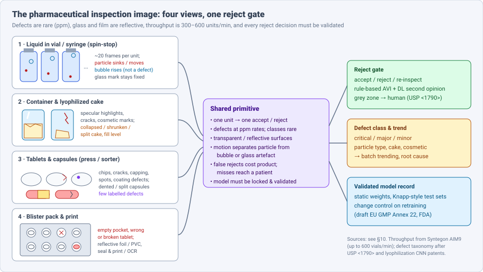
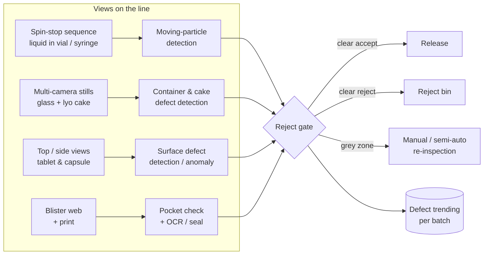
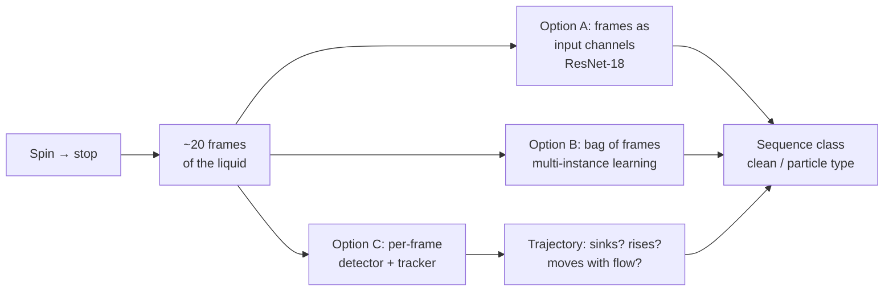
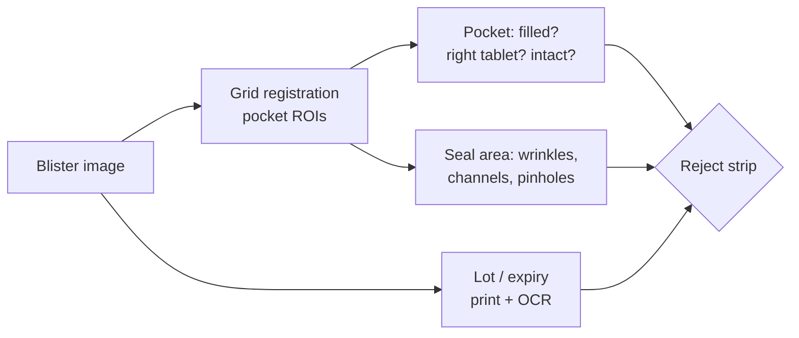
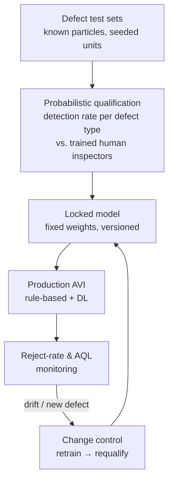

# Dense Object Detection & Classification — Recent Advances

*Compiled 2026-Nov-01 (America/Los_Angeles).*

Next installment in the running CV-updates log. Earlier entries:
[Apr-30](../2026-Apr-30/2026-Apr-30_CV_updates.md),
[May-01](../2026-May-01/2026-May-01_CV_updates.md),
[May-02](../2026-May-02/2026-May-02_CV_updates.md),
[May-04](../2026-May-04/2026-May-04_CV_updates.md),
[May-05](../2026-May-05/2026-May-05_CV_updates.md),
[May-07](../2026-May-07/2026-May-07_CV_updates.md),
[May-08](../2026-May-08/2026-May-08_CV_updates.md),
[May-15](../2026-May-15/2026-May-15_CV_updates.md),
[May-16](../2026-May-16/2026-May-16_CV_updates.md),
[May-17](../2026-May-17/2026-May-17_CV_updates.md),
[Jun-09](../2026-Jun-09/2026-Jun-09_CV_updates.md),
[Jun-10](../2026-Jun-10/2026-Jun-10_CV_updates.md),
[Jun-12](../2026-Jun-12/2026-Jun-12_CV_updates.md),
[Jun-15](../2026-Jun-15/2026-Jun-15_CV_updates.md),
[Jun-16](../2026-Jun-16/2026-Jun-16_CV_updates.md),
[Jun-17](../2026-Jun-17/2026-Jun-17_CV_updates.md),
[Jun-19](../2026-Jun-19/2026-Jun-19_CV_updates.md),
[Jun-21](../2026-Jun-21/2026-Jun-21_CV_updates.md),
[Jun-22](../2026-Jun-22/2026-Jun-22_CV_updates.md),
[Jun-23](../2026-Jun-23/2026-Jun-23_CV_updates.md),
[Jun-24](../2026-Jun-24/2026-Jun-24_CV_updates.md),
[Jun-25](../2026-Jun-25/2026-Jun-25_CV_updates.md),
[Jun-27](../2026-Jun-27/2026-Jun-27_CV_updates.md),
[Jun-29](../2026-Jun-29/2026-Jun-29_CV_updates.md),
[Jun-30](../2026-Jun-30/2026-Jun-30_CV_updates.md),
[Jul-04](../2026-Jul-04/2026-Jul-04_CV_updates.md),
[Jul-07](../2026-Jul-07/2026-Jul-07_CV_updates.md),
[Jul-08](../2026-Jul-08/2026-Jul-08_CV_updates.md),
[Jul-10](../2026-Jul-10/2026-Jul-10_CV_updates.md),
[Jul-15](../2026-Jul-15/2026-Jul-15_CV_updates.md),
[Jul-17](../2026-Jul-17/2026-Jul-17_CV_updates.md),
[Jul-18](../2026-Jul-18/2026-Jul-18_CV_updates.md),
[Jul-21](../2026-Jul-21/2026-Jul-21_CV_updates.md),
[Jul-22](../2026-Jul-22/2026-Jul-22_CV_updates.md),
[Jul-24](../2026-Jul-24/2026-Jul-24_CV_updates.md),
[Jul-26](../2026-Jul-26/2026-Jul-26_CV_updates.md),
[Jul-27](../2026-Jul-27/2026-Jul-27_CV_updates.md),
[Jul-30](../2026-Jul-30/2026-Jul-30_CV_updates.md),
[Aug-01](../2026-Aug-01/2026-Aug-01_CV_updates.md),
[Aug-02](../2026-Aug-02/2026-Aug-02_CV_updates.md),
[Aug-04](../2026-Aug-04/2026-Aug-04_CV_updates.md),
[Aug-07](../2026-Aug-07/2026-Aug-07_CV_updates.md),
[Aug-10](../2026-Aug-10/2026-Aug-10_CV_updates.md),
[Aug-11](../2026-Aug-11/2026-Aug-11_CV_updates.md),
[Aug-13](../2026-Aug-13/2026-Aug-13_CV_updates.md),
[Aug-15](../2026-Aug-15/2026-Aug-15_CV_updates.md),
[Aug-16](../2026-Aug-16/2026-Aug-16_CV_updates.md),
[Aug-18](../2026-Aug-18/2026-Aug-18_CV_updates.md),
[Aug-19](../2026-Aug-19/2026-Aug-19_CV_updates.md),
[Aug-21](../2026-Aug-21/2026-Aug-21_CV_updates.md),
[Aug-22](../2026-Aug-22/2026-Aug-22_CV_updates.md),
[Aug-24](../2026-Aug-24/2026-Aug-24_CV_updates.md),
[Aug-26](../2026-Aug-26/2026-Aug-26_CV_updates.md),
[Aug-29](../2026-Aug-29/2026-Aug-29_CV_updates.md),
[Sep-01](../2026-Sep-01/2026-Sep-01_CV_updates.md),
[Sep-20](../2026-Sep-20/2026-Sep-20_CV_updates.md),
[Sep-23](../2026-Sep-23/2026-Sep-23_CV_updates.md),
[Sep-24](../2026-Sep-24/2026-Sep-24_CV_updates.md),
[Sep-25](../2026-Sep-25/2026-Sep-25_CV_updates.md),
[Sep-26](../2026-Sep-26/2026-Sep-26_CV_updates.md),
[Sep-29](../2026-Sep-29/2026-Sep-29_CV_updates.md),
[Sep-30](../2026-Sep-30/2026-Sep-30_CV_updates.md),
[Oct-01](../2026-Oct-01/2026-Oct-01_CV_updates.md),
[Oct-02](../2026-Oct-02/2026-Oct-02_CV_updates.md),
[Oct-03](../2026-Oct-03/2026-Oct-03_CV_updates.md),
[Oct-04](../2026-Oct-04/2026-Oct-04_CV_updates.md),
[Oct-05](../2026-Oct-05/2026-Oct-05_CV_updates.md),
[Oct-06](../2026-Oct-06/2026-Oct-06_CV_updates.md),
[Oct-07](../2026-Oct-07/2026-Oct-07_CV_updates.md),
[Oct-08](../2026-Oct-08/2026-Oct-08_CV_updates.md),
[Oct-09](../2026-Oct-09/2026-Oct-09_CV_updates.md),
[Oct-10](../2026-Oct-10/2026-Oct-10_CV_updates.md),
[Oct-11](../2026-Oct-11/2026-Oct-11_CV_updates.md),
[Oct-12](../2026-Oct-12/2026-Oct-12_CV_updates.md),
[Oct-13](../2026-Oct-13/2026-Oct-13_CV_updates.md),
[Oct-14](../2026-Oct-14/2026-Oct-14_CV_updates.md),
[Oct-15](../2026-Oct-15/2026-Oct-15_CV_updates.md),
[Oct-16](../2026-Oct-16/2026-Oct-16_CV_updates.md),
[Oct-17](../2026-Oct-17/2026-Oct-17_CV_updates.md),
[Oct-18](../2026-Oct-18/2026-Oct-18_CV_updates.md),
[Oct-19](../2026-Oct-19/2026-Oct-19_CV_updates.md),
[Oct-20](../2026-Oct-20/2026-Oct-20_CV_updates.md),
[Oct-21](../2026-Oct-21/2026-Oct-21_CV_updates.md),
[Oct-22](../2026-Oct-22/2026-Oct-22_CV_updates.md),
[Oct-23](../2026-Oct-23/2026-Oct-23_CV_updates.md),
[Oct-24](../2026-Oct-24/2026-Oct-24_CV_updates.md),
[Oct-25](../2026-Oct-25/2026-Oct-25_CV_updates.md),
[Oct-26](../2026-Oct-26/2026-Oct-26_CV_updates.md),
[Oct-27](../2026-Oct-27/2026-Oct-27_CV_updates.md),
[Oct-28](../2026-Oct-28/2026-Oct-28_CV_updates.md),
[Oct-29](../2026-Oct-29/2026-Oct-29_CV_updates.md),
[Oct-30](../2026-Oct-30/2026-Oct-30_CV_updates.md),
[Oct-31](../2026-Oct-31/2026-Oct-31_CV_updates.md).

The last five entries covered
[wood & timber](../2026-Oct-27/2026-Oct-27_CV_updates.md),
[tire](../2026-Oct-28/2026-Oct-28_CV_updates.md),
[metal powder-bed fusion](../2026-Oct-29/2026-Oct-29_CV_updates.md),
[food-processing](../2026-Oct-30/2026-Oct-30_CV_updates.md) and
[waste-sorting](../2026-Oct-31/2026-Oct-31_CV_updates.md) inspection.
This run takes the most regulated line in the series: the
**pharmaceutical inspection image**. That means the spin-stop image
sequence of an injectable in a vial or syringe, the glass container and
its freeze-dried (lyophilized) cake, the tablet or capsule leaving a
press, and the blister pack before it is cartoned.

---

## Table of contents

1. [Why this pass](#1--why-this-pass)
2. [The primitive: four views, one reject gate](#2--the-primitive-four-views-one-reject-gate)
3. [Particles in liquid: detection over an image sequence](#3--particles-in-liquid-detection-over-an-image-sequence)
4. [Glass containers and lyophilized cakes](#4--glass-containers-and-lyophilized-cakes)
5. [Tablets and capsules](#5--tablets-and-capsules)
6. [Blister packs](#6--blister-packs)
7. [After the plant: pill identification](#7--after-the-plant-pill-identification)
8. [The regulatory wrapper: what a validated detector must look like](#8--the-regulatory-wrapper-what-a-validated-detector-must-look-like)
9. [Open problems / what to watch](#9--open-problems--what-to-watch)
10. [Sources](#10--sources)

---

## 1 · Why this pass

Pharmaceutical inspection has not had its own entry. The archive touches
it twice: in-line terahertz measurement of tablet film-coating thickness
in the [THz entry](../2026-Aug-11/2026-Aug-11_CV_updates.md), and the
MVTec AD `capsule` / `pill` categories that appear in several anomaly
detection sections (for example
[May-08](../2026-May-08/2026-May-08_CV_updates.md)). Searching the archive
for *parenteral*, *blister*, *lyophilized*, *USP 1790* and *Annex 22*
returns nothing.

What makes it a distinct primitive:

- **The decision is per unit, not per box.** The product of a detector
  here is one bit per vial or tablet: accept or reject. Localisation
  matters only because it explains the decision.
- **The hardest "objects" are moving dots in a liquid.** A 50–200 µm
  particle in a solution is visible only when it moves; a bubble or a
  scratch on the glass looks the same in one frame. So detection is over a
  short **image sequence** (spin the container, stop it, film the liquid)
  ([Cognex, particulate inspection](https://www.cognex.com/industries/pharmaceuticals-medical/vial-vaccine/primary-packaging/particulate-matter-inspection)).
- **False rejects are the main economic problem.** Rule-based automated
  visual inspection (AVI) can reject up to ~20% good units by some
  estimates, because it cannot tell bubbles and glare from defects
  ([Amgen at ISPE Aseptic 2025, via Pharmaceutical Online](https://www.pharmaceuticalonline.com/doc/amgen-s-deep-learning-approach-to-vial-inspection-0001)).
- **Defects are rare and there are no public datasets.** Defect rates are
  in parts per million. A patent on lyophilized-cake inspection notes that
  building a full defect library from production rejects "may take years"
  ([US11263738](https://image-ppubs.uspto.gov/dirsearch-public/print/downloadPdf/11263738)).
- **The model is a regulated device.** USP <790>/<1790>, the FDA draft
  guidance on visible particulates and the draft EU GMP Annex 22 (AI)
  together decide what kind of detector is allowed on the line (§8).

---

## 2 · The primitive: four views, one reject gate

**Public data, by what it keeps.** There is no public parenteral-liquid or
lyophilized-cake benchmark. What exists:

| Dataset | View | What it is | Caveat |
|---|---|---|---|
| Rosati et al. vial sequences ([ICPR 2024](https://iris.unimore.it/handle/11380/1350788)) | rotating liquid vials, image sequences | 2,426 sequences, 46,094 images, 5 classes, labelled per sequence | release status not confirmed; 19 vs. 20 frames per sequence differs between abstract and text |
| PharmaBlister ([Int. J. Comput. Intell. Syst., 2025](https://link.springer.com/article/10.1007/s44196-025-00986-2)) | blister packs, Basler industrial camera | standardised defect labels | size and licence not verified here |
| MVTec AD `capsule`, `pill` ([MVTec](https://www.mvtec.com/company/research/datasets/mvtec-ad)) | top view, single unit | normal-only training, pixel masks for test defects | saturated; lab lighting |
| VisA `capsules` ([Zou et al., ECCV 2022](https://arxiv.org/abs/2207.14315)) | many capsules per image | multi-instance anomaly segmentation | not a production line |
| MEDISEG ([arXiv 2603.10825](https://arxiv.org/abs/2603.10825); [Figshare](https://figshare.com/articles/dataset/MEDISEG/28574786)) | pills in hands, trays, dosette boxes | 8,262 images, 32 pill types, instance masks, CC BY 4.0 | identification, not defects |
| ePillID ([CVPR-W 2020](https://arxiv.org/abs/2005.14288)), VAIPE ([arXiv 2303.09782](https://arxiv.org/abs/2303.09782)) | consumer photos | fine-grained ID; VAIPE ≈10k multi-pill images | identification, not defects |

---

## 3 · Particles in liquid: detection over an image sequence

The physics is the method. Spin the container, stop it, and film the
liquid while it still swirls. Particles follow the flow and sink; bubbles
rise; glass marks stay fixed. A single-frame detector cannot use this, so
the 2024–26 work is about **sequence models**.

- **Frames as channels vs. multi-instance learning.** Rosati, Marchesini,
  Lumetti et al. (Modena / Reggio Emilia, ICPR 2024) built 2,426
  sequences (46,094 images) of rotating vials in five classes. They
  compare a ResNet-18 that takes all frames as input channels with a
  multi-instance learning (MIL, DSMIL-style) model that treats each
  sequence as a bag of frames. MIL fits the label: the sequence is
  defective if *any* frame shows the particle
  ([UNIMORE record](https://iris.unimore.it/handle/11380/1350788);
  [PDF](https://iris.unimore.it/bitstream/11380/1350788/2/01375.pdf);
  numbers not retrievable in this run).
- **Flexible bags.** A real-time deep-learning system for foreign
  particles inside flexible IV fluid bags reports >98% accuracy
  ([Appl. Sci. 14:7960, 2024](https://www.mdpi.com/2076-3417/14/17/7960)).
  Bags deform, so the "fixed glass mark" cue is weaker than in vials.
- **Bubble masking as a product feature.** Syntegon's AIM9 (Feb 2026)
  sells a *bubble masking tool* and optional deep learning next to its
  rule-based static-division (SD) sensors
  ([Syntegon](https://www.syntegon.com/news/syntegon-launches-aim9-high-speed-inspection-platform/)).
  MVTec describes a pharma customer using DL semantic segmentation to
  separate bubbles from contaminants
  ([MVTec success story](https://www.mvtec.com/application-areas/success-stories/ai-powered-machine-vision-automates-quality-inspection-in-the-pharmaceutical-industry)).
- **What DL adds in production.** At an Amgen syringe line (Juncos,
  Puerto Rico), Syntegon reports +70% particle detection and −60% false
  detections, averaged at one station
  ([Syntegon press release](https://www.syntegon.com/press/syntegon-validates-first-ai-equipped-visual-inspection-system);
  [Design News](https://www.designnews.com/automation/amgen-invests-ai-assisted-packaging-inspection)).
  Amgen's 2025 ISPE talk frames DL as a **second opinion on top of the
  rule-based algorithms**, not a replacement
  ([Pharmaceutical Online](https://www.pharmaceuticalonline.com/doc/amgen-s-deep-learning-approach-to-vial-inspection-0001)).
- **Adjacent method work.** Bubble tracking in two-phase flow
  (Mask R-CNN + SORT,
  [BubbleID, arXiv 2405.07994](https://arxiv.org/abs/2405.07994);
  depth-aware single-camera tracking,
  [arXiv 2601.21175](https://arxiv.org/abs/2601.21175)) and droplet
  tracking (YOLO + DeepSORT,
  [DropTrack, arXiv 2205.02568](https://arxiv.org/abs/2205.02568)) are the
  closest open code for a detect-then-track particle pipeline. None was
  tested on vials.

**Reading.** The field has the right inductive bias (sequence, motion) but
no open benchmark. The [X-ray transmission](../2026-Jul-15/2026-Jul-15_CV_updates.md)
and [cryo-EM](../2026-Sep-01/2026-Sep-01_CV_updates.md) entries faced the
same "tiny, low-contrast blob vs. artefact" problem and solved it with
large public sets; parenteral inspection has none.

---

## 4 · Glass containers and lyophilized cakes

The second view is the container itself: cracks, scratches, stones in
the glass, closure and crimp defects, fill level and, for freeze-dried
products, the **cake** (collapsed, shrunken, slanted, split or melted
back).

- **SAF-YOLO (Jiang et al., *Electronics* 14:4526, Nov 2025).** A YOLOv11
  variant for lyophilized vials with spectrum- and attention-fusion
  modules, built because transparent, reflective glass gives strong
  highlights and low-contrast defects; +2.6 mAP@50 over YOLOv11 across
  typical defect classes
  ([MDPI](https://www.mdpi.com/2079-9292/14/22/4526)).
- **The CNN patent family.** US11263738 / US11810287 describe CNN
  classification of lyophilized-cake and fill-volume defects, separating
  *critical* from *major* and *minor* defects, trained on 192 vials (half
  defective) × 112 images per vial — i.e. many views of few units
  ([US11810287, Google Patents](https://patents.google.com/patent/US11810287);
  [US11263738](https://image-ppubs.uspto.gov/dirsearch-public/print/downloadPdf/11263738)).
- **Data scarcity is the constant.** An MIT M.Eng. thesis comparing VGG16
  and ResNet50 on vial defects names small, imbalanced data as the main
  limit ([DSpace@MIT](https://dspace.mit.edu/handle/1721.1/140185)), and a
  2025 column on lyophilized AVI lists cake variability as the reason
  rule-based systems over-reject
  ([Pharmaceutical Online](https://www.pharmaceuticalonline.com/doc/addressing-challenges-in-automated-visual-inspection-of-lyophilized-vials-0001)).

**Reading.** The cake is a natural-texture object (like the
[wood](../2026-Oct-27/2026-Oct-27_CV_updates.md) and
[textile](../2026-Oct-23/2026-Oct-23_CV_updates.md) entries): normal
variation is large and defects are defined by a written taxonomy. That
argues for anomaly detection plus a small supervised head, as in §5.

---

## 5 · Tablets and capsules

- **Unsupervised, diffusion-based (DTDD, *Sensors* 25:5254, Aug 2025).**
  Trains on normal tablets only; an Assisted Reconstruction network feeds
  the original image into the diffusion denoiser so that small scratches
  and pits are not "healed away" in reconstruction
  ([MDPI](https://www.mdpi.com/1424-8220/25/17/5254/xml);
  [PMC](https://pmc.ncbi.nlm.nih.gov/articles/PMC12431306)). This is the
  same reconstruction-error idea as the MVTec AD baselines, adapted to
  very small defects.
- **Predicting defects before they are visible.** Kim & Han
  (*Pharmaceutics* 17:406, Mar 2025) build a tablet press that sorts
  tablets in real time from compression force, ejection force and speed —
  99.43% sorting accuracy, 93.7% defect detection (random forest, AUC
  0.895). It uses *process signals, not images*; the authors say no DL
  study on tableting defects existed because data were too limited
  ([MDPI](https://www.mdpi.com/1999-4923/17/4/406);
  [review report](https://www.mdpi.com/1999-4923/17/4/406/review_report)).
  Read it as a complement: the press can flag a likely defect for the
  camera to confirm.
- **Benchmarks.** MVTec AD `capsule` and `pill` and VisA `capsules`
  remain the public proxies (see the
  [May-08 entry](../2026-May-08/2026-May-08_CV_updates.md) for their
  saturation). Vendor tools (Cognex, Overview.ai) sell few-shot
  supervised DL for tablets
  ([Cognex](https://www.cognex.com/industries/pharmaceuticals-medical/tablet-capsule-manufacturing/inspection);
  [Overview.ai](https://www.overview.ai/blog/tablet-visual-inspection-ai)).
- **Below the surface.** Coating thickness and internal defects need
  other sensors: in-line THz pulsed imaging (see the
  [THz entry](../2026-Aug-11/2026-Aug-11_CV_updates.md)) and X-ray µCT with
  CNN segmentation for internal tablet defects
  ([Comet Dragonfly index](https://dragonfly.comet.tech/en/publication-index/application-of-deep-learning-convolutional-neural-networks-for-internal-tablet-defect-detection-hig)).

---

## 6 · Blister packs

The blister is a *dense, regular grid* of pockets, so detection is closer
to the [retail shelf](../2026-Oct-07/2026-Oct-07_CV_updates.md) problem
(is every slot filled with the right item?) than to free-form defect
search. The difficulty is the transparent, reflective forming film and
the foil lid.

- **PharmaBlister + DGDFF (2025).** A new dataset taken with an
  industrial Basler camera and a detector that fuses multi-level features
  with an uncertainty estimate; reported 99.4% mAP on PharmaBlister and
  97.2% on MVTec AD. The authors also warn that reflections and small data
  limit accuracy
  ([Springer, s44196-025-00986-2](https://link.springer.com/article/10.1007/s44196-025-00986-2)).
- **YOLOv8 on packaging lines.** A 2024 *Scientific Reports* paper on
  real-time defect detection in pharmaceutical packaging is the usual
  supervised baseline
  ([PMC11322668](https://www.ncbi.nlm.nih.gov/pmc/articles/PMC11322668/)).
- **Per-pocket autoencoders.** A recent patent trains an encoder–decoder
  on good pockets only and rejects pockets with high reconstruction error
  — anomaly detection, applied per grid cell
  ([US12152996](https://image-ppubs.uspto.gov/dirsearch-public/print/downloadPdf/12152996)).
- **Commercial.** ACG QualiShield BS series, Cognex blister tools and
  others sell DL blister inspection; claims (few-shot training, counting
  and binning) are vendor-reported
  ([ACG](https://www.acg-world.com/inspection-technologies/vision-based-packaging-inspection/blister-inspection/qualishield-bs50);
  [Cognex](https://www.cognex.com/industries/pharmaceuticals-medical/tablet-capsule-manufacturing/blister-pack-quality-check)).

---

## 7 · After the plant: pill identification

Outside the factory, the same objects become a **fine-grained,
open-set recognition** problem: which drug is this, in a hand, a tray or a
dosette box?

- **MEDISEG (Mar 2026).** 8,262 images, 32 pill types, instance masks
  from single pills to cluttered dosette boxes; YOLOv8/YOLOv9 reach 99.5
  mAP@50 on a 3-pill subset but 80.1 on all 32 pills — clutter and
  look-alike pills are the gap
  ([arXiv 2603.10825](https://arxiv.org/abs/2603.10825);
  [Figshare](https://figshare.com/articles/dataset/MEDISEG/28574786)).
- **Few-shot under domain shift.** A companion study trains on MEDISEG
  and CURE and tests few-shot recognition under visual shift
  ([arXiv 2603.10833](https://arxiv.org/abs/2603.10833)).
- **Older baselines.** ePillID (13k images, ~9.8k appearance classes,
  low-shot) and VAIPE (multi-pill, with a GNN that uses the prescription
  as context) ([ePillID](https://arxiv.org/abs/2005.14288);
  [VAIPE](https://arxiv.org/abs/2303.09782)).
- **Falsified medicines.** Peer-reviewed 2025 work still leans on
  portable NIR spectroscopy + classical ML rather than images; smartphone
  deep-learning detectors exist mainly as preprints and products
  ([arXiv 2410.05969](https://arxiv.org/abs/2410.05969);
  [UNIGE archive](https://archive-ouverte.unige.ch/unige:189863)).

---

## 8 · The regulatory wrapper: what a validated detector must look like

This is where the primitive differs most from the rest of the series.

- **USP <790> / <1790>** set the expectation of 100% inspection and
  probabilistic, defect-specific detection rates, with automated systems
  qualified against trained human inspectors; the **FDA draft guidance**
  (Dec 2021, still a draft) takes a risk-based view and allows manual,
  semi-automated or automated inspection
  ([FDA draft](https://fda.gov/media/154868/download);
  [GMP-Compliance summary](https://www.gmp-compliance.org/gmp-news/fda-publishes-draft-guidance-on-visual-inspection-of-parenterals);
  [USP comments](https://www.usp.org/sites/default/files/usp/document/public-policy/comment-letter/USP-Comments-to-FDA-on-draft-guidance-of-Inspection-of-Injectable-Products-for-Visible-Particulates.pdf)).
- **Draft EU GMP Annex 22 (AI), consulted Jul–Oct 2025.** Covers only
  **static** models in critical GMP use; continuously learning and
  probabilistic-output models and generative AI are excluded from critical
  uses; outsourcing the model does not transfer responsibility.
  Commentators read an accept/reject inspection model as a critical use.
  Finalisation is expected in 2026; this run could not confirm its status
  ([European Pharmaceutical Review](https://www.europeanpharmaceuticalreview.com/what-annex-22-spells-for-ai-in-gmp-manufacturing/2135686.article);
  [Mondaq](https://www.mondaq.com/eu-consults-on-new-gmp-rules-for-ai-in-pharma-manufacturing/1650932);
  [PharmOut](https://www.pharmout.net/annex-22-artificial-intelligence/)).
- **What vendors ship as a result.** Körber's **B.R.AI.N** (merging
  InspectifAI and Eject-X) is a supervised DL model running on or beside
  the inspection machine, with explainability tools and claimed false-
  reject reductions that vary by page (up to 90–99%)
  ([Körber press](https://www.koerber-pharma.com/en/press/detail/brain-ai-powered-inspection-for-efficient-pharmaceutical-production);
  [product page](https://www.koerber-pharma.com/en/solutions/inspection/automatic-inspection/ai-based-inspection)).
  Syntegon's AIM9 (up to 600 vials/min, 2–250 ml, integrated container-
  closure integrity testing) keeps DL as an option
  ([Syntegon](https://www.syntegon.com/news/syntegon-launches-aim9-high-speed-inspection-platform/);
  [Pharmaceutical Online](https://www.pharmaceuticalonline.com/doc/syntegon-launches-aim-high-speed-inspection-platform-0001)).

**Reading.** Three consequences for model design: (1) prefer architectures
whose output is deterministic for a given input (no test-time sampling,
which rules out some diffusion-based anomaly scores unless seeds are
fixed); (2) report **per-defect-class detection probability at a fixed
false-reject rate**, not mAP; (3) a foundation model is useful as a
labelling or pseudo-labelling teacher (as in the
[waste entry](../2026-Oct-31/2026-Oct-31_CV_updates.md)), but the deployed
model must be a frozen, versioned artefact.

---

## 9 · Open problems / what to watch

1. **No public parenteral benchmark.** A released spin-stop sequence set
   with particle, bubble and glass-artefact labels would do for this field
   what ZeroWaste did for MRFs (§3).
2. **Sequence detection.** MIL and frames-as-channels are early;
   video transformers and detect-and-track pipelines are untested on vials.
3. **Metrics that match USP <1790>.** Detection probability per defect type
   and size, at a fixed false-reject budget, with confidence intervals.
4. **Determinism vs. modern anomaly detectors.** Diffusion and other
   stochastic scorers (§5) must be made reproducible to fit a static-model
   rule (§8).
5. **Plastic, opaque and cell-therapy containers.** Translucent syringes,
   bags and opaque products break the motion cue; PDA's 2025 forum ran a
   session on exactly this
   ([PDA agenda](https://pda.org/rest-api/event-agenda/pda-visual-inspection-forum-2025)).
6. **Closing the loop with the process.** Press signals (§5) and container
   integrity data (AIM9) as priors for the image model.
7. **Watch:** final Annex 22 text; any FDA final guidance on visible
   particulates; a release of the Modena vial dataset; independent
   validation of vendor false-reject claims.

---

## 10 · Sources

### Particles in liquid (§3)
- Rosati, Marchesini, Lumetti et al., Identifying Impurities in Liquids of Pharmaceutical Vials (ICPR 2024) — https://iris.unimore.it/handle/11380/1350788 — https://iris.unimore.it/bitstream/11380/1350788/2/01375.pdf
- Deep learning real-time inspection of foreign particles in flexible fluid bags (Appl. Sci. 14:7960) — https://www.mdpi.com/2076-3417/14/17/7960
- Cognex, particulate matter inspection — https://www.cognex.com/industries/pharmaceuticals-medical/vial-vaccine/primary-packaging/particulate-matter-inspection
- MVTec pharma success story — https://www.mvtec.com/application-areas/success-stories/ai-powered-machine-vision-automates-quality-inspection-in-the-pharmaceutical-industry
- Amgen's deep learning approach to vial inspection (Pharmaceutical Online, Mar 2025) — https://www.pharmaceuticalonline.com/doc/amgen-s-deep-learning-approach-to-vial-inspection-0001
- Syntegon validates first AI-equipped visual inspection system — https://www.syntegon.com/press/syntegon-validates-first-ai-equipped-visual-inspection-system
- Amgen invests in AI-assisted packaging inspection (Design News) — https://www.designnews.com/automation/amgen-invests-ai-assisted-packaging-inspection
- BubbleID, arXiv 2405.07994 — https://arxiv.org/abs/2405.07994
- Depth-aware bubble characterisation, arXiv 2601.21175 — https://arxiv.org/abs/2601.21175
- DropTrack, arXiv 2205.02568 — https://arxiv.org/abs/2205.02568

### Containers and lyophilized cakes (§4)
- Jiang et al., An Improved YOLOv11-Based Method for Defect Detection in Lyophilized Vial (Electronics 14:4526) — https://www.mdpi.com/2079-9292/14/22/4526
- Defect detection in lyophilized drug products with CNNs (US11810287 / US11263738) — https://patents.google.com/patent/US11810287 — https://image-ppubs.uspto.gov/dirsearch-public/print/downloadPdf/11263738
- MIT M.Eng. thesis on vial defect classification — https://dspace.mit.edu/handle/1721.1/140185
- Addressing challenges in AVI of lyophilized vials (Pharmaceutical Online, Mar 2025) — https://www.pharmaceuticalonline.com/doc/addressing-challenges-in-automated-visual-inspection-of-lyophilized-vials-0001

### Tablets and capsules (§5)
- Zhang et al., Unsupervised Tablet Defect Detection Method Based on Diffusion Model (Sensors 25:5254) — https://www.mdpi.com/1424-8220/25/17/5254/xml — https://pmc.ncbi.nlm.nih.gov/articles/PMC12431306
- Kim & Han, Intelligent tablet press for in-line detection of defective tablets (Pharmaceutics 17:406) — https://www.mdpi.com/1999-4923/17/4/406 — https://www.mdpi.com/1999-4923/17/4/406/review_report
- MVTec AD — https://www.mvtec.com/company/research/datasets/mvtec-ad
- VisA (SPot-the-Difference), arXiv 2207.14315 — https://arxiv.org/abs/2207.14315
- Cognex tablet & capsule inspection — https://www.cognex.com/industries/pharmaceuticals-medical/tablet-capsule-manufacturing/inspection
- Overview.ai tablet inspection — https://www.overview.ai/blog/tablet-visual-inspection-ai
- CNN for internal tablet defects (Dragonfly publication index) — https://dragonfly.comet.tech/en/publication-index/application-of-deep-learning-convolutional-neural-networks-for-internal-tablet-defect-detection-hig

### Blister packs (§6)
- PharmaBlister / DGDFF (Springer, 2025) — https://link.springer.com/article/10.1007/s44196-025-00986-2
- Real-time visual intelligence for defect detection in pharmaceutical packaging (Sci. Rep. 2024) — https://www.ncbi.nlm.nih.gov/pmc/articles/PMC11322668/
- Blister inspection device patent (US12152996) — https://image-ppubs.uspto.gov/dirsearch-public/print/downloadPdf/12152996
- ACG QualiShield BS — https://www.acg-world.com/inspection-technologies/vision-based-packaging-inspection/blister-inspection/qualishield-bs50
- Cognex blister pack quality check — https://www.cognex.com/industries/pharmaceuticals-medical/tablet-capsule-manufacturing/blister-pack-quality-check

### Pill identification (§7)
- MEDISEG, arXiv 2603.10825 — https://arxiv.org/abs/2603.10825 — https://figshare.com/articles/dataset/MEDISEG/28574786
- Few-shot pill recognition under visual domain shift, arXiv 2603.10833 — https://arxiv.org/abs/2603.10833
- ePillID, arXiv 2005.14288 — https://arxiv.org/abs/2005.14288
- VAIPE multi-pill detection, arXiv 2303.09782 — https://arxiv.org/abs/2303.09782
- Counterfeit products from smartphone images, arXiv 2410.05969 — https://arxiv.org/abs/2410.05969
- UNIGE archive (falsified medicines) — https://archive-ouverte.unige.ch/unige:189863

### Regulation and products (§8)
- FDA draft guidance, Inspection of Injectable Products for Visible Particulates (2021) — https://fda.gov/media/154868/download
- GMP-Compliance summary of the FDA draft — https://www.gmp-compliance.org/gmp-news/fda-publishes-draft-guidance-on-visual-inspection-of-parenterals
- USP comments to FDA — https://www.usp.org/sites/default/files/usp/document/public-policy/comment-letter/USP-Comments-to-FDA-on-draft-guidance-of-Inspection-of-Injectable-Products-for-Visible-Particulates.pdf
- Draft EU GMP Annex 22 commentary — https://www.europeanpharmaceuticalreview.com/what-annex-22-spells-for-ai-in-gmp-manufacturing/2135686.article — https://www.mondaq.com/eu-consults-on-new-gmp-rules-for-ai-in-pharma-manufacturing/1650932 — https://www.pharmout.net/annex-22-artificial-intelligence/
- Körber B.R.AI.N — https://www.koerber-pharma.com/en/press/detail/brain-ai-powered-inspection-for-efficient-pharmaceutical-production — https://www.koerber-pharma.com/en/solutions/inspection/automatic-inspection/ai-based-inspection
- Syntegon AIM9 — https://www.syntegon.com/news/syntegon-launches-aim9-high-speed-inspection-platform/ — https://www.pharmaceuticalonline.com/doc/syntegon-launches-aim-high-speed-inspection-platform-0001
- PDA Visual Inspection Forum 2025 agenda — https://pda.org/rest-api/event-agenda/pda-visual-inspection-forum-2025

*Research note: direct page fetches to iris.unimore.it and ncbi.nlm.nih.gov
failed (hosts not reachable under this session's network policy), so
figures come from search-indexed abstracts, publisher listings, vendor
pages and trade press. The Modena vial paper's accuracy numbers, the
PharmaBlister dataset size and the final status of Annex 22 were not
retrievable. A cited "DDSCNet" vial result from a secondary article could
not be traced to a primary source and is omitted. Vendor figures
(Syntegon, Körber, ACG, Cognex) are unaudited.*
