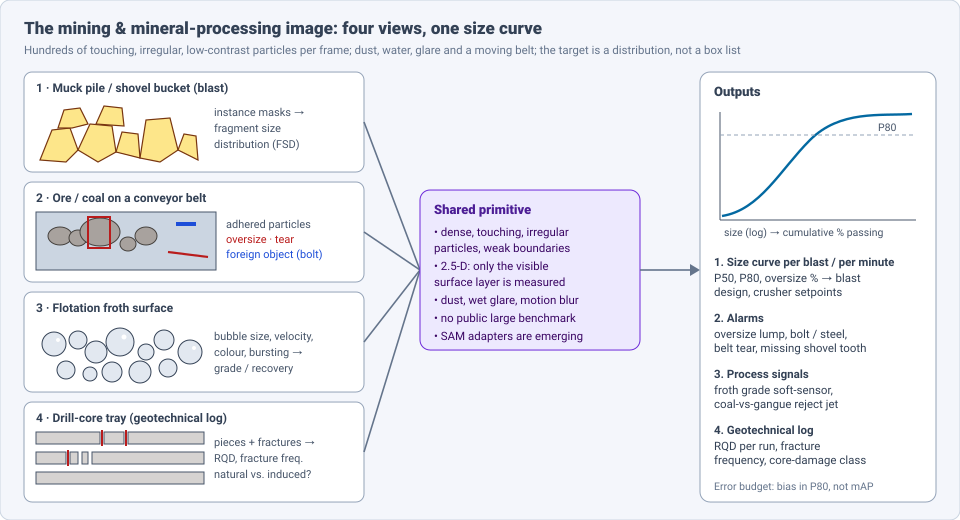
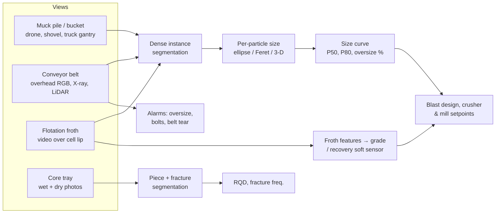
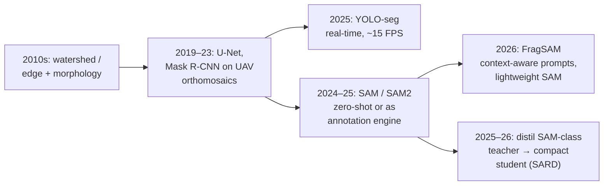
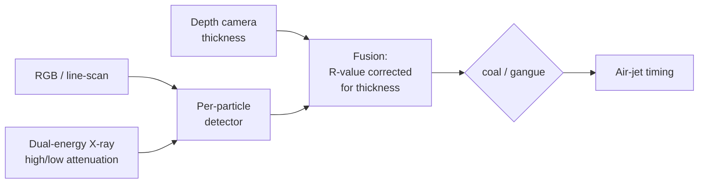
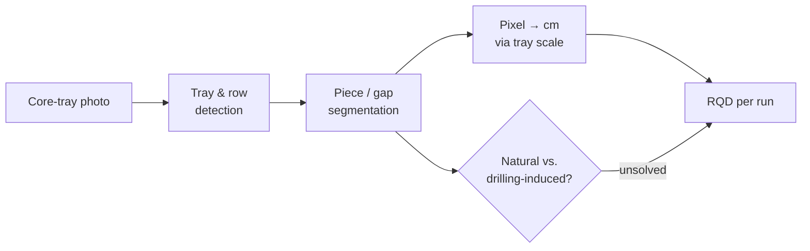

# Dense Object Detection & Classification — Recent Advances

*Compiled 2026-Nov-02 (America/Los_Angeles).*

Next installment in the running CV-updates log. Earlier entries:
[Apr-30](../2026-Apr-30/2026-Apr-30_CV_updates.md),
[May-01](../2026-May-01/2026-May-01_CV_updates.md),
[May-02](../2026-May-02/2026-May-02_CV_updates.md),
[May-04](../2026-May-04/2026-May-04_CV_updates.md),
[May-05](../2026-May-05/2026-May-05_CV_updates.md),
[May-07](../2026-May-07/2026-May-07_CV_updates.md),
[May-08](../2026-May-08/2026-May-08_CV_updates.md),
[May-15](../2026-May-15/2026-May-15_CV_updates.md),
[May-16](../2026-May-16/2026-May-16_CV_updates.md),
[May-17](../2026-May-17/2026-May-17_CV_updates.md),
[Jun-09](../2026-Jun-09/2026-Jun-09_CV_updates.md),
[Jun-10](../2026-Jun-10/2026-Jun-10_CV_updates.md),
[Jun-12](../2026-Jun-12/2026-Jun-12_CV_updates.md),
[Jun-15](../2026-Jun-15/2026-Jun-15_CV_updates.md),
[Jun-16](../2026-Jun-16/2026-Jun-16_CV_updates.md),
[Jun-17](../2026-Jun-17/2026-Jun-17_CV_updates.md),
[Jun-19](../2026-Jun-19/2026-Jun-19_CV_updates.md),
[Jun-21](../2026-Jun-21/2026-Jun-21_CV_updates.md),
[Jun-22](../2026-Jun-22/2026-Jun-22_CV_updates.md),
[Jun-23](../2026-Jun-23/2026-Jun-23_CV_updates.md),
[Jun-24](../2026-Jun-24/2026-Jun-24_CV_updates.md),
[Jun-25](../2026-Jun-25/2026-Jun-25_CV_updates.md),
[Jun-27](../2026-Jun-27/2026-Jun-27_CV_updates.md),
[Jun-29](../2026-Jun-29/2026-Jun-29_CV_updates.md),
[Jun-30](../2026-Jun-30/2026-Jun-30_CV_updates.md),
[Jul-04](../2026-Jul-04/2026-Jul-04_CV_updates.md),
[Jul-07](../2026-Jul-07/2026-Jul-07_CV_updates.md),
[Jul-08](../2026-Jul-08/2026-Jul-08_CV_updates.md),
[Jul-10](../2026-Jul-10/2026-Jul-10_CV_updates.md),
[Jul-15](../2026-Jul-15/2026-Jul-15_CV_updates.md),
[Jul-17](../2026-Jul-17/2026-Jul-17_CV_updates.md),
[Jul-18](../2026-Jul-18/2026-Jul-18_CV_updates.md),
[Jul-21](../2026-Jul-21/2026-Jul-21_CV_updates.md),
[Jul-22](../2026-Jul-22/2026-Jul-22_CV_updates.md),
[Jul-24](../2026-Jul-24/2026-Jul-24_CV_updates.md),
[Jul-26](../2026-Jul-26/2026-Jul-26_CV_updates.md),
[Jul-27](../2026-Jul-27/2026-Jul-27_CV_updates.md),
[Jul-30](../2026-Jul-30/2026-Jul-30_CV_updates.md),
[Aug-01](../2026-Aug-01/2026-Aug-01_CV_updates.md),
[Aug-02](../2026-Aug-02/2026-Aug-02_CV_updates.md),
[Aug-04](../2026-Aug-04/2026-Aug-04_CV_updates.md),
[Aug-07](../2026-Aug-07/2026-Aug-07_CV_updates.md),
[Aug-10](../2026-Aug-10/2026-Aug-10_CV_updates.md),
[Aug-11](../2026-Aug-11/2026-Aug-11_CV_updates.md),
[Aug-13](../2026-Aug-13/2026-Aug-13_CV_updates.md),
[Aug-15](../2026-Aug-15/2026-Aug-15_CV_updates.md),
[Aug-16](../2026-Aug-16/2026-Aug-16_CV_updates.md),
[Aug-18](../2026-Aug-18/2026-Aug-18_CV_updates.md),
[Aug-19](../2026-Aug-19/2026-Aug-19_CV_updates.md),
[Aug-21](../2026-Aug-21/2026-Aug-21_CV_updates.md),
[Aug-22](../2026-Aug-22/2026-Aug-22_CV_updates.md),
[Aug-24](../2026-Aug-24/2026-Aug-24_CV_updates.md),
[Aug-26](../2026-Aug-26/2026-Aug-26_CV_updates.md),
[Aug-29](../2026-Aug-29/2026-Aug-29_CV_updates.md),
[Sep-01](../2026-Sep-01/2026-Sep-01_CV_updates.md),
[Sep-20](../2026-Sep-20/2026-Sep-20_CV_updates.md),
[Sep-23](../2026-Sep-23/2026-Sep-23_CV_updates.md),
[Sep-24](../2026-Sep-24/2026-Sep-24_CV_updates.md),
[Sep-25](../2026-Sep-25/2026-Sep-25_CV_updates.md),
[Sep-26](../2026-Sep-26/2026-Sep-26_CV_updates.md),
[Sep-29](../2026-Sep-29/2026-Sep-29_CV_updates.md),
[Sep-30](../2026-Sep-30/2026-Sep-30_CV_updates.md),
[Oct-01](../2026-Oct-01/2026-Oct-01_CV_updates.md),
[Oct-02](../2026-Oct-02/2026-Oct-02_CV_updates.md),
[Oct-03](../2026-Oct-03/2026-Oct-03_CV_updates.md),
[Oct-04](../2026-Oct-04/2026-Oct-04_CV_updates.md),
[Oct-05](../2026-Oct-05/2026-Oct-05_CV_updates.md),
[Oct-06](../2026-Oct-06/2026-Oct-06_CV_updates.md),
[Oct-07](../2026-Oct-07/2026-Oct-07_CV_updates.md),
[Oct-08](../2026-Oct-08/2026-Oct-08_CV_updates.md),
[Oct-09](../2026-Oct-09/2026-Oct-09_CV_updates.md),
[Oct-10](../2026-Oct-10/2026-Oct-10_CV_updates.md),
[Oct-11](../2026-Oct-11/2026-Oct-11_CV_updates.md),
[Oct-12](../2026-Oct-12/2026-Oct-12_CV_updates.md),
[Oct-13](../2026-Oct-13/2026-Oct-13_CV_updates.md),
[Oct-14](../2026-Oct-14/2026-Oct-14_CV_updates.md),
[Oct-15](../2026-Oct-15/2026-Oct-15_CV_updates.md),
[Oct-16](../2026-Oct-16/2026-Oct-16_CV_updates.md),
[Oct-17](../2026-Oct-17/2026-Oct-17_CV_updates.md),
[Oct-18](../2026-Oct-18/2026-Oct-18_CV_updates.md),
[Oct-19](../2026-Oct-19/2026-Oct-19_CV_updates.md),
[Oct-20](../2026-Oct-20/2026-Oct-20_CV_updates.md),
[Oct-21](../2026-Oct-21/2026-Oct-21_CV_updates.md),
[Oct-22](../2026-Oct-22/2026-Oct-22_CV_updates.md),
[Oct-23](../2026-Oct-23/2026-Oct-23_CV_updates.md),
[Oct-24](../2026-Oct-24/2026-Oct-24_CV_updates.md),
[Oct-25](../2026-Oct-25/2026-Oct-25_CV_updates.md),
[Oct-26](../2026-Oct-26/2026-Oct-26_CV_updates.md),
[Oct-27](../2026-Oct-27/2026-Oct-27_CV_updates.md),
[Oct-28](../2026-Oct-28/2026-Oct-28_CV_updates.md),
[Oct-29](../2026-Oct-29/2026-Oct-29_CV_updates.md),
[Oct-30](../2026-Oct-30/2026-Oct-30_CV_updates.md),
[Oct-31](../2026-Oct-31/2026-Oct-31_CV_updates.md),
[Nov-01](../2026-Nov-01/2026-Nov-01_CV_updates.md).

The last five entries covered
[tire](../2026-Oct-28/2026-Oct-28_CV_updates.md),
[metal powder-bed fusion](../2026-Oct-29/2026-Oct-29_CV_updates.md),
[food-processing](../2026-Oct-30/2026-Oct-30_CV_updates.md),
[waste-sorting](../2026-Oct-31/2026-Oct-31_CV_updates.md) and
[pharmaceutical](../2026-Nov-01/2026-Nov-01_CV_updates.md) inspection.
This run moves upstream of every factory in the series, to the mine. It
covers the **mining & mineral-processing image**: the blasted muck pile and
the shovel bucket, ore and coal on a conveyor belt, the flotation-cell froth
surface, and the drill-core tray.

---

## Table of contents

1. [Why this pass](#1--why-this-pass)
2. [The primitive: four views, one size curve](#2--the-primitive-four-views-one-size-curve)
3. [Blast fragmentation: from watershed to SAM adapters](#3--blast-fragmentation-from-watershed-to-sam-adapters)
4. [The conveyor belt: adhered particles, oversize, foreign objects, tears](#4--the-conveyor-belt-adhered-particles-oversize-foreign-objects-tears)
5. [Coal vs. gangue: sorting at the particle level](#5--coal-vs-gangue-sorting-at-the-particle-level)
6. [Flotation froth: bubbles as a soft sensor](#6--flotation-froth-bubbles-as-a-soft-sensor)
7. [Drill core: fractures, RQD and zero-shot SAM](#7--drill-core-fractures-rqd-and-zero-shot-sam)
8. [Equipment health from the same cameras](#8--equipment-health-from-the-same-cameras)
9. [Evaluation: why mAP is the wrong number](#9--evaluation-why-map-is-the-wrong-number)
10. [Open problems / what to watch](#10--open-problems--what-to-watch)
11. [Sources](#11--sources)

---

## 1 · Why this pass

Searching the archive for *muck pile*, *flotation*, *gangue*, *RQD*,
*FragSAM* and *ParticleSAM* returns nothing. The closest entries are the
[waste-sorting](../2026-Oct-31/2026-Oct-31_CV_updates.md) belt (which shares
the conveyor geometry but sorts by material, not by size) and the
[GPR](../2026-Aug-10/2026-Aug-10_CV_updates.md) and
[seismic](../2026-Aug-15/2026-Aug-15_CV_updates.md) entries (which image the
ground before anyone digs).

What makes the mine image a distinct primitive:

- **The output is a distribution, not a list of boxes.** A blast engineer
  wants the cumulative size curve and its P50/P80 (the size that 50% / 80%
  of the material passes). Each mask matters only through its contribution
  to that curve.
- **The objects touch and look alike.** A muck pile or belt load is a packed
  field of grey, irregular rocks with weak edges. The classical failure is
  **over-segmenting large rocks and under-segmenting fines**, the same
  failure the froth literature reports for bubbles
  ([Minerals 15(12):1301, 2025](https://www.mdpi.com/2075-163X/15/12/1301/xml)).
- **Only the surface is visible.** A camera sees the top layer of a 3-D pile.
  Fines hide between and under large fragments, so a perfect 2-D
  segmentation still biases the size curve coarse.
- **The environment is hostile.** Dust, water spray, low light underground
  and fast belts blur images. Several 2025 coal-belt detectors add an
  image-restoration stage before detection for this reason
  ([CA-YOLOv8, JCAD 2025](https://www.jcad.cn/en/article/doi/10.3724/SP.J.1089.2023-00471)).
- **Public data is thin.** Most papers use self-collected sets. The only
  widely reused open fragment data are small Roboflow collections
  ([Yang, arXiv 2507.20126](https://arxiv.org/abs/2507.20126v1)).

---

## 2 · The primitive: four views, one size curve

| View | Typical sensor | Dense target | Main output | Public data |
|---|---|---|---|---|
| Muck pile / bucket | drone orthomosaic, shovel- or gantry-mounted camera | 10²–10³ fragments per image | fragment size distribution (FSD) | small Roboflow sets; mostly private |
| Conveyor belt | overhead RGB, line-scan, dual-energy X-ray (DE-XRT), depth | ore/coal particles, bolts, tears | on-line PSD, oversize & foreign-object alarms | CUMT-Belt (coal foreign objects, classification); otherwise private |
| Flotation froth | RGB video above the cell lip | 10²–10³ bubbles | bubble size, velocity, colour → grade | none standard |
| Drill core | core-tray photographs | core pieces, fractures | RQD, fracture frequency | none standard |

---

## 3 · Blast fragmentation: from watershed to SAM adapters

The 2024–26 thread is the same one seen across this series: a promptable
foundation segmenter replaces hand-tuned watershed, and the research
question becomes **how to make it dense, fast and boundary-faithful**.

- **FragSAM (IJMST, 2026).** Tang, Wang, Zhang, Hu, Wang, Oh and Si present
  an end-to-end, near-real-time framework that combines SAM's generalisation
  with a **context-aware prompting mechanism** and a lightweight
  architecture for dense fragment segmentation and FSD analysis, across
  mining, tunnelling and underground construction. The abstract reports
  competitive accuracy with "significantly lower latency and model
  complexity" than other SAM-based methods
  ([IJMST, doi:10.1016/j.ijmst.2026.03.017](https://journal.hep.com.cn/ijmst/EN/10.1016/j.ijmst.2026.03.017);
  numeric results not retrievable in this run). The prompting idea matters
  because SAM's default grid of point prompts is both slow and poorly
  matched to 10³ touching objects.
- **YOLO12l-seg + spatial statistics (arXiv 2507.20126, 2025).** Yang
  fine-tunes YOLO12l-seg on >500 annotated post-blast images (public
  Roboflow data plus self-labelled images) and reports **box mAP@0.5 ≈ 0.769,
  mask mAP@0.5 ≈ 0.800 at ~15 FPS**. The paper then adds spatial statistics
  over the masks to describe how fragmentation varies across the pile
  ([arXiv](https://arxiv.org/abs/2507.20126v1)).
- **Training-free SAM2 and structure-aware distillation (RIT).** An RIT
  project (PI Emmett Ientilucci) studies training-free SAM2 segmentation of
  post-blast images and **Structure-Aware Representation Distillation
  (SARD)**: a structure-importance map built from boundary salience,
  structural complexity and local feature variation guides distillation from
  a large teacher to a compact student, so the student keeps fine boundaries
  ([RIT project page](https://www.rit.edu/dirs/research/structure-aware-segmentation-post-blast-rock-fragmentation-analysis)).
- **SAM2 vs. sieving.** A Vietnamese study applies SAM2 to muck piles and
  reports **5–7% difference in mean particle size** against sieve analysis
  ([J. Sci. & Tech., Le Quy Don Univ.](https://jst.lqdtu.edu.vn/index.php/sce/article/view/970)).
  This is one of the few papers in the set that validates against physical
  ground truth rather than against hand masks.
- **SAM on spoil piles.** Thiruchittampalam et al. compare classical and
  deep segmentation on UAV images of spoil piles and find SAM the best of the
  methods tested
  ([Sci. Rep. 2025](https://research.usq.edu.au/download/e46acb61a49d88670692cf89c42d81f0bce7a6c923d91bbc63ed2409bf094648/3083834/Thiruchittampalam_et_al-2025-Scientific_Reports.pdf)).
- **From size to segregation.** Liu et al. segment drone images of a quarry
  slope with an enhanced U-Net, fit ellipsoids, and show clear vertical
  segregation (fines high, coarse low)
  ([arXiv 2406.04149](https://arxiv.org/abs/2406.04149v1)). The task moves
  from "one curve per pile" to "a curve per region".
- **Going 3-D.** Faramarzi & Esmaeili's SoftRock segments LiDAR point clouds,
  trained on a synthetic labelled 3-D dataset, and estimates per-rock
  sphericity and aspect ratio; validated on blasted limestone, pebbles and
  crushed copper ore
  ([Intelligent Geoengineering, 2026](https://castjournals.cast.org.cn/joweb/igeo/EN/1274414342334374021)).
  3-D removes the scale ambiguity of 2-D images but not the hidden-fines
  problem.

**Commercial context.** Orica's FRAGTrack family covers shovel, loader,
truck gantry, conveyor and crusher cameras; the gantry version detects
oversize on haul trucks to prevent crusher blockage
([Orica FRAGTrack](https://www.orica.com/digital-solutions/blast-design-and-execution/fragtrack);
[Rock Products, 2022](https://rockproducts.com/2022/12/22/orica-expands-fragmentation-monitoring-to-real-time-oversize/)).
Motion Metrics' ShovelMetrics measures fragmentation inside the bucket and
claims its newer segmentation runs 4× faster with a 5–10% improvement in
P80/P100 (vendor figures, date unclear;
[Pit & Quarry](https://www.pitandquarry.com/?p=33430)). No 2025–26 product
announcements from these vendors were found in this run.

---

## 4 · The conveyor belt: adhered particles, oversize, foreign objects, tears

The belt is the same dense-particle problem with a fixed geometry and a hard
latency budget. Four detection tasks share one camera:

**4a · On-line particle size (adhesion).** Ore on a belt piles and sticks
together; edges are blurred by dust and motion.

- **OreNeXt (arXiv 2402.17370, 2024)** is a lightweight MLP-based,
  **point-guided** segmentation network for ore images with ambiguous
  boundaries, designed for limited on-site compute
  ([arXiv](https://arxiv.org/pdf/2402.17370)).
- **VTC-Net** combines a Transformer branch with CBAM attention for semantic
  segmentation of adhered ore particles, and reviews detector-then-SAM
  pipelines for ore images
  ([PMC12899373](https://www.ncbi.nlm.nih.gov/pmc/articles/PMC12899373/);
  publication year not confirmed in this run).
- **ParticleSAM (EUSIPCO 2025).** Zhou, Thielmann, Chamoli, Mirbach, Stricker
  and Rambach (DFKI) reconfigure SAM's encoder and decoder for **automatic
  instance segmentation of hundreds of small, overlapping particles**. They
  build a multi-layer dataset by cutting particles out of single-layer
  industrial belt images and compositing them at controlled overlap and size
  distributions. It beats stock SAM, most clearly on overlapping particles
  ([arXiv 2508.03490](https://arxiv.org/abs/2508.03490v1);
  [DFKI](https://av.dfki.de/publications/particlesam-small-particle-segmentation-for-material-quality-monitoring-in-recycling-processes/)).
  The data is crushed construction waste, not ore, but the **synthetic
  multi-layer compositing** is the most transferable idea in this report:
  it creates exact ground truth for occluded particles, which no real belt
  image can provide.

**4b · Oversize ("large block") detection.** One lump can jam a chute or
crusher. 2024–25 Chinese coal-mining work is almost entirely YOLO-based:
CA-YOLOv8 with a deblurring front-end for dust and fast belts; Star-YOLOv8
for scraper-conveyor blockage; an improved YOLOv5 at 97.0% precision on mine
video; and the multi-task DR-YOLOM, which detects large coal, belt edges and
coal-flow state at once (90% mAP50 for large coal, 4.43 M parameters)
([JCAD 2025](https://www.jcad.cn/en/article/doi/10.3724/SP.J.1089.2023-00471);
[Coal Sci. Tech.](https://mtkxjs.com.cn/en/article/doi/10.12438/cst.2025-0960);
[YOLO-BS, Sensors 2022](https://www.mdpi.com/1424-8220/22/23/9052)).

**4c · Foreign objects.** Anchor bolts, steel mesh, timber and drill rods on a
coal belt can rip the belt or damage the crusher. Reported systems include a
lightweight YOLOv5 at 94.9% on a new dataset
([Sensors 2022](https://www.ncbi.nlm.nih.gov/pmc/articles/PMC9504995/)),
MSAM-YOLOv5 at 97.35% running on a Jetson Xavier NX
([Processes 11:2469](https://mdpi-res.com/d_attachment/processes/processes-11-02469/article_deploy/processes-11-02469.pdf)),
and a 2025 classification study at 96.9% on the **CUMT-Belt** dataset
([BIT](https://pure.bit.edu.cn/zh/publications/foreign-object-classification-for-coal-conveyor-belts-based-on-de/)).
An industrial write-up describes using **open-set detectors with text
prompts** ("belt tear") to bootstrap labels before training a small
detector (vendor blog, anecdotal;
[Wevolver / Matroid](https://www.wevolver.com/article/leveraging-open-set-detectors-to-create-a-custom-detector)).

**4d · Belt damage (longitudinal tears).** YOLO-STOD (YOLOv5-based) reports
**91.9% mAP at ~191 FPS** on a multi-case tear dataset built for
interference and small targets
([Sci. Rep., Jan 2025](https://doaj.org/article/a6a31e51c0714fab9624aacf37bcaf5a)).
Earlier, a CenterNet detector with fusion knowledge distillation reached
92.53% mAP at 65.8 FPS
([Guo et al., 2023](https://strathprints.strath.ac.uk/85161/1/Guo_etal_AEJ_2023_Machine_vision_based_damage_detection_for_conveyor.pdf)).
Tears are long, thin and rare: this is a **thin-structure** detection
problem, closer to the [road crack](../2026-Oct-12/2026-Oct-12_CV_updates.md)
and [bridge](../2026-Oct-18/2026-Oct-18_CV_updates.md) entries than to the
rest of this report.

---

## 5 · Coal vs. gangue: sorting at the particle level

Gangue (waste rock) separation is the mine-site cousin of the
[waste-sorting](../2026-Oct-31/2026-Oct-31_CV_updates.md) problem: detect
each particle, classify it, fire an air jet.

- **RGB alone.** ECC-YOLO (YOLOv5s + attention and feature reassembly)
  reports 89.0% mAP at 89.29 FPS on a self-built set
  ([J. Zhejiang Univ. (Eng.), 2025](https://www.zjujournals.com/eng/EN/abstract/abstract46943.shtml)).
  An improved YOLOv7-tiny sorting system reports, in deployment, an
  **82.2% gangue sorting rate and 8.1% false selection of coal**
  ([Processes 14:488, 2026](https://mdpi-res.com/d_attachment/processes/processes-14-00488/article_deploy/processes-14-00488.pdf)).
  Those plant numbers are much lower than the >95% detection accuracies
  quoted for the same task in lab papers.
- **Dual-energy X-ray.** DX-YOLOv5 pairs DE-XRT images with YOLOv5 and notes
  that **no public DE-XRT coal/gangue dataset exists**
  ([Appl. Sci. 14:98, 2024](https://www.mdpi.com/2076-3417/14/1/98)).
- **Thickness is the confounder.** X-ray attenuation depends on material
  *and* thickness. A 2026 *Journal of China Coal Society* paper fuses a depth
  camera with DE-XRT to correct for thickness and reports precision and F1
  gains of at least 6.4 and 2.9 points over X-ray-only, texture and deep
  baselines
  ([JCCS 2025-0289](https://mtxb.com.cn/en/article/doi/10.13225/j.cnki.jccs.2025.0289)).
  This mirrors the [X-ray transmission](../2026-Jul-15/2026-Jul-15_CV_updates.md)
  entry's point that transmission images need a physical model, not just a
  bigger detector.

---

## 6 · Flotation froth: bubbles as a soft sensor

Froth flotation separates valuable minerals by attaching them to air bubbles.
Operators have long read grade from the froth: bubble size, colour, speed
and bursting rate. Machine vision turns that into a soft sensor.

- **Segmentation is still mostly U-Net.** A December 2025 *Minerals* paper
  notes that U-Net and its variants are the standard baseline for froth
  segmentation (small-object performance, moderate size), citing an
  I-Attention U-Net with channel attention for zinc flotation
  ([Minerals 15(12):1301](https://www.mdpi.com/2075-163X/15/12/1301/xml)).
  A hybrid **U-Net + watershed** pipeline (semantic mask, then watershed to
  split touching bubbles) was presented at E3S 2025
  ([E3S Web Conf. 675:03008](https://www.e3s-conferences.org/10.1051/e3sconf/202567503008)).
  One froth-control study reports **IoU 0.6947** for its U-Net
  ([Processes 14:728](https://mdpi-res.com/d_attachment/processes/processes-14-00728/article_deploy/processes-14-00728.pdf)),
  which shows how hard bubble boundaries remain.
- **Video, not frames.** A 2026 conference paper models bubble size in column
  flotation from high-speed video (CLAHE, adaptive thresholding,
  frame-to-frame tracking) and links bubble statistics to SiO₂ concentrate
  grade ([Sciforum 34537](https://sciforum.net/paper/34537)).
- **What has not happened yet.** This run found **no video-transformer or
  SAM-based froth work** in 2025–26. The pattern from §3 and §4 (SAM adapter
  for dense instances, video model for dynamics) has not reached flotation in
  the indexed literature. It is a clear gap: froth is the densest scene in
  this report and the one with the most direct link to plant revenue.
- **Background.** The classical link from froth texture, bubble size and
  velocity to grade is reviewed by Nakhaei et al.
  ([Missouri S&T](https://scholarsmine.mst.edu/min_nuceng_facwork/1902)) and
  goes back at least to Forbes (UCT, 2007), who found froth class plus
  velocity explained most grade variance
  ([UCT](https://open.uct.ac.za/items/3dfcee3b-41eb-4521-b37b-0ba913042ad1)).

---

## 7 · Drill core: fractures, RQD and zero-shot SAM

Rock Quality Designation (RQD) is the percentage of a core run made of intact
pieces ≥10 cm. Geotechnical engineers log it by hand from core trays. The
image task is: find the tray, find the rows, segment each core piece and each
gap, and convert pixels to centimetres.

- **Zero-shot SAM works.** A 2025 Leoben/Aalto thesis finds SAM extracts
  fracture data from standard core-box photographs **without retraining**,
  instead of needing >1,000 annotated images. It cannot tell natural from
  artificial (drilling/handling) fractures, and lists box and row detection as
  future work
  ([Leoben](https://pure.unileoben.ac.at/en/publications/instance-segmentation-for-geotechnical-core-analysis-in-mining/);
  [Aalto](https://aaltodoc.aalto.fi/items/cf59c169-f612-49f2-9c35-27a9b814eda8)).
- **SAM + YOLO pipeline.** An EGU26 abstract uses SAM to extract core regions,
  a YOLOv8 segmentation model to find gaps between pieces, and pixel-to-length
  conversion to compute RQD
  ([EGU26-3464](https://meetingorganizer.copernicus.org/EGU26/EGU26-3464.html)).
- **Beyond fixed intervals.** SRK describes a CNN that classifies core photos by
  degree of brokenness (a "core damage index") at finer resolution than
  standard RQD intervals
  ([SRK](https://www.srk.com/en/events/novel-approaches-in-geotechnical-classification-using-machine-learning)).
  Earlier work regressed RQD directly from tray images with a CNN, and a
  Toronto MASc automated fracture detection and RQD
  ([U. Toronto](https://civmin.utoronto.ca/?p=37932)).

The natural-vs-induced distinction is the real geotechnical question and
needs context (fracture surface roughness, infill, angle to core axis) that a
generic segmenter does not provide.

---

## 8 · Equipment health from the same cameras

Cameras pointed at rock also see the machine. Missing shovel teeth
("ground-engaging tools") that reach the crusher cause costly stoppages.

- Academic work is older: semantic segmentation on key frames chosen by
  salient-object detection
  ([Liu et al., 2021](https://www.ncbi.nlm.nih.gov/pmc/articles/PMC8629673/))
  and Faster R-CNN pre-trained on renders of 3-D-printed teeth
  ([IEEE Access, 2021](https://doaj.org/article/92c144d9f9014ad59012edb301e10d9b)).
- Commercial systems use **thermal** cameras under the bucket (LoaderMetrics,
  ShovelMetrics oil-sands edition) because buildup hides teeth from visible
  light, with a DNN trained on "hundreds of thousands" of bucket images
  ([Canadian Mining Journal](https://canadianminingjournal.com/news/monitoring-loadermetrics-comes-canada)).
  The documented weak point is **false alarms**
  ([Cognitive World](https://cognitiveworld.com/articles/2020/9/23/machine-learning-for-shovel-tooth-failure-detection)).
  No 2025–26 papers were found; see the
  [thermal](../2026-Jun-30/2026-Jun-30_CV_updates.md) entry for the modality.

---

## 9 · Evaluation: why mAP is the wrong number

The papers above mostly report box/mask mAP or classification accuracy. The
plant cares about something else:

| What is reported | What the operator needs | Gap |
|---|---|---|
| mask mAP@0.5 on hand masks | bias in P50 / P80 vs. sieving | a model can gain mAP on large rocks while the fines tail stays wrong |
| per-image detection accuracy | false-alarm rate per shift | one false oversize stop per hour is unusable |
| lab accuracy (>95%) | plant sorting rate (e.g. 82.2% gangue, 8.1% coal loss) | §5 shows the drop |
| froth IoU | grade-prediction error over a shift | segmentation is a means, not the target |

Two practical points follow:

1. **Validate against physical ground truth** (sieve analysis, assays, belt
   stop-and-sample), as the SAM2-vs-sieving study does. Few papers do.
2. **Correct the size curve, not just the masks.** Classical tools apply
   stereological/fines corrections to 2-D measurements. Learning that
   correction (from synthetic piles, as in ParticleSAM's compositing or
   SoftRock's synthetic 3-D data) is a natural next step that this run did
   not find published.

---

## 10 · Open problems / what to watch

- **A public, sieve-validated fragmentation benchmark.** Images + masks +
  sieved PSD for the same material. Without it, FragSAM, YOLO-seg and SAM2
  results cannot be compared.
- **Synthetic multi-layer data for ore.** ParticleSAM's compositing applied
  to ore and coal, or physics-based pile rendering, to supervise occluded
  fines.
- **SAM adapters at belt speed.** FragSAM (context prompts, light model) and
  SARD (structure-aware distillation) point at the same goal: SAM-quality
  boundaries at YOLO latency on an edge box.
- **Froth video models.** Dense instance segmentation + tracking + a
  temporal model trained to predict assays. Absent from 2025–26 literature
  found here.
- **Multi-sensor sorting.** Depth-corrected DE-XRT (§5) shows that the
  right fusion beats a larger detector; expect the same for hyperspectral
  ore sorting (see the [hyperspectral](../2026-Jul-21/2026-Jul-21_CV_updates.md) entry).
- **Natural vs. induced core fractures.** The step that would make automated
  RQD acceptable to geotechnical engineers.
- **Open-vocabulary bootstrapping for rare alarms.** Tears, bolts and broken
  teeth are rare; text-prompted open-set detectors as label generators
  (§4c) are a cheap way to get a first training set.

---

## 11 · Sources

### Blast fragmentation (§3)
- Tang et al., FragSAM (IJMST, 2026) — https://journal.hep.com.cn/ijmst/EN/10.1016/j.ijmst.2026.03.017
- Yang, An Automated Deep Segmentation and Spatial-Statistics Approach for Post-Blast Rock Fragmentation Assessment, arXiv 2507.20126 — https://arxiv.org/abs/2507.20126v1
- RIT, Structure-Aware Segmentation for Post-Blast Rock Fragmentation Analysis — https://www.rit.edu/dirs/research/structure-aware-segmentation-post-blast-rock-fragmentation-analysis
- SAM2 muck-pile study vs. sieving (Le Quy Don Tech. Univ.) — https://jst.lqdtu.edu.vn/index.php/sce/article/view/970
- Thiruchittampalam et al., spoil-pile segmentation (Sci. Rep. 2025) — https://research.usq.edu.au/download/e46acb61a49d88670692cf89c42d81f0bce7a6c923d91bbc63ed2409bf094648/3083834/Thiruchittampalam_et_al-2025-Scientific_Reports.pdf
- Liu et al., Characterizing segregation in blast rock piles, arXiv 2406.04149 — https://arxiv.org/abs/2406.04149v1
- Faramarzi & Esmaeili, SoftRock LiDAR shape analysis (Intelligent Geoengineering, 2026) — https://castjournals.cast.org.cn/joweb/igeo/EN/1274414342334374021
- Bamford et al., DNN fragment size from images (IJRMMS 2021) — https://www.dynsyslab.org/wp-content/papercite-data/pdf/bamford-ijrmms21.pdf
- Schenk et al., UAV muck-pile fragmentation (ISPRS Annals 2019) — https://isprs-annals.copernicus.org/articles/IV-2-W5/163/2019/
- Orica FRAGTrack — https://www.orica.com/digital-solutions/blast-design-and-execution/fragtrack — https://rockproducts.com/2022/12/22/orica-expands-fragmentation-monitoring-to-real-time-oversize/
- Motion Metrics ShovelMetrics (Pit & Quarry) — https://www.pitandquarry.com/?p=33430

### Conveyor belt (§4)
- OreNeXt, arXiv 2402.17370 — https://arxiv.org/pdf/2402.17370
- VTC-Net (PMC12899373) — https://www.ncbi.nlm.nih.gov/pmc/articles/PMC12899373/
- Zhou et al., ParticleSAM (EUSIPCO 2025), arXiv 2508.03490 — https://arxiv.org/abs/2508.03490v1 — https://av.dfki.de/publications/particlesam-small-particle-segmentation-for-material-quality-monitoring-in-recycling-processes/
- CA-YOLOv8 large coal blocks (JCAD) — https://www.jcad.cn/en/article/doi/10.3724/SP.J.1089.2023-00471
- Coal Science & Technology (large coal / belt detection) — https://mtkxjs.com.cn/en/article/doi/10.12438/cst.2025-0960
- YOLO-BS big coal block alarm (Sensors 22:9052) — https://www.mdpi.com/1424-8220/22/23/9052
- YOLOv4 foreign objects in low illumination (Sensors 2022) — https://www.ncbi.nlm.nih.gov/pmc/articles/PMC9504995/
- Faster and lighter foreign-object detection (PMC10383480) — https://www.ncbi.nlm.nih.gov/pmc/articles/PMC10383480/
- MSAM-YOLOv5 large foreign objects (Processes 11:2469) — https://mdpi-res.com/d_attachment/processes/processes-11-02469/article_deploy/processes-11-02469.pdf
- Foreign-object classification on CUMT-Belt (BIT) — https://pure.bit.edu.cn/zh/publications/foreign-object-classification-for-coal-conveyor-belts-based-on-de/
- YOLO-STOD longitudinal tear detection (Sci. Rep. 2025) — https://doaj.org/article/a6a31e51c0714fab9624aacf37bcaf5a
- Guo et al., belt damage detection (2023) — https://strathprints.strath.ac.uk/85161/1/Guo_etal_AEJ_2023_Machine_vision_based_damage_detection_for_conveyor.pdf
- Open-set detectors to bootstrap a belt-tear detector (Wevolver/Matroid) — https://www.wevolver.com/article/leveraging-open-set-detectors-to-create-a-custom-detector

### Coal vs. gangue (§5)
- ECC-YOLO (J. Zhejiang Univ. Eng. Sci.) — https://www.zjujournals.com/eng/EN/abstract/abstract46943.shtml
- Improved YOLOv7-tiny sorting system (Processes 14:488) — https://mdpi-res.com/d_attachment/processes/processes-14-00488/article_deploy/processes-14-00488.pdf
- DX-YOLOv5 dual-energy X-ray (Appl. Sci. 14:98) — https://www.mdpi.com/2076-3417/14/1/98
- Depth + DE-XRT fusion (J. China Coal Soc.) — https://mtxb.com.cn/en/article/doi/10.13225/j.cnki.jccs.2025.0289

### Flotation froth (§6)
- Froth segmentation overview (Minerals 15(12):1301) — https://www.mdpi.com/2075-163X/15/12/1301/xml
- U-Net + watershed for froth (E3S Web Conf. 675:03008) — https://www.e3s-conferences.org/10.1051/e3sconf/202567503008
- Froth machine-vision control, U-Net IoU (Processes 14:728) — https://mdpi-res.com/d_attachment/processes/processes-14-00728/article_deploy/processes-14-00728.pdf
- Column-flotation bubble-size video study (Sciforum 34537) — https://sciforum.net/paper/34537
- Nakhaei et al., froth surface monitoring review — https://scholarsmine.mst.edu/min_nuceng_facwork/1902
- Forbes, texture and bubble size for concentrate grade (UCT 2007) — https://open.uct.ac.za/items/3dfcee3b-41eb-4521-b37b-0ba913042ad1

### Drill core (§7)
- Instance segmentation for geotechnical core analysis in mining (Leoben / Aalto) — https://pure.unileoben.ac.at/en/publications/instance-segmentation-for-geotechnical-core-analysis-in-mining/ — https://aaltodoc.aalto.fi/items/cf59c169-f612-49f2-9c35-27a9b814eda8
- EGU26-3464 (SAM + YOLOv8 RQD) — https://meetingorganizer.copernicus.org/EGU26/EGU26-3464.html
- SRK, geotechnical classification with ML — https://www.srk.com/en/events/novel-approaches-in-geotechnical-classification-using-machine-learning
- U. Toronto MASc, fracture detection and RQD — https://civmin.utoronto.ca/?p=37932

### Equipment health (§8)
- Liu et al., electric shovel teeth missing detection (2021) — https://www.ncbi.nlm.nih.gov/pmc/articles/PMC8629673/
- Faster R-CNN bucket teeth (IEEE Access 2021) — https://doaj.org/article/92c144d9f9014ad59012edb301e10d9b
- LoaderMetrics (Canadian Mining Journal) — https://canadianminingjournal.com/news/monitoring-loadermetrics-comes-canada
- Shovel tooth false alarms (Cognitive World) — https://cognitiveworld.com/articles/2020/9/23/machine-learning-for-shovel-tooth-failure-detection

*Research note: direct page fetches to arxiv.org and journal.hep.com.cn
failed (hosts not reachable under this session's network policy), so figures
come from search-indexed abstracts, publisher listings and trade press.
FragSAM's quantitative results, ParticleSAM's metrics and the publication year
of VTC-Net were not retrievable. Several coal-belt papers are in Chinese-
language journals and were read only through English abstracts. Vendor
figures (Orica, Motion Metrics, Matroid) are unaudited. No 2025–26 product
announcements were found for the fragmentation vendors.*
