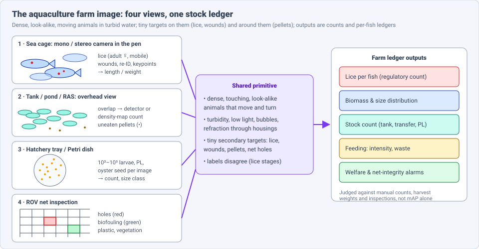
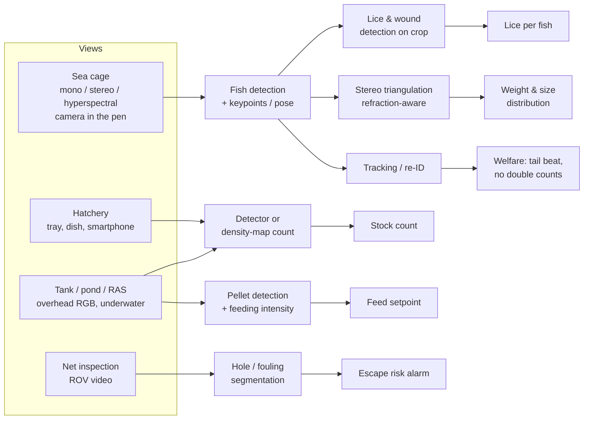
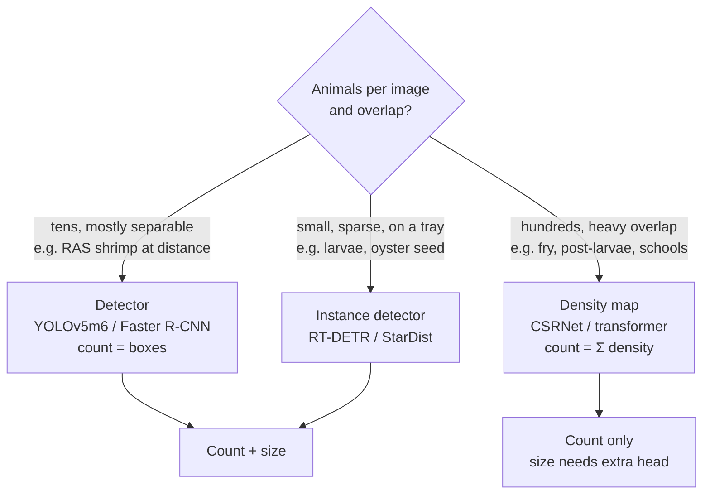
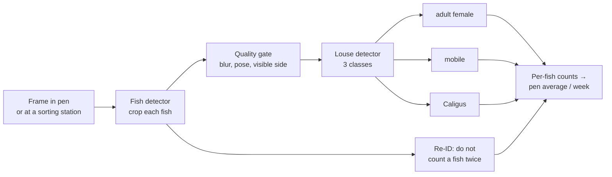
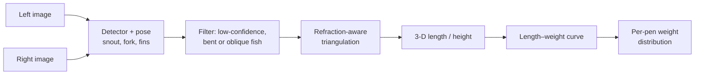

# Dense Object Detection & Classification — Recent Advances

*Compiled 2026-Nov-03 (America/Los_Angeles).*

Next installment in the running CV-updates log. Earlier entries:
[Apr-30](../2026-Apr-30/2026-Apr-30_CV_updates.md),
[May-01](../2026-May-01/2026-May-01_CV_updates.md),
[May-02](../2026-May-02/2026-May-02_CV_updates.md),
[May-04](../2026-May-04/2026-May-04_CV_updates.md),
[May-05](../2026-May-05/2026-May-05_CV_updates.md),
[May-07](../2026-May-07/2026-May-07_CV_updates.md),
[May-08](../2026-May-08/2026-May-08_CV_updates.md),
[May-15](../2026-May-15/2026-May-15_CV_updates.md),
[May-16](../2026-May-16/2026-May-16_CV_updates.md),
[May-17](../2026-May-17/2026-May-17_CV_updates.md),
[Jun-09](../2026-Jun-09/2026-Jun-09_CV_updates.md),
[Jun-10](../2026-Jun-10/2026-Jun-10_CV_updates.md),
[Jun-12](../2026-Jun-12/2026-Jun-12_CV_updates.md),
[Jun-15](../2026-Jun-15/2026-Jun-15_CV_updates.md),
[Jun-16](../2026-Jun-16/2026-Jun-16_CV_updates.md),
[Jun-17](../2026-Jun-17/2026-Jun-17_CV_updates.md),
[Jun-19](../2026-Jun-19/2026-Jun-19_CV_updates.md),
[Jun-21](../2026-Jun-21/2026-Jun-21_CV_updates.md),
[Jun-22](../2026-Jun-22/2026-Jun-22_CV_updates.md),
[Jun-23](../2026-Jun-23/2026-Jun-23_CV_updates.md),
[Jun-24](../2026-Jun-24/2026-Jun-24_CV_updates.md),
[Jun-25](../2026-Jun-25/2026-Jun-25_CV_updates.md),
[Jun-27](../2026-Jun-27/2026-Jun-27_CV_updates.md),
[Jun-29](../2026-Jun-29/2026-Jun-29_CV_updates.md),
[Jun-30](../2026-Jun-30/2026-Jun-30_CV_updates.md),
[Jul-04](../2026-Jul-04/2026-Jul-04_CV_updates.md),
[Jul-07](../2026-Jul-07/2026-Jul-07_CV_updates.md),
[Jul-08](../2026-Jul-08/2026-Jul-08_CV_updates.md),
[Jul-10](../2026-Jul-10/2026-Jul-10_CV_updates.md),
[Jul-15](../2026-Jul-15/2026-Jul-15_CV_updates.md),
[Jul-17](../2026-Jul-17/2026-Jul-17_CV_updates.md),
[Jul-18](../2026-Jul-18/2026-Jul-18_CV_updates.md),
[Jul-21](../2026-Jul-21/2026-Jul-21_CV_updates.md),
[Jul-22](../2026-Jul-22/2026-Jul-22_CV_updates.md),
[Jul-24](../2026-Jul-24/2026-Jul-24_CV_updates.md),
[Jul-26](../2026-Jul-26/2026-Jul-26_CV_updates.md),
[Jul-27](../2026-Jul-27/2026-Jul-27_CV_updates.md),
[Jul-30](../2026-Jul-30/2026-Jul-30_CV_updates.md),
[Aug-01](../2026-Aug-01/2026-Aug-01_CV_updates.md),
[Aug-02](../2026-Aug-02/2026-Aug-02_CV_updates.md),
[Aug-04](../2026-Aug-04/2026-Aug-04_CV_updates.md),
[Aug-07](../2026-Aug-07/2026-Aug-07_CV_updates.md),
[Aug-10](../2026-Aug-10/2026-Aug-10_CV_updates.md),
[Aug-11](../2026-Aug-11/2026-Aug-11_CV_updates.md),
[Aug-13](../2026-Aug-13/2026-Aug-13_CV_updates.md),
[Aug-15](../2026-Aug-15/2026-Aug-15_CV_updates.md),
[Aug-16](../2026-Aug-16/2026-Aug-16_CV_updates.md),
[Aug-18](../2026-Aug-18/2026-Aug-18_CV_updates.md),
[Aug-19](../2026-Aug-19/2026-Aug-19_CV_updates.md),
[Aug-21](../2026-Aug-21/2026-Aug-21_CV_updates.md),
[Aug-22](../2026-Aug-22/2026-Aug-22_CV_updates.md),
[Aug-24](../2026-Aug-24/2026-Aug-24_CV_updates.md),
[Aug-26](../2026-Aug-26/2026-Aug-26_CV_updates.md),
[Aug-29](../2026-Aug-29/2026-Aug-29_CV_updates.md),
[Sep-01](../2026-Sep-01/2026-Sep-01_CV_updates.md),
[Sep-20](../2026-Sep-20/2026-Sep-20_CV_updates.md),
[Sep-23](../2026-Sep-23/2026-Sep-23_CV_updates.md),
[Sep-24](../2026-Sep-24/2026-Sep-24_CV_updates.md),
[Sep-25](../2026-Sep-25/2026-Sep-25_CV_updates.md),
[Sep-26](../2026-Sep-26/2026-Sep-26_CV_updates.md),
[Sep-29](../2026-Sep-29/2026-Sep-29_CV_updates.md),
[Sep-30](../2026-Sep-30/2026-Sep-30_CV_updates.md),
[Oct-01](../2026-Oct-01/2026-Oct-01_CV_updates.md),
[Oct-02](../2026-Oct-02/2026-Oct-02_CV_updates.md),
[Oct-03](../2026-Oct-03/2026-Oct-03_CV_updates.md),
[Oct-04](../2026-Oct-04/2026-Oct-04_CV_updates.md),
[Oct-05](../2026-Oct-05/2026-Oct-05_CV_updates.md),
[Oct-06](../2026-Oct-06/2026-Oct-06_CV_updates.md),
[Oct-07](../2026-Oct-07/2026-Oct-07_CV_updates.md),
[Oct-08](../2026-Oct-08/2026-Oct-08_CV_updates.md),
[Oct-09](../2026-Oct-09/2026-Oct-09_CV_updates.md),
[Oct-10](../2026-Oct-10/2026-Oct-10_CV_updates.md),
[Oct-11](../2026-Oct-11/2026-Oct-11_CV_updates.md),
[Oct-12](../2026-Oct-12/2026-Oct-12_CV_updates.md),
[Oct-13](../2026-Oct-13/2026-Oct-13_CV_updates.md),
[Oct-14](../2026-Oct-14/2026-Oct-14_CV_updates.md),
[Oct-15](../2026-Oct-15/2026-Oct-15_CV_updates.md),
[Oct-16](../2026-Oct-16/2026-Oct-16_CV_updates.md),
[Oct-17](../2026-Oct-17/2026-Oct-17_CV_updates.md),
[Oct-18](../2026-Oct-18/2026-Oct-18_CV_updates.md),
[Oct-19](../2026-Oct-19/2026-Oct-19_CV_updates.md),
[Oct-20](../2026-Oct-20/2026-Oct-20_CV_updates.md),
[Oct-21](../2026-Oct-21/2026-Oct-21_CV_updates.md),
[Oct-22](../2026-Oct-22/2026-Oct-22_CV_updates.md),
[Oct-23](../2026-Oct-23/2026-Oct-23_CV_updates.md),
[Oct-24](../2026-Oct-24/2026-Oct-24_CV_updates.md),
[Oct-25](../2026-Oct-25/2026-Oct-25_CV_updates.md),
[Oct-26](../2026-Oct-26/2026-Oct-26_CV_updates.md),
[Oct-27](../2026-Oct-27/2026-Oct-27_CV_updates.md),
[Oct-28](../2026-Oct-28/2026-Oct-28_CV_updates.md),
[Oct-29](../2026-Oct-29/2026-Oct-29_CV_updates.md),
[Oct-30](../2026-Oct-30/2026-Oct-30_CV_updates.md),
[Oct-31](../2026-Oct-31/2026-Oct-31_CV_updates.md),
[Nov-01](../2026-Nov-01/2026-Nov-01_CV_updates.md),
[Nov-02](../2026-Nov-02/2026-Nov-02_CV_updates.md).

The last five entries covered
[metal powder-bed fusion](../2026-Oct-29/2026-Oct-29_CV_updates.md),
[food-processing](../2026-Oct-30/2026-Oct-30_CV_updates.md),
[waste-sorting](../2026-Oct-31/2026-Oct-31_CV_updates.md),
[pharmaceutical](../2026-Nov-01/2026-Nov-01_CV_updates.md) and
[mining](../2026-Nov-02/2026-Nov-02_CV_updates.md) imagery.
This run moves from the processing plant to the farm. It covers the
**aquaculture farm image**: the underwater camera in a salmon sea cage, the
overhead view of a tank, pond or recirculating system (RAS), the hatchery
tray or Petri dish, and the ROV camera inspecting the net.

---

## Table of contents

1. [Why this pass](#1--why-this-pass)
2. [The primitive: four views, one ledger](#2--the-primitive-four-views-one-ledger)
3. [Counting dense schools: detectors vs. density maps](#3--counting-dense-schools-detectors-vs-density-maps)
4. [Sea lice: on the fish and in the water](#4--sea-lice-on-the-fish-and-in-the-water)
5. [Size and biomass: keypoints, stereo and refraction](#5--size-and-biomass-keypoints-stereo-and-refraction)
6. [Tracking, re-identification and welfare](#6--tracking-re-identification-and-welfare)
7. [Feeding: pellets, splashes and sound](#7--feeding-pellets-splashes-and-sound)
8. [The net itself: holes and biofouling from an ROV](#8--the-net-itself-holes-and-biofouling-from-an-rov)
9. [Foundation models and pooled benchmarks](#9--foundation-models-and-pooled-benchmarks)
10. [Evaluation: what the farm actually checks](#10--evaluation-what-the-farm-actually-checks)
11. [Open problems / what to watch](#11--open-problems--what-to-watch)
12. [Sources](#12--sources)

---

## 1 · Why this pass

Searching the archive for *sea lice*, *net pen*, *FFIA*, *MFT25*,
*FishDet-M*, *WildFin* and *BoostTrack* returns nothing. Three earlier
entries come close, and this pass stays clear of them:

- The [underwater & marine](../2026-Jul-08/2026-Jul-08_CV_updates.md) entry
  covered wild-reef monitoring (diver video, species ID, AquaticCLIP).
- The [food-processing](../2026-Oct-30/2026-Oct-30_CV_updates.md) entry
  covered fish *after* catch or harvest (AutoFish on a belt, parasites in
  fillets, bones in X-ray).
- The [camera-trap](../2026-Oct-08/2026-Oct-08_CV_updates.md) and other wildlife
  entries cover animals that are not owned, fed or counted for sale.

What makes the farm image a distinct primitive:

- **The objects are a school.** Hundreds of near-identical animals overlap,
  turn and leave the frame. Counting, sizing and tracking all fail in the
  same way: occlusion and identity switches.
- **The interesting target is often tiny and on the animal.** A 2–10 mm
  louse on a 4 kg salmon, a wound, an uneaten pellet below the school.
- **The water degrades everything.** Turbidity, low light at depth, bubbles,
  and refraction through the camera housing. Refraction directly biases
  stereo length estimates (§5).
- **The labels are disputed.** Human lice counters disagree, especially on
  mobile stages (§4). Any model trained on those labels inherits the
  disagreement.
- **The output feeds money and regulation.** Norwegian farms must report lice
  per fish weekly. Biomass sets feed and harvest timing. A count error is a
  financial or legal error, not a lower mAP.

---

## 2 · The primitive: four views, one ledger

| View | Typical sensor | Dense target | Main output | Public data |
|---|---|---|---|---|
| Sea cage | mono/stereo RGB, hyperspectral, in-pen | 10–10² fish per frame; lice and wounds on each | lice/fish, weight distribution, welfare | BoostCompTrack salmon tracking sets; most lice data private |
| Tank / pond / RAS | overhead or underwater RGB, smartphone | 10²–10³ fish or shrimp; pellets | stock count, feed waste | Bukas et al. shrimp (1,379 images); AV-FFIA (27k audio-visual clips); tilapia fingerling sets |
| Hatchery | smartphone, microscope, tray camera | 10²–10³ larvae / post-larvae / seed | count, size class | small; often "on request" |
| Net inspection | ROV RGB | net meshes, holes, fouling | integrity alarms | small private sets |
| (Water sample) | microscope, holographic camera | lice larvae among plankton | early warning of infection pressure | WUR 8,316-image set (journal) |

---

## 3 · Counting dense schools: detectors vs. density maps

The same split seen in [dense-crowd](../2026-Oct-11/2026-Oct-11_CV_updates.md) counting
appears here: detectors when animals are separable, density maps when they
are not. The farm literature gives a usable rule of thumb.

**Detectors win in the industrial shrimp benchmark.** Bukas et al. compared
eight deep-learning counters on 1,379 iPhone images of shrimp in commercial
RAS tanks. YOLOv5m6- and Faster R-CNN-based models gave the best counts. The
density-map autoencoder was worse. The models held up in dim light and with
overlapping, small animals
([J. Cleaner Production 468:143024, 2024](https://epic.awi.de/id/eprint/58961)).

**Density maps win when overlap is extreme.** Recent fish-counting work is
almost all transformer + density regression:

| Method | Setting | Idea | Reported result |
|---|---|---|---|
| FCFormer ([Front. Mar. Sci. 2024](https://www.frontiersin.org/journals/marine-science/articles/10.3389/fmars.2024.1370786/full)) | RAS fish | Twins Transformer density estimation | 97.06% counting accuracy (authors) |
| Density difference-aware transformer ([Aquacult. Int. 2026](https://link.springer.com/article/10.1007/s10499-026-02601-3)) | grass carp | models density differences across the school | MAE 3.36, RMSE 4.76 fish/image |
| Feature-offset aggregation + occlusion-aware attention ([Springer 2026](https://link.springer.com/article/10.1007/s44443-026-01240-1)) | dense occluded schools | transformer with density regression head | (numbers not retrieved) |
| Density-response-oriented counting ([Fishes 11(9):540, 2026](https://www.mdpi.com/2410-3888/11/9/540)) | low-visibility RAS | fixes ground-truth density-map generation; Softplus output | (numbers not retrieved) |
| Semi-supervised adaptive density proxy ([COMPAG 2024](https://www.sciencedirect.com/science/article/abs/pii/S0168169924012651)) | RAS fish schools | fewer point labels | — |

**Hatcheries and nurseries.** Counts here decide what is sold:

- **Shrimp post-larvae (PL).** P2CountNet scales each animal's density
  contribution by its size and adds multiscale features
  ([Dang et al., TAFE 2026](https://sites.biology.unt.edu/~mager/Dang%20TAFE%202026.pdf)).
  OSA-Net is a 660 KB density counter for vannamei PL on edge devices
  ([IJIES 2025](https://inass.org/wp-content/uploads/2024/11/2025033101.pdf)).
  A Vietnamese annotation study reports an average of 235.8 PL per image
  ([JST-UD 2025](https://jst-ud.vn/jst-ud/article/download/9869/6540/28008)).
  A Bayesian-loss counter appears in South China Fisheries Science
  ([21(1), 2025](https://schinafish.cn/en/article/Y2025/I1/173)).
- **Fish larvae.** On smartphone images from a Brazilian hatchery (sorubim
  and dourado larvae, one "fish" class, transparent species treated as
  noise), RT-DETR-X gave the lowest count error (MAPE 4.46 ± 4.70%) and
  YOLOv8-M was close (4.71 ± 4.98%)
  ([arXiv 2408.05032](https://arxiv.org/abs/2408.05032v1);
  [RITA 33, 2026](https://seer.ufrgs.br/index.php/rita/article/view/150926)).
  Data are available on request.
- **Oyster seed.** Louisiana Sea Grant and LSU trained StarDist (star-convex
  instance segmentation, borrowed from cell microscopy) on 2–4 mm and
  4–6 mm seed. Accuracy is 90–94%, and a count takes about one minute
  instead of three, on a Raspberry Pi unit
  ([LA Sea Grant, 2026](https://www.laseagrant.org/2026/new-tool/)).
- **Controlled-density data.** Tilapia fingerling sets with exactly 10, 30
  or 50 fish per white-tray image (polygon labels, YOLO format) are useful
  for measuring how error grows with density
  ([Mendeley: 10](https://data.mendeley.com/datasets/kjtycfjkt3),
  [30](https://data.mendeley.com/datasets/vh5cfk49ws),
  [50](https://data.mendeley.com/datasets/fxtyccykf8/1)).

**Synthetic schools.** A net-pen counter trained YOLOv4 on simulated
images where the number of fish and their 3-D configuration can be set
freely ([Aquaculture Europe 2023](https://aquaeas.org/Program/PaperDetail/40478)).
This is the only practical way to get exact ground truth for a cage of
tens of thousands of fish.

---

## 4 · Sea lice: on the fish and in the water

Sea lice (*Lepeophtheirus salmonis*, *Caligus elongatus*) are the main
health cost in salmon farming. Two separate imaging problems exist.

### 4a · Lice on the fish

The standard pipeline is two-stage: detect and crop each fish, then detect
lice on the crop.

- **Validated against manual counts.** Norway's Institute of Marine
  Research describes a camera system with exactly this pipeline (fish
  detection and crop, then a louse model for adult female, mobile and
  *Caligus*). Against standardised manual counts, it agreed at r = 0.92 for
  mobile lice and r = 0.96 for adult females, similar to agreement between
  human counters
  ([IMR report 2024-61](https://www.hi.no/en/hi/nettrapporter/rapport-fra-havforskningen-en-2024-61)).
- **The labels are the limit.** A 2026 *Aquaculture* paper measured
  inter-observer variability in image-based lice annotation. Exact agreement
  was higher for adult females than for mobile lice, and lower image quality
  increased uncertainty, mostly for mobiles
  ([Aquaculture, 2026](https://www.sciencedirect.com/science/article/pii/S0044848626009646)).
  A model cannot be judged more precisely than its annotators agree.
- **Segmentation for breeding.** Benchmark Genetics and the Danish
  Technological Institute use a U-Net to segment lice and salmon in
  multi-wavelength mono-camera images under a half-dome light. Lice are
  then filtered and counted to select lice-resistant broodstock
  ([Fish Farming Expert](https://www.fishfarmingexpert.com/artificial-intelligence-benchmark-genetics-norway-dti/machine-learning-deployed-to-select-sea-lice-resistant-salmon/1268376)).
- **Commercial systems** count by stage (Aquabyte: adult female, mobile,
  stationary, *Caligus*) or use hyperspectral sensing (Ecotone SpectraLice)
  ([Aquabyte](https://www.aquabyte.ai/products/lice);
  [Business Norway](https://businessnorway.com/solutions/ecotone-hyperspectral-camera-for-counting-sea-lice)).
  Vendor accuracy figures are unaudited.

### 4b · Lice larvae in the water

The goal is an early warning of infection pressure before lice settle on
fish. Here the image is a microscope or holographic frame of seawater full
of plankton and debris.

- Wageningen built 8,316 images of three larval classes (*Nauplius live*,
  *Nauplius shell*, *Copepodite*) and compared **16 detectors** (one- and
  two-stage CNNs and transformers)
  ([Aquaculture 592:741252, 2024](https://research.wur.nl/en/publications/rapid-detection-of-salmon-louse-larvae-in-seawater-based-on-machi/)).
  In the conference version, YOLOv8 reached 96.5% recall on the test set at
  up to 416 FPS, but only **80% recall in real seawater**
  ([AQUA 2024](https://was.org/Meeting/Program/PaperDetail/163250)).
- A follow-up trained on more than 120,000 real plus synthetic images. On one
  complex sample it found 97.5% of larvae in about 30 minutes; biologists
  found 82% in more than 30 hours
  ([Salmon Business](https://www.salmonbusiness.com/?p=135864);
  [Global Seafood](https://www.globalseafood.org/advocate/study-ai-model-identifies-salmon-lice-larvae-faster-and-more-accurately-than-biologists/)).
  These figures are press-reported.
- **Holographic cameras** (Aberdeen/SAMS) image larvae in situ, avoiding
  the days of lab microscopy
  ([Global Seafood](https://www.globalseafood.org/advocate/could-holographic-cameras-and-ai-technology-lead-to-an-early-warning-system-for-sea-lice-in-the-ocean/)).
  "Blue Lice" counts lice in traps with a fully convolutional network
  trained on more than 150,000 images, so far only in a simulated lab setup
  ([Aquaculture Europe 2025](https://aquaeas.org/Program/PaperDetail/42776)).

The 96.5% → 80% drop from test set to real seawater is the
domain-shift problem in a
small, concrete form: synthetic data is the current answer.

---

## 5 · Size and biomass: keypoints, stereo and refraction

Weight is estimated from length (and height) using species-specific
length–weight curves. Length comes from keypoints triangulated in a stereo
pair.

- **Leopard coral grouper (*Sci. Rep.*, Jul 2025).** RTMDet + RTMPose find
  snout and tail; housing refraction is corrected before binocular
  triangulation. Keypoint AP@0.5:0.95 is 98.6%, length error about 3.2 mm
  in a tank, 28 FPS on a GTX 1060
  ([DOAJ](https://doaj.org/article/965fd3924ee045c285cbcc624cddd0d4);
  [PubMed 40628812](https://pubmed.ncbi.nlm.nih.gov/40628812/)).
- **Aquarium fish (arXiv 2603.06421, Mar 2026).** YOLOv11-Pose per stereo
  view plus refraction-aware triangulation. The main finding: **filtering
  low-quality detections matters more than the detector** for length
  accuracy
  ([arXiv 2603.06421](https://arxiv.org/pdf/2603.06421)).
- **Sea bream (Aquaculture Europe 2025).** Keypoint R-CNN and YOLO trained
  on 250 images / 700 fish with snout and tail keypoints
  ([AE 2025](https://aquaeas.org/Program/PaperDetail/42677)).
- **Stereo point clouds.** One group converts stereo RGB-D to an RGB-XYZ
  cloud, segments fish with a point-cloud transformer and regresses biomass
  with kNN; it reports farm deployment
  ([AHFE 2025](https://openaccess.cms-conferences.org/publications/book/979-8-950676-11-6/article/979-8-950676-11-6_17)).
- **Reference point.** On stereo-BRUVS (wild fish), semi-automated length
  reached Pearson r = 0.99 against humans over 3,954 out-of-sample
  measurements
  ([Front. Mar. Sci. 2023](https://researchonline.jcu.edu.au/83122/)).
- **Commercial cameras** (Ace Aquatec A-BIOMASS, Innovasea) use stereo
  keypoints; a 2022 Scottish trial compared camera average weights to harvest
  weights
  ([Ace Aquatec](https://aceaquatec.com/news-and-resources/news/scottish-farm-trials-validate-biomass-technology);
  [Innovasea](https://www.innovasea.com/aquaculture/biomass-estimation/)).

The weak link is not keypoint AP (often >95%). It is **which fish get
measured**: bent fish, oblique fish and fish close to the camera are
over-represented or rejected, which biases the pen distribution.

---

## 6 · Tracking, re-identification and welfare

- **Salmon tracking by body part (arXiv 2509.25969, Sep 2025).** Høgstedt,
  Schellewald, Stahl and Mester (SINTEF/NTNU) use a top-down pose model to
  box each salmon *and its body parts*, track each part separately, then fuse
  the tracks. They argue boxes are more stable than keypoints for
  association. Two new datasets target **ID transfers in crowded scenes** and
  **ID switches when salmon turn**; the method beats BoostTrack on both. The
  part tracks give tail-beat wavelength, a welfare indicator, directly
  ([arXiv](https://arxiv.org/abs/2509.25969);
  [code + data](https://github.com/espenbh/BoostCompTrack)).
- **MFT25 (AAAI 2026, oral).** 15 sequences, 48,066 frames, 408,578 boxes of
  multiple fish. The SU-T baseline (YOLOX detector at 800×1440) reaches
  **34.1 HOTA / 44.6 IDF1**, far below pedestrian MOT numbers, with the
  lowest scores on dense pond sequences
  ([arXiv 2507.06400](https://arxiv.org/abs/2507.06400);
  [AAAI](https://ojs.aaai.org/index.php/AAAI/article/view/37574)).
- **Re-identification.** FishNet adapted FaceNet/DeepFace-style embeddings
  to individual Atlantic salmon so no fish is counted twice during lice
  inspection ([arXiv 2010.10475](https://arxiv.org/abs/2010.10475)).
  The NTNU/SINTEF cAIge project lists 2024–26 work on transformer and
  contrastive re-ID, wound segmentation, anomaly detection and synthetic
  data ([cAIge, RCN 344022](https://schellew.folk.ntnu.no/cAIge_NFR344022/)).
- **Wounds.** A SINTEF detection-plus-tracking system reached about 90%
  accuracy on unseen video from operating farms, positioned as an assistant
  to manual camera inspection
  ([MED 2024](https://www.sintef.no/en/publications/publication/2276805)).
  Earlier, a CNN reached 96.7% on a balanced lice/wound/healthy set from IMR
  tanks ([Gupta et al., Fishes 2022](https://uia.brage.unit.no/uia-xmlui/handle/11250/3067637)).
- **Behaviour is still hard.** WildFin (ECCV 2026, Cornell) annotates nine
  hours of reef video frame-by-frame with behaviours (foraging, feeding,
  fighting). Fine-tuned standard video models performed poorly
  ([arXiv 2608.21281](https://arxiv.org/pdf/2608.21281);
  [Cornell](https://news.cornell.edu/stories/2026/10/sea-change-wildfin-aims-improve-fish-behavior-analysis-wild)).
  It is wild-reef data, but the gap applies to welfare monitoring on farms.

---

## 7 · Feeding: pellets, splashes and sound

Feed is the largest operating cost. Two signals are used: pellets that
fall through uneaten, and the school's feeding response.

- **Uneaten pellets.** YOLO-Shrimp modifies YOLOv11n with multi-attention
  features and an EnWIoU loss. On 3,461 real farm images: **70.01%
  mAP@0.5, 28.01% mAP@0.5:0.95**, 2.08 M parameters, 5.5 GFLOPs (−19.7%
  parameters, −14.6% GFLOPs vs. the baseline)
  ([Sensors 26:791, 2026](https://www.ncbi.nlm.nih.gov/pmc/articles/PMC12899731/)).
  The low mAP@0.5:0.95 reflects how small and blurry pellets are. A shrimp
  feed-tray study pairs detection (mAP50 0.923) with density-map counting
  ([Preprints 202609.2654](https://www.preprints.org/manuscript/202609.2654)).
- **Limits of pellet counting.** A *Fishes* paper argues pellet detection
  alone says little, since pellet size and fish variability change
  recognition; it prefers tracking behaviour, but notes optical flow is too
  heavy for edge devices
  ([Fishes 11:300](https://mdpi-res.com/d_attachment/fishes/fishes-11-00300/article_deploy/fishes-11-00300.pdf)).
- **Audio-visual feeding intensity.** AV-FFIA has 27,000 labelled audio and
  video clips at four levels (none / weak / medium / strong); U-FFIA is one
  model that accepts audio, video or both
  ([arXiv 2309.05058](https://arxiv.org/abs/2309.05058);
  [code](https://github.com/FishMaster93/U-FFIA)). The 2025 follow-up,
  AV-CIL-FFIA, has 81,932 two-second clips across six farmed species and
  frames the task as class-incremental learning (HAIL-FFIA) so new species
  can be added without forgetting
  ([arXiv 2504.15171](https://arxiv.org/abs/2504.15171)).

---

## 8 · The net itself: holes and biofouling from an ROV

A hole means escapes; fouling cuts water exchange. Nets are inspected by
ROV video, and here the dense pattern is the mesh itself.

- **Real-time ROV system (*Sci. Rep.* 2025).** ROS2 pipeline with
  learning-based ROV pose control (to avoid hitting and damaging the net)
  and YOLO-variant detectors for holes and entangled plastic, validated in a
  pool and at a fish farm
  ([PMC12460654](https://pmc.ncbi.nlm.nih.gov/articles/PMC12460654)).
- **Multi-scale semantic segmentation (ESWA 2024).** Akram et al. segment
  biofouling, vegetation and holes on two private and two public farm
  datasets, reporting mAP gains of 3.69–6.58 points over prior methods
  ([ADU repository](https://repository.adu.ac.ae/items/90958fbc-cbe2-4d69-be19-99e90428be29)).
- **Embedded evaluation (ICINCO 2023).** The same group showed real-time
  defect detection on embedded hardware aboard the ROV
  ([arXiv 2308.13826](https://arxiv.org/abs/2308.13826v1)).

Most prior work only detects holes in lab tanks. The move now is to
multiple defect classes, real farms and closed-loop ROV control.

---

## 9 · Foundation models and pooled benchmarks

- **FishDet-M (arXiv 2507.17859).** Merges 13 public fish-detection sets
  into one COCO-format benchmark: 105,556 images, 296,885 fish. It
  benchmarks 28 detectors (YOLOv8–v12, R-CNN, DETR families) and adds a
  **CLIP-guided zero-shot selector** that picks a detector per image instead
  of running an ensemble. A third-party listing puts YOLO12x on top at
  mAP 0.491 (mAP@50 0.848); transformers were slower and weaker on small
  fish. That number was not confirmed against the paper
  ([arXiv](https://arxiv.org/abs/2507.17859v1)).
- **SAM in a commercial RAS (*Aquaculture* 626).** Fred et al. ran Segment
  Anything on rainbow trout and Atlantic salmon at 32–40 kg/m³. A light
  classifier filtering SAM's masks raised the share of good whole-fish or
  head masks from 60.5% to 77.7% (automatic) and 75.6% to 85.2% (hand
  prompts), on an 88-image verified benchmark. The authors note most welfare
  studies use tanks 100–1,000× smaller than farms
  ([Luke repository](https://jukuri.luke.fi/items/48d4c736-b025-449c-9130-8d2c8d4407d2/full)).
- **SAM as a labeler.** SAM-generated masks used to train YOLO instance
  segmentation gave only marginally lower results than full human labels
  ([Rovira Coll & Burguera, UIB](https://dspace.uib.es/xmlui/handle/11201/171185)).

The pattern matches the [mining](../2026-Nov-02/2026-Nov-02_CV_updates.md)
and [waste-sorting](../2026-Oct-31/2026-Oct-31_CV_updates.md) entries: SAM
is used to bootstrap labels and then a small YOLO-class model runs at the
edge. Raw SAM output needs a filter before it is usable on dense schools.

---

## 10 · Evaluation: what the farm actually checks

| What papers report | What the farm needs | Gap |
|---|---|---|
| lice detection mAP / recall | lice per fish vs. standardised manual count, by stage | annotator disagreement on mobiles caps achievable accuracy (§4a) |
| test-set recall (96.5%) | recall in real seawater (80%) | domain shift; synthetic data helps (§4b) |
| keypoint AP (>95%) | mean and spread of harvest weight | selection bias in which fish are measured (§5) |
| count MAE per image | pen or batch total, sold PL count | per-image error compounds; double counting without re-ID |
| HOTA / IDF1 | no fish counted twice, tail-beat stats | MFT25 HOTA 34.1 shows tracking is far from solved (§6) |
| pellet mAP@0.5 | feed saved without lower growth | few papers close the loop to feed conversion |

Practical points:

1. **Report agreement with manual counts in the same units** as the
   regulation or sale (lice/fish, PL per bag), as the IMR report does.
2. **Report annotator agreement** alongside model scores for lice and
   wounds.
3. **Validate biomass against harvest weights**, not tank measurements.

---

## 11 · Open problems / what to watch

- **A public, sea-cage lice benchmark** with stage labels from several
  annotators. Nothing like it was found; all on-fish lice data is private.
- **Synthetic schools and synthetic larvae.** Already used for net-pen
  counting and lice larvae; expect rendered cages with exact counts,
  occlusion and turbidity as a pre-training source.
- **Tracking through turns and crowds.** Part-based tracking
  (BoostCompTrack) and re-ID embeddings need to meet: count each fish once
  per inspection pass.
- **Refraction and selection bias in biomass.** Refraction-aware
  triangulation is now standard; correcting for *which fish* are measured is
  not.
- **Behaviour and welfare from video.** WildFin and the feeding-intensity
  work show video models are weak here; audio is a cheap extra channel.
- **Closed-loop ROV inspection.** Net-defect detection tied to ROV control,
  as in the 2025 *Sci. Rep.* system.
- **SAM-to-YOLO distillation for dense schools** with a mask-quality filter,
  following Fred et al.

---

## 12 · Sources

### Counting (§3)
- Bukas et al., robust shrimp counting in an industrial farm (J. Clean. Prod. 468:143024, 2024) — https://epic.awi.de/id/eprint/58961 — https://push-zb.helmholtz-munich.de/deliver.php?id=35862
- FCFormer (Front. Mar. Sci. 2024) — https://www.frontiersin.org/journals/marine-science/articles/10.3389/fmars.2024.1370786/full
- Density difference-aware transformer (Aquaculture International 2026) — https://link.springer.com/article/10.1007/s10499-026-02601-3
- Transformer with feature offset aggregation and occlusion-aware attention (2026) — https://link.springer.com/article/10.1007/s44443-026-01240-1
- Density-response-oriented fish counting for RAS (Fishes 11(9):540) — https://www.mdpi.com/2410-3888/11/9/540
- Semi-supervised fish-school density estimation in RAS (COMPAG 2024) — https://www.sciencedirect.com/science/article/abs/pii/S0168169924012651
- Hybrid Swin-CSRNet (JMSE 12:1823) — https://doi.org/10.3390/jmse12101823
- Dang et al., P2CountNet (TAFE 2026) — https://sites.biology.unt.edu/~mager/Dang%20TAFE%202026.pdf
- OSA-Net vannamei PL counting (IJIES 2025) — https://inass.org/wp-content/uploads/2024/11/2025033101.pdf
- PL annotation study (JST-UD 2025) — https://jst-ud.vn/jst-ud/article/download/9869/6540/28008
- Bayesian-loss shrimp counting (South China Fisheries Science 21(1), 2025) — https://schinafish.cn/en/article/Y2025/I1/173
- Ortega de Carvalho et al., fish larvae counting with DETR and YOLO — https://arxiv.org/abs/2408.05032v1 — https://seer.ufrgs.br/index.php/rita/article/view/150926
- Louisiana Sea Grant oyster seed counter — https://www.laseagrant.org/2026/new-tool/ — https://www.usharbors.com/2026/03/louisiana-sea-grant-develops-new-tool-to-count-oyster-seed-faster/
- Oreochromis niloticus fingerling datasets (Mendeley) — https://data.mendeley.com/datasets/kjtycfjkt3 — https://data.mendeley.com/datasets/vh5cfk49ws — https://data.mendeley.com/datasets/fxtyccykf8/1
- Simulated training data for net-pen counting (Aquaculture Europe 2023) — https://aquaeas.org/Program/PaperDetail/40478
- Computer vision for oyster measuring and counting (review) — https://www.ncbi.nlm.nih.gov/pmc/articles/PMC12733815/

### Sea lice (§4)
- IMR, standardisation of manual louse counts for validation of camera systems (2024-61) — https://www.hi.no/en/hi/nettrapporter/rapport-fra-havforskningen-en-2024-61
- Inter-observer variability for image-based lice monitoring (Aquaculture 2026) — https://www.sciencedirect.com/science/article/pii/S0044848626009646
- Benchmark Genetics / DTI lice segmentation — https://www.fishfarmingexpert.com/artificial-intelligence-benchmark-genetics-norway-dti/machine-learning-deployed-to-select-sea-lice-resistant-salmon/1268376
- Aquabyte LICE — https://www.aquabyte.ai/products/lice
- Ecotone SpectraLice — https://businessnorway.com/solutions/ecotone-hyperspectral-camera-for-counting-sea-lice
- Rapid detection of salmon louse larvae in seawater (Aquaculture 592:741252) — https://research.wur.nl/en/publications/rapid-detection-of-salmon-louse-larvae-in-seawater-based-on-machi/
- AQUA 2024 abstract (YOLOv8 recall) — https://was.org/Meeting/Program/PaperDetail/163250
- AI vs. biologists on lice larvae (press) — https://www.salmonbusiness.com/?p=135864 — https://www.globalseafood.org/advocate/study-ai-model-identifies-salmon-lice-larvae-faster-and-more-accurately-than-biologists/
- Holographic camera early warning (Aberdeen/SAMS) — https://www.globalseafood.org/advocate/could-holographic-cameras-and-ai-technology-lead-to-an-early-warning-system-for-sea-lice-in-the-ocean/
- Blue Lice trap counting (Aquaculture Europe 2025) — https://aquaeas.org/Program/PaperDetail/42776

### Size and biomass (§5)
- Leopard coral grouper stereo phenotyping (Sci. Rep. 2025) — https://doaj.org/article/965fd3924ee045c285cbcc624cddd0d4 — https://pubmed.ncbi.nlm.nih.gov/40628812/
- Stereo fish length in aquariums with YOLOv11-Pose, arXiv 2603.06421 — https://arxiv.org/pdf/2603.06421
- Sea bream keypoint length (Aquaculture Europe 2025) — https://aquaeas.org/Program/PaperDetail/42677
- Digital-twin stereo biomass (AHFE 2025) — https://openaccess.cms-conferences.org/publications/book/979-8-950676-11-6/article/979-8-950676-11-6_17
- Marrable et al., stereo-BRUVS length (Front. Mar. Sci. 2023) — https://researchonline.jcu.edu.au/83122/
- Ace Aquatec biomass trials — https://aceaquatec.com/news-and-resources/news/scottish-farm-trials-validate-biomass-technology
- Innovasea biomass camera — https://www.innovasea.com/aquaculture/biomass-estimation/

### Tracking, re-ID, welfare (§6)
- Høgstedt et al., multi-purpose salmon tracking, arXiv 2509.25969 — https://arxiv.org/abs/2509.25969 — https://github.com/espenbh/BoostCompTrack
- Li et al., MFT25 / SU-T, arXiv 2507.06400 (AAAI 2026) — https://arxiv.org/abs/2507.06400 — https://ojs.aaai.org/index.php/AAAI/article/view/37574
- Mathisen et al., FishNet salmon recognition, arXiv 2010.10475 — https://arxiv.org/abs/2010.10475
- cAIge project (RCN 344022) — https://schellew.folk.ntnu.no/cAIge_NFR344022/
- SINTEF wound detection and tracking (MED 2024) — https://www.sintef.no/en/publications/publication/2276805
- Gupta et al., wound and lice detection in Atlantic salmon (Fishes 2022) — https://uia.brage.unit.no/uia-xmlui/handle/11250/3067637
- WildFin, arXiv 2608.21281 (ECCV 2026) — https://arxiv.org/pdf/2608.21281 — https://news.cornell.edu/stories/2026/10/sea-change-wildfin-aims-improve-fish-behavior-analysis-wild

### Feeding (§7)
- YOLO-Shrimp (Sensors 26:791, 2026) — https://www.ncbi.nlm.nih.gov/pmc/articles/PMC12899731/
- Shrimp feed-tray detection + counting (Preprints 202609.2654) — https://www.preprints.org/manuscript/202609.2654
- Behaviour vs. pellet detection for feeding (Fishes 11:300) — https://mdpi-res.com/d_attachment/fishes/fishes-11-00300/article_deploy/fishes-11-00300.pdf
- Cui et al., AV-FFIA / U-FFIA, arXiv 2309.05058 — https://arxiv.org/abs/2309.05058 — https://github.com/FishMaster93/U-FFIA
- AV-CIL-FFIA / HAIL-FFIA, arXiv 2504.15171 — https://arxiv.org/abs/2504.15171

### Net inspection (§8)
- ROS2 ROV net-defect system (Sci. Rep. 2025) — https://pmc.ncbi.nlm.nih.gov/articles/PMC12460654
- Akram et al., aquaculture defects via multi-scale semantic segmentation (ESWA 2024) — https://repository.adu.ac.ae/items/90958fbc-cbe2-4d69-be19-99e90428be29
- Evaluating deep-learning-assisted net-pen inspection using ROV (ICINCO 2023), arXiv 2308.13826 — https://arxiv.org/abs/2308.13826v1

### Foundation models and benchmarks (§9)
- FishDet-M, arXiv 2507.17859 — https://arxiv.org/abs/2507.17859v1
- Fred et al., SAM for fish in RAS (Aquaculture 626) — https://jukuri.luke.fi/items/48d4c736-b025-449c-9130-8d2c8d4407d2/full
- Rovira Coll & Burguera, SAM masks for YOLO instance segmentation — https://dspace.uib.es/xmlui/handle/11201/171185
- Fish tracking, counting and behaviour survey, arXiv 2406.17800 — https://arxiv.org/pdf/2406.17800

*Research note: direct page fetches to arxiv.org, ncbi.nlm.nih.gov,
epic.awi.de and sites.biology.unt.edu failed (hosts not reachable under this
session's network policy), so figures come from search-indexed abstracts,
publisher listings, repository records and trade press. FishDet-M's top mAP
is from a third-party listing; the lice-larvae 97.5% figure and all vendor
claims are press-reported and unaudited. Numbers for the two 2026 Springer
counting transformers and P2CountNet were not retrievable. Publication years
for a few journal items (e.g. Aquaculture 626, the inter-observer study) come
from search metadata that was occasionally inconsistent.*
