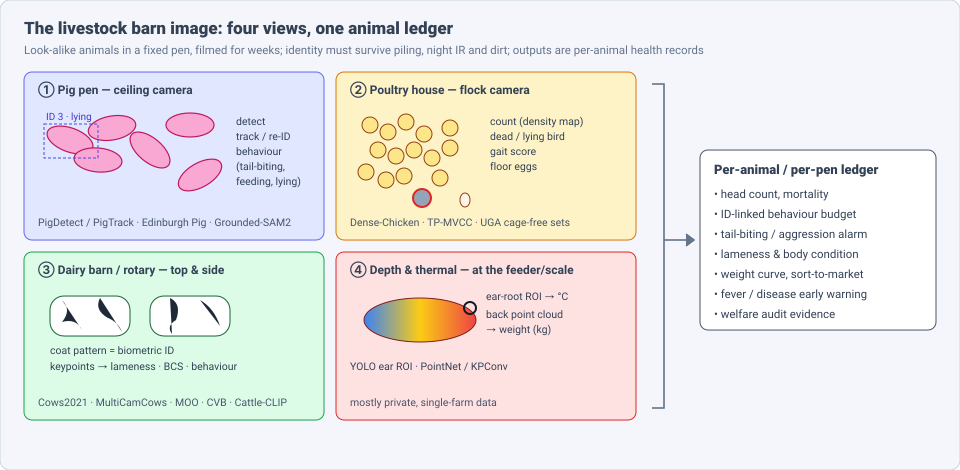
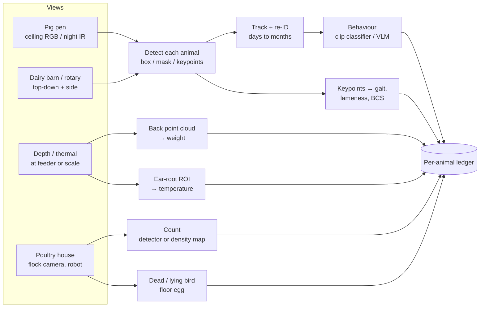
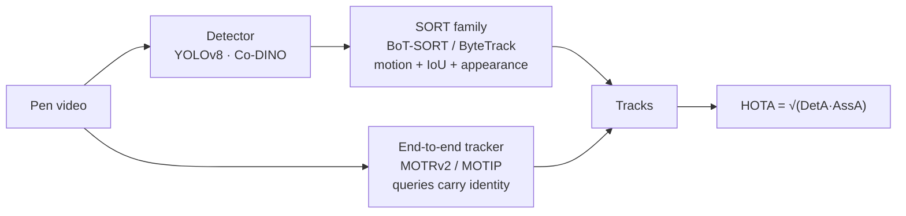
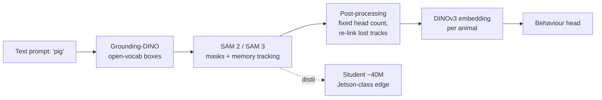
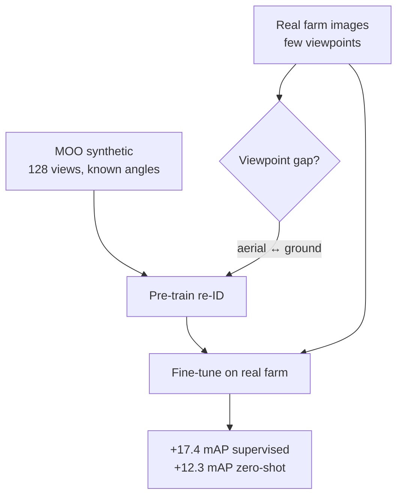
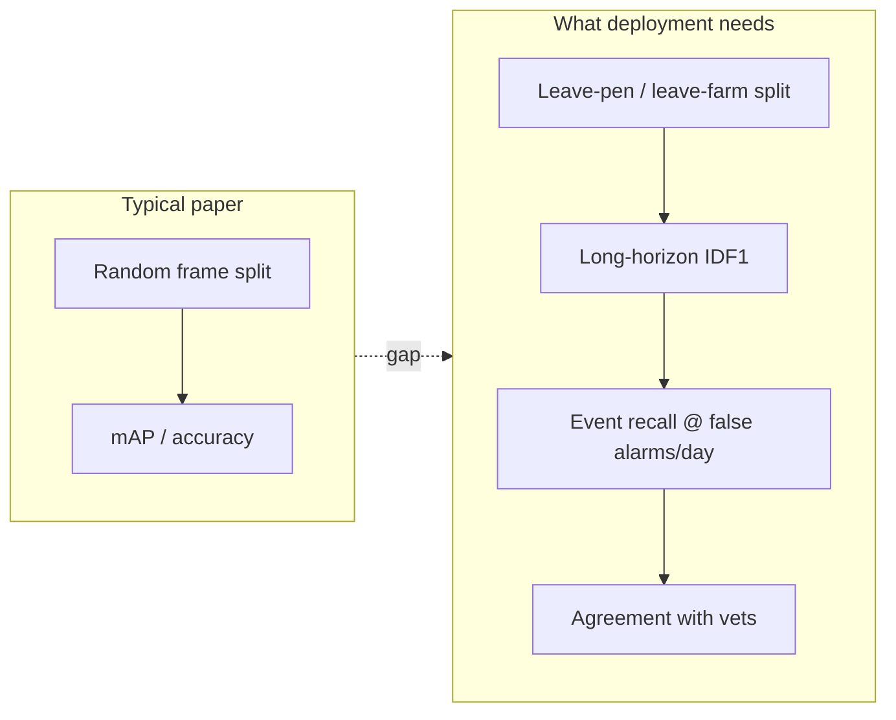

# Dense Object Detection & Classification — Recent Advances

*Compiled 2026-Nov-04 (America/Los_Angeles).*

Next installment in the running CV-updates log. Earlier entries:
[Apr-30](../2026-Apr-30/2026-Apr-30_CV_updates.md),
[May-01](../2026-May-01/2026-May-01_CV_updates.md),
[May-02](../2026-May-02/2026-May-02_CV_updates.md),
[May-04](../2026-May-04/2026-May-04_CV_updates.md),
[May-05](../2026-May-05/2026-May-05_CV_updates.md),
[May-07](../2026-May-07/2026-May-07_CV_updates.md),
[May-08](../2026-May-08/2026-May-08_CV_updates.md),
[May-15](../2026-May-15/2026-May-15_CV_updates.md),
[May-16](../2026-May-16/2026-May-16_CV_updates.md),
[May-17](../2026-May-17/2026-May-17_CV_updates.md),
[Jun-09](../2026-Jun-09/2026-Jun-09_CV_updates.md),
[Jun-10](../2026-Jun-10/2026-Jun-10_CV_updates.md),
[Jun-12](../2026-Jun-12/2026-Jun-12_CV_updates.md),
[Jun-15](../2026-Jun-15/2026-Jun-15_CV_updates.md),
[Jun-16](../2026-Jun-16/2026-Jun-16_CV_updates.md),
[Jun-17](../2026-Jun-17/2026-Jun-17_CV_updates.md),
[Jun-19](../2026-Jun-19/2026-Jun-19_CV_updates.md),
[Jun-21](../2026-Jun-21/2026-Jun-21_CV_updates.md),
[Jun-22](../2026-Jun-22/2026-Jun-22_CV_updates.md),
[Jun-23](../2026-Jun-23/2026-Jun-23_CV_updates.md),
[Jun-24](../2026-Jun-24/2026-Jun-24_CV_updates.md),
[Jun-25](../2026-Jun-25/2026-Jun-25_CV_updates.md),
[Jun-27](../2026-Jun-27/2026-Jun-27_CV_updates.md),
[Jun-29](../2026-Jun-29/2026-Jun-29_CV_updates.md),
[Jun-30](../2026-Jun-30/2026-Jun-30_CV_updates.md),
[Jul-04](../2026-Jul-04/2026-Jul-04_CV_updates.md),
[Jul-07](../2026-Jul-07/2026-Jul-07_CV_updates.md),
[Jul-08](../2026-Jul-08/2026-Jul-08_CV_updates.md),
[Jul-10](../2026-Jul-10/2026-Jul-10_CV_updates.md),
[Jul-15](../2026-Jul-15/2026-Jul-15_CV_updates.md),
[Jul-17](../2026-Jul-17/2026-Jul-17_CV_updates.md),
[Jul-18](../2026-Jul-18/2026-Jul-18_CV_updates.md),
[Jul-21](../2026-Jul-21/2026-Jul-21_CV_updates.md),
[Jul-22](../2026-Jul-22/2026-Jul-22_CV_updates.md),
[Jul-24](../2026-Jul-24/2026-Jul-24_CV_updates.md),
[Jul-26](../2026-Jul-26/2026-Jul-26_CV_updates.md),
[Jul-27](../2026-Jul-27/2026-Jul-27_CV_updates.md),
[Jul-30](../2026-Jul-30/2026-Jul-30_CV_updates.md),
[Aug-01](../2026-Aug-01/2026-Aug-01_CV_updates.md),
[Aug-02](../2026-Aug-02/2026-Aug-02_CV_updates.md),
[Aug-04](../2026-Aug-04/2026-Aug-04_CV_updates.md),
[Aug-07](../2026-Aug-07/2026-Aug-07_CV_updates.md),
[Aug-10](../2026-Aug-10/2026-Aug-10_CV_updates.md),
[Aug-11](../2026-Aug-11/2026-Aug-11_CV_updates.md),
[Aug-13](../2026-Aug-13/2026-Aug-13_CV_updates.md),
[Aug-15](../2026-Aug-15/2026-Aug-15_CV_updates.md),
[Aug-16](../2026-Aug-16/2026-Aug-16_CV_updates.md),
[Aug-18](../2026-Aug-18/2026-Aug-18_CV_updates.md),
[Aug-19](../2026-Aug-19/2026-Aug-19_CV_updates.md),
[Aug-21](../2026-Aug-21/2026-Aug-21_CV_updates.md),
[Aug-22](../2026-Aug-22/2026-Aug-22_CV_updates.md),
[Aug-24](../2026-Aug-24/2026-Aug-24_CV_updates.md),
[Aug-26](../2026-Aug-26/2026-Aug-26_CV_updates.md),
[Aug-29](../2026-Aug-29/2026-Aug-29_CV_updates.md),
[Sep-01](../2026-Sep-01/2026-Sep-01_CV_updates.md),
[Sep-20](../2026-Sep-20/2026-Sep-20_CV_updates.md),
[Sep-23](../2026-Sep-23/2026-Sep-23_CV_updates.md),
[Sep-24](../2026-Sep-24/2026-Sep-24_CV_updates.md),
[Sep-25](../2026-Sep-25/2026-Sep-25_CV_updates.md),
[Sep-26](../2026-Sep-26/2026-Sep-26_CV_updates.md),
[Sep-29](../2026-Sep-29/2026-Sep-29_CV_updates.md),
[Sep-30](../2026-Sep-30/2026-Sep-30_CV_updates.md),
[Oct-01](../2026-Oct-01/2026-Oct-01_CV_updates.md),
[Oct-02](../2026-Oct-02/2026-Oct-02_CV_updates.md),
[Oct-03](../2026-Oct-03/2026-Oct-03_CV_updates.md),
[Oct-04](../2026-Oct-04/2026-Oct-04_CV_updates.md),
[Oct-05](../2026-Oct-05/2026-Oct-05_CV_updates.md),
[Oct-06](../2026-Oct-06/2026-Oct-06_CV_updates.md),
[Oct-07](../2026-Oct-07/2026-Oct-07_CV_updates.md),
[Oct-08](../2026-Oct-08/2026-Oct-08_CV_updates.md),
[Oct-09](../2026-Oct-09/2026-Oct-09_CV_updates.md),
[Oct-10](../2026-Oct-10/2026-Oct-10_CV_updates.md),
[Oct-11](../2026-Oct-11/2026-Oct-11_CV_updates.md),
[Oct-12](../2026-Oct-12/2026-Oct-12_CV_updates.md),
[Oct-13](../2026-Oct-13/2026-Oct-13_CV_updates.md),
[Oct-14](../2026-Oct-14/2026-Oct-14_CV_updates.md),
[Oct-15](../2026-Oct-15/2026-Oct-15_CV_updates.md),
[Oct-16](../2026-Oct-16/2026-Oct-16_CV_updates.md),
[Oct-17](../2026-Oct-17/2026-Oct-17_CV_updates.md),
[Oct-18](../2026-Oct-18/2026-Oct-18_CV_updates.md),
[Oct-19](../2026-Oct-19/2026-Oct-19_CV_updates.md),
[Oct-20](../2026-Oct-20/2026-Oct-20_CV_updates.md),
[Oct-21](../2026-Oct-21/2026-Oct-21_CV_updates.md),
[Oct-22](../2026-Oct-22/2026-Oct-22_CV_updates.md),
[Oct-23](../2026-Oct-23/2026-Oct-23_CV_updates.md),
[Oct-24](../2026-Oct-24/2026-Oct-24_CV_updates.md),
[Oct-25](../2026-Oct-25/2026-Oct-25_CV_updates.md),
[Oct-26](../2026-Oct-26/2026-Oct-26_CV_updates.md),
[Oct-27](../2026-Oct-27/2026-Oct-27_CV_updates.md),
[Oct-28](../2026-Oct-28/2026-Oct-28_CV_updates.md),
[Oct-29](../2026-Oct-29/2026-Oct-29_CV_updates.md),
[Oct-30](../2026-Oct-30/2026-Oct-30_CV_updates.md),
[Oct-31](../2026-Oct-31/2026-Oct-31_CV_updates.md),
[Nov-01](../2026-Nov-01/2026-Nov-01_CV_updates.md),
[Nov-02](../2026-Nov-02/2026-Nov-02_CV_updates.md),
[Nov-03](../2026-Nov-03/2026-Nov-03_CV_updates.md).

The last five entries covered
[food-processing](../2026-Oct-30/2026-Oct-30_CV_updates.md),
[waste-sorting](../2026-Oct-31/2026-Oct-31_CV_updates.md),
[pharmaceutical](../2026-Nov-01/2026-Nov-01_CV_updates.md),
[mining](../2026-Nov-02/2026-Nov-02_CV_updates.md) and
[aquaculture](../2026-Nov-03/2026-Nov-03_CV_updates.md) imagery.
This run moves from the fish farm to the land farm. It covers the
**livestock barn image**: the ceiling camera over a pig pen, the flock
camera in a broiler or cage-free layer house, the top or side camera in a
dairy barn or on a milking rotary, and the depth or thermal camera at a
feeder or scale.

---

## Table of contents

1. [Why this pass](#1--why-this-pass)
2. [The primitive: four views, one ledger](#2--the-primitive-four-views-one-ledger)
3. [Pigs: the first real detection + tracking benchmark](#3--pigs-the-first-real-detection--tracking-benchmark)
4. [Foundation models move into the pen](#4--foundation-models-move-into-the-pen)
5. [Behaviour: from boxes to tail-biting alarms](#5--behaviour-from-boxes-to-tail-biting-alarms)
6. [Cattle: coat-pattern re-ID, viewpoint and vision-language](#6--cattle-coat-pattern-re-id-viewpoint-and-vision-language)
7. [Poultry: counting the flock, finding the dead bird](#7--poultry-counting-the-flock-finding-the-dead-bird)
8. [Depth and thermal: weight and fever without handling](#8--depth-and-thermal-weight-and-fever-without-handling)
9. [Evaluation: what the barn actually checks](#9--evaluation-what-the-barn-actually-checks)
10. [Open problems / what to watch](#10--open-problems--what-to-watch)
11. [Sources](#11--sources)

---

## 1 · Why this pass

Searching the archive for *PigTrack*, *PigDetect*, *broiler*, *laying hen*,
*Cows2021*, *MultiCamCows*, *Cattle-CLIP* and *dairy* returns nothing. The
nearest earlier entries, which this pass stays clear of:

- The [camera-trap](../2026-Oct-08/2026-Oct-08_CV_updates.md) entry covered
  wild animals that walk past a fixed trigger camera.
- The [aquaculture](../2026-Nov-03/2026-Nov-03_CV_updates.md) entry covered
  farmed fish and shrimp, using the same "count, size, track, welfare" frame.
- The [food-processing](../2026-Oct-30/2026-Oct-30_CV_updates.md) entry
  covered carcasses on the slaughter line. This entry covers live animals.
- The [dense-crowd](../2026-Oct-11/2026-Oct-11_CV_updates.md) entry covered
  density-map counting of humans. §7 reuses the idea for chickens.

What makes the barn image a distinct primitive:

- **The same animals, every day, for months.** A pen camera sees the same
  8–30 pigs for the whole fattening period. Unlike camera traps or crowds,
  long-term identity is the product, not a side effect.
- **Look-alike animals that pile up.** Pigs lie in heaps, broilers form a
  carpet of thousands of white birds, and Holsteins differ only in their coat
  pattern. Occlusion is the normal state, not an edge case.
- **Hostile imaging.** Night-time IR, dust, dirty lenses, condensation and
  fixed low ceilings give wide-angle, distorted, low-contrast views.
- **The label is a welfare or vet judgement.** Gait scores, body condition
  scores and "is this tail-biting or play?" are ordinal and disputed between
  human scorers.
- **The output feeds money, welfare law and disease control.** Mortality,
  lameness and tail damage are audited. A missed dead bird or a late
  tail-biting outbreak costs money and welfare, not just mAP.

---

## 2 · The primitive: four views, one ledger

| View | Typical sensor | Dense target | Main output | Public data (examples) |
|---|---|---|---|---|
| Pig pen | ceiling RGB, night IR, fish-eye | 8–30 pigs, heavy piling | identity-linked behaviour, tail-biting alarm | PigDetect / PigTrack, Edinburgh Pig |
| Poultry house | wall/ceiling RGB, IR-visible fusion, floor robot | 10²–10⁴ birds, eggs | count, mortality, gait score | Dense-Chicken, TP-MVCC multi-view, Roboflow sets |
| Dairy barn / rotary | top-down RGB/depth, side camera on walkway | 10–10² cows | ID, lameness, body condition, behaviour | Cows2021, MultiCamCows2024, CattleEyeView, CVB, CattleBehaviours6 |
| Pasture (UAV) | drone RGB | 10–10³ animals | herd count | Institut de l'Elevage cow/sheep sets on Zenodo |
| Depth / thermal | ToF / stereo depth, LWIR | 1 animal per frame | weight, body temperature | mostly private |

---

## 3 · Pigs: the first real detection + tracking benchmark

Until 2025, pig detection papers each used a private set, often from one pen
or barn. **PigDetect / PigTrack** (Henrich et al., Göttingen; *Computers and
Electronics in Agriculture* 241:111264, 2026) is the first public pair built
for comparison across pens and conditions
([arXiv 2507.16639](https://arxiv.org/abs/2507.16639);
[code + weights: PigBench](https://github.com/jonaden94/PigBench);
[PigDetect on Zenodo](https://zenodo.org/records/18155376)).

- **PigDetect** (detection): curated, diverse frames, with a test split held
  out by imaging day. The Zenodo release lists a 4,040-frame train/val pool.
- **PigTrack** (MOT): reported as 80 videos, about 41 minutes, 26,487 frames,
  covering occlusion, poor visibility and high density (aggregator figures,
  [Emergent Mind](https://www.emergentmind.com/topics/pigtrack)).

What they found:

| Question | Finding (authors' reported results) |
|---|---|
| Real-time vs. SOTA detectors | Co-DINO reaches the highest AP (80.34%), about 2 points above YOLOv8-X, but is much slower. YOLOv8 beats YOLOX at every size. |
| SORT-style vs. end-to-end tracking | SORT-based trackers (e.g. BoT-SORT on Co-DINO detections) win on detection quality. End-to-end trackers (MOTRv2, MOTIP) associate better. |
| Reported HOTA (third-party listing, unverified) | BoT-SORT 87.9 · MOTRv2 (+val) 88.2 · MOTIP (+val) 86.5 |
| Generalisation | Models trained on the sets perform well in unseen pens. |

**Why it matters for dense detection generally.** The result matches the
[sports-broadcast](../2026-Oct-10/2026-Oct-10_CV_updates.md) and crowd MOT
pattern. With look-alike targets and good detectors, tracking-by-detection is
still the safe baseline. End-to-end association is close behind and better
at keeping identities through piles.

---

## 4 · Foundation models move into the pen

The clearest change in 2026 is that promptable segmentation and
self-supervised backbones are replacing pen-specific training.

| Work | Idea | Reported result |
|---|---|---|
| **Grounded-SAM2 for nursery pigs** (Bi, Acharya, Rosero, Steibel; Iowa State; [arXiv 2604.03426](https://arxiv.org/abs/2604.03426), Apr 2026) | Grounding-DINO text-prompted detection → SAM2 masks and tracking. No task-specific training. | Detection baseline on 1,418 images. On 550 one-minute clips, >80% of 4,927 active tracks fully correct after post-processing. One summary reports stable IDs over a 132-minute video. Degrades at night and under heavy occlusion. |
| **Edinburgh Pig pipeline** (Yang et al.; [arXiv 2509.12047](https://arxiv.org/abs/2509.12047)) | Zero-shot detection + motion-aware tracking/segmentation + ViT features for behaviour | 8 pigs, 7,200 frames (~57,600 pig annotations), 17 behaviour classes. Third-party summary: 94.2% behaviour accuracy, 93.3% ID preservation. |
| **SAM 3 + DINOv3 distilled for the edge** (Yang & Hostens; [arXiv 2604.27128](https://arxiv.org/abs/2604.27128), Apr 2026) | Distil SAM 3's 446M Perception Encoder into a 40.66M TinyViT-FPN student; DINOv3 ViT-S/16 embeddings per animal | Keeps 92.29% MOTA and 96.15% IDF1 relative to the SAM 3 teacher (−1.68 / −0.84 pts). About 7.8× fewer parameters, 3× less VRAM, fits a Jetson Orin NX 16 GB. 9-class behaviour 97.34% top-1. |
| **SAM for poultry** (UGA/UF; [arXiv 2305.10254](https://arxiv.org/abs/2305.10254)) | Zero-shot SAM for whole-bird and part segmentation; boxes feed YOLOX + ByteTrack | SAM beat SegFormer and SETR. Earlier work, but the template the 2026 papers follow. |

**The barn-specific trick.** A pen has a *known, fixed number of animals*.
Several pipelines use that constraint in post-processing: if a track is lost,
it must be re-linked, not replaced. Open-world MOT cannot assume this; barn
MOT can.

---

## 5 · Behaviour: from boxes to tail-biting alarms

Behaviour labels range from easy postures (lying, standing) to rare,
short social events (tail-biting, ear-biting, fighting, mounting).

| Work | Task | Model | Reported result |
|---|---|---|---|
| WUR tail- and ear-biting ([research.wur.nl](https://research.wur.nl/en/publications/behaviour-recognition-of-tail-and-ear-biting-in-pigs-using-ai-bas/)) | 532 tail-biting + 750 ear-biting events, commercial farm | SlowFast vs. MViTv2 | Best (MViTv2-S) about 72% accuracy for both. Works without a fixed posture of biter or victim. |
| PB-STR ([Smart Agric. Tech., Dec 2025](https://library.kab.ac.ug/Record/doaj-art-86ff077ba13d4e93b356ef7ecf88c4cf/Description)) | multi-behaviour pigs | spatio-temporal transformer | (numbers not retrieved) |
| S_TransNeXtM ([Front. Vet. Sci. 2025](https://www.frontiersin.org/journals/veterinary-science/articles/10.3389/fvets.2025.1674842/pdf)) | pig behaviour | transformer backbone + sLSTM | 98.15% accuracy (authors) |
| YOLO + tracking aggression ([EasyChair preprint 2025](https://10wvvw.easychair.org/publications/preprint/8wMr/open)) | aggression | detect → track → classify | ~90% (preprint, not peer reviewed) |
| Whole-pen CNN-LSTM ([Front. Vet. Sci. 2023](https://www.frontiersin.org/journals/veterinary-science/articles/10.3389/fvets.2022.1099347/epub)) | tail-biting at pen level | CNN-LSTM vs. CNN-CNN | CNN-LSTM generalised better |

**The gap between 98% and 72%.** High accuracies come from frequent,
posture-like classes on curated clips. Tail-biting, the behaviour farmers
most want an alarm for, sits around 70% even with modern video transformers.
Tail-posture proxies remain useful: lowered tails measured by 3-D camera
predicted outbreaks before they started in earlier work
([PLOS One 2018](https://pmc.ncbi.nlm.nih.gov/articles/PMC5884497)).

---

## 6 · Cattle: coat-pattern re-ID, viewpoint and vision-language

Holstein-Friesian black-and-white patches act like a barcode. Most dairy CV
work is therefore *re-identification first*.

| Dataset / work | What | Size |
|---|---|---|
| OpenCows2020 | top-down Holstein ID | 46 cows, 4,736 images |
| Cows2021 | top-down video, self-supervised ID from coat-pattern consistency | 182 cows, 13,784 images |
| MultiCamCows2024 ([arXiv 2410.12695](https://arxiv.org/abs/2410.12695)) | 3 ceiling cameras, 7 days, working farm | 101,329 images. >96% single-image ID accuracy (authors) |
| **MOO** ([arXiv 2603.04314](https://arxiv.org/abs/2603.04314), Mar 2026; [code](https://github.com/TurtleSmoke/MOO)) | synthetic Blender cattle, 128 viewpoints with azimuth/elevation labels | 1,000 identities, 128,000 images |
| CattleEyeView ([GitHub](https://github.com/AnimalEyeQ/CattleEyeView)) | top-down multi-task: count, detect, pose, track, instance seg | 30,703 frames, 753 cow instances, 14 sequences |
| CVB ([arXiv 2305.16555](https://arxiv.org/abs/2305.16555)) | grazing cattle behaviour, AVA format | 502 × 15 s clips, 11 behaviours |

**MOO's finding is the 2026 headline.** Re-ID breaks when the camera angle
changes, especially between aerial and ground views. The authors find an
elevation threshold above which models generalise better to unseen views.
Pre-training on MOO improves real cattle re-ID by **+17.4 mAP (supervised)**
and **+12.3 mAP (zero-shot)**. Synthetic data that controls the hard
variable (here, viewing angle) adds more than extra real images, which have
the same few camera angles.

**Vision-language for cattle.**

- **Cattle-CLIP** ([arXiv 2510.09203](https://arxiv.org/abs/2510.09203))
  adapts CLIP to video and releases **CattleBehaviours6** (feeding, drinking,
  standing self-grooming, standing ruminating, lying self-grooming, lying
  ruminating). It reports 96.1% supervised accuracy and better few-shot
  stability with a base-to-novel strategy. Its weak spot: in few-shot runs,
  29–47% of *lying-ruminating* clips are called *lying-self-grooming*. The
  authors blame average pooling over frames, which loses temporal detail.
- **BLIP-based captioning** of individual and group cattle activity, smoothed
  over time ([Hartpury 2025](https://pure.hartpury.ac.uk/en/publications/toward-multimodal-ai-for-livestock-vision-language-modelling-for-/)).
- **Grounding DINO zero-shot muzzle detection** for nose-print biometrics
  ([arXiv 2509.06427](https://www.emergentmind.com/papers/2509.06427)).

**Lameness and body condition.** Most work is keypoints + gait features on a
walkway after milking. Reported 2025 results include 85–100% per-class
accuracy from keypoint tracking
([Vet. Sci. 2025](https://www.ncbi.nlm.nih.gov/pmc/articles/PMC11946227/)) and
99% healthy-vs-lame with attention gait maps
([Agriculture 2025](https://doaj.org/article/938aa10059af4f30a90e79762162f059)).
The Liverpool group evaluated a fully automated 2D mobility system on 11 UK
farms against four vets (*J. Dairy Sci.* 108(4), 2025;
[Liverpool repository](https://livrepository.liverpool.ac.uk/3190703/)).
A 2026 review still says there are **no standardised public datasets** for
lameness or BCS, so these numbers cannot be compared. For general keypoint
priors, SuperAnimal covers 45+ species without new labels
([Nat. Commun. 2024](https://ideas.repec.org/a/nat/natcom/v15y2024i1d10.1038_s41467-024-48792-2.html)).
Cattle-specific pose work such as FSMC-Pose for mounting (oestrus) detection
still relies on self-collected data
([arXiv 2603.16596](https://arxiv.org/html/2603.16596v1)).

---

## 7 · Poultry: counting the flock, finding the dead bird

A broiler house is the densest barn image: tens of thousands of white birds
on litter. The [crowd-counting](../2026-Oct-11/2026-Oct-11_CV_updates.md)
toolkit transfers directly.

| Work | Task | Idea | Reported result |
|---|---|---|---|
| DFCCNet / **Dense-Chicken** ([Animals 2023](https://bohrium.dp.tech/paper/arxiv/38067080)) | dense flock counting | density-map regression | 600 images, 99,916 chickens, point + box labels |
| **TP-MVCC** ([arXiv 2509.24329](https://arxiv.org/abs/2509.24329), Sep 2025) | multi-view counting in crowded coops | align per-view features into a tri-plane, decode a scene-level density map | new real-farm multi-view dataset (silkie chickens) |
| Improved YOLO11n + IR-visible fusion ([Trans. CSAE 2026](https://www.aeeisp.com/nygcxb/article/doi/10.11975/j.issn.1002-6819.202512177)) | dead hens in stacked cages | fuse thermal (dead birds cool) with RGB | targets occlusion and small targets |
| Improved YOLOv8n ([Trans. CSAE 2025](https://www.aeeisp.com/nygcxb/cn/article/Y2025/I7/156)) | normal / lying / dead layers | separate *lying* from *dead* as distinct classes | 4,000-image set |
| YOLOv3 dead-broiler robot ([Agriculture 2022](https://doaj.org/article/a4f97dd435c8414c926cf24f735d0e82)) | dead broilers in cages | detector on removal system | 98.6% mAP |
| Floor eggs, cage-free ([UGA, 2023](https://www.pubmed.gov/37011469/)) | eggs on litter | YOLOv5x-egg | 90% precision, 87.9% recall across 4 facilities |

**Two ideas worth copying.**

1. **Thermal makes "dead" a physical signal.** A dead bird cools within
   hours. IR-visible fusion turns a hard visual class (still bird vs. dead
   bird) into an easier temperature cue.
2. **Multi-view density beats one camera in a crowded coop.** TP-MVCC fuses
   views before counting, the same move as multi-view crowd counting.

**Gait in broilers.** DeepLabCut keypoints showed lame broilers have sharper
hock angles and lower step height
([Fodor et al. 2023](https://pmc.ncbi.nlm.nih.gov/articles/PMC10404698/)).
A 2025 YOLOv8 mobility system predicts gait score only moderately well
(generalised R² 0.62, 65% classification accuracy;
[AgriEngineering 7:133](https://mdpi-res.com/d_attachment/agriengineering/agriengineering-07-00133/article_deploy/agriengineering-07-00133.pdf)).
That ceiling is close to agreement between human scorers.

---

## 8 · Depth and thermal: weight and fever without handling

**Weight from the back.** A depth camera over a feeder or weighing station
captures the back surface. A point network regresses weight.

| Work | Input | Model | Reported result |
|---|---|---|---|
| Finishing pigs ([PMC10778518](https://www.ncbi.nlm.nih.gov/pmc/articles/PMC10778518/)) | point cloud | PointNet | R² 0.94, RMSE 6.88 kg (vs. R² 0.76 for volume-based linear model) |
| Sows, 258 animals ([PMC11010847](https://www.ncbi.nlm.nih.gov/pmc/articles/PMC11010847/)) | back point cloud over weighbridge | CNN + multi-head attention | RMSE 11.18 kg |
| Sows, Dec 2025 ([Animals 16(1):72](https://www.mdpi.com/2076-2615/16/1/72)) | depth back point cloud | KPConv segmentation → weight & body size | — |
| Fattening-pig sorting ([Agriculture 15(4):365](https://mdpi.com/2077-0472/15/4/365)) | point cloud, edge + cloud | grouping by estimated weight | system paper |

**Fever from the ear root.** Ear-root and forehead skin temperature track
rectal temperature best. The CV job is to find that small ROI on a thermal
frame fast enough for a moving group.

| Work | Model | Reported result |
|---|---|---|
| YOLOv5s-BiFPN ([COMPAG 2023](https://bohrium.dp.tech/paper/arxiv/33918530)) | 6 body regions, 2,797 images, 16 pigs | 96.36% mAP, ~100 FPS |
| Improved YOLOv8n ([Intell. Robot. 2024](https://oaepublish.com/articles/ir.2024.02)) | ear detection, 3,000 IR images, 50 pigs | P 97.0 / R 98.1 / mAP 98.5%, 131 FPS |
| SwinStar-YOLO ([Preprints 202506.1729](https://www.preprints.org/manuscript/202506.1729/v1)) | group-housed ear temperature | R² 0.97 vs. manual max/mean ear temperature |

---

## 9 · Evaluation: what the barn actually checks

| What the farm needs | Metric people report | Metric that matters |
|---|---|---|
| "Is every pig still the same pig?" | MOTA, mAP | **IDF1 / AssA over hours**, ID switches per pig per day |
| "Did a tail-biting outbreak start?" | clip accuracy | **event recall at a fixed false-alarm rate per pen per day**, lead time before visible damage |
| "How many birds died today?" | detection mAP | **missed dead birds per house per day**, dead-vs-lying confusion |
| "Is this cow lame?" | accuracy on 2–4 classes | **agreement with multiple vets** (κ), performance on mild cases |
| "When to sell?" | R², RMSE kg | **error at the sort threshold weight**, bias by breed and growth stage |
| "Will it work in my barn?" | same-farm test split | **leave-farm-out / leave-pen-out** test (PigDetect does this by imaging day) |

---

## 10 · Open problems / what to watch

1. **Night IR and piling remain the failure mode.** Even the Grounded-SAM2
   pipeline degrades at night and under heavy occlusion. Watch for
   IR-specific fine-tuning of SAM 3–class models and the fixed-head-count
   constraint as a standard post-processing step.
2. **Rare-event behaviour.** Tail-biting at ~72% is not alarm-grade. Expect
   more pen-level anomaly scoring and tail-posture proxies rather than
   per-event classification.
3. **Lameness/BCS need a public benchmark.** No shared dataset exists. A
   multi-farm, multi-vet-scored release would do for dairy what PigTrack did
   for pigs.
4. **Synthetic livestock.** MOO shows +12–17 mAP from controlled-viewpoint
   synthetic cattle. The same approach should transfer to pigs (piling poses)
   and broilers (density), where exact ground truth is impossible to label.
5. **Edge foundation models.** Distilling SAM 3 / DINOv3 to ~40M parameters on
   a Jetson Orin NX is the first credible on-farm foundation-model pipeline.
   Its embedding-pool re-ID is not yet validated.
6. **VLM behaviour labels.** Cattle-CLIP's lying-ruminating vs.
   lying-grooming confusion shows that frame-averaged CLIP features miss
   subtle motion. Video-native VLMs are the next step.
7. **Cross-species transfer.** PigBench, CattleEyeView and Dense-Chicken use
   different label formats. A unified livestock benchmark (box + mask +
   keypoint + ID + behaviour) does not yet exist.

---

## 11 · Sources

### Pig detection, tracking, foundation models (§3–4)
- Henrich et al., PigDetect / PigTrack, arXiv 2507.16639 (COMPAG 241:111264, 2026) — https://arxiv.org/abs/2507.16639 — https://github.com/jonaden94/PigBench — https://zenodo.org/records/18155376
- PigTrack summary (aggregator) — https://www.emergentmind.com/topics/pigtrack
- Bi et al., Grounded-SAM2 for group-housed pigs, arXiv 2604.03426 — https://arxiv.org/abs/2604.03426
- Yang et al., Edinburgh Pig pipeline, arXiv 2509.12047 — https://arxiv.org/abs/2509.12047
- Yang & Hostens, SAM 3 + DINOv3 distillation, arXiv 2604.27128 — https://arxiv.org/abs/2604.27128
- SAM for Poultry Science, arXiv 2305.10254 — https://arxiv.org/abs/2305.10254

### Behaviour (§5)
- WUR tail- and ear-biting recognition — https://research.wur.nl/en/publications/behaviour-recognition-of-tail-and-ear-biting-in-pigs-using-ai-bas/
- PB-STR (Smart Agric. Tech. 2025) — https://library.kab.ac.ug/Record/doaj-art-86ff077ba13d4e93b356ef7ecf88c4cf/Description
- S_TransNeXtM (Front. Vet. Sci. 2025) — https://www.frontiersin.org/journals/veterinary-science/articles/10.3389/fvets.2025.1674842/pdf
- YOLO aggression pipeline (EasyChair preprint) — https://10wvvw.easychair.org/publications/preprint/8wMr/open
- CNN-LSTM tail-biting (Front. Vet. Sci. 2023) — https://www.frontiersin.org/journals/veterinary-science/articles/10.3389/fvets.2022.1099347/epub
- 3-D tail posture as early warning (PLOS One 2018) — https://pmc.ncbi.nlm.nih.gov/articles/PMC5884497

### Cattle (§6)
- MultiCamCows2024, arXiv 2410.12695 — https://arxiv.org/abs/2410.12695
- MOO, arXiv 2603.04314 — https://arxiv.org/abs/2603.04314 — https://github.com/TurtleSmoke/MOO
- CattleEyeView — https://github.com/AnimalEyeQ/CattleEyeView
- CVB, arXiv 2305.16555 — https://arxiv.org/abs/2305.16555
- Cattle-CLIP, arXiv 2510.09203 — https://arxiv.org/abs/2510.09203
- Hartpury VLM cattle behaviour — https://pure.hartpury.ac.uk/en/publications/toward-multimodal-ai-for-livestock-vision-language-modelling-for-/
- Grounding DINO muzzle detection, arXiv 2509.06427 — https://www.emergentmind.com/papers/2509.06427
- Keypoint-tracking lameness (Vet. Sci. 2025) — https://www.ncbi.nlm.nih.gov/pmc/articles/PMC11946227/
- Gait feature mapping (Agriculture 2025) — https://doaj.org/article/938aa10059af4f30a90e79762162f059
- Liverpool automated mobility scoring — https://livrepository.liverpool.ac.uk/3190703/ — https://www.liverpool.ac.uk/people/robert-smith/research-outputs
- SuperAnimal (Nat. Commun. 2024) — https://ideas.repec.org/a/nat/natcom/v15y2024i1d10.1038_s41467-024-48792-2.html
- FSMC-Pose cattle mounting, arXiv 2603.16596 — https://arxiv.org/html/2603.16596v1

### Poultry (§7)
- DFCCNet / Dense-Chicken — https://bohrium.dp.tech/paper/arxiv/38067080
- TP-MVCC, arXiv 2509.24329 — https://arxiv.org/abs/2509.24329
- YOLO11n IR-visible dead hens (Trans. CSAE) — https://www.aeeisp.com/nygcxb/article/doi/10.11975/j.issn.1002-6819.202512177
- YOLOv8n normal/lying/dead layers — https://www.aeeisp.com/nygcxb/cn/article/Y2025/I7/156
- YOLOv3 dead broilers (Agriculture 2022) — https://doaj.org/article/a4f97dd435c8414c926cf24f735d0e82
- Floor-egg detection (UGA) — https://www.pubmed.gov/37011469/
- Fodor et al., broiler gait pose estimation — https://pmc.ncbi.nlm.nih.gov/articles/PMC10404698/
- Jaihuni et al., broiler mobility (AgriEngineering 2025) — https://mdpi-res.com/d_attachment/agriengineering/agriengineering-07-00133/article_deploy/agriengineering-07-00133.pdf

### Pasture UAV (§2)
- Institut de l'Elevage drone datasets catalogue — https://github.com/ICAERUS-EU/Zenodo_Datasets — https://zenodo.org/records/11048412 — https://zenodo.org/records/18889878

### Depth and thermal (§8)
- PointNet finishing-pig weight — https://www.ncbi.nlm.nih.gov/pmc/articles/PMC10778518/
- Back point cloud sow weight — https://www.ncbi.nlm.nih.gov/pmc/articles/PMC11010847/
- KPConv sow weight (Animals 16:72) — https://www.mdpi.com/2076-2615/16/1/72
- Point-cloud pig grouping system (Agriculture 15:365) — https://mdpi.com/2077-0472/15/4/365
- YOLOv5s-BiFPN body temperature — https://bohrium.dp.tech/paper/arxiv/33918530
- Improved YOLOv8n pig-ear thermal — https://oaepublish.com/articles/ir.2024.02
- SwinStar-YOLO ear temperature — https://www.preprints.org/manuscript/202506.1729/v1

*Research note: direct page fetches to arxiv.org failed (host not reachable
under this session's network policy), so figures come from search-indexed
abstracts, arXiv HTML snippets, publisher listings and aggregators. The
PigTrack size and HOTA figures and the Edinburgh-pipeline accuracies are from
third-party summaries and could not be checked against the papers. Few-shot
numbers for Cattle-CLIP and results for PB-STR were not retrievable. All
accuracies are the authors' own and use different, mostly single-farm,
test sets. They are not comparable across rows.*
