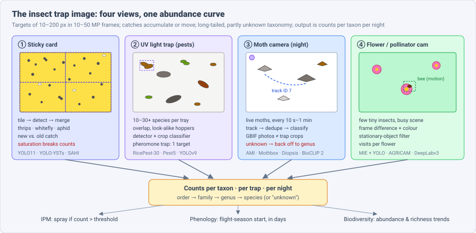
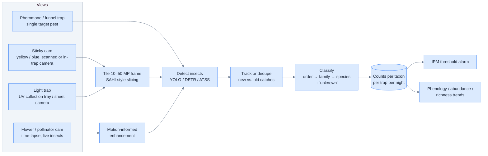
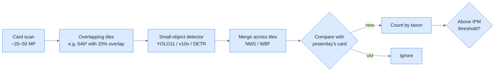
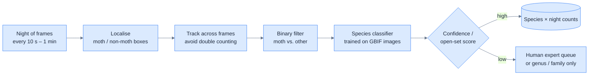
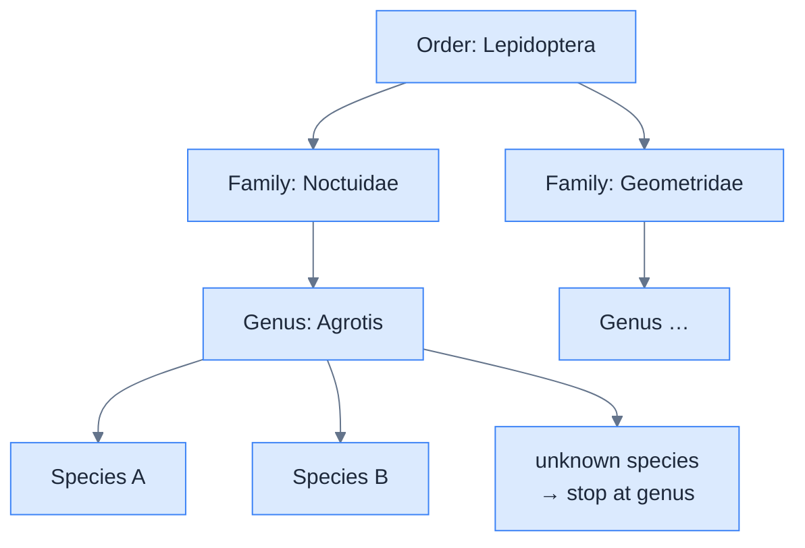

# Dense Object Detection & Classification — Recent Advances

*Compiled 2026-Nov-05 (America/Los_Angeles).*

Next installment in the running CV-updates log. Earlier entries:
[Apr-30](../2026-Apr-30/2026-Apr-30_CV_updates.md),
[May-01](../2026-May-01/2026-May-01_CV_updates.md),
[May-02](../2026-May-02/2026-May-02_CV_updates.md),
[May-04](../2026-May-04/2026-May-04_CV_updates.md),
[May-05](../2026-May-05/2026-May-05_CV_updates.md),
[May-07](../2026-May-07/2026-May-07_CV_updates.md),
[May-08](../2026-May-08/2026-May-08_CV_updates.md),
[May-15](../2026-May-15/2026-May-15_CV_updates.md),
[May-16](../2026-May-16/2026-May-16_CV_updates.md),
[May-17](../2026-May-17/2026-May-17_CV_updates.md),
[Jun-09](../2026-Jun-09/2026-Jun-09_CV_updates.md),
[Jun-10](../2026-Jun-10/2026-Jun-10_CV_updates.md),
[Jun-12](../2026-Jun-12/2026-Jun-12_CV_updates.md),
[Jun-15](../2026-Jun-15/2026-Jun-15_CV_updates.md),
[Jun-16](../2026-Jun-16/2026-Jun-16_CV_updates.md),
[Jun-17](../2026-Jun-17/2026-Jun-17_CV_updates.md),
[Jun-19](../2026-Jun-19/2026-Jun-19_CV_updates.md),
[Jun-21](../2026-Jun-21/2026-Jun-21_CV_updates.md),
[Jun-22](../2026-Jun-22/2026-Jun-22_CV_updates.md),
[Jun-23](../2026-Jun-23/2026-Jun-23_CV_updates.md),
[Jun-24](../2026-Jun-24/2026-Jun-24_CV_updates.md),
[Jun-25](../2026-Jun-25/2026-Jun-25_CV_updates.md),
[Jun-27](../2026-Jun-27/2026-Jun-27_CV_updates.md),
[Jun-29](../2026-Jun-29/2026-Jun-29_CV_updates.md),
[Jun-30](../2026-Jun-30/2026-Jun-30_CV_updates.md),
[Jul-04](../2026-Jul-04/2026-Jul-04_CV_updates.md),
[Jul-07](../2026-Jul-07/2026-Jul-07_CV_updates.md),
[Jul-08](../2026-Jul-08/2026-Jul-08_CV_updates.md),
[Jul-10](../2026-Jul-10/2026-Jul-10_CV_updates.md),
[Jul-15](../2026-Jul-15/2026-Jul-15_CV_updates.md),
[Jul-17](../2026-Jul-17/2026-Jul-17_CV_updates.md),
[Jul-18](../2026-Jul-18/2026-Jul-18_CV_updates.md),
[Jul-21](../2026-Jul-21/2026-Jul-21_CV_updates.md),
[Jul-22](../2026-Jul-22/2026-Jul-22_CV_updates.md),
[Jul-24](../2026-Jul-24/2026-Jul-24_CV_updates.md),
[Jul-26](../2026-Jul-26/2026-Jul-26_CV_updates.md),
[Jul-27](../2026-Jul-27/2026-Jul-27_CV_updates.md),
[Jul-30](../2026-Jul-30/2026-Jul-30_CV_updates.md),
[Aug-01](../2026-Aug-01/2026-Aug-01_CV_updates.md),
[Aug-02](../2026-Aug-02/2026-Aug-02_CV_updates.md),
[Aug-04](../2026-Aug-04/2026-Aug-04_CV_updates.md),
[Aug-07](../2026-Aug-07/2026-Aug-07_CV_updates.md),
[Aug-10](../2026-Aug-10/2026-Aug-10_CV_updates.md),
[Aug-11](../2026-Aug-11/2026-Aug-11_CV_updates.md),
[Aug-13](../2026-Aug-13/2026-Aug-13_CV_updates.md),
[Aug-15](../2026-Aug-15/2026-Aug-15_CV_updates.md),
[Aug-16](../2026-Aug-16/2026-Aug-16_CV_updates.md),
[Aug-18](../2026-Aug-18/2026-Aug-18_CV_updates.md),
[Aug-19](../2026-Aug-19/2026-Aug-19_CV_updates.md),
[Aug-21](../2026-Aug-21/2026-Aug-21_CV_updates.md),
[Aug-22](../2026-Aug-22/2026-Aug-22_CV_updates.md),
[Aug-24](../2026-Aug-24/2026-Aug-24_CV_updates.md),
[Aug-26](../2026-Aug-26/2026-Aug-26_CV_updates.md),
[Aug-29](../2026-Aug-29/2026-Aug-29_CV_updates.md),
[Sep-01](../2026-Sep-01/2026-Sep-01_CV_updates.md),
[Sep-20](../2026-Sep-20/2026-Sep-20_CV_updates.md),
[Sep-23](../2026-Sep-23/2026-Sep-23_CV_updates.md),
[Sep-24](../2026-Sep-24/2026-Sep-24_CV_updates.md),
[Sep-25](../2026-Sep-25/2026-Sep-25_CV_updates.md),
[Sep-26](../2026-Sep-26/2026-Sep-26_CV_updates.md),
[Sep-29](../2026-Sep-29/2026-Sep-29_CV_updates.md),
[Sep-30](../2026-Sep-30/2026-Sep-30_CV_updates.md),
[Oct-01](../2026-Oct-01/2026-Oct-01_CV_updates.md),
[Oct-02](../2026-Oct-02/2026-Oct-02_CV_updates.md),
[Oct-03](../2026-Oct-03/2026-Oct-03_CV_updates.md),
[Oct-04](../2026-Oct-04/2026-Oct-04_CV_updates.md),
[Oct-05](../2026-Oct-05/2026-Oct-05_CV_updates.md),
[Oct-06](../2026-Oct-06/2026-Oct-06_CV_updates.md),
[Oct-07](../2026-Oct-07/2026-Oct-07_CV_updates.md),
[Oct-08](../2026-Oct-08/2026-Oct-08_CV_updates.md),
[Oct-09](../2026-Oct-09/2026-Oct-09_CV_updates.md),
[Oct-10](../2026-Oct-10/2026-Oct-10_CV_updates.md),
[Oct-11](../2026-Oct-11/2026-Oct-11_CV_updates.md),
[Oct-12](../2026-Oct-12/2026-Oct-12_CV_updates.md),
[Oct-13](../2026-Oct-13/2026-Oct-13_CV_updates.md),
[Oct-14](../2026-Oct-14/2026-Oct-14_CV_updates.md),
[Oct-15](../2026-Oct-15/2026-Oct-15_CV_updates.md),
[Oct-16](../2026-Oct-16/2026-Oct-16_CV_updates.md),
[Oct-17](../2026-Oct-17/2026-Oct-17_CV_updates.md),
[Oct-18](../2026-Oct-18/2026-Oct-18_CV_updates.md),
[Oct-19](../2026-Oct-19/2026-Oct-19_CV_updates.md),
[Oct-20](../2026-Oct-20/2026-Oct-20_CV_updates.md),
[Oct-21](../2026-Oct-21/2026-Oct-21_CV_updates.md),
[Oct-22](../2026-Oct-22/2026-Oct-22_CV_updates.md),
[Oct-23](../2026-Oct-23/2026-Oct-23_CV_updates.md),
[Oct-24](../2026-Oct-24/2026-Oct-24_CV_updates.md),
[Oct-25](../2026-Oct-25/2026-Oct-25_CV_updates.md),
[Oct-26](../2026-Oct-26/2026-Oct-26_CV_updates.md),
[Oct-27](../2026-Oct-27/2026-Oct-27_CV_updates.md),
[Oct-28](../2026-Oct-28/2026-Oct-28_CV_updates.md),
[Oct-29](../2026-Oct-29/2026-Oct-29_CV_updates.md),
[Oct-30](../2026-Oct-30/2026-Oct-30_CV_updates.md),
[Oct-31](../2026-Oct-31/2026-Oct-31_CV_updates.md),
[Nov-01](../2026-Nov-01/2026-Nov-01_CV_updates.md),
[Nov-02](../2026-Nov-02/2026-Nov-02_CV_updates.md),
[Nov-03](../2026-Nov-03/2026-Nov-03_CV_updates.md),
[Nov-04](../2026-Nov-04/2026-Nov-04_CV_updates.md).

The last five entries covered
[waste-sorting](../2026-Oct-31/2026-Oct-31_CV_updates.md),
[pharmaceutical](../2026-Nov-01/2026-Nov-01_CV_updates.md),
[mining](../2026-Nov-02/2026-Nov-02_CV_updates.md),
[aquaculture](../2026-Nov-03/2026-Nov-03_CV_updates.md) and
[livestock-barn](../2026-Nov-04/2026-Nov-04_CV_updates.md) imagery.
This run stays on the farm but shrinks the target by three orders of
magnitude. It covers the **insect trap image**: the yellow or blue sticky
card in a greenhouse, the pheromone or funnel trap in an orchard, the UV
light trap over a rice paddy, the white-sheet moth camera at night, and the
time-lapse camera pointed at flowers.



---

## Table of contents

1. [Why this pass](#1--why-this-pass)
2. [The primitive: four views, one abundance curve](#2--the-primitive-four-views-one-abundance-curve)
3. [Sticky cards: tiny, touching, and saturating](#3--sticky-cards-tiny-touching-and-saturating)
4. [Light traps: dense multi-class pest benchmarks](#4--light-traps-dense-multi-class-pest-benchmarks)
5. [Moth cameras: detect, track, then classify thousands of species](#5--moth-cameras-detect-track-then-classify-thousands-of-species)
6. [Foundation-model priors and open-set insects](#6--foundation-model-priors-and-open-set-insects)
7. [Flower cameras and pollinators: motion is the signal](#7--flower-cameras-and-pollinators-motion-is-the-signal)
8. [Mosquitoes: vector surveillance from trap to phone](#8--mosquitoes-vector-surveillance-from-trap-to-phone)
9. [Evaluation: what the trap network actually checks](#9--evaluation-what-the-trap-network-actually-checks)
10. [Open problems / what to watch](#10--open-problems--what-to-watch)
11. [Sources](#11--sources)

---

## 1 · Why this pass

Searching the archive for *sticky trap*, *AMI*, *Mothbox*, *IP102*,
*planthopper*, *mosquito* and *pollinator* returns nothing beyond a
passing mention. The nearest earlier entries, which this pass stays clear
of:

- The [camera-trap](../2026-Oct-08/2026-Oct-08_CV_updates.md) entry covered
  vertebrates passing a PIR-triggered camera (MegaDetector → SpeciesNet).
  Insect cameras share the "trap" name and BioCLIP-style classifiers but
  almost nothing else: targets are 10–200 px, there is no trigger, and the
  attractant (light, colour, pheromone) is part of the sensor.
- The [in-field crop](../2026-Oct-09/2026-Oct-09_CV_updates.md) entry
  covered pests and disease *on the plant*. This entry covers insects
  *caught or attracted* to a device.
- The [livestock-barn](../2026-Nov-04/2026-Nov-04_CV_updates.md) and
  [dense-crowd](../2026-Oct-11/2026-Oct-11_CV_updates.md) entries covered
  counting look-alike individuals; §3 reuses that idea at a much smaller
  scale.

What makes the trap image a distinct primitive:

- **Tiny targets, huge frames.** A thrips on a 25 × 10 cm card scanned at
  high resolution is a few dozen pixels; a whitefly is not much bigger. The
  frame is 10–50 MP. Tiling (SAHI-style) is the default, not an option.
- **The trap is cumulative.** A sticky card is read daily or weekly and
  keeps everything it caught. Detection has to separate *new* catches from
  old ones, and accuracy collapses once the card saturates.
- **Long-tailed, fine-grained, partially unknown taxonomy.** A UK/Denmark
  moth classifier covers ~2,500 species; a Panamanian or Malaysian trap sees
  many species no model has seen. Open-set recognition is a core need.
- **Live vs. dead targets.** Moth and pollinator cameras watch live,
  moving insects, so the same individual appears in many frames.
  Counting needs tracking or deduplication.
- **The output is an ecological or IPM decision.** A pest count crossing an
  action threshold triggers spraying. A moth abundance series feeds
  biodiversity trend estimates. A mosquito species count feeds public
  health. mAP alone does not answer any of those.

---

## 2 · The primitive: four views, one abundance curve



| View | Typical sensor | Dense target | Main output | Public data (examples) |
|---|---|---|---|---|
| Sticky card | flatbed scan, phone, in-trap RPi camera | 10²–10³ tiny insects, touching | per-taxon count, IPM threshold | thrips/whitefly YST set (Front. Plant Sci. 2025), urban-insect set (Data in Brief 2025), grapevine YST (Zenodo) |
| Light trap (pest) | camera over collection tray or sticky plate | 10¹–10³ insects, many species, overlapping | multi-species count | RicePest-30, Pest5, planthopper sets |
| Moth light camera | RPi / DSLR over illuminated white sheet | 10¹–10² live moths per frame, all night | species abundance series | AMI-Traps / AMI-GBIF, Diopsis, Mothbox data |
| Pheromone trap | camera inside delta/funnel trap | 1 species, 0–10² individuals | target-pest count | mostly vendor-private |
| Flower camera | time-lapse RGB, track robot | few small insects on cluttered background | visits per flower | Aarhus MIE set, cocoa flower visitors |
| Mosquito trap | lab microscope / phone / robot camera | 10¹–10² specimens | species, sex, abdomen status | VectorBrain, USF smartphone sets |

---

## 3 · Sticky cards: tiny, touching, and saturating

The sticky card is the oldest and cheapest trap, and it now has
species-level public data.

- **Thrips vs. whitefly, species level** (*Frontiers in Plant Science*,
  Nov 2025). A labelled RGB set of thrips and whiteflies on one type of
  yellow sticky trap, trained with **YOLO11** and **YOLO-NAS**. Reported
  **79–89% mAP@50** on an independent test set. The authors flag that the
  model is tied to one trap type and call for cross-trap data
  ([PMC12669111](https://www.ncbi.nlm.nih.gov/pmc/articles/PMC12669111/);
  [Frontiers](https://www.frontiersin.org/journals/plant-science/articles/10.3389/fpls.2025.1668795/full)).
- **YOLO-YSTs** (*Agronomy* 15:575, Feb 2025). A YOLOv10n variant for
  yellow-sticky-trap pests aimed at edge devices. Reported **86.8% mAP50 at
  139 FPS** ([MDPI](https://mdpi.com/2073-4395/15/3/575)).
- **Urban insects on scanned cards** (*Data in Brief*, Jun 2025; Lim, Chan,
  Ong). More than **25,000 order-level bounding boxes** on scanned images,
  released for YOLO-style benchmarking
  ([UMS eprint](https://eprints.ums.edu.my/id/eprint/44483);
  [catalogue record](https://library.kab.ac.ug/Record/doaj-art-cb93157f7f3647e4b4983159f8971f6c)).
- **Whitefly counting with SAHI** (*Frontiers in Plant Science*, Oct 2025).
  Counts adult whiteflies and late-instar nymphs from AR-glasses images using
  a detector with built-in slicing-aided inference. Reported **mAP50 91.6%,
  recall 86.2%, precision 84.25%**, ahead of YOLO, RTMDet, Cascade R-CNN,
  DETR and DINO in the same setting
  ([Frontiers](https://www.frontiersin.org/journals/plant-science/articles/10.3389/fpls.2025.1687282/full)).
  The same paper names the two structural limits of cards: they miss
  non-flying stages (nymphs), and **"the saturated sticky surface"** makes
  counts unreliable exactly when populations peak.



**Why it matters for dense detection generally.** Sticky cards are the
cleanest real-world case of *tiny, touching, same-colour objects on a
uniform background*. The working recipe is the one used for
[remote-sensing](../2026-Aug-02/2026-Aug-02_CV_updates.md) small objects:
slice, detect, merge. The unsolved part is temporal: almost no public set
gives day-to-day sequences of the same card, so "new catch" detection is
rarely evaluated.

---

## 4 · Light traps: dense multi-class pest benchmarks

UV light traps over rice and field crops catch hundreds of insects of
dozens of species a night. China's plant-protection network runs thousands
of camera-equipped units, and 2025–26 brought larger public benchmarks.

- **RicePest-30** (*Agronomy* 16:53, Dec 2025). **8,848 images, 62,227
  instances, 30 rice pest species**. Field images come mostly from UV
  light traps in Hunan, mixed with lab close-ups and web images. Released
  with a benchmark of mainstream detectors
  ([MDPI](https://www.mdpi.com/2073-4395/16/1/53)).
- **Pest5 / PestDet** (*J. South China Agric. Univ.*, 2026). A light-trap
  dataset with an improved **ATSS** detector at **92.0% mAP, 40.2 FPS**
  ([SCAU](https://journal.scau.edu.cn/en/article/doi/10.7671/j.issn.1001-411X.202510033);
  [DOAJ](https://doaj.org/article/5145cff35b4442ee908d59be9cdb772f)).
- **Light-trap planthoppers** (*Smart Agriculture*, 2025). Targets dense,
  occluded, low-resolution brown and white-backed planthoppers with an
  improved **YOLOv11x**, +3.5 to +5.5 points over baseline
  ([SciOpen](https://www.sciopen.com/article/10.12133/j.smartag.SA202507024)).
  Earlier planthopper sets reached 7,328 high-density sticky light-trap
  images ([Agriculture 2023](https://www.mdpi.com/2077-0472/13/6/1155)).
- **Detect-then-classify with self-supervision** (*J. Integrative
  Agriculture*, 2025). A two-stage pipeline for light-trapped insects:
  Swin-T pre-trained with InsectSSRL and fine-tuned on **5%** of InsectID
  reached **80.35%** classification accuracy
  ([JIA](https://www.chinaagrisci.com/Jwk_zgnykxen/EN/abstract/abstract565013.shtml)).
- **Pheromone traps with built-in counting** (*Frontiers in Plant Science*,
  Mar 2025). Electro-killing pheromone traps with a network camera feed a
  **YOLOv9** detector; the platform covers attraction, kill, image capture,
  identification, counting and data traceability
  ([Frontiers](https://www.frontiersin.org/journals/plant-science/articles/10.3389/fpls.2025.1521594/epub)).

The pattern across these papers: a single-stage detector does
localisation and coarse class well. Fine species ID among look-alikes
(planthoppers, small moths) improves when a **second-stage crop
classifier** is added. This is the same split as
[MegaDetector → SpeciesNet](../2026-Oct-08/2026-Oct-08_CV_updates.md),
at 1/100th the pixel scale.

---

## 5 · Moth cameras: detect, track, then classify thousands of species

Non-lethal moth cameras photograph live moths on a lit white screen all
night. The European AMI line (Aarhus → UKCEH → Mila) and the low-cost
Mothbox are now the reference hardware.

- **AMI dataset** (Jain et al.; [arXiv 2406.12452](https://arxiv.org/abs/2406.12452)).
  Two parts: **AMI-GBIF** (citizen-science and museum images, used for
  training) and **AMI-Traps** (expert-annotated crops from automated traps in
  five countries, used for testing). Of 14,105 moth crops, 76.95% were
  labelled to family, 50.09% to genus and 38.10% to species. The gap between
  those numbers is itself a finding: experts cannot name most trap crops to
  species ([ResearchGate](https://www.researchgate.net/publication/386338544_Insect_Identification_in_the_Wild_The_AMI_Dataset)).
- **UKCEH AMI system** (*HardwareX* 27:e00822, 2026). The second-generation
  open-source hardware/software: single-board computer, USB camera,
  attractant lights, field-tested for scalable semi-autonomous monitoring
  ([NORA](https://nora.nerc.ac.uk/id/eprint/542184/)).
- **Mothbox + Mothbot** (bioRxiv 10.64898/2025.12.03.692171; covered in
  *Methods in Ecology and Evolution*). An open-source automated light trap
  for non-specialists, parts ~**US$375–450**, ultra-high-resolution photos,
  plus **Mothbot**, an ML and annotation tool for the resulting images
  ([bioRxiv](https://www.biorxiv.org/content/10.64898/2025.12.03.692171.full.pdf);
  [Methods blog, Jun 2026](https://methodsblog.com/2026/06/30/developing-the-mothbox-automated-light-trap/);
  [Wildlife Society](https://wildlife.org/insect-surveys-just-got-a-whole-lot-easier/)).
- **What three years of AMI data say** (Gillespie, Bjerge, Høye et al.,
  EcoEvoRxiv, v2). Twelve AMI traps across three regions of Denmark over
  three years. Automated data **shift phenology estimates by weeks** compared
  with manual sampling and improve biodiversity assessment
  ([EcoEvoRxiv](https://ecoevorxiv.org/repository/view/10577/)).
- **Diopsis (Netherlands, ARISE).** A solar-powered camera photographing a
  lit screen every 10 s. v2 units produced **>8.3 million photos** in 2023.
  The public detection split has **3,965 images (3280 × 2464) with 48,216
  boxes**. Annual reports note corrupt photos stalling the ARISE pipeline, a
  reminder that I/O robustness is part of the system
  ([2023 report](https://diopsis.eu/wp-content/uploads/2026/04/Jaarrapportage-DIOPSIS-Pilot-Project-2023.pdf)).



**The key lesson** is the same domain gap seen in the camera-trap entry:
classifiers are trained on clean GBIF photos (pinned specimens, daytime
pictures) and tested on blurry, top-down, UV-lit trap crops. A reported
species classifier for 2,530 UK and Danish species reaches **F1 0.784** on
AMI-Traps moths.

---

## 6 · Foundation-model priors and open-set insects

- **BioCLIP 2 as teacher for edge moth classifiers** (Gardiner et al.,
  Exeter/Aarhus; ICCV 2025 CV4E workshop;
  [arXiv 2508.20089](https://arxiv.org/abs/2508.20089);
  [CVF](https://openaccess.thecvf.com/content/ICCV2025W/CV4E/html/Gardiner_Bridging_Domain_Gaps_for_Fine-Grained_Moth_Classification_Through_Expert-Informed_Adaptation_ICCVW_2025_paper.html)).
  On **101 Danish moth species** (110 AMI images each), frozen BioCLIP 2
  features beat other backbones, and a ConvNeXt-tiny **distilled from
  BioCLIP 2** gets comparable accuracy at far lower cost. A third-party
  review reports that adding just **5% target-domain (trap) images** lifts
  accuracy by ~13–15 points, and distillation adds ~3.6 points over the
  plain student
  ([review](https://www.themoonlight.io/review/bridging-domain-gaps-for-fine-grained-moth-classification-through-expert-informed-adaptation-and-foundation-model-priors)).
- **Insect-Foundation / Insect-1M** (Nguyen et al., *IJCV* 2025;
  [arXiv 2311.15206](https://arxiv.org/abs/2311.15206);
  [project](https://uark-cviu.github.io/projects/insect-foundation)). A
  ViT-B/16 insect foundation model and large multimodal dataset aimed at
  detection and classification downstream tasks.
- **BioCLIP 2 / TreeOfLife-200M** ([arXiv 2505.23883](https://arxiv.org/abs/2505.23883);
  [project](https://imageomics.github.io/bioclip-2)). The general
  biology backbone that most 2025–26 insect papers now start from.
- **Open-set and hierarchy.** The *Open-Insect* benchmark targets species
  missing from training; its authors report that a simple max-softmax
  baseline stays competitive with more complex open-set methods.
  **BugNet** (Grele & Richards, *Frontiers in Ecology and Evolution*, Feb
  2026) reports that training with hierarchical labels improves handling of
  unknown taxa
  ([Frontiers](https://public-pages-files-2025.frontiersin.org/journals/ecology-and-evolution/articles/10.3389/fevo.2026.1750931/pdf);
  [Dryad data](https://datadryad.org/dataset/doi:10.5061/dryad.g1jwstr5f)).
  A July 2026 preprint applies hierarchical classification to camera-trap
  insect imagery from a German agricultural biodiversity project
  ([arXiv 2607.28005](https://arxiv.org/pdf/2607.28005)).



**Takeaway.** For insects, "back off to the deepest confident rank" is
emerging as the practical replacement for forced species labels. This
matches what experts did when annotating AMI-Traps.

---

## 7 · Flower cameras and pollinators: motion is the signal

Pollinator cameras watch live insects on cluttered, wind-moving
vegetation. A single frame is a poor signal; a sequence is better.

- **Motion-informed enhancement (MIE)** (Bjerge, Frigaard, Karstoft;
  *Sensors* 23:7242, 2023; [arXiv 2212.00423](https://arxiv.org/abs/2212.00423)).
  Uses frame differences and colour to boost insects before a CNN detector:
  YOLO micro-F1 rises from **0.49 to 0.71** and Faster R-CNN from **0.32 to
  0.56** on 107,387 time-lapse images with 9,423 annotated insects.
- **Field-scale pipeline** (Bjerge, Karstoft, Mann, Høye; *Ecological
  Informatics* 84, Dec 2024). Applied to **>10 million images** from **48
  insect camera traps** over two years. MIE + YOLO for arthropods, a
  stationary-object filter to stop double counting, and DeepLabv3 for flower
  cover ([Aarhus news](https://arctic.au.dk/news-and-events/news/show/artikel/a-deep-learning-pipeline-for-time-lapse-camera-monitoring-of-insects-and-their-floral-environments);
  [DOAJ](https://doaj.org/article/21188da303044bf191da90ab4f03f057)).
- **AGRICAM** ([arXiv 2608.29237](https://arxiv.org/pdf/2608.29237), Aug 2026).
  A track-mounted robot for crop pollination monitoring in blueberries.
  Uses Polytrack trajectories with background segmentation plus a **YOLOv12**
  honeybee detector (2,844 annotated images, **97.5% recall**) and a
  separate flower detector.
- **Cocoa flower visitors** ([arXiv 2412.19915](https://export.arxiv.org/pdf/2412.19915)).
  5,792 images of tiny visitors (biting midges, ants, aphids, spiders,
  encyrtid wasps) plus 1,082 background images, YOLOv8 baselines.
- *Note:* the BuzzSet v1.0 pollinator dataset (arXiv 2508.19762) has been
  **withdrawn** by its author and is not used here.

---

## 8 · Mosquitoes: vector surveillance from trap to phone

- **VectorBrain** (*Scientific Reports*, 2024). A light CNN on basic
  smartphone images for species, sex and abdomen status. Species
  accuracy **94.44 ± 2%** (macro-F1 94.10); abdomen status lower at
  **82.20 ± 3.1%** ([PMC11464746](https://www.ncbi.nlm.nih.gov/pmc/articles/PMC11464746/)).
- **YOLito** (bioRxiv 10.1101/2025.11.20.689454, Nov 2025). Ultralytics
  YOLO + SAHI slicing for small, moving *Aedes*, *Anopheles* and *Culex* in
  blood-feeding, sugar-feeding and oviposition assays. It is an assay-video
  tool, not a field trap, but shows the same tiling recipe as §3
  ([bioRxiv](https://www.biorxiv.org/content/10.1101/2025.11.20.689454.full.pdf)).
- **Smart and robotic traps.** A Taiwanese IoT trap separates *Aedes* from
  non-*Aedes* with **97%** recognition
  ([PMC9895108](https://www.ncbi.nlm.nih.gov/pmc/articles/PMC9895108/));
  the Dragonfly robot ran YOLOv4 on glue traps
  ([PMC9269550](https://www.ncbi.nlm.nih.gov/pmc/articles/PMC9269550/)).
- **Non-image alternatives.** FarmSense identifies insects by wingbeat
  frequency and body profile in a light curtain. A Kentucky Extension trial
  found it caught fewer pests than sticky traps but still recorded the target
  pests, with servicing every ~8 weeks instead of weekly
  ([UKY](https://kers.ca.uky.edu/core/reports/Story/s/16367/2025)).
  Trapview (camera pheromone traps, >40 countries) claims **>90%**
  identification accuracy; this is a vendor claim
  ([CORDIS](https://cordis.europa.eu/project/id/733979)).

---

## 9 · Evaluation: what the trap network actually checks

| What the user needs | Metric people report | Metric that matters |
|---|---|---|
| "Should I spray this week?" | mAP@50 per image | **count error near the action threshold**, false-alarm rate per trap per season |
| "How many new catches today?" | single-image detection | **new-vs-old catch accuracy** on sequential card images |
| "Is the card still readable?" | — | accuracy vs. **card density / saturation** curve |
| "Which moth species, how many?" | top-1 on curated crops | **per-night abundance error** after tracking/dedup; rank-backoff accuracy |
| "Is there a species we've never seen?" | closed-set accuracy | **open-set AUROC**, % routed to experts |
| "Will it work at a new site?" | random split | **leave-trap / leave-region out**, GBIF→trap domain shift |
| "When does the flight season start?" | — | **phenology bias in days** vs. manual sampling |

```mermaid
%%{init: {"theme":"base","themeVariables":{"primaryColor":"#dbeafe","primaryTextColor":"#1e293b","primaryBorderColor":"#3b82f6","lineColor":"#64748b","clusterBkg":"#f1f5f9","clusterBorder":"#94a3b8"}}}%%
flowchart LR
  subgraph Lab[Typical paper]
    A1[Random image split] --> A2[mAP@50 / top-1]
  end
  subgraph Field[What the trap network needs]
    B1[Leave-site split] --> B2[Count error at IPM threshold]
    B2 --> B3[Abundance & phenology bias]
    B3 --> B4[Open-set routing to experts]
  end
  Lab -. gap .-> Field
```

---

## 10 · Open problems / what to watch

1. **Saturation and time.** No widely used benchmark gives sequential images
   of the same sticky card through to saturation. Until one exists, "new
   catch" counting and late-season accuracy stay unmeasured.
2. **Cross-trap generalisation.** The 2025 thrips/whitefly work trained on
   one card type. Card colour, glue sheen and scan vs. phone capture all
   shift the domain. Expect multi-trap, multi-site releases.
3. **GBIF → trap domain gap.** The fix that works today is a small labelled
   target set (5% helps a lot) plus foundation-model distillation. Watch
   for self-supervised pre-training on millions of unlabelled AMI/Diopsis
   frames.
4. **Open-set by default.** Tropical deployments (Mothbox in Panama, AMI in
   the Barro Colorado, Panama trial) see many unknown species. Hierarchical backoff
   and expert-routing rates should become reported metrics.
5. **Tracking live insects.** Moth and pollinator counts need
   deduplication across frames. Current pipelines use simple trackers or
   stationary filters; MOT methods from the
   [sports](../2026-Oct-10/2026-Oct-10_CV_updates.md) and
   [livestock](../2026-Nov-04/2026-Nov-04_CV_updates.md) entries have not
   been benchmarked here.
6. **Edge vs. cloud.** Distilled ConvNeXt-tiny students and YOLOv10n-class
   detectors make on-trap inference practical. Reported FPS rarely includes
   tiling cost on 20–50 MP frames.
7. **Independent validation of commercial traps.** Vendor accuracy claims
   (>90%) lack peer-reviewed field tests; Extension trials show performance
   depends on whether the model was trained for the local target pest.

---

## 11 · Sources

### Sticky cards (§3)
- Thrips & whitefly species-level YOLO (Front. Plant Sci. 2025) — https://www.ncbi.nlm.nih.gov/pmc/articles/PMC12669111/ — https://www.frontiersin.org/journals/plant-science/articles/10.3389/fpls.2025.1668795/full
- YOLO-YSTs (Agronomy 15:575, 2025) — https://mdpi.com/2073-4395/15/3/575
- Urban insect dataset (Data in Brief 2025) — https://eprints.ums.edu.my/id/eprint/44483 — https://library.kab.ac.ug/Record/doaj-art-cb93157f7f3647e4b4983159f8971f6c
- Whitefly SAHI counting (Front. Plant Sci. 2025) — https://www.frontiersin.org/journals/plant-science/articles/10.3389/fpls.2025.1687282/full
- Grapevine YST dataset (Zenodo 2024) — https://zenodo.org/record/11441757

### Light and pheromone traps (§4)
- RicePest-30 (Agronomy 16:53) — https://www.mdpi.com/2073-4395/16/1/53
- Pest5 / PestDet (J. SCAU 2026) — https://journal.scau.edu.cn/en/article/doi/10.7671/j.issn.1001-411X.202510033 — https://doaj.org/article/5145cff35b4442ee908d59be9cdb772f
- Light-trap planthoppers (Smart Agriculture 2025) — https://www.sciopen.com/article/10.12133/j.smartag.SA202507024
- Planthopper sticky light-trap set (Agriculture 2023) — https://www.mdpi.com/2077-0472/13/6/1155
- InsectSSRL two-stage pipeline (JIA 2025) — https://www.chinaagrisci.com/Jwk_zgnykxen/EN/abstract/abstract565013.shtml
- Smart electro-killing pheromone trap + YOLOv9 (Front. Plant Sci. 2025) — https://www.frontiersin.org/journals/plant-science/articles/10.3389/fpls.2025.1521594/epub
- Fine-grained insect pest recognition review (Neotrop. Entomol. 2026) — https://www.alice.cnptia.embrapa.br/alice/bitstream/doc/1186931/1/2026-Lau-Fine-Grained-Recognition-of-Insect-Pests-from-Digital-Images.pdf
- Ding & Taylor, moth detection from trap images (2016 baseline) — https://arxiv.org/pdf/1602.07383

### Moth cameras (§5)
- AMI dataset, arXiv 2406.12452 — https://arxiv.org/abs/2406.12452 — https://www.researchgate.net/publication/386338544_Insect_Identification_in_the_Wild_The_AMI_Dataset
- UKCEH AMI system (HardwareX 2026) — https://nora.nerc.ac.uk/id/eprint/542184/ — https://www.biorxiv.org/content/10.64898/2026.02.06.704388v1.full.pdf
- Mothbox / Mothbot — https://www.biorxiv.org/content/10.64898/2025.12.03.692171.full.pdf — https://methodsblog.com/2026/06/30/developing-the-mothbox-automated-light-trap/ — https://wildlife.org/insect-surveys-just-got-a-whole-lot-easier/ — https://wildlabs.net/node/14855
- Gillespie et al., automated insect monitoring with camera traps (EcoEvoRxiv) — https://ecoevorxiv.org/repository/view/10577/
- Bjerge et al., automated moth light trap (Sensors 2021) — https://www.ncbi.nlm.nih.gov/pmc/articles/PMC7825571/
- Light-based camera trap monitoring, arXiv 2307.15433 — https://arxiv.org/pdf/2307.15433
- ML pipeline for automated insect monitoring (NeurIPS 2023 CCAI) — https://www.climatechange.ai/papers/neurips2023/47
- Standardized framework for AI image-based nocturnal insect monitoring — https://www.ncbi.nlm.nih.gov/pmc/articles/PMC11070254/
- Diopsis 2023 report — https://diopsis.eu/wp-content/uploads/2026/04/Jaarrapportage-DIOPSIS-Pilot-Project-2023.pdf
- Barro Colorado AMI / Diopsis / Automoth trial (NERC) — https://data-search.nerc.ac.uk/geonetwork/srv/api/records/b088d4bd-4abb-46d4-bc90-f4e58c65f324

### Foundation models and open set (§6)
- Gardiner et al., arXiv 2508.20089 (ICCV 2025 CV4E) — https://arxiv.org/abs/2508.20089 — https://openaccess.thecvf.com/content/ICCV2025W/CV4E/html/Gardiner_Bridging_Domain_Gaps_for_Fine-Grained_Moth_Classification_Through_Expert-Informed_Adaptation_ICCVW_2025_paper.html
- Insect-Foundation, arXiv 2311.15206 — https://arxiv.org/abs/2311.15206 — https://uark-cviu.github.io/projects/insect-foundation
- BioCLIP 2, arXiv 2505.23883 — https://imageomics.github.io/bioclip-2
- BugNet (Front. Ecol. Evol. 2026) — https://public-pages-files-2025.frontiersin.org/journals/ecology-and-evolution/articles/10.3389/fevo.2026.1750931/pdf — https://datadryad.org/dataset/doi:10.5061/dryad.g1jwstr5f
- Hierarchical insect classification, arXiv 2607.28005 — https://arxiv.org/pdf/2607.28005
- Jain et al. (Mila) insect monitoring pipeline, arXiv 2406.13031 — https://arxiv.org/abs/2406.13031

### Flower cameras (§7)
- Motion-informed detection, arXiv 2212.00423 — https://arxiv.org/abs/2212.00423
- Field-scale pipeline (Ecol. Inform. 2024) — https://doaj.org/article/21188da303044bf191da90ab4f03f057 — https://arctic.au.dk/news-and-events/news/show/artikel/a-deep-learning-pipeline-for-time-lapse-camera-monitoring-of-insects-and-their-floral-environments
- AGRICAM, arXiv 2608.29237 — https://arxiv.org/pdf/2608.29237
- Cocoa flower visitors, arXiv 2412.19915 — https://export.arxiv.org/pdf/2412.19915
- BuzzSet v1.0 (withdrawn), arXiv 2508.19762 — https://arxiv.org/abs/2508.19762v4

### Mosquitoes and commercial traps (§8)
- VectorBrain (Sci. Rep. 2024) — https://www.ncbi.nlm.nih.gov/pmc/articles/PMC11464746/
- YOLito (bioRxiv 2025) — https://www.biorxiv.org/content/10.1101/2025.11.20.689454.full.pdf
- IoT smart mosquito trap — https://www.ncbi.nlm.nih.gov/pmc/articles/PMC9895108/
- Dragonfly robot — https://www.ncbi.nlm.nih.gov/pmc/articles/PMC9269550/
- Minakshi et al., trapped-specimen surveillance, arXiv 2005.12188 — https://arxiv.org/pdf/2005.12188
- FarmSense Extension evaluation — https://kers.ca.uky.edu/core/reports/Story/s/16367/2025
- Trapview (CORDIS) — https://cordis.europa.eu/project/id/733979

*Research note: direct page fetches to arxiv.org, biorxiv.org and
ecoevorxiv.org failed (hosts not reachable under this session's network
policy), so figures come from search-indexed abstracts, publisher listings
and aggregators. The Gardiner et al. accuracy gains are from a third-party
review, and the 0.784 F1 figure for the 2,530-species AMI classifier is
from a citing paper; neither was checked against the primary PDF. The
Open-Insect benchmark's date and venue were not confirmed. All accuracies
are the authors' own on different, mostly single-site test sets and are not
comparable across rows.*
