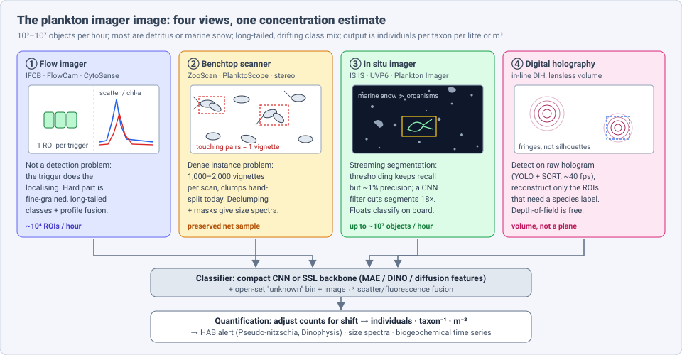
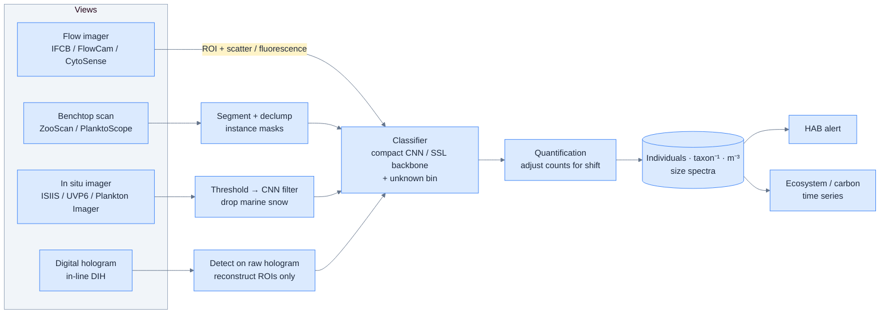
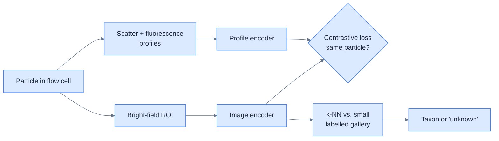
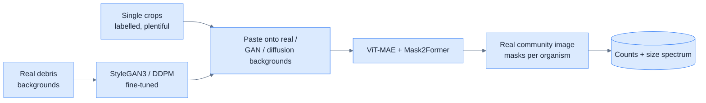
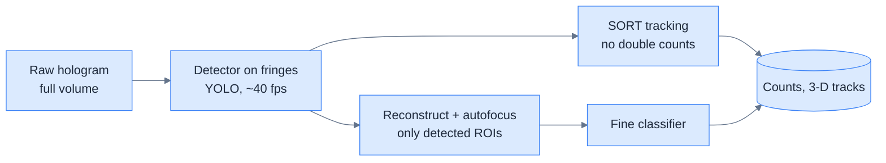
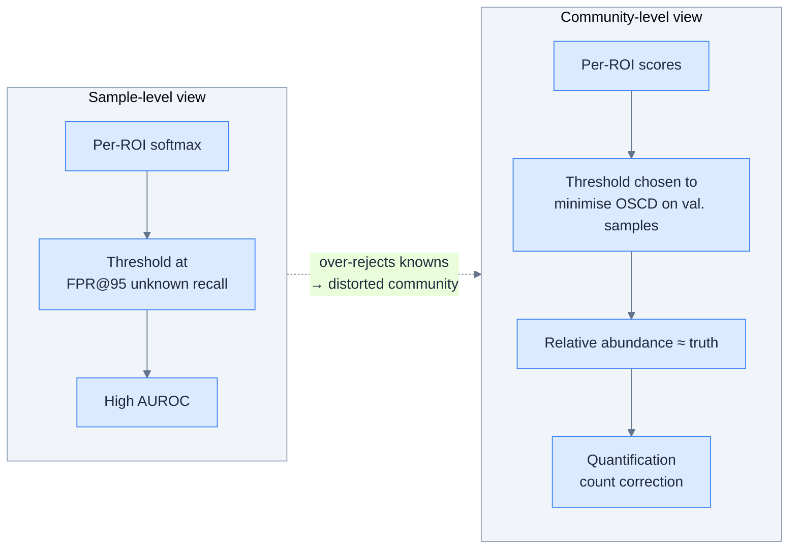
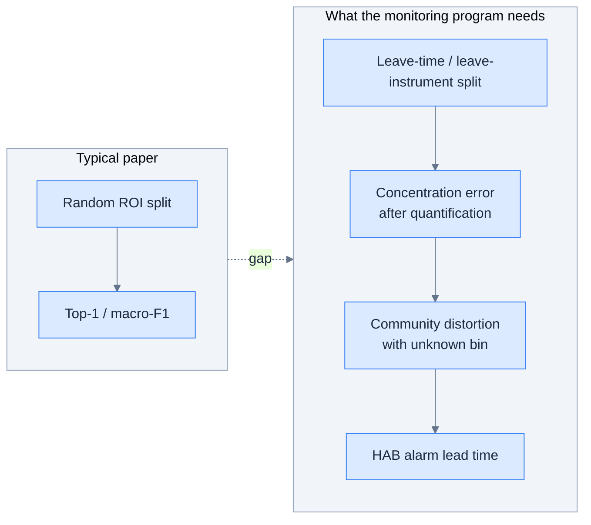

# Dense Object Detection & Classification — Recent Advances

*Compiled 2026-Nov-06 (America/Los_Angeles).*

Next installment in the running CV-updates log. Earlier entries:
[Apr-30](../2026-Apr-30/2026-Apr-30_CV_updates.md),
[May-01](../2026-May-01/2026-May-01_CV_updates.md),
[May-02](../2026-May-02/2026-May-02_CV_updates.md),
[May-04](../2026-May-04/2026-May-04_CV_updates.md),
[May-05](../2026-May-05/2026-May-05_CV_updates.md),
[May-07](../2026-May-07/2026-May-07_CV_updates.md),
[May-08](../2026-May-08/2026-May-08_CV_updates.md),
[May-15](../2026-May-15/2026-May-15_CV_updates.md),
[May-16](../2026-May-16/2026-May-16_CV_updates.md),
[May-17](../2026-May-17/2026-May-17_CV_updates.md),
[Jun-09](../2026-Jun-09/2026-Jun-09_CV_updates.md),
[Jun-10](../2026-Jun-10/2026-Jun-10_CV_updates.md),
[Jun-12](../2026-Jun-12/2026-Jun-12_CV_updates.md),
[Jun-15](../2026-Jun-15/2026-Jun-15_CV_updates.md),
[Jun-16](../2026-Jun-16/2026-Jun-16_CV_updates.md),
[Jun-17](../2026-Jun-17/2026-Jun-17_CV_updates.md),
[Jun-19](../2026-Jun-19/2026-Jun-19_CV_updates.md),
[Jun-21](../2026-Jun-21/2026-Jun-21_CV_updates.md),
[Jun-22](../2026-Jun-22/2026-Jun-22_CV_updates.md),
[Jun-23](../2026-Jun-23/2026-Jun-23_CV_updates.md),
[Jun-24](../2026-Jun-24/2026-Jun-24_CV_updates.md),
[Jun-25](../2026-Jun-25/2026-Jun-25_CV_updates.md),
[Jun-27](../2026-Jun-27/2026-Jun-27_CV_updates.md),
[Jun-29](../2026-Jun-29/2026-Jun-29_CV_updates.md),
[Jun-30](../2026-Jun-30/2026-Jun-30_CV_updates.md),
[Jul-04](../2026-Jul-04/2026-Jul-04_CV_updates.md),
[Jul-07](../2026-Jul-07/2026-Jul-07_CV_updates.md),
[Jul-08](../2026-Jul-08/2026-Jul-08_CV_updates.md),
[Jul-10](../2026-Jul-10/2026-Jul-10_CV_updates.md),
[Jul-15](../2026-Jul-15/2026-Jul-15_CV_updates.md),
[Jul-17](../2026-Jul-17/2026-Jul-17_CV_updates.md),
[Jul-18](../2026-Jul-18/2026-Jul-18_CV_updates.md),
[Jul-21](../2026-Jul-21/2026-Jul-21_CV_updates.md),
[Jul-22](../2026-Jul-22/2026-Jul-22_CV_updates.md),
[Jul-24](../2026-Jul-24/2026-Jul-24_CV_updates.md),
[Jul-26](../2026-Jul-26/2026-Jul-26_CV_updates.md),
[Jul-27](../2026-Jul-27/2026-Jul-27_CV_updates.md),
[Jul-30](../2026-Jul-30/2026-Jul-30_CV_updates.md),
[Aug-01](../2026-Aug-01/2026-Aug-01_CV_updates.md),
[Aug-02](../2026-Aug-02/2026-Aug-02_CV_updates.md),
[Aug-04](../2026-Aug-04/2026-Aug-04_CV_updates.md),
[Aug-07](../2026-Aug-07/2026-Aug-07_CV_updates.md),
[Aug-10](../2026-Aug-10/2026-Aug-10_CV_updates.md),
[Aug-11](../2026-Aug-11/2026-Aug-11_CV_updates.md),
[Aug-13](../2026-Aug-13/2026-Aug-13_CV_updates.md),
[Aug-15](../2026-Aug-15/2026-Aug-15_CV_updates.md),
[Aug-16](../2026-Aug-16/2026-Aug-16_CV_updates.md),
[Aug-18](../2026-Aug-18/2026-Aug-18_CV_updates.md),
[Aug-19](../2026-Aug-19/2026-Aug-19_CV_updates.md),
[Aug-21](../2026-Aug-21/2026-Aug-21_CV_updates.md),
[Aug-22](../2026-Aug-22/2026-Aug-22_CV_updates.md),
[Aug-24](../2026-Aug-24/2026-Aug-24_CV_updates.md),
[Aug-26](../2026-Aug-26/2026-Aug-26_CV_updates.md),
[Aug-29](../2026-Aug-29/2026-Aug-29_CV_updates.md),
[Sep-01](../2026-Sep-01/2026-Sep-01_CV_updates.md),
[Sep-20](../2026-Sep-20/2026-Sep-20_CV_updates.md),
[Sep-23](../2026-Sep-23/2026-Sep-23_CV_updates.md),
[Sep-24](../2026-Sep-24/2026-Sep-24_CV_updates.md),
[Sep-25](../2026-Sep-25/2026-Sep-25_CV_updates.md),
[Sep-26](../2026-Sep-26/2026-Sep-26_CV_updates.md),
[Sep-29](../2026-Sep-29/2026-Sep-29_CV_updates.md),
[Sep-30](../2026-Sep-30/2026-Sep-30_CV_updates.md),
[Oct-01](../2026-Oct-01/2026-Oct-01_CV_updates.md),
[Oct-02](../2026-Oct-02/2026-Oct-02_CV_updates.md),
[Oct-03](../2026-Oct-03/2026-Oct-03_CV_updates.md),
[Oct-04](../2026-Oct-04/2026-Oct-04_CV_updates.md),
[Oct-05](../2026-Oct-05/2026-Oct-05_CV_updates.md),
[Oct-06](../2026-Oct-06/2026-Oct-06_CV_updates.md),
[Oct-07](../2026-Oct-07/2026-Oct-07_CV_updates.md),
[Oct-08](../2026-Oct-08/2026-Oct-08_CV_updates.md),
[Oct-09](../2026-Oct-09/2026-Oct-09_CV_updates.md),
[Oct-10](../2026-Oct-10/2026-Oct-10_CV_updates.md),
[Oct-11](../2026-Oct-11/2026-Oct-11_CV_updates.md),
[Oct-12](../2026-Oct-12/2026-Oct-12_CV_updates.md),
[Oct-13](../2026-Oct-13/2026-Oct-13_CV_updates.md),
[Oct-14](../2026-Oct-14/2026-Oct-14_CV_updates.md),
[Oct-15](../2026-Oct-15/2026-Oct-15_CV_updates.md),
[Oct-16](../2026-Oct-16/2026-Oct-16_CV_updates.md),
[Oct-17](../2026-Oct-17/2026-Oct-17_CV_updates.md),
[Oct-18](../2026-Oct-18/2026-Oct-18_CV_updates.md),
[Oct-19](../2026-Oct-19/2026-Oct-19_CV_updates.md),
[Oct-20](../2026-Oct-20/2026-Oct-20_CV_updates.md),
[Oct-21](../2026-Oct-21/2026-Oct-21_CV_updates.md),
[Oct-22](../2026-Oct-22/2026-Oct-22_CV_updates.md),
[Oct-23](../2026-Oct-23/2026-Oct-23_CV_updates.md),
[Oct-24](../2026-Oct-24/2026-Oct-24_CV_updates.md),
[Oct-25](../2026-Oct-25/2026-Oct-25_CV_updates.md),
[Oct-26](../2026-Oct-26/2026-Oct-26_CV_updates.md),
[Oct-27](../2026-Oct-27/2026-Oct-27_CV_updates.md),
[Oct-28](../2026-Oct-28/2026-Oct-28_CV_updates.md),
[Oct-29](../2026-Oct-29/2026-Oct-29_CV_updates.md),
[Oct-30](../2026-Oct-30/2026-Oct-30_CV_updates.md),
[Oct-31](../2026-Oct-31/2026-Oct-31_CV_updates.md),
[Nov-01](../2026-Nov-01/2026-Nov-01_CV_updates.md),
[Nov-02](../2026-Nov-02/2026-Nov-02_CV_updates.md),
[Nov-03](../2026-Nov-03/2026-Nov-03_CV_updates.md),
[Nov-04](../2026-Nov-04/2026-Nov-04_CV_updates.md),
[Nov-05](../2026-Nov-05/2026-Nov-05_CV_updates.md).

The last five entries covered
[pharmaceutical](../2026-Nov-01/2026-Nov-01_CV_updates.md),
[mining](../2026-Nov-02/2026-Nov-02_CV_updates.md),
[aquaculture](../2026-Nov-03/2026-Nov-03_CV_updates.md),
[livestock-barn](../2026-Nov-04/2026-Nov-04_CV_updates.md) and
[insect-trap](../2026-Nov-05/2026-Nov-05_CV_updates.md) imagery.
This run keeps the "count small organisms" theme but moves into water. It
covers the **plankton imager image**: the Imaging FlowCytobot (IFCB) and
FlowCam flow cell, the ZooScan and PlanktoScope tray scan, the UVP6 on a
float or glider, the ISIIS shadowgraph towed behind a ship, and the
digital in-line hologram.

---

## Table of contents

1. [Why this pass](#1--why-this-pass)
2. [The primitive: four views, one concentration estimate](#2--the-primitive-four-views-one-concentration-estimate)
3. [Benchmarks: small models are enough](#3--benchmarks-small-models-are-enough)
4. [Self-supervised and cross-modal backbones](#4--self-supervised-and-cross-modal-backbones)
5. [Dense scans: declumping and instance segmentation](#5--dense-scans-declumping-and-instance-segmentation)
6. [In situ streams: segmentation, marine snow and on-board models](#6--in-situ-streams-segmentation-marine-snow-and-on-board-models)
7. [Holography: detect before you reconstruct](#7--holography-detect-before-you-reconstruct)
8. [Shift, open set and quantification: from labels to concentrations](#8--shift-open-set-and-quantification-from-labels-to-concentrations)
9. [Operational networks: harmful algal bloom early warning](#9--operational-networks-harmful-algal-bloom-early-warning)
10. [Evaluation: what the monitoring program actually checks](#10--evaluation-what-the-monitoring-program-actually-checks)
11. [Open problems / what to watch](#11--open-problems--what-to-watch)
12. [Sources](#12--sources)

---

## 1 · Why this pass

Searching the archive for *ZooScan*, *UVP*, *FlowCam*, *holograph*,
*EcoTaxa* and *quantification* finds nothing. *Plankton* and *IFCB* turn up
only as one bullet in the
[underwater imagery](../2026-Jul-08/2026-Jul-08_CV_updates.md) entry
(MedPlanktonSet and the open-set idea). The nearest earlier entries, which
this pass stays clear of:

- The [underwater](../2026-Jul-08/2026-Jul-08_CV_updates.md) entry covered
  ROV/diver imagery of fish, coral and the benthos (FathomNet, ReefNet). Plankton
  imagers are purpose-built microscopes or shadowgraphs: one particle per
  frame or thousands per second, almost no scene context.
- The [aquaculture](../2026-Nov-03/2026-Nov-03_CV_updates.md) entry mentioned
  sea-lice larvae "among plankton" in water samples. This entry is about the
  plankton itself.
- The [cytology smear](../2026-Oct-06/2026-Oct-06_CV_updates.md) and
  [insect-trap](../2026-Nov-05/2026-Nov-05_CV_updates.md) entries covered
  look-alike small objects on a slide or a card. The tray scan in §5 is
  their aquatic sibling.

What makes the plankton imager image a distinct primitive:

- **The instrument often does the localising.** A flow imager triggers on
  scatter or fluorescence and saves one region of interest (ROI) per
  particle. "Detection" moves into hardware. What is left is
  classification of tiny, mostly grayscale crops, plus fusion with the
  optical trace that came with them.
- **When it does not, the frame is mostly junk.** An in situ shadowgraph or
  line-scan camera sees marine snow, detritus and bubbles far more often
  than organisms. Throughput is enormous: ISIIS is reported at up to
  **~11 million objects per hour**, versus **~10,000** for the IFCB.
- **Touching organisms in preserved samples.** A ZooScan tray holds
  1,000–2,000 vignettes per scan, and a share of them are several animals
  stuck together. Each clump biases size and count.
- **Long tail and drift.** A few classes (detritus, small flagellates,
  copepods) dominate. The species mix changes with season, place and
  bloom, so the test distribution never matches training.
- **The output is a concentration, not a label.** Ecologists want
  individuals per taxon per litre or m³, size spectra and bloom alerts.
  Per-image accuracy matters only through its effect on those numbers.

---

## 2 · The primitive: four views, one concentration estimate

| View | Typical instrument | Dense target | Main output | Public data (examples) |
|---|---|---|---|---|
| Flow imager | IFCB, FlowCam, CytoSense | 1 ROI per trigger, ~10⁴ ROIs/hour | phytoplankton counts by taxon | WHOI-Plankton, SYKE-plankton_IFCB_2022, SMHI IFCB library, FlowCAMNet |
| Benchtop scan | ZooScan, PlanktoScope, stereo microscope | 10³ vignettes per tray, some touching | zooplankton counts and size spectra | ZooScanNet, SEANOE ZooScan declumping masks, ZMIS5K |
| In situ shadowgraph / line scan | ISIIS, UVP6, Plankton Imager (RAPID) | 10⁵–10⁷ objects/hour, mostly snow | concentration profiles with depth | ISIISNet, UVP6Net |
| Lake camera | Dual Scripps Plankton Camera (Aquascope) | ROIs from dark-field microscope | lake zooplankton time series | ZooLake (Eawag) |
| Digital hologram | in-line DIH on profilers or moorings | particles through a volume | counts, 3-D positions, tracks | mostly per-paper sets |

---

## 3 · Benchmarks: small models are enough

The most useful 2026 result is a sobering one.

- **Panaïotis et al., ESSD 18:945–967 (Feb 2026).** "Benchmark of plankton
  images classification: emphasizing features extraction over classifier
  complexity." The authors argue that most earlier studies used small,
  unpublished datasets that lack realism in size, class diversity and
  proportions. They benchmark handcrafted-feature classifiers against CNNs
  and vision transformers on large public sets from widely used
  instruments: **FlowCAMNet, UVP6Net, ZooCAMNet, ZooScanNet and
  WHOI-Plankton** (the preprint also listed ISIISNet). A **relatively small
  CNN** performs best, especially on rare classes. Their conclusion: for
  small grayscale plankton images, compact models are sufficient
  ([ESSD](https://essd.copernicus.org/articles/18/945/2026/);
  [preprint discussion](https://essd.copernicus.org/preprints/essd-2025-309);
  code on Zenodo as `ThelmaPana/plankton_classif`).
- **Cross-instrument pooling** (Chauhan, Clark, Fileman, Widdicombe, Ruhl,
  Rowlands; *IEEE Access* 14:9473–9489, 2026,
  doi:10.1109/ACCESS.2026.3652320). Models were trained on **145 IFCB** and
  **193 FlowCam** categories, then on a combined **236-category** label
  space. FlowCam image features were fused with **29 metadata
  attributes**; IFCB had images only. The combined model reached **84.6%**
  test accuracy, with fewer classes below F1 0.5 and **+4.5 points** average
  F1 on the hardest classes
  ([PML eprint](https://plymsea.ac.uk/id/eprint/10648/)).
- **Open tooling for FlowCam.** A March 2026 *PeerJ* pipeline replaces the
  vendor VisualSpreadsheet workflow with modular open-source steps, a
  label-checking tool and a shallow multi-input classifier
  ([PubMed 41907466](https://pubmed.ncbi.nlm.nih.gov/41907466/)).
  A USGS FlowCam CNN reports **86%** overall apparent accuracy, but also
  notes that more than half of its images were zooplankton, detritus or
  unidentifiable
  ([USGS data release](https://www.usgs.gov/data/images-phytoplankton-used-development-a-convolutional-neural-network-automate-phytoplankton)).
- **Operational IFCB model.** SMHI's open **IFCB Plankton Classifier** (web
  app, ResNet-50) is trained on the SMHI IFCB Plankton Image Reference
  Library plus NIVA data, last updated Aug 2026
  ([SciLifeLab Serve](https://serve.scilifelab.se/records/6ajxb-8hr75/);
  [reference library](https://researchdata.se/en/catalogue/dataset/doi-10-17044-scilifelab-25883455)).
  SMHI's 2026 monthly algae reports name the model in use: a pooled
  "SMHI-NIVA-SYKE-SAMS-SZN-ResNet50 (V6)", with a human validator
  ([SMHI report, Sep 2026](https://www.smhi.se/download/18.3fff79411a03d0afb4e6625/1789643690570/algsit26_09.pdf)).

**Why it matters for dense detection generally.** Plankton is the clearest
case where the *ROI pipeline* (instrument trigger → crop → small classifier)
beats an end-to-end detector. Model capacity is not the bottleneck: label
coverage across instruments and seasons is. Pooling labs and instruments
(SMHI's five-institute model, the IFCB+FlowCam label space) does more than
a bigger backbone.

---

## 4 · Self-supervised and cross-modal backbones

Plankton labs hold far more unlabelled ROIs than labelled ones. 2025–26
work shows how to use them.

- **MAE pre-training on plankton** (Kareinen et al., CVPR 2025 FGVC12
  workshop; [arXiv 2503.11341](https://arxiv.org/abs/2503.11341);
  [CVF anthology](https://mlanthology.org/cvprw/2025/kareinen2025cvprw-selfsupervised)).
  A masked autoencoder pre-trained on a pool of public plankton datasets
  beats ImageNet pre-training when labels are scarce. It matches ImageNet
  with far fewer pre-training images. Adding the *unlabelled target* data to
  pre-training helps further.
- **Frozen diffusion features** (Nieto Juscafresa, Mazcuñán Herreros,
  Sullivan; [arXiv 2601.13416](https://arxiv.org/abs/2601.13416), Jan 2026).
  Linear probes on intermediate denoising features of an unconditional
  diffusion model (DDAE-style), swept over layers and timesteps. They are
  competitive with supervised baselines and beat other self-supervised
  methods in balanced *and naturally long-tailed* settings. They also hold
  up on temporally and geographically shifted test sets. The authors report
  them ahead of DINOv3 under their protocol.
- **Image ⇄ optical-profile contrastive learning** (Kareinen et al.,
  [arXiv 2603.16427](https://arxiv.org/abs/2603.16427), Mar 2026;
  [code](https://github.com/Jookare/cross-modal-plankton)). CytoSense
  records both a bright-field image and scatter/fluorescence profiles for
  each particle. Encoders are trained CLIP-style with only "same particle /
  different particle" supervision. Recognition is a **k-NN over a small
  labelled gallery**, and it beats an image-only DINO baseline with very
  few labels.
- **Towards a pelagic foundation model.** The ELLIS-advertised **AqQua**
  project aims to train a foundation model of aquatic life on billions of
  imager ROIs. So far it has published a hiring call, not a model
  ([ELLIS](https://ellis.eu/jobs/postdoc-research-engineer-position-in-the-aqqua-project-building-a-foundation-model-of-aquatic-life)).

**Takeaway.** The plankton community is heading where
[camera-trap](../2026-Oct-08/2026-Oct-08_CV_updates.md) and
[insect](../2026-Nov-05/2026-Nov-05_CV_updates.md) work already is: a
domain-pre-trained backbone plus light per-site heads. The twist is the
second modality that flow cytometers record for free.

---

## 5 · Dense scans: declumping and instance segmentation

Tray scans and stereo-microscope images are the one plankton view that is
a true dense-instance problem.

- **ZooScan declumping data** (SEANOE, 2024–25). About **14k vignettes**
  where a human operator drew white lines to separate touching objects,
  plus **~5k** correctly isolated single objects, with binary masks for all.
  Split 70/15/15. Operators currently do this by hand on the full frame
  ([SEANOE 99663](https://seanoe.org/data/00885/99663)). A 2025 Utrecht MSc
  thesis, "Declumping the Clumps", trains instance segmentation on it
  ([UU theses](https://studenttheses.uu.nl/handle/20.500.12932/50326)).
- **PlankFormer** (Miyazaki, Otake, Ito, Makino, Urabe, Aoki; Tohoku/Kyoto;
  [arXiv 2604.17856](https://arxiv.org/abs/2604.17856), Apr 2026). No public
  pixel-labelled plankton *community* images exist, so the authors build
  **Pseudo Community Images**. They paste individual plankton crops onto
  real or generated backgrounds (StyleGAN3 and DDPM fine-tuned on real
  debris-filled backgrounds). A **MAE-pre-trained ViT encoder with a
  Mask2Former decoder** is trained on them. It beats Mask R-CNN most clearly
  in high-debris scenes on two real lake community sets (Biwako, Tsuruike).
- **ZMIS-SAM** ([arXiv 2607.27585](https://arxiv.org/pdf/2607.27585),
  Jul 2026). Adapts SAM to zooplankton microscopy with ViT adapters, a
  neighbouring-feature aggregation module and a wavelet multi-scale,
  multi-direction enhancement module. The targets are thin appendages and
  incomplete boundaries. It introduces **ZMIS5K** (47 species, **10,228
  instances**) and reports state-of-the-art instance segmentation on it.
- **DaphnAI** (bioRxiv 10.1101/2025.07.30.667622). A **YOLOv12n-seg** model
  segments and counts zooplankton in high-resolution images of Lugol-preserved
  mesocosm samples. Reported **mAP50 0.899** and ~**230×** faster than
  manual annotation, on non-GPU hardware. Masks give body size, which moves
  monitoring from presence/absence towards demography
  ([bioRxiv](https://www.biorxiv.org/content/10.1101/2025.07.30.667622.full.pdf)).

**Takeaway.** Synthetic composition (paste-and-blend) is how this field gets
dense instance labels it cannot afford to draw. It is the same trick used
for [retail shelves](../2026-Oct-07/2026-Oct-07_CV_updates.md) and
[waste belts](../2026-Oct-31/2026-Oct-31_CV_updates.md), with debris as the
hard negative.

---

## 6 · In situ streams: segmentation, marine snow and on-board models

- **ISIIS segmentation** (Panaïotis et al., *Front. Mar. Sci.* 2022 — the
  reference baseline that 2025–26 pipelines still cite). On >3,000 manually
  outlined Mediterranean organisms, plain background thresholding reached
  **97.3% recall but 0.9% precision**. Adding a content-aware CNN kept
  **91.8% recall**, raised precision to **16.3%**, and cut the number of
  segments **18-fold**. MSER was faster but missed more (85.4% recall)
  ([Frontiers](https://www.frontiersin.org/journals/marine-science/articles/10.3389/fmars.2022.870005/full)).
- **Plankton Imager + RAPID edge AI** (*Front. Mar. Sci.*, Jan 2025). A
  line-scan imager on a ship's seawater supply. During a seven-day survey it
  saved **128 million** mesozooplankton-sized particles and classified **17
  million** in real time on a dashboard
  ([DOAJ](https://doaj.org/article/93385ca4f25546fa9464646c528dcc7b)).
- **UVP6 on floats and gliders.** More than a hundred UVP6 units are
  deployed. On BGC-Argo floats the images are normally never recovered,
  so **on-board taxa counts are the only data**. The embedded
  classifier is trained on **UVP6Net**, with the taxonomy coarsened from
  **110 to 20 classes** to fit power limits, and uses gradient-boosted trees
  (the **UVPec** toolbox) rather than a CNN
  ([EGU25-11373](https://meetingorganizer.copernicus.org/EGU25/EGU25-11373.html);
  [UVP6Net](https://seanoe.org/data/00908/101948);
  [UVPec](https://github.com/Flavi1P/uvpec)). Akvaplan-niva reports
  **>91%** accuracy for real-time salmon-lice detection with an embedded
  UVP6 classifier checked by an off-line deep model (press release, not
  peer reviewed) and used UVP6 gliders to track zooplankton patches in 2025
  ([Akvaplan-niva](https://akvaplan.niva.no/en/pressrelease/2025-07-08/tracking-zooplankton-patches-using-optic-sensors-3395922)).
- **Planktivore on an AUV (MBARI).** A 2024 student project put a ResNet-18
  on board to sort ROIs into broad groups and send counts to shore. The
  main obstacle was the lack of training images that look like the
  instrument's output
  ([MBARI report](https://www.mbari.org/wp-content/uploads/Patrick_Steven.pdf)).
- **Towed imagery and marine snow** ([arXiv 2505.18477](https://arxiv.org/pdf/2505.18477v1),
  KDD 2025) and **PhyTracker**, an online phytoplankton tracker
  ([AITopics](https://aitopics.org/doc/arxivorg:CEB444E4)), cover the
  tracking side.

**Why it matters for dense detection generally.** In situ plankton is the
extreme case of the *precision problem* in dense scenes. The detector's real
job is rejecting 99% of blobs cheaply, under power and bandwidth limits.
The design is a cascade (threshold → small CNN → classifier). The deployed
classifier on floats is still a tree ensemble on 20 classes.

---

## 7 · Holography: detect before you reconstruct

Digital in-line holography records a volume, not a focal plane, but each
organism appears as a fringe pattern. Numerical reconstruction and
autofocus are the slow step, so recent work detects first.

- **Raw-hologram detection and tracking** (Scherrer et al., 2022): YOLOv5 +
  SORT on raw hologram video, **13 classes, 97.6% mAP@0.5, 92% MOTA, 44 fps**
  ([AGRIS](https://agris.fao.org/search/es/records/66d9b77ef995ef9c0425737f)).
- **In situ biological particle analyzer** (Sanborn et al.,
  [arXiv 2301.09638](https://arxiv.org/pdf/2301.09638)): customised YOLOv5,
  **99.8%** extraction at confidence 0.3, **>40 fps**. Copepod nauplii and
  adults lack distinct holographic signatures, so fine classes still need
  reconstruction.
- **IDRMP** (Xu et al., *Sensors*, Apr 2025): an A-Unet reconstructs
  holograms (SSIM >0.97) and a YOLOv5 head detects; **91.0%** mean accuracy
  over four taxa from the Weifang coast
  ([PMC11991423](https://www.ncbi.nlm.nih.gov/pmc/articles/PMC11991423/)).
- **Tomsk State University** (*Appl. Sci.* 15:12193, Nov 2025) targets the
  same bottleneck: reconstruction and focusing time on top of YOLO-class
  detection ([MDPI](https://www.mdpi.com/2076-3417/15/22/12193)).

---

## 8 · Shift, open set and quantification: from labels to concentrations

This is where plankton work is ahead of most dense-detection domains.

- **Quantification instead of better labels.** Orenstein et al. (*L&O:
  Methods*, 2020) corrected classifier counts with a small set of
  human-checked images. On **41** independent Scripps Plankton Camera
  samples, mean absolute error fell by **~80%** versus raw classifier output
  ([eScholarship](https://escholarship.org/uc/item/0dq5f92q)). Chen et al.
  (Eawag; [arXiv 2401.14256](https://arxiv.org/abs/2401.14256)) split shift
  into *distributional* (class proportions) and *compositional* (appearance)
  and test on 10 held-out deployment days. Their best model, a BEiT ensemble
  with targeted and test-time augmentation, reaches about **83% OOD
  accuracy**. They show that recalculating the count correction is cheaper
  than retraining.
- **Open-set recognition** (Kareinen et al.,
  [arXiv 2503.11318](https://arxiv.org/abs/2503.11318), 2025). OpenMax,
  ArcFace and Class Anchored Clustering compared on SYKE-plankton_IFCB_2022:
  all methods score well on known classes, but open-set performance varies
  widely.
- **Community-aware thresholds** (Chen, Huang, Xiao, Fang;
  [arXiv 2605.15835](https://arxiv.org/abs/2605.15835), May 2026). Treats
  open-set recognition as an **ecological measurement problem**. It
  introduces **Open-Set Community Distortion (OSCD)**: a Bray–Curtis distance
  between true and predicted relative abundance over the known taxa plus an
  "unknown" bin, with over- and under-estimation components. The usual
  threshold (FPR at 95% unknown recall, max-softmax) badly distorts the
  community because it rejects too many *known* organisms. Calibrating for
  community fidelity cut test OSCD from **0.498 to 0.119** and raised
  known-sample recall from **0.43 to 0.92**. Benchmarks: SYKE-ZooScan 2024,
  SYKE-IFCB 2022 and ZooLake. Caveat: gains depend on how representative the
  validation community is, and on ZooLake the baseline was already close.

**Takeaway for any dense counting task.** Choose operating points by their
effect on the *aggregate* the user consumes (abundance, density, proportion),
not by per-object metrics. The same argument applies to the
[crowd](../2026-Oct-11/2026-Oct-11_CV_updates.md),
[livestock](../2026-Nov-04/2026-Nov-04_CV_updates.md) and
[insect-trap](../2026-Nov-05/2026-Nov-05_CV_updates.md) entries, none of
which had an OSCD-style metric.

---

## 9 · Operational networks: harmful algal bloom early warning

- **Scotland (SAIC "From detection to forecast").** An IFCB with an AI
  classifier at a Shetland site gave near-real-time counts of potentially
  fish-killing taxa. Its alerts triggered forecast-model runs, and the
  dashboard tracked *Pseudo-nitzschia* from Feb 2023 to Jan 2025. The case
  study adds that **87.7%** of observations were zero and threshold-crossing
  blooms were rare. That is good for the farm, but it leaves little data to
  validate the alarm
  ([SAIC project](https://www.sustainableaquaculture.com/projects/project-list/from-detection-to-forecast-tackling-harmful-algal-blooms-in-scottish-aquaculture/);
  [case study](https://www.sustainableaquaculture.com/media/3038/plankton-predict-case-study-pdf-copy.pdf)).
- **US networks.** NOAA NCCOS supports uncrewed-surface-vessel IFCBs in the
  Gulf of Maine for *Pseudo-nitzschia* and domoic-acid risk, with real-time
  satellite telemetry. VIMS is building a *Dinophysis* early-warning
  system with IFCBs in Long Island Sound and Chesapeake Bay. California is
  building a statewide IFCB network
  ([NCCOS](https://coastalscience.noaa.gov/?p=75139);
  [VIMS](https://vims.edu/research/units/programs/aquatic_toxinology/research/early-warning-for-dinophysis-and-dsp.php);
  [SCCOOS](https://sccoos.org/?p=14298)).
- **Sweden.** SMHI's monthly algae-situation reports for 2026 now publish
  IFCB-based identification from the pooled ResNet-50 model, checked by a
  human taxonomist (§3).

---

## 10 · Evaluation: what the monitoring program actually checks

| What the user needs | Metric people report | Metric that matters |
|---|---|---|
| "Is a toxic bloom starting?" | per-class accuracy / F1 | **alarm lead time** and false-alarm rate at the regulatory cell-count threshold |
| "How many copepods per m³?" | top-1 on curated crops | **absolute concentration error** after quantification correction |
| "Has the community changed?" | closed-set accuracy | **community distortion** (Bray–Curtis / OSCD) incl. unknown bin |
| "Will it work next season / at another site?" | random split | **leave-day / leave-cruise / leave-instrument out** accuracy |
| "What is the size spectrum?" | box mAP | **mask-derived size error**; declumping rate on touching pairs |
| "Can a float do this alone?" | GPU accuracy | **accuracy per joule**, classes kept on board |
| "How much do humans still check?" | — | **% ROIs routed to validation** at a fixed abundance error |

---

## 11 · Open problems / what to watch

1. **Cross-instrument models.** The IFCB+FlowCam pooled label space and the
   five-institute SMHI model are early steps. Watch for a shared taxonomy
   across EcoTaxa instruments and a pre-trained backbone on all of them
   (the stated AqQua goal).
2. **Dense instance labels.** Real community images with per-organism masks
   remain scarce. PlankFormer's synthetic composites and the SEANOE
   declumping set are the current workaround. Expect an annotated
   community-image benchmark to appear.
3. **Embedded constraints.** Floats run 20-class tree ensembles. Distilled
   compact CNNs, which the ESSD benchmark says are enough, have not yet
   been reported on float-class hardware with energy figures.
4. **Use the second modality.** Most classifiers ignore the scatter and
   fluorescence traces that flow imagers record. Cross-modal training needs
   very few labels and should become a default for CytoSense-type data.
5. **Report community metrics.** OSCD-style and concentration-error metrics
   should be standard alongside accuracy, and thresholds should be tuned on
   them.
6. **Holography without reconstruction.** Raw-hologram detection runs at
   video rate. Fine classification still needs reconstruction. A learned
   "reconstruct only where uncertain" policy would close the gap.
7. **Rare-event validation for HAB alarms.** With ~88% zero observations at
   one site, alarm performance needs multi-site, multi-year pooling before
   anyone can quote a false-alarm rate.

---

## 12 · Sources

### Benchmarks and operational classifiers (§3)
- Panaïotis et al., plankton classification benchmark (ESSD 18:945, 2026) — https://essd.copernicus.org/articles/18/945/2026/ — https://essd.copernicus.org/preprints/essd-2025-309
- Chauhan et al., IFCB + FlowCam shared label space (IEEE Access 2026) — https://plymsea.ac.uk/id/eprint/10648/
- FlowCam open-source pipeline (PeerJ 2026) — https://pubmed.ncbi.nlm.nih.gov/41907466/
- USGS FlowCam CNN data release — https://www.usgs.gov/data/images-phytoplankton-used-development-a-convolutional-neural-network-automate-phytoplankton
- SMHI IFCB Plankton Classifier — https://serve.scilifelab.se/records/6ajxb-8hr75/
- SMHI IFCB Plankton Image Reference Library — https://researchdata.se/en/catalogue/dataset/doi-10-17044-scilifelab-25883455 — https://figshare.scilifelab.se/articles/dataset/Manually_annotated_IFCB_plankton_images_from_the_Skagerrak_Kattegat_and_Baltic_Proper_by_SMHI/25883455
- SMHI algae situation report, Sep 2026 — https://www.smhi.se/download/18.3fff79411a03d0afb4e6625/1789643690570/algsit26_09.pdf
- MIT thesis comparing CNN / ViT / MAE on IFCB (2025) — https://dspace.mit.edu/handle/1721.1/159114
- Eawag lake zooplankton classifier & ZooLake — https://www.frontiersin.org/journals/microbiology/articles/10.3389/fmicb.2021.746297/full — https://opendata.eawag.ch/dataset/deep-learning-classification-of-zooplankton-from-lakes

### Self-supervised and cross-modal (§4)
- Kareinen et al., MAE pre-training for plankton, arXiv 2503.11341 — https://arxiv.org/abs/2503.11341 — https://mlanthology.org/cvprw/2025/kareinen2025cvprw-selfsupervised
- Diffusion representations for plankton, arXiv 2601.13416 — https://arxiv.org/abs/2601.13416
- Cross-modal learning for plankton recognition, arXiv 2603.16427 — https://arxiv.org/abs/2603.16427 — https://github.com/Jookare/cross-modal-plankton
- AqQua project (ELLIS) — https://ellis.eu/jobs/postdoc-research-engineer-position-in-the-aqqua-project-building-a-foundation-model-of-aquatic-life

### Dense scans (§5)
- ZooScan declumping masks (SEANOE) — https://seanoe.org/data/00885/99663
- "Declumping the Clumps" (Utrecht MSc 2025) — https://studenttheses.uu.nl/handle/20.500.12932/50326
- PlankFormer, arXiv 2604.17856 — https://arxiv.org/abs/2604.17856
- ZMIS-SAM, arXiv 2607.27585 — https://arxiv.org/pdf/2607.27585
- DaphnAI (bioRxiv 2025) — https://www.biorxiv.org/content/10.1101/2025.07.30.667622.full.pdf

### In situ imagers (§6)
- ISIIS segmentation (Front. Mar. Sci. 2022) — https://www.frontiersin.org/journals/marine-science/articles/10.3389/fmars.2022.870005/full
- Plankton Imager / RAPID edge AI (Front. Mar. Sci. 2025) — https://doaj.org/article/93385ca4f25546fa9464646c528dcc7b
- UVP6 embedded classification (EGU25-11373) — https://meetingorganizer.copernicus.org/EGU25/EGU25-11373.html
- UVP6Net — https://seanoe.org/data/00908/101948
- UVPec toolbox — https://github.com/Flavi1P/uvpec — https://pypi.org/project/uvpec/
- Akvaplan-niva UVP6 gliders (2025) — https://akvaplan.niva.no/en/pressrelease/2025-07-08/tracking-zooplankton-patches-using-optic-sensors-3395922
- MBARI Planktivore on-board classification report — https://www.mbari.org/wp-content/uploads/Patrick_Steven.pdf
- Towed imagery / marine snow, arXiv 2505.18477 — https://arxiv.org/pdf/2505.18477v1
- PhyTracker — https://aitopics.org/doc/arxivorg:CEB444E4
- Deep learning in plankton ecology review, arXiv 2309.08500 — https://arxiv.org/abs/2309.08500

### Holography (§7)
- Raw-hologram YOLOv5 + SORT — https://agris.fao.org/search/es/records/66d9b77ef995ef9c0425737f
- In situ particle analyzer, arXiv 2301.09638 — https://arxiv.org/pdf/2301.09638
- IDRMP (Sensors 2025) — https://www.ncbi.nlm.nih.gov/pmc/articles/PMC11991423/
- Tomsk holography (Appl. Sci. 15:12193, 2025) — https://www.mdpi.com/2076-3417/15/22/12193

### Shift, open set, quantification (§8)
- Orenstein et al., quantification (L&O: Methods 2020) — https://escholarship.org/uc/item/0dq5f92q
- Chen et al., robustness to dataset shift, arXiv 2401.14256 — https://arxiv.org/abs/2401.14256
- Open-set plankton recognition, arXiv 2503.11318 — https://arxiv.org/abs/2503.11318
- Community-aware open-set evaluation (OSCD), arXiv 2605.15835 — https://arxiv.org/abs/2605.15835

### HAB networks (§9)
- SAIC Scottish HAB project — https://www.sustainableaquaculture.com/projects/project-list/from-detection-to-forecast-tackling-harmful-algal-blooms-in-scottish-aquaculture/ — https://www.sustainableaquaculture.com/media/3038/plankton-predict-case-study-pdf-copy.pdf
- NOAA NCCOS Gulf of Maine USV-IFCB — https://coastalscience.noaa.gov/?p=75139
- VIMS Dinophysis early warning — https://vims.edu/research/units/programs/aquatic_toxinology/research/early-warning-for-dinophysis-and-dsp.php
- SCCOOS California IFCB network — https://sccoos.org/?p=14298

*Research note: direct page fetches to arxiv.org and essd.copernicus.org
failed (hosts not reachable under this session's network policy), so
figures come from search-indexed abstracts, publisher listings and
aggregators. Not checked against primary PDFs: the ESSD dataset list (the
preprint named six sets including ISIISNet; the final paper may list five),
the PlankFormer and ZMIS-SAM scores (no numbers retrieved beyond those
quoted), and the 83% OOD figure for Chen et al. (from a third-party
summary). The 2022 ISIIS and holography results predate this period and are
included as the baselines that 2025–26 work compares against. All
accuracies are the authors' own, on different instruments and test sets,
and are not comparable across rows.*
