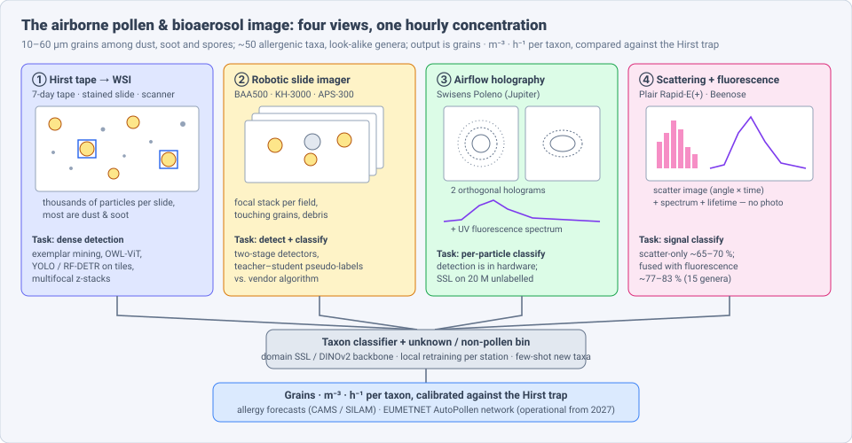
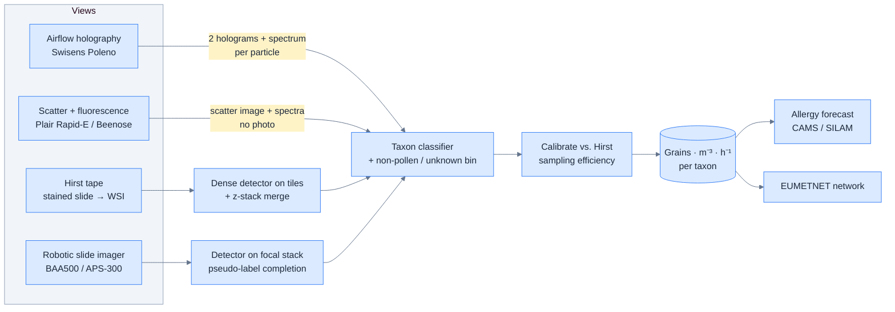
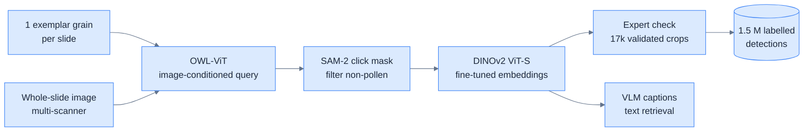
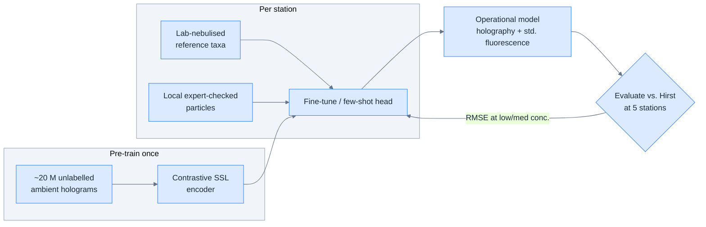
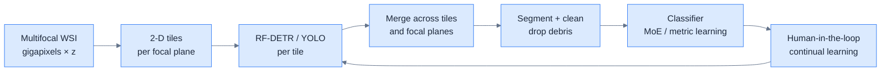
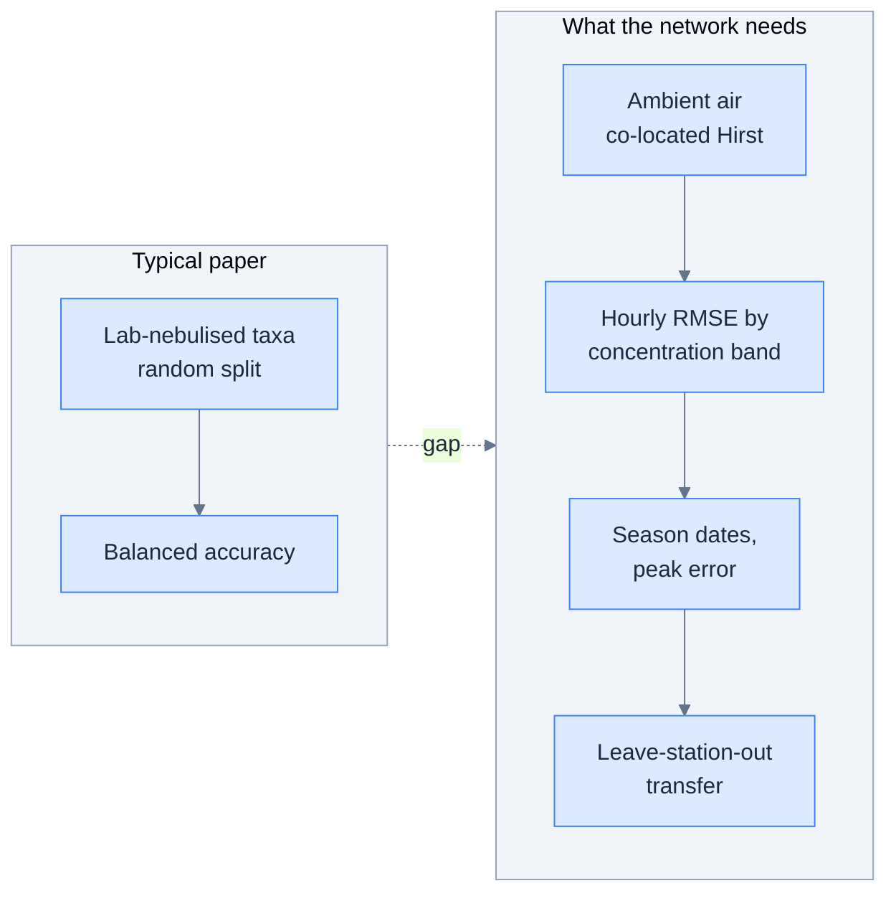

# Dense Object Detection & Classification — Recent Advances

*Compiled 2026-Nov-07 (America/Los_Angeles).*

Next installment in the running CV-updates log. Earlier entries:
[Apr-30](../2026-Apr-30/2026-Apr-30_CV_updates.md),
[May-01](../2026-May-01/2026-May-01_CV_updates.md),
[May-02](../2026-May-02/2026-May-02_CV_updates.md),
[May-04](../2026-May-04/2026-May-04_CV_updates.md),
[May-05](../2026-May-05/2026-May-05_CV_updates.md),
[May-07](../2026-May-07/2026-May-07_CV_updates.md),
[May-08](../2026-May-08/2026-May-08_CV_updates.md),
[May-15](../2026-May-15/2026-May-15_CV_updates.md),
[May-16](../2026-May-16/2026-May-16_CV_updates.md),
[May-17](../2026-May-17/2026-May-17_CV_updates.md),
[Jun-09](../2026-Jun-09/2026-Jun-09_CV_updates.md),
[Jun-10](../2026-Jun-10/2026-Jun-10_CV_updates.md),
[Jun-12](../2026-Jun-12/2026-Jun-12_CV_updates.md),
[Jun-15](../2026-Jun-15/2026-Jun-15_CV_updates.md),
[Jun-16](../2026-Jun-16/2026-Jun-16_CV_updates.md),
[Jun-17](../2026-Jun-17/2026-Jun-17_CV_updates.md),
[Jun-19](../2026-Jun-19/2026-Jun-19_CV_updates.md),
[Jun-21](../2026-Jun-21/2026-Jun-21_CV_updates.md),
[Jun-22](../2026-Jun-22/2026-Jun-22_CV_updates.md),
[Jun-23](../2026-Jun-23/2026-Jun-23_CV_updates.md),
[Jun-24](../2026-Jun-24/2026-Jun-24_CV_updates.md),
[Jun-25](../2026-Jun-25/2026-Jun-25_CV_updates.md),
[Jun-27](../2026-Jun-27/2026-Jun-27_CV_updates.md),
[Jun-29](../2026-Jun-29/2026-Jun-29_CV_updates.md),
[Jun-30](../2026-Jun-30/2026-Jun-30_CV_updates.md),
[Jul-04](../2026-Jul-04/2026-Jul-04_CV_updates.md),
[Jul-07](../2026-Jul-07/2026-Jul-07_CV_updates.md),
[Jul-08](../2026-Jul-08/2026-Jul-08_CV_updates.md),
[Jul-10](../2026-Jul-10/2026-Jul-10_CV_updates.md),
[Jul-15](../2026-Jul-15/2026-Jul-15_CV_updates.md),
[Jul-17](../2026-Jul-17/2026-Jul-17_CV_updates.md),
[Jul-18](../2026-Jul-18/2026-Jul-18_CV_updates.md),
[Jul-21](../2026-Jul-21/2026-Jul-21_CV_updates.md),
[Jul-22](../2026-Jul-22/2026-Jul-22_CV_updates.md),
[Jul-24](../2026-Jul-24/2026-Jul-24_CV_updates.md),
[Jul-26](../2026-Jul-26/2026-Jul-26_CV_updates.md),
[Jul-27](../2026-Jul-27/2026-Jul-27_CV_updates.md),
[Jul-30](../2026-Jul-30/2026-Jul-30_CV_updates.md),
[Aug-01](../2026-Aug-01/2026-Aug-01_CV_updates.md),
[Aug-02](../2026-Aug-02/2026-Aug-02_CV_updates.md),
[Aug-04](../2026-Aug-04/2026-Aug-04_CV_updates.md),
[Aug-07](../2026-Aug-07/2026-Aug-07_CV_updates.md),
[Aug-10](../2026-Aug-10/2026-Aug-10_CV_updates.md),
[Aug-11](../2026-Aug-11/2026-Aug-11_CV_updates.md),
[Aug-13](../2026-Aug-13/2026-Aug-13_CV_updates.md),
[Aug-15](../2026-Aug-15/2026-Aug-15_CV_updates.md),
[Aug-16](../2026-Aug-16/2026-Aug-16_CV_updates.md),
[Aug-18](../2026-Aug-18/2026-Aug-18_CV_updates.md),
[Aug-19](../2026-Aug-19/2026-Aug-19_CV_updates.md),
[Aug-21](../2026-Aug-21/2026-Aug-21_CV_updates.md),
[Aug-22](../2026-Aug-22/2026-Aug-22_CV_updates.md),
[Aug-24](../2026-Aug-24/2026-Aug-24_CV_updates.md),
[Aug-26](../2026-Aug-26/2026-Aug-26_CV_updates.md),
[Aug-29](../2026-Aug-29/2026-Aug-29_CV_updates.md),
[Sep-01](../2026-Sep-01/2026-Sep-01_CV_updates.md),
[Sep-20](../2026-Sep-20/2026-Sep-20_CV_updates.md),
[Sep-23](../2026-Sep-23/2026-Sep-23_CV_updates.md),
[Sep-24](../2026-Sep-24/2026-Sep-24_CV_updates.md),
[Sep-25](../2026-Sep-25/2026-Sep-25_CV_updates.md),
[Sep-26](../2026-Sep-26/2026-Sep-26_CV_updates.md),
[Sep-29](../2026-Sep-29/2026-Sep-29_CV_updates.md),
[Sep-30](../2026-Sep-30/2026-Sep-30_CV_updates.md),
[Oct-01](../2026-Oct-01/2026-Oct-01_CV_updates.md),
[Oct-02](../2026-Oct-02/2026-Oct-02_CV_updates.md),
[Oct-03](../2026-Oct-03/2026-Oct-03_CV_updates.md),
[Oct-04](../2026-Oct-04/2026-Oct-04_CV_updates.md),
[Oct-05](../2026-Oct-05/2026-Oct-05_CV_updates.md),
[Oct-06](../2026-Oct-06/2026-Oct-06_CV_updates.md),
[Oct-07](../2026-Oct-07/2026-Oct-07_CV_updates.md),
[Oct-08](../2026-Oct-08/2026-Oct-08_CV_updates.md),
[Oct-09](../2026-Oct-09/2026-Oct-09_CV_updates.md),
[Oct-10](../2026-Oct-10/2026-Oct-10_CV_updates.md),
[Oct-11](../2026-Oct-11/2026-Oct-11_CV_updates.md),
[Oct-12](../2026-Oct-12/2026-Oct-12_CV_updates.md),
[Oct-13](../2026-Oct-13/2026-Oct-13_CV_updates.md),
[Oct-14](../2026-Oct-14/2026-Oct-14_CV_updates.md),
[Oct-15](../2026-Oct-15/2026-Oct-15_CV_updates.md),
[Oct-16](../2026-Oct-16/2026-Oct-16_CV_updates.md),
[Oct-17](../2026-Oct-17/2026-Oct-17_CV_updates.md),
[Oct-18](../2026-Oct-18/2026-Oct-18_CV_updates.md),
[Oct-19](../2026-Oct-19/2026-Oct-19_CV_updates.md),
[Oct-20](../2026-Oct-20/2026-Oct-20_CV_updates.md),
[Oct-21](../2026-Oct-21/2026-Oct-21_CV_updates.md),
[Oct-22](../2026-Oct-22/2026-Oct-22_CV_updates.md),
[Oct-23](../2026-Oct-23/2026-Oct-23_CV_updates.md),
[Oct-24](../2026-Oct-24/2026-Oct-24_CV_updates.md),
[Oct-25](../2026-Oct-25/2026-Oct-25_CV_updates.md),
[Oct-26](../2026-Oct-26/2026-Oct-26_CV_updates.md),
[Oct-27](../2026-Oct-27/2026-Oct-27_CV_updates.md),
[Oct-28](../2026-Oct-28/2026-Oct-28_CV_updates.md),
[Oct-29](../2026-Oct-29/2026-Oct-29_CV_updates.md),
[Oct-30](../2026-Oct-30/2026-Oct-30_CV_updates.md),
[Oct-31](../2026-Oct-31/2026-Oct-31_CV_updates.md),
[Nov-01](../2026-Nov-01/2026-Nov-01_CV_updates.md),
[Nov-02](../2026-Nov-02/2026-Nov-02_CV_updates.md),
[Nov-03](../2026-Nov-03/2026-Nov-03_CV_updates.md),
[Nov-04](../2026-Nov-04/2026-Nov-04_CV_updates.md),
[Nov-05](../2026-Nov-05/2026-Nov-05_CV_updates.md),
[Nov-06](../2026-Nov-06/2026-Nov-06_CV_updates.md).

The last five entries covered
[mining](../2026-Nov-02/2026-Nov-02_CV_updates.md),
[aquaculture](../2026-Nov-03/2026-Nov-03_CV_updates.md),
[livestock-barn](../2026-Nov-04/2026-Nov-04_CV_updates.md),
[insect-trap](../2026-Nov-05/2026-Nov-05_CV_updates.md) and
[plankton-imager](../2026-Nov-06/2026-Nov-06_CV_updates.md) imagery.
This run keeps the "count small organisms" theme and moves from water to
air. It covers the **airborne pollen & bioaerosol image**: the Hirst-type
trap tape scanned as a whole-slide image, robotic slide imagers such as the
BAA500, airflow holography (Swisens Poleno), scattering/fluorescence sensors
(Plair Rapid-E), and the fossil and honey slides that use the same
detectors.

---

## Table of contents

1. [Why this pass](#1--why-this-pass)
2. [The primitive: four views, one hourly concentration](#2--the-primitive-four-views-one-hourly-concentration)
3. [Hirst slides: mining labels at million scale](#3--hirst-slides-mining-labels-at-million-scale)
4. [Robotic slide imagers: beating the vendor algorithm](#4--robotic-slide-imagers-beating-the-vendor-algorithm)
5. [Airflow holography: detection in hardware, learning in the field](#5--airflow-holography-detection-in-hardware-learning-in-the-field)
6. [Scattering-only sensors and fungal spores](#6--scattering-only-sensors-and-fungal-spores)
7. [Same detectors, other slides: fossil palynomorphs and honey](#7--same-detectors-other-slides-fossil-palynomorphs-and-honey)
8. [Networks: from AutoPollen to an operational EUMETNET programme](#8--networks-from-autopollen-to-an-operational-eumetnet-programme)
9. [Evaluation: what the allergy forecast actually checks](#9--evaluation-what-the-allergy-forecast-actually-checks)
10. [Open problems / what to watch](#10--open-problems--what-to-watch)
11. [Sources](#11--sources)

---

## 1 · Why this pass

Searching the archive for *pollen*, *palynolog*, *Poleno*, *bioaerosol*,
*Hirst* and *spore* finds nothing. The nearest earlier entries, which this
pass stays clear of:

- The [plankton-imager](../2026-Nov-06/2026-Nov-06_CV_updates.md) entry
  covered flow imagers and holography in water. Airflow holography (§5) is
  its closest sibling; this entry is about the air-sampled particle and the
  allergy and climate users downstream.
- The [insect-trap](../2026-Nov-05/2026-Nov-05_CV_updates.md) entry covered
  mm-scale organisms on sticky cards. Pollen grains are 10–60 µm and need a
  microscope or a hologram.
- The [cytology smear](../2026-Oct-06/2026-Oct-06_CV_updates.md) entry
  covered stained slides scanned as whole-slide images (WSIs). Hirst slides
  (§3) and fossil slides (§7) borrow that tooling, but with botanical
  taxonomy, dust and soot as clutter, and no clinical label.
- The [herbarium mention](../2026-May-15/2026-May-15_CV_updates.md) was a
  passing reference to specimen sheets, not microscopy.

What makes the pollen & bioaerosol image a distinct primitive:

- **The reference method is slow and manual.** The Hirst-type volumetric
  trap is still the global standard. Its tape is cut, stained and counted
  by a trained palynologist along transects, so results arrive days late
  (Buters et al., *Aerobiologia* overview). Every automatic system is judged
  by how well its counts agree with that reference.
- **Tiny objects in heavy clutter.** On a slide, a few grains sit among
  dust, soot, fibres and spores. Many are partly out of focus, so slides
  are scanned as z-stacks.
- **Look-alike genera.** *Betula*, *Alnus* and *Corylus* (birch, alder,
  hazel) are the classic confusion set. Grasses (*Poaceae*) are usually
  reported only at family level.
- **Some instruments never produce a photograph.** Holographic monitors
  record interference patterns; scattering sensors record angle-resolved
  light and fluorescence spectra. "Detection" is a hardware trigger, and
  what is left is per-particle classification.
- **The output is an hourly concentration.** Allergy forecasts want grains
  per m³ per hour per taxon, in near-real time, from a network. Per-grain
  accuracy matters only through that number.

---

## 2 · The primitive: four views, one hourly concentration

| View | Typical instrument | Dense target | Main output | Public data (examples) |
|---|---|---|---|---|
| Hirst tape → WSI | Burkard / Lanzoni trap + slide scanner | thousands of particles per slide, most of them debris; multifocal | daily/bi-hourly counts, archive reanalysis | Pollen AI Atlas (1.5 M detections) |
| Robotic slide imager | Hund BAA500, Pollen Sense APS-300, KH-3000 | grains per field, focal stack, touching grains | 3-hourly counts (Bavarian ePIN) | per-paper sets (Augsburg) |
| Airflow holography | Swisens Poleno (Mars / Jupiter) | one particle per trigger, two holograms + fluorescence | hourly counts per taxon | Wrocław training set (doi:10.34616/DMTZAB) |
| Scatter + fluorescence | Plair Rapid-E / Rapid-E+, Beenose | no image; scatter pattern + spectra + lifetime | hourly counts | per-paper sets |
| Video microscope | cyclone collector + off-the-shelf microscope | grains tracked over frames | counts with tracking | Pollen Video Library (16 types, ~35k images/type) |

---

## 3 · Hirst slides: mining labels at million scale

Hirst archives go back decades, but almost none of the grains on them are
boxed. 2025–26 work attacks the labelling cost first.

- **Training-set generation with one exemplar** (Biricz et al., *Sci. Rep.*,
  Dec 2025, doi:10.1038/s41598-025-31646-2). A largely automatic pipeline
  combines one-shot detection with systematic refinement. It uses
  **OWL-ViT** as the open-vocabulary first stage and produces tens of
  thousands of annotations from bright-field WSIs. Slides come from Hungary,
  Sweden, France and the Mediterranean; the authors report good
  cross-regional generalisation
  ([PMC12808117](https://www.ncbi.nlm.nih.gov/pmc/articles/PMC12808117/);
  [Wigner project page](https://wsclab.wigner.hu/en/grants/running-grants/efficient-and-scalable-training-set-generation-for-automated-pollen-monitoring-with-hirst-type-samplers)).
- **Pollen AI Atlas** (Biricz + 5 co-authors,
  [arXiv 2606.17809](https://arxiv.org/abs/2606.17809), Jun 2026). The
  follow-up scales the same idea to **~1.51 M** pollen-grain detections from
  85 processed WSIs, **four origins, four scanner settings, 45 genera plus
  one family-only taxon** (46 labels). Mining starts from **one manually
  chosen exemplar per slide** and reaches **99.6% proposal precision** in
  expert-curated test regions. Components: OWL-ViT for query initialisation,
  **SAM-2** single-click masks for filtering, and a **DINOv2 ViT-S**
  backbone fine-tuned on the crops. It also adds **VLM captions** (Gemma 4
  31B as the main set, plus four Qwen-VL variants) for text retrieval. The
  Zenodo release (42.8 GB, CC BY 4.0) has **17,318 expert-validated
  crops** and the fine-tuned checkpoint
  ([Zenodo](https://zenodo.org/records/20690944);
  [code, Apache-2.0](https://github.com/abiricz/pollen-ai-atlas-paper)).
- **YOLO on slides.** Kubera et al. (*Sensors* 2022) remain the reference
  baseline: YOLO beat other detectors on Hirst-style images of *Betula*,
  *Alnus* and *Corylus*, with **mAP@.5:.95 86.8–92.4%**
  ([PMC9002382](https://www.ncbi.nlm.nih.gov/pmc/articles/PMC9002382/)).
  Two 2026 Leiden bachelor theses test the newest detectors: one compares
  **YOLO26 with YOLOv8** on three allergenic tree taxa
  ([LIACS, Jun 2026](https://theses.liacs.nl/pdf/2025-2026-WangJJinnan.pdf));
  the other fine-tunes a *Betula* model for **100× plastic slides**, which
  cuts a slide from about **5 GB to 350 MB**
  ([LIACS, Apr 2026](https://theses.liacs.nl/pdf/2025-2026-SluimerLLinde.pdf)).

**Why it matters for dense detection generally.** This is the clearest 2026
example of *exemplar-prompted open-vocabulary detection as a label
factory*: one click per slide, a promptable segmenter as a filter, and a
self-supervised backbone to cluster the rest. The same recipe would work for
the [cytology](../2026-Oct-06/2026-Oct-06_CV_updates.md) and
[insect-trap](../2026-Nov-05/2026-Nov-05_CV_updates.md) domains.

---

## 4 · Robotic slide imagers: beating the vendor algorithm

The Hund **BAA500** samples air onto a slide, stains it, and photographs
fields at several focal planes. It has run in Augsburg since 2015 and
underpins the Bavarian **ePIN** network, which publishes 3-hourly counts.

- **Detection vs. the built-in algorithm** (University of Augsburg / TUM).
  Two-stage deep detectors were trained on raw and synthesised BAA500
  images. Labels were incomplete, so a **teacher–student** scheme added
  pseudo-labels during training. On a hand-built test set of boxes and taxa,
  the model reached **unweighted mean F1 76.9% vs. 61.3%** for the vendor
  algorithm. An earlier classification-only study on crops reached **F1
  93.8%** over 15 taxa; that number is not comparable with detection F1
  ([TUM portal](https://portal.fis.tum.de/en/publications/towards-automatic-airborne-pollen-monitoring-from-commercial-devi/);
  [Augsburg OPUS](https://opus.bibliothek.uni-augsburg.de/opus4/files/104545/104545.pdf)).
- **Network accuracy.** Against expert identification, the Bavarian BAA500
  network reported **>90%** multiclass accuracy, with every taxon above
  85% except *Populus* (73%) and *Alnus* (64%)
  ([TUM portal](https://portal.fis.tum.de/en/publications/automated-classification-of-airborne-pollen-using-neural-networks/)).
- **Spores are a sampling problem first** (*Environ. Pollut.* 2026,
  doi:10.1016/j.envpol.2026.128148). BAA500 vs. Hirst for five fungal-spore
  types: capture was best for medium-sized spores, and small *Cladosporium*
  were heavily under-counted. The best agreement was for *Alternaria*. The
  recogniser was not trained for multi-taxon spores
  ([DZL listing](https://dzl.de/publication/10-1016-j-envpol-2026-128148/)).
- **Pollen Sense APS-300** (US). An imaging sensor with a 25-taxon library.
  In an Atlanta field study against a Rotorod sampler it tracked peak
  season well but reported fewer tree taxa and needed better grass and weed
  recognition ([MDPI IJERPH 19:6444](https://www.mdpi.com/1660-4601/19/11/6444)).

**Takeaway.** The vendor-algorithm comparison is the useful pattern: a
modern detector plus pseudo-label completion gains ~15 F1 points on the same
images. Hardware sampling efficiency (spore size) can cap the result
whatever the model does.

---

## 5 · Airflow holography: detection in hardware, learning in the field

The **Swisens Poleno** draws air through a nozzle and records two orthogonal
holograms per particle; the Jupiter model adds UV-induced fluorescence
spectra. It is the backbone of SwissPollen and of the European SYLVA
infrastructure.

- **Fusing holography and fluorescence** (*AMT* 17:441, 2024). Balanced
  accuracy **0.992** fused vs. **0.968** holography only vs. **0.878**
  fluorescence only, in the lab
  ([AMT 17:441](https://amt.copernicus.org/articles/17/441/2024/)).
- **Self-supervised + few-shot** (Willi et al., *Aerobiologia* 2025,
  doi:10.1007/s10453-025-09850-4; [arXiv 2406.09984](https://arxiv.org/abs/2406.09984)).
  SimCLR-style pre-training on about **20 million unlabelled ambient
  holograms** from a year at Payerne, then few-shot heads on 11 taxa.
  Self-supervision helped even with plentiful labels, helped most in the
  few-shot regime, and transferred better to another instrument
  ([EPFL Infoscience](https://infoscience.epfl.ch/entities/publication/2fc27e49-c43e-41a3-b7c8-03a7465c5e0a/articledetails)).
- **How to compare classifiers in operation** (*AMT* 19:3427, 2026). "A
  methodological framework for evaluating real-time bioaerosol
  classification algorithms." Seven deep classifiers trained on Poleno
  holography + fluorescence, plus the 2022 holography-only model, were run
  on operational data from **five SwissPollen stations**. The outcome was a
  new operational SwissPollen model combining holography with
  *standardised* fluorescence from the Poleno Jupiter. The authors call for
  richer evaluation datasets
  ([AMT 19:3427](https://amt.copernicus.org/articles/19/3427/2026/)).
- **Local retraining beats the factory model** (Tomczyk, Werner,
  Malkiewicz, Bubel; *AMT* 19:4779–4795, 2026). In Wrocław, the Poleno
  Jupiter reference database was extended with local data. The retrained
  model had lower RMSE than the baseline, most of all at **low and medium
  concentrations**, and captured seasonal and diurnal dynamics better.
  Training data are public (doi:10.34616/DMTZAB)
  ([AMT 19:4779](https://amt.copernicus.org/articles/19/4779/2026/);
  [preprint](https://egusphere.copernicus.org/preprints/2026/egusphere-2025-5874/)).
- **Same lesson in Italy** (Gottardini et al., 2025). Agreement between a
  Swisens 2025 classifier and Hirst counts depended on site and input
  data ([FEM Open](https://openpub.fmach.it/handle/10449/89616)).
- **A forecaster's own classifier** (Kadantsev, Kouznetsov, Sofiev, FMI;
  EGU26-19423). A deep classifier for common European taxa on Poleno data:
  **>90% average lab accuracy**, errors mostly between similar taxa,
  evaluated on SYLVA field data. Conference abstract, not peer reviewed
  ([EGU26-19423](https://meetingorganizer.copernicus.org/EGU26/EGU26-19423.html)).
- **Industry.** CSEM and Swisens describe a multimodal model merging
  holographic and optical channels with a self-learning step that adapts to
  field conditions (vendor report, no numbers retrieved)
  ([CSEM 2025](https://www.csem.ch/en/annual-report/2025/ai-transforms-pollen-and-spore-detection/)).

**Why it matters for dense detection generally.** Poleno work shows two
things the plankton entry also found. First, when hardware isolates each
particle, the problem becomes classification under drift. Second, the fixes
are domain self-supervision and *per-site* fine-tuning, judged by
concentration error against a reference rather than by lab accuracy.

---

## 6 · Scattering-only sensors and fungal spores

- **Scatter alone is not enough** (Daunys et al., *Aerobiologia* 2024).
  Eight computer-vision models (32 set-ups) on Rapid-E scattering "images"
  for 15 genera. Weakly supervised object-detection models were best but
  slow, and the best set-ups reached only **~65–70%** accuracy, with many
  false positives on real time series. Fused with fluorescence, overall
  accuracy rose to **77–83%**, about 15 points above either alone. The
  motivation: the UV laser is the most expensive, least reliable part (about
  two years' life)
  ([VU e-publications](https://epublications.vu.lt/object/elaba:146323575/index.html)).
- **Explainable fusion** (Brdar et al., *Sci. Rep.* 2023) adds fluorescence
  lifetime as a third modality and explains which channels drive each call
  ([DOAJ](https://doaj.org/article/9c49ac5c64ba49d3aa4ed40d568f5206)).
- **Fungal spores on Rapid-E+** (Bruffaerts et al., *Aerobiologia*, Jun
  2025). Models on **17 fungal species**, including five *Alternaria*:
  **83.4–95.1%** accuracy. *Cladosporium* species separated well; some
  *Alternaria* species did not.
- **Poleno and *Alternaria*** (Erb et al., 2023). The holographic classifier
  was extended from pollen to *Alternaria* using a contaminated potato
  field at harvest, with high correlation to manual counts in the main
  dispersal period
  ([PMC11096102](https://www.ncbi.nlm.nih.gov/pmc/articles/PMC11096102/)).
- **Beenose** is a low-cost multi-angle scattering sensor evaluated in the
  lab only so far
  ([PMC10057867](https://www.ncbi.nlm.nih.gov/pmc/articles/PMC10057867/)).

---

## 7 · Same detectors, other slides: fossil palynomorphs and honey

The same image type appears in palaeoclimate and food authentication, with
different clutter and taxonomy.

- **Fossil palynomorphs in WSIs** (Shaikh, Mayor, White, Viswanathan,
  Barman; Rice / Smithsonian;
  [arXiv 2609.05323](https://arxiv.org/pdf/2609.05323), Sep 2026). Described
  as the first end-to-end pipeline for palynomorph detection in whole-slide
  images. Multifocal slides are split into 2-D tiles; detectors are
  benchmarked, with **RF-DETR at AP@50 0.879**; detections are merged across
  the large image; and an I/O optimisation speeds inference.
- **"Open world" fossil pollen** (Feng, Puthanveetil Satheesan, Kong,
  Donders, Punyasena; *Paleobiology* 2025, CC BY). Four fixes for real
  slides: **mixture-of-experts** detectors for taxonomic bias, **domain
  fine-tuning** for imaging differences, **continual learning** with
  human-in-the-loop annotation, and **segmentation** to clean detections
  before classification. In the related thesis, domain fine-tuning raised
  new-domain mAP from **32.6% to 66.0%**
  ([Cambridge Core](https://www.cambridge.org/core/journals/paleobiology/article/addressing-the-open-world-detecting-and-segmenting-pollen-on-palynological-slides-with-deep-learning/7F12E2B1F72DC18ABA73D460A90BCDD4);
  [bioRxiv](https://www.biorxiv.org/content/10.1101/2025.01.05.631390v1.full.pdf);
  [Illinois Data Bank](https://databank.illinois.edu/datasets/IDB-4207757)).
- **Honey (melissopalynology)** (Staforelli-Vivanco et al.,
  [arXiv 2604.16743](https://arxiv.org/pdf/2604.16743), Apr 2026). **U²-Net**
  salient-object detection, then a **DINOv2 ViT** trained with deep metric
  learning, with gradient-weighted attention maps for interpretable
  features. Reported **95.8% classification recall** and **6×** faster than
  manual analysis, which takes 4–6 h per sample. Crops are cut on the fly
  from stored boxes and contours (20% padding, 252 px, background masked to
  gray).
- **Holographic microscopy is still hard** (Warshaneyan et al.,
  [arXiv 2512.12101](https://arxiv.org/abs/2512.12101), Dec 2025). YOLOv8s
  reached **91.3% mAP50** on optical images but very low mAP on digital
  in-line holographic microscopy. WGAN-SN synthetic holograms mixed 1:1.5
  with real ones raised DIHM detection to **15.4% mAP50**.

---

## 8 · Networks: from AutoPollen to an operational EUMETNET programme

- **EUMETNET AutoPollen** started as a prototype automatic network across
  Europe (*Aerobiologia* 2020). A 2026 EGU abstract says it is being turned
  into an **operational EUMETNET programme** with **SYLVA** as its
  technological backbone, pre-operational since 2025 and **operational from
  2027**, with support from CAMS and ACTRIS
  ([Aerobiologia 2020](https://link.springer.com/article/10.1007/s10453-020-09666-4);
  [EUMETNET](https://eumetnet.eu/?p=3319)).
- **Forecast assimilation.** Automatic observations are already used to
  adjust the starting point of daily pollen forecasts (CAMS-linked report)
  ([NILU](https://nilu.no/publikasjon/10450995/)).
- **National networks.** Bavaria's ePIN (BAA500, 3-hourly public data),
  MeteoSwiss/SwissPollen (Poleno, hourly), and test sites in Serbia, Croatia
  and Finland ([Science in Poland](https://scienceinpoland.pl/en/news/news,88181,scientists-create-automatic-pollen-monitoring-real-time.html)).

**What this means for the model.** A pan-European network needs one model
per instrument type that holds up across climates, plus a documented
per-station calibration. The SwissPollen evaluation framework (§5) is the
first published attempt to make that comparison standard.

---

## 9 · Evaluation: what the allergy forecast actually checks

| What the user needs | Metric people report | Metric that matters |
|---|---|---|
| "How much birch pollen is in the air now?" | per-class accuracy on lab-nebulised particles | **hourly concentration RMSE / correlation vs. co-located Hirst**, by concentration band |
| "Has the season started?" | top-1 | **season start/end date error** and peak-day error |
| "Does it work at a new station?" | random split | **leave-station-out** error; retraining effort per site |
| "Can it find grains on an old slide?" | box mAP on curated tiles | **recall per slide** at fixed precision, incl. out-of-focus grains |
| "Is it better than the vendor?" | — | **same-image F1 vs. built-in algorithm** (Augsburg-style) |
| "What about spores?" | classifier accuracy | **capture efficiency by particle size** × classifier recall |
| "Is anything new in the air?" | closed-set accuracy | **unknown / non-pollen rejection rate** without suppressing rare taxa |

---

## 10 · Open problems / what to watch

1. **A common benchmark across instruments.** Each instrument has its own
   data, and lab accuracies (0.99 balanced on Poleno) say little about field
   RMSE. The AMT 2026 framework and the public Wrocław set are the start of
   a shared protocol; watch for a multi-station, multi-instrument release
   tied to the EUMETNET programme.
2. **Exemplar-prompted labelling everywhere.** The Pollen AI Atlas recipe
   (one exemplar → OWL-ViT → SAM-2 → DINOv2) should transfer to robotic
   imagers and to fossil slides. A published comparison against
   human-labelled sets on those would show how far it goes.
3. **Look-alike taxa and the unknown bin.** *Alnus* (64% in the Bavarian
   network) and *Populus* are persistent weak spots. None of the 2026 papers
   found here reported open-set or community-level metrics like the OSCD
   measure in the [plankton](../2026-Nov-06/2026-Nov-06_CV_updates.md)
   entry.
4. **Spores need sampler-aware models.** Small spores are under-sampled
   before any model sees them. Joint correction of capture efficiency and
   classification is missing.
5. **Scatter-only sensors.** Dropping the UV laser would cut cost, but
   scatter-only accuracy (~65–70%) is not yet usable. Self-supervised
   pre-training on unlabelled scatter streams, which helped holography, has
   not been reported for Rapid-E-type data.
6. **Newest detectors on slides.** YOLO26 and RF-DETR are only now being
   tested on pollen (theses and one preprint). Expect peer-reviewed
   comparisons on Hirst WSIs, with z-stack handling, in 2027.
7. **VLM captions for palynology.** Pollen AI Atlas ships five caption sets.
   Whether text retrieval or zero-shot VLM classification helps experts on
   rare taxa is still untested.

---

## 11 · Sources

### Hirst slides and label mining (§3)
- Biricz et al., training-set generation for Hirst samplers (Sci. Rep. 2025) — https://www.ncbi.nlm.nih.gov/pmc/articles/PMC12808117/ — https://wsclab.wigner.hu/en/grants/running-grants/efficient-and-scalable-training-set-generation-for-automated-pollen-monitoring-with-hirst-type-samplers
- Pollen AI Atlas, arXiv 2606.17809 — https://arxiv.org/abs/2606.17809 — https://zenodo.org/records/20690944 — https://github.com/abiricz/pollen-ai-atlas-paper
- Kubera et al., detection and recognition of pollen in multilabel microscopic images (Sensors 2022) — https://www.ncbi.nlm.nih.gov/pmc/articles/PMC9002382/
- LIACS thesis, YOLO26 vs YOLOv8 for pollen (2026) — https://theses.liacs.nl/pdf/2025-2026-WangJJinnan.pdf
- LIACS thesis, low-magnification plastic slides (2026) — https://theses.liacs.nl/pdf/2025-2026-SluimerLLinde.pdf
- Pollen Video Library (Cao et al., DATA '20) — https://zenodo.org/records/10067085 — https://research-collection.ethz.ch/handle/20.500.11850/457333

### Robotic slide imagers (§4)
- Augsburg/TUM, towards automatic pollen monitoring from commercial devices — https://portal.fis.tum.de/en/publications/towards-automatic-airborne-pollen-monitoring-from-commercial-devi/ — https://opus.bibliothek.uni-augsburg.de/opus4/files/104545/104545.pdf
- Automated classification of airborne pollen using neural networks (BAA500) — https://portal.fis.tum.de/en/publications/automated-classification-of-airborne-pollen-using-neural-networks/
- BAA500 vs Hirst for fungal spores (Environ. Pollut. 2026) — https://dzl.de/publication/10-1016-j-envpol-2026-128148/
- Pollen Sense APS-300 field evaluation (IJERPH 2022) — https://www.mdpi.com/1660-4601/19/11/6444

### Airflow holography (§5)
- Sauvageat et al., real-time pollen monitoring using digital holography (AMT 2020) — https://amt.copernicus.org/articles/13/1539/2020/
- Holography + fluorescence fusion (AMT 17:441, 2024) — https://amt.copernicus.org/articles/17/441/2024/
- Willi et al., self-supervised and few-shot learning for bioaerosol monitoring — https://arxiv.org/abs/2406.09984 — https://infoscience.epfl.ch/entities/publication/2fc27e49-c43e-41a3-b7c8-03a7465c5e0a/articledetails
- Framework for evaluating real-time bioaerosol classifiers (AMT 19:3427, 2026) — https://amt.copernicus.org/articles/19/3427/2026/
- Tomczyk et al., Wrocław 2024–2025 (AMT 19:4779, 2026) — https://amt.copernicus.org/articles/19/4779/2026/ — https://egusphere.copernicus.org/preprints/2026/egusphere-2025-5874/
- Gottardini et al., local effects on automatic counts (2025) — https://openpub.fmach.it/handle/10449/89616
- Kadantsev, Kouznetsov, Sofiev, EGU26-19423 — https://meetingorganizer.copernicus.org/EGU26/EGU26-19423.html
- CSEM annual report 2025 — https://www.csem.ch/en/annual-report/2025/ai-transforms-pollen-and-spore-detection/

### Scattering sensors and spores (§6)
- Daunys et al., computer vision models for Rapid-E scattering (Aerobiologia 2024) — https://epublications.vu.lt/object/elaba:146323575/index.html
- Brdar et al., explainable AI for Rapid-E (Sci. Rep. 2023) — https://doaj.org/article/9c49ac5c64ba49d3aa4ed40d568f5206
- Erb et al., automatic real-time monitoring of Alternaria — https://www.ncbi.nlm.nih.gov/pmc/articles/PMC11096102/
- Beenose laboratory evaluation (Sensors 2023) — https://www.ncbi.nlm.nih.gov/pmc/articles/PMC10057867/
- Buters et al., automatic detection of airborne pollen: an overview (Aerobiologia) — https://www.utupub.fi/items/5810b93e-8d8f-4e3e-af25-03f1fa744269/full

### Fossil, honey and holographic microscopy (§7)
- Fossil palynomorph detection in multifocal WSIs, arXiv 2609.05323 — https://arxiv.org/pdf/2609.05323
- Feng et al., "Addressing the open world" (Paleobiology 2025) — https://www.cambridge.org/core/journals/paleobiology/article/addressing-the-open-world-detecting-and-segmenting-pollen-on-palynological-slides-with-deep-learning/7F12E2B1F72DC18ABA73D460A90BCDD4 — https://www.biorxiv.org/content/10.1101/2025.01.05.631390v1.full.pdf — https://databank.illinois.edu/datasets/IDB-4207757
- Automated palynological analysis system (honey), arXiv 2604.16743 — https://arxiv.org/pdf/2604.16743
- AI-augmented pollen recognition in optical and holographic microscopy, arXiv 2512.12101 — https://arxiv.org/abs/2512.12101

### Networks (§8)
- EUMETNET AutoPollen (Aerobiologia 2020) — https://link.springer.com/article/10.1007/s10453-020-09666-4
- EUMETNET — https://eumetnet.eu/?p=3319
- NILU / CAMS-linked report — https://nilu.no/publikasjon/10450995/
- Science in Poland, automatic real-time pollen monitoring — https://scienceinpoland.pl/en/news/news,88181,scientists-create-automatic-pollen-monitoring-real-time.html

*Research note: direct page fetches to copernicus.org, ncbi.nlm.nih.gov and
csem.ch failed (hosts not reachable under this session's network policy),
so figures come from search-indexed abstracts, publisher listings and the
Pollen AI Atlas GitHub README. Not checked against primary PDFs: the
per-classifier results of AMT 19:3427 (not retrieved), the RMSE values for
the Wrocław study (only the direction was retrieved), the Bruffaerts et al.
accuracy range, the Augsburg detection study's publication year, and the
32.6→66.0% mAP figure, which comes from the authors' related thesis rather
than the Paleobiology paper. The 2020–2024 instrument papers are included
as the baselines that 2025–26 work compares against. All accuracies are the
authors' own, on different instruments, taxa and test sets, and are not
comparable across rows.*
