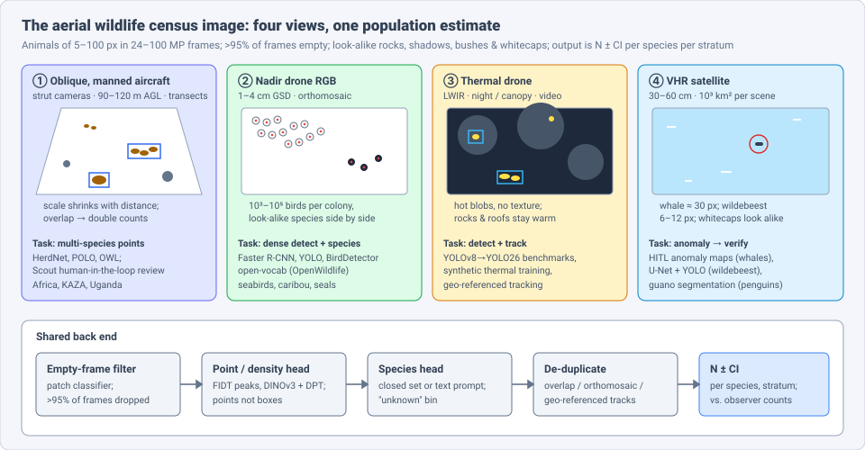
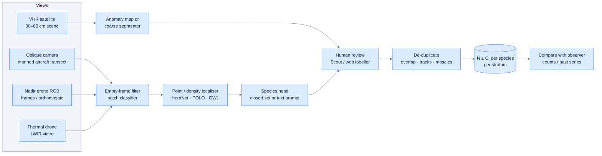
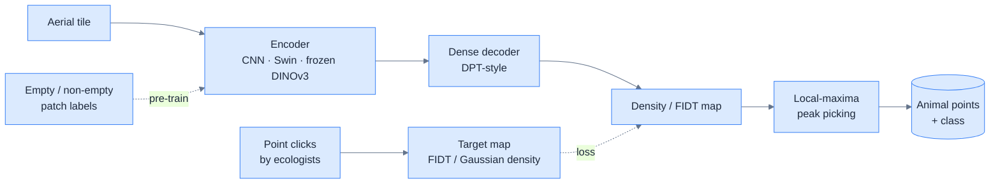
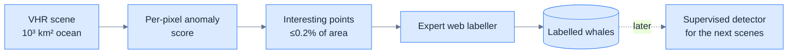

# Dense Object Detection & Classification — Recent Advances

*Compiled 2026-Nov-08 (America/Los_Angeles).*

Next installment in the running CV-updates log. Earlier entries:
[Apr-30](../2026-Apr-30/2026-Apr-30_CV_updates.md),
[May-01](../2026-May-01/2026-May-01_CV_updates.md),
[May-02](../2026-May-02/2026-May-02_CV_updates.md),
[May-04](../2026-May-04/2026-May-04_CV_updates.md),
[May-05](../2026-May-05/2026-May-05_CV_updates.md),
[May-07](../2026-May-07/2026-May-07_CV_updates.md),
[May-08](../2026-May-08/2026-May-08_CV_updates.md),
[May-15](../2026-May-15/2026-May-15_CV_updates.md),
[May-16](../2026-May-16/2026-May-16_CV_updates.md),
[May-17](../2026-May-17/2026-May-17_CV_updates.md),
[Jun-09](../2026-Jun-09/2026-Jun-09_CV_updates.md),
[Jun-10](../2026-Jun-10/2026-Jun-10_CV_updates.md),
[Jun-12](../2026-Jun-12/2026-Jun-12_CV_updates.md),
[Jun-15](../2026-Jun-15/2026-Jun-15_CV_updates.md),
[Jun-16](../2026-Jun-16/2026-Jun-16_CV_updates.md),
[Jun-17](../2026-Jun-17/2026-Jun-17_CV_updates.md),
[Jun-19](../2026-Jun-19/2026-Jun-19_CV_updates.md),
[Jun-21](../2026-Jun-21/2026-Jun-21_CV_updates.md),
[Jun-22](../2026-Jun-22/2026-Jun-22_CV_updates.md),
[Jun-23](../2026-Jun-23/2026-Jun-23_CV_updates.md),
[Jun-24](../2026-Jun-24/2026-Jun-24_CV_updates.md),
[Jun-25](../2026-Jun-25/2026-Jun-25_CV_updates.md),
[Jun-27](../2026-Jun-27/2026-Jun-27_CV_updates.md),
[Jun-29](../2026-Jun-29/2026-Jun-29_CV_updates.md),
[Jun-30](../2026-Jun-30/2026-Jun-30_CV_updates.md),
[Jul-04](../2026-Jul-04/2026-Jul-04_CV_updates.md),
[Jul-07](../2026-Jul-07/2026-Jul-07_CV_updates.md),
[Jul-08](../2026-Jul-08/2026-Jul-08_CV_updates.md),
[Jul-10](../2026-Jul-10/2026-Jul-10_CV_updates.md),
[Jul-15](../2026-Jul-15/2026-Jul-15_CV_updates.md),
[Jul-17](../2026-Jul-17/2026-Jul-17_CV_updates.md),
[Jul-18](../2026-Jul-18/2026-Jul-18_CV_updates.md),
[Jul-21](../2026-Jul-21/2026-Jul-21_CV_updates.md),
[Jul-22](../2026-Jul-22/2026-Jul-22_CV_updates.md),
[Jul-24](../2026-Jul-24/2026-Jul-24_CV_updates.md),
[Jul-26](../2026-Jul-26/2026-Jul-26_CV_updates.md),
[Jul-27](../2026-Jul-27/2026-Jul-27_CV_updates.md),
[Jul-30](../2026-Jul-30/2026-Jul-30_CV_updates.md),
[Aug-01](../2026-Aug-01/2026-Aug-01_CV_updates.md),
[Aug-02](../2026-Aug-02/2026-Aug-02_CV_updates.md),
[Aug-04](../2026-Aug-04/2026-Aug-04_CV_updates.md),
[Aug-07](../2026-Aug-07/2026-Aug-07_CV_updates.md),
[Aug-10](../2026-Aug-10/2026-Aug-10_CV_updates.md),
[Aug-11](../2026-Aug-11/2026-Aug-11_CV_updates.md),
[Aug-13](../2026-Aug-13/2026-Aug-13_CV_updates.md),
[Aug-15](../2026-Aug-15/2026-Aug-15_CV_updates.md),
[Aug-16](../2026-Aug-16/2026-Aug-16_CV_updates.md),
[Aug-18](../2026-Aug-18/2026-Aug-18_CV_updates.md),
[Aug-19](../2026-Aug-19/2026-Aug-19_CV_updates.md),
[Aug-21](../2026-Aug-21/2026-Aug-21_CV_updates.md),
[Aug-22](../2026-Aug-22/2026-Aug-22_CV_updates.md),
[Aug-24](../2026-Aug-24/2026-Aug-24_CV_updates.md),
[Aug-26](../2026-Aug-26/2026-Aug-26_CV_updates.md),
[Aug-29](../2026-Aug-29/2026-Aug-29_CV_updates.md),
[Sep-01](../2026-Sep-01/2026-Sep-01_CV_updates.md),
[Sep-20](../2026-Sep-20/2026-Sep-20_CV_updates.md),
[Sep-23](../2026-Sep-23/2026-Sep-23_CV_updates.md),
[Sep-24](../2026-Sep-24/2026-Sep-24_CV_updates.md),
[Sep-25](../2026-Sep-25/2026-Sep-25_CV_updates.md),
[Sep-26](../2026-Sep-26/2026-Sep-26_CV_updates.md),
[Sep-29](../2026-Sep-29/2026-Sep-29_CV_updates.md),
[Sep-30](../2026-Sep-30/2026-Sep-30_CV_updates.md),
[Oct-01](../2026-Oct-01/2026-Oct-01_CV_updates.md),
[Oct-02](../2026-Oct-02/2026-Oct-02_CV_updates.md),
[Oct-03](../2026-Oct-03/2026-Oct-03_CV_updates.md),
[Oct-04](../2026-Oct-04/2026-Oct-04_CV_updates.md),
[Oct-05](../2026-Oct-05/2026-Oct-05_CV_updates.md),
[Oct-06](../2026-Oct-06/2026-Oct-06_CV_updates.md),
[Oct-07](../2026-Oct-07/2026-Oct-07_CV_updates.md),
[Oct-08](../2026-Oct-08/2026-Oct-08_CV_updates.md),
[Oct-09](../2026-Oct-09/2026-Oct-09_CV_updates.md),
[Oct-10](../2026-Oct-10/2026-Oct-10_CV_updates.md),
[Oct-11](../2026-Oct-11/2026-Oct-11_CV_updates.md),
[Oct-12](../2026-Oct-12/2026-Oct-12_CV_updates.md),
[Oct-13](../2026-Oct-13/2026-Oct-13_CV_updates.md),
[Oct-14](../2026-Oct-14/2026-Oct-14_CV_updates.md),
[Oct-15](../2026-Oct-15/2026-Oct-15_CV_updates.md),
[Oct-16](../2026-Oct-16/2026-Oct-16_CV_updates.md),
[Oct-17](../2026-Oct-17/2026-Oct-17_CV_updates.md),
[Oct-18](../2026-Oct-18/2026-Oct-18_CV_updates.md),
[Oct-19](../2026-Oct-19/2026-Oct-19_CV_updates.md),
[Oct-20](../2026-Oct-20/2026-Oct-20_CV_updates.md),
[Oct-21](../2026-Oct-21/2026-Oct-21_CV_updates.md),
[Oct-22](../2026-Oct-22/2026-Oct-22_CV_updates.md),
[Oct-23](../2026-Oct-23/2026-Oct-23_CV_updates.md),
[Oct-24](../2026-Oct-24/2026-Oct-24_CV_updates.md),
[Oct-25](../2026-Oct-25/2026-Oct-25_CV_updates.md),
[Oct-26](../2026-Oct-26/2026-Oct-26_CV_updates.md),
[Oct-27](../2026-Oct-27/2026-Oct-27_CV_updates.md),
[Oct-28](../2026-Oct-28/2026-Oct-28_CV_updates.md),
[Oct-29](../2026-Oct-29/2026-Oct-29_CV_updates.md),
[Oct-30](../2026-Oct-30/2026-Oct-30_CV_updates.md),
[Oct-31](../2026-Oct-31/2026-Oct-31_CV_updates.md),
[Nov-01](../2026-Nov-01/2026-Nov-01_CV_updates.md),
[Nov-02](../2026-Nov-02/2026-Nov-02_CV_updates.md),
[Nov-03](../2026-Nov-03/2026-Nov-03_CV_updates.md),
[Nov-04](../2026-Nov-04/2026-Nov-04_CV_updates.md),
[Nov-05](../2026-Nov-05/2026-Nov-05_CV_updates.md),
[Nov-06](../2026-Nov-06/2026-Nov-06_CV_updates.md),
[Nov-07](../2026-Nov-07/2026-Nov-07_CV_updates.md).

The last five entries covered
[aquaculture](../2026-Nov-03/2026-Nov-03_CV_updates.md),
[livestock-barn](../2026-Nov-04/2026-Nov-04_CV_updates.md),
[insect-trap](../2026-Nov-05/2026-Nov-05_CV_updates.md),
[plankton-imager](../2026-Nov-06/2026-Nov-06_CV_updates.md) and
[airborne pollen](../2026-Nov-07/2026-Nov-07_CV_updates.md) imagery.
This run keeps the "count organisms" theme but turns the camera around:
instead of sampling organisms into an instrument, the instrument flies over
them. It covers the **aerial wildlife census image**: oblique cameras on
manned survey aircraft, nadir drone RGB and orthomosaics of colonies and
herds, thermal drone video, and very-high-resolution (VHR) satellite scenes
of whales and migrating ungulates.

---

## Table of contents

1. [Why this pass](#1--why-this-pass)
2. [The primitive: four views, one population estimate](#2--the-primitive-four-views-one-population-estimate)
3. [Points beat boxes: OWL and the weak-supervision turn](#3--points-beat-boxes-owl-and-the-weak-supervision-turn)
4. [Oblique manned surveys: the African census pipeline](#4--oblique-manned-surveys-the-african-census-pipeline)
5. [Nadir drone colonies: seabirds at national scale](#5--nadir-drone-colonies-seabirds-at-national-scale)
6. [Thermal drones: night, canopy and tracking](#6--thermal-drones-night-canopy-and-tracking)
7. [From space: whales, wildebeest and penguin guano](#7--from-space-whales-wildebeest-and-penguin-guano)
8. [Generalist and open-vocabulary detectors](#8--generalist-and-open-vocabulary-detectors)
9. [Evaluation: what a census actually checks](#9--evaluation-what-a-census-actually-checks)
10. [Open problems / what to watch](#10--open-problems--what-to-watch)
11. [Sources](#11--sources)

---

## 1 · Why this pass

Searching the archive for *HerdNet*, *seabird*, *penguin*, *aerial survey*,
*wildebeest* and *OWL* finds nothing. The nearest earlier entries, which
this pass stays clear of:

- The [camera-trap](../2026-Oct-08/2026-Oct-08_CV_updates.md) entry covered
  ground-level, motion-triggered wildlife photos (MegaDetector, SpeciesNet).
  The overhead view has different geometry, object sizes and failure modes,
  and Microsoft's overhead work (§3, §7) is a separate model family.
- The [livestock-barn](../2026-Nov-04/2026-Nov-04_CV_updates.md) entry
  mentioned pasture drone counts of cattle and sheep in one table row.
  This entry is about free-ranging wild animals and the census statistics
  behind them.
- The [dense crowd](../2026-Oct-11/2026-Oct-11_CV_updates.md) entry covered
  density-map counting of people. HerdNet and OWL borrow that machinery
  (§3), but animals are sparse across huge empty areas rather than packed
  into one frame.
- The [aquaculture](../2026-Nov-03/2026-Nov-03_CV_updates.md) entry covered
  farmed fish in cages; marine mammals here are wild and seen from above.

What makes the aerial wildlife census image a distinct primitive:

- **Almost every frame is empty.** A transect survey produces tens of
  thousands of 24–100 MP frames, and tools like Wild Me Scout are built
  around the fact that over 98% of them contain no target animal
  ([Scout](https://www.wildme.org/scout.html)). Empty-frame rejection is
  the first, and cheapest, detection stage.
- **Objects are tiny and scale varies within a frame.** Animals range from
  6–12 px (wildebeest at 30–60 cm satellite resolution) to ~100 px (drone
  at low altitude). Oblique frames add a near-to-far scale gradient.
- **Look-alike clutter.** Rocks, termite mounds, shadows, bushes, warm
  roofs (thermal) and whitecaps (sea) all imitate animals. Every 2026 paper
  surveyed here lists background false positives as the main error mode.
- **Labels are points, not boxes.** Ecologists already annotate by
  clicking animals, and boxes on 10-px objects carry little extra
  information. This drives the weak-supervision work in §3.
- **The output is a population estimate with an interval.** A census
  wants *N ± CI* per species per stratum, comparable to decades of
  observer counts. Per-object mAP matters only through that number.

---

## 2 · The primitive: four views, one population estimate

| View | Typical platform | Dense target | Main output | Public data (examples) |
|---|---|---|---|---|
| Oblique, manned | Cessna/Husky with strut-mounted 24 MP cameras, 90–120 m AGL | herds of 1–10³ animals in 24 MP oblique frames, mostly empty | species counts per transect, distance-sampling input | Delplanque et al. (6 species, Africa); Uganda QEPA set |
| Nadir drone RGB | multirotor / fixed-wing, 1–4 cm GSD | colonies of 10³–10⁵ birds, herds, haul-outs | orthomosaic counts per colony | Norwegian seabird set (23k birds); Falklands albatross/penguin; WAID; MMLA |
| Thermal drone | LWIR gimbal camera, night | warm blobs under canopy, moving | detections + tracks per transect | BIRDSAI; UAV thermal bird benchmark (Zenodo, 2026) |
| VHR satellite | WorldView-3/Legion class, 30–60 cm | animals of 6–30 px over 10³ km² | presence + counts per scene | Serengeti wildebeest (70k labels); whale scenes (microsoft/whales) |

---

## 3 · Points beat boxes: OWL and the weak-supervision turn

The 2023 baseline is **HerdNet** (Delplanque et al., *ISPRS J.*), a
crowd-counting-style network that regresses a **Focal Inverse Distance
Transform (FIDT)** map and recovers animal centres as local maxima. It
reached a global F1 of 73.6% on 24 MP images of six African mammal species
at ~3.6 s per image
([AGRIS](https://agris.fao.org/search/ru/records/67484eb17625988a371a07ee);
[ORBi PDF](https://orbi.uliege.be/bitstream/2268/299905/1/Delplanque%20A.%20et%20al._From%20crowd%20to%20herd%20counting_Jour%20of%20photogram_PR2023.pdf)).
2025–26 work asks how far point labels alone can go.

- **When to use points vs. boxes** (May et al., *Ecol. Inform.* 91:103387,
  2025, "How to minimize the annotation effort in aerial wildlife
  surveys"). Detection with pseudo-boxes beat point localisation on nadir
  images, and stayed competitive on oblique images; localisation is cheaper
  to train and is preferred at high density or low pixel occupancy
  ([ORBi](https://orbi.uliege.be/handle/2268/335667)).
- **POLO** (arXiv 2410.11741, v2 Apr 2025). A YOLOv8 variant trained
  directly on point labels for multi-class detection; on waterfowl drone
  imagery it counted better than YOLOv8 trained on pseudo-boxes
  ([arXiv](https://arxiv.org/abs/2410.11741v2)).
- **OWL — Overhead Wildlife Locator** (Microsoft AI for Good with partners,
  [arXiv 2606.13911](https://arxiv.org/abs/2606.13911), Jun 2026). Frames
  aerial localisation as **weakly supervised density estimation** from
  points, and cites box labels as up to **7× slower and 3× more
  expensive** than points. Three variants:
  **OWL-C** (fully convolutional, fast screening), **OWL-T** (Swin hybrid
  for clutter) and **OWL-D** (frozen **DINOv3** encoder + DPT-style
  decoder). Benchmarked against POLO, YOLOv11 and HerdNet on five public
  aerial datasets, OWL-D has the highest AP on four of five, including
  **0.934 vs. 0.840 (HerdNet)** on the Delplanque set. The headline claim:
  point-supervised density estimation matches or beats fully supervised
  box detection *regardless of detector size*. Released as **Overhead
  MegaDetector** (code + weights on GitHub, checkpoints and caribou patches
  on Zenodo)
  ([MSR page](https://www.microsoft.com/en-us/research/publication/overhead-wildlife-locator-owl-benchmarking-weakly-supervised-learning-for-aerial-wildlife-surveys/);
  [Zenodo](https://zenodo.org/records/20802844)).
- **Image-level labels as pre-training** (Serati, Foucher & Théau,
  *Front. Ecol. Evol.* 14:1727514, 2026;
  [arXiv 2601.18891](https://arxiv.org/abs/2601.18891)). HerdNet is first
  pre-trained on **binary empty / non-empty patch labels** from caribou
  surveys (2–4.3 cm GSD, five Alaskan herds), then fine-tuned for points.
  Versus ImageNet initialisation: positive-patch F1 **92.6 / 93.5% vs.
  89.3 / 88.6%**, full-image counting F1 **95.5 / 93.3% vs. 91.5 /
  90.4%** on two test settings. All models over-estimated totals because
  of animal-like background
  ([Frontiers](https://www.frontiersin.org/journals/ecology-and-evolution/articles/10.3389/fevo.2026.1727514/full)).

**Why it matters for dense detection generally.** OWL is the clearest 2026
data point that a **frozen self-supervised backbone plus a dense point
head** can beat box detectors on tiny objects, with cheaper labels. The
same recipe should transfer to the
[plankton](../2026-Nov-06/2026-Nov-06_CV_updates.md),
[pollen](../2026-Nov-07/2026-Nov-07_CV_updates.md) and
[crowd](../2026-Oct-11/2026-Oct-11_CV_updates.md) domains, where labels are
also naturally points.

---

## 4 · Oblique manned surveys: the African census pipeline

East and southern African censuses increasingly replace rear-seat
observers with the **oblique camera count (OCC)**: strut cameras that
mimic the observer's view and photograph every second along transects.
A Tsavo comparison found camera counts higher than observer counts for
many species
([Save the Elephants](https://savetheelephants.org/research/research-library/comparing-an-automated-high-definition-oblique-camera-system-to-rear-seat-observers-in-a-wildlife-survey-in-tsavo-kenya-taking-multi-species-aerial-counts-to-the-next-level-2019/)).
The bottleneck is reviewing hundreds of thousands of frames.

- **HerdNet on oblique frames** (Uganda, Queen Elizabeth Protected Area,
  *Front. Ecol. Evol.* 2023). 12 wildlife and livestock species; **F1 85%
  on positive images** and a **74% cut** in manual interpretation, with
  animal-like landscape features inflating counts
  ([Frontiers](https://www.frontiersin.org/articles/10.3389/fevo.2023.1270857);
  [Twente](https://research.utwente.nl/en/publications/surveying-wildlife-and-livestock-in-uganda-with-aerial-cameras-de/)).
  Delplanque's thesis reports HerdNet gains of **+26% F1 (oblique)** and
  **+32% (nadir)** over earlier methods and an estimated **98%** workload
  reduction, with species ID the weak point
  ([ORBi thesis](https://orbi.uliege.be/handle/2268/321482)).
- **De-duplication without GPS** (Zeyu Xu, PhD, ITC/Twente, Sep 2025,
  "AI in the Sky"). A YOLO-based pipeline that improves detection and
  **removes over-counting from overlapping frames without GPS metadata**,
  so it also works on historical survey archives. Models compared include
  YOLO, RT-DETR, CenterNet, U-Net and D2-Net
  ([ITC](https://www.itc.nl/events/2025/9/591000/phd-defence-zeyu-xu-ai-in-the-sky-advancing-wildlife-survey-methods-in-africa-with-deep-learning-and-aerial-imagery);
  [4TU data](https://data.4tu.nl/datasets/838e8d53-e7ba-4306-a62c-6ba7a9428f13)).
- **Human + ML review tooling.** **Wild Me Scout** (MIT) is a multi-user
  review app with a two-stage ML back end (Scoutbot): reject empty frames,
  then box animals for human confirmation. Scout 2.0 ships a new detector
  and is used for the **KAZA TFCA** (Kavango–Zambezi) aerial survey
  ([Scout](https://www.wildme.org/scout.html);
  [release notes](https://community.wildme.org/t/scout-2-0-release-notes/2138)).
  UCSB/Smithsonian **WildlifeMapper** (11k+ aerial images, Kenya and
  Tanzania partners) reports a >42% mAP gain over prior methods on its
  project page
  ([UCSB](https://bigdatahealth.ucsb.edu/node/115)).

**Takeaway.** In oblique surveys the hard part is no longer "find the
animal"; it is the **species head** and **counting each animal once**
across overlapping frames. That is where 2025–26 effort has moved.

---

## 5 · Nadir drone colonies: seabirds at national scale

Drones over colonies produce the densest version of this primitive: tens
of thousands of near-identical birds per orthomosaic, with several species
interleaved.

- **Norway, 163 colonies** (Ecol. Inform. 93, 2026, "From pictures to
  numbers: multi-species seabird surveys using drone imagery and neural
  networks"; NINA / Norwegian Computing Center / SEAPOP). Drone imagery
  from **163 colonies, 2022–2024, 7.67 km²**, with **23,062** annotated
  seabirds. **Faster R-CNN (ResNet-101)** trained on 131 orthomosaics,
  tested on 32 from *geographically distinct* colonies: **detection rate
  87.5%, macro F1 0.88** at confidence 0.7, and **92.4%** of detections
  classified to the correct species. Errors were mostly missed birds and
  look-alike species. NINA stresses calibration against traditional counts
  before using it for trends
  ([NR](https://nr.no/en/publication/10314840);
  [SEAPOP](https://seapop.no/en/2026/01/drones-and-artificial-intelligence-bring-new-precision-to-seabird-monitoring/);
  [NINA](https://www.nina.no/english/About-NINA/News/article/droner-og-kunstig-intelligens-gir-ny-presisjon-i-sjofuglovervaking)).
- **Generalist bird detector, fine-tuned** (Salvin's albatross, Bounty
  Islands; CV4Animals @ CVPR 2025,
  [arXiv 2505.10737](https://arxiv.org/abs/2505.10737v1)). The DeepForest
  **BirdDetector** (trained on 250k annotations from 13 projects) gives a
  usable zero-shot baseline; fine-tuning on target-domain labels with
  stronger augmentation gives a clear gain
  ([DeepForest bird model](https://huggingface.co/weecology/deepforest-bird)).
- **Baseline to beat.** The 2021 Falklands albatross/penguin study had
  automated counts within 5% of human counts ~90% of the time
  ([Duke data](https://research.repository.duke.edu/concern/datasets/kp78gh20s)).
- **Live vs. dead birds.** Bass Rock gannets during avian influenza:
  first known deep-learning detection of *dead* birds from drone imagery
  ([Drones 8(2):40](https://mdpi.com/2504-446X/8/2/40)). Health state is
  becoming a class alongside species.
- **Pinnipeds and marine megafauna.** A 2025 *Animals* paper splits spotted
  seal detection into a light on-drone model and a heavier ground model
  ([PMC12608872](https://www.ncbi.nlm.nih.gov/pmc/articles/PMC12608872/));
  JCU is testing AI on aerial dugong survey imagery against observer
  surveys ([JCU](https://portfolio.jcu.edu.au/projects/JCU6601)).

**Takeaway.** Colony counting is close to solved for *detection*;
species confusion and calibration against long-running observer series
are what remain.

---

## 6 · Thermal drones: night, canopy and tracking

- **Thermal simulation for labels** (Backman et al., *Methods Ecol. Evol.*
  2025; [Methods blog, Mar 2026](https://methodsblog.com/2026/03/19/kal-backman-human-inspired-deep-learning-to-locate-and-classify-terrestrial-and-arboreal-animals-in-thermal-drone-surveys/)).
  A model that localises animals and classifies them as **terrestrial or
  arboreal**, trained partly on a **thermal simulation engine** that
  generates and annotates images automatically. Tested on **130 h / 14 M
  thermal frames** with **57 species** in New South Wales, it found
  **~95%** of the animals pilots recorded
  ([UNE](https://researchers.une.edu.au/en/publications/human-inspired-deep-learning-to-locate-and-classify-terrestrial-a/)).
- **YOLOv8 → YOLO26 on thermal birds** (UIB, 2026). A benchmark of YOLO
  generations on UAV thermal bird frames at varied altitudes, with dataset,
  weights (best per family incl. **YOLO26m**) and notebooks on Zenodo
  (doi:10.5281/zenodo.19071374)
  ([UIB portal](https://portalinvestigacio.uib.es/documentos/69c4165f51799c7f541a84a4)).
  Headline metrics were not retrieved.
- **Geo-referenced tracking under canopy** (Praschl et al., *IET Computer
  Vision* 2026, "Stay Local or Go Global"). Compares image-space tracking
  with **geo-referenced bounding boxes** for following individual animals
  in thermal drone video through forest occlusion
  ([UHasselt PDF](https://documentserver.uhasselt.be/bitstream/1942/49837/1/IET%20Computer%20Vision%20-%202026%20-%20Praschl%20-%20Stay%20Local%20or%20Go%20Global%20%20Geo%e2%80%90Referenced%20Bounding%20Boxes%20for%20Tracking%20Wildlife%20in.pdf)).
  Geo-referencing is also the natural way to de-duplicate counts (§4).
- **Baseline data.** BIRDSAI (WACV 2020) remains the public thermal
  detection/tracking set for night-time animals and poachers
  ([CVF](https://openaccess.thecvf.com/content_WACV_2020/html/Bondi_BIRDSAI_A_Dataset_for_Detection_and_Tracking_in_Aerial_Thermal_WACV_2020_paper.html)).

---

## 7 · From space: whales, wildebeest and penguin guano

At 30–60 cm a satellite pixel is larger than a drone's whole bird, so
"detection" becomes small-blob search over 10³ km².

- **Wildebeest, Serengeti–Mara** (Duporge, Wu, Xu, Gong et al.,
  *PNAS Nexus*, Sep 2025). **U-Net (pixel) + YOLOv8 (object)** on VHR
  scenes from Aug 2022 and Aug 2023, **>4,000 km²**, trained on **70,417**
  labelled wildebeest, **F1 up to 0.830**. Counts came in **under 600,000**,
  vs. the ~1.3 M figure from aerial surveys since the 1970s. The authors
  caution that timing, coverage and route changes may explain part of the
  gap, and that at 6–12 px the models cannot separate wildebeest from zebra
  or eland
  ([Oxford](https://www.ox.ac.uk/news/2025-09-10-ai-satellite-survey-challenges-long-standing-estimates-serengeti-wildebeest-numbers);
  [EurekAlert](https://www.eurekalert.org/news-releases/1097678);
  [Princeton](https://collaborate.princeton.edu/en/publications/ai-based-satellite-survey-offers-independent-assessment-of-migrat/)).
  This builds on Wu et al. (*Nat. Commun.* 2023, F1 84.75%)
  ([PMC10224963](https://www.ncbi.nlm.nih.gov/pmc/articles/PMC10224963/)).
- **Whales without labels** (Robinson et al., "Where are the Whales",
  ICML 2025 TerraBytes workshop; [arXiv 2510.14709](https://arxiv.org/pdf/2510.14709)).
  Statistical **anomaly detection** flags spatial outliers in VHR ocean
  scenes, which experts review in a web labeller. Recall **90.3–96.4%** on
  three scenes while cutting the area to inspect by up to **99.8%**
  (>1,000 km² → <2 km²). No training data needed; whitecaps are the main
  false-positive source. Code: microsoft/whales
  ([PMLR](https://proceedings.mlr.press/v292/robinson25a.html)).
- **Penguin colonies via guano.** Individual penguins are below
  resolution, so colonies are mapped by segmenting guano. A prior-mask
  CNN that uses earlier years' annotations raised mean IoU **0.34 → 0.50**
  ([DOAJ](https://doaj.org/article/4e873627ddcc41098f0fcfe536585e9b)). No
  2026 update was found.

**Takeaway.** From orbit the working pattern is **cheap candidate
generation + expert verification**, and the evaluation question is
whether the satellite count agrees with the aerial series, not mAP.

---

## 8 · Generalist and open-vocabulary detectors

- **OpenWildlife** (Univ. of Waterloo MASc thesis, Apr 2026, "Towards
  Adaptable and Deployable Wildlife Detection from Aerial Imagery"). An
  open-vocabulary detector that takes species names as text prompts.
  **0.597 mAP50 zero-shot** on unseen species across seven datasets,
  **0.981** after fine-tuning. Eider-duck case study in Arctic Canada:
  **77.6% recall, 22.2% count error, 87.4% less annotation time**
  ([UWSpace](https://www.uwspace.uwaterloo.ca/items/5fee81b1-d056-4f24-bacf-f14914fa411d)).
- **FLAIR** (*Methods Ecol. Evol.* 2025;
  [arXiv 2501.05717](https://arxiv.org/abs/2501.05717)). CLIP + SAM 2 for
  label-free shark segmentation in drone video; Dice **0.8**, beating
  trained detectors on nurse sharks.
- **Overhead MegaDetector** (§3) is the first attempt at a single
  overhead model analogous to the camera-trap MegaDetector.
- **Low-altitude drone sets.** **MMLA** (2025) adds ~155k low-altitude
  frames of zebras, giraffes, onagers and dogs across sites and reports
  that off-the-shelf YOLO degrades across environments
  ([arXiv 2504.07744](https://arxiv.org/abs/2504.07744)); **WAID** (2023)
  has 14,375 UAV images of six species
  ([Appl. Sci.](https://www.mdpi.com/2076-3417/13/18/10397)).

**Takeaway.** Zero-shot is good enough to *pre-label* (and cut
annotation ~90%), not yet to *count*. Every result above improves sharply
with a small amount of target-domain fine-tuning.

---

## 9 · Evaluation: what a census actually checks

| Level | Metric | Used by |
|---|---|---|
| Frame | empty-frame recall (missed positives) | Scout, caribou patch pre-training |
| Object | point-matching F1 / AP at a radius; box mAP | HerdNet, OWL, POLO, YOLO benchmarks |
| Species | per-class F1, % correct species among detections | Norway seabirds (92.4%) |
| Count | total counting error, RMSE per image | OWL caribou (+3.1%), HerdNet (RMSE 9.8) |
| Survey | N ± CI vs. observer or prior aerial series | Serengeti wildebeest, Tsavo OCC |
| Effort | % reduction in human review / annotation time | Uganda (74%), OpenWildlife (87.4%), whales (99.8% area) |

Three cautions:

1. **Small object F1 hides count bias.** The caribou models all
   *over*-counted because of background false positives, even at F1 > 93%.
   A survey needs signed count error, not just F1.
2. **Transfer is the real test.** The strongest 2026 numbers are on
   held-out geography or time: Norway (distinct colonies), OWL caribou
   (2017 Porcupine → 2022 Central Arctic, **F1 0.965, +3.1% count**).
   In-domain random splits overstate deployment accuracy.
3. **Ground truth is itself an estimate.** Observer counts and older aerial
   series have their own biases; the wildebeest disagreement shows that a
   model can be "wrong" against the reference for reasons outside the
   model.

---

## 10 · Open problems / what to watch

1. **Independent OWL replication.** OWL's "points ≥ boxes at any size"
   claim is from a preprint; watch for third-party results on oblique
   African and seabird sets.
2. **Counting each animal once.** Overlap de-duplication (Xu) and
   geo-referenced tracking (Praschl) are separate threads; no public
   benchmark yet scores *survey-level* counts end to end.
3. **Species at low resolution.** Satellite wildebeest vs. zebra/eland and
   oblique species confusion remain unsolved; multi-temporal or
   multi-view cues are the obvious next step.
4. **Detectability correction.** Animals under canopy or diving whales are
   never imaged. Joint models of detection probability and population
   (distance sampling with ML detections) are rare.
5. **Open-vocabulary for rare species.** OpenWildlife and FLAIR suggest
   text prompts work for pre-labelling; peer-reviewed comparisons on
   rare-species surveys are missing.
6. **On-board inference.** Split models (spotted seals) and autonomous
   tracking drones (MMLA) point to real-time counting in flight; power and
   latency trade-offs are not yet benchmarked.
7. **Thermal + RGB fusion.** Most thermal work is single-modal; fused
   day/night pipelines for the same transects have not been reported.

---

## 11 · Sources

### Points vs. boxes (§3)
- Delplanque et al., From crowd to herd counting (ISPRS J. 2023) — https://agris.fao.org/search/ru/records/67484eb17625988a371a07ee — https://orbi.uliege.be/bitstream/2268/299905/1/Delplanque%20A.%20et%20al._From%20crowd%20to%20herd%20counting_Jour%20of%20photogram_PR2023.pdf
- May et al., How to minimize the annotation effort in aerial wildlife surveys (Ecol. Inform. 2025) — https://orbi.uliege.be/handle/2268/335667 — https://orbi.uliege.be/bitstream/2268/335667/1/2025_May_et_al_EcoInf.pdf
- POLO, point-based multi-class animal detection — https://arxiv.org/abs/2410.11741v2
- OWL: Overhead Wildlife Locator, arXiv 2606.13911 — https://arxiv.org/abs/2606.13911 — https://www.microsoft.com/en-us/research/publication/overhead-wildlife-locator-owl-benchmarking-weakly-supervised-learning-for-aerial-wildlife-surveys/ — https://zenodo.org/records/20802844
- Serati, Foucher & Théau, weakly supervised caribou detection (Front. Ecol. Evol. 2026) — https://www.frontiersin.org/journals/ecology-and-evolution/articles/10.3389/fevo.2026.1727514/full — https://arxiv.org/abs/2601.18891

### Oblique manned surveys (§4)
- Tsavo oblique camera vs. rear-seat observers — https://savetheelephants.org/research/research-library/comparing-an-automated-high-definition-oblique-camera-system-to-rear-seat-observers-in-a-wildlife-survey-in-tsavo-kenya-taking-multi-species-aerial-counts-to-the-next-level-2019/
- Uganda oblique survey with HerdNet (Front. Ecol. Evol. 2023) — https://www.frontiersin.org/articles/10.3389/fevo.2023.1270857 — https://research.utwente.nl/en/publications/surveying-wildlife-and-livestock-in-uganda-with-aerial-cameras-de/
- Delplanque PhD thesis (ULiège 2024) — https://orbi.uliege.be/handle/2268/321482
- Zeyu Xu PhD, "AI in the Sky" (ITC 2025) — https://www.itc.nl/events/2025/9/591000/phd-defence-zeyu-xu-ai-in-the-sky-advancing-wildlife-survey-methods-in-africa-with-deep-learning-and-aerial-imagery — https://data.4tu.nl/datasets/838e8d53-e7ba-4306-a62c-6ba7a9428f13
- Wild Me Scout — https://www.wildme.org/scout.html — https://community.wildme.org/t/scout-2-0-release-notes/2138
- WildlifeMapper (UCSB) — https://bigdatahealth.ucsb.edu/node/115

### Nadir drone colonies (§5)
- From pictures to numbers, Norwegian seabird colonies (Ecol. Inform. 93, 2026) — https://nr.no/en/publication/10314840 — https://seapop.no/en/2026/01/drones-and-artificial-intelligence-bring-new-precision-to-seabird-monitoring/ — https://www.nina.no/english/About-NINA/News/article/droner-og-kunstig-intelligens-gir-ny-presisjon-i-sjofuglovervaking
- Salvin's albatross detection, arXiv 2505.10737 — https://arxiv.org/abs/2505.10737v1
- DeepForest bird model — https://huggingface.co/weecology/deepforest-bird — https://zenodo.org/record/5033174
- Falklands seabird colonies data (2021) — https://research.repository.duke.edu/concern/datasets/kp78gh20s
- Bass Rock gannets, live and dead (Drones 2024) — https://mdpi.com/2504-446X/8/2/40
- Spotted seal dual-model UAV detection (Animals 2025) — https://www.ncbi.nlm.nih.gov/pmc/articles/PMC12608872/
- JCU dugong AI project — https://portfolio.jcu.edu.au/projects/JCU6601

### Thermal drones (§6)
- Backman et al., terrestrial vs. arboreal thermal detection — https://methodsblog.com/2026/03/19/kal-backman-human-inspired-deep-learning-to-locate-and-classify-terrestrial-and-arboreal-animals-in-thermal-drone-surveys/ — https://researchers.une.edu.au/en/publications/human-inspired-deep-learning-to-locate-and-classify-terrestrial-a/
- UAV thermal bird detection, YOLOv8–YOLO26 benchmark (2026) — https://portalinvestigacio.uib.es/documentos/69c4165f51799c7f541a84a4
- Praschl et al., geo-referenced boxes for wildlife tracking (IET CV 2026) — https://documentserver.uhasselt.be/bitstream/1942/49837/1/IET%20Computer%20Vision%20-%202026%20-%20Praschl%20-%20Stay%20Local%20or%20Go%20Global%20%20Geo%e2%80%90Referenced%20Bounding%20Boxes%20for%20Tracking%20Wildlife%20in.pdf
- BIRDSAI (WACV 2020) — https://openaccess.thecvf.com/content_WACV_2020/html/Bondi_BIRDSAI_A_Dataset_for_Detection_and_Tracking_in_Aerial_Thermal_WACV_2020_paper.html

### Satellite (§7)
- Serengeti wildebeest satellite survey (PNAS Nexus 2025) — https://www.ox.ac.uk/news/2025-09-10-ai-satellite-survey-challenges-long-standing-estimates-serengeti-wildebeest-numbers — https://www.eurekalert.org/news-releases/1097678 — https://collaborate.princeton.edu/en/publications/ai-based-satellite-survey-offers-independent-assessment-of-migrat/
- Wu et al., satellite monitoring of terrestrial mammals (Nat. Commun. 2023) — https://www.ncbi.nlm.nih.gov/pmc/articles/PMC10224963/
- Robinson et al., Where are the Whales — https://arxiv.org/pdf/2510.14709 — https://proceedings.mlr.press/v292/robinson25a.html
- Le, Samaras & Lynch, prior-mask CNN for seabird colonies (RSEC 2022) — https://doaj.org/article/4e873627ddcc41098f0fcfe536585e9b

### Generalist and open-vocabulary (§8)
- OpenWildlife, Waterloo MASc thesis (2026) — https://www.uwspace.uwaterloo.ca/items/5fee81b1-d056-4f24-bacf-f14914fa411d
- FLAIR, zero-shot shark tracking — https://arxiv.org/abs/2501.05717
- MMLA dataset — https://arxiv.org/abs/2504.07744
- WAID dataset (Appl. Sci. 2023) — https://www.mdpi.com/2076-3417/13/18/10397

*Research note: direct page fetches to arxiv.org failed (host not
reachable under this session's network policy), so figures come from
search-indexed abstracts, publisher and institutional pages, and press
releases. Not checked against primary PDFs: OWL's per-dataset results
beyond the Delplanque AP, the per-model metrics of the UIB thermal YOLO
benchmark (not retrieved), the exact models compared in May et al. 2025,
and the WildlifeMapper mAP claim (project page only). The 2019–2023 papers
are included as the baselines that 2025–26 work compares against. All
accuracies are the authors' own, on different platforms, species and test
sets, and are not comparable across rows.*
