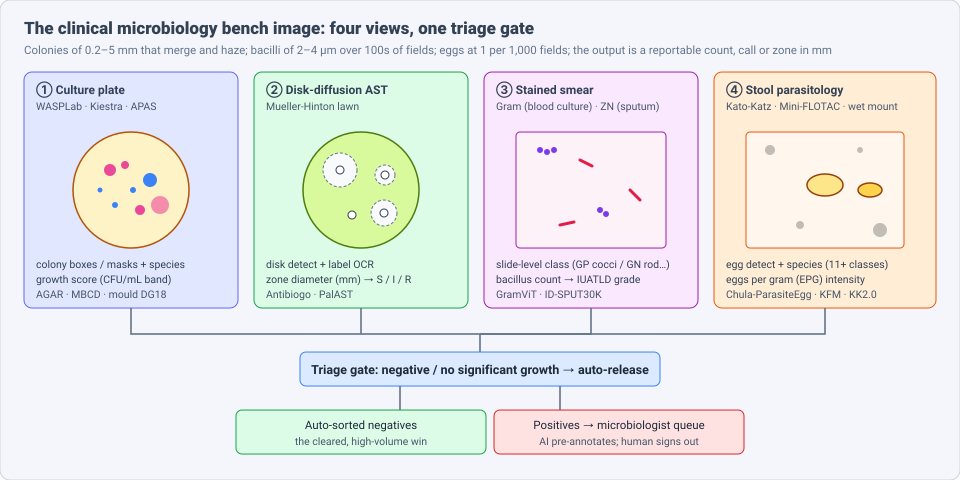
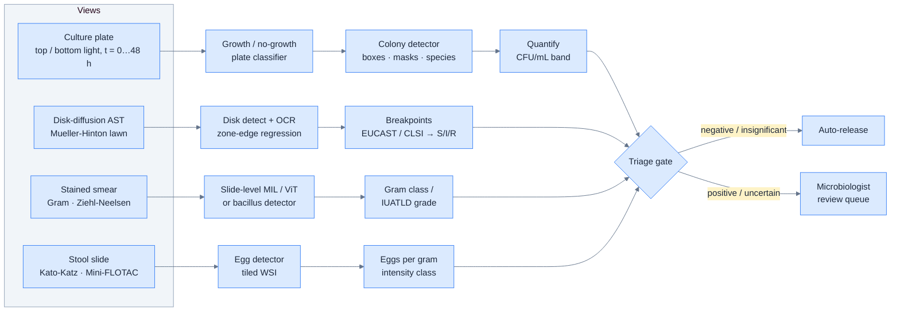
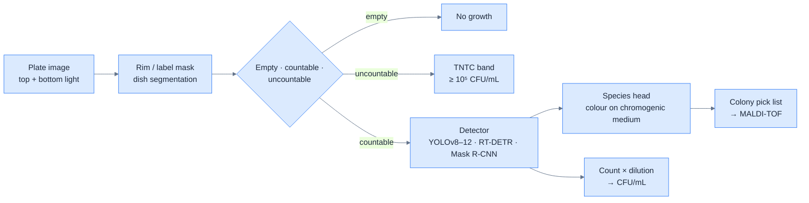
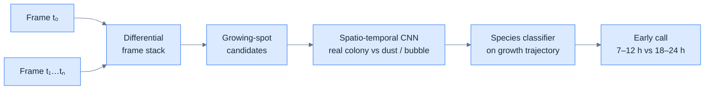

# Dense Object Detection & Classification — Recent Advances

*Compiled 2026-Nov-09 (America/Los_Angeles).*

Next installment in the running CV-updates log. Earlier entries:
[Apr-30](../2026-Apr-30/2026-Apr-30_CV_updates.md),
[May-01](../2026-May-01/2026-May-01_CV_updates.md),
[May-02](../2026-May-02/2026-May-02_CV_updates.md),
[May-04](../2026-May-04/2026-May-04_CV_updates.md),
[May-05](../2026-May-05/2026-May-05_CV_updates.md),
[May-07](../2026-May-07/2026-May-07_CV_updates.md),
[May-08](../2026-May-08/2026-May-08_CV_updates.md),
[May-15](../2026-May-15/2026-May-15_CV_updates.md),
[May-16](../2026-May-16/2026-May-16_CV_updates.md),
[May-17](../2026-May-17/2026-May-17_CV_updates.md),
[Jun-09](../2026-Jun-09/2026-Jun-09_CV_updates.md),
[Jun-10](../2026-Jun-10/2026-Jun-10_CV_updates.md),
[Jun-12](../2026-Jun-12/2026-Jun-12_CV_updates.md),
[Jun-15](../2026-Jun-15/2026-Jun-15_CV_updates.md),
[Jun-16](../2026-Jun-16/2026-Jun-16_CV_updates.md),
[Jun-17](../2026-Jun-17/2026-Jun-17_CV_updates.md),
[Jun-19](../2026-Jun-19/2026-Jun-19_CV_updates.md),
[Jun-21](../2026-Jun-21/2026-Jun-21_CV_updates.md),
[Jun-22](../2026-Jun-22/2026-Jun-22_CV_updates.md),
[Jun-23](../2026-Jun-23/2026-Jun-23_CV_updates.md),
[Jun-24](../2026-Jun-24/2026-Jun-24_CV_updates.md),
[Jun-25](../2026-Jun-25/2026-Jun-25_CV_updates.md),
[Jun-27](../2026-Jun-27/2026-Jun-27_CV_updates.md),
[Jun-29](../2026-Jun-29/2026-Jun-29_CV_updates.md),
[Jun-30](../2026-Jun-30/2026-Jun-30_CV_updates.md),
[Jul-04](../2026-Jul-04/2026-Jul-04_CV_updates.md),
[Jul-07](../2026-Jul-07/2026-Jul-07_CV_updates.md),
[Jul-08](../2026-Jul-08/2026-Jul-08_CV_updates.md),
[Jul-10](../2026-Jul-10/2026-Jul-10_CV_updates.md),
[Jul-15](../2026-Jul-15/2026-Jul-15_CV_updates.md),
[Jul-17](../2026-Jul-17/2026-Jul-17_CV_updates.md),
[Jul-18](../2026-Jul-18/2026-Jul-18_CV_updates.md),
[Jul-21](../2026-Jul-21/2026-Jul-21_CV_updates.md),
[Jul-22](../2026-Jul-22/2026-Jul-22_CV_updates.md),
[Jul-24](../2026-Jul-24/2026-Jul-24_CV_updates.md),
[Jul-26](../2026-Jul-26/2026-Jul-26_CV_updates.md),
[Jul-27](../2026-Jul-27/2026-Jul-27_CV_updates.md),
[Jul-30](../2026-Jul-30/2026-Jul-30_CV_updates.md),
[Aug-01](../2026-Aug-01/2026-Aug-01_CV_updates.md),
[Aug-02](../2026-Aug-02/2026-Aug-02_CV_updates.md),
[Aug-04](../2026-Aug-04/2026-Aug-04_CV_updates.md),
[Aug-07](../2026-Aug-07/2026-Aug-07_CV_updates.md),
[Aug-10](../2026-Aug-10/2026-Aug-10_CV_updates.md),
[Aug-11](../2026-Aug-11/2026-Aug-11_CV_updates.md),
[Aug-13](../2026-Aug-13/2026-Aug-13_CV_updates.md),
[Aug-15](../2026-Aug-15/2026-Aug-15_CV_updates.md),
[Aug-16](../2026-Aug-16/2026-Aug-16_CV_updates.md),
[Aug-18](../2026-Aug-18/2026-Aug-18_CV_updates.md),
[Aug-19](../2026-Aug-19/2026-Aug-19_CV_updates.md),
[Aug-21](../2026-Aug-21/2026-Aug-21_CV_updates.md),
[Aug-22](../2026-Aug-22/2026-Aug-22_CV_updates.md),
[Aug-24](../2026-Aug-24/2026-Aug-24_CV_updates.md),
[Aug-26](../2026-Aug-26/2026-Aug-26_CV_updates.md),
[Aug-29](../2026-Aug-29/2026-Aug-29_CV_updates.md),
[Sep-01](../2026-Sep-01/2026-Sep-01_CV_updates.md),
[Sep-20](../2026-Sep-20/2026-Sep-20_CV_updates.md),
[Sep-23](../2026-Sep-23/2026-Sep-23_CV_updates.md),
[Sep-24](../2026-Sep-24/2026-Sep-24_CV_updates.md),
[Sep-25](../2026-Sep-25/2026-Sep-25_CV_updates.md),
[Sep-26](../2026-Sep-26/2026-Sep-26_CV_updates.md),
[Sep-29](../2026-Sep-29/2026-Sep-29_CV_updates.md),
[Sep-30](../2026-Sep-30/2026-Sep-30_CV_updates.md),
[Oct-01](../2026-Oct-01/2026-Oct-01_CV_updates.md),
[Oct-02](../2026-Oct-02/2026-Oct-02_CV_updates.md),
[Oct-03](../2026-Oct-03/2026-Oct-03_CV_updates.md),
[Oct-04](../2026-Oct-04/2026-Oct-04_CV_updates.md),
[Oct-05](../2026-Oct-05/2026-Oct-05_CV_updates.md),
[Oct-06](../2026-Oct-06/2026-Oct-06_CV_updates.md),
[Oct-07](../2026-Oct-07/2026-Oct-07_CV_updates.md),
[Oct-08](../2026-Oct-08/2026-Oct-08_CV_updates.md),
[Oct-09](../2026-Oct-09/2026-Oct-09_CV_updates.md),
[Oct-10](../2026-Oct-10/2026-Oct-10_CV_updates.md),
[Oct-11](../2026-Oct-11/2026-Oct-11_CV_updates.md),
[Oct-12](../2026-Oct-12/2026-Oct-12_CV_updates.md),
[Oct-13](../2026-Oct-13/2026-Oct-13_CV_updates.md),
[Oct-14](../2026-Oct-14/2026-Oct-14_CV_updates.md),
[Oct-15](../2026-Oct-15/2026-Oct-15_CV_updates.md),
[Oct-16](../2026-Oct-16/2026-Oct-16_CV_updates.md),
[Oct-17](../2026-Oct-17/2026-Oct-17_CV_updates.md),
[Oct-18](../2026-Oct-18/2026-Oct-18_CV_updates.md),
[Oct-19](../2026-Oct-19/2026-Oct-19_CV_updates.md),
[Oct-20](../2026-Oct-20/2026-Oct-20_CV_updates.md),
[Oct-21](../2026-Oct-21/2026-Oct-21_CV_updates.md),
[Oct-22](../2026-Oct-22/2026-Oct-22_CV_updates.md),
[Oct-23](../2026-Oct-23/2026-Oct-23_CV_updates.md),
[Oct-24](../2026-Oct-24/2026-Oct-24_CV_updates.md),
[Oct-25](../2026-Oct-25/2026-Oct-25_CV_updates.md),
[Oct-26](../2026-Oct-26/2026-Oct-26_CV_updates.md),
[Oct-27](../2026-Oct-27/2026-Oct-27_CV_updates.md),
[Oct-28](../2026-Oct-28/2026-Oct-28_CV_updates.md),
[Oct-29](../2026-Oct-29/2026-Oct-29_CV_updates.md),
[Oct-30](../2026-Oct-30/2026-Oct-30_CV_updates.md),
[Oct-31](../2026-Oct-31/2026-Oct-31_CV_updates.md),
[Nov-01](../2026-Nov-01/2026-Nov-01_CV_updates.md),
[Nov-02](../2026-Nov-02/2026-Nov-02_CV_updates.md),
[Nov-03](../2026-Nov-03/2026-Nov-03_CV_updates.md),
[Nov-04](../2026-Nov-04/2026-Nov-04_CV_updates.md),
[Nov-05](../2026-Nov-05/2026-Nov-05_CV_updates.md),
[Nov-06](../2026-Nov-06/2026-Nov-06_CV_updates.md),
[Nov-07](../2026-Nov-07/2026-Nov-07_CV_updates.md),
[Nov-08](../2026-Nov-08/2026-Nov-08_CV_updates.md).

The last five entries covered
[livestock-barn](../2026-Nov-04/2026-Nov-04_CV_updates.md),
[insect-trap](../2026-Nov-05/2026-Nov-05_CV_updates.md),
[plankton-imager](../2026-Nov-06/2026-Nov-06_CV_updates.md),
[airborne pollen](../2026-Nov-07/2026-Nov-07_CV_updates.md) and
[aerial wildlife census](../2026-Nov-08/2026-Nov-08_CV_updates.md) imagery.
This run keeps the "count organisms" theme but shrinks it to the scale of
the clinical lab bench. It covers the **clinical microbiology bench image**:
culture plates photographed inside lab-automation incubators, disk-diffusion
antimicrobial susceptibility (AST) plates, Gram- and Ziehl-Neelsen-stained
smears, and stool parasitology slides (Kato-Katz, Mini-FLOTAC).

The [Oct-06 cytology & haematology entry](../2026-Oct-06/2026-Oct-06_CV_updates.md)
already covered Pap/LBC, urine sediment, blood/marrow and malaria films.
They are left out here, and malaria is mentioned only for contrast.

---

## Table of contents

1. [Why this pass](#1--why-this-pass)
2. [The primitive: four views, one triage gate](#2--the-primitive-four-views-one-triage-gate)
3. [Culture plates: colony detection on AGAR and beyond](#3--culture-plates-colony-detection-on-agar-and-beyond)
4. [Foundation models reach the Petri dish](#4--foundation-models-reach-the-petri-dish)
5. [Lab automation in production: PhenoMATRIX, Kiestra UCA, APAS](#5--lab-automation-in-production-phenomatrix-kiestra-uca-apas)
6. [Time-lapse and holographic plates: detect before the eye can](#6--time-lapse-and-holographic-plates-detect-before-the-eye-can)
7. [Disk-diffusion AST: reading the zone](#7--disk-diffusion-ast-reading-the-zone)
8. [Stained smears: Gram and acid-fast bacilli](#8--stained-smears-gram-and-acid-fast-bacilli)
9. [Stool parasitology: eggs at one per thousand fields](#9--stool-parasitology-eggs-at-one-per-thousand-fields)
10. [Evaluation: what the lab actually checks](#10--evaluation-what-the-lab-actually-checks)
11. [Open problems / what to watch](#11--open-problems--what-to-watch)
12. [Sources](#12--sources)

---

## 1 · Why this pass

Clinical microbiology is one of the last large diagnostic disciplines where
reading the image is still mostly done by eye. Pathology went digital years
ago, but a technologist still reads a urine culture plate by holding it up to
the light and estimating the colony count. Three changes in 2025–26 make the
bench image worth treating as its own primitive:

* **Regulatory traction.** In **February 2026** Copan announced an FDA 510(k)
  clearance with a broad intended use for **PhenoMATRIX**, its AI plate-sorting
  software for WASPLab. This adds to the earlier APAS Independence clearances
  (K183648, K200839). AI plate reading is now a cleared, multi-vendor product
  category in the US, not a one-off.
* **Foundation models arrive.** *Colony Grounded SAM2* (arXiv, Mar 2026) and a
  study of foundation models for mould-colony detection (arXiv, Oct 2025)
  bring Grounding DINO, SAM 2, MaskDINO and RF-DETR to the Petri dish. Both
  find that natural-image pretraining does not transfer to agar out of the
  box.
* **Field evidence for parasitology.** A 2025 *Scientific Reports* study in
  Kenyan primary care found that **expert-verified AI** on Kato-Katz smears
  roughly doubled sensitivity for *Trichuris* and *Ascaris* compared with
  manual microscopy. This is one of the cleanest prospective
  "AI + human vs. human" comparisons in any dense-detection domain covered so
  far.

What makes this domain unusual among dense-detection problems:

| Property | Typical value | Why it matters for the detector |
|---|---|---|
| Object size | colonies 0.2–5 mm on a 90 mm plate; bacilli 2–4 µm; helminth eggs 40–150 µm | extreme scale range across views; small-object recall dominates |
| Object density | 0 to >300 colonies per plate, then confluent | counting has a ceiling ("too numerous to count"), so labels become categorical |
| Prevalence | most urine cultures are negative or insignificant; AFB/eggs are rare per field | the main value is **auto-releasing negatives**, not finding positives |
| Label semantics | CFU/mL bands, IUATLD grades, eggs per gram, S/I/R | the target is a *reportable category* derived from counts, not mAP |
| Appearance shift | media (blood, chromogenic, MacConkey), lighting, incubation time, stain batch | chromogenic colour is a *feature* on one medium and a confounder on another |
| Ground truth | microbiologist read, MALDI-TOF identification, reference broth microdilution | identification labels come from a different instrument than the image |

---

## 2 · The primitive: four views, one triage gate

The pattern is the same in all four views. A **cheap image-level gate** sorts
out the many negative images. A **dense detector** counts what is left.
A **domain rule** (CFU/mL thresholds, EUCAST/CLSI breakpoints, IUATLD grading,
WHO intensity classes) turns counts into a reportable category. A **human**
signs off on positives. Every cleared commercial system has this shape: the AI
sorts and pre-annotates, and trained staff make the final assessment.

---

## 3 · Culture plates: colony detection on AGAR and beyond

**AGAR** (NeuroSYS, arXiv 2108.01234) is still the reference benchmark.
It has about 18,000 Petri-dish photos and **336,442** colonies labelled by
microbiologists with location and species (five classes, including
*S. aureus*, *E. coli*, *P. aeruginosa*, *B. subtilis* and *C. albicans*).
Each image is also tagged *countable*, *uncountable* or *empty*. That
three-way tag is the triage gate from §2, built into the dataset. Its
higher-resolution subset of about 7k images is what most detector comparisons
use.

What the 2025 literature reports on AGAR and similar sets:

| Work | Detector | Data | Reported result |
|---|---|---|---|
| Majchrowska et al. (comparative, arXiv 2108.10103) | two-stage, one-stage and transformer detectors | AGAR higher-res subset | benchmark of detector families on AGAR; the reference comparison later YOLO papers build on |
| *Colony-YOLO* (Microorganisms 13(7):1617, Jul 2025) | YOLOv8n + StarNet backbone, lightweight | new **MBCD** set: 310 images, 23,524 micro-colonies of mulberry bacterial blight | 96.1 % mAP, +4.8 pts over YOLOv8n |
| Dillenseger (2025) | **YOLOv12** | AGAR, 5 classes | mAP50 0.975, mAP50:95 0.706 |
| Silva et al. (2025) | Faster R-CNN, SSD300, FCOS, YOLOv11 | >9,000 agar images | YOLOv11 best at a reported 99.1 % |
| Polibits (2025) | YOLOv5 + classical CV | Petri dishes | automated CFU counting pipeline |

Two lessons hold across these papers:

1. **mAP50 is saturated; mAP50:95 is not.** A detector at 0.975 mAP50 but
   0.706 mAP50:95 finds the colonies but draws loose boxes. That is fine for
   counting, but it matters for colony picking, where a robot arm needs the
   centroid of a single isolated colony to pass to MALDI-TOF.
2. **Single-organism datasets overstate performance.** The Colony-YOLO authors
   note that using one colony type limits generalisability. Mixed cultures,
   where a contaminant spreads across a pathogen, are where clinical plates
   are hardest, and they are the least represented in public data.

---

## 4 · Foundation models reach the Petri dish

**Colony Grounded SAM2** (arXiv 2603.13393, March 2026) is the first
foundation-model pipeline built specifically for bacterial colonies. Grounding
DINO proposes boxes from a text prompt and SAM 2 turns each box into a mask.
The authors report that Grounding DINO's natural-image pretraining performs
poorly on agar out of the box, so they **fine-tune** both components rather
than running them purely zero-shot. Reported results: **93.1 mAP** on the ADBC
dataset (above Colony-YOLO's 91.1) and **Dice@detection 0.85** on
out-of-distribution sets.

**Assessing Foundation Models for Mould Colony Detection with Limited Training
Data** (arXiv 2510.00561, Oct 2025) works on indoor-air and environmental
monitoring rather than clinical bacteriology. It uses about 5,000
high-resolution (1400 × 1400) Petri-dish images from sites across Germany,
grown on **DG18** agar (selective for moulds), and compares YoloV9 and
Mask R-CNN against **MaskDINO, RF-DETR and SAM 2** when training labels are
scarce. Mould colonies are irregular, fuzzy and overlapping, which makes this
a harder segmentation target than round bacterial colonies.

Taken together:

* The **detector-plus-promptable-segmenter** design that appeared earlier in
  this log for plankton, pollen and insect traps also applies to agar. It is
  attractive here because labs change media and organisms often, and a text
  prompt is cheaper than a new labelled dataset.
* **Fine-tuning is still needed.** Neither paper finds a frozen natural-image
  model good enough. The gap is the domain itself: translucent colonies on
  translucent agar, specular glare from the lid, and colour that carries
  meaning only on chromogenic media.
* There is **no vision-language agar dataset yet**. No public set pairs plate
  images with free-text microbiologist reads. That is the obvious next step,
  given that commercial systems already store millions of annotated plate
  images.

---

## 5 · Lab automation in production: PhenoMATRIX, Kiestra UCA, APAS

Commercial systems are where the bench image is now being read at scale. All
three major platforms photograph plates under standardised lighting at fixed
incubation times. That standardisation gives commercial systems their
advantage over academic smartphone-photo datasets.

| System | Vendor | What the AI does | Regulatory status (as found) |
|---|---|---|---|
| **PhenoMATRIX** on WASPLab | Copan | sorts culture plate images (e.g. no growth / growth / pathogen-specific) for review; final assessment by trained staff | FDA 510(k), Class II, announced **Feb 2026** with a "broad intended use". Copan plans more submissions for other plate types. The brochure notes that one of its three AI packages is not FDA-cleared. An FDA recall entry from May 2025 (lack of premarket notification) predates the clearance. |
| **Urine Culture Application (UCA)** on Kiestra | BD | growth scoring and presumptive ID on urine plates; releases no-significant-growth plates; queues growth for review | US launch May 2021. 2026 *J Clin Microbiol* evaluation (below). |
| **APAS Independence** | Clever Culture Systems (US distribution: Thermo Fisher) | reads, interprets and sorts urine culture plates | FDA K183648 (urine module) and K200839; all plates flagged positive must be reviewed by a microbiologist |

**The 2026 BD UCA evaluation** (van der Walt et al., *J Clin Microbiol*,
doi:10.1128/jcm.00270-26) is useful because it is independent-looking and
recent. In a centralised laboratory, using consecutive midstream and catheter
urines on **CHROMagar Orientation**, 1,251 of 1,304 cultures could be
evaluated. Exact agreement across four growth categories was **86.2 %**. The
authors conclude the application can support **safe triage of cultures with
little or no growth**. They also report a specific failure mode: **faint, hazy
light-blue growth was labelled presumptive *Enterococcus***. This is the
chromogenic-colour problem from §1, where a hue shift caused by thin growth is
read as a species signal.

Earlier work points the same way. A 2022 study found **96.5 %** concordance
with technologist counts on MacConkey II agar. *BacterioSight* (Clinical
Chemistry, 2022), a deep-learning model trained on Kiestra blood-agar urine
images from two centres, reported 97 % accuracy against standard of care and
100 % against technologist consensus. A CHUV growth/no-growth extension of the
UCA analysed 4,151 plates, but it is not available for clinical use.

**The pattern across studies:** high agreement at the *no-growth* end, which
is where the auto-release value is, and weaker agreement on *intermediate
counts and colour-based presumptive ID*. The regulatory wording reflects this:
the AI sorts, and a person signs off.

---

## 6 · Time-lapse and holographic plates: detect before the eye can

A plate photographed once at 18–24 h is a static detection problem. A plate
imaged every few minutes is a **spatio-temporal detection** problem, and
colonies can be found before they are visible.

* **Lens-free holographic time-lapse** (Wang et al., *Light: Science &
  Applications* 2020, UCLA Ozcan lab): a monochrome CMOS sensor inside the
  incubator scans the plate in about 87 s. One network detects growing
  micro-colonies from changes between frames, and a second classifies the
  species. Trained on about 16,000 colonies, it reports **90 % of colonies
  detected within 7–10 h**, species ID at **80 % accuracy in 7.6–12 h**, and a
  limit of detection of about **1 CFU/L in 9 h** for water samples.
* **TFT image-sensor version** (arXiv 2205.03549, 2022): a thin-film-transistor
  sensor images chromogenic agar time-lapse, and two networks detect, count
  and identify colonies. The authors report a saving of about **12 h** compared
  with EPA-approved methods.

The lab-automation incubators in §5 already capture plates at several time
points. Exploiting the *temporal* signal (growth rate, morphology over time)
rather than reading only the final frame is the clearest technical gap
between academic prototypes and cleared products.

---

## 7 · Disk-diffusion AST: reading the zone

In Kirby-Bauer disk diffusion, the image is a confluent lawn with antibiotic
disks on it, and the measurement is the **diameter of each inhibition zone in
millimetres**. EUCAST or CLSI breakpoints then map each diameter to
S / I / R. Manual measurement varies between readers, and real zones are
rarely clean circles: swarming *Proteus*, double zones, and scattered
colonies inside the zone all occur.

| Work | Approach | Notes |
|---|---|---|
| **Antibiogo** (Pascucci et al., *Nat Commun*, 2021; MSF Foundation) | offline Android app: ML + image processing for disks and zones, plus a rule-based **expert system** for interpretation | built for low-resource labs; runs entirely on the phone |
| **PalAST** (i-JIM) | cross-platform mobile app; pretrained model detects disks and regresses bounding circles for zones | the "zone as a circle" formulation |
| Ciftci et al. (*Biomedical Journal*, 2026) | deep-learning zone reader trained and validated on 207 plate images | reports **VME 0 %** and **ME 10.5 %** (from a secondary summary; not verified against the paper) |
| IoT AST system (2024) | semantic segmentation with dilated convolutions | segmentation, not circle fitting |
| **CombiANT Reader** (medRxiv 2024) | segments growth on a combination-AST agar assay | a different assay, but the same lawn-segmentation sub-problem |
| Hue-contrast method (*Microchemical J*, 2025) | AI-driven zone identification using hue contrast | title only found |

**Why the error metric is unusual.** AST readers are judged by clinical error
categories, not IoU. A **very major error (VME)** is calling a resistant
isolate susceptible, which can lead to treatment failure. A **major error
(ME)** is calling a susceptible isolate resistant, which wastes an antibiotic.
A detector that is off by 1 mm on a zone near the breakpoint can produce a VME,
while a 5 mm error far from the breakpoint is harmless. A loss function should
therefore weight errors by distance to the breakpoint, not by pixel error.
Antibiogo's expert-system layer also handles intrinsic resistances and
inconsistent phenotypes, the knowledge a microbiologist applies after
measuring.

---

## 8 · Stained smears: Gram and acid-fast bacilli

### Gram stain of positive blood cultures

When a blood culture bottle flags positive, the Gram stain is the first
result sent to the clinician, and it drives empirical antibiotic choice.

* **GramViT** (Stanford; *J Clin Microbiol*, Feb 2025; arXiv 2409.15546) uses
  **LongViT** with self-supervised pretraining on whole-slide images and
  **needs no patch-level annotation**, only the slide-level Gram label. On 475
  slides with five-fold nested cross-validation it reports **accuracy 0.858
  and AUC 0.952**. On 27 external Stanford Health slides, without
  fine-tuning, it reaches **0.926 binary GP/GN accuracy**. It performs worst on
  rare classes, notably **Gram-positive rods**.
* This follows Smith et al. (2017, *J Clin Microbiol*), a patch-CNN with a
  4-way softmax applied to 189 whole slides.

This is the same move from patch labels to slide-level MIL that
histopathology made several years ago. Gram slides are a good fit: one
answer per slide, a few dense regions of bacteria among large areas of
background, and labels already available from the downstream culture.

### Ziehl-Neelsen sputum smears for TB

Smear microscopy detects only about **10–75 %** of pulmonary TB cases (Chen
et al., *Microorganisms* 2024, an evaluation of an intelligent scanner on 1,000
smears). Much of that loss comes from reader fatigue while searching hundreds
of fields for a few red rods.

| Work | Method | Data | Reported |
|---|---|---|---|
| **Mod-YOLOv10** + **ID-SPUT30K** (2025) | modified YOLOv10 for AFB detection and **IUATLD grading** | 313 ZN slides, ~31,300 patches from a low-cost digital microscope; cross-dataset test on MIDTI | 97.5 % accuracy, 97.9 % specificity on a balanced blind test |
| Two-stage segment-then-classify (arXiv 2501.03538, Jan 2025) | Attention Residual U-Net segmentation + ViT classification | ZN smears | targets weak automation and inconsistent segmentation in earlier pipelines |
| Genç et al. (*APMIS* 134, 2026) | five transfer-learned CNNs | ZN smears | InceptionV3 / Xception at a reported 99 % |
| Kokane et al. (*Indian J Tuberc*, 2025) | CNN, ResNet50, EfficientNetB0 | hand-labelled ZN | matches expert performance and reduces reading time |

Many papers report "99 % accuracy" on curated, balanced, single-site patch
sets. The figure that matters clinically is **slide-level sensitivity at the
scanty (1–9 AFB / 100 fields) grade** on consecutive specimens. Only the
scanner-evaluation and ID-SPUT30K lines of work approach that, and the
ID-SPUT30K test set is still balanced rather than consecutive.

---

## 9 · Stool parasitology: eggs at one per thousand fields

Soil-transmitted helminths (STH) and schistosomes are diagnosed by counting
eggs in a stool preparation. Light infections, the majority in
control-programme settings, may contain only a few eggs per slide. This is
the domain where **human-in-the-loop AI has the strongest prospective
evidence**.

**AI-supported vs. manual Kato-Katz** (von Bahr et al., *Sci Rep* 2025;
Karolinska, Uppsala and Helsinki groups; Kenyan primary-care school children,
704 usable smears). Sensitivity against a composite reference standard:

| Species | Manual microscopy | Autonomous AI | **Expert-verified AI** |
|---|---|---|---|
| *A. lumbricoides* | 50.0 % | 50.0 % | **100 %** |
| *T. trichiura* | 31.2 % | 84.4 % | **93.8 %** |
| Hookworm | 77.8 % | 87.4 % | **92.2 %** |

Specificity was above 97 % for all methods. **96.7 %** of positive cases were
light-intensity infections, which manual reading tends to miss. In the
expert-verified arm, the AI pre-selects candidate eggs on the digitised slide
and a local expert confirms them in **under a minute**. The caveat: the
reference standard is a composite of eggs verified on both physical and
digital smears, so the gains are relative to that standard rather than an
independent gold standard. This builds on a 2022 *PLoS NTDs* proof of concept
with a portable whole-slide scanner in Cambodia, Ethiopia, Kenya and Tanzania
(weighted AP 94.9 %, recall 96.1 % across four helminth species).

**The KK2.0 trial** (Ucayali, Peru) compares AI digital-pathology Kato-Katz
with conventional reading in school-age children. Results were not visible in
the abstract retrieved for this pass.

**Kubic FLOTAC Microscope (KFM)** (University of Naples Federico II, WHO
CC ITA-116) is a compact, battery-powered digital microscope that reads
Mini-FLOTAC / FLOTAC chambers. A web UI controls it and a separate AI server
runs detection. The clinical report reached a **mean absolute error of about
8 eggs per sample** for faecal egg counts. A 2024 *Frontiers in AI* paper
described the **AI-KFM Kaggle challenge** (gastrointestinal nematode eggs in
cattle). A 2025 *Int J Parasitol* workflow separates ***Fasciola hepatica***
from ***Calicophoron daubneyi*** eggs, which are hard to distinguish by eye,
with dedicated post-processing to suppress false positives.

**Benchmarks and embedded models.** **Chula-ParasiteEgg** (ICIP 2022
challenge; 11,000 images, 11 egg types × 1,000) remains the multi-class
reference. A 2025 *Intelligence-Based Medicine* comparison runs compact YOLO
variants (v5n/s, v7/tiny, v8n/s, v10n/s) on 11 egg species and measures
real-time throughput on **Raspberry Pi 4, Intel UP² + NCS2 and Jetson Nano**.
That deployment target matters: these readers will run next to a field
microscope, not in a data centre.

---

## 10 · Evaluation: what the lab actually checks

| View | Image metric papers report | Metric the lab or regulator uses |
|---|---|---|
| Culture plate | mAP50, mAP50:95, count MAE | **categorical agreement** across CFU/mL bands; *negative predictive value* for auto-release; time to result |
| Presumptive ID | top-1 accuracy | agreement with **MALDI-TOF** ID; rate of colour-driven mis-ID (e.g. hazy-blue → *Enterococcus*) |
| Disk-diffusion AST | zone diameter MAE, IoU | **VME / ME / minor error** rates vs. reference AST; essential and categorical agreement |
| Gram stain | slide AUC | per-morphotype accuracy, especially rare classes; time to first report |
| AFB smear | patch accuracy | slide sensitivity at the **scanty grade**; agreement with IUATLD grade; Xpert/culture as reference |
| Parasitology | mAP, per-egg F1 | **per-species sensitivity at light intensity**; EPG agreement; WHO intensity class |

The common thread: **image-level metrics saturate long before clinical
metrics do**. A 0.97 mAP50 colony detector can still have unacceptable
categorical disagreement near the 10⁵ CFU/mL threshold. A 99 % patch-accuracy
AFB classifier can still miss a scanty slide. Benchmark papers that do not
report the clinical metric cannot be compared with cleared products.

---

## 11 · Open problems / what to watch

1. **Mixed and polymicrobial plates.** Public datasets are mostly
   single-organism. Clinical plates with a contaminant over a pathogen, or
   three uropathogens together, are where errors concentrate and where data is
   scarcest.
2. **Using the time-lapse signal in production.** Automated incubators already
   take multi-time-point images. Bringing the holographic-prototype idea
   (§6) into cleared products could move "no growth" calls from 18 h toward
   about 10 h.
3. **Media-agnostic models.** Chromogenic colour is a strong cue on one medium
   and meaningless on another. Watch whether foundation-model fine-tunes
   (Colony Grounded SAM2) generalise across blood, MacConkey, CLED and
   chromogenic media without per-medium retraining.
4. **Breakpoint-aware AST losses.** Zone readers trained on pixel error, not
   VME risk near breakpoints, are optimising the wrong objective.
5. **A vision-language plate corpus.** Millions of plate images with
   microbiologist free-text reads sit in LIS/middleware systems. A public,
   de-identified subset would do for microbiology what MIMIC-CXR did for chest
   radiographs.
6. **Prospective, consecutive-specimen trials for AFB and Gram.** Parasitology
   now has a prospective three-arm comparison (manual / autonomous / verified).
   TB smear and Gram-stain AI still mostly report curated retrospective
   accuracy.
7. **Regulatory scope.** Copan's Feb 2026 clearance claims a *broad* intended
   use, and further submissions are planned. Watch whether FDA decisions move
   beyond urine toward wound, respiratory and MRSA/VRE/CRE screening plates,
   and whether any system is cleared to **auto-report** positives rather than
   only auto-release negatives.

---

## 12 · Sources

*Research note: arxiv.org and rapidmicrobiology.com could not be fetched
directly from this run's network sandbox. Figures for those items come from
search-index abstracts and summaries, and are flagged where they could not be
checked against the primary paper.*

### Culture plates and datasets (§3)
* AGAR dataset — Majchrowska et al., *AGAR a microbial colony dataset for deep learning detection*: <https://arxiv.org/abs/2108.01234> · project page <https://agar.neurosys.com/>
* *Deep neural networks approach to microbial colony detection — a comparative analysis*: <https://arxiv.org/abs/2108.10103>
* Colony-YOLO (Microorganisms 13(7):1617, 2025): <https://www.mdpi.com/2076-2607/13/7/1617> · <https://www.ncbi.nlm.nih.gov/pmc/articles/PMC12299148/>
* CFU detection in Petri-dish images using YOLOv12 (record): <https://ubmr.hds.hebis.de/EdsRecord/edsair%252Cedsair.od......2755..1e009ffdc890b10ba291b12feedc593c>
* Automated detection of bacterial colonies using YOLOv5 (Polibits): <https://polibits.cidetec.ipn.mx/index.php/polibits/article/view/6507>
* Chalmers colony detection (CNN + ViT): <https://research.chalmers.se/publication/554369/file/554369_Fulltext.pdf>
* Roboflow bacteria colony counting set: <https://universe.roboflow.com/praca-mfrbd/bacteria-colony-counting-9e7ti>

### Foundation models (§4)
* Colony Grounded SAM2 (arXiv 2603.13393): <https://arxiv.org/abs/2603.13393> · summary <https://sotaverified.org/papers/260313393>
* Assessing Foundation Models for Mold Colony Detection with Limited Training Data (arXiv 2510.00561): <https://arxiv.org/abs/2510.00561>

### Lab automation (§5)
* FDA 510(k) for Copan PhenoMATRIX (Feb 2026): <https://www.rapidmicrobiology.com/news/fda-510-k-clearance-establishes-broad-intended-use-for-copan-s-phenomatrix> · <https://www.captodayonline.com/copans-phenomatrix-software-gets-fda-510k-clearance/> · <https://technode.global/prnasia/fda-510k-clearance-establishes-broad-intended-use-for-copans-phenomatrix-expanding-clinical-microbiology-capabilities/>
* PhenoMATRIX brochure (US, 2025): <https://www.copanusa.com/wp-content/uploads/2025/05/Phenomatrix_Brochure_US_051325_to_print.pdf>
* PhenoMATRIX recall record: <https://recallcheck.net/device-recalls/15628>
* APAS Independence — K183648: <https://510k.innolitics.com/search/K183648> · GUDID <https://accessgudid.nlm.nih.gov/devices/09354646000001>
* APAS clinical evaluation (J Microbiol Methods): <https://assets.thermofisher.com/TFS-Assets/MBD/Application-Notes/Study-Clinical-Evaluation-of-APAS-Journal-of-Microbiological-Methods.pdf>
* van der Walt et al., *Evaluation of the BD Urine Culture Application for AI-assisted urine culture interpretation*, J Clin Microbiol (doi:10.1128/jcm.00270-26): <https://www.citedrive.com/en/discovery/evaluation-of-the-bd-urine-culture-application-for-artificial-intelligence-assisted-urine-culture-interpretation/>
* BD Kiestra UCA launch: <https://www.biospace.com/bd-leverages-artificial-intelligence-to-transform-microbiology-urine-testing> · product page <https://www.bd.com/en-ca/products-and-solutions/products/product-families/bd-kiestra-urine-culture-application>
* CHUV growth / no-growth AI study: <https://serval.unil.ch/resource/serval:BIB_CA319F0D5E34.P001/REF>

### Time-lapse plates (§6)
* Wang et al., early detection and classification of live bacteria using time-lapse coherent imaging (LSA 2020): <https://innovate.ee.ucla.edu/wp-content/uploads/2020/07/s41377-020-00358-9.pdf>
* TFT image sensor colony detection (arXiv 2205.03549): <https://arxiv.org/abs/2205.03549>

### Disk-diffusion AST (§7)
* Antibiogo, Pascucci et al., Nat Commun 2021: <https://www.doi.org/10.1038/s41467-021-21187-3> · <https://pmc.ncbi.nlm.nih.gov/articles/PMC7895972>
* PalAST: <https://online-journals.org/index.php/i-jim/article/view/41815>
* CombiANT Reader (medRxiv): <https://medrxiv.org/content/10.1101/2024.10.16.24315598v2.full-text>
* New AI framework for AST (journal-club summary of Ciftci et al.): <https://www.rapidmicrobiology.com/journal-club/new-ai-framework-for-antimicrobial-susceptibility-testing-ast>
* Hue-contrast inhibition-zone method: <https://ouci.dntb.gov.ua/works/42rBA684>
* Deep-learning AST smart system: <https://www.bohrium.com/paper-details/development-of-deep-learning-based-antimicrobial-susceptibility-test-smart-system/999855226414432258-2817>

### Stained smears (§8)
* GramViT (J Clin Microbiol 2025): <https://www.ncbi.nlm.nih.gov/pmc/articles/PMC11898657/> · <https://arxiv.org/abs/2409.15546>
* Smith et al. 2017, Gram stain CNN: <https://pmc.ncbi.nlm.nih.gov/articles/PMC5824030>
* Two-stage AFB segmentation/classification (arXiv 2501.03538): <https://arxiv.org/html/2501.03538v1>
* Digital microscopy system and sputum dataset (ID-SPUT30K): <https://scholar.its.ac.id/en/publications/a-digital-microscopy-system-and-new-sputum-dataset-for-deep-learn/>
* Chen et al., intelligent scanner for AFB (Microorganisms 2024): <https://www.ncbi.nlm.nih.gov/pmc/articles/PMC11356913/>
* ZN smear transfer learning (Genç et al.): <https://avesis.ksbu.edu.tr/yayin/5c81cc14-1bec-4589-b06d-cb2f48550c50/detection-of-mycobacterium-tuberculosis-in-ziehlneelsen-stained-sputum-smear-specimens-using-deep-learning-techniques>

### Parasitology (§9)
* von Bahr et al., AI-supported vs manual Kato-Katz (Sci Rep 2025): <https://openarchive.ki.se/articles/journal_contribution/AI-supported_versus_manual_microscopy_of_Kato-Katz_smears_for_diagnosis_of_soil-transmitted_helminth_infections_in_a_primary_healthcare_setting/29437964> · news <https://www.uu.se/en/department/womens-and-childrens-health/news/archive/2025-07-17-ai-supported-microscopy-enhances-detection-of---intestinal-parasitic-infections-in-primary-healthcare> · <https://www.helsinki.fi/en/hilife-helsinki-institute-life-science/news-0/ai-supported-microscopy-enhances-detection-parasitic-infections-primary-healthcare>
* InfoNTD record: <https://www.infontd.org/resource/ai-supported-versus-manual-microscopy-kato-katz-smears-diagnosis-soil-transmitted-helminth>
* AI digital pathology for STH eggs (KK2.0 context): <https://ouci.dntb.gov.ua/works/4MdAqQP7>
* Kubic FLOTAC Microscope (Parasitology 2021): <https://pubmed.ncbi.nlm.nih.gov/33213534/> · <https://pmc.ncbi.nlm.nih.gov/articles/PMC7938342>
* AI-KFM challenge (Front AI 2024): <https://www.frontiersin.org/journals/artificial-intelligence/articles/10.3389/frai.2024.1325219/pdf>
* WHO CC ITA-116 publications (Fasciola / Calicophoron workflow): <https://maps.parassitologia.unina.it/publications>
* Chula-ParasiteEgg (ICIP 2022) Zenodo: <https://zenodo.org/records/15866298>
* YOLOv5 parasite-egg framework (Diagnostics 2023): <https://www.ncbi.nlm.nih.gov/pmc/articles/PMC10527934/>
* Resource-efficient YOLO models for parasitic eggs (Intelligence-Based Medicine 2025): <https://www.amrita.edu/publication/comparative-analysis-of-resource-efficient-yolo-models-for-rapid-and-accurate-recognition-of-intestinal-parasitic-eggs-in-stool-microscopy/>
* Helminth egg recognition platform: <https://www.ncbi.nlm.nih.gov/pmc/articles/PMC11614813/>

### Context (single-cell AST, not covered in depth)
* Zagajewski et al., deep-learning single-cell AST (Commun Biol 2023): <https://www.nature.com/articles/s42003-023-05524-4>
* Morphometric AST for *K. pneumoniae* (Front Imaging 2024): <https://public-pages-files-2025.frontiersin.org/journals/imaging/articles/10.3389/fimag.2024.1418669/text>
