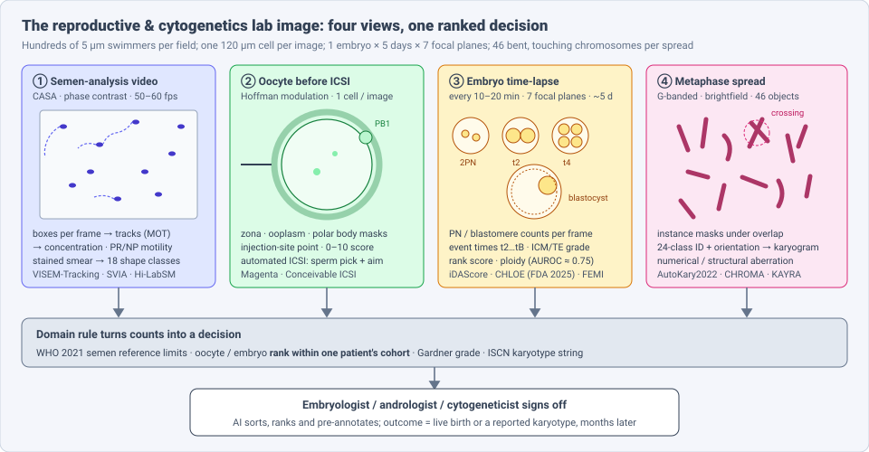
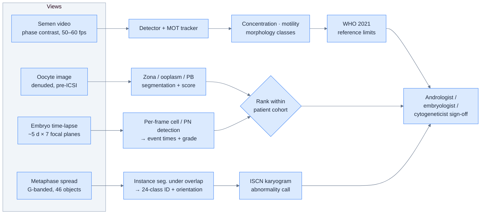
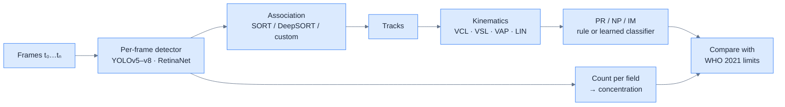
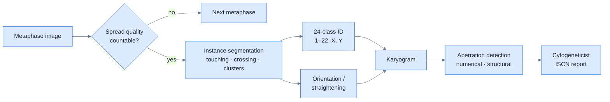

# Dense Object Detection & Classification — Recent Advances

*Compiled 2026-Nov-10 (America/Los_Angeles).*

Next installment in the running CV-updates log. Earlier entries:
[Apr-30](../2026-Apr-30/2026-Apr-30_CV_updates.md),
[May-01](../2026-May-01/2026-May-01_CV_updates.md),
[May-02](../2026-May-02/2026-May-02_CV_updates.md),
[May-04](../2026-May-04/2026-May-04_CV_updates.md),
[May-05](../2026-May-05/2026-May-05_CV_updates.md),
[May-07](../2026-May-07/2026-May-07_CV_updates.md),
[May-08](../2026-May-08/2026-May-08_CV_updates.md),
[May-15](../2026-May-15/2026-May-15_CV_updates.md),
[May-16](../2026-May-16/2026-May-16_CV_updates.md),
[May-17](../2026-May-17/2026-May-17_CV_updates.md),
[Jun-09](../2026-Jun-09/2026-Jun-09_CV_updates.md),
[Jun-10](../2026-Jun-10/2026-Jun-10_CV_updates.md),
[Jun-12](../2026-Jun-12/2026-Jun-12_CV_updates.md),
[Jun-15](../2026-Jun-15/2026-Jun-15_CV_updates.md),
[Jun-16](../2026-Jun-16/2026-Jun-16_CV_updates.md),
[Jun-17](../2026-Jun-17/2026-Jun-17_CV_updates.md),
[Jun-19](../2026-Jun-19/2026-Jun-19_CV_updates.md),
[Jun-21](../2026-Jun-21/2026-Jun-21_CV_updates.md),
[Jun-22](../2026-Jun-22/2026-Jun-22_CV_updates.md),
[Jun-23](../2026-Jun-23/2026-Jun-23_CV_updates.md),
[Jun-24](../2026-Jun-24/2026-Jun-24_CV_updates.md),
[Jun-25](../2026-Jun-25/2026-Jun-25_CV_updates.md),
[Jun-27](../2026-Jun-27/2026-Jun-27_CV_updates.md),
[Jun-29](../2026-Jun-29/2026-Jun-29_CV_updates.md),
[Jun-30](../2026-Jun-30/2026-Jun-30_CV_updates.md),
[Jul-04](../2026-Jul-04/2026-Jul-04_CV_updates.md),
[Jul-07](../2026-Jul-07/2026-Jul-07_CV_updates.md),
[Jul-08](../2026-Jul-08/2026-Jul-08_CV_updates.md),
[Jul-10](../2026-Jul-10/2026-Jul-10_CV_updates.md),
[Jul-15](../2026-Jul-15/2026-Jul-15_CV_updates.md),
[Jul-17](../2026-Jul-17/2026-Jul-17_CV_updates.md),
[Jul-18](../2026-Jul-18/2026-Jul-18_CV_updates.md),
[Jul-21](../2026-Jul-21/2026-Jul-21_CV_updates.md),
[Jul-22](../2026-Jul-22/2026-Jul-22_CV_updates.md),
[Jul-24](../2026-Jul-24/2026-Jul-24_CV_updates.md),
[Jul-26](../2026-Jul-26/2026-Jul-26_CV_updates.md),
[Jul-27](../2026-Jul-27/2026-Jul-27_CV_updates.md),
[Jul-30](../2026-Jul-30/2026-Jul-30_CV_updates.md),
[Aug-01](../2026-Aug-01/2026-Aug-01_CV_updates.md),
[Aug-02](../2026-Aug-02/2026-Aug-02_CV_updates.md),
[Aug-04](../2026-Aug-04/2026-Aug-04_CV_updates.md),
[Aug-07](../2026-Aug-07/2026-Aug-07_CV_updates.md),
[Aug-10](../2026-Aug-10/2026-Aug-10_CV_updates.md),
[Aug-11](../2026-Aug-11/2026-Aug-11_CV_updates.md),
[Aug-13](../2026-Aug-13/2026-Aug-13_CV_updates.md),
[Aug-15](../2026-Aug-15/2026-Aug-15_CV_updates.md),
[Aug-16](../2026-Aug-16/2026-Aug-16_CV_updates.md),
[Aug-18](../2026-Aug-18/2026-Aug-18_CV_updates.md),
[Aug-19](../2026-Aug-19/2026-Aug-19_CV_updates.md),
[Aug-21](../2026-Aug-21/2026-Aug-21_CV_updates.md),
[Aug-22](../2026-Aug-22/2026-Aug-22_CV_updates.md),
[Aug-24](../2026-Aug-24/2026-Aug-24_CV_updates.md),
[Aug-26](../2026-Aug-26/2026-Aug-26_CV_updates.md),
[Aug-29](../2026-Aug-29/2026-Aug-29_CV_updates.md),
[Sep-01](../2026-Sep-01/2026-Sep-01_CV_updates.md),
[Sep-20](../2026-Sep-20/2026-Sep-20_CV_updates.md),
[Sep-23](../2026-Sep-23/2026-Sep-23_CV_updates.md),
[Sep-24](../2026-Sep-24/2026-Sep-24_CV_updates.md),
[Sep-25](../2026-Sep-25/2026-Sep-25_CV_updates.md),
[Sep-26](../2026-Sep-26/2026-Sep-26_CV_updates.md),
[Sep-29](../2026-Sep-29/2026-Sep-29_CV_updates.md),
[Sep-30](../2026-Sep-30/2026-Sep-30_CV_updates.md),
[Oct-01](../2026-Oct-01/2026-Oct-01_CV_updates.md),
[Oct-02](../2026-Oct-02/2026-Oct-02_CV_updates.md),
[Oct-03](../2026-Oct-03/2026-Oct-03_CV_updates.md),
[Oct-04](../2026-Oct-04/2026-Oct-04_CV_updates.md),
[Oct-05](../2026-Oct-05/2026-Oct-05_CV_updates.md),
[Oct-06](../2026-Oct-06/2026-Oct-06_CV_updates.md),
[Oct-07](../2026-Oct-07/2026-Oct-07_CV_updates.md),
[Oct-08](../2026-Oct-08/2026-Oct-08_CV_updates.md),
[Oct-09](../2026-Oct-09/2026-Oct-09_CV_updates.md),
[Oct-10](../2026-Oct-10/2026-Oct-10_CV_updates.md),
[Oct-11](../2026-Oct-11/2026-Oct-11_CV_updates.md),
[Oct-12](../2026-Oct-12/2026-Oct-12_CV_updates.md),
[Oct-13](../2026-Oct-13/2026-Oct-13_CV_updates.md),
[Oct-14](../2026-Oct-14/2026-Oct-14_CV_updates.md),
[Oct-15](../2026-Oct-15/2026-Oct-15_CV_updates.md),
[Oct-16](../2026-Oct-16/2026-Oct-16_CV_updates.md),
[Oct-17](../2026-Oct-17/2026-Oct-17_CV_updates.md),
[Oct-18](../2026-Oct-18/2026-Oct-18_CV_updates.md),
[Oct-19](../2026-Oct-19/2026-Oct-19_CV_updates.md),
[Oct-20](../2026-Oct-20/2026-Oct-20_CV_updates.md),
[Oct-21](../2026-Oct-21/2026-Oct-21_CV_updates.md),
[Oct-22](../2026-Oct-22/2026-Oct-22_CV_updates.md),
[Oct-23](../2026-Oct-23/2026-Oct-23_CV_updates.md),
[Oct-24](../2026-Oct-24/2026-Oct-24_CV_updates.md),
[Oct-25](../2026-Oct-25/2026-Oct-25_CV_updates.md),
[Oct-26](../2026-Oct-26/2026-Oct-26_CV_updates.md),
[Oct-27](../2026-Oct-27/2026-Oct-27_CV_updates.md),
[Oct-28](../2026-Oct-28/2026-Oct-28_CV_updates.md),
[Oct-29](../2026-Oct-29/2026-Oct-29_CV_updates.md),
[Oct-30](../2026-Oct-30/2026-Oct-30_CV_updates.md),
[Oct-31](../2026-Oct-31/2026-Oct-31_CV_updates.md),
[Nov-01](../2026-Nov-01/2026-Nov-01_CV_updates.md),
[Nov-02](../2026-Nov-02/2026-Nov-02_CV_updates.md),
[Nov-03](../2026-Nov-03/2026-Nov-03_CV_updates.md),
[Nov-04](../2026-Nov-04/2026-Nov-04_CV_updates.md),
[Nov-05](../2026-Nov-05/2026-Nov-05_CV_updates.md),
[Nov-06](../2026-Nov-06/2026-Nov-06_CV_updates.md),
[Nov-07](../2026-Nov-07/2026-Nov-07_CV_updates.md),
[Nov-08](../2026-Nov-08/2026-Nov-08_CV_updates.md),
[Nov-09](../2026-Nov-09/2026-Nov-09_CV_updates.md).

The last five entries covered
[insect-trap](../2026-Nov-05/2026-Nov-05_CV_updates.md),
[plankton-imager](../2026-Nov-06/2026-Nov-06_CV_updates.md),
[airborne pollen](../2026-Nov-07/2026-Nov-07_CV_updates.md),
[aerial wildlife census](../2026-Nov-08/2026-Nov-08_CV_updates.md) and
[clinical microbiology bench](../2026-Nov-09/2026-Nov-09_CV_updates.md)
imagery. This run stays at the lab bench but moves from microbes to human
cells. It covers the **reproductive-medicine & cytogenetics lab image**:
semen-analysis video (sperm detection, tracking and morphology), the oocyte
imaged just before ICSI, the embryo time-lapse stack, and the G-banded
metaphase spread that becomes a karyogram.

Out of scope: blood, marrow and cytology smears (covered in the
[Oct-06 entry](../2026-Oct-06/2026-Oct-06_CV_updates.md)), FISH and
sequencing-based genetics, and ultrasound follicle counting.

---

## Table of contents

1. [Why this pass](#1--why-this-pass)
2. [The primitive: four views, one ranked decision](#2--the-primitive-four-views-one-ranked-decision)
3. [Semen-analysis video: detect, track, then count](#3--semen-analysis-video-detect-track-then-count)
4. [Sperm morphology: 18 classes and 65 % accuracy](#4--sperm-morphology-18-classes-and-65--accuracy)
5. [Rare-sperm search and automated ICSI](#5--rare-sperm-search-and-automated-icsi)
6. [The oocyte image](#6--the-oocyte-image)
7. [Embryo time-lapse: dense events in one cell cluster](#7--embryo-time-lapse-dense-events-in-one-cell-cluster)
8. [Embryo AI in the clinic: the RCT, the clearance, the foundation model](#8--embryo-ai-in-the-clinic-the-rct-the-clearance-the-foundation-model)
9. [The metaphase spread: 46 objects that touch and cross](#9--the-metaphase-spread-46-objects-that-touch-and-cross)
10. [Evaluation: what the lab actually checks](#10--evaluation-what-the-lab-actually-checks)
11. [Open problems / what to watch](#11--open-problems--what-to-watch)
12. [Sources](#12--sources)

---

## 1 · Why this pass

Reproductive medicine and clinical cytogenetics are two lab disciplines where
a trained person still reads most images under a microscope, one at a time.
Several 2025–26 events make the images from these labs worth treating as a
primitive of their own:

* **First FDA clearance for embryo AI.** Fairtility's **CHLOE Blast** received
  FDA 510(k) clearance (**K243851**, decision dated 15 Aug 2025, announced
  3 Sep 2025) under the product code for embryo image assessment systems
  (PBH). The company describes it as the first FDA-cleared machine-learning
  decision-support tool for embryo assessment.
* **A negative RCT that set the bar.** The first large randomised trial of
  deep-learning embryo selection (iDAScore vs. manual morphology,
  *Nature Medicine*, Nov 2024; 1,066 patients, 14 clinics) **did not show
  non-inferiority** for clinical pregnancy. It did show a large saving in
  embryologist time. Every 2025–26 embryo-AI claim is now read against that
  result.
* **Robots and rare-object search reach live outcomes.** In 2025, the first
  live birth from a **digitally controlled, AI-assisted ICSI** system was
  reported (Conceivable Life Sciences, *RBMO*). Columbia's **STAR** system
  scanned millions of frames to find two sperm in a man with azoospermia,
  leading to a pregnancy (*Lancet* research letter, Oct 2025).
* **Foundation models on both benches.** **FEMI** (*Nat Commun* 2025) was
  pretrained on about 18 million embryo time-lapse images. **CHROMA**
  (arXiv, May 2025) was pretrained on about 4 million chromosome images.
  **KAYRA** (arXiv, Apr 2026) is a deployable karyotyping pipeline with a
  head-to-head comparison against two commercial systems.

What makes this domain unusual among dense-detection problems:

| Property | Typical value | Why it matters for the detector |
|---|---|---|
| Object count | 10s–100s of sperm per field; 1 oocyte; 1–200 cells inside one embryo; 46 chromosomes per spread | density varies by four orders of magnitude between views |
| Motion | sperm swim at ~25–100 µm/s, and heads leave the focal plane | detection alone is insufficient; motility is a **tracking** output |
| Overlap | chromosomes touch and cross; blastomeres occlude in 3-D | instance separation under overlap is the core segmentation problem |
| Label semantics | WHO reference limits, Gardner grade, morphokinetic event times, ISCN karyotype | the target is a reportable category or a **rank**, not a box |
| Ground truth | live birth (months later), PGT-A result, cytogeneticist sign-off | labels are delayed, confounded by patient factors, and often unavailable for untransferred embryos |
| Decision unit | the *cohort* of one patient's embryos or oocytes | the model needs to rank items well within one patient; ranking well across patients is not required |

---

## 2 · The primitive: four views, one ranked decision

The structure differs from the triage gate in the
[microbiology entry](../2026-Nov-09/2026-Nov-09_CV_updates.md). There, the AI's
main job was to auto-release the many negatives. Here, the main job is
**ranking**: which sperm to inject, which oocyte is most promising, which
embryo to transfer first. The cytogenetics view is the exception. There the
AI's job is to **assemble** a karyogram that a person then reads. In both
cases, a person signs off on every result.

---

## 3 · Semen-analysis video: detect, track, then count

A semen analysis reports concentration, total and progressive motility, and
morphology against the WHO reference limits (WHO laboratory manual, 6th ed.,
2021). Concentration is a counting problem. Motility is a **multi-object
tracking** problem: progressive vs. non-progressive vs. immotile is a
property of a trajectory, not of a box.

**Datasets.**

| Dataset | Content | Notes |
|---|---|---|
| **VISEM-Tracking** (Thambawita et al., *Sci Data* 2023) | 20 wet-prep videos, 30 s each, with boxes and track IDs; classes normal sperm, pinhead, cluster | about **7× more annotated frames and 2.3× more annotated objects than SVIA**; YOLOv5 baseline; CC BY 4.0 on Zenodo |
| **SVIA** | ~125,000 detection annotations, plus segmentation and classification subsets | very short clips (1–3 s), so it is weak for tracking |
| VISEM (2019) | 85 participants, videos plus clinical and fatty-acid data | the parent set; useful for multimodal fertility prediction |

**Methods.** A July 2026 review (Guan et al., arXiv 2607.05311, 46 pp.)
describes the dominant design as a **per-frame deep detector followed by a
separate association step**, the same tracking-by-detection split used for
crowds and sports in earlier entries. Reported systems include
**SpermYOLOv8E-TrackEVD** (enhanced YOLOv8 with a dedicated association
algorithm; **HOTA 74.3 %**) and a MobileNet + YOLOv5s + DeepSORT CASA
pipeline. The review did not report a transformer tracker (TransTrack- or
MOTR-style) for CASA motility, and this pass did not find one either.

Why sperm tracking is harder than it looks:

* **Identity switches at collisions.** Sperm cross paths constantly. Each
  switch corrupts *two* trajectories and so two motility labels. Hidayatullah
  et al. designed their bull-sperm tracker specifically to reduce identity
  switches (MOTAL 73.2) before classifying motility (SVM, 92.08 % mean
  accuracy).
* **Defocus exits.** Heads leave the shallow depth of field and come back.
  A tracker that ends the track and starts a new one will over-count cells
  and under-count progressive ones.
* **Static thresholds.** Classic CASA rules (VAP, VSL, LIN cut-offs) handle
  fast progressive sperm well and non-progressive ones poorly. That gap is
  where learned trajectory classifiers help.

---

## 4 · Sperm morphology: 18 classes and 65 % accuracy

Morphology is assessed on stained smears, with strict criteria and only a few
percent of cells "normal" even in fertile men. It is a fine-grained,
long-tailed classification problem on small patches.

**Hi-LabSpermMorpho** (Aktas et al., *IEEE Access*, 2024/25) is now the
largest public reference: **49,345** RGB patches in **18 expert-labelled
classes** (normal plus 17 head, neck and tail defects: eight head classes such as tapered,
pyriform, vacuolated and pin; thin, thick, twisted and asymmetrical necks;
and double, curly, long, short and twisted tails). It includes three Diff-Quik-type stain variants. The authors trained 35
architectures. The best single model reached only **65.05 %** (BesLab stain)
and **67.42 %** (Histoplus) accuracy.

That number is the most useful fact in this section. On a well-labelled,
reasonably large set, single CNNs and ViTs get about two-thirds of the
classes right. This is consistent with inter-observer variation on sperm
morphology, which is known to be high. 2025 follow-ups (a soft-voting
ensemble in *Diagnostics* 15(12):1564; a ViT comparison in *PeerJ CS*) improve
on the baseline. They also point out that many earlier methods classify only
the **head** and ignore the midpiece and tail, which carry half the defect
classes.

For detection-oriented readers, the take-away is that whole-smear
morphology is a **detect-then-classify** problem. The classifier, not the
detector, is the bottleneck. Benchmarks that report only head-crop accuracy
on pre-cropped cells overstate end-to-end performance.

---

## 5 · Rare-sperm search and automated ICSI

Two 2025 systems use dense detection in very different ways: one searches
millions of frames for a handful of cells, and the other aims one sperm at one
oocyte.

**STAR (Sperm Tracking and Recovery), Columbia University.** In
non-obstructive azoospermia, a semen sample may contain no sperm visible
to a technician, or only a few. STAR flows the sample through a microfluidic
chip under a high-speed camera. A model flags sperm among debris, and the
chip diverts the droplet that holds the flagged cell for recovery.
In the case reported as a research letter in *The Lancet* (Suryawanshi …
Williams, 31 Oct 2025), the system scanned about **2.5 million images in
roughly two hours** and recovered **two viable sperm**, which were used for
ICSI and led to a clinical pregnancy. Press coverage quotes the team as
finding sperm in just under **30 %** of patients previously told they had
none. That figure has not been peer-reviewed, and larger studies are
under way.

As a detection problem, STAR is extreme-prevalence search: on the order of
one positive per million frames, with a real-time budget. Precision matters
because each false positive means a physical recovery attempt. Recall matters
because a single missed sperm may be the only one in the sample.

**Digitally controlled ICSI, Conceivable Life Sciences.** An *RBMO* case
report (2025) describes the first live birth from an ICSI system that
automates the **23 steps** of the procedure, either under AI control or
digitally by a remote operator. Vision models select a sperm, aim a laser to
immobilise it, and position it in the pipette. They then locate the oocyte
and its injection site. In the case, **4 of 5** oocytes injected
by the system fertilised. The automated procedure averaged **9 min 56 s
per oocyte**, compared with **1 min 22 s** for manual ICSI. Caveats: this is one
patient (donor oocytes), and the authors are the developers.

---

## 6 · The oocyte image

The oocyte image is the opposite of the semen video: one large cell
(~120 µm), photographed once after denudation, just before ICSI. Its
dense-prediction content is **segmentation of structures inside the cell**
(zona pellucida, perivitelline space, ooplasm, first polar body, and
inclusions such as vacuoles or refractile bodies), followed by a quality
score.

* **Polar body and injection site.** A CNN that locates the polar body and
  the optimal injection site reached **98.9 %** accuracy (95 % CI
  98.5–99.2 %) (*J Assist Reprod Genet*, 2022). This is the localisation step
  an automated ICSI system needs.
* **Magenta** (Future Fertility) scores each mature oocyte from 0 to 10 for its
  likelihood of reaching blastocyst. A 2025 retrospective cohort
  (*JBRA Assist Reprod* 29 Suppl 1) scored **14,605 oocytes from 2,306 ICSI
  cycles** (2020–2024). It reports that the score tracks fertilisation,
  blastulation, blastocyst quality and aneuploidy, with maternal age as the
  dominant negative factor. This is a conference abstract, not a full
  peer-reviewed validation.

The oocyte score is useful mainly for **counselling** (how many oocytes to
bank) and as an early prior on the embryo ranking, not for discarding
oocytes. Few clinics would decline to inseminate a mature oocyte because of a
low score.

---

## 7 · Embryo time-lapse: dense events in one cell cluster

A time-lapse incubator (EmbryoScope, Geri, MIRI and others) photographs each
embryo every 10–20 minutes for about five days, often at **seven focal
planes**. The result is a video of a single cell cluster. The cluster goes
from 1 cell with two pronuclei, through 2, 4 and 8 cells, to compaction and a
blastocyst of ~100–200 cells.

Dense prediction appears at several levels:

| Level | Target | Representative work |
|---|---|---|
| Per-frame detection | pronuclei (0PN / 1PN / 2PN / 3PN), blastomeres, fragments | Fukunaga et al. 2020 (900 embryos, PN counting); Mask R-CNN zona/cytoplasm/PN segmentation (Dice ≈ 0.83) |
| Per-video events | morphokinetic times t2, t3 … t8, tSB, tB | Gomez et al. (*Data in Brief* 2022): **704 videos × 7 focal planes, 16 annotated events**, the first public morphokinetic set; CNN-LSTM stage-onset detection (Miled et al., 2024) |
| Per-embryo grade | expansion, inner-cell-mass and trophectoderm grades (Gardner) | many CNN/ViT papers; part of FEMI's evaluation |
| Per-embryo outcome | implantation, ploidy, live birth | iDAScore, CHLOE, BELA, FEMI (§8) |

Two technical points stand out:

1. **Count tracking has a ceiling.** Blastomeres can be counted and tracked
   up to about 8–16 cells. After compaction, cell boundaries disappear, and
   the problem changes from counting cells to segmenting the blastocyst
   regions (ICM, TE, cavity). Event detection should be benchmarked
   separately before and after compaction.
2. **Focal planes are a 3-D signal that is often discarded.** Many models use
   only the central plane. Blastomeres that hide one another in one plane
   are separate in another, which is the same multi-view argument made for
   light-field imaging in an [earlier entry](../2026-Sep-24/2026-Sep-24_CV_updates.md).

---

## 8 · Embryo AI in the clinic: the RCT, the clearance, the foundation model

**The randomised evidence.** Illingworth et al. (*Nat Med* 30:3114–3120,
2024) randomised **1,066** patients at **14** clinics in Australia and Europe
to single-blastocyst selection by **iDAScore** (Vitrolife) or by standard
morphology. Clinical pregnancy was **46.5 % vs. 48.2 %** (risk difference
−1.7 %, 95 % CI −7.7 to 4.3). With a 5 % margin, **non-inferiority was not
shown**. Embryo evaluation took about ten times less time with iDAScore.
Vitrolife's materials describe the rates as "clinically similar", which is a
different claim from the trial's formal conclusion. A January 2026
*Human Reproduction* follow-up from an RCT of uninterrupted time-lapse culture
with or without a commercial ML selection algorithm found comparable
obstetric and perinatal outcomes, a safety result rather than an efficacy
one.

**The clearance.** **CHLOE Blast** (Fairtility) is FDA 510(k) **K243851**
(Aug 2025). Its supporting study (NCT05455281) was observational. The primary
outcome was the association between CHLOE's prediction and the actual
blastocyst outcome. So the US clearance rests on a **prediction-accuracy**
claim, not on a randomised outcome benefit. This matches the pattern seen with
microbiology plate readers, where the AI is cleared as decision support with
human sign-off.

**Ploidy from pixels.** Predicting aneuploidy from images could, in
principle, reduce reliance on embryo biopsy (PGT-A). The image-only results
have stayed in a narrow band:

| Model | Data | Ploidy result |
|---|---|---|
| **BELA** (Weill Cornell, *Nat Commun* 2024) | time-lapse video + maternal age | AUC **0.76** euploid vs. aneuploid; authors state it is not a PGT-A replacement |
| **FEMI** (*Nat Commun* 2025; doi 10.1038/s41467-025-61116-2) | foundation model, **~18 M** time-lapse images | AUROC **> 0.75** image-only; mosaic embryos excluded; outperforms VGG16, EfficientNetV2, ConvNeXt, CoAtNet, MoViNet baselines |
| FEMI (tech-transfer summary) | single image → video → + maternal age | > 0.75 → > 0.80 → > 0.85 AUROC (developer figures) |
| Multicentre transformer (China) | time-lapse | AUC 0.811 (exploratory) |

A 2026 systematic review (*J Reprod Infertil*) gives a range of **AUC
0.76–0.91** for AI embryo-outcome prediction, and finds that the evidence
for better clinical outcomes is weaker than the evidence for prediction. A
registered RCT (**NCT07833345**, Nanjing Drum Tower Hospital) will test
AI-assisted morphology plus euploidy prediction for single-blastocyst transfer
in women of advanced maternal age. No results have been reported yet.

**Why ranking metrics flatter.** Most papers report AUC pooled over all
embryos from all patients. The clinical decision is which embryo to transfer
*from one patient's cohort*, often 2–5 blastocysts of similar grade. Maternal
age alone explains much of the pooled AUC, which is why "+ maternal age"
rows improve so much. **Within-cohort ranking** metrics (e.g. how often the
top-ranked embryo is the one that implanted, among cohorts with a known
outcome) are rarely reported. That gap may explain why strong pooled AUCs
did not turn into a non-inferior RCT.

---

## 9 · The metaphase spread: 46 objects that touch and cross

In conventional karyotyping, cells are arrested in metaphase, spread on a
slide and G-banded. A cytogeneticist then segments the ~46 chromosomes,
identifies each of the 24 classes, rotates each one upright and arranges them
into a karyogram before looking for numerical or structural aberrations.
This takes tens of minutes per case and is a long-standing target for
automation.

Each sub-task maps onto a detection primitive:

**Datasets.**

| Dataset | Content |
|---|---|
| **AutoKary2022** (You et al., ICME 2023) | **612** images from **50** patients, **> 27,000** chromosome instances with polygon masks and class labels; the reference for chromosome *instance segmentation* |
| Fetal metaphase set (*Sci Data* 2023) | **229,852** chromosomes, 24-class annotations; reported 98.88 % identification accuracy |
| Compact Seg-UNet (*Neural Process Lett* 2022) | overlapping-pair benchmark; IoU **93.44 ± 0.26 %** on overlapping pairs |

**Where the errors are.** All the work points to the same failure mode.
*Touching* chromosomes are separated well by box detectors. *Crossing*
chromosomes, and clusters of three or more, are not (ChromSeg analysis). A
2025 pipeline using **YOLOv10 for detection and SAM for masks** reported 99.4 %
detection performance but noted that SAM masks fail on overlaps. This is the
same "promptable segmenter needs fine-tuning" result seen for agar plates
yesterday.

**2025–26 systems.**

* **CHROMA** (arXiv 2505.15868, May 2025; Xinhua Hospital / KAUST) is a
  cytogenetics foundation model pretrained with self-supervision on
  **~84,000 specimens (~4 M chromosome images)**. It adds noise injection and
  denoising in unmasked regions to cope with low resolution and uneven
  staining. The authors report that it beats task-specific models on all
  abnormality types, including with fewer and more imbalanced labels.
  This is a preprint.
* **KAYRA** (Pintér et al., arXiv 2604.26869, Apr 2026) is a containerised
  microservice pipeline that runs the same images in the cloud or
  on-premise. It combines EfficientNet-B5 U-Net semantic segmentation,
  Mask R-CNN instances and a ResNet-18 classifier, with cascaded ROI
  cropping. In a pilot on **459 chromosomes / 10 spreads** against two
  commercial reference systems:

  | Metric | KAYRA | Modern AI-supported reference | Older reference |
  |---|---|---|---|
  | Segmentation | **98.91 %** | 78.21 % | 40.52 % |
  | Classification | 89.1 % | 86.9 % (n.s., p = 0.34) | 54.5 % |
  | Orientation | 89.76 % | **94.55 %** | — |

  The test set is small and from one laboratory, and Y chromosomes are
  under-represented. The authors place it at TRL 6 with a mandatory
  expert-review step.
* **Diagens AutoVision** (China) applied to the NMPA in May 2025 for Class III
  registration. The company reports **100 % sensitivity and specificity** for
  numerical abnormalities in a 1,518-sample multicentre trial. This is a
  company figure.
* A 2025 review (*The Emergence of AI-Guided Karyotyping*, PMC12192041) and
  UK lab-workflow coverage cite a validation study in which hands-on time fell
  from about **34 to under 7 minutes per case**. They also note that several
  commercial AI karyotypers are still labelled research-use-only in some
  jurisdictions. This pass did not verify the time figure against the
  primary paper.

As in the embryo view, the time saved is well documented and the diagnostic
benefit less so. Here, though, the person who signs off sees every
chromosome. AI errors are corrected, not silently passed on, provided the
reviewer does not over-trust a tidy-looking karyogram.

---

## 10 · Evaluation: what the lab actually checks

| View | Image metric papers report | Metric the lab or regulator uses |
|---|---|---|
| Semen video | mAP, HOTA/IDF1, count MAE | agreement with manual counting chamber on **concentration**; agreement of **PR/NP/IM percentages** near WHO limits; between-lab reproducibility (EQA schemes) |
| Sperm morphology | patch accuracy | % normal forms vs. strict-criteria experts; EQA agreement |
| Rare-sperm search | per-frame precision/recall | **sperm found per sample**, false-recovery rate, time to result, fertilisation and pregnancy |
| Oocyte | segmentation Dice, score AUC | calibration of blastocyst likelihood for counselling |
| Embryo time-lapse | pooled AUC (implantation, ploidy) | **within-cohort ranking**, clinical pregnancy and **live birth per transfer** (RCT), time to pregnancy, embryologist time |
| Metaphase | instance AP, 24-class accuracy | **karyogram correction time**, missed aberrations, ISCN concordance with cytogeneticist |

The common thread with the last few entries: **image metrics saturate long
before outcome metrics do**. Here the gap is wider, because the clinical
endpoint (a live birth) arrives nine months later and is shaped by the
patient as much as by the embryo.

---

## 11 · Open problems / what to watch

1. **Within-cohort ranking benchmarks.** A public time-lapse set with known
   implantation outcomes, scored by top-1-in-cohort rather than pooled AUC,
   would make embryo-AI claims comparable and test whether pooled AUC is
   mostly maternal age.
2. **Transformer trackers for CASA.** Sperm motility is still built on
   tracking-by-detection with hand-set kinematic thresholds. End-to-end
   query-based trackers (MOTR-style) trained on VISEM-Tracking are an open
   gap.
3. **Morphology beyond the head.** With Hi-LabSpermMorpho's 18 classes at
   ~65 % for single models, detection-plus-part-segmentation (head,
   midpiece, tail) is the likely next step, rather than larger whole-cell
   classifiers.
4. **Crossing-chromosome segmentation.** Overlaps and clusters of three or
   more remain the main failure mode. Watch whether foundation-model
   pretraining (CHROMA) and amodal instance segmentation close it.
5. **Outcome RCTs after the iDAScore result.** NCT07833345 and the BELA team's
   planned prospective study are the next randomised tests. Watch whether
   any embryo-AI system reports a live-birth *benefit*, not only
   non-inferiority.
6. **Prospective rare-sperm search.** STAR's ~30 % sperm-found rate in
   non-obstructive azoospermia needs a peer-reviewed series with
   recovery, fertilisation and live-birth rates.
7. **Regulatory scope.** CHLOE Blast is cleared in the US as decision
   support. Watch for clearances of oocyte scoring, sperm selection, automated
   ICSI and AI karyotyping (the Diagens NMPA decision), and whether any of
   them is cleared to act without a person approving each decision.

---

## 12 · Sources

*Research note: arxiv.org and several aggregator sites could not be fetched
directly from this run's network sandbox. Figures for arXiv items (2607.05311,
2604.26869, 2505.15868, 2303.15839) come from search-index abstracts and
summaries. Conference-abstract and company figures are labelled as such in the
text.*

### Semen video and morphology (§3–4)
* VISEM-Tracking (Sci Data 2023): <https://www.ncbi.nlm.nih.gov/pmc/articles/PMC10167330/> · <https://arxiv.org/abs/2212.02842>
* Guan et al., *Deep Learning for Semen Analysis in Male Infertility: Computer Vision, Multimodal Fusion, and Clinical Translation* (arXiv 2607.05311, Jul 2026): <https://arxiv.org/abs/2607.05311> · <https://chatpaper.com/paper/307617>
* Mohammadi et al., RetinaNet + modified CSR-DCF sperm tracking: <https://arxiv.org/abs/2002.04034>
* Bull sperm tracking and ML motility classification (Hidayatullah et al.): <https://informatika.stei.itb.ac.id/~rinaldi.munir/Penelitian/Makalah_Jurnal_S3_Priyanto.pdf>
* SuperPoint + SORT sperm trajectories (Front Comput Sci 2022): <https://www.frontiersin.org/journals/computer-science/articles/10.3389/fcomp.2022.861495/pdf>
* Hi-LabSpermMorpho (IEEE Access): <https://research.itu.edu.tr/en/publications/hi-labspermmorpho-a-novel-expert-labeled-dataset-with-extensive-a/> · <https://api.openalex.org/works/doi:10.1109%2FACCESS.2024.3521643>
* Ensemble sperm morphology classification (Diagnostics 2025, 15(12):1564): <https://www.mdpi.com/2075-4418/15/12/1564>
* Vision transformers for sperm morphology (PeerJ CS 2025): <https://peerj.com/articles/cs-3173>

### Rare-sperm search and automated ICSI (§5)
* Columbia STAR, *Lancet* research letter (Oct 2025), press release: <https://www.eurekalert.org/news-releases/1104028> · <https://www.news-medical.net/news/20251031/Columbia-researchers-report-first-successful-pregnancy-using-AI-guided-sperm-recovery-method.aspx>
* Conceivable Life Sciences automated ICSI, first live birth (RBMO 2025): <https://www.genengnews.com/topics/artificial-intelligence/first-infant-conceived-and-born-using-fully-automated-intracytoplasmic-sperm-injection-system> · <https://www.livescience.com/health/fertility-pregnancy-birth/worlds-first-baby-conceived-with-automated-ivf-has-been-born>

### Oocyte (§6)
* Magenta oocyte score, 14,605 oocytes (JBRA Assist Reprod 2025;29 Suppl 1, O-09): <https://www.jbra.com.br/media/html/O-09.html>
* Magenta in egg-sharing donation (JBRA 2025, P-025): <https://www.jbra.com.br/media/html/P-025.html>
* CNN polar body / injection site (J Assist Reprod Genet 2022): <https://dx.doi.org/10.1007/s10815-022-02685-9>
* AI for oocyte and sperm selection, review (Front Reprod Health 2025): <https://www.frontiersin.org/articles/10.3389/frph.2025.1520919/full>

### Embryo time-lapse (§7–8)
* Illingworth et al., deep learning vs manual morphology RCT (Nat Med 2024): <https://pubmed.ncbi.nlm.nih.gov/39122964/> · <https://www.ncbi.nlm.nih.gov/pmc/articles/PMC11564097/>
* Fairtility CHLOE Blast FDA 510(k) (Sep 2025): <https://www.businesswire.com/news/home/20250903721745/en/Fairtilitys-CHLOE-Platform-Achieves-FDA-Clearance-for-AI-Powered-Embryo-Assessment-Tool-CHLOE-Blast> · K243851 record <https://www.510kdatabase.net/k243851/device-report.pdf>
* FEMI foundation model (Nat Commun 2025): <https://ideas.repec.org/a/nat/natcom/v16y2025i1d10.1038_s41467-025-61116-2.html> · <https://eipm.weill.cornell.edu/publications/foundational-model-vitro-fertilization-trained-18-million-time-lapse-images> · tech summary <https://innovation.weill.cornell.edu/node/1100>
* BELA ploidy model (Weill Cornell): <https://elementolab.weill.cornell.edu/publications/automatic-ploidy-prediction-and-quality-assessment-human-blastocysts-using-time-lapse> · <https://sciencedaily.com/releases/2024/10/241022154133.htm>
* NCT07833345 protocol (AI-assisted euploid embryo selection, AMA): <https://cdn.clinicaltrials.gov/large-docs/45/NCT07833345/Prot_SAP_000.pdf>
* Time-lapse ± ML selection, perinatal follow-up (Human Reproduction 2026; PubMed record surfaced by search, not opened): <https://pubmed.ncbi.nlm.nih.gov/41139424/>
* Systematic review of AI embryo selection (J Reprod Infertil 2026): <https://publish.kne-publishing.com/index.php/JRI/article/view/22117>
* Embryo development stage onset detection (Miled et al., 2024): <https://scitepress.org/PublishedPapers/2024/123906>
* Pronuclei counting (Fukunaga et al., Reprod Med Biol 2020): <https://doaj.org/article/00205e884e8249f1ae3f3d498b3a45d5>
* Automated morphological measurements of embryos: <https://arxiv.org/abs/2006.00067>

### Metaphase / karyotype (§9)
* AutoKary2022 (ICME 2023): <https://arxiv.org/abs/2303.15839>
* Fetal metaphase chromosome dataset (Sci Data 2023): <https://link.springer.com/article/10.1038/s41597-023-02003-7>
* Compact Seg-UNet for overlapping chromosomes (Neural Process Lett 2022): <https://scholar.xjtlu.edu.cn/en/publications/a-new-convolutional-neural-network-architecture-for-automatic-seg/>
* ChromSeg (touching vs crossing overlaps): <https://www.bio8.cs.hku.hk/pdf/chromseg.pdf>
* YOLOv10 + SAM chromosome pipeline (ERAMIA-RS 2025): <https://sol.sbc.org.br/index.php/eramiars/article/view/39405>
* CHROMA cytogenetics foundation model (arXiv 2505.15868): <https://arxiv.org/abs/2505.15868> · <https://www.themoonlight.io/review/an-inclusive-foundation-model-for-generalizable-cytogenetics-in-precision-oncology>
* KAYRA (arXiv 2604.26869, Apr 2026): <https://arxiv.org/abs/2604.26869> · <https://chatpaper.com/paper/273508>
* *The Emergence of AI-Guided Karyotyping: A Review and Reflection*: <https://www.ncbi.nlm.nih.gov/pmc/articles/PMC12192041/>
* Diagens AutoVision (NMPA application): <https://amp.kr-asia.com/diagens-nears-ipo-with-medical-imaging-ai-foundation-model>
* Transformer chromosome identification (ASH 2024 abstract): <https://ash.confex.com/ash/2024/webprogram/Paper211644.html>
