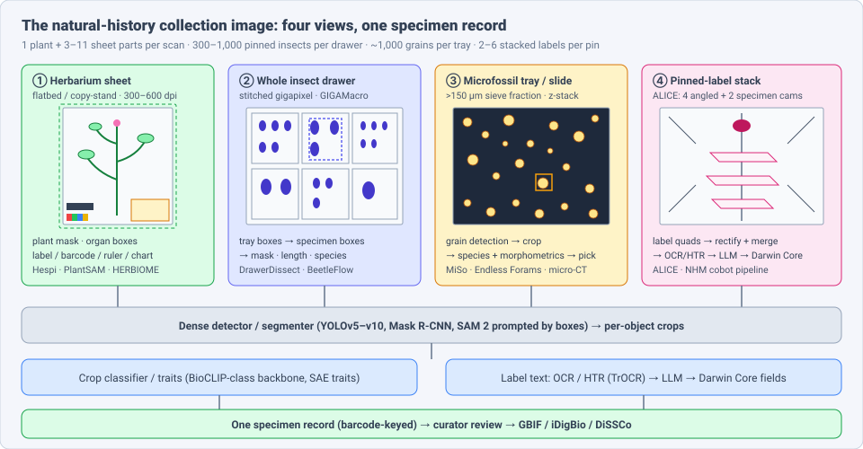
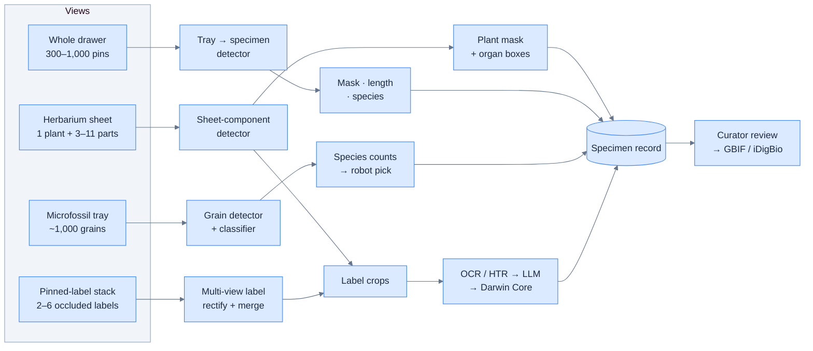
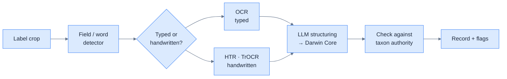
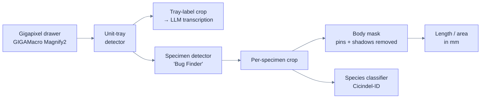

# Dense Object Detection & Classification — Recent Advances

*Compiled 2026-Nov-11 (America/Los_Angeles).*

Next installment in the running CV-updates log. Earlier entries:
[Apr-30](../2026-Apr-30/2026-Apr-30_CV_updates.md),
[May-01](../2026-May-01/2026-May-01_CV_updates.md),
[May-02](../2026-May-02/2026-May-02_CV_updates.md),
[May-04](../2026-May-04/2026-May-04_CV_updates.md),
[May-05](../2026-May-05/2026-May-05_CV_updates.md),
[May-07](../2026-May-07/2026-May-07_CV_updates.md),
[May-08](../2026-May-08/2026-May-08_CV_updates.md),
[May-15](../2026-May-15/2026-May-15_CV_updates.md),
[May-16](../2026-May-16/2026-May-16_CV_updates.md),
[May-17](../2026-May-17/2026-May-17_CV_updates.md),
[Jun-09](../2026-Jun-09/2026-Jun-09_CV_updates.md),
[Jun-10](../2026-Jun-10/2026-Jun-10_CV_updates.md),
[Jun-12](../2026-Jun-12/2026-Jun-12_CV_updates.md),
[Jun-15](../2026-Jun-15/2026-Jun-15_CV_updates.md),
[Jun-16](../2026-Jun-16/2026-Jun-16_CV_updates.md),
[Jun-17](../2026-Jun-17/2026-Jun-17_CV_updates.md),
[Jun-19](../2026-Jun-19/2026-Jun-19_CV_updates.md),
[Jun-21](../2026-Jun-21/2026-Jun-21_CV_updates.md),
[Jun-22](../2026-Jun-22/2026-Jun-22_CV_updates.md),
[Jun-23](../2026-Jun-23/2026-Jun-23_CV_updates.md),
[Jun-24](../2026-Jun-24/2026-Jun-24_CV_updates.md),
[Jun-25](../2026-Jun-25/2026-Jun-25_CV_updates.md),
[Jun-27](../2026-Jun-27/2026-Jun-27_CV_updates.md),
[Jun-29](../2026-Jun-29/2026-Jun-29_CV_updates.md),
[Jun-30](../2026-Jun-30/2026-Jun-30_CV_updates.md),
[Jul-04](../2026-Jul-04/2026-Jul-04_CV_updates.md),
[Jul-07](../2026-Jul-07/2026-Jul-07_CV_updates.md),
[Jul-08](../2026-Jul-08/2026-Jul-08_CV_updates.md),
[Jul-10](../2026-Jul-10/2026-Jul-10_CV_updates.md),
[Jul-15](../2026-Jul-15/2026-Jul-15_CV_updates.md),
[Jul-17](../2026-Jul-17/2026-Jul-17_CV_updates.md),
[Jul-18](../2026-Jul-18/2026-Jul-18_CV_updates.md),
[Jul-21](../2026-Jul-21/2026-Jul-21_CV_updates.md),
[Jul-22](../2026-Jul-22/2026-Jul-22_CV_updates.md),
[Jul-24](../2026-Jul-24/2026-Jul-24_CV_updates.md),
[Jul-26](../2026-Jul-26/2026-Jul-26_CV_updates.md),
[Jul-27](../2026-Jul-27/2026-Jul-27_CV_updates.md),
[Jul-30](../2026-Jul-30/2026-Jul-30_CV_updates.md),
[Aug-01](../2026-Aug-01/2026-Aug-01_CV_updates.md),
[Aug-02](../2026-Aug-02/2026-Aug-02_CV_updates.md),
[Aug-04](../2026-Aug-04/2026-Aug-04_CV_updates.md),
[Aug-07](../2026-Aug-07/2026-Aug-07_CV_updates.md),
[Aug-10](../2026-Aug-10/2026-Aug-10_CV_updates.md),
[Aug-11](../2026-Aug-11/2026-Aug-11_CV_updates.md),
[Aug-13](../2026-Aug-13/2026-Aug-13_CV_updates.md),
[Aug-15](../2026-Aug-15/2026-Aug-15_CV_updates.md),
[Aug-16](../2026-Aug-16/2026-Aug-16_CV_updates.md),
[Aug-18](../2026-Aug-18/2026-Aug-18_CV_updates.md),
[Aug-19](../2026-Aug-19/2026-Aug-19_CV_updates.md),
[Aug-21](../2026-Aug-21/2026-Aug-21_CV_updates.md),
[Aug-22](../2026-Aug-22/2026-Aug-22_CV_updates.md),
[Aug-24](../2026-Aug-24/2026-Aug-24_CV_updates.md),
[Aug-26](../2026-Aug-26/2026-Aug-26_CV_updates.md),
[Aug-29](../2026-Aug-29/2026-Aug-29_CV_updates.md),
[Sep-01](../2026-Sep-01/2026-Sep-01_CV_updates.md),
[Sep-20](../2026-Sep-20/2026-Sep-20_CV_updates.md),
[Sep-23](../2026-Sep-23/2026-Sep-23_CV_updates.md),
[Sep-24](../2026-Sep-24/2026-Sep-24_CV_updates.md),
[Sep-25](../2026-Sep-25/2026-Sep-25_CV_updates.md),
[Sep-26](../2026-Sep-26/2026-Sep-26_CV_updates.md),
[Sep-29](../2026-Sep-29/2026-Sep-29_CV_updates.md),
[Sep-30](../2026-Sep-30/2026-Sep-30_CV_updates.md),
[Oct-01](../2026-Oct-01/2026-Oct-01_CV_updates.md),
[Oct-02](../2026-Oct-02/2026-Oct-02_CV_updates.md),
[Oct-03](../2026-Oct-03/2026-Oct-03_CV_updates.md),
[Oct-04](../2026-Oct-04/2026-Oct-04_CV_updates.md),
[Oct-05](../2026-Oct-05/2026-Oct-05_CV_updates.md),
[Oct-06](../2026-Oct-06/2026-Oct-06_CV_updates.md),
[Oct-07](../2026-Oct-07/2026-Oct-07_CV_updates.md),
[Oct-08](../2026-Oct-08/2026-Oct-08_CV_updates.md),
[Oct-09](../2026-Oct-09/2026-Oct-09_CV_updates.md),
[Oct-10](../2026-Oct-10/2026-Oct-10_CV_updates.md),
[Oct-11](../2026-Oct-11/2026-Oct-11_CV_updates.md),
[Oct-12](../2026-Oct-12/2026-Oct-12_CV_updates.md),
[Oct-13](../2026-Oct-13/2026-Oct-13_CV_updates.md),
[Oct-14](../2026-Oct-14/2026-Oct-14_CV_updates.md),
[Oct-15](../2026-Oct-15/2026-Oct-15_CV_updates.md),
[Oct-16](../2026-Oct-16/2026-Oct-16_CV_updates.md),
[Oct-17](../2026-Oct-17/2026-Oct-17_CV_updates.md),
[Oct-18](../2026-Oct-18/2026-Oct-18_CV_updates.md),
[Oct-19](../2026-Oct-19/2026-Oct-19_CV_updates.md),
[Oct-20](../2026-Oct-20/2026-Oct-20_CV_updates.md),
[Oct-21](../2026-Oct-21/2026-Oct-21_CV_updates.md),
[Oct-22](../2026-Oct-22/2026-Oct-22_CV_updates.md),
[Oct-23](../2026-Oct-23/2026-Oct-23_CV_updates.md),
[Oct-24](../2026-Oct-24/2026-Oct-24_CV_updates.md),
[Oct-25](../2026-Oct-25/2026-Oct-25_CV_updates.md),
[Oct-26](../2026-Oct-26/2026-Oct-26_CV_updates.md),
[Oct-27](../2026-Oct-27/2026-Oct-27_CV_updates.md),
[Oct-28](../2026-Oct-28/2026-Oct-28_CV_updates.md),
[Oct-29](../2026-Oct-29/2026-Oct-29_CV_updates.md),
[Oct-30](../2026-Oct-30/2026-Oct-30_CV_updates.md),
[Oct-31](../2026-Oct-31/2026-Oct-31_CV_updates.md),
[Nov-01](../2026-Nov-01/2026-Nov-01_CV_updates.md),
[Nov-02](../2026-Nov-02/2026-Nov-02_CV_updates.md),
[Nov-03](../2026-Nov-03/2026-Nov-03_CV_updates.md),
[Nov-04](../2026-Nov-04/2026-Nov-04_CV_updates.md),
[Nov-05](../2026-Nov-05/2026-Nov-05_CV_updates.md),
[Nov-06](../2026-Nov-06/2026-Nov-06_CV_updates.md),
[Nov-07](../2026-Nov-07/2026-Nov-07_CV_updates.md),
[Nov-08](../2026-Nov-08/2026-Nov-08_CV_updates.md),
[Nov-09](../2026-Nov-09/2026-Nov-09_CV_updates.md),
[Nov-10](../2026-Nov-10/2026-Nov-10_CV_updates.md).

The last five entries covered
[plankton-imager](../2026-Nov-06/2026-Nov-06_CV_updates.md),
[airborne pollen](../2026-Nov-07/2026-Nov-07_CV_updates.md),
[aerial wildlife census](../2026-Nov-08/2026-Nov-08_CV_updates.md),
[clinical microbiology bench](../2026-Nov-09/2026-Nov-09_CV_updates.md) and
[reproductive-medicine & cytogenetics lab](../2026-Nov-10/2026-Nov-10_CV_updates.md)
imagery. This run moves from living samples to preserved ones. It covers the
**natural-history collection digitization image**: the scanned herbarium
sheet, the whole insect drawer photographed as one gigapixel image, the
microfossil picking tray, and the stack of labels under a pinned insect that
has to be read without being removed.

Out of scope: field photos of living organisms (camera traps,
[Oct-08](../2026-Oct-08/2026-Oct-08_CV_updates.md); live insect traps,
[Nov-05](../2026-Nov-05/2026-Nov-05_CV_updates.md)), fossil pollen and
palynomorph slides (covered in
[Nov-07 §8](../2026-Nov-07/2026-Nov-07_CV_updates.md)), fine-grained taxon
classifiers such as BioCLIP-2 on their own (covered in
[May-15](../2026-May-15/2026-May-15_CV_updates.md)), and general document
OCR ([Aug-18](../2026-Aug-18/2026-Aug-18_CV_updates.md)). Labels appear here
only where the detector has to find them on a specimen image first.

> **Research note.** arxiv.org could not be reached from this run's network
> sandbox, so arXiv papers are summarised from their abstracts, search
> snippets and mirror pages (ICLR proceedings, chatpaper, Hugging Face,
> EcoEvoRxiv, PMC). Figures that could not be checked against a full text
> are marked *(abstract-level)*.

---

## Table of contents

1. [Why this pass](#1--why-this-pass)
2. [The primitive: four views, one specimen record](#2--the-primitive-four-views-one-specimen-record)
3. [The herbarium sheet: parse the sheet before reading the plant](#3--the-herbarium-sheet-parse-the-sheet-before-reading-the-plant)
4. [Herbarium labels: detector + OCR + LLM, and where it breaks](#4--herbarium-labels-detector--ocr--llm-and-where-it-breaks)
5. [The whole insect drawer: tray → specimen → mask → measurement](#5--the-whole-insect-drawer-tray--specimen--mask--measurement)
6. [The pinned-label stack: reading labels you cannot see](#6--the-pinned-label-stack-reading-labels-you-cannot-see)
7. [The microfossil tray: thousands of grains, then a robot arm](#7--the-microfossil-tray-thousands-of-grains-then-a-robot-arm)
8. [From boxes to traits: SAE-driven trait annotation](#8--from-boxes-to-traits-sae-driven-trait-annotation)
9. [Imaging protocol is part of the model](#9--imaging-protocol-is-part-of-the-model)
10. [Evaluation: what a collection actually checks](#10--evaluation-what-a-collection-actually-checks)
11. [Open problems / what to watch](#11--open-problems--what-to-watch)
12. [Sources](#12--sources)

---

## 1 · Why this pass

Natural-history museums hold well over a billion specimens, and
most of them are still known only from a drawer or a cabinet. Digitization
is the bottleneck, and the expensive part is not taking the picture. It is
turning the picture into a record: finding every specimen, segmenting it,
naming it, and reading the labels. That is dense detection and
classification with a database row as the output.

Several 2025–26 releases make this image type worth treating on its own:

* **Whole-drawer pipelines with public code.** The Field Museum's
  **DrawerDissect** (EcoEvoRxiv preprint, v4) turns gigapixel photos of
  insect drawers into per-specimen dorsal images, masks and body
  measurements. The team used it on 44 drawers of tiger beetles, giving
  **13,484** specimen images with masks and measurements. Code, a Roboflow
  detector and a Hugging Face classifier (Cicindel-ID) are public.
* **Detector-first label pipelines grow up.** **Hespi** (University of
  Melbourne; *BioScience* 2025, arXiv v2 Jul 2025) and **HERBIOME** (arXiv
  2608.28676, accepted at KES 2026) both detect sheet components, then label
  fields, then run OCR/HTR and an LLM. HERBIOME reports a **4.05–4.10 %
  CER** for its fine-tuned TrOCR but only **0.44 semantic field accuracy**
  end to end on 450 French sheets. The detector and OCR now work well; the
  structuring step does not yet.
* **SAM 2 enters the herbarium.** **PlantSAM** (arXiv 2507.16506;
  *Applications in Plant Sciences* 2025) prompts SAM 2 with YOLOv10 boxes
  and reports **IoU 0.94 / Dice 0.97** for plant masks. Removing the
  background improves downstream trait classifiers by up to **4.36 pp**.
* **Robot-ready pinned-insect pipelines.** The Natural History Museum
  (London) published a deep-learning pipeline for pinned insects and labels
  aimed at collaborative robots (*Advanced Intelligent Systems*, Jan 2026).
  The Imageomics **BeetleFlow** pipeline (NeurIPS 2025 workshop) detects,
  crops and segments beetle parts with a transformer.
* **Traits without hand labels.** **Bioscan-Traits** (ICLR 2026,
  arXiv 2604.01619) uses sparse autoencoders over foundation-model features
  to find body-part regions, then asks a multimodal LLM to describe them.
  The result is 80 K trait annotations on 19 K insect images.

---

## 2 · The primitive: four views, one specimen record

Each view gives a different density problem, but all four end in the same
place: one barcode-keyed record that a curator signs off.

| View | Typical capture | Objects per image | Hard part | Output |
|---|---|---|---|---|
| Herbarium sheet | Flatbed or copy-stand, 300–600 dpi, colour chart and ruler in frame | 1 plant (often many organs), 3–11 sheet components | Pressed, overlapping organs; mixed handwritten and typed labels; annotation slips | Plant mask, phenology counts, label fields |
| Whole insect drawer | Stitched gigapixel (e.g. GIGAMacro Magnify2) | 300–1,000+ pinned insects in unit trays | Tiny specimens next to large ones; pins, shadows and tray walls; labels hidden underneath | Per-specimen crops, masks, lengths, IDs |
| Microfossil tray / slide | Reflected light or transmitted z-stack on picking tray or slide | Hundreds to thousands of grains | Touching grains, debris, orientation, broken tests | Species counts, morphometrics, pick list |
| Pinned-label stack | Multi-camera angled rig (ALICE) | 2–6 stacked labels per pin | Labels partly hidden by each other and by the specimen | Rectified label images → text |

---

## 3 · The herbarium sheet: parse the sheet before reading the plant

A herbarium sheet is a small, structured scene. A good detector first finds
the parts (the plant, the main label, determination slips, barcode, colour
chart, scale bar, envelopes) and only then sends each part to its own model.

**Sheet-component detection.** Hespi's first model is a YOLO-family detector
trained on University of Melbourne Herbarium scans. It outputs **11
component classes**, including the primary specimen label. An earlier
study cited by the Hespi authors found that **at least ~2,000 annotated
sheets** were needed for an adequate component detector. HERBIOME uses a
YOLOv8 component detector for the same role.

**Plant segmentation with promptable models.** PlantSAM chains two models:

The detector stops SAM from segmenting the label or the colour chart, and
SAM provides a sharper edge than a detector-only mask. A companion paper
from overlapping authors (*Applications in Plant Sciences* 2025) reports
F1 up to **96.6 %** for plant masks and gains of up to **3 pp accuracy /
7 pp F1** on morphological traits after background removal. The lesson for
dense pipelines is that clutter removal is a classification gain, not just a
cosmetic step.

**Phenology counting.** Counting buds, flowers and fruits on pressed
specimens is the herbarium's version of dense small-object counting. The
reference work is still from 2019–20: Mask R-CNN counts trained on
crowd-sourced annotations of 3,000+ sheets (Davis et al.), organ detection
and sizing on *Streptanthus tortuosus* (Goëau et al.), and a study showing
that ML **undercounts** organs but still gets the phenological stage right
(Love et al.). This run found no 2025–26 paper that clearly moves this
benchmark. Flowers remain the hardest class because pressing distorts their
shape the most.

---

## 4 · Herbarium labels: detector + OCR + LLM, and where it breaks

Label reading is now a four-stage pipeline with a dense detector at the
front. The three recent systems differ mainly in where the LLM enters.

| System | Detection stage | Text stage | Structuring | Reported result |
|---|---|---|---|---|
| **Hespi** (BioScience 2025) | YOLO sheet components (11 classes) → label-field detector | Typed/handwritten classifier, then OCR or HTR per field | Corrected against plant/fungal name authorities, then refined with a multimodal LLM | Field-level pipeline; open source (`pip install hespi`) |
| **HERBIOME** (arXiv 2608.28676, KES 2026) | YOLOv8 components → CRAFT word boxes with reading-order restoration | TrOCR fine-tuned on CREMMA-AN, PictoCatalogs and RéColNat | GPT-4o mini | CER **4.05–4.10 %**; end-to-end MWS **0.61**, semantic field accuracy **0.44** on 450 French sheets *(abstract-level)* |
| **Zacchigna et al.** (*Plants* 2026, 15(4):637) | None separate; end-to-end | Donut-style multimodal transformer reads the image directly | Same model emits Darwin Core concepts | Fully open-source, OCR-free; multi-label sheets mixing handwriting and type are the hardest case |
| **VoucherVision + LeafMachine2** (U. Michigan) | LeafMachine2 finds labels (trained on ~0.5 M annotations, 2,000+ species) | Cloud OCR or vision LLM | LLM with prompt templates → JSON | Typed labels ≈ human accuracy; full human review of every AI suggestion is only ~10–15 % faster than transcribing from scratch |

Two findings matter for anyone building such a pipeline:

1. **The bottleneck has moved downstream.** HERBIOME's 4 % CER against a
   0.44 semantic score means most errors now come from assigning text to
   the right Darwin Core field, especially taxon names. Guralnick et al.
   (*Applications in Plant Sciences* 2025) found GPT-4 often invents field
   names that are not Darwin Core terms. They reconcile them in a separate
   step, and they combine LLM and rule-based extractors as an ensemble.
2. **Review cost decides the economics.** If a curator must check every
   field anyway, a 10–15 % speed-up is all you get. The gain comes from
   good confidence estimates that let typed, high-confidence labels skip
   review. Michigan's planned Specimen Label Transcription benchmark is
   meant to make these comparisons possible.

---

## 5 · The whole insect drawer: tray → specimen → mask → measurement

Whole-drawer imaging is the fastest way to photograph pinned insects. One
stitched image captures every specimen at once. The cost is that the image
is now a dense, multi-scale detection problem.

**DrawerDissect** (Field Museum; EcoEvoRxiv, v4) is the most complete open
pipeline:

* Detection runs in two levels: unit trays first, then specimens inside
  each tray. This keeps the specimen detector working at a sensible scale
  and links each specimen to its tray label (usually the species name).
* Text on tray labels is cropped by a detector and sent to an LLM for
  transcription.
* On the tiger-beetle collection (44 drawers), the output was **13,484**
  dorsal images, masked specimens and body measurements. Training images
  are public on Roboflow Universe, and the Cicindel-ID weights are on
  Hugging Face.

**BeetleFlow** (NeurIPS 2025 workshop; Imageomics) is a three-stage
detect → crop → segment pipeline for pinned ground beetles. Its
transformer-based part segmenter reaches **85.11 % mIoU** on 5 parts and
**77.38 % mIoU** on 9 parts. The checkpoints were trained on one beetle
family, so expect a drop on other taxa.

**Morphological sub-structure.** KIT's robotic imaging of Phoridae flies
uses a U-Net to segment **nine anatomical regions** at **0.78 mIoU**. This
is part-level dense segmentation on specimens that are only a few
millimetres long.

---

## 6 · The pinned-label stack: reading labels you cannot see

A pinned insect usually carries several labels on the same pin, stacked
under the specimen. Taking them off to scan is the slowest step in insect
digitization.

**ALICE** (Angled Label Image Capture Equipment, NHM London) uses four
cameras at oblique angles plus a dorsal and a lateral camera. Each angled
view shows a different visible part of each label. The software then:

1. finds each label's quadrilateral in each view,
2. applies a perspective transform to rectify it,
3. registers the views to a template, and
4. merges them by averaging, so that the parts hidden in one view are
   filled from another, before OCR.

Reported throughput is about **800 specimens per day**, and up to 1,300.
The NHM's next step, published in *Advanced Intelligent Systems*
(Jan 2026, Zhang, Salili-James, Poon, Hollister et al.), is a deep-learning
pipeline for identifying, handling and digitizing pinned insects and their
labels. It is built as a proof of concept for collaborative robots that
pick up each pin. Search-surfaced figures give accuracies of about **0.95**
for specimen identification, **0.79** for pinheads (the grasp point for the
robot) and **0.92** for labels on independent test sets *(abstract-level)*.
The pinhead class is the interesting one: it is a tiny keypoint-like object
that a gripper needs, and it is the weakest of the three.

A complementary bioRxiv preprint (Jul 2025) describes a semi-automated,
high-throughput pipeline for extracting information from **printed**
entomological labels during large-scale digitization. Printed labels are
the easy majority, and moving them out of the human queue is where most of
the time saving comes from.

---

## 7 · The microfossil tray: thousands of grains, then a robot arm

Foraminifera, radiolaria and diatoms are the main paleoclimate proxies.
Their analysis starts with an image of a tray or slide holding hundreds to
thousands of grains, most of which must be found, identified and counted.

| System / dataset | Imaging | Model | Reported result |
|---|---|---|---|
| **MiSo** (CEREGE) | Robotic picker with imaging tower | CNN trained on deep-sea sediment | Fully operational, runs 24/7; picks classified grains |
| **Endless Forams** (Hsiang et al. 2019; Zenodo library) | Reflected light, AutoMorph segmentation | CNN, 35 modern planktonic species | ~27 K labelled training images; a 26.7 K machine-labelled coretop set at **87.4 %** validation accuracy |
| **J. Micropalaeontology** 45:95 (2026) | Literature + new classifier | ResNet-50 transfer learning | **80.6 %** species, **85.6 %** genus validation accuracy; rare species often misclassified; YOLO cited for benthic forams |
| **ForamDeepSlice** (KAUST, arXiv 2512.00912) | Micro-CT, 2-D slices from 3-D scans | 7 CNN backbones compared | **95.64 %** test accuracy on 12 species (97 specimens, 27 species scanned) *(preprint)* |
| **Radiolarian slide scanner** (Itaki et al., EGU 2025) | Virtual slide scanner, up to **360** slides unattended | Deep classification | Applied to a Southern Ocean core *(conference abstract)* |
| **Siliceous microfossil detector** (ESS Open Archive 2024) | Microscope images of Mediterranean sediment | Object detector | Precision **0.72**, recall **0.74**; transfers to another ocean basin |

The pattern matches other "count every particle" images in this log (pollen,
plankton): **long-tail classes decide the result**. Species-level accuracy
is fine for the dominant taxa, but the rare species, which are often the
climatically informative ones, are where classifiers fail. Micro-CT gives
much higher accuracy, but at a cost per specimen that only makes sense for
type material or morphometric studies, not routine counts.

---

## 8 · From boxes to traits: SAE-driven trait annotation

Once a collection has millions of crops, the next request is traits:
"elytra metallic green", "antennae longer than body". Hand-labelling traits
does not scale.

**Bioscan-Traits** (Pahuja, Stevens, East, Record, Su; ICLR 2026,
arXiv 2604.01619) builds trait labels automatically:

```mermaid
%%{init: {"theme":"base","themeVariables":{"primaryColor":"#fce7f3","primaryTextColor":"#1e293b","primaryBorderColor":"#db2777","lineColor":"#64748b"}}}%%
flowchart LR
  I[Specimen crop<br/>BIOSCAN-5M] --> FM[Frozen foundation<br/>model features]
  FM --> SAE[Sparse autoencoder<br/>under 10 ms per image]
  SAE --> R[Latents map to<br/>tight body-part regions]
  R --> MLLM[Multimodal LLM<br/>describes the region]
  MLLM --> TR[80 K trait annotations<br/>on 19 K images]
  TR --> FT[Fine-tune BioCLIP<br/>→ better zero-shot ID]
```

* SAE latents act as an unsupervised part detector: each latent fires on a
  spatially compact region such as a leg or wing.
* The MLLM is only asked about the highlighted region, which keeps
  descriptions grounded. Human raters judged them biologically plausible.
* Fine-tuning BioCLIP on the result improves zero-shot species
  classification on an in-the-wild insect benchmark.
* The authors note that not every latent is monosemantic. Some encode
  combined traits, so the "part detector" is not yet a clean one.

This connects back to drawers: DrawerDissect-style crops are exactly the
input this method needs.

---

## 9 · Imaging protocol is part of the model

East, Campolongo et al., *Methods in Ecology and Evolution* 2025
(arXiv 2505.17317), give a practical framework for photographing specimens
for computer vision. Their ten considerations include:

* full metadata documentation (camera, lens, lighting, scale),
* standard specimen positioning,
* size and colour calibration in every frame,
* explicit protocols for images with **multiple specimens**,
* a uniform background and controlled lighting,
* resolution and magnification that match the smallest diagnostic feature,
* and file formats, archiving and sharing.

For dense detection the multi-specimen rule matters most. A drawer image or
a multi-specimen herbarium sheet must record which crop belongs to which
catalogue number. Otherwise the detector's boxes cannot be joined to the
database. The paper also warns about **data leakage**: crops of the same
specimen, or specimens from the same drawer, must not appear in both
training and test sets. Otherwise reported accuracy is too high.

---

## 10 · Evaluation: what a collection actually checks

| Stage | Metric used in papers | What the collection cares about |
|---|---|---|
| Sheet / drawer detection | mAP, recall at IoU 0.5 | **Missed specimens**: a missed pin is a missing record. Recall matters more than precision. |
| Segmentation | IoU, Dice, mIoU per part | Whether the measured length and area stay within the calibration error |
| Species ID | Top-1 / top-5, per-class accuracy | Accuracy on **rare and type** specimens, and a calibrated "unsure" output |
| Label text | CER / WER | **Field-level** correctness after Darwin Core mapping (HERBIOME's SMA-style metric), and correct taxon names against an authority |
| Whole pipeline | Images per hour | **Curator minutes per record**, including review. The Michigan numbers show review can erase most of the gain. |

Proposed minimum report for a new pipeline: recall of specimens per drawer
or sheet, per-field accuracy after mapping, how many records were sent to
review, and how long that review took.

---

## 11 · Open problems / what to watch

* **A shared label benchmark.** Hespi, HERBIOME, the *Plants* 2026 model
  and VoucherVision all report on their own data. Michigan's planned
  benchmark (images, fine-tuned models and validation tools) would allow a
  direct comparison.
* **Taxon fields.** All recent systems name the taxon field as the weakest
  point. Constraining LLM output to an authority list (as Hespi does), not
  correcting it afterwards, is the obvious next step.
* **Drawer pipelines beyond beetles.** DrawerDissect and BeetleFlow are
  trained on beetles. Moths with spread wings, tiny wasps and
  mixed-taxon drawers need retraining and probably a different
  segmentation strategy.
* **Pinhead and grasp detection.** The NHM pinhead accuracy (~0.79) is the
  limit for cobot handling. Small-keypoint detection methods from other
  dense domains should transfer here.
* **Phenology counts.** No clear 2025–26 update after the 2020 Mask R-CNN
  work. Promptable segmenters such as PlantSAM may help with organ-level
  instance masks.
* **Rare microfossil species.** Long-tail methods (re-weighting, metric
  learning, open-set rejection) matter more than another backbone.
* **Linking crops to records.** The multi-specimen protocol of §9 is a data
  engineering problem, but without it detection output cannot be used.

---

## 12 · Sources

### Herbarium sheet and segmentation (§3)
* PlantSAM, YOLOv10 + SAM 2 herbarium segmentation (arXiv 2507.16506; Appl Plant Sci 2025, doi:10.1002/aps3.70034): <https://arxiv.org/abs/2507.16506v1> · <https://papers.cool/arxiv/2507.16506> · <https://horizon.documentation.ird.fr/exl-doc/pleins_textes/2026-01/010095889.pdf>
* Segmentation for morphological trait identification in herbarium collections (Appl Plant Sci 2025): <https://www.documentation.ird.fr/hor/fdi:010092750> · <https://horizon.documentation.ird.fr/exl-doc/pleins_textes/2025-03/010092750.pdf>
* Species detection and segmentation of multi-specimen historical herbaria (2021, YOLOv3): <https://archive.org/details/speciesdetectio5thir>
* Davis et al., Mask R-CNN reproductive structure counts (2020): <https://agris.fao.org/search/en/records/6748b3857625988a371fcee5>
* Goëau et al., fine-grained phenology extraction (*Streptanthus*, 2020): <https://pmc.ncbi.nlm.nih.gov/articles/PMC7328656> · <https://hal.inrae.fr/hal-02894994/document>
* Lorieul et al., flower/fruit presence at scale (2019): <https://hal.inrae.fr/hal-02909794/document>
* Love et al., ML undercounts reproductive organs: <https://par.nsf.gov/biblio/10456861>

### Herbarium labels (§4)
* Hespi (arXiv 2410.08740 v2; BioScience 2025, doi:10.1093/biosci/biaf042): <https://arxiv.org/abs/2410.08740> · <https://www.ncbi.nlm.nih.gov/pmc/articles/PMC12352312/> · code <https://github.com/jbest/hespi> · <https://pypi.org/project/hespi>
* HERBIOME, automated pipeline for herbarium label digitization (arXiv 2608.28676, KES 2026): <https://arxiv.org/abs/2608.28676> · <https://chatpaper.com/chatpaper/paper/339913> · TrOCR checkpoint <https://huggingface.co/yeppeuda13/TrOCR_Herbiome>
* Zacchigna et al., computer vision for herbarium label metadata (Plants 2026, 15(4):637): <https://www.mdpi.com/2223-7747/15/4/637> · preprint <https://www.preprints.org/manuscript/202512.0251>
* Guralnick et al., ensemble LLM + rule-based Darwin Core extraction (Appl Plant Sci 2025): <https://www.ncbi.nlm.nih.gov/pmc/articles/PMC11788903/>
* VoucherVision / LeafMachine2 at the U-M Herbarium: <https://michigan.it.umich.edu/news/?p=28637> · <https://midas.umich.edu/?p=27321> · <https://prod.lsa.umich.edu/eeb/news-events/all-news/herbarium-spotlight--how-ai-is-transforming-specimen-transcripti.html> · <https://digitaldata2024.sched.com/event/1cG5f/exploring-the-ai-kaleidoscope-with-vouchervision-a-spectrum-of-techniques-for-specimen-label-transcription>

### Whole drawers and pinned insects (§5–6)
* DrawerDissect (Field Museum, EcoEvoRxiv preprint): <https://ecoevorxiv.org/repository/view/9647/> · Field Museum case study <https://roboflow.com/case-studies/field-museum>
* BeetleFlow (arXiv 2511.00255, NeurIPS 2025 workshop): <https://arxiv.org/html/2511.00255v2> · <https://huggingface-gw-kz.just-ai.com/imageomics/BeetleFlow>
* Zhang et al., *Accelerating Pinned Insect Specimen Digitization: A Deep Learning Pipeline for Future Collaborative Robots* (Adv Intell Syst, Jan 2026): <https://doaj.org/article/415b8d03602c4a9b8e05a32cd4787f7a>
* KIT robotic imaging of Phoridae / part segmentation: <https://publikationen.bibliothek.kit.edu/1000191702/177992111> · <https://publikationen.bibliothek.kit.edu/1000193585/183013492>
* ALICE (NHM London): <https://dissco.github.io/PinnedInsect/ALICE.html> · <https://frontiersin.org/articles/10.3389/fevo.2024.1305931/full> · <https://agris.fao.org/search/fr/records/652f9728d5e38ff7731f3adb> · <https://next.sciencegate.app/document/10.3897/biss.3.37141>
* High-throughput extraction of printed entomological labels (bioRxiv 2025.07.09.663724): <https://www.biorxiv.org/content/10.1101/2025.07.09.663724.full.pdf>

### Microfossils (§7)
* ForamDeepSlice (arXiv 2512.00912): <https://arxiv.org/abs/2512.00912v1> · <https://wiki.vis.kaust.edu.sa/highlights/2025/foramslice>
* MiSo microfossil sorter (CEREGE): <https://hal.archives-ouvertes.fr/hal-02998019> · <https://www.popsci.com/technology/forabot-sort-foram-fossil/>
* Endless Forams (Hsiang et al. 2019) and machine-identified coretop library: <https://eprints.soton.ac.uk/433625/1/Hsiang_et_al_2019_Paleoceanography_and_Paleoclimatology.pdf> · <https://openpolar.no/Record/ftzenodo:oai:zenodo.org:7270253>
* Journal of Micropalaeontology 45:95 (2026): <https://jm.copernicus.org/articles/45/95/2026/>
* Foraminifera images with segmentation labels (PANGAEA): <https://service.tib.eu/ldmservice/dataset/png-doi-10-1594-pangaea-897873>
* Tropical Indian Ocean planktonic foram dataset (SEANOE): <https://openpolar.no/Record/ftseanoe:oai:seanoe.org:86411/Description>
* Radiolarian automated image collection + AI classification (Sci Rep 2020): <https://www.ncbi.nlm.nih.gov/pmc/articles/PMC7713231/> · Itaki et al., EGU 2025: <https://meetingorganizer.copernicus.org/EGU25/EGU25-8073.html>
* Siliceous microfossil detection (ESS Open Archive 2024): <https://essopenarchive.org/doi/full/10.22541/essoar.170956736.63037601/v1>

### Traits, protocol, and context (§8–9)
* Bioscan-Traits / SAE trait annotation (ICLR 2026, arXiv 2604.01619): <https://proceedings.iclr.cc/paper_files/paper/2026/hash/c43b2989b1ba055aa713a4abbe4a8b05-Abstract-Conference.html> · <https://arxiv.org/abs/2604.01619> · code <https://github.com/OSU-NLP-Group/sae-trait-annotation>
* East, Campolongo et al., optimizing specimen image capture for CV (Methods Ecol Evol 2025, arXiv 2505.17317): <https://arxiv.org/abs/2505.17317>
* Conversational exploration of the Australian Museum's 1.7 M digitised records (arXiv 2603.10285): <https://arxiv.org/abs/2603.10285>
* Fossil palynomorph detection in multifocal slides (arXiv 2609.05323; covered in Nov-07): <https://arxiv.org/pdf/2609.05323>
