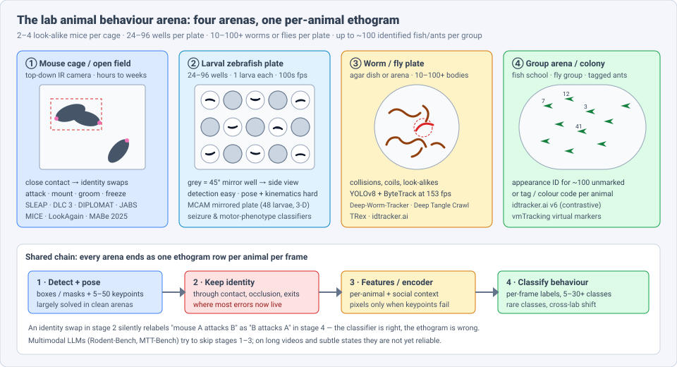
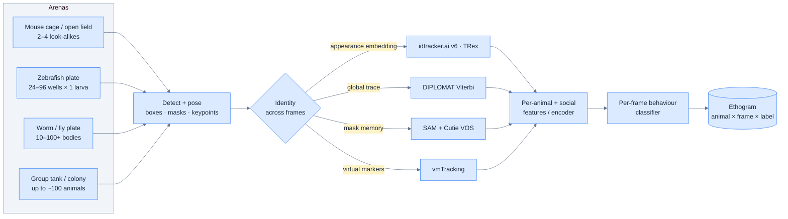
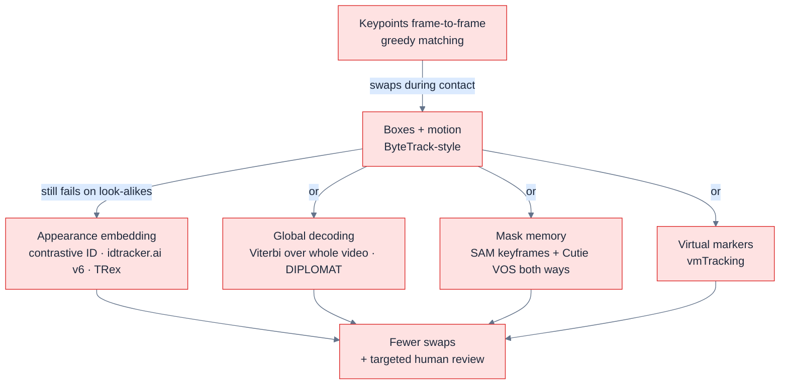
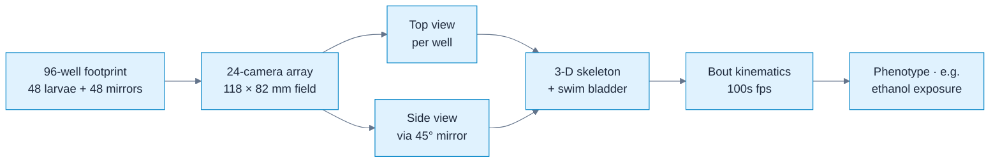
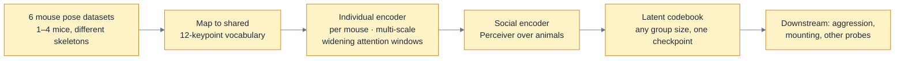

# Dense Object Detection & Classification — Recent Advances

*Compiled 2026-Nov-12 (America/Los_Angeles).*

Next installment in the running CV-updates log. Earlier entries:
[Apr-30](../2026-Apr-30/2026-Apr-30_CV_updates.md),
[May-01](../2026-May-01/2026-May-01_CV_updates.md),
[May-02](../2026-May-02/2026-May-02_CV_updates.md),
[May-04](../2026-May-04/2026-May-04_CV_updates.md),
[May-05](../2026-May-05/2026-May-05_CV_updates.md),
[May-07](../2026-May-07/2026-May-07_CV_updates.md),
[May-08](../2026-May-08/2026-May-08_CV_updates.md),
[May-15](../2026-May-15/2026-May-15_CV_updates.md),
[May-16](../2026-May-16/2026-May-16_CV_updates.md),
[May-17](../2026-May-17/2026-May-17_CV_updates.md),
[Jun-09](../2026-Jun-09/2026-Jun-09_CV_updates.md),
[Jun-10](../2026-Jun-10/2026-Jun-10_CV_updates.md),
[Jun-12](../2026-Jun-12/2026-Jun-12_CV_updates.md),
[Jun-15](../2026-Jun-15/2026-Jun-15_CV_updates.md),
[Jun-16](../2026-Jun-16/2026-Jun-16_CV_updates.md),
[Jun-17](../2026-Jun-17/2026-Jun-17_CV_updates.md),
[Jun-19](../2026-Jun-19/2026-Jun-19_CV_updates.md),
[Jun-21](../2026-Jun-21/2026-Jun-21_CV_updates.md),
[Jun-22](../2026-Jun-22/2026-Jun-22_CV_updates.md),
[Jun-23](../2026-Jun-23/2026-Jun-23_CV_updates.md),
[Jun-24](../2026-Jun-24/2026-Jun-24_CV_updates.md),
[Jun-25](../2026-Jun-25/2026-Jun-25_CV_updates.md),
[Jun-27](../2026-Jun-27/2026-Jun-27_CV_updates.md),
[Jun-29](../2026-Jun-29/2026-Jun-29_CV_updates.md),
[Jun-30](../2026-Jun-30/2026-Jun-30_CV_updates.md),
[Jul-04](../2026-Jul-04/2026-Jul-04_CV_updates.md),
[Jul-07](../2026-Jul-07/2026-Jul-07_CV_updates.md),
[Jul-08](../2026-Jul-08/2026-Jul-08_CV_updates.md),
[Jul-10](../2026-Jul-10/2026-Jul-10_CV_updates.md),
[Jul-15](../2026-Jul-15/2026-Jul-15_CV_updates.md),
[Jul-17](../2026-Jul-17/2026-Jul-17_CV_updates.md),
[Jul-18](../2026-Jul-18/2026-Jul-18_CV_updates.md),
[Jul-21](../2026-Jul-21/2026-Jul-21_CV_updates.md),
[Jul-22](../2026-Jul-22/2026-Jul-22_CV_updates.md),
[Jul-24](../2026-Jul-24/2026-Jul-24_CV_updates.md),
[Jul-26](../2026-Jul-26/2026-Jul-26_CV_updates.md),
[Jul-27](../2026-Jul-27/2026-Jul-27_CV_updates.md),
[Jul-30](../2026-Jul-30/2026-Jul-30_CV_updates.md),
[Aug-01](../2026-Aug-01/2026-Aug-01_CV_updates.md),
[Aug-02](../2026-Aug-02/2026-Aug-02_CV_updates.md),
[Aug-04](../2026-Aug-04/2026-Aug-04_CV_updates.md),
[Aug-07](../2026-Aug-07/2026-Aug-07_CV_updates.md),
[Aug-10](../2026-Aug-10/2026-Aug-10_CV_updates.md),
[Aug-11](../2026-Aug-11/2026-Aug-11_CV_updates.md),
[Aug-13](../2026-Aug-13/2026-Aug-13_CV_updates.md),
[Aug-15](../2026-Aug-15/2026-Aug-15_CV_updates.md),
[Aug-16](../2026-Aug-16/2026-Aug-16_CV_updates.md),
[Aug-18](../2026-Aug-18/2026-Aug-18_CV_updates.md),
[Aug-19](../2026-Aug-19/2026-Aug-19_CV_updates.md),
[Aug-21](../2026-Aug-21/2026-Aug-21_CV_updates.md),
[Aug-22](../2026-Aug-22/2026-Aug-22_CV_updates.md),
[Aug-24](../2026-Aug-24/2026-Aug-24_CV_updates.md),
[Aug-26](../2026-Aug-26/2026-Aug-26_CV_updates.md),
[Aug-29](../2026-Aug-29/2026-Aug-29_CV_updates.md),
[Sep-01](../2026-Sep-01/2026-Sep-01_CV_updates.md),
[Sep-20](../2026-Sep-20/2026-Sep-20_CV_updates.md),
[Sep-23](../2026-Sep-23/2026-Sep-23_CV_updates.md),
[Sep-24](../2026-Sep-24/2026-Sep-24_CV_updates.md),
[Sep-25](../2026-Sep-25/2026-Sep-25_CV_updates.md),
[Sep-26](../2026-Sep-26/2026-Sep-26_CV_updates.md),
[Sep-29](../2026-Sep-29/2026-Sep-29_CV_updates.md),
[Sep-30](../2026-Sep-30/2026-Sep-30_CV_updates.md),
[Oct-01](../2026-Oct-01/2026-Oct-01_CV_updates.md),
[Oct-02](../2026-Oct-02/2026-Oct-02_CV_updates.md),
[Oct-03](../2026-Oct-03/2026-Oct-03_CV_updates.md),
[Oct-04](../2026-Oct-04/2026-Oct-04_CV_updates.md),
[Oct-05](../2026-Oct-05/2026-Oct-05_CV_updates.md),
[Oct-06](../2026-Oct-06/2026-Oct-06_CV_updates.md),
[Oct-07](../2026-Oct-07/2026-Oct-07_CV_updates.md),
[Oct-08](../2026-Oct-08/2026-Oct-08_CV_updates.md),
[Oct-09](../2026-Oct-09/2026-Oct-09_CV_updates.md),
[Oct-10](../2026-Oct-10/2026-Oct-10_CV_updates.md),
[Oct-11](../2026-Oct-11/2026-Oct-11_CV_updates.md),
[Oct-12](../2026-Oct-12/2026-Oct-12_CV_updates.md),
[Oct-13](../2026-Oct-13/2026-Oct-13_CV_updates.md),
[Oct-14](../2026-Oct-14/2026-Oct-14_CV_updates.md),
[Oct-15](../2026-Oct-15/2026-Oct-15_CV_updates.md),
[Oct-16](../2026-Oct-16/2026-Oct-16_CV_updates.md),
[Oct-17](../2026-Oct-17/2026-Oct-17_CV_updates.md),
[Oct-18](../2026-Oct-18/2026-Oct-18_CV_updates.md),
[Oct-19](../2026-Oct-19/2026-Oct-19_CV_updates.md),
[Oct-20](../2026-Oct-20/2026-Oct-20_CV_updates.md),
[Oct-21](../2026-Oct-21/2026-Oct-21_CV_updates.md),
[Oct-22](../2026-Oct-22/2026-Oct-22_CV_updates.md),
[Oct-23](../2026-Oct-23/2026-Oct-23_CV_updates.md),
[Oct-24](../2026-Oct-24/2026-Oct-24_CV_updates.md),
[Oct-25](../2026-Oct-25/2026-Oct-25_CV_updates.md),
[Oct-26](../2026-Oct-26/2026-Oct-26_CV_updates.md),
[Oct-27](../2026-Oct-27/2026-Oct-27_CV_updates.md),
[Oct-28](../2026-Oct-28/2026-Oct-28_CV_updates.md),
[Oct-29](../2026-Oct-29/2026-Oct-29_CV_updates.md),
[Oct-30](../2026-Oct-30/2026-Oct-30_CV_updates.md),
[Oct-31](../2026-Oct-31/2026-Oct-31_CV_updates.md),
[Nov-01](../2026-Nov-01/2026-Nov-01_CV_updates.md),
[Nov-02](../2026-Nov-02/2026-Nov-02_CV_updates.md),
[Nov-03](../2026-Nov-03/2026-Nov-03_CV_updates.md),
[Nov-04](../2026-Nov-04/2026-Nov-04_CV_updates.md),
[Nov-05](../2026-Nov-05/2026-Nov-05_CV_updates.md),
[Nov-06](../2026-Nov-06/2026-Nov-06_CV_updates.md),
[Nov-07](../2026-Nov-07/2026-Nov-07_CV_updates.md),
[Nov-08](../2026-Nov-08/2026-Nov-08_CV_updates.md),
[Nov-09](../2026-Nov-09/2026-Nov-09_CV_updates.md),
[Nov-10](../2026-Nov-10/2026-Nov-10_CV_updates.md),
[Nov-11](../2026-Nov-11/2026-Nov-11_CV_updates.md).

The last five entries covered
[airborne pollen](../2026-Nov-07/2026-Nov-07_CV_updates.md),
[aerial wildlife census](../2026-Nov-08/2026-Nov-08_CV_updates.md),
[clinical microbiology bench](../2026-Nov-09/2026-Nov-09_CV_updates.md),
[reproductive-medicine & cytogenetics lab](../2026-Nov-10/2026-Nov-10_CV_updates.md) and
[natural-history collection](../2026-Nov-11/2026-Nov-11_CV_updates.md)
imagery. This run moves from preserved specimens back to living ones, inside
the lab. It covers the **laboratory animal behaviour arena image**: the
top-down video of 2–4 mice in a cage or open field, the 96-well plate of
larval zebrafish, the agar plate of crawling *C. elegans* or a fly arena,
and the group tank or colony with tens to a hundred look-alike animals. The
output is not a count. It is a per-animal, per-frame behaviour label (an
*ethogram*), and it is only correct if the detector, the pose model, the
identity tracker and the behaviour classifier are all correct together.

Out of scope: general animal pose models such as SuperAnimal and X-Pose
(covered in [Jun-22](../2026-Jun-22/2026-Jun-22_CV_updates.md)), livestock
pens and barns ([Nov-04](../2026-Nov-04/2026-Nov-04_CV_updates.md)),
aquaculture tanks ([Nov-03](../2026-Nov-03/2026-Nov-03_CV_updates.md)),
field camera traps ([Oct-08](../2026-Oct-08/2026-Oct-08_CV_updates.md)) and
generic sports multi-object tracking
([Oct-10](../2026-Oct-10/2026-Oct-10_CV_updates.md)). Methods from those
areas appear here only where lab-arena papers use them directly.

> **Research note.** arxiv.org, PMC, eLife, NeurIPS and alphaXiv pages could
> not be fetched from this run's network sandbox. Papers are summarised from
> abstracts, search-engine snippets, reviewer summaries and mirror pages.
> Numbers that could not be checked against a full text are marked
> *(abstract-level)*; numbers taken from a third-party summary are marked
> *(secondary)*.

---

## Table of contents

1. [Why this pass](#1--why-this-pass)
2. [The primitive: four arenas, one ethogram](#2--the-primitive-four-arenas-one-ethogram)
3. [Stage 1 — detection and pose: mostly a solved front end](#3--stage-1--detection-and-pose-mostly-a-solved-front-end)
4. [Stage 2 — identity: where the errors now live](#4--stage-2--identity-where-the-errors-now-live)
5. [The worm plate: slender bodies that collide and coil](#5--the-worm-plate-slender-bodies-that-collide-and-coil)
6. [The zebrafish well plate: easy detection, hard kinematics](#6--the-zebrafish-well-plate-easy-detection-hard-kinematics)
7. [Stages 3–4 — from keypoints to behaviour classes](#7--stages-34--from-keypoints-to-behaviour-classes)
8. [Multimodal LLMs in the arena: not yet an annotator](#8--multimodal-llms-in-the-arena-not-yet-an-annotator)
9. [Evaluation: what a behaviour lab should actually measure](#9--evaluation-what-a-behaviour-lab-should-actually-measure)
10. [Open problems / what to watch](#10--open-problems--what-to-watch)
11. [Sources](#11--sources)

---

## 1 · Why this pass

Behavioural neuroscience, pharmacology and toxicology run on video of lab
animals. A single home-cage study can produce weeks of footage per cage, and
a zebrafish drug screen can image hundreds of larvae per plate. Hand-scoring
does not scale, so the lab arena has become one of the most demanding dense
detection-and-classification settings: many near-identical objects, long
videos, frequent contact, and labels that are defined per individual.

Several 2025–26 releases justify treating this image type on its own:

* **Identity becomes a representation-learning problem.** The new
  **idtracker.ai** (Torrents, Costa & de Polavieja; eLife 2025) replaces its
  old "find a segment where every animal is visible" step with contrastive
  learning on image pairs. On a 33-video benchmark it reports mean **IDF1
  99.63 %** (99.49 % with crossings) against 98.39 % (98.24 %) for the
  original, and is on average **44×** faster (up to 440× on hard videos;
  the abstract says up to 700×).
* **Global, not greedy, identity assignment.** **DIPLOMAT** (bioRxiv
  2025.08.11.669786) treats each animal's body parts as a Markov process and
  finds a maximum-probability trace with Viterbi decoding. On the MABe mouse
  benchmark it cuts body identity swaps by **>75 %** *(abstract-level)* and
  adds a GUI for the remaining fixes.
* **Masks before keypoints.** The Kirst lab (UCSF; bioRxiv
  2025.09.22.677949) prompts SAM for keyframe masks, propagates them both
  ways with the Cutie video-object-segmentation model, and asks a human only
  where the two directions disagree. Identity is fixed on masks; keypoints
  are then re-attached.
* **Behaviour foundation models go social.** **MICE** (arXiv 2611.11644,
  Nov 2026) pretrains one keypoint encoder on six mouse corpora with 1–4
  animals, using a shared 12-keypoint vocabulary and a social module that
  works for any group size.
* **The third MABe challenge ran on Kaggle** (Sept–Dec 2025): 30+ social and
  non-social mouse behaviours from multiple labs, a $20 K prize, and public
  top scores of only about **0.53** on its F-score metric *(snapshot)*.
* **LLM benchmarks arrive, with sobering results.** **Rodent-Bench** (arXiv
  2602.18540) finds that Gemini-2.5-Pro, Gemini-2.5-Flash and Qwen-VL-Max
  are not yet good enough to act as behaviour annotators.

---

## 2 · The primitive: four arenas, one ethogram

All four arenas end in the same output, and all four share the same weak
link: keeping each animal's identity through contact.

| Arena | Typical capture | Objects per frame | Hard part | Output |
|---|---|---|---|---|
| Mouse cage / open field | Top-down (often IR) camera, 30–60 fps, hours to weeks | 1–4 mice, usually same strain and coat | Huddling, mounting and fighting cause occlusion and identity swaps; bedding hides paws | Pose tracks, social and solo behaviours per mouse |
| Larval zebrafish plate | Plate reader camera or camera array, 100s fps | 24–96 wells, 1 larva per well | Tiny, fast animals; 2-D view hides pitch and roll; seizure-like bouts are brief | Bout kinematics, motor phenotype, seizure flags per well |
| Worm / fly plate | Macro camera over agar dish or arena | 10–100+ near-identical bodies | Slender bodies cross, touch and coil; no appearance cues | Tracks, posture, locomotion states |
| Group tank / colony | Overhead camera over tank, arena or nest | Tens to ~100 animals | Identity over hours without markers, or reading tags | Identity-preserving trajectories, interactions |

---

## 3 · Stage 1 — detection and pose: mostly a solved front end

In a clean, well-lit arena, finding animals and their keypoints is no longer
the bottleneck. Both of the main open tools moved to PyTorch and now offer
the same two strategies.

| Tool | 2025–26 state | Multi-animal strategy | Note |
|---|---|---|---|
| **SLEAP** | Split into `sleap-nn` (PyTorch training/inference) and `sleap-io` (file I/O); imports and exports COCO, NWB and DeepLabCut formats | Top-down (detector → per-crop pose) and bottom-up (all keypoints → part-affinity grouping); tracking runs as a separate step | 2022 paper reported >800 fps and <3.5 ms latency at 1024×1024 |
| **DeepLabCut 3.0** | PyTorch engine; same high-level API | Any single-animal backbone becomes top-down with a `top_down_` prefix; also **BUCTD** (bottom-up-conditioned top-down, Zhou et al.) for crowds | Model zoo reports e.g. RTMPose-X 57.6 mAP on AP-10K |

**Top-down vs bottom-up in arenas.** Top-down is accurate when animals are
apart, but its detector merges two mice in contact into one box. Bottom-up
handles contact but must then group keypoints, which fails when two animals
of the same colour overlap. BUCTD uses bottom-up keypoints as a prompt for a
top-down model, so each crop knows which animal it is meant to describe.
For mice that huddle and fight, this hybrid is the option DLC's documentation points to for crowded scenes.

**What remains hard at stage 1:** black mice on black bedding, partial views
through cage furniture, and tiny animals (larvae, worms) at low resolution.
These failures do not stay in stage 1. They show up as identity swaps in
stage 2.

---

## 4 · Stage 2 — identity: where the errors now live

A pose model works one frame at a time. The tracker must decide which
detection in frame *t* is the same animal as in frame *t−1*. One swap during
a fight turns "A attacks B" into "B attacks A" for the rest of the video. The
2025–26 methods differ mainly in **what they use as the identity signal**.

| Method | Identity signal | Reported result | Caveat |
|---|---|---|---|
| **idtracker.ai v6** (eLife 2025) | Contrastive embedding trained on image pairs known from video structure to be same/different animals | IDF1 **99.63 %** / **99.49 %** with crossings vs 98.39 % / 98.24 % (v4); 33 videos incl. zebrafish, flies, mice; mean 44× faster | Reviewers noted the headline excludes crossings; crossing-inclusive numbers are in the supplement |
| **DIPLOMAT** (bioRxiv 2025, v2) | Markov model per animal, Viterbi trace over the whole video, on top of DLC or SLEAP heatmaps | **>75 %** fewer body identity swaps on MABe mice *(abstract-level)*; earlier write-up claimed 80–95 % on other data | Remaining swaps fixed in its editing GUI; not fully automatic |
| **Bidirectional VOS** (Wang … Kirst, bioRxiv 2025) | SAM keyframe masks → Cutie forward and backward → human reviews the "zone of disagreement" → keypoints re-aligned to masks | Authors report that none of the SLEAP identity-tracking settings they tried prevented swaps over long recordings; they propose mask-level correction as the fix *(qualitative, no swap counts found)* | Needs a person at keyframes and disagreements |
| **vmTracking** (PLOS Biology, Feb 2025) | Output of maDLC/SLEAP is drawn back on the video as coloured "virtual markers"; a single-animal model then tracks marked animals | School of 10 fish: match rates **>99 %**; beat maDLC on black mice on black and white backgrounds; fewer training frames | Marker number, colour and placement effects still unstudied |
| **TRex** (v2+) | YOLO-compatible detector + visual ID network | Tracks 256 fish faster than real time; visual ID for up to ~100 unmarked animals | No 2025–26 paper found in this run |

**Transfer from other domains.** Mask-memory tracking is spreading. An Iowa
State pipeline for group-housed pigs (arXiv 2604.03426) uses Grounded-SAM2
and reports that **over 80 % of 4,927 active tracks** in 550 one-minute
clips were fully correct after post-processing. SAMIDARE (arXiv 2604.22162)
adds density-aware mask re-generation and selective memory updates to
SAM2MOT and gains **+2.5 HOTA / +4.2 IDF1** on SportsMOT. Neither was tested
on lab arenas, but both target the same failure: memory corrupted during
close contact.

**Practical reading.** The field has converged on a split of labour:
automated tracking that makes swaps *rare and detectable*, plus a tool that
shows a person only the uncertain moments. Fully automatic identity over
days of home-cage video is still not claimed by any of these papers.

---

## 5 · The worm plate: slender bodies that collide and coil

*C. elegans* gives the purest identity problem: dozens of identical,
featureless animals with no appearance cue at all. Motion and shape are the
only signals.

| System | Detector / tracker | Result |
|---|---|---|
| **Liu et al.** (PLOS Comp Biol, Nov 2025) | YOLOv8 + ByteTrack, real-time | Precision **99.5 %**, recall **98.7 %**, mAP50 **99.6 %**, **153 fps** *(abstract-level)*; handles brief hiding and touching |
| **Deep-Worm-Tracker** (2023) | YOLOv5 + StrongSORT with a worm re-ID model | Re-ID dataset with 32 worm identities |
| **Deep Tangle Crawl** (2024) | End-to-end shape tracking | Keeps identities and trajectories through collisions and coils |

The high mAP50 values say that *detection* is easy here. The useful
measure for a worm lab is how long identities survive collisions and coils,
which detection metrics do not capture. The coil (a worm touching itself)
is a separate failure: a box detector still sees one worm, but a skeleton
model gets the posture wrong.

---

## 6 · The zebrafish well plate: easy detection, hard kinematics

In a multi-well plate each larva sits in its own well, so detection and
identity are trivial: the well *is* the identity. The dense problem moves to
pose and fast motion across up to 96 small scenes per frame.

* **3-D from a plate.** Chen, Li, Kreiss et al. (*Communications Biology*
  9:141, Jan 2026) replace half the wells of a 96-well plate with 45°
  mirrors. A 24-camera array microscope then sees up to **48 larvae** from
  two orthogonal directions over a **118 × 82 mm** field at up to several
  hundred fps. They track 3-D skeletons and swim-bladder shape and show that
  single-view 2-D analysis **misses kinematic changes under ethanol
  exposure**.
* **Behaviour classes per well.** A PLoS ONE pipeline (Oct 2025) classifies
  spontaneous and stimulus-evoked larval behaviours across plate formats
  using pose from the same camera-array system. A UCSF study
  (*Communications Biology* 2025) detects seizure-like behaviour from
  96-well recordings at **160 fps** with an **8-point skeleton**, for larvae
  3–7 days post-fertilisation.
* **Pretrained larval pose models** for DeepLabCut and SLEAP, with three
  annotated datasets of 5–7 dpf larvae, lower the cost of starting.

The lesson matches earlier entries in this series: the imaging protocol (here
a mirror per well) can remove an error that no model can fix from one view.

---

## 7 · Stages 3–4 — from keypoints to behaviour classes

Once each animal has a clean pose track, the task is temporal
classification: assign one of 5–30+ behaviours to every frame. Three
directions are visible in 2025–26.

**1. Big multi-lab benchmarks with small scores.** The third MABe challenge
(Kaggle, 2025) asked for 30+ behaviours from pose tracks recorded in many
labs, with run-time limits of 9 hours per notebook. Public top scores
clustered around **0.53** in mid-December 2025 *(leaderboard snapshot, not
the final private board)*. The published 4th-place solution trained XGBoost
and neural networks **separately per lab** and for single-mouse vs pair
setups, and tuned per-action thresholds on each lab's out-of-fold F1. The
6th-place team found that restricting convolutions within keypoint groups
helped. Per-lab models winning is a sign that cross-lab generalisation is
not solved.

**2. Social foundation encoders.** MICE (Su, Li & Wu; arXiv 2611.11644)
attacks the same issue directly:

It reports matching or beating earlier keypoint baselines on all six
datasets across four evaluation protocols, and layer-wise probes show the
social stage adds information beyond the per-animal stage
*(abstract-level)*. Code and weights are public.

**3. Look at pixels only when needed.** LookAgain (Li et al.; arXiv
2603.07279) keeps keypoints as the main input and adds a gate that calls a
video encoder only when keypoint evidence is ambiguous. It reports
performance close to using video on all frames at much lower compute, on a
single-animal benchmark (Sturman et al. 2020) and a multi-animal one (Sun et
al. 2023) *(abstract-level)*. This matters because keypoints cannot see some
behaviours, such as what is in the mouth or whether a paw touches the face.

**Deployment detail that bites: pose-model lock-in.** JAX's **JABS**
(eLife 2025) is a top-down open-field system with an active-learning module
for annotating and training classifiers and a web app for sharing them. Its
authors advise that a shared classifier should only be used on pose files
from the **same pose model** it was trained on. A behaviour classifier is
therefore tied to its upstream detector and skeleton. MICE's shared keypoint
vocabulary is one attempt to loosen that tie.

---

## 8 · Multimodal LLMs in the arena: not yet an annotator

A newer line skips stages 1–3 and asks a video-language model to label
behaviour from raw video.

| Work | Task | Models | Finding |
|---|---|---|---|
| **Rodent-Bench** (arXiv 2602.18540, Feb 2026) | Annotate social interaction, grooming, scratching, freezing; Short (≤10 min) and Long (≤35 min) splits; uses CalMS21 plus a private set | Gemini-2.5-Pro, Gemini-2.5-Flash, Qwen-VL-Max | None good enough as an assistant; weakest on temporal segmentation, long videos and subtle states; grooming best |
| **MTT-Bench** (arXiv 2604.22492, Apr 2026) | Predict tube-test dominance winner from video; 44 train / 14 test videos | Zero-shot MLLMs | InternVL3-2B reported at **76.14 %** accuracy, above human and unsupervised baselines *(secondary)* |
| **MouseGPT** (arXiv 2503.10212, 2025) | Open-vocabulary description of mouse behaviour from multi-view video, including disease models | Vision encoder + LLM, with pose/kinematic embeddings | Dataset of **>42 M frames**; claims better precision and richer descriptions than prior models *(abstract-level)* |

The pattern is consistent: LLMs do well on coarse, clip-level questions
(who wins a tube test) and poorly on frame-accurate segmentation of long
videos, which is what an ethogram needs. Rodent-Bench's proposed metrics
(second-wise accuracy, macro F1, mAP, mutual information, MCC) are a useful
template even for non-LLM systems.

---

## 9 · Evaluation: what a behaviour lab should actually measure

| Stage | Common metric | What it misses | Better addition |
|---|---|---|---|
| Detection / pose | mAP, keypoint error (px) | Errors cluster during contact, which is rare but decisive | Report error on contact frames separately |
| Identity | IDF1, MOTA | IDF1 "without crossings" hides the hardest events | Swaps per hour, time to first swap, IDF1 *with* crossings |
| Behaviour | Per-frame F1 / mAP | Rare classes (attack is ~2.76 % of CalMS21 task-1 training frames) | Per-class F1, bout-level onset/offset error |
| Transfer | Same-lab test split | Lab, strain, camera and skeleton shift | Leave-one-lab-out, as MABe 2025 and MICE emphasise |
| End to end | — | Swaps silently flip actor and target | Score actor–target pairs, not just the action |

---

## 10 · Open problems / what to watch

* **Fully automatic identity over days.** Every 2025–26 identity paper
  either keeps a human in the loop (DIPLOMAT, bidirectional VOS) or reports
  headline numbers that exclude crossings (idtracker.ai v6). Home-cage
  studies over weeks need swap rates near zero without review.
* **Cross-lab behaviour models.** MABe 2025's per-lab winners and MICE's
  shared vocabulary point at the same gap. Watch whether MICE-style encoders
  appear in a future MABe round or on the Kaggle data once released.
* **Mask-memory trackers for look-alike animals.** SAM 2-family trackers
  (Grounded-SAM2, SAMIDARE, Cutie) are being tuned for crowded scenes. A
  lab-arena benchmark with identity-swap annotations would show whether they
  beat pose-first trackers.
* **Hybrid keypoint + pixel classifiers.** LookAgain-style gating is the
  sensible middle ground between cheap keypoints and expensive video models.
* **3-D by protocol, not by model.** Mirrored wells and multi-camera arrays
  for larvae, and multi-view rigs for rodents, will likely matter more than
  monocular 3-D lifting.
* **LLMs as reviewers, not annotators.** Given Rodent-Bench, the near-term
  use of MLLMs is likely flagging clips for review or answering clip-level
  questions, not producing frame-accurate ethograms.

---

## 11 · Sources

### Identity tracking (§4)
* New idtracker.ai (Torrents, Costa & de Polavieja, eLife 2025): <https://elifesciences.org/reviewed-preprints/107602> · bioRxiv <https://www.biorxiv.org/content/10.1101/2025.05.30.657023.full.pdf> · reviews <https://elifesciences.org/reviewed-preprints/107602v2/reviews>
* DIPLOMAT: <https://www.biorxiv.org/content/10.1101/2025.08.11.669786.full.pdf> · <https://www.ncbi.nlm.nih.gov/pmc/articles/PMC12407788/> · earlier version <https://openjournals.uwaterloo.ca/index.php/vsl/article/view/6361> · <https://pypi.org/p/diplomat-track>
* Identity-stable tracking with bidirectional segmentation and object-level memory (Wang … Kirst 2025): <https://www.biorxiv.org/content/10.1101/2025.09.22.677949.full.pdf> · <https://www.ncbi.nlm.nih.gov/pmc/articles/PMC12485842/>
* vmTracking (Azechi & Takahashi, PLOS Biology 2025): <https://www.ncbi.nlm.nih.gov/pmc/articles/PMC11845028/> · <https://ideas.repec.org/a/plo/pbio00/3003002.html>
* TRex: <https://github.com/mooch443/trex>
* Group-housed pig segmentation and tracking with Grounded-SAM2 (arXiv 2604.03426): <https://arxiv.org/abs/2604.03426>
* SAMIDARE (arXiv 2604.22162): <https://arxiv.org/abs/2604.22162>

### Pose front end (§3)
* SLEAP (Nature Methods 2022): <https://www.ncbi.nlm.nih.gov/pmc/articles/PMC9007740/> · <https://github.com/talmolab/sleap>
* Multi-animal DeepLabCut (Nature Methods 2022): <https://www.ncbi.nlm.nih.gov/pmc/articles/PMC9007739/>
* DeepLabCut 3.0 PyTorch architectures (top-down, BUCTD): <https://deeplabcut.github.io/DeepLabCut/docs/pytorch/architectures.html> · <https://github.com/DeepLabCut/DeepLabCut>

### Worms and zebrafish (§5–6)
* Liu et al., automated *C. elegans* behaviour analysis with YOLOv8 + ByteTrack (PLOS Comp Biol 2025): <https://www.ncbi.nlm.nih.gov/pmc/articles/PMC12626320/> · <https://ideas.repec.org/a/plo/pcbi00/1013707.html>
* Deep-Worm-Tracker: <https://www.biorxiv.org/content/10.1101/2022.08.18.504475.full.pdf>
* Fast detection of slender bodies in high-density microscopy data: <https://www.nature.com/articles/s42003-023-05098-1.pdf>
* Multi-camera array microscope with mirrored well plate (Comm Biol 9:141, 2026): <https://www.ncbi.nlm.nih.gov/pmc/articles/PMC12858796/> · bioRxiv <https://www.biorxiv.org/content/10.1101/2025.07.07.661868.full.pdf>
* ML pipeline for larval zebrafish motor behaviour (PLoS ONE 2025): <https://www.ncbi.nlm.nih.gov/pmc/articles/PMC12533844/>
* Larval zebrafish seizure detection (Comm Biol 2025): <https://barabanlab.ucsf.edu/sites/default/files/2026-01/Comm%20Biol%202025%20-%20Ramona%20.pdf>

### Behaviour classification (§7)
* MICE (arXiv 2611.11644): <https://arxiv.org/abs/2611.11644> · code <https://github.com/eric0708/MICE>
* LookAgain / on-demand keypoint-video fusion (arXiv 2603.07279): <https://arxiv.org/abs/2603.07279>
* MABe Challenge – Social Action Recognition in Mice (Kaggle 2025): announcement <https://www.thetransmitter.org/machine-learning/competition-seeks-new-algorithms-to-classify-social-behavior-in-animals/> · 4th-place write-up <https://www.kaggle.com/competitions/MABe-mouse-behavior-detection/writeups/4th-place-solution-xgb-nn-ensemble> · 6th-place retrospective <https://speakerdeck.com/yu4u/kagglekonpeteisiyon-mabe-challenge-social-action-recognition-in-mice-zhen-rifan-ri> · standings snapshot <https://clist.by/standings/mabe-challenge-social-action-recognition-in-mice-biology-time-series-analysis-classification-deep-learning-transfer-learning-custom-metric-61977595/>
* CalMS21 / MABe 2021 dataset: <https://arxiv.org/abs/2104.02710>
* JABS (eLife 2025): <https://elifesciences.org/articles/107259> · <https://www.biorxiv.org/content/10.1101/2022.01.13.476229v2.full-text>
* Camilleri et al., group-housed mouse behaviour across cages: <https://arxiv.org/abs/2306.03066>

### Multimodal LLMs (§8)
* Rodent-Bench (arXiv 2602.18540): <https://arxiv.org/abs/2602.18540>
* MTT-Bench (arXiv 2604.22492): <https://arxiv.org/abs/2604.22492> · secondary summary <https://www.themoonlight.io/review/mtt-bench-predicting-social-dominance-in-mice-via-multimodal-large-language-models>
* MouseGPT (arXiv 2503.10212): <https://arxiv.org/abs/2503.10212>
