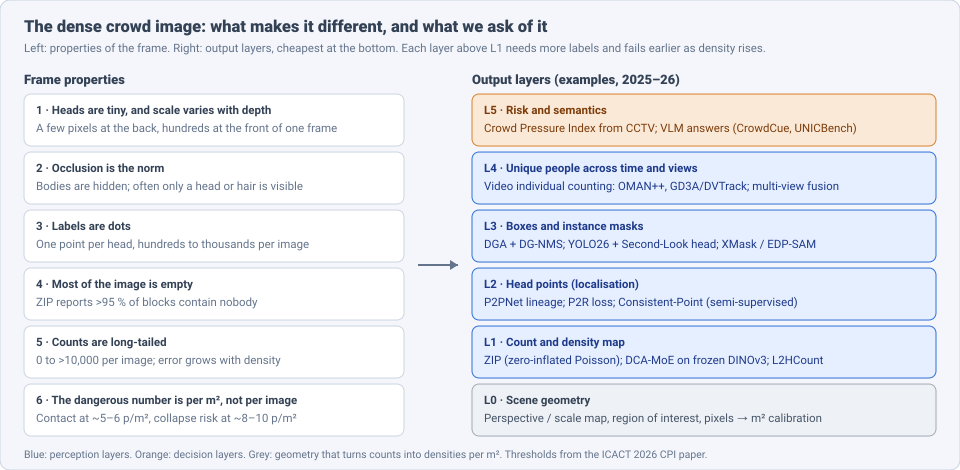
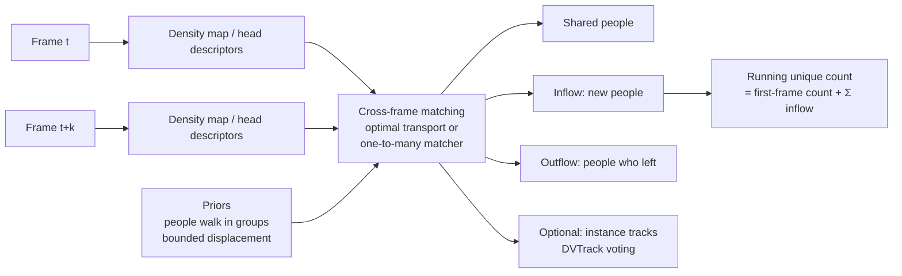
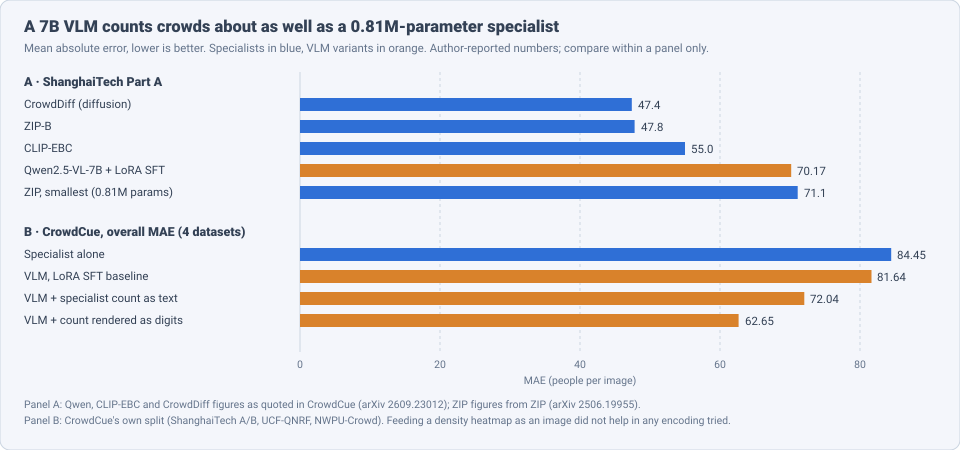

# Dense Object Detection & Classification — Recent Advances

*Compiled 2026-Oct-11 (America/Los_Angeles).*

Next installment in the running CV-updates log. Earlier entries on
`main`:
[Apr-30](../2026-Apr-30/2026-Apr-30_CV_updates.md),
[May-01](../2026-May-01/2026-May-01_CV_updates.md),
[May-02](../2026-May-02/2026-May-02_CV_updates.md),
[May-04](../2026-May-04/2026-May-04_CV_updates.md),
[May-05](../2026-May-05/2026-May-05_CV_updates.md),
[May-07](../2026-May-07/2026-May-07_CV_updates.md),
[May-08](../2026-May-08/2026-May-08_CV_updates.md),
[May-15](../2026-May-15/2026-May-15_CV_updates.md),
[May-16](../2026-May-16/2026-May-16_CV_updates.md),
[May-17](../2026-May-17/2026-May-17_CV_updates.md),
[Jun-09](../2026-Jun-09/2026-Jun-09_CV_updates.md),
[Jun-10](../2026-Jun-10/2026-Jun-10_CV_updates.md),
[Jun-12](../2026-Jun-12/2026-Jun-12_CV_updates.md),
[Jun-15](../2026-Jun-15/2026-Jun-15_CV_updates.md),
[Jun-16](../2026-Jun-16/2026-Jun-16_CV_updates.md),
[Jun-17](../2026-Jun-17/2026-Jun-17_CV_updates.md),
[Jun-19](../2026-Jun-19/2026-Jun-19_CV_updates.md),
[Jun-21](../2026-Jun-21/2026-Jun-21_CV_updates.md),
[Jun-22](../2026-Jun-22/2026-Jun-22_CV_updates.md),
[Jun-23](../2026-Jun-23/2026-Jun-23_CV_updates.md),
[Jun-24](../2026-Jun-24/2026-Jun-24_CV_updates.md),
[Jun-25](../2026-Jun-25/2026-Jun-25_CV_updates.md),
[Jun-27](../2026-Jun-27/2026-Jun-27_CV_updates.md),
[Jun-29](../2026-Jun-29/2026-Jun-29_CV_updates.md),
[Jun-30](../2026-Jun-30/2026-Jun-30_CV_updates.md),
[Jul-04](../2026-Jul-04/2026-Jul-04_CV_updates.md),
[Jul-07](../2026-Jul-07/2026-Jul-07_CV_updates.md),
[Jul-08](../2026-Jul-08/2026-Jul-08_CV_updates.md),
[Jul-10](../2026-Jul-10/2026-Jul-10_CV_updates.md),
[Jul-15](../2026-Jul-15/2026-Jul-15_CV_updates.md),
[Jul-17](../2026-Jul-17/2026-Jul-17_CV_updates.md),
[Jul-18](../2026-Jul-18/2026-Jul-18_CV_updates.md),
[Jul-21](../2026-Jul-21/2026-Jul-21_CV_updates.md),
[Jul-22](../2026-Jul-22/2026-Jul-22_CV_updates.md),
[Jul-24](../2026-Jul-24/2026-Jul-24_CV_updates.md),
[Jul-26](../2026-Jul-26/2026-Jul-26_CV_updates.md),
[Jul-27](../2026-Jul-27/2026-Jul-27_CV_updates.md),
[Jul-30](../2026-Jul-30/2026-Jul-30_CV_updates.md),
[Aug-01](../2026-Aug-01/2026-Aug-01_CV_updates.md),
[Aug-02](../2026-Aug-02/2026-Aug-02_CV_updates.md),
[Aug-04](../2026-Aug-04/2026-Aug-04_CV_updates.md),
[Aug-07](../2026-Aug-07/2026-Aug-07_CV_updates.md),
[Aug-10](../2026-Aug-10/2026-Aug-10_CV_updates.md),
[Aug-11](../2026-Aug-11/2026-Aug-11_CV_updates.md),
[Aug-13](../2026-Aug-13/2026-Aug-13_CV_updates.md),
[Aug-15](../2026-Aug-15/2026-Aug-15_CV_updates.md),
[Aug-16](../2026-Aug-16/2026-Aug-16_CV_updates.md),
[Aug-18](../2026-Aug-18/2026-Aug-18_CV_updates.md),
[Aug-19](../2026-Aug-19/2026-Aug-19_CV_updates.md),
[Aug-21](../2026-Aug-21/2026-Aug-21_CV_updates.md),
[Aug-22](../2026-Aug-22/2026-Aug-22_CV_updates.md),
[Aug-24](../2026-Aug-24/2026-Aug-24_CV_updates.md),
[Aug-26](../2026-Aug-26/2026-Aug-26_CV_updates.md),
[Aug-29](../2026-Aug-29/2026-Aug-29_CV_updates.md),
[Sep-01](../2026-Sep-01/2026-Sep-01_CV_updates.md),
[Sep-20](../2026-Sep-20/2026-Sep-20_CV_updates.md),
[Sep-23](../2026-Sep-23/2026-Sep-23_CV_updates.md),
[Sep-24](../2026-Sep-24/2026-Sep-24_CV_updates.md),
[Sep-25](../2026-Sep-25/2026-Sep-25_CV_updates.md),
[Sep-26](../2026-Sep-26/2026-Sep-26_CV_updates.md),
[Sep-29](../2026-Sep-29/2026-Sep-29_CV_updates.md),
[Sep-30](../2026-Sep-30/2026-Sep-30_CV_updates.md),
[Oct-01](../2026-Oct-01/2026-Oct-01_CV_updates.md),
[Oct-02](../2026-Oct-02/2026-Oct-02_CV_updates.md),
[Oct-03](../2026-Oct-03/2026-Oct-03_CV_updates.md),
[Oct-04](../2026-Oct-04/2026-Oct-04_CV_updates.md),
[Oct-05](../2026-Oct-05/2026-Oct-05_CV_updates.md),
[Oct-06](../2026-Oct-06/2026-Oct-06_CV_updates.md),
[Oct-07](../2026-Oct-07/2026-Oct-07_CV_updates.md),
[Oct-08](../2026-Oct-08/2026-Oct-08_CV_updates.md),
[Oct-09](../2026-Oct-09/2026-Oct-09_CV_updates.md),
[Oct-10](../2026-Oct-10/2026-Oct-10_CV_updates.md).

The last entry covered the [sports broadcast video](../2026-Oct-10/2026-Oct-10_CV_updates.md).
Today's primitive keeps the people and drops the pitch: the **dense crowd
image**. This is a CCTV frame, drone frame or still photo of a crowd of
hundreds to tens of thousands of people, where the target is "how many,
where, and how tightly packed."

Earlier entries touched crowds only from the side. [May-15 §3](../2026-May-15/2026-May-15_CV_updates.md)
and [Jun-21 §7](../2026-Jun-21/2026-Jun-21_CV_updates.md) covered
class-agnostic and open-vocabulary counting (FamNet → CountGD), with
crowds as one test set. [Aug-16](../2026-Aug-16/2026-Aug-16_CV_updates.md)
covered Wi-Fi crowd counting, and [Jun-30](../2026-Jun-30/2026-Jun-30_CV_updates.md)
thermal imaging in general. This entry treats the crowd frame as a
modality of its own and does not repeat the open-vocabulary counting
material.

Six properties make the dense crowd frame a distinct problem:

- **Heads are tiny, and scale varies with depth.** A head at the back of
  a stadium shot can be a few pixels while one at the front is hundreds,
  in the same image (§3).
- **Occlusion is the norm.** Bodies are hidden; often only the top of a
  head is visible. That is why the field labels heads, not people (§4).
- **Labels are dots.** Datasets give one point per head, so box-based
  detectors have no native supervision, and labelling one dense image
  takes thousands of clicks (§4, §5).
- **Most of the image is empty.** At the scale density maps are
  predicted, over 95 % of blocks contain nobody (ZIP, §3).
- **Counts are long-tailed.** From zero to over ten thousand per image.
  Errors grow with density, so a single MAE hides most of the story (§3,
  §8).
- **The dangerous number is per square metre.** Safety decisions depend
  on local density and spacing, not on the image total (§9).

> **Numbers below come from search-engine abstracts, abstract pages on
> mirrors, CVF open-access listings, a GitHub README and conference
> abstract PDFs. I did not read the full papers** (arXiv could not be
> fetched directly on this run). Treat every number as an author-reported,
> abstract-level claim. Most items are 2025–26 preprints. Results from
> different papers use different splits and protocols, so do not compare
> them across tables unless the text says they are on the same split.

---

## Table of contents

1. [Why this pass](#1--why-this-pass)
2. [The primitive: six output layers](#2--the-primitive-six-output-layers)
3. [Layer 1: counts and density maps](#3--layer-1-counts-and-density-maps)
4. [Layer 2: head points and localisation](#4--layer-2-head-points-and-localisation)
5. [Layer 3: boxes and masks in a crowd](#5--layer-3-boxes-and-masks-in-a-crowd)
6. [Layer 4: unique people across time and views](#6--layer-4-unique-people-across-time-and-views)
7. [Beyond RGB, and robustness](#7--beyond-rgb-and-robustness)
8. [Vision-language models meet the crowd](#8--vision-language-models-meet-the-crowd)
9. [Layer 5: from counts to crush risk](#9--layer-5-from-counts-to-crush-risk)
10. [Open problems / what to watch](#10--open-problems--what-to-watch)
11. [Sources](#11--sources)

---

## 1 · Why this pass

- **The loss function, not the backbone, moved the leaderboard.** ZIP
  (Ma, Sanchez & Guha; arXiv 2506.19955) replaces MSE on block counts with
  a zero-inflated Poisson likelihood. It reports **28.2 MAE** on
  NWPU-Crowd val against **36.6** for CLIP-EBC, and **47.8 / 5.5 MAE** on
  ShanghaiTech A / B (§3).
- **Frozen foundation features are now competitive.** DCA-MoE (arXiv
  2608.15213) keeps a DINOv3 backbone frozen and adds density-routed
  experts. It reports **31.74 MAE** on NWPU-Crowd val with ViT-L/16 (§3).
- **Counting unique people in video became its own task.** Two January
  2026 papers add crowded benchmarks (WuhanMetroCrowd, MovingDroneCrowd++)
  and report **38.12 %** and **47.4 %** error reductions over prior
  video individual counting methods (§6).
- **VLMs are still weak crowd counters.** A LoRA-tuned Qwen2.5-VL-7B
  scores **70.17 MAE** on ShanghaiTech A, about the same as a
  **0.81M-parameter** ZIP model (**71.1**). Giving the VLM a specialist's
  count as rendered digits cut its overall MAE from **81.64** to
  **62.65** (CrowdCue, arXiv 2609.23012; §8).
- **Benchmarks for VLM counting arrived.** UNICBench (CVPR 2026) tests
  **45** MLLMs; only **three** image models exceed **50 % Hit@80 %** on
  its image split (§8).
- **Attacks now transfer across counting paradigms.** A CVPR 2026 paper
  generates perturbations that raise MAE about **7×** on average and
  transfer between density-map and point-regression counters (§7).
- **Crush risk is being computed from CCTV.** An ICACT 2026 paper combines
  P2PNet points with nearest-neighbour spacing into a Crowd Pressure Index,
  tested on footage of the 2021 Meron and 2022 Seoul Halloween crushes
  (§9).

---

## 2 · The primitive: six output layers

The layers form a ladder. Each rung needs more expensive labels and
breaks at a lower density than the rung below. Density maps (L1) survive
the densest scenes; boxes (L3) and tracks (L4) fail first. The safety
layer (L5) needs L0 geometry to turn a count into people per m².

| Layer | Output | Typical tool (2025–26) | Main failure |
|---|---|---|---|
| 0 | perspective, ROI, pixel → m² mapping | camera calibration, scale maps | uncalibrated CCTV, moving drones |
| 1 | count and density map | ZIP, DCA-MoE, CLIP-EBC, CrowdDiff | extreme density, domain shift |
| 2 | one point per head | P2PNet lineage, P2R loss, Consistent-Point | label cost, tiny heads |
| 3 | boxes or instance masks | DGA + DG-NMS, YOLO26 + SLR, XMask | NMS suppresses true neighbours |
| 4 | unique people across frames or cameras | OMAN++, GD3A/DVTrack, multi-view fusion | matching identical-looking heads |
| 5 | risk index, natural-language answers | CPI, CrowdCue, CrowdVLM-R1 | calibration to m², VLM numeracy |

---

## 3 · Layer 1: counts and density maps

**ZIP: model the zeros.** Density-map counters usually regress the count
in each image block with an MSE-style loss. ZIP (Yiming Ma, Victor Sanchez
& Tanaya Guha; arXiv 2506.19955, three versions; v1 titled "EBC-ZIP")
argues this is the wrong likelihood. More than 95 % of blocks in standard
benchmarks contain nobody. ZIP models each block's count with a
zero-inflated Poisson: one term for blocks that are structurally empty
and one for the expected count where people are present.

- **NWPU-Crowd val:** ZIP-B **28.2 MAE / 64.8 RMSE** vs CLIP-EBC
  **36.6 / 81.7**.
- **NWPU-Crowd test:** ZIP-B has the lowest MAE (**60.1**) and NAE
  (**0.104**) in its table. CLIP-EBC is at **61.3** MAE but has a lower
  RMSE (**278.4** vs **299.0**), so ZIP does not win every metric.
- **ShanghaiTech A / B:** **47.8 / 5.5 MAE**.
- **Scaling:** the authors report gains at every model size, from a
  0.81M-parameter variant up.

**DCA-MoE: a frozen DINOv3 with density-routed experts.** DCA-MoE (arXiv
2608.15213, Aug 2026) has two modules. SALF chooses which backbone depths
to take features from at each location. DR-MoE decides how much local,
mid-range and large-context processing each position gets. The DINOv3
backbone stays frozen.

- NWPU-Crowd val: **31.74 MAE / 72.20 RMSE** with ViT-L/16; **32.21 /
  75.87** with ViT-B/16.
- The authors themselves say repeated-seed statistics and cross-dataset
  tests are still missing. On the same split, ZIP-B's reported **28.2** is
  lower.

**L2HCount: train on sparse, test on dense.** Annotating dense scenes is
much harder than sparse ones. L2HCount (Xu, Yin et al., BUPT; arXiv
2503.12935) asks whether a counter trained only on low-density images
can generalise upward. It synthesises high-density images and their
point labels by shifting and stacking low-density content, adds a module
to sharpen heads blurred by the simulation, and keeps separate memories
for real-sparse and simulated-dense patterns. I could not confirm a
venue or headline numbers.

**Edge and video variants.**

- *Real-Time Crowd Counting for Embedded Systems* (Zhao, Wen, Yang, Ning,
  Liu & Gao; arXiv 2510.13250) uses a large-kernel stem, light
  multi-scale fusion and an FPN. It claims the fastest inference among
  compared methods with competitive accuracy on three benchmarks.
- *Density Estimation and Crowd Counting* (arXiv 2511.09723) adapts a
  diffusion density estimator (in the CrowdDiff style) to video. It keeps
  only frames with significant Farneback optical-flow motion, to save
  compute and storage.
- A 2026 systematic review in IJACSA (20 studies from 2020–2025) found
  ShanghaiTech the most-used benchmark and a shift toward lightweight
  edge models, with congested and occluded scenes still the main failure.

---

## 4 · Layer 2: head points and localisation

The density map gives a count but not positions. Point-based counters
(the P2PNet lineage, ICCV 2021) predict one point per head and match them
to the ground-truth dots, so count and localisation come from the same
output. The 2025–26 work is mostly about doing this with fewer labels.

- **Point-to-Region (P2R) loss** (Wei Lin, Chenyang Zhao & Antoni B.
  Chan; CVPR 2025 highlight; arXiv 2505.21943). Semi-supervised point
  counters train on a few labelled images plus pseudo-labelled ones. The
  authors show that point-to-point matching cannot pass pseudo-label
  confidence to background pixels. P2R supervises a local region around
  each point instead. Code: `Elin24/P2RLoss`.
- **Consistent-Point** (arXiv 2503.12441, Mar 2025). Also
  semi-supervised. It fixes two inconsistencies in pseudo-points with
  neighbour-aggregated positions and per-instance uncertainty
  calibration, and reports state-of-the-art localisation.
- **APGCC** (ECCV 2024; arXiv 2405.10589) remains the common reference
  for fully supervised point counting. It adds auxiliary positive and
  negative points to stabilise proposal-target matching.

**From points to masks.** *Exclusivity-Guided Mask Learning* (Huang,
Cheng, Lin, Wan & Chan; arXiv 2603.16241, Mar 2026) turns point labels
into instance masks:

1. **EDP-SAM** prompts SAM with each head point. A Nearest Neighbour
   Exclusion Circle constraint stops one mask from spreading into the
   next head.
2. **XMask** learns masks for dense scenes with a loss that separates
   neighbouring people, plus Gaussian smoothing and differentiable centre
   sampling.
3. The masks become pseudo-labels for a semi-supervised counter, on the
   argument that masks carry more shape information than points.

It is evaluated on ShanghaiTech A, UCF-QNRF and JHU++ with 5 %, 10 % and
40 % of labels and reports state-of-the-art segmentation and counting.

---

## 5 · Layer 3: boxes and masks in a crowd

Box detectors fail in crowds for two reasons. During training, anchors
overlap several heavily overlapped people and get ambiguous targets.
At inference, NMS deletes true detections that overlap a neighbour.

**Density-guided anchors and NMS.** Chenyang Zhao, Jia Wan and Antoni B.
Chan (CityU; arXiv 2504.09819, Apr 2025) use a predicted density map in
both places:

- **DGA** assigns anchors by unbalanced optimal transport: each
  ground-truth person's density is moved to anchor positions at minimal
  cost.
- **DG-NMS** sets the NMS threshold per location from predicted density,
  so packed regions suppress less.

They report gains on CrowdHuman and CityPersons; I did not see the
numbers.

**NMS-free YOLO in crowds.** YOLO26's one-to-one head removes NMS, but on
crowded scenes it scores below the same network's NMS output. The
*Second-Look* re-scoring head (Salam, Jebaseeli, Shirly & Sulaiman; under
review; code `naderkarunya/second-look-nmsfree`, AGPL-3.0) re-scores the
500 one-to-one candidates of a frozen YOLO26 using appearance, geometry
and each box's relation to its strongest higher-scored overlapping
neighbour. It adds about **0.97M** parameters and **4.6 ms** on a T4. On
CrowdHuman with YOLO26s-P2 the README reports:

| Metric | NMS-free output | + Second-Look head |
|---|---|---|
| AP ↑ | 87.90 | 89.96 |
| MR⁻² ↓ | 52.47 | 47.52 |
| JI ↑ | 75.90 | 79.49 |

The README says this beats the same network's NMS output but does not
give that number. For scale, the 2022 query-based end-to-end detector of
arXiv 2203.07669 reported **92.0 AP / 41.4 MR⁻²** on CrowdHuman with
Sparse R-CNN, so real-time NMS-free detectors still trail heavier
crowd-specific ones.

---

## 6 · Layer 4: unique people across time and views

Summing per-frame counts over a video counts the same person many times.
**Video individual counting (VIC)** asks for the number of *distinct*
people who passed through, which means matching people between frames.
Dense crowds make this hard because heads look alike and most people are
partly hidden.

- **OMAN → OMAN++ and WuhanMetroCrowd.** Zhu et al. (arXiv 2506.13067,
  Jun 2025) replaced one-to-one matching with implicit one-to-many
  matching. Lu, Zhu, Zhang, Li & Bai (arXiv 2601.01192, Jan 2026) add two
  priors: pedestrians walk in groups (so match groups, not individuals),
  and people cannot jump far between frames (a displacement prior). They
  release **WuhanMetroCrowd**, a crowded metro dataset with varied
  density, clip length, flow speed and occlusion. OMAN++ is reported to
  beat prior methods on SenseCrowd, CroHD and MovingDroneCrowd, with a
  **38.12 %** error reduction on WuhanMetroCrowd. Code is listed at
  `tiny-smart/OMAN`.
- **MovingDroneCrowd++, GD3A and DVTrack.** Fan, Wan, Han, Ma & Chan
  (arXiv 2601.12500, Jan 2026) add camera motion. Their dataset is shot
  from moving drones at varied altitudes, angles and lighting. **GD3A**
  matches pedestrian descriptors across frames with optimal transport and
  splits the density map into shared, inflow and outflow parts, so it
  counts without explicit localisation. **DVTrack** turns the
  descriptor matches into tracks by voting. They report a **47.4 %**
  counting-error reduction and a **39.2 %** HOTA gain in dense,
  fast-moving scenes.

**Multiple cameras.** The same problem across views:

- Zhang, Li, Chan & Huang (arXiv 2509.16684, Sep 2025) study which
  camera views to choose so that scene-level counting and localisation
  cover the whole crowd with fewer labels.
- **WSCF-MVCC** (Li, Chen & Zhang; arXiv 2512.02359, Dec 2025) trains
  multi-view counting with only the total count as supervision and no
  camera calibration.

---

## 7 · Beyond RGB, and robustness

**Thermal-only counting for privacy.** TDCount (Qian, Guo, Lei, Deng,
Lau, Hong & Pound; arXiv 2605.17042, May 2026) uses RGB only once,
offline, to train a ControlNet. At deployment it needs only a thermal
camera, which removes the continuous RGB capture that is the main privacy
risk. It uses a depth-to-RGB diffusion model as a bridge to sharpen
thermal features. The authors find that single-step LCM denoising works
better than multi-step, which drifts from the conditioning structure.
They report results on RGBT-CC and DroneRGBT that are competitive with
RGB-T fusion methods that need both cameras at inference.

**Cross-domain generalisation.** Counters trained on one dataset still
degrade on new cameras and scenes. Recent single-domain generalisation
work includes SinCount, a Fourier-based method in *Scientific Reports*
(2026), and a hybrid-space-fusion and contrastive-disentanglement method
in *Applied Soft Computing* (2026). L2HCount (§3) attacks the related
sparse-to-dense shift.

**Adversarial transfer across paradigms.** Anisha, Wang & Chellappan
(USF; CVPR 2026; arXiv 2603.24821) train a light generative UNet to
produce subtle perturbations. They suppress high-confidence logits in
point-regression counters and density peaks in density-map counters, so
one generator attacks both families. They report about a **7×** average
increase in MAE across seven crowd models. A perturbation built on SASNet
also degraded P2PNet at **20.68 dB PSNR**. Any safety use of counters
(§9) has to assume this.

---

## 8 · Vision-language models meet the crowd

**The benchmarks.**

- **UNICBench** (Rong et al.; CVPR 2026; arXiv 2603.00595) covers
  counting in images (5,300 images, 5,508 QA), documents and audio, and
  evaluates **45** MLLMs. Accuracy drops sharply on high-count cases. A
  third-party summary reports only **three** image models above **50 %
  Hit@80 %** (the answer within 20 % of the truth). The authors warn
  that refusals can make MAE look better, so MAE must be read with a
  success rate.
- **HoloCount** (arXiv 2607.06420) includes a high-density enumeration
  category. Across more than 20 MLLMs, performance drops as tasks move
  from perception to reasoning and adverse conditions.

**Teaching VLMs to count crowds.**

- **CrowdVLM-R1** (arXiv 2504.03724; code `yeyimilk/CrowdVLM-R1`)
  fine-tunes Qwen2.5-VL (3B, 7B) with GRPO. A 0/1 exact-count reward did
  worse than plain supervised fine-tuning. A *fuzzy* reward that gives
  partial credit for close counts beat SFT and GPT-4o on five in-domain
  datasets, and helped most out of domain when counts were large.
- **CrowdCue** (University of Doha for Science and Technology; arXiv
  2609.23012, Sep 2026) asks how to give a VLM a specialist's help.
  Zero-shot Qwen2.5-VL-7B rarely outputs a parseable count, so a LoRA SFT
  model is the baseline (**81.64** overall MAE on ShanghaiTech A/B,
  UCF-QNRF and NWPU-Crowd).
  - Feeding a P2PNet-style density heatmap as an extra image failed in
    every encoding tried. An adversarial-swap test suggests the model
    reads the heatmap but uses it wrongly.
  - Passing the specialist's integer count as text: **72.04**.
  - Rendering that integer as printed digits in a second image: **62.65**,
    better than the specialist alone (**84.45**) on the same split.
  - The authors conclude that the abstraction level of the hint matters
    more than the channel: a VLM uses a number, not a map.

The practical reading: for crowd counts, the VLM should be the interface
and the specialist the counter.

---

## 9 · Layer 5: from counts to crush risk

**Crowd Pressure Index.** A paper in ICACT 2026 proposes a real-time
crush-risk framework for CCTV. It combines P2PNet head points (density
per unit area) with nearest-neighbour spacing into a **Crowd Pressure
Index (CPI)**, to capture both overall congestion and local compression.
It was evaluated on real footage of the **2021 Meron** disaster and the
**2022 Seoul Halloween** crush, with sub-2-second latency, and the index
rose sharply before both. It uses thresholds of about **5–6 persons/m²**
(physical contact unavoidable) and **8–10 persons/m²** (collapse-prone
spacing). This is a conference abstract; I did not see the CPI formula.

**What the numbers mean.** A PLOS ONE simulation of the Seoul crush
(Liang et al., 2024) estimated an average density of **7.57 ped/m²**
(max **9.95**) and average crowd pressure peaking at **1,063 N/m**.
Those values sit inside the CPI paper's danger band.

**Deployed.** After the Seoul crush, the city announced a CCTV crowd
detection system for its busiest areas; Korean press reported **909
cameras** in **71** areas. An ISSF 2026 paper describes a simpler
YOLOv8-S + heatmap + LSTM early-warning system and reports >93 %
accuracy, weaker in low light and under occlusion.

**The missing link is L0.** All of these need image area converted to
ground area. That calibration is rarely available for CCTV and changes
constantly for drones, and §7's attacks and domain shift apply on top.

---

## 10 · Open problems / what to watch

1. **Error by density band, not one MAE.** Safety lives in the dense
   tail. Benchmarks should report error per density bin and per m², not
   per image.
2. **Calibrated density.** Counts per m² need ground-plane geometry. A
   public benchmark with calibrated CCTV and per-m² labels would let CPI-
   style methods be compared.
3. **Frozen foundation backbones vs tailored losses.** DCA-MoE (frozen
   DINOv3) and ZIP (better likelihood) improve different parts. Watch for
   the combination, with cross-dataset tests.
4. **Video individual counting at scale.** WuhanMetroCrowd and
   MovingDroneCrowd++ show large gains but on new data. A shared leaderboard
   would show whether group priors or descriptor matching generalise.
5. **VLMs as front-ends.** CrowdCue suggests tool use (call a counter,
   read the number) beats end-to-end VLM counting. Watch for agentic
   pipelines evaluated on UNICBench's high-count split.
6. **Robust and private sensing.** Cross-paradigm attacks and
   thermal-only deployment pull in opposite directions. Robustness of
   thermal counters to attacks is untested.
7. **Labels beyond dots.** EDP-SAM turns dots into masks almost for free.
   If masks become the default label, box and mask detectors (§5) may
   close the gap to density maps in mid-density scenes.

---

## 11 · Sources

### Counts and density maps (§3)

- ZIP: Scalable Crowd Counting via Zero-Inflated Poisson Modeling — arXiv 2506.19955 — https://arxiv.org/abs/2506.19955 — https://arxiv.org/html/2506.19955v3
- DCA-MoE: Spatially Adaptive Cross-Layer Fusion and Density-Routed Experts for Crowd Counting — arXiv 2608.15213 — https://arxiv.org/pdf/2608.15213
- L2HCount: Generalizing Crowd Counting from Low to High Crowd Density via Density Simulation — arXiv 2503.12935 — https://arxiv.org/abs/2503.12935v1
- Real-Time Crowd Counting for Embedded Systems with Lightweight Architecture — arXiv 2510.13250 — https://arxiv.org/abs/2510.13250v1
- Density Estimation and Crowd Counting — arXiv 2511.09723 — https://arxiv.org/abs/2511.09723v1
- CrowdDiff: Multi-hypothesis Crowd Density Estimation using Diffusion Models — arXiv 2303.12790 — https://arxiv.org/abs/2303.12790
- A Systematic Review on Crowd Density Estimation — IJACSA vol. 17 no. 3 (2026) — https://thesai.org/Downloads/Volume17No3/Paper_102-A_Systematic_Review_on_Crowd_Density_Estimation.pdf

### Points and masks (§4)

- Point-to-Region Loss for Semi-Supervised Point-Based Crowd Counting — CVPR 2025, arXiv 2505.21943 — https://openaccess.thecvf.com/content/CVPR2025/html/Lin_Point-to-Region_Loss_for_Semi-Supervised_Point-Based_Crowd_Counting_CVPR_2025_paper.html — code https://github.com/Elin24/P2RLoss
- Consistent-Point (semi-supervised crowd counting and localisation) — arXiv 2503.12441 — https://arxiv.org/abs/2503.12441v1
- Improving Point-based Crowd Counting and Localization Based on Auxiliary Point Guidance (APGCC) — ECCV 2024, arXiv 2405.10589 — https://arxiv.org/abs/2405.10589
- Rethinking Counting and Localization in Crowds: A Purely Point-Based Framework (P2PNet) — ICCV 2021, arXiv 2107.12746 — https://arxiv.org/abs/2107.12746
- Exclusivity-Guided Mask Learning for Semi-Supervised Crowd Instance Segmentation and Counting — arXiv 2603.16241 — https://arxiv.org/abs/2603.16241
- Awesome Crowd Localization (leaderboard list) — https://github.com/taohan10200/Awesome-Crowd-Localization

### Boxes in crowds (§5)

- Density-based Object Detection in Crowded Scenes — arXiv 2504.09819 — https://arxiv.org/abs/2504.09819v1
- Second-Look re-scoring head for NMS-free YOLO26 pedestrian detection in crowds (code and README) — https://github.com/naderkarunya/second-look-nmsfree
- Progressive End-to-End Object Detection in Crowded Scenes — arXiv 2203.07669 — https://arxiv.org/abs/2203.07669
- CrowdHuman: A Benchmark for Detecting Human in a Crowd — arXiv 1805.00123 — https://arxiv.org/abs/1805.00123

### Video and multi-view (§6)

- Crowded Video Individual Counting Informed by Social Grouping and Spatial-Temporal Displacement Priors (OMAN++, WuhanMetroCrowd) — arXiv 2601.01192 — https://arxiv.org/abs/2601.01192 — https://papers.cool/arxiv/2601.01192
- Video individual counting with implicit one-to-many matching (OMAN) — arXiv 2506.13067 — https://arxiv.org/abs/2506.13067
- Video Individual Counting and Tracking from Moving Drones: A Benchmark and Methods (MovingDroneCrowd++, GD3A, DVTrack) — arXiv 2601.12500 — https://arxiv.org/abs/2601.12500v1
- Active view selection for multi-view crowd counting and localisation — arXiv 2509.16684 — https://arxiv.org/abs/2509.16684
- WSCF-MVCC: weakly supervised, calibration-free multi-view crowd counting — arXiv 2512.02359 — https://arxiv.org/abs/2512.02359v1

### Beyond RGB and robustness (§7)

- Thermal-Only Crowd Counting with Deployment-Time Privacy Protection (TDCount) — arXiv 2605.17042 — https://arxiv.org/abs/2605.17042
- Fourier transform-based single domain generalization for crowd counting (SinCount) — Scientific Reports (2026) — https://www.nature.com/articles/s41598-026-46286-3
- Single domain generalization crowd counting via hybrid space fusion and contrastive disentanglement learning — Applied Soft Computing (2026) — https://www.sciencedirect.com/science/article/abs/pii/S1568494626003108
- Generative Adversarial Perturbations with Cross-paradigm Transferability on Localized Crowd Counting — CVPR 2026, arXiv 2603.24821 — https://arxiv.org/abs/2603.24821 — https://cvpr.thecvf.com/virtual/2026/poster/40179

### Vision-language models (§8)

- UNICBench: UNIfied Counting Benchmark for MLLM — CVPR 2026, arXiv 2603.00595 — https://openaccess.thecvf.com/content/CVPR2026/html/Rong_UNICBench_UNIfied_Counting_Benchmark_for_MLLM_CVPR_2026_paper.html — summary https://www.emergentmind.com/papers/2603.00595
- HoloCount: A Holistic Visual Counting Benchmark for MLLMs — arXiv 2607.06420 — https://arxiv.org/abs/2607.06420
- CrowdVLM-R1: Expanding R1 Ability to Vision Language Model for Crowd Counting using Fuzzy Group Relative Policy Reward — arXiv 2504.03724 — https://arxiv.org/abs/2504.03724 — code https://github.com/yeyimilk/CrowdVLM-R1
- CrowdCue: Specialist-Cue Conditioning for Vision-Language Crowd Counting — arXiv 2609.23012 — https://arxiv.org/abs/2609.23012 — https://arxiv.org/html/2609.23012v1

### Crush risk and deployment (§9)

- Crowd Pressure Index from CCTV (P2PNet + spacing; Meron 2021, Seoul 2022) — ICACT 2026 abstract — https://www.icact.org/upload/2026/0308/20260308_biography.pdf
- Liang et al., simulation of the Seoul Halloween crowd crush — PLOS ONE (2024) — https://pmc.ncbi.nlm.nih.gov/articles/PMC11244771
- Unraveling the causes of the Seoul Halloween crowd-crush disaster — https://pure.uos.ac.kr/en/publications/unraveling-the-causes-of-the-seoul-halloween-crowd-crush-disaster/
- Seoul crowd alert system (press) — https://www.koreajoongangdaily.com/korea/seoul-to-implement-alert-system-to-manage-halloween-crowds/10253557 — https://kurrant.com/kurrantly-news/seoul-to-launch-advanced-crowd-detection-system/
- YOLOv8-based crowd early-warning system — ISSF 2026 proceedings — https://www.atlantis-press.com/proceedings/issf-26/126025068
