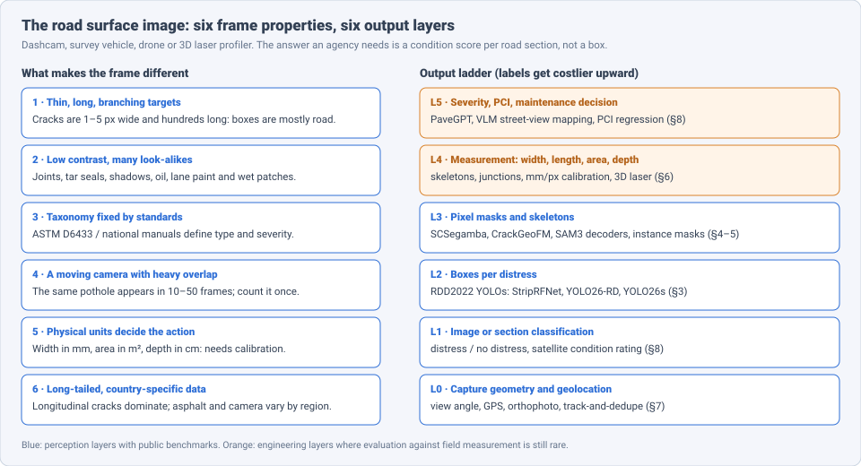
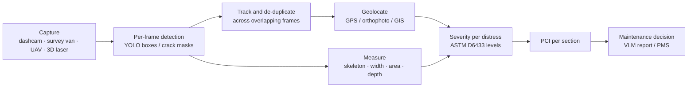
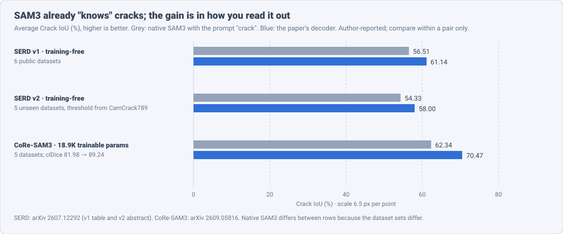

# Dense Object Detection & Classification — Recent Advances

*Compiled 2026-Oct-12 (America/Los_Angeles).*

Next installment in the running CV-updates log. Earlier entries on
`main`:
[Apr-30](../2026-Apr-30/2026-Apr-30_CV_updates.md),
[May-01](../2026-May-01/2026-May-01_CV_updates.md),
[May-02](../2026-May-02/2026-May-02_CV_updates.md),
[May-04](../2026-May-04/2026-May-04_CV_updates.md),
[May-05](../2026-May-05/2026-May-05_CV_updates.md),
[May-07](../2026-May-07/2026-May-07_CV_updates.md),
[May-08](../2026-May-08/2026-May-08_CV_updates.md),
[May-15](../2026-May-15/2026-May-15_CV_updates.md),
[May-16](../2026-May-16/2026-May-16_CV_updates.md),
[May-17](../2026-May-17/2026-May-17_CV_updates.md),
[Jun-09](../2026-Jun-09/2026-Jun-09_CV_updates.md),
[Jun-10](../2026-Jun-10/2026-Jun-10_CV_updates.md),
[Jun-12](../2026-Jun-12/2026-Jun-12_CV_updates.md),
[Jun-15](../2026-Jun-15/2026-Jun-15_CV_updates.md),
[Jun-16](../2026-Jun-16/2026-Jun-16_CV_updates.md),
[Jun-17](../2026-Jun-17/2026-Jun-17_CV_updates.md),
[Jun-19](../2026-Jun-19/2026-Jun-19_CV_updates.md),
[Jun-21](../2026-Jun-21/2026-Jun-21_CV_updates.md),
[Jun-22](../2026-Jun-22/2026-Jun-22_CV_updates.md),
[Jun-23](../2026-Jun-23/2026-Jun-23_CV_updates.md),
[Jun-24](../2026-Jun-24/2026-Jun-24_CV_updates.md),
[Jun-25](../2026-Jun-25/2026-Jun-25_CV_updates.md),
[Jun-27](../2026-Jun-27/2026-Jun-27_CV_updates.md),
[Jun-29](../2026-Jun-29/2026-Jun-29_CV_updates.md),
[Jun-30](../2026-Jun-30/2026-Jun-30_CV_updates.md),
[Jul-04](../2026-Jul-04/2026-Jul-04_CV_updates.md),
[Jul-07](../2026-Jul-07/2026-Jul-07_CV_updates.md),
[Jul-08](../2026-Jul-08/2026-Jul-08_CV_updates.md),
[Jul-10](../2026-Jul-10/2026-Jul-10_CV_updates.md),
[Jul-15](../2026-Jul-15/2026-Jul-15_CV_updates.md),
[Jul-17](../2026-Jul-17/2026-Jul-17_CV_updates.md),
[Jul-18](../2026-Jul-18/2026-Jul-18_CV_updates.md),
[Jul-21](../2026-Jul-21/2026-Jul-21_CV_updates.md),
[Jul-22](../2026-Jul-22/2026-Jul-22_CV_updates.md),
[Jul-24](../2026-Jul-24/2026-Jul-24_CV_updates.md),
[Jul-26](../2026-Jul-26/2026-Jul-26_CV_updates.md),
[Jul-27](../2026-Jul-27/2026-Jul-27_CV_updates.md),
[Jul-30](../2026-Jul-30/2026-Jul-30_CV_updates.md),
[Aug-01](../2026-Aug-01/2026-Aug-01_CV_updates.md),
[Aug-02](../2026-Aug-02/2026-Aug-02_CV_updates.md),
[Aug-04](../2026-Aug-04/2026-Aug-04_CV_updates.md),
[Aug-07](../2026-Aug-07/2026-Aug-07_CV_updates.md),
[Aug-10](../2026-Aug-10/2026-Aug-10_CV_updates.md),
[Aug-11](../2026-Aug-11/2026-Aug-11_CV_updates.md),
[Aug-13](../2026-Aug-13/2026-Aug-13_CV_updates.md),
[Aug-15](../2026-Aug-15/2026-Aug-15_CV_updates.md),
[Aug-16](../2026-Aug-16/2026-Aug-16_CV_updates.md),
[Aug-18](../2026-Aug-18/2026-Aug-18_CV_updates.md),
[Aug-19](../2026-Aug-19/2026-Aug-19_CV_updates.md),
[Aug-21](../2026-Aug-21/2026-Aug-21_CV_updates.md),
[Aug-22](../2026-Aug-22/2026-Aug-22_CV_updates.md),
[Aug-24](../2026-Aug-24/2026-Aug-24_CV_updates.md),
[Aug-26](../2026-Aug-26/2026-Aug-26_CV_updates.md),
[Aug-29](../2026-Aug-29/2026-Aug-29_CV_updates.md),
[Sep-01](../2026-Sep-01/2026-Sep-01_CV_updates.md),
[Sep-20](../2026-Sep-20/2026-Sep-20_CV_updates.md),
[Sep-23](../2026-Sep-23/2026-Sep-23_CV_updates.md),
[Sep-24](../2026-Sep-24/2026-Sep-24_CV_updates.md),
[Sep-25](../2026-Sep-25/2026-Sep-25_CV_updates.md),
[Sep-26](../2026-Sep-26/2026-Sep-26_CV_updates.md),
[Sep-29](../2026-Sep-29/2026-Sep-29_CV_updates.md),
[Sep-30](../2026-Sep-30/2026-Sep-30_CV_updates.md),
[Oct-01](../2026-Oct-01/2026-Oct-01_CV_updates.md),
[Oct-02](../2026-Oct-02/2026-Oct-02_CV_updates.md),
[Oct-03](../2026-Oct-03/2026-Oct-03_CV_updates.md),
[Oct-04](../2026-Oct-04/2026-Oct-04_CV_updates.md),
[Oct-05](../2026-Oct-05/2026-Oct-05_CV_updates.md),
[Oct-06](../2026-Oct-06/2026-Oct-06_CV_updates.md),
[Oct-07](../2026-Oct-07/2026-Oct-07_CV_updates.md),
[Oct-08](../2026-Oct-08/2026-Oct-08_CV_updates.md),
[Oct-09](../2026-Oct-09/2026-Oct-09_CV_updates.md),
[Oct-10](../2026-Oct-10/2026-Oct-10_CV_updates.md),
[Oct-11](../2026-Oct-11/2026-Oct-11_CV_updates.md).

The last entry covered the [dense crowd image](../2026-Oct-11/2026-Oct-11_CV_updates.md).
Today's primitive looks down instead of across: the **road surface
image**. This is the frame a dashcam, a survey van, a drone or a 3D laser
profiler takes of asphalt or concrete pavement, where the target is "what
distress is here, how bad is it, and what should the agency do about it."

Earlier entries touched this only from the side. [Aug-10](../2026-Aug-10/2026-Aug-10_CV_updates.md)
covered pavement layers seen by ground-penetrating radar (below the
surface), [Jul-15](../2026-Jul-15/2026-Jul-15_CV_updates.md) cracks
inside parts seen by X-ray, and [May-16 §10](../2026-May-16/2026-May-16_CV_updates.md)
generic industrial anomaly detection (MVTec-AD). [Aug-02](../2026-Aug-02/2026-Aug-02_CV_updates.md)
covered overhead optical detection in general. This entry treats the
visible road surface as a modality of its own.

Six properties make the road surface frame a distinct problem:

- **The main target is a thin curve.** A crack can be 1–5 px wide and
  hundreds of pixels long, and it branches. A bounding box around it is
  mostly intact road (§3, §4).
- **Contrast is low and look-alikes are everywhere.** Joints, sealed
  cracks, shadows, oil stains, lane paint and wet patches all resemble
  distress (PaveBench builds a hard-distractor set for this; §8).
- **The taxonomy is set by engineering standards.** ASTM D6433 and
  national manuals define distress types and severity levels, and the
  final output is often a Pavement Condition Index (PCI), not a box (§8).
- **The camera moves and frames overlap.** The same pothole appears in
  many consecutive frames. A network-level survey has to count it once
  and place it on a map (§7).
- **Physical units decide the action.** Crack width in mm, patch area in
  m² and pothole depth in cm drive repair choices, so pixel outputs need
  calibration (§6).
- **Data are long-tailed and regional.** Longitudinal cracks dominate,
  potholes are rare, and road surfaces, cameras and labelling rules
  differ between countries (§3, §9).

> **Numbers below come from search-engine abstracts, arXiv HTML
> snippets, GitHub READMEs, PubMed/PMC and journal landing pages. I did
> not read the full papers** (arXiv and most mirrors could not be fetched
> directly on this run; WebFetch failed on DNS). Treat every number as an
> author-reported, abstract-level claim. Most items are 2025–26 preprints.
> Datasets, splits and metrics differ between papers, so do not compare
> numbers across rows unless the text says they share a protocol.

---

## Table of contents

1. [Why this pass](#1--why-this-pass)
2. [The primitive: six output layers](#2--the-primitive-six-output-layers)
3. [Layer 2: boxes — the RDD2022 detector line](#3--layer-2-boxes--the-rdd2022-detector-line)
4. [Layer 3: crack masks — SAM3, frozen backbones, Mamba](#4--layer-3-crack-masks--sam3-frozen-backbones-mamba)
5. [Layer 3b: instance masks and aerial orthophotos](#5--layer-3b-instance-masks-and-aerial-orthophotos)
6. [Layer 4: from pixels to millimetres and topology](#6--layer-4-from-pixels-to-millimetres-and-topology)
7. [Layer 0: video, overlap and geolocation](#7--layer-0-video-overlap-and-geolocation)
8. [Layer 5: vision-language models and the PCI](#8--layer-5-vision-language-models-and-the-pci)
9. [Data: unification and synthesis](#9--data-unification-and-synthesis)
10. [Open problems / what to watch](#10--open-problems--what-to-watch)
11. [Sources](#11--sources)

---

## 1 · Why this pass

- **SAM3 is a strong zero-shot crack detector if you skip its mask
  head.** SERD (arXiv 2607.12292) reads SAM3's internal response to the
  prompt "crack" instead of its final masks. Average Crack IoU rises from
  **56.51 %** to **61.14 %** on six datasets with no training.
  CoRe-SAM3 (arXiv 2609.05816) adds **~18.9K** trainable parameters and
  reports **62.34 % → 70.47 %** IoU and **81.98 % → 89.24 %** clDice on
  five datasets (§4).
- **Frozen foundation backbones reached cracks.** CrackGeoFM (arXiv
  2606.05641) adapts a frozen DINOv2-L and outputs a mask, a skeleton and
  an uncertainty map in one pass. It is evaluated on **20** crack
  datasets and adapts with **5** labelled images (§4).
- **The YOLO line is still where road damage boxes come from.**
  StripRFNet (YOLO11s-based) reports **80.33 % F1** on full RDD2022 at
  **~37.4 ms**/image, above the ORDDC'2024 champion's **79.27 %**
  in its own comparison. YOLO26-RD keeps the NMS-free YOLO26 head and adds
  a **494-parameter** learnable contrast stem (§3).
- **Weather is the unsolved part.** A YOLO26s study on a 4-class RDD2022
  subset reports **89.0 %** mAP@0.5 clean, but **68.1 %** in fog and
  **15.3 %** with motion blur (§3).
- **Pavement VLM benchmarks arrived in 2026.** PaveBench (real highway
  images, four tasks plus VQA), PaveInstruct/PaveGPT (**278,889**
  instruction pairs, **32** task types, ASTM D6433-style outputs) and
  WildRoadBench (UAV grounding; frontier VLMs "miss more than half the
  metric") (§8).
- **Generated crack data now come with label confidence.** CrackSegFlow
  releases a **50K** image–mask set; a Sep 2026 pipeline (arXiv
  2609.12431) weights each synthetic pixel by an ensemble's confidence and
  cuts the smallest reliably detected crack width on CRACK500 from **8.0**
  to **4.3 px** (§9).

---

## 2 · The primitive: six output layers

The layers form a ladder from what a detector sees to what a road agency
pays for. Public benchmarks are strong at L1–L3. L4 and L5 are where
evaluation against field measurement is rare, and where most claims in
this entry are weakest.

| Layer | Output | Typical tool (2025–26) | Main failure |
|---|---|---|---|
| 0 | view, GPS, orthophoto, unique defects | tracking + Kalman, UAV orthophoto, GIS vectors | double counting, scale drift |
| 1 | distress yes/no, section rating | CNN ensembles, VLM screening | coarse; no location |
| 2 | box per distress (RDD classes) | StripRFNet, YOLO26-RD, YOLO26s, TD-YOLOv10 | boxes poorly fit thin cracks |
| 3 | crack mask, skeleton, instance mask | SCSegamba, CrackGeoFM, SERD / CoRe-SAM3, Mask R-CNN | broken topology, look-alikes |
| 4 | width, length, area, depth in physical units | CrackMorph-XAI-Net, mm/px calibration, 3D laser | calibration, sub-pixel width |
| 5 | severity, PCI, maintenance plan | PaveGPT, GSV + VLM mapping, PCI regression | severity agreement with experts |

---

## 3 · Layer 2: boxes — the RDD2022 detector line

**The benchmark.** RDD2022 (Arya et al., Geoscience Data Journal 2024;
arXiv 2209.08538) collects smartphone and vehicle images from six
countries with four main classes: longitudinal cracks (D00), transverse
cracks (D10), alligator cracks (D20) and potholes (D40). It feeds the
CRDDC'2022 and ORDDC'2024 challenges, which score by F1 and, in
ORDDC'2024, by inference time as well.

**ORDDC'2024** (IEEE BigData 2024). Participants came from **19**
countries, with **76,069** Phase 1 and **353** Phase 2 submissions. All
top-five teams used YOLO-family backbones. The summary paper reports a
winning solution with two operating points: **86.18 % F1 at 136.41 ms**
per image (accuracy-optimised) and **79.27 % F1 at 26.8 ms** (speed-
optimised). StripRFNet's comparison table lists the champion at
**79.27 F1 / 37.2 ms**, so the timing depends on hardware and source.

| Model | Base | Data / metric | Reported result |
|---|---|---|---|
| StripRFNet (arXiv 2510.16115) | YOLO11s | full RDD2022, F1 | **80.33 %**, ~37.4 ms/img |
| ORDDC'2024 champion | YOLO | full RDD2022, F1 | 79.27 % (speed track) |
| YOLO26-RD (arXiv 2608.15713) | YOLO26 | road-survey set, mAP50 / 50-95 avg over scales | **0.790 / 0.482** vs YOLO26 0.776 / 0.471 |
| YOLO26-RD-l | YOLO26 | same | 0.809 / 0.497 |
| YOLO26s (Sensors 26(16):5113) | YOLO26 | 4-class RDD2022 subset (6,972 img), mAP@0.5 | **89.0 %**; 88.52 ± 1.03 over seeds vs YOLOv8s 87.41 ± 0.84 |
| TD-YOLOv10 (arXiv 2501.14302) | YOLOv10 | TD-RD top-down set, mAP | 88.1 % |

**What the architectures add.** The 2025–26 changes all target the thin
crack:

- **StripRFNet** adds a strip receptive-field module (long, narrow
  kernels for slender cracks), a shape-perception module and a
  small-scale enhancement module. On the Chinese subset it reports
  **+4.4** F1, **+2.9** mAP50 and **+3.4** mAP50:95 over its baseline.
  A later Research Square preprint notes that receptive-field designs of
  this kind tend to gain 1–4 points, so treat single-paper margins with
  care.
- **YOLO26-RD** (Youwai et al.) starts from the observation that road
  damage detectors are usually tuned for small objects by adding a
  stride-4 head and replacing strided convolution with space-to-depth.
  It adds **LearnableContrast**, a **494-parameter** per-tile correction
  that acts like a learnable CLAHE trained from the detection loss, and
  **EdgeSPD**, a lossless space-to-depth downsampler gated by a fixed
  Sobel prior. The repo says a data audit led the authors to keep the
  stride-4 features in the neck but drop the P2 detection level. The
  classes in the repo are alligator cracking, linear cracks and
  patching; I could not confirm whether RDD2022 is one of the test sets.
- **TD-RD** (Xiao et al., arXiv 2501.14302; IEEE Xplore 2025) argues the benchmarks lack
  viewpoint diversity and adds **7,088** top-down images with **12,882**
  instances of cracks, potholes and patches, filtered from **214,872**
  captured frames.

**Robustness is the weak point.** The YOLO26s study (Abbas et al.,
Sensors, Aug 2026) is the clearest stress test found. It uses 14.3 %
fewer parameters and 7.7 % fewer FLOPs than YOLOv8s (19.2 MB weights)
and runs on a Raspberry Pi. Its mAP@0.5 drops from **89.0 %** to
**86.95 %** in rain, **73.12 %** in low light, **68.12 %** in fog and
**15.30 %** with motion blur. Motion blur is exactly what a survey vehicle
at speed produces. The authors call the YOLO26 vs YOLOv8 gap
"directionally robust" rather than statistically strong.

---

## 4 · Layer 3: crack masks — SAM3, frozen backbones, Mamba

Box detection says "a crack is in this region." Maintenance needs the
crack's shape. The 2025–26 work on pixel-level crack segmentation splits
into three lines.

**Line 1: decode SAM3 differently.** SAM 3 (arXiv 2511.16719) segments
from text concepts. Out of the box it is a weak crack segmenter: a
crack is thin and often runs along object edges, and the mask head
prefers compact, salient objects. Two papers find the signal is already
inside the model.

- **SERD** (Semantic-Edge Response Decoding; arXiv 2607.12292, code
  `xauat-liushipeng/SERD`). SAM3 is fully frozen and no crack labels are
  used. SERD takes SAM3's internal language-conditioned response to
  "crack" as a dense crack-likelihood map, calibrates it with a Sobel
  edge prior and applies a global threshold.
  - v1, six public datasets: Crack IoU **56.51 → 61.14 %**, recall
    **70.38 → 78.01 %**, beating the compared zero-shot and
    open-vocabulary methods.
  - v2, stricter protocol (threshold chosen on CamCrack789 only):
    **54.33 → 58.00 %** on five unseen datasets; **60.23 %** mean target
    IoU and **67.18 %** Boundary F1 across six rotated source domains.
  - Ablations credit most of the gain to reading the internal response;
    the edge prior mainly helps structure and false positives. The
    authors note that the response is relative evidence, not a
    calibrated probability.
- **CoRe-SAM3** (arXiv 2609.05816, Sep 2026). The authors find SAM3's
  semantic path carries most of the crack signal, while its visual
  features help only in some states. Simply fusing the two is
  inconsistent. CoRe keeps the semantic prediction as the main path and
  adds a bounded, zero-initialised visual correction.
  - Five datasets: Crack IoU **62.34 → 70.47 %**, clDice **81.98 →
    89.24 %**, with **~18.9K** trainable parameters.
  - It fixes about **34 %** of SAM3's errors while damaging **0.23 %**
    of pixels SAM3 already had right.

Earlier SAM adaptations set the baseline: CrackSAM (arXiv 2312.04233)
fine-tuned SAM with adapters and LoRA, and *Segment Any Crack* (arXiv
2504.14138) found that tuning only normalisation layers reached **61.22 %
F1 / 44.13 % IoU** on OmniCrack30k.

**Line 2: a frozen general backbone plus crack modules.** CrackGeoFM
(Kyem, Asamoah, Denteh & Aboah; arXiv 2606.05641; code
`Blessing988/CrackGeoFM`; project page lists *Automation in Construction*
2026) freezes DINOv2-Large and adds three modules:

- FCEM, a frequency-guided crack enhancement module;
- CFAM, a crack-domain feature adaptation module;
- SMTD, a structure-aware multi-task decoder that outputs a **mask**, a
  **skeleton** and an **uncertainty map** together.

The skeleton targets are derived automatically from ordinary binary
masks, so no extra labelling is needed. The motivation is that models
can score high overlap while breaking cracks into fragments and missing
fine branches. Across **20** crack datasets the authors claim state-of-
the-art segmentation, better topology, calibrated uncertainty and
five-shot adaptation. I did not see per-dataset numbers.

**Line 3: small specialist networks.** SCSegamba (Liu et al., CVPR 2025;
code `Karl1109/SCSegamba`) is a ~**2.8M**-parameter vision Mamba (about
**18.16 GFLOPs**). A gated bottleneck convolution models crack morphology
and a structure-aware scanning strategy follows crack topology. It
reports **F1 0.7678 / mIoU 0.8094** on CrackMap and **0.8390 / 0.8479**
on the multi-scenario TUT set.

**The benchmark under all three.** OmniCrack30k (Benz & Rodehorst, CVPRW
2024) pools **30k** samples from over **20** datasets (~9 billion pixels)
across asphalt, concrete, masonry, ceramic and steel. Its baseline
finding: a plain nnU-Net with transfer learning reaches **64 %** mean
clIoU (4 px tolerance), at least 10 points above the other methods
tested. The Aug 2025 review by Zhang et al. (arXiv 2508.10256) traces
the field's shift toward semi-, weakly- and un-supervised learning,
domain adaptation and foundation-model fine-tuning, and toward
cross-dataset evaluation.

---

## 5 · Layer 3b: instance masks and aerial orthophotos

Semantic masks merge touching cracks; boxes overstate thin-crack area.
Instance masks sit between them.

- **UWGB-StreetCrack** (Dewick et al., Univ. of Wisconsin–Green Bay;
  arXiv 2605.26095, v2 Jul 2026). Polygon labels for longitudinal,
  transverse and alligator cracks and potholes, from a vehicle-mounted
  smartphone. Five Detectron2 Mask R-CNN variants were fine-tuned under
  one protocol; the best (ResNet-101 FPN) reached **84.23 %** precision,
  **90.04 %** recall and **87.04 %** F1 under the project's box-matching
  rule. The authors list annotation consistency, class imbalance,
  confounder rejection and mask-level benchmarking as open issues.
- **UAV orthophotos** (*End-to-end instance segmentation framework…
  UAV-derived digital orthophoto maps*, Computer-Aided Civil and
  Infrastructure Engineering). Orthophotos are geometrically corrected,
  so area can be measured directly, but they are huge and few deep
  models had been applied to them. The authors annotate distress as GIS
  vectors, convert to detection formats, and compare YOLOv7, YOLOv8 with
  a YOLACT head, and Mask R-CNN. I did not see the accuracy numbers.
  Related: PDIS-Net reports **78.1 % mAP at 30.8 FPS** on UAPD-Instance,
  and UAV-PDD2023 provides six distress classes from drones.

---

## 6 · Layer 4: from pixels to millimetres and topology

A mask is not yet an engineering measurement. The road agency wants
length, mean and maximum width, area, branching and depth.

- **CrackMorph-XAI-Net** (Ajjarapu & Mallikarjunaiah, Texas A&M–Corpus
  Christi; arXiv 2605.08265). Four stages: topology-preserving skeleton
  extraction, junction detection by Gaussian heatmap regression,
  morphology descriptors and severity screening. On CRACK500 extended
  with the authors' own skeleton, junction and topology labels: skeleton
  Dice **0.991**, topology kept in **98.5 %** of test images, junction
  recall **0.964** / F1 **0.887**, descriptor correlations **> 0.95**
  for length, width, orientation, junction count and tortuosity. The
  labels are the authors' own, so the numbers are not yet independent.
- **SAM3-based measurement.** The latest SERD version reframes the
  method as rapid-deployment crack measurement: its tool reports
  length, mean and maximum width and area, converted with a mm/pixel
  calibration factor.
- **Width needs calibration and sub-pixel care.** Recent journal work
  uses a laser line or checkerboard to fix mm/px and measures width from
  the mask edges or a 3D reconstruction; reported mean errors are around
  **0.15 mm** on concrete (MDPI Metrology; Applied Sciences 2026 with
  binocular vision, 0.07–0.31 mm). A 2025 CACIE paper uses a parallel
  laser line-camera and an "equal-area" grey-value method for sub-pixel
  width. These are mostly structural-concrete studies, not network-level
  road surveys.
- **The 3D laser is the production baseline.** Network surveys by road
  agencies mostly use 3D laser profilers (LCMS-type) that measure rut
  depth and crack depth across the lane at traffic speed; the Pavemetrics
  LCMS specification quotes about 1 mm transverse and 0.5 mm depth
  accuracy. The 3DCrack set (Georgia Tech Sensing Vehicle; 1,139 / 245 /
  250 train/val/test range images of 512 × 624) in the Zhang et al.
  review gives deep models a public 3D benchmark. I did not find a 2026
  deep-learning paper on LCMS rut depth.

---

## 7 · Layer 0: video, overlap and geolocation

Per-image detection overcounts on video: one pothole is seen in many
frames. Three 2025–26 works address the time axis, with mixed results.

- **Road Inspection 4.0** (Big Data and Cognitive Computing 10(7):234,
  2026). **619** HD videos from South Kalimantan, Indonesia, cut into
  2-second, 48-frame clips with pixel-level pothole masks. The per-frame
  models (**~66.5–81 %** IoU; a fusion ensemble ~81 %, YOLOv8-seg and
  OneFormer ~80 %) clearly beat the multi-frame video methods
  (**~17.9–55.4 %**). Temporal modelling did not help here.
- **Video pothole area with depth and Kalman smoothing** (arXiv
  2505.21049). A YOLOv8 variant plus monocular depth and Kalman
  smoothing estimates pothole area along the video. The area estimates
  were checked for internal consistency, not against field measurements.
- **Orthophotos as the deduplication step.** The UAV orthophoto line
  (§5) avoids the problem by stitching first and detecting once on a
  geometrically corrected map.

I found no 2026 paper that reports per-kilometre distress counts after
de-duplication against a ground-truth survey. This is the gap between
benchmark F1 and an agency's inventory.

---

## 8 · Layer 5: vision-language models and the PCI

The output a road agency uses is a condition rating per section,
usually a PCI derived from distress type, severity and extent (ASTM
D6433). VLMs are being tried as the step that turns detections into that
rating and a written report.

**Benchmarks.**

- **PaveBench** (Li, Che, Zhang, Zhou, Zhang & Han; arXiv 2604.02804;
  data on Hugging Face). Real highway inspection images with four tasks:
  classification, detection, semantic segmentation and VQA. Its PaveVQA
  part supports single-turn, multi-turn and expert-corrected
  interactions, and grounds answers on metadata from the annotations
  (box, pixel area, skeleton length) to limit hallucination. A
  hard-distractor subset holds look-alikes that co-occur with real
  distress. The authors describe PaveVQA as the largest real-image VQA
  set for pavement inspection.
- **RoadBench / RoadCLIP** (Xiao et al.; arXiv 2507.17353, Jul 2025).
  About 100K image–text pairs, with images generated by GPT-4o from
  structured prompts and checked by experts. RoadCLIP adds
  damage-aware positional encoding to CLIP. Secondary summaries quote
  **78.6 %** zero-shot accuracy (GPT-4V **74.5 %**) and **58.4 %**
  R@1 retrieval vs **40.3 %** for CLIP. PaveBench criticises it for
  relying on synthetic images.
- **WildRoadBench** (Liu et al.; arXiv 2605.20306, May 2026). UAV images
  from 50–200 m over Chinese roads, annotated by maintenance experts. The
  VLM track has **1,061** images and **1,699** boxes in five classes
  (water, crack, pothole, debris, infrastructure anomaly). Frontier
  closed models lead but still "miss more than half the metric," open
  grounders trail, small targets fail for every open model, and several
  LLM agents asked to build their own detector produced no valid
  submission within budget.

**Models.**

- **PaveGPT / PaveInstruct** (arXiv 2604.08212, Apr 2026). PaveInstruct
  merges **nine** pavement datasets into **278,889** image–instruction–
  response pairs over **32** task types: identification and
  localisation, ASTM-based severity, chain-of-thought PCI estimation,
  formatted reports and maintenance advice. Instruction tuning is
  reported to improve grounding, reasoning and generation by **> 20 %**
  over general VLMs, with ASTM D6433-compliant output. A third-party
  review calls the evidence thin and flags the merging of nine
  heterogeneous datasets as the assumption to check.

**VLMs on street view.**

- A 2026 *Transportation Engineering* proof of concept samples Google
  Street View lane images over an area, asks a VLM for distress type and
  severity, and publishes a georeferenced map. Four GPT-based VLMs were
  compared with three pavement experts on **364** images: strong on
  distress vs no distress and on severity within one level, but below
  expert consensus on exact severity and full multi-class labels.
- A PLOS ONE benchmark found GPT-4o (**78.99 %** accuracy, **69.50 %**
  F1) and o1 (**77.55 % / 67.72 %**) the best at visible cracks and
  potholes.
- A Street View PCI study (IOP, 2026) shows the other route: its
  detector reached only **0.193** mAP@0.5, yet a simple regression from
  rut depth and pothole count to PCI reached **R² = 0.95**. Section-level
  ratings can be predicted from rough detections.
- At the coarsest level, satellite images with Texas DOT PMIS ratings
  (Lebaku et al., arXiv 2508.01206; Infrastructures 2024) reach **93 %**
  accuracy and **0.93** F1 with an ensemble of pretrained CNNs.

The reading so far: VLMs are useful screeners and report writers;
severity grading still needs a specialist detector and a measurement
step underneath.

---

## 9 · Data: unification and synthesis

**Unifying existing sets.**

- **PaveSync** (Kyem et al.; arXiv 2512.20011). Merges public benchmarks
  into one standard set: **52,747** images from **seven** countries,
  **135,277** boxes and **13** distress types (another passage of the
  paper gives 52,854 images). Aerial, drone and vehicle images are
  included, with harmonised class definitions.
- **UDTIRI-Crack** (Ma et al.; arXiv 2503.18082). **2,500** images from
  seven public sources with an online leaderboard at udtiri.com, covering
  supervised, semi-, weakly and unsupervised methods.

**Synthesising new ones.**

- **CrackSegFlow** (arXiv 2601.03637, Jan 2026). Flow matching with mask
  injection and boundary-gated rendering keeps generated cracks aligned
  with their masks. Releases **CSF-50K** (50,000 image–mask pairs).
  Target-guided cross-domain synthesis adds about **+13.12 mIoU / +14.82
  F1** across domains and **+5.37 / +5.13** in domain.
- **Controllable crack synthesis pipeline** (Li, Pu, Lim, Lin & Wang;
  arXiv 2609.12431, Sep 2026). Bézier skeletons → GAN crack masks →
  dual-ControlNet Stable Diffusion images. Instead of discarding doubtful
  samples, an ensemble assigns per-pixel label confidence that weights
  the loss. On CRACK500 the minimum crack width U-Net detects with 90 %
  probability (95 % confidence) falls from **8.0** to **4.3 px**, and
  expected calibration error from **14.2 %** to **9.6 %**. A third-party
  review says a post-hoc filter may explain part of the gain.
- **CrackMaskNet** (Engineering Applications of AI, 2026) jointly
  generates pavement images and masks with diffusion (FID **39.6**) and
  reports downstream gains in classification, detection and
  segmentation.

The "minimum detectable width" metric from arXiv 2609.12431 is worth
noting on its own. It is a probability-of-detection measure borrowed
from non-destructive testing, and it says more about field use than
mIoU does.

---

## 10 · Open problems / what to watch

1. **Robustness to motion blur, fog and night.** The YOLO26s study's drop
   to **15 %** mAP under blur is the most actionable number in this
   entry. Expect blur-aware training or event/global-shutter capture.
2. **Topology metrics as defaults.** clDice, skeleton Dice and
   minimum-detectable-width describe cracks better than IoU. CoRe-SAM3
   and CrackGeoFM report them; most YOLO papers do not.
3. **Frozen foundation models vs small specialists.** SAM3 decoders and
   frozen DINOv2 compete with a 2.8M-parameter Mamba. A shared
   cross-domain test on OmniCrack30k would settle which to deploy.
4. **Counting once per kilometre.** No public benchmark scores
   de-duplicated, geolocated distress inventories against a field
   survey. Road Inspection 4.0 suggests temporal models do not yet help.
5. **Severity agreement with engineers.** VLMs pass the "is there
   distress" test but not exact severity. Watch PaveBench and PaveGPT
   evaluations against inspector panels and ASTM D6433 sheets.
6. **Measured, not self-consistent, physical outputs.** Width, area and
   depth claims mostly use the authors' own labels or internal
   consistency. Paired 2D image + 3D laser datasets (3DCrack-style)
   would let image-only methods be checked against a profiler.
7. **Merged datasets.** PaveSync and PaveInstruct merge heterogeneous
   sources. How label definitions were harmonised will decide whether
   models trained on them transfer across countries.

---

## 11 · Sources

### Benchmarks and box detectors (§3)

- RDD2022: A multi-national image dataset for automatic road damage detection — Geoscience Data Journal (2024), arXiv 2209.08538 — https://arxiv.org/abs/2209.08538 — https://rmets.onlinelibrary.wiley.com/doi/10.1002/gdj3.260
- ORDDC'2024: State of the art Solutions for Optimized Road Damage Detection — IEEE BigData 2024 — https://ieeexplore.ieee.org/document/10825254/ — repo https://github.com/jjxxmiin/ORDDC2024
- StripRFNet: A Strip Receptive Field and Shape-Aware Network for Road Damage Detection — arXiv 2510.16115 — https://arxiv.org/abs/2510.16115
- YOLO26-RD: An End-to-End Road Damage Detection Network With Learnable Contrast Enhancement and Edge-Guided Downsampling — arXiv 2608.15713 — https://arxiv.org/abs/2608.15713 — code https://github.com/Sompote/YOLO26-RD — https://github.com/Sompote/YOLO26RD
- Evaluating YOLO26s for Multi-Class Pavement Crack Detection: A Lightweight Approach for Sustainable Edge Deployment — Sensors 26(16):5113 (2026) — https://www.mdpi.com/1424-8220/26/16/5113 — https://pmc.ncbi.nlm.nih.gov/articles/PMC13517557/ — code https://github.com/Saifal-abbas/YOLO26s-for-Multi-Class-Pavement-Crack-Detection
- TD-RD: A Top-Down Benchmark with Real-Time Framework for Road Damage Detection — arXiv 2501.14302 — https://arxiv.org/abs/2501.14302
- YOLO-RCD (receptive-field designs, controlled RDD2022 China Drone split) — Research Square preprint — https://assets-eu.researchsquare.com/files/rs-10846283/v1_covered_8331ef84-494a-4a49-8375-40396e716e76.pdf

### Crack segmentation (§4)

- Semantic-Edge Response Decoding of SAM3 for Zero-Shot Crack Segmentation (SERD; later titles "Training-Free Decoding of SAM3 Semantic Responses…" and "Rapid-Deployment Crack Measurement…") — arXiv 2607.12292 — https://arxiv.org/abs/2607.12292 — https://arxiv.org/html/2607.12292v2 — code https://github.com/xauat-liushipeng/SERD
- CoRe-SAM3: Conditional Semantic–Visual Reconciliation for SAM3 Crack Segmentation — arXiv 2609.05816 — https://arxiv.org/abs/2609.05816
- SAM 3: Segment Anything with Concepts — arXiv 2511.16719 — https://arxiv.org/abs/2511.16719
- Multi-Task Crack Foundation Model for Engineering-Reliable Crack Representation and Topology Preservation in Civil Infrastructure (CrackGeoFM) — arXiv 2606.05641 — https://arxiv.org/abs/2606.05641 — code https://github.com/Blessing988/CrackGeoFM — https://blessing-agyei-kyem.github.io/
- SCSegamba: Lightweight Structure-Aware Vision Mamba for Crack Segmentation in Structures — CVPR 2025 — https://openaccess.thecvf.com/content/CVPR2025/html/Liu_SCSegamba_Lightweight_Structure-Aware_Vision_Mamba_for_Crack_Segmentation_in_Structures_CVPR_2025_paper.html — code https://github.com/Karl1109/SCSegamba
- Fine-tuning vision foundation model for crack segmentation in civil infrastructures (CrackSAM) — arXiv 2312.04233 — https://arxiv.org/abs/2312.04233
- Segment Any Crack: Deep Semantic Segmentation Adaptation for Crack Detection — arXiv 2504.14138 — https://arxiv.org/abs/2504.14138
- OmniCrack30k: A Benchmark for Crack Segmentation and the Reasonable Effectiveness of Transfer Learning — CVPRW 2024 — https://openaccess.thecvf.com/content/CVPR2024W/VAND/html/Benz_OmniCrack30k_A_Benchmark_for_Crack_Segmentation_and_the_Reasonable_Effectiveness_CVPRW_2024_paper.html
- Deep Learning for Crack Detection: A Review of Learning Paradigms, Generalizability, and Datasets (incl. 3DCrack) — arXiv 2508.10256 — https://arxiv.org/abs/2508.10256 — list https://github.com/nantonzhang/Awesome-Crack-Detection

### Instance masks and UAV (§5)

- Pixel-Level Pavement Distress Assessment Using Instance Segmentation — arXiv 2605.26095 — https://arxiv.org/abs/2605.26095 — https://huggingface.co/papers/2605.26095
- End-to-end instance segmentation framework for automated pavement distress assessment using UAV-derived digital orthophoto maps — https://www.sciencedirect.com/science/article/pii/S1093968726012740
- Efficient instance segmentation framework for UAV-based pavement distress detection (PDIS-Net) — Automation in Construction — https://www.sciencedirect.com/science/article/abs/pii/S0926580525002353
- UAV-PDD2023: A benchmark dataset for pavement distress detection based on UAV images — https://www.ncbi.nlm.nih.gov/pmc/articles/PMC10630617/

### Measurement and topology (§6)

- CrackMorph-XAI-Net: A Topology-Preserving and Explainable Framework for Automated Crack Morphology — arXiv 2605.08265 — https://arxiv.org/abs/2605.08265
- Deep Learning for Concrete Crack Detection and Measurement — Metrology 4(1):5 — https://doi.org/10.3390/metrology4010005
- Intelligent Measurement of Concrete Crack Width Based on U-Net and Binocular Vision 3D Reconstruction — Applied Sciences 16(5):2355 — https://doi.org/10.3390/app16052355
- Automatic tiny crack positioning and width measurement with parallel laser line-camera system — CACIE (2025) — https://onlinelibrary.wiley.com/doi/10.1111/mice.13420
- Automated low-cost framework for crack measurements in RC structures using deep learning — Scientific Reports (2026) — https://www.nature.com/articles/s41598-026-50880-w
- Fast Measuring Pavement Crack Width by Cascading Principal Component Analysis — arXiv 2511.02144 — https://arxiv.org/abs/2511.02144
- Computational intelligence for road pavement condition assessment: a deep learning perspective (review, LCMS context) — https://link.springer.com/article/10.1007/s44285-026-00073-8
- Pavemetrics LCMS (case study / specification) — https://www.ino.ca/en/resources/case-studies/case-studies-infrastructure/laser-crack-mesurement/

### Video and geolocation (§7)

- Road Inspection 4.0: A Short-Video Benchmark for Deep Learning-Based High-Resolution Pothole Detection in Autonomous Driving — BDCC 10(7):234 — https://doi.org/10.3390/bdcc10070234
- A pothole video dataset for semantic segmentation — Data in Brief — https://www.sciencedirect.com/science/article/pii/S2352340924001033
- Robust Video-Based Pothole Detection and Area Estimation for Intelligent Vehicles with Depth Map and Kalman Smoothing — arXiv 2505.21049 — https://arxiv.org/abs/2505.21049

### Vision-language and PCI (§8)

- PaveBench: A Versatile Benchmark for Pavement Distress Perception and Interactive Vision-Language Analysis — arXiv 2604.02804 — https://arxiv.org/abs/2604.02804 — data https://huggingface.co/datasets/MML-Group/PaveBench
- Vision-Language Foundation Models for Comprehensive Automated Pavement Condition Assessment (PaveGPT, PaveInstruct) — arXiv 2604.08212 — https://arxiv.org/abs/2604.08212
- RoadBench: A Vision-Language Foundation Model and Benchmark for Road Damage Understanding (RoadCLIP) — arXiv 2507.17353 — https://arxiv.org/abs/2507.17353 — summary https://www.emergentmind.com/topics/roadbench
- WildRoadBench: A Wild Aerial Road-Damage Grounding Benchmark for Vision-Language Models and Autonomous Agents — arXiv 2605.20306 — https://arxiv.org/abs/2605.20306
- Fully automated road imagery acquisition and pavement distress mapping from Google Street View using vision-language models: proof of concept — Transportation Engineering (2026) — https://www.sciencedirect.com/science/article/pii/S2666691X2600031X
- Multimodal generative AI for automated pavement condition assessment: Benchmarking model performance — PLOS ONE — https://journals.plos.org/plosone/article?id=10.1371%2Fjournal.pone.0340380
- Pavement condition index estimation from Google Street View images using distress detection and regression models — Eng. Res. Express (IOP) — https://iopscience.iop.org/article/10.1088/2631-8695/ae660f
- Deep Learning for Pavement Condition Evaluation Using Satellite Imagery — arXiv 2508.01206 — https://arxiv.org/abs/2508.01206

### Data unification and synthesis (§9)

- PaveSync: A Unified and Comprehensive Dataset for Pavement Distress Analysis and Classification — arXiv 2512.20011 — https://arxiv.org/abs/2512.20011
- Vehicular Road Crack Detection with Deep Learning: A New Online Benchmark (UDTIRI-Crack) — arXiv 2503.18082 — https://arxiv.org/abs/2503.18082
- CrackSegFlow: Controllable Flow Matching Synthesis for Generalizable Crack Segmentation with a 50K Image-Mask Benchmark — arXiv 2601.03637 — https://arxiv.org/abs/2601.03637
- An End-to-End Automated Pipeline for Controllable Crack Data Synthesis — arXiv 2609.12431 — https://arxiv.org/abs/2609.12431
- Class-controllable diffusion with mask generation for pavement distress detection (CrackMaskNet) — Eng. Appl. of AI (2026) — https://www.sciencedirect.com/science/article/pii/S0952197626013965
