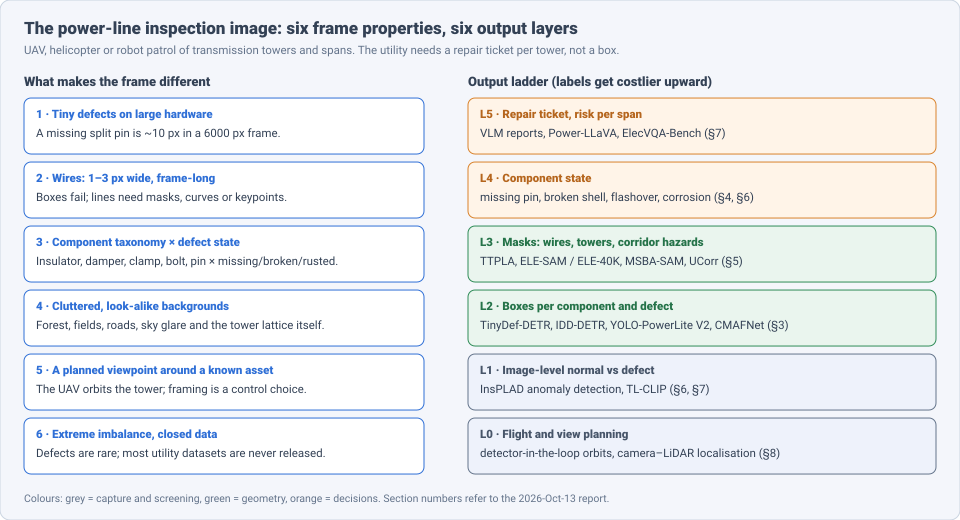
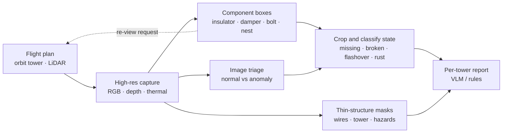
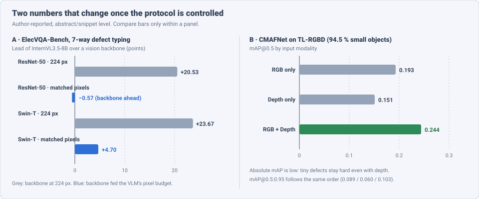

# Dense Object Detection & Classification — Recent Advances

*Compiled 2026-Oct-13 (America/Los_Angeles).*

Next installment in the running CV-updates log. Earlier entries on
`main`:
[Apr-30](../2026-Apr-30/2026-Apr-30_CV_updates.md),
[May-01](../2026-May-01/2026-May-01_CV_updates.md),
[May-02](../2026-May-02/2026-May-02_CV_updates.md),
[May-04](../2026-May-04/2026-May-04_CV_updates.md),
[May-05](../2026-May-05/2026-May-05_CV_updates.md),
[May-07](../2026-May-07/2026-May-07_CV_updates.md),
[May-08](../2026-May-08/2026-May-08_CV_updates.md),
[May-15](../2026-May-15/2026-May-15_CV_updates.md),
[May-16](../2026-May-16/2026-May-16_CV_updates.md),
[May-17](../2026-May-17/2026-May-17_CV_updates.md),
[Jun-09](../2026-Jun-09/2026-Jun-09_CV_updates.md),
[Jun-10](../2026-Jun-10/2026-Jun-10_CV_updates.md),
[Jun-12](../2026-Jun-12/2026-Jun-12_CV_updates.md),
[Jun-15](../2026-Jun-15/2026-Jun-15_CV_updates.md),
[Jun-16](../2026-Jun-16/2026-Jun-16_CV_updates.md),
[Jun-17](../2026-Jun-17/2026-Jun-17_CV_updates.md),
[Jun-19](../2026-Jun-19/2026-Jun-19_CV_updates.md),
[Jun-21](../2026-Jun-21/2026-Jun-21_CV_updates.md),
[Jun-22](../2026-Jun-22/2026-Jun-22_CV_updates.md),
[Jun-23](../2026-Jun-23/2026-Jun-23_CV_updates.md),
[Jun-24](../2026-Jun-24/2026-Jun-24_CV_updates.md),
[Jun-25](../2026-Jun-25/2026-Jun-25_CV_updates.md),
[Jun-27](../2026-Jun-27/2026-Jun-27_CV_updates.md),
[Jun-29](../2026-Jun-29/2026-Jun-29_CV_updates.md),
[Jun-30](../2026-Jun-30/2026-Jun-30_CV_updates.md),
[Jul-04](../2026-Jul-04/2026-Jul-04_CV_updates.md),
[Jul-07](../2026-Jul-07/2026-Jul-07_CV_updates.md),
[Jul-08](../2026-Jul-08/2026-Jul-08_CV_updates.md),
[Jul-10](../2026-Jul-10/2026-Jul-10_CV_updates.md),
[Jul-15](../2026-Jul-15/2026-Jul-15_CV_updates.md),
[Jul-17](../2026-Jul-17/2026-Jul-17_CV_updates.md),
[Jul-18](../2026-Jul-18/2026-Jul-18_CV_updates.md),
[Jul-21](../2026-Jul-21/2026-Jul-21_CV_updates.md),
[Jul-22](../2026-Jul-22/2026-Jul-22_CV_updates.md),
[Jul-24](../2026-Jul-24/2026-Jul-24_CV_updates.md),
[Jul-26](../2026-Jul-26/2026-Jul-26_CV_updates.md),
[Jul-27](../2026-Jul-27/2026-Jul-27_CV_updates.md),
[Jul-30](../2026-Jul-30/2026-Jul-30_CV_updates.md),
[Aug-01](../2026-Aug-01/2026-Aug-01_CV_updates.md),
[Aug-02](../2026-Aug-02/2026-Aug-02_CV_updates.md),
[Aug-04](../2026-Aug-04/2026-Aug-04_CV_updates.md),
[Aug-07](../2026-Aug-07/2026-Aug-07_CV_updates.md),
[Aug-10](../2026-Aug-10/2026-Aug-10_CV_updates.md),
[Aug-11](../2026-Aug-11/2026-Aug-11_CV_updates.md),
[Aug-13](../2026-Aug-13/2026-Aug-13_CV_updates.md),
[Aug-15](../2026-Aug-15/2026-Aug-15_CV_updates.md),
[Aug-16](../2026-Aug-16/2026-Aug-16_CV_updates.md),
[Aug-18](../2026-Aug-18/2026-Aug-18_CV_updates.md),
[Aug-19](../2026-Aug-19/2026-Aug-19_CV_updates.md),
[Aug-21](../2026-Aug-21/2026-Aug-21_CV_updates.md),
[Aug-22](../2026-Aug-22/2026-Aug-22_CV_updates.md),
[Aug-24](../2026-Aug-24/2026-Aug-24_CV_updates.md),
[Aug-26](../2026-Aug-26/2026-Aug-26_CV_updates.md),
[Aug-29](../2026-Aug-29/2026-Aug-29_CV_updates.md),
[Sep-01](../2026-Sep-01/2026-Sep-01_CV_updates.md),
[Sep-20](../2026-Sep-20/2026-Sep-20_CV_updates.md),
[Sep-23](../2026-Sep-23/2026-Sep-23_CV_updates.md),
[Sep-24](../2026-Sep-24/2026-Sep-24_CV_updates.md),
[Sep-25](../2026-Sep-25/2026-Sep-25_CV_updates.md),
[Sep-26](../2026-Sep-26/2026-Sep-26_CV_updates.md),
[Sep-29](../2026-Sep-29/2026-Sep-29_CV_updates.md),
[Sep-30](../2026-Sep-30/2026-Sep-30_CV_updates.md),
[Oct-01](../2026-Oct-01/2026-Oct-01_CV_updates.md),
[Oct-02](../2026-Oct-02/2026-Oct-02_CV_updates.md),
[Oct-03](../2026-Oct-03/2026-Oct-03_CV_updates.md),
[Oct-04](../2026-Oct-04/2026-Oct-04_CV_updates.md),
[Oct-05](../2026-Oct-05/2026-Oct-05_CV_updates.md),
[Oct-06](../2026-Oct-06/2026-Oct-06_CV_updates.md),
[Oct-07](../2026-Oct-07/2026-Oct-07_CV_updates.md),
[Oct-08](../2026-Oct-08/2026-Oct-08_CV_updates.md),
[Oct-09](../2026-Oct-09/2026-Oct-09_CV_updates.md),
[Oct-10](../2026-Oct-10/2026-Oct-10_CV_updates.md),
[Oct-11](../2026-Oct-11/2026-Oct-11_CV_updates.md),
[Oct-12](../2026-Oct-12/2026-Oct-12_CV_updates.md).

The last entry covered the [road surface image](../2026-Oct-12/2026-Oct-12_CV_updates.md).
Today's primitive is another infrastructure frame, but one taken from
the air around a single tall asset: the **overhead power-line inspection
image**. This is the photo a UAV, helicopter or line robot takes of a
transmission tower, its insulator strings and fittings, and the
conductors between towers. The question is "which component is this,
is it damaged, and does the utility need to send a crew?"

Earlier entries touched this only from the side.
[Aug-02](../2026-Aug-02/2026-Aug-02_CV_updates.md) covered overhead
optical detection in general (satellite and aerial, small objects),
[May-16 §10](../2026-May-16/2026-May-16_CV_updates.md) generic industrial
anomaly detection, and [Oct-12](../2026-Oct-12/2026-Oct-12_CV_updates.md)
thin-structure segmentation for cracks. No earlier entry treated the
power-line frame as a modality of its own; this one does.

Six properties make the power-line frame a distinct problem:

- **The defect is tiny; the asset is not.** A missing split pin, a
  loose bolt or a cracked insulator shell can be a few dozen pixels in a
  20–60 MP frame. CMAFNet's TL-RGBD benchmark reports that **94.5 %** of
  annotated instances are small objects (§3).
- **Wires are thin curves that cross the whole frame.** A conductor is
  1–3 px wide and runs edge to edge. Boxes are the wrong output; masks,
  keypoints or fitted curves are needed (§5).
- **The taxonomy is component × state.** Insulator, damper, clamp, bolt,
  pin, spacer, bird nest, foreign object — each with states such as
  missing, broken, flashover, rust. Datasets differ on how they split
  these (§4).
- **Backgrounds are cluttered and self-similar.** Forest, farmland,
  roads, sky glare and the steel lattice of the tower itself all
  produce false positives.
- **The viewpoint is planned, not given.** The UAV orbits a known tower,
  so where the camera points is itself a decision. Detection can feed
  back into the flight (§8).
- **Defects are rare and data are mostly closed.** Utilities hold
  millions of patrol images but release few. Public sets (InsPLAD,
  CPLID, IDID, TTPLA) are small or narrow, which pushes the field toward
  anomaly detection and synthetic data (§6).

> **Numbers below come from search-engine abstracts, arXiv HTML
> snippets, MDPI/PMC landing pages, CIGRE abstracts and patent
> listings. I did not read the full papers** (arXiv, export.arxiv.org
> and Semantic Scholar were blocked by the network proxy on this run;
> WebFetch failed on DNS). Treat every number as an author-reported,
> abstract-level claim. Many items in this sub-field are journal papers
> (MDPI *Remote Sensing*, *Sensors*, *Drones*) or Chinese-language venues
> rather than arXiv preprints. Datasets, splits and metrics differ
> between papers, so do not compare numbers across rows unless the text
> says they share a protocol.

---

## Table of contents

1. [Why this pass](#1--why-this-pass)
2. [The primitive: six output layers](#2--the-primitive-six-output-layers)
3. [Layer 2: boxes for tiny defects](#3--layer-2-boxes-for-tiny-defects)
4. [Layer 4: insulator state and the dataset problem](#4--layer-4-insulator-state-and-the-dataset-problem)
5. [Layer 3: wires, towers and corridor hazards](#5--layer-3-wires-towers-and-corridor-hazards)
6. [Layer 1: anomaly detection and synthetic defects](#6--layer-1-anomaly-detection-and-synthetic-defects)
7. [Layer 5: vision-language models — and a controlled benchmark](#7--layer-5-vision-language-models--and-a-controlled-benchmark)
8. [Layer 0: the UAV in the loop](#8--layer-0-the-uav-in-the-loop)
9. [Open problems / what to watch](#9--open-problems--what-to-watch)
10. [Sources](#10--sources)

---

## 1 · Why this pass

- **A controlled benchmark shrinks the VLM advantage.** "Beyond
  Balanced Accuracy" (arXiv 2609.27457, State Grid Sichuan; Sep 2026)
  builds **ElecVQA-Bench** (**56,972** items from InsPLAD). Once vision
  backbones get the same pixel budget as the VLM, InternVL3.5-8B's lead
  on 7-way defect typing falls from **+20.53 → −0.57** points vs ResNet-50
  and **+23.67 → +4.70** vs Swin-T. Binary screening differs by only
  **~0.03** points (§7).
- **Depth helps tiny defects, but absolute accuracy is still low.**
  CMAFNet (arXiv 2602.01696) fuses RGB and depth on TL-RGBD. mAP@0.5 is
  **0.193** for RGB, **0.151** for depth and **0.244** fused (§3).
- **DETR-family detectors moved into this niche.** TinyDef-DETR (arXiv
  2509.06035; *Remote Sensing* 17:3789) and IDD-DETR (*Remote Sensing*
  18:486, Feb 2026: **+2.2** mAP, **−44.9 %** params, **61.2** FPS) target
  small UAV defects (§3).
- **The edge YOLO line keeps shrinking.** YOLO-PowerLite V2 (*Remote
  Sensing* 18:1937, Jun 2026; YOLO11n base) reports **95.2 %** mAP@50 on
  bird nests, defective insulators and balloons at **0.97 M** params and
  **2.8 GFLOPs**. YOLO26 variants appear in 2026 patents and journals (§3).
- **SAM is now adapted to the transmission corridor.** ELE-SAM releases
  **ELE-40K** (**44,094** image–mask pairs, **4** equipment types, **11**
  hazard classes). A Sep 2026 preprint segments tower parts zero-shot by
  adding saliency-depth conditioning in front of Grounded-SAM / SAM 3 (§5).
- **Synthetic defects from an off-the-shelf multimodal LLM.** With
  **104** real images, adding embedding-filtered generated images lifts
  insulator defect-type F1 from **0.615 → 0.739** (arXiv 2603.08069) (§6).

---

## 2 · The primitive: six output layers

The layers run from where the drone flies to what the utility repairs.
Public benchmarks are strongest at L2 (boxes) and L1 (normal vs defect).
L4 state classification is where dataset definitions disagree, and L5 is
where vision-language models are being tried.

| Layer | Output | Typical tool (2025–26) | Main failure |
|---|---|---|---|
| 0 | flight path, viewpoint, tower-relative position | detector + LiDAR projection, orbit planning | wrong view → defect never seen |
| 1 | normal / defect per crop | InsPLAD anomaly detection, CLIP-guided flows, TL-CLIP | unseen defect types, domain shift |
| 2 | box per component / defect | TinyDef-DETR, IDD-DETR, YOLO-PowerLite V2, CMAFNet | tiny objects, clutter |
| 3 | wire / tower / hazard masks | TTPLA baselines, ELE-SAM, MSBA-SAM, UCorr | broken thin lines |
| 4 | component state (missing, broken, flashover, rust) | cascaded detect-then-classify, prototype nets | label definitions differ |
| 5 | repair ticket, report, Q&A | Power-LLaVA, VLMs on ElecVQA-Bench | resolution confounds, hallucination |

---

## 3 · Layer 2: boxes for tiny defects

**The problem.** Most defects are a small part of a large frame. Two
2025–26 review threads list the same obstacles: missed detections from
small size, false detections from dense and occluded bolts, and
imbalanced defect classes (Drones 2024 bolt review; Faisal et al.,
*Applied Energy* 2025, arXiv 2502.07826). The Faisal review splits the
field into component detection and fault diagnosis, and adds data
quality, embedded deployment and the lack of standard baselines to the
open problems.

**DETR-style detectors.**

- **TinyDef-DETR** (arXiv 2509.06035, revised through v9; *Remote
  Sensing* 17:3789, 2025). Four parts: an edge-enhanced ResNet backbone;
  a *stride-free space-to-depth* downsampler that moves 2×2 pixel blocks
  into channels instead of striding (so tiny details are not dropped);
  dual-domain multi-scale attention; and a Focaler-Wise-SIoU box loss.
  Evaluated on the CSG-ADCD dataset (China Southern Grid) and on
  VisDrone for generalisation. Authors report clear precision and recall
  gains over YOLO variants, RT-DETR, Conditional-DETR, RetinaNet and
  DETR, mainly on small-object subsets (exact numbers were not visible
  in snippets).
- **IDD-DETR** (*Remote Sensing* 18:486, 3 Feb 2026; Xu et al.). A
  lightweight DETR for multiple insulator defects, with an added P2
  shallow feature level for small targets (modules LMS-FE, SOEP,
  LMB-FF). Reports **+2.2 %** mAP over its baseline on an insulator
  small-defect set, **−44.9 %** parameters, **−47.1 %** computation and
  **61.2 FPS**. (A different *Sensors* 25:5848 paper uses the same name:
  RT-DETR-based, **81.7 %** mAP50, **+3.8** pts over RT-DETR, **76 FPS** on
  an RTX 3060. Keep the two apart.)

**The edge YOLO line.**

- **YOLO-PowerLite V2** (*Remote Sensing* 18:1937, Jun 2026). YOLO11n
  base with C3k2-UIB, MCA, MFM and MBConv blocks. **95.2 %** mAP@50 on
  **5,563** aerial images (bird nests, defective insulators, balloons),
  **0.97 M** params, **2.8 GFLOPs**; **−62.5 %** params and **−56.25 %**
  FLOPs vs its baseline. Its predecessor (YOLOv8n base, IEEE Access 2024)
  reported **94.2 %**.
- **YOLO26 arrives via patents and journals.** A Shenyang Institute of
  Engineering patent application (CN122510232A, published 4 Aug 2026)
  replaces convolutions in YOLO26 with GhostConv for UAV-side insulator
  monitoring; it notes stock YOLO26 is still too heavy for low-power
  airframes. A 2026 *Autonomous Intelligent Systems* paper cascades
  YOLO26 with a Swin classifier, uses a conditional diffusion model to
  balance fault classes, and explains decisions with SHAP-CAM (§6).
- **AE-YOLO** (June 2026 preprint, listed under cs.CV; arXiv ID not
  confirmed) adds an autoencoder branch and CBAM; reports **95.10 %**
  mAP@0.5, **96.40 %** precision, **93.80 %** recall on an
  insulator-defect dataset.
- **Field deployment.** A CIGRE 2026 session paper (D1-10516) reports a
  custom YOLO model at **95 %** test accuracy being wired into a utility's
  drone-patrol back end. Bird-nest detectors remain a steady sub-thread
  (LW-YOLOv7: **89.31 %** AP; LRCAN: **+5.4** mAP over YOLOX-S at similar
  size). Amprion (German TSO) runs YOLOv11 over existing aerial imagery
  to inventory nesting boxes on its network.

**Adding depth.** **CMAFNet** (arXiv 2602.01696, Feb 2026; first titled
"Cross-Modal Alignment and Fusion", later "Cross-Modal Purification and
Fusion") fuses RGB and depth for small transmission-line defects. A
Semantic Recomposition Module uses a learned codebook to remove
modality-specific noise; a Contextual Semantic Integration Framework adds
partial-channel global attention at the deepest stage. On **TL-RGBD**
(**94.5 %** small instances) the modality ablation gives:

| Input | mAP@0.5 | mAP@0.5:0.95 |
|---|---|---|
| RGB only | 0.193 | 0.089 |
| Depth only | 0.151 | 0.060 |
| RGB + Depth | **0.244** | **0.103** |

The authors report beating state-of-the-art detectors on all metrics,
with TinyDef-DETR named as the prior best. The low absolute numbers are
the useful signal: on a benchmark that is genuinely small-object, the
headline 90 %+ mAP figures of insulator-only datasets do not carry over.

---

## 4 · Layer 4: insulator state and the dataset problem

Insulators dominate the literature because they are large, numerous and
their failures are visible. But "insulator defect" means different
things in different datasets:

| Dataset | What it labels | Note |
|---|---|---|
| **CPLID** (Chinese Power Line Insulator Dataset) | normal vs missing-shell insulators | most used; much of it synthetic paste-in; near-saturated |
| **IDID** (EPRI / IEEE DataPort) | per-shell healthy, broken, flashover | 1,596 train / 88 hidden test images; scored by mAP@0.5; damage is a small part of each image |
| **InsPLAD** (2023) | 17 asset types; 6 defects (4 corrosion, broken component, bird nest) | **10,607** UAV images; detection, classification and anomaly tasks; CC BY-NC |
| **CSG-ADCD** | China Southern Grid defect set | used by TinyDef-DETR |
| **TL-RGBD** | RGB-D transmission-line defects | used by CMAFNet; 94.5 % small objects |

Two consequences recur in 2025–26 work:

- **Cascades beat single-stage on state.** Detect the insulator string,
  crop it, then classify each shell. Prototype-based classifiers (YOLO +
  Quasi-ProtoPNet) and XAI-guided anomaly models (arXiv 2409.16821,
  2312.11470) work at shell level on IDID. Some groups merge flashover
  into "healthy" and keep only broken shells as defects, so their
  numbers are not comparable with three-class results.
- **Saturated benchmarks hide the hard part.** CPLID-style results above
  95 % sit beside IDID and TL-RGBD, where small, partial damage keeps
  scores far lower. Prefer papers that report on IDID, InsPLAD or a
  small-object split.

---

## 5 · Layer 3: wires, towers and corridor hazards

**Wires as thin structures.** **TTPLA** (2020; **1,100** images at
3840×2160, **8,987** tower and line instances) is still the standard
instance-segmentation benchmark; PLDU/PLDM (close-range, 540×360) are
used for wire detection. Transformer-CNN hybrids (DUFormer) and
edge/line-head U-Nets (PL-UNeXt, **70.6** F1 on TTPLA) set the 2023
baselines. Generic thin-structure methods from 2026 — **TopoLoRA-SAM**
(arXiv 2601.02273: topology-aware LoRA adaptation of SAM, tested on
vessels and SAR coastlines) and **SEMIR** (arXiv 2606.24935,
graph-minor topology preservation) — have not yet been reported on
TTPLA. That is an obvious gap.

**Wires for flight safety.** **UCorr** (arXiv 2509.14989, Imperial)
predicts wire masks and depth together from a single camera, using a
temporal correlation layer trained on synthetic data, to let drones
avoid wires without LiDAR. A CMU Robotics Institute report (CMU-RI-TR-25-100,
Dec 2025) detects and tracks multiple wires in 3D from stereo RGB in
real time on light onboard compute, for UAVs that must approach a wire.

**SAM for the corridor.** **ELE-SAM** (arXiv 2505.22105) adapts SAM to
power transmission corridor hazards with a Context-Aware Prompt Adapter
(better prompt tokens in clutter) and a High-Fidelity Mask Decoder
(upsamples mask features for thin parts). It ships **ELE-40K**:
**44,094** image–mask pairs, **4** equipment types, **11** hazard
categories (e.g. construction machinery, vegetation, foreign objects).
**MSBA-SAM** (*Energy Informatics*, 2026) pairs a ResNet-34 branch with
the SAM ViT and adds boundary awareness for aerial grid segmentation.

**Zero-shot tower parts.** "Saliency-Depth Conditioning for Zero-Shot
Segmentation of Communication-Tower Components in Cluttered UAV Imagery"
(arXiv 2608.25435) is training-free: a shared saliency + depth module
suppresses background, and the cleaned image plus a text prompt goes to
Grounded-SAM or SAM 3. It targets telecom towers (antennas, radio units),
but the recipe — clean the foreground before prompting — transfers
directly to lattice transmission towers.

---

## 6 · Layer 1: anomaly detection and synthetic defects

Because labelled defects are scarce, two strategies replace "more
labels":

**Train on normal only.** InsPLAD's third task is unsupervised anomaly
detection (normal vs defect per asset crop, scored by AUROC). Attention
modules on DifferNet (WACV 2024, arXiv 2311.02747) were an early
baseline. A CLIP-guided normalizing-flow method with multi-scale
attention (PeerJ CS) reports average AUROC **0.9566** on InsPLAD and
**0.8554** on PTL-AI. A 2025 UFPE dissertation adds **InsPLAD-seg**
pixel masks and documents how poorly industrial anomaly detectors
(trained on MVTec-style close-ups) generalise to real aerial inspection.

**Generate the rare classes.**

- **Training-free MLLM generation** (Wang & Wang, Wayne State; arXiv
  2603.08069, Mar 2026). An off-the-shelf multimodal LLM generates
  ceramic insulator defect images from two reference images and a text
  prompt. A light human check fixes label errors, and an embedding
  filter keeps only images close to the real class centroids. With
  **104** real training images (10 % split), test F1 for shell vs glaze
  defect rises **0.615 → 0.739**, an estimated **4–5×** data-efficiency
  gain that holds with stronger backbones and linear probes.
- **Conditional diffusion + YOLO26-Swin** (*Autonomous Intelligent
  Systems*, 2026). Diffusion-generated fault images rebalance the
  dataset before a two-stage detect-then-classify cascade.
- Earlier GAN routes (attention CycleGAN for insulators; DP-GAN for
  rare bolt defects, 2024) reported blurry, unconstrained backgrounds —
  the reason 2026 pipelines add a fidelity filter.

The common pattern is **generate → filter → train**. What is still
missing is a benchmark that compares real-only and real+synthetic
training on rare non-insulator defects (missing pins, damaged dampers).

---

## 7 · Layer 5: vision-language models — and a controlled benchmark

**Domain VLMs.** **Power-LLaVA** (arXiv 2407.19178) trained a LLaVA-style
assistant on transmission-line instructions and reported **86.79 %** on
the GPT-4V-generated, manually checked **PowerQA** (1K items).
**TL-CLIP** (arXiv 2411.11370; v2 retitled "Transmission Line Defect
Detection Based on UAV Patrol Images and Vision-language Pretraining")
adds power-specific contrastive pre-training tasks and a fine-tuning
scheme against over-fitting on small inspection sets.

**The controlled comparison.** "Beyond Balanced Accuracy: A Resolution-
and Parity-Controlled Benchmark for Vision-Language and Vision-Only
Defect Assessment in UAV Power-Line Inspection" (Zhang, Xiang, Kuang,
Yi; arXiv 2609.27457, Sep 2026) is the most useful paper in this entry.
It asks whether VLMs really beat task-specific vision backbones, using
**ElecVQA-Bench** (**56,972** items from InsPLAD) and six evaluation
choices that papers often leave unreported. Findings (from abstract and
table snippets):

- **Binary screening: no real gap.** On a matched partition, Swin-T and
  the best adapted VLM differ by about **0.03** points.
- **Resolution explains most of the typing gap.** Raising backbone input
  from 224 px to the VLM preprocessor's pixel budget moves the
  InternVL3.5-8B lead on 7-way typing from **+20.53 → −0.57** (ResNet-50)
  and **+23.67 → +4.70** (Swin-T). See panel A of the figure in §3.
- **Not all of it.** A pixel-budget audit shifts Qwen3-VL-8B's macro
  recall by **10.78** points; under a source-pixel-matched InternVL
  control, Qwen still leads by **7.43–13.61** points while using **56 %**
  fewer visual tokens.
- **Error bars matter.** At n = 2,021, balanced accuracy carries about
  **±1 pt** sampling uncertainty; the authors do not interpret gaps
  under ~2 pts without a paired test.
- **Conclusion:** once those choices are controlled, no stable
  family-level ordering (VLM vs vision-only) remains on this benchmark.

The practical reading: when a paper says a VLM beats a CNN on defect
typing, check the input resolution first. Small defects need pixels, and
VLM preprocessors often supply more of them by default.

---

## 8 · Layer 0: the UAV in the loop

**Detection that steers the flight.** Riss, Krátký, Pěnička and Saska
(CTU Prague; arXiv 2602.24011, Feb 2026) fly a UAV around a tower with
**no prior map**. A CNN detects insulators; LiDAR points are projected
into the image and filtered by the boxes to localise each insulator in
3D; the planner then places close-up views. Real-world mean error is
**0.16 ± 0.08 m** horizontal and **0.16 ± 0.11 m** vertical, with about
an order of magnitude lower horizontal variance than the closest prior
method.

This changes what "dense detection" means for this modality. The
first-pass detector only has to find components well enough to plan a
second, close-range view; the defect classifier then works on large,
well-framed crops. Benchmarks built from fixed photo sets do not score
that loop.

**Edge vs cloud.** The Faisal review and the 2026 YOLO papers agree that
inference is split: a tiny detector on the airframe (YOLO-PowerLite V2
class, < 1 M params) picks views and flags obvious faults; heavier
cascades, anomaly models and VLM reports run after landing. The
Shenyang patent's note that stock YOLO26 is "still too large" for
low-power UAVs shows where the pressure is.

---

## 9 · Open problems / what to watch

1. **A shared small-object benchmark.** CPLID-style scores above 95 %
   sit beside TL-RGBD's **0.244** mAP@0.5. A public split of
   pin/bolt/damper defects with fixed protocol would make 2026 detector
   claims comparable.
2. **Protocol control as a default.** ElecVQA-Bench's six choices
   (resolution above all) should be reported by every VLM-vs-CNN
   comparison. Expect follow-ups that apply the same audit to detection,
   not only classification.
3. **SAM 3 and topology-aware adapters on TTPLA.** TopoLoRA-SAM, SEMIR
   and SAM 3 decoders have not been reported on power lines. The
   crack-segmentation results in the
   [Oct-12 entry](../2026-Oct-12/2026-Oct-12_CV_updates.md) suggest
   large gains are possible.
4. **Rare-defect synthesis beyond insulators.** Generate-filter-train
   works for insulator shells. Nobody has shown it for missing split
   pins, where the defect is a few pixels.
5. **Closed-loop evaluation.** Score systems on defects found per tower
   per flight, not on mAP over a fixed image set (§8).
6. **Multimodal fusion.** Depth (CMAFNet), LiDAR (CTU) and thermal
   (CIGRE 2026 weakly supervised infrared work) each help. A joint
   RGB-depth-thermal dataset of the same towers does not yet exist in
   public.
7. **Data access.** Most of the progress uses utility-internal datasets
   (CSG-ADCD, State Grid sets). Licence terms (InsPLAD is
   non-commercial) limit reuse.

---

## 10 · Sources

### Reviews and datasets

- Deep Learning in Automated Power Line Inspection: A Review — arXiv 2502.07826; *Applied Energy* (2025) — https://arxiv.org/abs/2502.07826 — https://www.nature.com/nature-index/article/10.1016/j.apenergy.2025.125507
- InsPLAD: A Dataset and Benchmark for Power Line Asset Inspection in UAV Images — https://data.mendeley.com/datasets/5n3fjgvfyz — https://huggingface.co/datasets/Voxel51/InsPLAD — https://paperswithcode.com/dataset/insplad
- TTPLA: An Aerial-Image Dataset for Detection and Segmentation of Transmission Towers and Power Lines — arXiv 2010.10032 — https://arxiv.org/abs/2010.10032
- Insulator Defect Detection (IDID, EPRI) — IEEE DataPort — https://ieee-dataport.org/competitions/insulator-defect-detection — https://ieee-dataport.org/competitions/epri-insulator-defect-image-dataset
- Bolt defect detection review (UAV) — *Drones* (2024) — https://doaj.org/article/4f626914df51410eb31c231bfb1b934b
- Pin bolt state identification (two-stage) — *Frontiers in Energy Research* (2022) — https://frontiersin.org/journals/energy-research/articles/10.3389/fenrg.2022.813945/full

### Box detectors (§3)

- TinyDef-DETR: A Transformer-Based Framework for Defect Detection in Transmission Lines from UAV Imagery — arXiv 2509.06035 — https://arxiv.org/abs/2509.06035 — *Remote Sensing* 17:3789 — https://doi.org/10.3390/rs17233789
- IDD-DETR: Lightweight Multi-Defect Detection Model for Transmission Line Insulators Based on UAV Remote Sensing — *Remote Sensing* 18:486 (2026) — https://doi.org/10.3390/rs18030486
- IDD-DETR (bidirectional cross-scale fusion, dynamic histogram attention; different paper) — *Sensors* 25:5848 — https://www.mdpi.com/1424-8220/25/18/5848 — https://www.ncbi.nlm.nih.gov/pmc/articles/PMC12473871/
- YOLO-PowerLite V2 — *Remote Sensing* 18:1937 (2026) — https://mdpi-res.com/d_attachment/remotesensing/remotesensing-18-01937/article_deploy/remotesensing-18-01937.pdf
- Cross-Modal Purification and Fusion for Small-Object RGB-D Transmission-Line Defect Detection (CMAFNet) — arXiv 2602.01696 — https://arxiv.org/abs/2602.01696
- A lightweight YOLO26 insulator defect monitoring method based on GhostConv — patent application CN122510232A — https://eureka.patsnap.com/patent/CN122510232A
- Diffusion-augmented YOLO26-Swin cascaded framework with hybrid SHAP-CAM for autonomous power grid inspection — *Autonomous Intelligent Systems* (2026) — https://journal.hep.com.cn/ais/EN/10.1007/s43684-026-00135-2
- AE-YOLO (autoencoder + CBAM insulator defects; June 2026 listing) — https://chatpaper.com/paper/296102
- Transmission line insulator defect detection and diagnostics using machine learning models — CIGRE 2026, D1-10516 — https://www.e-cigre.org/publications/detail/d1-10516-2026-transmission-line-insulator-defect-detection-and-diagnostics-using-machine-learning-models.html
- LW-YOLOv7 bird-nest / foreign-object detection — *Journal of Internet Technology* (2025) — https://jit.ndhu.edu.tw/article/view/3174
- LRCAN bird-nest detection — *J. Terahertz Sci. Electron. Inf. Technol.* 23(6) (2025) — https://m.researching.cn/articles/OJ634def79973b8676
- Automated AI-based detection of nesting boxes in a TSO overhead line network (YOLOv11) — https://www.hswt.de/forschung/forschungsprofil/publikationen/detail/development-of-an-automated-ai-based-detection-of-nesting-boxes-in-the-overhead-line-network-of-a-transmission-system-operator-a-yolov11-application-for-environmental-and-operational-monitoring

### Insulator state (§4)

- XAI-guided Insulator Anomaly Detection for Imbalanced Datasets — arXiv 2409.16821 — https://arxiv.org/abs/2409.16821
- An Improved Anomaly Detection Model for Automated Inspection of Power Line Insulators — arXiv 2312.11470 — https://arxiv.org/abs/2312.11470
- Object detection-based inspection of power line insulators: incipient fault detection in the low data-regime — arXiv 2212.11017 — https://arxiv.org/abs/2212.11017

### Wires, towers and corridor (§5)

- DUFormer: Solving Power Line Detection Task in Aerial Images using Semantic Segmentation — arXiv 2304.05821 — https://arxiv.org/abs/2304.05821
- PL-UNeXt: Per-stage Edge Detail and Line Feature Guided Segmentation for Power Line Detection — arXiv 2303.04413 — https://arxiv.org/abs/2303.04413
- Vision-Based Power Line Cables and Pylons Detection for Low Flying Aircraft — arXiv 2407.14352 — https://arxiv.org/abs/2407.14352
- UCorr: Wire Detection and Depth Estimation for Autonomous Drones — arXiv 2509.14989 — https://arxiv.org/abs/2509.14989
- Vision-Based Multi-Wire Detection and Tracking for UAV Wire Approach — CMU-RI-TR-25-100 — https://www.ri.cmu.edu/publications/vision-based-multi-wire-detection-and-tracking-for-uav-wire-approach
- Adapting Segment Anything Model for Power Transmission Corridor Hazard Segmentation (ELE-SAM, ELE-40K) — arXiv 2505.22105 — https://arxiv.org/abs/2505.22105
- MSBA-SAM: a multi-scale and boundary-aware framework for power grid segmentation in aerial image — *Energy Informatics* (2026) — https://link.springer.com/article/10.1186/s42162-026-00669-y
- Saliency-Depth Conditioning for Zero-Shot Segmentation of Communication-Tower Components in Cluttered UAV Imagery — arXiv 2608.25435 — https://arxiv.org/abs/2608.25435
- TopoLoRA-SAM: Topology-Aware Parameter-Efficient Adaptation of Foundation Segmenters for Thin-Structure and Cross-Domain Binary Semantic Segmentation — arXiv 2601.02273 — https://arxiv.org/abs/2601.02273
- SEMIR: Topology-Preserving Graph Minors for Thin-Structure Segmentation — arXiv 2606.24935 — https://arxiv.org/abs/2606.24935

### Anomaly detection and synthesis (§6)

- Attention Modules Improve Image-Level Anomaly Detection for Industrial Inspection: A DifferNet Case Study — WACV 2024, arXiv 2311.02747 — https://arxiv.org/abs/2311.02747
- CLIP-guided anomaly detection for power line inspection with multi-scale attention — PeerJ CS — https://peerj.com/reviewer-match/128290
- Poor generalization of unsupervised anomaly detectors on aerial images from real-world inspections (InsPLAD-seg) — UFPE dissertation (2025) — https://attena.ufpe.br/bitstream/123456789/67115/1/DISSERTA%c3%87%c3%83O%20Felipe%20de%20Melo%20Battisti.pdf
- Synthetic Defect Image Generation for Power Line Insulator Inspection Using Multimodal Large Language Models — arXiv 2603.08069 — https://arxiv.org/abs/2603.08069
- CycleGAN-based insulator defect sample generation — *J. Electronic Science and Technology* 22(2) (2024) — https://doaj.org/article/76f1ae1d947a4ff0b44f7b902cd20f41

### Vision-language (§7)

- Beyond Balanced Accuracy: A Resolution- and Parity-Controlled Benchmark for Vision–Language and Vision-Only Defect Assessment in UAV Power-Line Inspection (ElecVQA-Bench) — arXiv 2609.27457 — https://arxiv.org/abs/2609.27457 — https://arxiv.org/html/2609.27457v1
- Power-LLaVA: Large Language and Vision Assistant for Power Transmission Line Inspection — arXiv 2407.19178 — https://arxiv.org/abs/2407.19178
- TL-CLIP / Transmission Line Defect Detection Based on UAV Patrol Images and Vision-language Pretraining — arXiv 2411.11370 — https://arxiv.org/abs/2411.11370

### UAV loop and thermal (§8, §9)

- Autonomous Inspection of Power Line Insulators with UAV on an Unmapped Transmission Tower — arXiv 2602.24011 — https://arxiv.org/abs/2602.24011
- Weakly supervised infrared image recognition method for substation equipment fault detection — CIGRE 2026, A2-11495 — https://www.e-cigre.org/publications/detail/a2-11495-2026-weakly-supervised-infrared-image-recognition-method-for-substation-equipment-fault-detection.html
- Infrared image identification method of substation equipment fault under weak supervision — arXiv 2311.11214 — https://arxiv.org/abs/2311.11214
