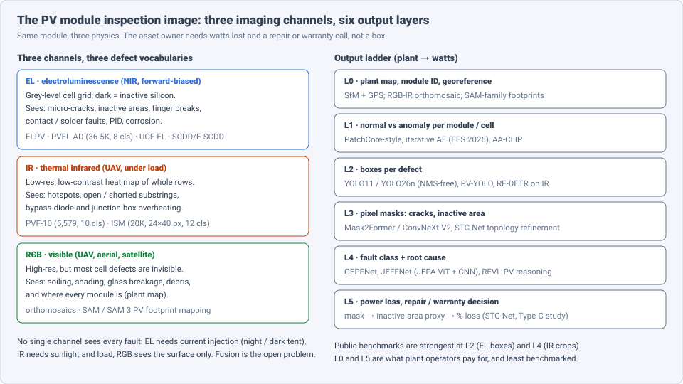
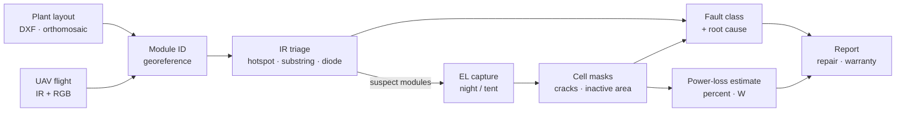
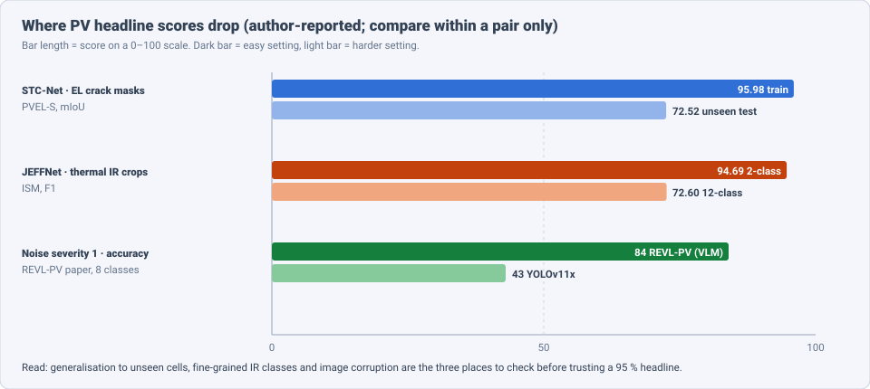

# Dense Object Detection & Classification — Recent Advances

*Compiled 2026-Oct-14 (America/Los_Angeles).*

Next installment in the running CV-updates log. Earlier entries on
`main`:
[Apr-30](../2026-Apr-30/2026-Apr-30_CV_updates.md),
[May-01](../2026-May-01/2026-May-01_CV_updates.md),
[May-02](../2026-May-02/2026-May-02_CV_updates.md),
[May-04](../2026-May-04/2026-May-04_CV_updates.md),
[May-05](../2026-May-05/2026-May-05_CV_updates.md),
[May-07](../2026-May-07/2026-May-07_CV_updates.md),
[May-08](../2026-May-08/2026-May-08_CV_updates.md),
[May-15](../2026-May-15/2026-May-15_CV_updates.md),
[May-16](../2026-May-16/2026-May-16_CV_updates.md),
[May-17](../2026-May-17/2026-May-17_CV_updates.md),
[Jun-09](../2026-Jun-09/2026-Jun-09_CV_updates.md),
[Jun-10](../2026-Jun-10/2026-Jun-10_CV_updates.md),
[Jun-12](../2026-Jun-12/2026-Jun-12_CV_updates.md),
[Jun-15](../2026-Jun-15/2026-Jun-15_CV_updates.md),
[Jun-16](../2026-Jun-16/2026-Jun-16_CV_updates.md),
[Jun-17](../2026-Jun-17/2026-Jun-17_CV_updates.md),
[Jun-19](../2026-Jun-19/2026-Jun-19_CV_updates.md),
[Jun-21](../2026-Jun-21/2026-Jun-21_CV_updates.md),
[Jun-22](../2026-Jun-22/2026-Jun-22_CV_updates.md),
[Jun-23](../2026-Jun-23/2026-Jun-23_CV_updates.md),
[Jun-24](../2026-Jun-24/2026-Jun-24_CV_updates.md),
[Jun-25](../2026-Jun-25/2026-Jun-25_CV_updates.md),
[Jun-27](../2026-Jun-27/2026-Jun-27_CV_updates.md),
[Jun-29](../2026-Jun-29/2026-Jun-29_CV_updates.md),
[Jun-30](../2026-Jun-30/2026-Jun-30_CV_updates.md),
[Jul-04](../2026-Jul-04/2026-Jul-04_CV_updates.md),
[Jul-07](../2026-Jul-07/2026-Jul-07_CV_updates.md),
[Jul-08](../2026-Jul-08/2026-Jul-08_CV_updates.md),
[Jul-10](../2026-Jul-10/2026-Jul-10_CV_updates.md),
[Jul-15](../2026-Jul-15/2026-Jul-15_CV_updates.md),
[Jul-17](../2026-Jul-17/2026-Jul-17_CV_updates.md),
[Jul-18](../2026-Jul-18/2026-Jul-18_CV_updates.md),
[Jul-21](../2026-Jul-21/2026-Jul-21_CV_updates.md),
[Jul-22](../2026-Jul-22/2026-Jul-22_CV_updates.md),
[Jul-24](../2026-Jul-24/2026-Jul-24_CV_updates.md),
[Jul-26](../2026-Jul-26/2026-Jul-26_CV_updates.md),
[Jul-27](../2026-Jul-27/2026-Jul-27_CV_updates.md),
[Jul-30](../2026-Jul-30/2026-Jul-30_CV_updates.md),
[Aug-01](../2026-Aug-01/2026-Aug-01_CV_updates.md),
[Aug-02](../2026-Aug-02/2026-Aug-02_CV_updates.md),
[Aug-04](../2026-Aug-04/2026-Aug-04_CV_updates.md),
[Aug-07](../2026-Aug-07/2026-Aug-07_CV_updates.md),
[Aug-10](../2026-Aug-10/2026-Aug-10_CV_updates.md),
[Aug-11](../2026-Aug-11/2026-Aug-11_CV_updates.md),
[Aug-13](../2026-Aug-13/2026-Aug-13_CV_updates.md),
[Aug-15](../2026-Aug-15/2026-Aug-15_CV_updates.md),
[Aug-16](../2026-Aug-16/2026-Aug-16_CV_updates.md),
[Aug-18](../2026-Aug-18/2026-Aug-18_CV_updates.md),
[Aug-19](../2026-Aug-19/2026-Aug-19_CV_updates.md),
[Aug-21](../2026-Aug-21/2026-Aug-21_CV_updates.md),
[Aug-22](../2026-Aug-22/2026-Aug-22_CV_updates.md),
[Aug-24](../2026-Aug-24/2026-Aug-24_CV_updates.md),
[Aug-26](../2026-Aug-26/2026-Aug-26_CV_updates.md),
[Aug-29](../2026-Aug-29/2026-Aug-29_CV_updates.md),
[Sep-01](../2026-Sep-01/2026-Sep-01_CV_updates.md),
[Sep-20](../2026-Sep-20/2026-Sep-20_CV_updates.md),
[Sep-23](../2026-Sep-23/2026-Sep-23_CV_updates.md),
[Sep-24](../2026-Sep-24/2026-Sep-24_CV_updates.md),
[Sep-25](../2026-Sep-25/2026-Sep-25_CV_updates.md),
[Sep-26](../2026-Sep-26/2026-Sep-26_CV_updates.md),
[Sep-29](../2026-Sep-29/2026-Sep-29_CV_updates.md),
[Sep-30](../2026-Sep-30/2026-Sep-30_CV_updates.md),
[Oct-01](../2026-Oct-01/2026-Oct-01_CV_updates.md),
[Oct-02](../2026-Oct-02/2026-Oct-02_CV_updates.md),
[Oct-03](../2026-Oct-03/2026-Oct-03_CV_updates.md),
[Oct-04](../2026-Oct-04/2026-Oct-04_CV_updates.md),
[Oct-05](../2026-Oct-05/2026-Oct-05_CV_updates.md),
[Oct-06](../2026-Oct-06/2026-Oct-06_CV_updates.md),
[Oct-07](../2026-Oct-07/2026-Oct-07_CV_updates.md),
[Oct-08](../2026-Oct-08/2026-Oct-08_CV_updates.md),
[Oct-09](../2026-Oct-09/2026-Oct-09_CV_updates.md),
[Oct-10](../2026-Oct-10/2026-Oct-10_CV_updates.md),
[Oct-11](../2026-Oct-11/2026-Oct-11_CV_updates.md),
[Oct-12](../2026-Oct-12/2026-Oct-12_CV_updates.md),
[Oct-13](../2026-Oct-13/2026-Oct-13_CV_updates.md).

The last entry covered the [overhead power-line inspection image](../2026-Oct-13/2026-Oct-13_CV_updates.md).
Today's primitive is the next energy asset along the grid: the
**photovoltaic (PV) module inspection image**. This is any image of a
solar module or a solar plant taken to find faults: an
electroluminescence (EL) image of a cell grid in a factory or a field
tent, a thermal infrared (IR) frame from a drone flying over rows under
load, or a visible RGB photo or orthomosaic of the plant. The question is
"which module is this, what is wrong with it, how many watts does it
cost, and is it a repair or a warranty claim?"

Earlier entries touched this only from the side.
[May-16 §10](../2026-May-16/2026-May-16_CV_updates.md) covered generic
industrial anomaly detection,
[Aug-02](../2026-Aug-02/2026-Aug-02_CV_updates.md) overhead optical
detection, [Oct-12](../2026-Oct-12/2026-Oct-12_CV_updates.md)
thin-crack segmentation on roads, and
[Oct-13](../2026-Oct-13/2026-Oct-13_CV_updates.md) UAV inspection of
transmission assets. No earlier entry treated the PV image as a modality
of its own; this one does.

Six properties make the PV image a distinct problem:

- **Three channels, three physics.** EL shows where silicon is
  electrically inactive; IR shows where heat builds under load; RGB shows
  the surface. Each sees a different subset of faults, and each needs
  different capture conditions (current injection, sunlight, daylight).
- **A rigid, known grid.** Modules are rows of identical cells (60/72/
  half-cut/IBC layouts). The regular structure is a strong prior — and a
  source of false positives, since busbars and cell edges look like
  cracks.
- **Cracks are thin, topological defects.** A micro-crack is a 1–3 px
  dark line; whether it isolates a cell region (and so costs power)
  depends on its connectivity, not its area (§4).
- **IR is low-resolution and low-contrast.** Drone thermal crops are
  often tens of pixels across (ISM uses 24×40 px). Fine-grained fault
  classes must be read from a few warm pixels (§5).
- **Scale is extreme.** A utility-scale plant holds 10⁵–10⁶ modules.
  Every detection has to be tied to a module ID on a plant map before it
  is useful (§7).
- **The outcome is a number in watts.** Asset owners care about power
  loss and warranty thresholds, so the last output layer is regression
  from mask to loss, not a class label (§4, §8).

> **Numbers below come from search-engine abstracts, arXiv/RSC/MDPI
> landing-page snippets and third-party summary pages. I did not read
> the full papers** (arxiv.org, alphaxiv.org and chatpaper.com failed DNS
> resolution through WebFetch on this run). Treat every number as an
> author-reported, abstract-level claim. Datasets, splits and metrics
> differ between papers; do not compare numbers across rows unless the
> text says they share a protocol.

---

## Table of contents

1. [Why this pass](#1--why-this-pass)
2. [The primitive: three channels, six output layers](#2--the-primitive-three-channels-six-output-layers)
3. [Layer 2: EL defect boxes and the PVEL-AD line](#3--layer-2-el-defect-boxes-and-the-pvel-ad-line)
4. [Layer 3 and 5: crack masks and power loss](#4--layer-3-and-5-crack-masks-and-power-loss)
5. [Layer 4: thermal-IR fault classification](#5--layer-4-thermal-ir-fault-classification)
6. [Layer 1: anomaly detection and synthetic EL defects](#6--layer-1-anomaly-detection-and-synthetic-el-defects)
7. [Layer 0: plant maps, drones and foundation-model footprints](#7--layer-0-plant-maps-drones-and-foundation-model-footprints)
8. [Layer 4–5: vision-language diagnosis](#8--layer-45-vision-language-diagnosis)
9. [Open problems / what to watch](#9--open-problems--what-to-watch)
10. [Sources](#10--sources)

---

## 1 · Why this pass

- **Crack masks now feed a power-loss estimate.** STC-Net (arXiv
  2608.01714, Aug 2026) segments EL cracks with edge and spectral priors
  plus boundary-topology refinement, then turns the mask into an
  inactive-area proxy for power loss. It reports **95.98** mIoU on
  training samples but **72.52** mIoU / **80.16** mDice on unseen PVEL-S
  test samples (§4).
- **JEPA reaches thermal PV.** JEFFNet (arXiv 2607.09205, Jul 2026)
  fuses a JEPA-pretrained ViT with EfficientNetV2-S. On PVF-10 it reports
  **93.21** F1 / **94.33 %** acc (10 classes); on ISM **72.60** F1 (12
  classes) vs **94.69** F1 (2 classes), with **47 %** fewer parameters
  than GEPFNet (§5).
- **A VLM that writes the inspection report.** REVL-PV (arXiv 2603.26776,
  Mar 2026) covers EL, thermal and RGB, reports **93 %** accuracy on
  **1,927** modules / **8** classes, and keeps **84 %** under mild noise
  where YOLOv11x falls to **43 %** (§8).
- **NMS-free YOLO26 on EL.** A 2026 conference study runs YOLOv8n vs
  YOLO26n on a **4,500**-image PVEL-AD subset: mAP@0.5 **0.897–0.926**,
  YOLO26n ≈ **2.5 ms** vs ≈ **3.3 ms** total latency per image. PVEL-AD
  test annotations were made public in Jan 2026 (§3).
- **Unsupervised EL segmentation trained only on normal cells.** An
  enhanced iterative autoencoder (*Energy & Environmental Science* 19:513,
  2026) segments all defect types from normal-only training and extends
  to few-shot with a handful of masks (§6).
- **SAM 3 maps small PV, and prompts matter most.** arXiv 2608.10801
  (Aug 2026) finds prompt type dominates SAM 3 performance on rooftop and
  small ground PV: text-only prompts are worst; hybrid text + spatial
  prompts are best; a few hundred labels capture most gains (§7).

---

## 2 · The primitive: three channels, six output layers

| Layer | Output | Typical tool (2025–26) | Main failure |
|---|---|---|---|
| 0 | module ID, georeference, plant map | SfM + GPS, RGB–IR orthomosaics, SAM 3 footprints | mis-assigned module → wrong crew dispatch |
| 1 | normal / anomaly per cell or module | PatchCore variants, iterative AE, AA-CLIP | defect types unseen at training |
| 2 | box per defect | YOLO11 / YOLO26n, PV-YOLO, RF-DETR | thin cracks, busbar look-alikes |
| 3 | crack / inactive-area masks | Mask2Former, ConvNeXt-V2, STC-Net | broken topology, poor test generalisation |
| 4 | fault class (and root cause) | GEPFNet, JEFFNet, REVL-PV | low-res IR, fine-grained classes |
| 5 | watts lost, repair / warranty call | mask → inactive-area proxy | few validations against I–V curves |

The practical pipeline is a funnel: cheap IR flights over everything,
then EL only on modules that IR or production data flag. Most public
benchmarks evaluate one box of this diagram in isolation.

---

## 3 · Layer 2: EL defect boxes and the PVEL-AD line

**The benchmark.** **PVEL-AD** (Su et al., *IEEE TII* 19(1), 2023) is the
largest open EL detection set: **36,543** near-infrared images with
heterogeneous backgrounds and **37,380** boxes across **8** defect types.
Its test annotations were held back for a Kaggle-style competition; the
maintainers' GitHub notes that test labels were **released publicly in
Jan 2026**. That makes full-protocol self-evaluation possible for the
first time — and means 2026+ numbers on the "official" test split need
a check for test-set tuning.

**Edge detectors.**

- **YOLOv8n vs YOLO26n** (3rd International Online Conference on
  Energies, IOCEN 2026). A feasibility study on a **4,500**-image,
  **8**-class PVEL-AD subset: mAP@0.5 **0.897–0.926** for both, total
  latency **≈2.5 ms** (YOLO26n) vs **≈3.3 ms** (YOLOv8n) per image; the
  speed gain is attributed to YOLO26's NMS-free head. Crack remains the
  weakest class. Reduced training and a subset protocol — not comparable
  to full PVEL-AD results.
- Older full-set baselines for context: YOLO-iCBAM (YOLOv4 + CBAM, 2023)
  **0.748** mAP / **0.716** F1.
- **Industry signal:** a Hanwha Solutions patent application
  (EP4769941A1) argues that EL-based detection misses fine cracks in
  some settings and proposes deep-learning detection on optical images
  instead — a reminder that production lines pick the channel by
  throughput, not by benchmark.

**Reading the numbers.** EL box detection is close to saturated on easy
classes (dark cells, finger interruptions). Cracks are thin, oriented and
low-contrast against busbars, so mAP on the crack class is the number to
ask for.

---

## 4 · Layer 3 and 5: crack masks and power loss

**Instance segmentation benchmark.** Hijjawi et al. (*Solar Energy* 303,
114083, 2026; open access at Warwick) benchmark Mask R-CNN, ConvNeXt,
ConvNeXt-V2 and Mask2Former in MMDetection on **UCF EL Defect**, one of
the largest pixel-annotated EL sets (cracks, interconnection, contact
defects, corrosion). The authors state it is the first instance-
segmentation benchmark on PV EL images; a later preprint summarises
ConvNeXt-V2 as the strongest. (Per-class numbers were not visible in
snippets.)

**Topology-aware cracks.** **STC-Net** (arXiv 2608.01714, Aug 2026)
targets "thin, elongated and structurally constrained" cracks with:

- edge priors and spectral (frequency-domain) priors in the encoder;
- a boundary-topology refinement module to keep crack lines connected;
- a **power-loss head**: the predicted crack mask is converted to an
  inactive-area proxy, linking segmentation to degradation.

Reported on PVEL-S: **95.98** mIoU / **98.01** mDice on training samples,
**72.52** mIoU / **80.16** mDice on unseen test samples. The ~23-point
train–test gap is itself the main finding for practitioners: crack
segmentation generalises poorly across cells and modules.

**Why power loss is the target.** A University of Cádiz field study of
**100** modules after 11 years estimated a mean **12.77 %** power loss
from Type-C cracks, with concentrated cracks in single cells causing
disproportionate loss. Crack *area* is a weak proxy; whether a crack
isolates a cell region is what matters — which is why topology-
preserving losses from other thin-structure domains (TopoLoRA-SAM,
SEMIR; see [Oct-13 §5](../2026-Oct-13/2026-Oct-13_CV_updates.md)) are
an obvious next import.

Smaller 2025–26 results: a VGG16-U-Net on a **29**-class EL module
dataset (IEA/AIE 2025) reports mIoU **0.663** on features but only
**0.326** on defect classes; a July 2026 *InGenio* paper applies U-Net
semantic segmentation to EL panels.

---

## 5 · Layer 4: thermal-IR fault classification

**Datasets.**

| Dataset | Content | Note |
|---|---|---|
| **PVF-10** (*Applied Energy* 376, 2024) | **5,579** UAV TIR crops from operating plants, **10** classes | substring open circuit, panel/string short, debris, shading, bottom dirt, broken panel, junction-box overheat, overheated cell, healthy; 112×112 version common |
| **InfraredSolarModules (ISM)** | **20,000** IR crops at **24×40** px, **12** classes | 1 normal + 11 faults; very low resolution |

**Models.**

- **GEPFNet** (Guo, Ng, Lam, Abreu; Macao Polytechnic / Coimbra, 2026).
  Group-equivariant convolutions model fault geometry under rotation and
  flips, with multi-scale parallel fusion. PVF-10: **96.05 ± 0.42 %**
  (2-class), **94.64 ± 0.35 %** (10-class); ≈**+5 %** over baselines on
  ISM. Motivation in the authors' words: long imaging distance and low
  TIR resolution make faults low-contrast.
- **JEFFNet** (Azimidokht et al., Oulu / CQU; arXiv 2607.09205). A
  JEPA-pretrained ViT branch (semantic, predictive features) fused with
  EfficientNetV2-S (local texture). PVF-10: **93.21** F1 / **94.33 %**
  acc (10-class), **97.53** F1 / **96.41 %** (2-class); ISM: **72.60** F1
  / **83.88 %** (12-class), **94.69** F1 / **94.78 %** (2-class);
  **108.6 M** params vs **205.91 M** for GEPFNet. Best F1, recall,
  precision and AUC on PVF-10 10-class, but GEPFNet keeps slightly higher
  accuracy and MCC. Binary results are derived by merging fault classes,
  not from separate binary models.
- A thermal ViT-vs-CNN benchmark with XAI validation (arXiv 2509.07039)
  is the reference comparison on ISM.

**Detection on raw drone frames.** 2025–26 IR detection work is mostly
YOLO variants: PV-YOLO with dynamic convolution (*Sensors and Materials*,
Apr 2026), LFS-YOLO (IEEE), YOLOv11 on IR (MPCON 2026), and an ISPRS 2025
edge study comparing **RF-DETR** and **YOLO12** on-board, which notes the
public Kaggle thermal set is mostly near-nadir and static and had to be
augmented for real flights. A Cyprus University of Technology study of
**21** flight configurations finds YOLOv11 thermal detection works best
in **morning** flights with moderate camera tilt; low altitude helps
small faults at the cost of coverage.

**The takeaway.** Binary healthy/faulty on IR crops is near 95 %
across methods. Fine-grained typing on very low-resolution crops (ISM
12-class, ~73 F1) is the real open problem — the same resolution
confound the [Oct-13 ElecVQA-Bench](../2026-Oct-13/2026-Oct-13_CV_updates.md)
paper found for power-line defects.

---

## 6 · Layer 1: anomaly detection and synthetic EL defects

**Normal-only training.**

- **Enhanced iterative autoencoder (EI-AE)** — Lin, Sun et al.,
  *Energy & Environmental Science* 19:513–526 (2026, open access).
  Iteratively re-reconstructs the EL image so defects are progressively
  removed from the reconstruction; the residual gives pixel-level
  masks of **all** defect types using only normal PVEL images. A few
  annotated masks turn it into a few-shot segmenter that suppresses
  background structure (busbars, grain boundaries). The authors give a
  theoretical argument for beating a plain AE and report gains over
  unsupervised and few-shot baselines on several pixel metrics.
- **SE-PatchCore** adds squeeze-excitation attention to PatchCore's
  ResNet backbone; on ELPV it reports **98.7 %** image-AUROC and
  **98.5 %** pixel-AUROC (+0.2 / +0.6 over PatchCore). ELPV is small
  (**2,624** cells, 4 classes) and near-saturated.

**Generating rare defects.** **PV-DDPM** (arXiv 2511.09604, Nov 2025;
McGill ASTAD workshop) is a spatially conditioned diffusion model that
synthesises EL anomalies for four cell types (multi-c-Si, mono-c-Si,
half-cut multi-c-Si, IBC with dogbone interconnect), conditioned on
binary masks for cell structure and defect positions, single or
multiple defects per cell. It releases **E-SCDD**: **1,000**
pixel-annotated EL images over **30** semantic classes plus **1,768**
unlabelled synthetic samples. Generation FID **4.10**, KID **0.0023**.
Training the vision-language anomaly model **AA-CLIP** on E-SCDD instead
of SCDD raises pixel-AUC by **+1.70** and AP by **+8.34** points.

The pattern matches [Oct-13 §6](../2026-Oct-13/2026-Oct-13_CV_updates.md):
**mask-conditioned generate → train**, with structure conditioning
(cell layout) doing the job a fidelity filter does elsewhere.

---

## 7 · Layer 0: plant maps, drones and foundation-model footprints

**Every module needs an address.** Bommes et al. (arXiv 2204.02733)
remain the reference: incremental SfM with the drone GPS trajectory
geolocates **99.3 %** of **35,084** modules over five plants and
extracts **2.2 M+** module crops from IR video. Chudoba et al. (arXiv
2501.14587) tie thermal module detection to UAV navigation with anchor
points and tracking. A CGI case study (Eurelectric, Jun 2026) describes
a deployed thermal+RGB drone pipeline that maps detections to modules
via standard DXF plant layouts. An EPJ Web of Conferences paper (May
2026) fuses thermal and visible images into one orthomosaic for PV
inspection.

**Foundation-model footprints.** For rooftop and small ground PV,
mapping is now a promptable-segmentation problem:

- arXiv 2608.10801 (Blushtein-Livnon, Svoray et al., Aug 2026)
  evaluates **SAM 3** on small-scale PV in multi-temporal aerial imagery
  of a large off-grid rural region, validated on three more datasets.
  **Prompt type dominates**: text-only is worst and most sensitive to
  supervision and imaging conditions; spatial prompts help a lot;
  hybrid text + spatial prompts are best; most gains arrive with a few
  hundred labels; transfer learning adds little. Caveat: spatial
  prompts came from ground truth.
- A companion study (arXiv 2605.09642) uses SAM 3 to delineate
  household PV at 0.13–0.25 m/px for adoption analysis in the Negev.
- Earlier: SolarSAM (SmartGridComm 2024) and SAM on 20 cm German
  orthophotos (FOSS4G Europe 2025).

The open link is between L0 and L4: plant-scale RGB/IR footprints are
solved well enough, but no public benchmark scores "fault found on the
right module ID".

---

## 8 · Layer 4–5: vision-language diagnosis

**REVL-PV** (Mistry, Qiu, Chen, Liu, Chen, Shahidehpour, Wang; arXiv
2603.26776, Mar 2026). A compact, domain-adapted VLM for EL, thermal and
visible images, trained to link visual evidence to a likely cause before
committing to a class, and to emit a structured report in the format
of professional PV inspection.

- **93 %** accuracy on **1,927** real modules across **8** defect classes.
- **Robustness:** at the mildest additive-noise severity (variance
  0.01), YOLOv11x drops to **43 %** while REVL-PV keeps **84 %**; at
  severity 5 REVL-PV is still at **63 %**.
- **Expert check:** a blind concordance study against a certified
  solar inspector across four reasoning dimensions (primary class,
  alternative class, root cause, visual description) reports strong
  agreement.
- Not peer reviewed; SOTAVerified lists it as unreproduced. Before
  reading the robustness gap as a VLM-vs-CNN result, check input
  resolution and augmentation parity (the Oct-13 ElecVQA lesson).

Related: Li, Chen & Jain (PVSC 2025) explore a multimodal foundation
model for image-based PV fault detection (results not visible in
snippets).

---

## 9 · Open problems / what to watch

1. **Cross-module generalisation of crack masks.** STC-Net's 96 → 73
   mIoU train→test drop is the field's key number. Expect topology-aware
   SAM adapters and DINOv3-class backbones to be tried on PVEL-S / UCF-EL.
2. **PVEL-AD after the test-label release.** Full-protocol numbers will
   become common in 2026–27; check for test-set tuning and report the
   crack-class AP separately.
3. **Fine-grained IR on tiny crops.** ISM 12-class F1 sits near 73.
   Resolution-controlled comparisons (as in ElecVQA-Bench) are missing.
4. **Multi-channel fusion of the same module.** No public dataset pairs
   EL, IR and RGB images of the same physical modules with shared labels.
   REVL-PV covers all three but not co-registered.
5. **Mask → watts validation.** Power-loss heads need ground truth from
   I–V curve measurements; most work still validates on segmentation
   metrics only.
6. **Closed-loop plant inspection.** Score systems on "faulty module IDs
   found per MW flown", combining L0 georeferencing with L4 typing.
7. **New cell architectures.** TOPCon, heterojunction, IBC and
   perovskite-silicon tandems change EL appearance; E-SCDD's IBC class
   is an early step, most datasets remain multi/mono-c-Si.

---

## 10 · Sources

### Datasets and benchmarks

- PVEL-AD: A Large-Scale Open-World Dataset for Photovoltaic Cell Anomaly Detection — *IEEE TII* 19(1) (2023) — https://research.buaa.edu.cn/en/publications/pvel-ad-a-large-scale-open-world-dataset-for-photovoltaic-cell-an/ — https://github.com/binyisu/PVEL-AD
- PVF-10: A high-resolution UAV thermal infrared image dataset for fine-grained photovoltaic fault classification — *Applied Energy* 376 (2024) — https://ideas.repec.org/a/eee/appene/v376y2024ipas0306261924015708.html
- A benchmarking study of instance segmentation methods for photovoltaic cell defect detection using electroluminescence images — *Solar Energy* 303:114083 (2026) — https://wrap.warwick.ac.uk/194894
- Benchmarking Vision Transformers and CNNs for Thermal Photovoltaic Fault Detection with Explainable AI Validation — arXiv 2509.07039 — https://arxiv.org/abs/2509.07039
- IEC TS 60904-13 — Electroluminescence of photovoltaic modules — https://knowledge.bsigroup.com/products/photovoltaic-devices-electroluminescence-of-photovoltaic-modules

### EL detection and segmentation (§3–4)

- Feasibility study, YOLOv8n vs YOLOv26n on PVEL-AD — IOCEN 2026 — https://sciforum.net/paper/30764
- YOLO-iCBAM: An Improved YOLOv4 based on CBAM for Defect Detection — https://research.mpu.edu.mo/en/publications/yolo-icbam-an-improved-yolov4-based-on-cbam-for-defect-detection/
- Deep learning-based photovoltaic panel defect detection device, and method therefor (Hanwha) — EP4769941A1 — https://eureka.patsnap.com/patent-EP4769941A1
- STC-Net: Electroluminescence-Based Solar Cell Crack Segmentation for Power Loss Estimation — arXiv 2608.01714 — https://arxiv.org/abs/2608.01714 — https://tldr.takara.ai/p/2608.01714
- Type-C cracks power loss study (Univ. of Cádiz) — https://rodin.uca.es/handle/10498/38859 — https://www.pv-magazine.com/?p=66985
- U-Net–based semantic segmentation of defects in photovoltaic panels — *Ingenius* — https://ingenius.ups.edu.ec/ingenius/article/view/10760
- EL module segmentation, VGG16-U-Net on 29 classes — IEA/AIE 2025 — https://orbilu.uni.lu/handle/10993/65653
- EL defect detection with U-Net — *InGenio Journal* (2026) — https://revistas.uteq.edu.ec/index.php/ingenio/article/download/1232/1237?inline=1
- Advanced deep learning modeling to enhance detection of defective PV cells in EL images (GAN augmentation) — *Scientific Reports* (2025) — https://www.ncbi.nlm.nih.gov/pmc/articles/PMC12391306/
- Enhanced Crack Segmentation (eCS) — https://www5.informatik.uni-erlangen.de/Forschung/Publikationen/2019/Stromer19-ECS.pdf

### Thermal IR (§5)

- Joint-Embedding Predictive Architecture for Solar PV Panel Fault Classification (JEFFNet) — arXiv 2607.09205 — https://arxiv.org/abs/2607.09205
- GEPFNet: group equivariant feature extraction with parallel fusion — https://research.mpu.edu.mo/en/publications/gepfnet-a-group-equivariant-feature-extraction-with-parallel-fusi/
- Real time solar panels heat point detection with edge ViTs using thermal drone imagery — ISPRS Archives XLVIII-2-W11 (2025) — https://isprs-archives.copernicus.org/articles/XLVIII-2-W11-2025/127/2025/isprs-archives-XLVIII-2-W11-2025-127-2025.pdf
- UAV flight-parameter study for thermal PV detection (CUT) — https://ktisis.cut.ac.cy/bitstreams/7733eaf2-9fe2-44bd-b2d2-303ef07cdb0a/download
- LFS-YOLO: A PV Panel Defect Detection Algorithm for UAV Infrared Sensors — https://ieeexplore.ieee.org/document/10948135
- Enhanced PV-YOLO — *Sensors and Materials* (2026) — https://sensors.myu-group.co.jp/article.php?ss=6096
- Photovoltaic panel defect detection based on infrared imaging and improved YOLOv8 — https://www.ncbi.nlm.nih.gov/pmc/articles/PMC12190611/
- A Multi-Stage model based on YOLOv3 for defect detection in PV panels (IR + visible, UAV) — arXiv 2111.11709 — https://arxiv.org/abs/2111.11709

### Anomaly detection and synthesis (§6)

- Unsupervised and few-shot segmentation in PV EL images via an enhanced iterative autoencoder — *Energy Environ. Sci.* 19:513 (2026) — https://pubs.rsc.org/en/content/articlehtml/2026/ee/d5ee05042a
- Bridging the Data Gap: Spatially Conditioned Diffusion Model for Anomaly Generation in PV EL Images (PV-DDPM, E-SCDD) — arXiv 2511.09604 — https://arxiv.org/abs/2511.09604 — https://ismart.ece.mcgill.ca/ASTAD_Papers/16_Bridging_the_Data_Gap_Spati.pdf
- Solar Cell Anomaly Detection by ResNet with SE Attention Module (SE-PatchCore) — https://hrcak.srce.hr/342655
- Segmentation of cell-level anomalies in EL images of PV modules — arXiv 2106.10962 — https://arxiv.org/abs/2106.10962
- A scalable framework for annotating PV cell defects in EL images — arXiv 2212.07768 — https://arxiv.org/abs/2212.07768

### Plant mapping and drones (§7)

- Georeferencing of PV modules from aerial infrared videos using SfM — arXiv 2204.02733 — https://arxiv.org/abs/2204.02733
- Thermal-camera UAV localisation for PV inspection (Chudoba et al.) — arXiv 2501.14587 — https://arxiv.org/abs/2501.14587
- Thermal and Visual Tracking of Photovoltaic Plants for Autonomous UAV Inspection — *Drones* 6(11):347 — https://www.mdpi.com/2504-446X/6/11/347
- CGI drone-based PV plant defect detection — Eurelectric (Jun 2026) — https://www.eurelectric.org/stories/cgi-drone-based-photovoltaic-pv-plant-defect-detection/
- Thermal–visible orthomosaic fusion for PV inspection — EPJ Web of Conferences (2026) — https://www.epj-conferences.org/10.1051/epjconf/202637103001
- Evaluating Semantic and Spatial Guidance for Foundation Model Segmentation of Small-Scale PV in Remote Sensing Imagery — arXiv 2608.10801 — https://arxiv.org/abs/2608.10801
- From Expansion to Consolidation: Socio-Spatial Contagion Dynamics in Off-Grid PV Adoption (SAM 3 delineation) — arXiv 2605.09642 — https://arxiv.org/abs/2605.09642
- SolarSAM: Mapping Solar Potential with Aerial and Satellite Images — https://www.fortiss.org/ergebnisse/publikationen/details/default-bed1ac53ff
- Spatial Parameter Analysis of Ground-Mounted PV Using Orthophotos and SAM — FOSS4G Europe 2025 — https://talks.osgeo.org/foss4g-europe-2025/talk/EU3CB3/

### Vision-language (§8)

- From Prediction to Diagnosis: Reasoning-Aware AI for Photovoltaic Defect Inspection (REVL-PV) — arXiv 2603.26776 — https://arxiv.org/abs/2603.26776 — https://sotaverified.org/papers/260326776
- Multimodal foundation model for image-based PV fault detection (Li, Chen, Jain; PVSC 2025) — https://escholarship.org/content/qt661127bh/qt661127bh.pdf
