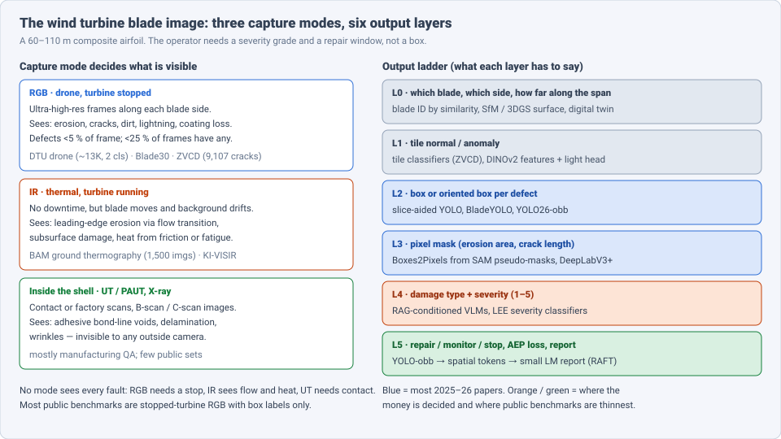
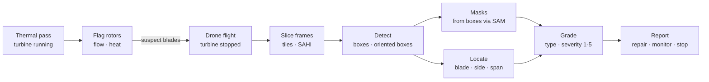
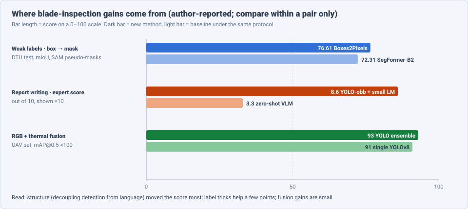

# Dense Object Detection & Classification — Recent Advances

*Compiled 2026-Oct-15 (America/Los_Angeles).*

Next installment in the running CV-updates log. Earlier entries on
`main`:
[Apr-30](../2026-Apr-30/2026-Apr-30_CV_updates.md),
[May-01](../2026-May-01/2026-May-01_CV_updates.md),
[May-02](../2026-May-02/2026-May-02_CV_updates.md),
[May-04](../2026-May-04/2026-May-04_CV_updates.md),
[May-05](../2026-May-05/2026-May-05_CV_updates.md),
[May-07](../2026-May-07/2026-May-07_CV_updates.md),
[May-08](../2026-May-08/2026-May-08_CV_updates.md),
[May-15](../2026-May-15/2026-May-15_CV_updates.md),
[May-16](../2026-May-16/2026-May-16_CV_updates.md),
[May-17](../2026-May-17/2026-May-17_CV_updates.md),
[Jun-09](../2026-Jun-09/2026-Jun-09_CV_updates.md),
[Jun-10](../2026-Jun-10/2026-Jun-10_CV_updates.md),
[Jun-12](../2026-Jun-12/2026-Jun-12_CV_updates.md),
[Jun-15](../2026-Jun-15/2026-Jun-15_CV_updates.md),
[Jun-16](../2026-Jun-16/2026-Jun-16_CV_updates.md),
[Jun-17](../2026-Jun-17/2026-Jun-17_CV_updates.md),
[Jun-19](../2026-Jun-19/2026-Jun-19_CV_updates.md),
[Jun-21](../2026-Jun-21/2026-Jun-21_CV_updates.md),
[Jun-22](../2026-Jun-22/2026-Jun-22_CV_updates.md),
[Jun-23](../2026-Jun-23/2026-Jun-23_CV_updates.md),
[Jun-24](../2026-Jun-24/2026-Jun-24_CV_updates.md),
[Jun-25](../2026-Jun-25/2026-Jun-25_CV_updates.md),
[Jun-27](../2026-Jun-27/2026-Jun-27_CV_updates.md),
[Jun-29](../2026-Jun-29/2026-Jun-29_CV_updates.md),
[Jun-30](../2026-Jun-30/2026-Jun-30_CV_updates.md),
[Jul-04](../2026-Jul-04/2026-Jul-04_CV_updates.md),
[Jul-07](../2026-Jul-07/2026-Jul-07_CV_updates.md),
[Jul-08](../2026-Jul-08/2026-Jul-08_CV_updates.md),
[Jul-10](../2026-Jul-10/2026-Jul-10_CV_updates.md),
[Jul-15](../2026-Jul-15/2026-Jul-15_CV_updates.md),
[Jul-17](../2026-Jul-17/2026-Jul-17_CV_updates.md),
[Jul-18](../2026-Jul-18/2026-Jul-18_CV_updates.md),
[Jul-21](../2026-Jul-21/2026-Jul-21_CV_updates.md),
[Jul-22](../2026-Jul-22/2026-Jul-22_CV_updates.md),
[Jul-24](../2026-Jul-24/2026-Jul-24_CV_updates.md),
[Jul-26](../2026-Jul-26/2026-Jul-26_CV_updates.md),
[Jul-27](../2026-Jul-27/2026-Jul-27_CV_updates.md),
[Jul-30](../2026-Jul-30/2026-Jul-30_CV_updates.md),
[Aug-01](../2026-Aug-01/2026-Aug-01_CV_updates.md),
[Aug-02](../2026-Aug-02/2026-Aug-02_CV_updates.md),
[Aug-04](../2026-Aug-04/2026-Aug-04_CV_updates.md),
[Aug-07](../2026-Aug-07/2026-Aug-07_CV_updates.md),
[Aug-10](../2026-Aug-10/2026-Aug-10_CV_updates.md),
[Aug-11](../2026-Aug-11/2026-Aug-11_CV_updates.md),
[Aug-13](../2026-Aug-13/2026-Aug-13_CV_updates.md),
[Aug-15](../2026-Aug-15/2026-Aug-15_CV_updates.md),
[Aug-16](../2026-Aug-16/2026-Aug-16_CV_updates.md),
[Aug-18](../2026-Aug-18/2026-Aug-18_CV_updates.md),
[Aug-19](../2026-Aug-19/2026-Aug-19_CV_updates.md),
[Aug-21](../2026-Aug-21/2026-Aug-21_CV_updates.md),
[Aug-22](../2026-Aug-22/2026-Aug-22_CV_updates.md),
[Aug-24](../2026-Aug-24/2026-Aug-24_CV_updates.md),
[Aug-26](../2026-Aug-26/2026-Aug-26_CV_updates.md),
[Aug-29](../2026-Aug-29/2026-Aug-29_CV_updates.md),
[Sep-01](../2026-Sep-01/2026-Sep-01_CV_updates.md),
[Sep-20](../2026-Sep-20/2026-Sep-20_CV_updates.md),
[Sep-23](../2026-Sep-23/2026-Sep-23_CV_updates.md),
[Sep-24](../2026-Sep-24/2026-Sep-24_CV_updates.md),
[Sep-25](../2026-Sep-25/2026-Sep-25_CV_updates.md),
[Sep-26](../2026-Sep-26/2026-Sep-26_CV_updates.md),
[Sep-29](../2026-Sep-29/2026-Sep-29_CV_updates.md),
[Sep-30](../2026-Sep-30/2026-Sep-30_CV_updates.md),
[Oct-01](../2026-Oct-01/2026-Oct-01_CV_updates.md),
[Oct-02](../2026-Oct-02/2026-Oct-02_CV_updates.md),
[Oct-03](../2026-Oct-03/2026-Oct-03_CV_updates.md),
[Oct-04](../2026-Oct-04/2026-Oct-04_CV_updates.md),
[Oct-05](../2026-Oct-05/2026-Oct-05_CV_updates.md),
[Oct-06](../2026-Oct-06/2026-Oct-06_CV_updates.md),
[Oct-07](../2026-Oct-07/2026-Oct-07_CV_updates.md),
[Oct-08](../2026-Oct-08/2026-Oct-08_CV_updates.md),
[Oct-09](../2026-Oct-09/2026-Oct-09_CV_updates.md),
[Oct-10](../2026-Oct-10/2026-Oct-10_CV_updates.md),
[Oct-11](../2026-Oct-11/2026-Oct-11_CV_updates.md),
[Oct-12](../2026-Oct-12/2026-Oct-12_CV_updates.md),
[Oct-13](../2026-Oct-13/2026-Oct-13_CV_updates.md),
[Oct-14](../2026-Oct-14/2026-Oct-14_CV_updates.md).

The last entry covered the [photovoltaic module inspection image](../2026-Oct-14/2026-Oct-14_CV_updates.md).
Today's primitive is the other big renewable asset: the **wind turbine
blade inspection image**. This is any image taken to find damage on a
rotor blade: a drone photo of a stopped blade, a thermal frame of a
running rotor shot from the ground or a drone, or an ultrasonic scan of
the bond lines inside the shell. The question is "which blade and where
along the span, what is the damage, how bad is it, and does it need a
repair before the next storm season?"

Earlier entries touched this only from the side.
[May-16 §10](../2026-May-16/2026-May-16_CV_updates.md) covered generic
industrial anomaly detection,
[Oct-12](../2026-Oct-12/2026-Oct-12_CV_updates.md) thin-crack
segmentation on roads,
[Oct-13](../2026-Oct-13/2026-Oct-13_CV_updates.md) UAV inspection of
transmission lines, and
[Oct-14](../2026-Oct-14/2026-Oct-14_CV_updates.md) PV plants. No
earlier entry treated the blade image as a modality of its own; this one
does.

Six properties make the blade image a distinct problem:

- **Huge surface, tiny defects.** A modern blade is 60–110 m long. Drone
  frames are ultra-high resolution, yet in the public DTU set fewer than
  **25 %** of images contain a defect and defects usually cover under
  **5 %** of the frame (§3).
- **Stop or run.** RGB drone inspection usually needs the turbine
  stopped (lost production). Thermal imaging works on a running rotor but
  sees flow and heat, not the surface itself (§6).
- **Severity, not presence, drives the decision.** Industry grades damage
  on an ordinal **1–5** scale; categories 1–2 are cosmetic, 4–5 call for
  a stop. Most detectors still output a class and a box (§5).
- **Labels are boxes.** The widely used public set has box labels for two
  classes only. Masks, oriented boxes and severity grades are added by
  each paper, so protocols rarely match (§3–4).
- **Many look-alikes.** Dirt, bird droppings, paint marks, reflections
  and repair patches resemble erosion and cracks. Barely visible cracks
  are the costly misses (§3).
- **Location matters.** A crack near the root or on the spar cap is
  worse than one at the tip. Every finding must be tied to a blade ID and
  a span position (§7).

> **Numbers below come from search-engine abstracts, arXiv/journal
> landing-page snippets and third-party summary pages. I did not read
> the full papers** (arxiv.org and link.springer.com failed DNS
> resolution through WebFetch on this run). Treat every number as an
> author-reported, abstract-level claim. Datasets, splits and metrics
> differ between papers; do not compare numbers across rows unless the
> text says they share a protocol.

---

## Table of contents

1. [Why this pass](#1--why-this-pass)
2. [The primitive: three capture modes, six output layers](#2--the-primitive-three-capture-modes-six-output-layers)
3. [Layer 2: small-defect detection on stopped blades](#3--layer-2-small-defect-detection-on-stopped-blades)
4. [Layer 3: masks from boxes](#4--layer-3-masks-from-boxes)
5. [Layer 4–5: vision-language diagnosis and reports](#5--layer-45-vision-language-diagnosis-and-reports)
6. [Running turbines: thermal and multispectral](#6--running-turbines-thermal-and-multispectral)
7. [Layer 0: blade identity, 3D surfaces and digital twins](#7--layer-0-blade-identity-3d-surfaces-and-digital-twins)
8. [Open problems / what to watch](#8--open-problems--what-to-watch)
9. [Sources](#9--sources)

---

## 1 · Why this pass

- **DINOv3 meets YOLO on blades.** BladeYOLO (arXiv 2607.28065, Jul
  2026) puts a DINOv3-initialised ViT backbone into YOLOv12-L and adds a
  Mamba-guided weak-defect module. It reports **+3.5** mAP50 and
  **+2.5** mAP50-95 over the best competitor on a public set, with the
  largest margins at **10–50 %** of labels (§3).
- **Masks from boxes, without the SAM noise.** Boxes2Pixels (arXiv
  2604.11162, CVPR 2026 AI4RWC workshop) trains a light decoder on frozen
  DINOv2 ViT-S/14 features from noisy SAM masks: **+6.97** anomaly mIoU,
  **+9.71** binary IoU over the best weakly supervised baseline, with
  **80 %** fewer trainable parameters (§4).
- **Training-free diagnosis with retrieval.** A knowledge-augmented VLM
  (arXiv 2510.22868 v2) retrieves manuals, reference images and guidelines
  and reaches **94.55 %** accuracy on **110** blade images in **4**
  damage classes without task training (§5).
- **Decoupled reports beat a monolithic VLM.** arXiv 2605.26533 (May
  2026) feeds YOLO26-x-obb detections as spatial tokens to a 4-bit
  Qwen-2.5-1.5B. It reports a **4 %** hallucination rate and an expert
  score of **8.6/10**, versus **65 %** and **3.3/10** for a zero-shot VLM
  (§5).
- **Journal detectors keep climbing.** SASED-YOLO (*Scientific Reports*,
  Feb 2026) reports **87.7 %** mAP, **+10.5** over YOLOv8s; a SAGE
  *Wind Engineering* study reports YOLOv11 at **0.969** mAP@0.5 on a
  holdout set (§3).

---

## 2 · The primitive: three capture modes, six output layers

| Layer | Output | Typical tool (2025–26) | Main failure |
|---|---|---|---|
| 0 | blade ID, side, span position | similarity-based blade ID, SfM / Gaussian-splat surfaces | finding assigned to the wrong blade |
| 1 | tile normal / anomaly | tile classifiers (ZVCD pipeline), DINOv2 + light head | dirt and repair patches flagged |
| 2 | box or oriented box per defect | slice-aided YOLO, BladeYOLO, SASED-YOLO, YOLO26-obb | barely visible cracks, tiny defects |
| 3 | pixel mask (erosion area, crack length) | Boxes2Pixels, DeepLabV3+, U-Net on patches | no dense ground truth |
| 4 | damage type + severity 1–5 | RAG-VLM, erosion severity classifiers | low-severity grades confused |
| 5 | repair / monitor / stop, report | detector → spatial tokens → small LM | hallucinated findings |

The practical pipeline is a funnel: thermal or SCADA signals flag a
rotor, then a stopped-turbine drone flight captures the blades in detail.
Most public benchmarks score only the "Detect" box.

---

## 3 · Layer 2: small-defect detection on stopped blades

**The benchmark.** The **DTU drone inspection** set (Shihavuddin et al.)
is the common public base. Foster et al.'s YOLO-format release has about
**13,000** images at **586×371** px (Dataset Ninja lists **13,470**
images and **9,351** objects), with box labels for **damage** and
**surface dirt** only, licence CC BY-NC 4.0. Fewer than **25 %** of
images contain a defect. **Blade30** is the other public set used for
segmentation-style work. **ZVCD** (Zeitview, arXiv 2407.07186) is the
largest crack set described in the literature — **9,107** cracks across
**988** sites, **4,684** turbines, **34** manufacturers and **195** blade
models — and the only one in its comparison table with barely visible
cracks; the pipeline classifies image tiles rather than drawing boxes, to
cut false positives. ZVCD is not openly downloadable as far as snippets
show.

**Slicing and orientation.** Gohar et al. (*Machines* 2023; EUSIPCO
2024; Heriot-Watt PhD 2025) showed two durable tricks on DTU and
Blade30: **slice-aided hyper-inference** (run the detector on overlapping
tiles of the full-res frame) gives large accuracy gains at higher
inference time, and **oriented boxes** localise elongated cracks and
leading-edge erosion better than axis-aligned ones. They released
oriented-box annotations for two public sets.

**2026 detectors.**

- **BladeYOLO** (Xu et al., arXiv 2607.28065). Replaces the YOLOv12-L
  backbone with a **DINOv3**-initialised ViT and adds a Mamba-guided
  Weak-Defect Enhancement module: a multi-scale high-frequency branch plus
  a Cross-Mamba block that sends semantic guidance into shallow features.
  On a public Wind Surface Defect set it beats the best competitor by
  **+3.5** mAP50 / **+2.5** mAP50-95. On the authors' WTBlade-Defect set
  it leads YOLO, DETR and Mamba baselines, most clearly with **10–50 %**
  of labels. Absolute mAP values were not visible in snippets; not peer
  reviewed.
- **SASED-YOLO** (Lv et al., *Scientific Reports*, Feb 2026). Collaborative
  attention plus multi-scale feature-space pooling for blurred, fine
  defect textures. Reports **87.7 %** mAP, **10.5** higher than YOLOv8s,
  and claims to beat RT-DETR, YOLOv11s and Mamba baselines. (Whether
  10.5 is points or relative is unclear from the abstract.)
- **YOLOv8–v11 vs Faster R-CNN** (SAGE *Wind Engineering*, 2026, DOI
  10.1177/0309524X261428794). YOLOv11 at **0.969** mAP@0.5 on a holdout
  set.
- Others in the same line: AUD-YOLO (YOLOv8-based, robust to fog and
  snow; *Scientific Reports* 2025), YOLO-Wind (*Scientific Reports* 2025), TurbineBladeDetNet (five fault
  classes; *CMES* 2026), WB-YOLO with a programmable UAV system (*NDT&E*
  2026), and a YOLOv5 → DINOv2 → stochastic configuration network
  classifier at **97.8 %** accuracy and **19.65 ms** per image (PMC 2025).

**Reading the numbers.** Each paper picks its own split, class set and
image size. Ask for the crack class separately, for results on full-res
frames (not pre-cropped tiles), and for the false-positive rate on dirt
and repair patches.

---

## 4 · Layer 3: masks from boxes

Pixel masks give erosion area and crack length, which feed severity. But
public blade data is box-only, so masks have to come from somewhere.

**Boxes2Pixels** (Lendering, Akdag et al.; arXiv 2604.11162; CVPR 2026
AI4RWC workshop; code on GitHub). Prompt SAM with the DTU boxes to get
pseudo-masks, then train a student that does not copy SAM's systematic
errors:

- a hierarchical decoder on **frozen DINOv2 ViT-S/14** features;
- a **one-sided self-correcting loss** that lets the student grow masks
  where SAM under-segments, adding **+18.56** binary recall;
- **+6.97** anomaly mIoU and **+9.71** binary IoU over the strongest
  baseline with the same weak supervision, on a manually annotated test
  benchmark, with **80 %** fewer trainable parameters.

A leaderboard page lists **76.61** mIoU for Boxes2Pixels versus
**72.31** SegFormer-B2, **70.57** U-Net and **68.67** DeepLabV3 on the DTU
test split, all trained on the same SAM pseudo-masks (column labels were
unclear in the snippet). The authors note that U-Net and SegFormer
overfit SAM's mistakes — the same lesson as SAM-labelled cracks in
[Oct-12](../2026-Oct-12/2026-Oct-12_CV_updates.md).

**Fully supervised segmentation** still appears on private data: a
YOLOv7 + DeepLabV3+ UAV pipeline reports **92.7 %** mIoU on **15,000+**
aerial images (IIETA, Nov 2025); a two-step "blade first, then defect
patches" U-Net (CILAMCE 2025) separates adhered material, erosion and
impact damage; a VR-synthetic-data U-Net (arXiv 2401.00237) trains on
rendered cracks, erosion and lightning damage.

---

## 5 · Layer 4–5: vision-language diagnosis and reports

**Training-free with retrieval.** Zhang et al., *Seeing the Unseen*
(arXiv 2510.22868; v2 retitled "Training-Free", Aug 2026; listed as
*IEEE Access* 2026). A multimodal knowledge base of technical documents,
reference images and guidelines; a hybrid text–image retriever with
keyword-aware reranking; the retrieved context conditions a VLM.

- **94.55 %** overall accuracy on **110** labelled blade images, **4**
  damage classes; macro precision **0.979**, recall **0.875**, F1
  **0.906**.
- Ablations: removing hybrid retrieval or reranking hurts; single-modality
  retrieval fails on specific classes.
- Compared against AnomalyCLIP and YOLO detectors; the authors credit
  structured domain knowledge for the gap.
- The VLM is also asked for a **1–5 severity** grade; examples show
  errors (an ice case misread). v1 used only **30** images. Small test
  set, so treat the accuracy as indicative.

**Decoupled report generation.** Malikussaid & Gohar (arXiv 2605.26533,
May 2026):

1. **YOLO26-x-obb** detects oriented boxes on DTU images (OBB labels
   public on GitHub);
2. a deterministic module turns each box into grid-based **spatial
   tokens** (blade region, size, class);
3. a 4-bit **Qwen-2.5-1.5B** with QLoRA, trained on **947** synthetic
   maintenance reports and retrieval-augmented fine-tuning (RAFT) over
   maintenance procedures, writes the report.

Reported: BLEU-4 **0.41**, hallucination rate **4 %**, expert score
**8.6/10**, versus **0.07**, **65 %** and **3.3/10** for a zero-shot
monolithic VLM. Runs on edge hardware. The corpus and code are on
request.

The pattern matches [Oct-14 §8](../2026-Oct-14/2026-Oct-14_CV_updates.md)
(REVL-PV): a detector or retriever supplies grounded evidence; the
language model only explains and formats. Asking a general VLM to both
find and describe tiny blade defects is what produces the hallucinations.

**Severity from physics.** A *Wind Energy Science* preprint
(wes-2025-289) trains a random forest on Gaussian-process surrogate data
to grade leading-edge erosion into **5** levels at **87 %** accuracy
(vs **83 %** when trained on full simulations). It uses simulated
aerodynamic signals, not images, but gives a label scale image models
could be scored against.

---

## 6 · Running turbines: thermal and multispectral

**Thermography of leading-edge erosion.** BAM (Germany) images running
turbines from the ground: erosion trips the boundary layer from laminar
to turbulent flow, which shows up as a temperature pattern. A fully
convolutional network trained on about **1,500** thermograms detects
and classifies the damage in about **10 minutes** per turbine without a
stop. Their estimate: erosion costs **0.5–2 %** of annual energy
production per year.

**Thermal detectors.** **A-BiYOLOv9** (*Applied Sciences* 15(21), Nov
2025) adds attention and a BiFPN-style neck to YOLOv9 for thermal
turbulence patterns on the public **KI-VISIR** infrared set; gains over
plain YOLOv9 are not uniform across metrics. Sheiati & Chen (*SHM* 2024)
segment fatigue damage in passive thermal video of a lab blade under
cyclic load, where the moving blade and changing background defeat
classical processing.

**RGB + thermal fusion.** Svystun et al. (arXiv 2509.04156; IEEE IDAACS
2025) combine a general YOLOv8 with a thermal-specialised model by box
fusion: **0.93** mAP@0.5 / **0.90** F1 vs **0.91** for YOLOv8 alone. A
drone dataset of **36** optical–thermal video pairs (**20,000+** images)
of blades in normal operation is on IEEE DataPort.

**Inside the shell.** Ultrasonic B/C-scans of adhesive bond lines are a
separate image domain: a 2026 *Ultrasonics* paper applies deep mutual
learning to multimodal phased-array data for bond-line defects (details
not visible in snippets). These defects are invisible to drones.

---

## 7 · Layer 0: blade identity, 3D surfaces and digital twins

- **Which blade is this?** On a running turbine, three blades look the
  same. AI-based blade identification via image similarity (2024) assigns
  drone frames to blade A/B/C so findings accumulate per blade across
  inspections.
- **3D surfaces.** A Gaussian-splatting reconstruction of blade leading
  edges from high-resolution images (*Automation in Construction* 2025)
  reports full surface completeness where multi-view stereo leaves holes —
  the base for measuring erosion depth, not just area. (See
  [Sep-26](../2026-Sep-26/2026-Sep-26_CV_updates.md) on 3DGS as a
  detection substrate.)
- **Digital twins.** A *Renewable Energy* paper (2024) builds a digital
  twin from deep-learning drone inspection with damage-size quantification
  for standstill and rotating turbines; a 2025 *Renewable Energy* study
  models erosion growth from repeated drone inspections.

Missing piece: no public benchmark scores "right defect, right blade,
right span position, right severity" end to end.

---

## 8 · Open problems / what to watch

1. **A shared dense benchmark.** DTU is box-only and two-class. Expect
   released mask or OBB annotations (Boxes2Pixels, Gohar) to become the
   de facto test sets; check that papers use the same version.
2. **Barely visible cracks.** ZVCD shows the scale needed (thousands of
   cracks, hundreds of blade models). An open counterpart would change
   the field.
3. **Severity as the metric.** Score ordinal 1–5 grades (e.g. weighted
   kappa), not only mAP. Category 1–2 confusion is the known weak spot.
4. **Foundation backbones under few labels.** BladeYOLO (DINOv3) and
   Boxes2Pixels (DINOv2) both win most at low label counts; compare them
   on equal footing with SAM 3 and open-vocabulary detectors.
5. **Grounded language.** Decoupled detector → LM designs cut
   hallucinations sharply. Test them on real (not synthetic) reports and
   on defects the detector misses.
6. **Inspect without stopping.** Thermal and motion-compensated RGB of
   running rotors would remove the production cost of a stop; public data
   is still small.
7. **Track change over time.** Repeat inspections of the same blade could
   turn detection into growth-rate estimation — the input an O&M schedule
   actually needs.

---

## 9 · Sources

### Datasets and benchmarks

- DTU – Drone inspection images of wind turbine (YOLO-annotated release) — https://datasetninja.com/yolo-annotated-wind-turbine-surface-damage
- Barely-Visible Surface Crack Detection for Wind Turbine Sustainability (ZVCD) — arXiv 2407.07186 — https://arxiv.org/abs/2407.07186 — https://blog.zeitview.com/wind-turbine-crack-detection
- Drone-based Optical and Thermal Videos of Rotor Blades Taken in Normal Wind Turbine Operation — IEEE DataPort — https://ieee-dataport.org/comment/5016
- Blade30 segmentation thesis (Memorial University, 2024) — https://research.library.mun.ca/16710
- Learning to identify cracks on wind turbine blade surfaces using drone-based inspection images — https://ar5iv.labs.arxiv.org/html/2207.11186

### Detection (§3)

- BladeYOLO: Wind Turbine Blade Defect Detection with Limited Annotations and Weak-Saliency Awareness — arXiv 2607.28065 — https://arxiv.org/abs/2607.28065 — https://pith.science/paper/2607.28065
- Multi-scale defect detection technology for wind turbine blade surfaces based on the SASED-YOLO algorithm — *Scientific Reports* (2026) — https://www.nature.com/articles/s41598-026-37780-9 — https://pmc.ncbi.nlm.nih.gov/articles/PMC12923570
- YOLOv8–v11 vs Faster R-CNN for blade defects — *Wind Engineering* (2026) — https://doi.org/10.1177/0309524X261428794
- Slice-Aided Defect Detection in Ultra High-Resolution Wind Turbine Blade Images — *Machines* 11(10):953 — https://www.mdpi.com/2075-1702/11/10/953
- Optimizing Wind Turbine Surface Defect Detection: A Rotated Bounding Box Approach — EUSIPCO 2024 — https://researchportal.hw.ac.uk/en/publications/optimizing-wind-turbine-surface-defect-detection-a-rotated-boundi/
- Data-driven techniques for wind turbine blade surface defect detection using drone imaging (Gohar, PhD 2025) — https://www.ros.hw.ac.uk/handle/10399/5340
- Precision Slicing for Enhanced Defect Detection in High-Resolution Wind Turbine Blade Imagery (Svystun et al.) — https://ceur-ws.org/Vol-3736/paper1.pdf
- Enhancing wind turbine blade damage detection with YOLO-Wind — *Scientific Reports* (2025) — https://www.nature.com/articles/s41598-025-03639-8
- Wind Turbine Blade Defect Recognition Method Based on Large-Vision-Model Transfer Learning (DINOv2 + SCN) — https://pmc.ncbi.nlm.nih.gov/articles/PMC12300182/
- Dual-Attention Multi-Path Deep Learning Framework for Wind Turbine Blade Fault Detection (TurbineBladeDetNet) — *CMES* (2026) — https://www.sciopen.com/article/10.32604/cmes.2026.077956
- A programmable UAV-based measurement system for wind turbine surface defect detection: WB-YOLO — *NDT&E* (2026) — https://www.tandfonline.com/doi/full/10.1080/10589759.2026.2635561
- Comparative YOLOv7 / Faster R-CNN study — arXiv 2501.16662 — https://arxiv.org/abs/2501.16662v2

### Segmentation (§4)

- Boxes2Pixels: Learning Defect Segmentation from Noisy SAM Masks — arXiv 2604.11162 — https://arxiv.org/abs/2604.11162 — https://www.sota2.com/research/sota/semantic-segmentation-on-dtu-drone-inspection-images-of-wind-turbine-test
- UAV YOLOv7 + DeepLabV3+ damage segmentation — IIETA (2025) — https://www.iieta.org/download/file/fid/190184
- Visual Detection of Surface Defects in Wind Turbine Blades Using Two-Step Image Segmentation — CILAMCE 2025 — https://publicacoes.softaliza.com.br/cilamce-2025/article/view/14353
- A Novel Approach for Defect Detection of Wind Turbine Blade Using Virtual Reality and Deep Learning — arXiv 2401.00237 — https://arxiv.org/abs/2401.00237

### Vision-language and severity (§5)

- Seeing the Unseen: Towards Training-Free Inspection for Wind Turbine Blades Using Knowledge-Augmented Vision Language Models — arXiv 2510.22868 — https://arxiv.org/abs/2510.22868 — https://arxiv.org/html/2510.22868v2
- A Hybrid Vision-Language Architecture for Automated Defect Reasoning and Report Generation in Industrial Inspection — arXiv 2605.26533 — https://arxiv.org/abs/2605.26533 — https://www.alphaxiv.org/abs/2605.26533
- Classification of Leading Edge Erosion Severity via Machine Learning Surrogate Models — WES preprint wes-2025-289 — https://wes.copernicus.org/preprints/wes-2025-289/
- Wind turbine blade damage: a systematic review of detection, diagnosis, performance impact, and lifecycle health management — https://www.sciencedirect.com/science/article/abs/pii/S1364032125013413

### Thermal, multispectral and internal (§6)

- Thermographic detection and AI evaluation of leading-edge erosion (BAM) — https://opus4.kobv.de/opus4-bam/frontdoor/index/index/year/2025/docId/62501 — https://opus4.kobv.de/opus4-bam/frontdoor/index/index/year/2025/docId/62452
- A-BiYOLOv9: An Attention-Guided YOLOv9 Model for Infrared-Based Wind Turbine Inspection — *Applied Sciences* 15(21):11840 — https://www.mdpi.com/2076-3417/15/21/11840/html
- Deep learning-based fatigue damage segmentation of wind turbine blades under complex dynamic thermal backgrounds — *SHM* (2024) — https://journals.sagepub.com/doi/10.1177/14759217231174377
- YOLO Ensemble for UAV-based Multispectral Defect Detection in Wind Turbine Components — arXiv 2509.04156 — https://arxiv.org/abs/2509.04156
- Deep mutual learning for blade defect detection in multimodal phased array ultrasonic data — *Ultrasonics* (2026) — https://pubmed.ncbi.nlm.nih.gov/41795453/

### Blade identity, 3D and digital twins (§7)

- AI-based blade identification in operational wind turbines through similarity analysis aided drone inspection — https://www.researchgate.net/publication/385458081
- Accurate and robust 3D reconstruction of wind turbine blade leading edges from high-resolution images — *Automation in Construction* (2025) — https://www.sciencedirect.com/science/article/abs/pii/S0926580525001931
- Digital twin of wind turbine surface damage detection based on deep learning-aided drone inspection — *Renewable Energy* — https://www.sciencedirect.com/science/article/abs/pii/S0960148124024005
- Drone-based leading-edge erosion growth modelling — *Renewable Energy* 252 (2025) — https://ideas.repec.org/a/eee/renene/v252y2025ics096014812501016x.html
