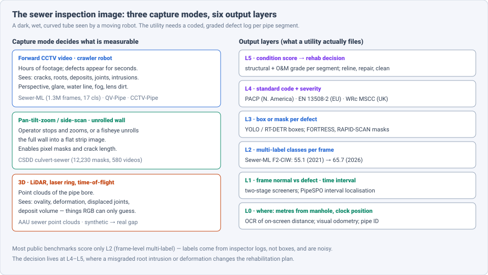
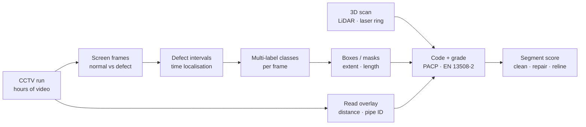
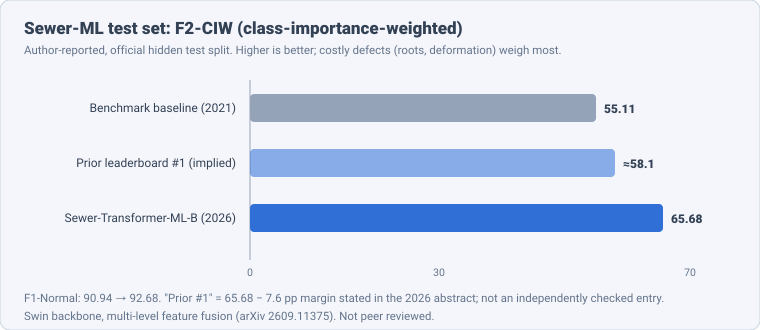

# Dense Object Detection & Classification — Recent Advances

*Compiled 2026-Oct-16 (America/Los_Angeles).*

Next installment in the running CV-updates log. Earlier entries on
`main`:
[Apr-30](../2026-Apr-30/2026-Apr-30_CV_updates.md),
[May-01](../2026-May-01/2026-May-01_CV_updates.md),
[May-02](../2026-May-02/2026-May-02_CV_updates.md),
[May-04](../2026-May-04/2026-May-04_CV_updates.md),
[May-05](../2026-May-05/2026-May-05_CV_updates.md),
[May-07](../2026-May-07/2026-May-07_CV_updates.md),
[May-08](../2026-May-08/2026-May-08_CV_updates.md),
[May-15](../2026-May-15/2026-May-15_CV_updates.md),
[May-16](../2026-May-16/2026-May-16_CV_updates.md),
[May-17](../2026-May-17/2026-May-17_CV_updates.md),
[Jun-09](../2026-Jun-09/2026-Jun-09_CV_updates.md),
[Jun-10](../2026-Jun-10/2026-Jun-10_CV_updates.md),
[Jun-12](../2026-Jun-12/2026-Jun-12_CV_updates.md),
[Jun-15](../2026-Jun-15/2026-Jun-15_CV_updates.md),
[Jun-16](../2026-Jun-16/2026-Jun-16_CV_updates.md),
[Jun-17](../2026-Jun-17/2026-Jun-17_CV_updates.md),
[Jun-19](../2026-Jun-19/2026-Jun-19_CV_updates.md),
[Jun-21](../2026-Jun-21/2026-Jun-21_CV_updates.md),
[Jun-22](../2026-Jun-22/2026-Jun-22_CV_updates.md),
[Jun-23](../2026-Jun-23/2026-Jun-23_CV_updates.md),
[Jun-24](../2026-Jun-24/2026-Jun-24_CV_updates.md),
[Jun-25](../2026-Jun-25/2026-Jun-25_CV_updates.md),
[Jun-27](../2026-Jun-27/2026-Jun-27_CV_updates.md),
[Jun-29](../2026-Jun-29/2026-Jun-29_CV_updates.md),
[Jun-30](../2026-Jun-30/2026-Jun-30_CV_updates.md),
[Jul-04](../2026-Jul-04/2026-Jul-04_CV_updates.md),
[Jul-07](../2026-Jul-07/2026-Jul-07_CV_updates.md),
[Jul-08](../2026-Jul-08/2026-Jul-08_CV_updates.md),
[Jul-10](../2026-Jul-10/2026-Jul-10_CV_updates.md),
[Jul-15](../2026-Jul-15/2026-Jul-15_CV_updates.md),
[Jul-17](../2026-Jul-17/2026-Jul-17_CV_updates.md),
[Jul-18](../2026-Jul-18/2026-Jul-18_CV_updates.md),
[Jul-21](../2026-Jul-21/2026-Jul-21_CV_updates.md),
[Jul-22](../2026-Jul-22/2026-Jul-22_CV_updates.md),
[Jul-24](../2026-Jul-24/2026-Jul-24_CV_updates.md),
[Jul-26](../2026-Jul-26/2026-Jul-26_CV_updates.md),
[Jul-27](../2026-Jul-27/2026-Jul-27_CV_updates.md),
[Jul-30](../2026-Jul-30/2026-Jul-30_CV_updates.md),
[Aug-01](../2026-Aug-01/2026-Aug-01_CV_updates.md),
[Aug-02](../2026-Aug-02/2026-Aug-02_CV_updates.md),
[Aug-04](../2026-Aug-04/2026-Aug-04_CV_updates.md),
[Aug-07](../2026-Aug-07/2026-Aug-07_CV_updates.md),
[Aug-10](../2026-Aug-10/2026-Aug-10_CV_updates.md),
[Aug-11](../2026-Aug-11/2026-Aug-11_CV_updates.md),
[Aug-13](../2026-Aug-13/2026-Aug-13_CV_updates.md),
[Aug-15](../2026-Aug-15/2026-Aug-15_CV_updates.md),
[Aug-16](../2026-Aug-16/2026-Aug-16_CV_updates.md),
[Aug-18](../2026-Aug-18/2026-Aug-18_CV_updates.md),
[Aug-19](../2026-Aug-19/2026-Aug-19_CV_updates.md),
[Aug-21](../2026-Aug-21/2026-Aug-21_CV_updates.md),
[Aug-22](../2026-Aug-22/2026-Aug-22_CV_updates.md),
[Aug-24](../2026-Aug-24/2026-Aug-24_CV_updates.md),
[Aug-26](../2026-Aug-26/2026-Aug-26_CV_updates.md),
[Aug-29](../2026-Aug-29/2026-Aug-29_CV_updates.md),
[Sep-01](../2026-Sep-01/2026-Sep-01_CV_updates.md),
[Sep-20](../2026-Sep-20/2026-Sep-20_CV_updates.md),
[Sep-23](../2026-Sep-23/2026-Sep-23_CV_updates.md),
[Sep-24](../2026-Sep-24/2026-Sep-24_CV_updates.md),
[Sep-25](../2026-Sep-25/2026-Sep-25_CV_updates.md),
[Sep-26](../2026-Sep-26/2026-Sep-26_CV_updates.md),
[Sep-29](../2026-Sep-29/2026-Sep-29_CV_updates.md),
[Sep-30](../2026-Sep-30/2026-Sep-30_CV_updates.md),
[Oct-01](../2026-Oct-01/2026-Oct-01_CV_updates.md),
[Oct-02](../2026-Oct-02/2026-Oct-02_CV_updates.md),
[Oct-03](../2026-Oct-03/2026-Oct-03_CV_updates.md),
[Oct-04](../2026-Oct-04/2026-Oct-04_CV_updates.md),
[Oct-05](../2026-Oct-05/2026-Oct-05_CV_updates.md),
[Oct-06](../2026-Oct-06/2026-Oct-06_CV_updates.md),
[Oct-07](../2026-Oct-07/2026-Oct-07_CV_updates.md),
[Oct-08](../2026-Oct-08/2026-Oct-08_CV_updates.md),
[Oct-09](../2026-Oct-09/2026-Oct-09_CV_updates.md),
[Oct-10](../2026-Oct-10/2026-Oct-10_CV_updates.md),
[Oct-11](../2026-Oct-11/2026-Oct-11_CV_updates.md),
[Oct-12](../2026-Oct-12/2026-Oct-12_CV_updates.md),
[Oct-13](../2026-Oct-13/2026-Oct-13_CV_updates.md),
[Oct-14](../2026-Oct-14/2026-Oct-14_CV_updates.md),
[Oct-15](../2026-Oct-15/2026-Oct-15_CV_updates.md).

The last entry covered the [wind turbine blade inspection image](../2026-Oct-15/2026-Oct-15_CV_updates.md).
Today's primitive goes underground: the **sewer pipe inspection
image**. This is what a crawler robot records as it drives through a
sewer or culvert: forward-looking CCTV video, still frames grabbed by
the operator, an "unrolled" side-scan of the pipe wall, or a LiDAR /
laser-ring point cloud of the bore. The question is "at how many
metres from the manhole, which defect, coded to which standard, how
severe, and does this segment need cleaning, a repair or a reline?"

Earlier entries touched this only from the side.
[May-16 §10](../2026-May-16/2026-May-16_CV_updates.md) covered generic
industrial anomaly detection,
[Jul-30](../2026-Jul-30/2026-Jul-30_CV_updates.md) fisheye imaging,
[Oct-12](../2026-Oct-12/2026-Oct-12_CV_updates.md) thin-crack
segmentation on roads, and
[Oct-13](../2026-Oct-13/2026-Oct-13_CV_updates.md)–[Oct-15](../2026-Oct-15/2026-Oct-15_CV_updates.md)
other infrastructure inspection. No earlier entry treated the sewer
image as a modality of its own; this one does.

Six properties make the sewer image a distinct problem:

- **Labels come from inspector logs, not annotators.** The biggest
  public set, **Sewer-ML**, has **1.3 M** frames labelled from nine years
  of professional inspection reports — frame-level multi-labels, no
  boxes, and plenty of noise (§3, §7).
- **Multi-label is the norm.** One frame often shows a root intrusion,
  a deposit and a displaced joint together. Single-label classifiers and
  single-class detectors do not fit (§3).
- **Costly defects are rare and hard.** Sewer-ML's own analysis notes
  that the classes with the largest economic impact — e.g. deformation
  and pipe break/collapse — are among the worst recognised (§3).
- **Video, not images.** A survey run is hours of footage; a defect is
  visible for seconds; the industry log records a *time point*, not an
  interval (§5).
- **The output is a code.** Utilities file defects under PACP (North
  America), EN 13508-2 (Europe) or WRc MSCC (UK) with a severity grade.
  Benchmarks almost never score that code (§6).
- **Geometry matters.** Ovality and deformation are 3D facts; RGB only
  hints at them. LiDAR and laser profilers measure them, but the deep
  models trained on synthetic point clouds struggle on real scans (§6).

> **Numbers below come from search-engine abstracts, arXiv/CVF/journal
> landing-page snippets and third-party summary pages. I did not read
> the full papers** (arxiv.org and alphaxiv.org failed DNS resolution
> through WebFetch on this run). Treat every number as an
> author-reported, abstract-level claim. Datasets, splits and metrics
> differ between papers; do not compare numbers across rows unless the
> text says they share a protocol.

---

## Table of contents

1. [Why this pass](#1--why-this-pass)
2. [The primitive: three capture modes, six output layers](#2--the-primitive-three-capture-modes-six-output-layers)
3. [Layer 2: multi-label frame classification on Sewer-ML](#3--layer-2-multi-label-frame-classification-on-sewer-ml)
4. [Layer 3: boxes and masks](#4--layer-3-boxes-and-masks)
5. [Layer 1 in time: video and interval localisation](#5--layer-1-in-time-video-and-interval-localisation)
6. [Layer 4–5: vision-language models, codes and 3D](#6--layer-45-vision-language-models-codes-and-3d)
7. [Label noise: the hidden bottleneck](#7--label-noise-the-hidden-bottleneck)
8. [Open problems / what to watch](#8--open-problems--what-to-watch)
9. [Sources](#9--sources)

---

## 1 · Why this pass

- **Sewer-ML moves ten points.** Sewer-Transformer-ML (arXiv
  2609.11375, Sep 2026) — a Swin backbone with multi-level feature
  fusion — reports **65.68 %** F2-CIW and **92.68 %** F1-Normal on the
  hidden test set, first on the public leaderboard and **+7.6** pp over
  the runner-up. The 2021 benchmark baseline was **55.11 %** (§3).
- **Zero-shot defect classes at CVPR.** SFR-Net (CVPR 2026) frames
  unseen sewer defects as multi-label zero-shot learning on CLIP
  features and introduces **WZ-Pipe**, described as the first dedicated
  multi-label zero-shot sewer set (§3).
- **General VLMs are not ready.** A TU Delft study (*Cambridge Prisms:
  Water*, Mar 2026) ran **18** VLMs zero-shot on **6** defect types;
  the best, GPT-4.1 mini, reached only **0.50** macro-F1, and confidence
  scores were unreliable (§6).
- **Segment-then-describe on the robot.** Edge-optimised pipeline
  (arXiv 2602.03742, Feb 2026): a **0.64 M**-parameter segmenter
  (RAPID-SCAN) feeds a fine-tuned, quantised Phi-3.5 vision model that
  writes inspection summaries on a mobile robot (§6).
- **Transformers beat YOLO on real footage.** An Istanbul benchmark
  (*Applied Sciences*, Oct 2025) of YOLOv8/11/12 against RT-DETR v1/v2
  finds RT-DETR v2 best at **79.03 %** F1 (§4).

---

## 2 · The primitive: three capture modes, six output layers

| Layer | Output | Typical tool (2025–26) | Main failure |
|---|---|---|---|
| 0 | position (m from manhole), clock position, pipe ID | OCR of on-screen overlay, visual odometry | defect logged at wrong distance |
| 1 | frame normal / defect; defect time interval | binary screener; PipeSPO | long normal stretches flood the reviewer |
| 2 | multi-label classes per frame | Sewer-Transformer-ML, TResNet two-stage, CLIP-based | rare costly classes (deformation, collapse) |
| 3 | box or mask per defect | YOLOv8–12, RT-DETR v2, FORTRESS, RAPID-SCAN | water line, glare and joints as false positives |
| 4 | standard code + severity grade | VLMs, rule engines (mostly manual today) | wrong code, wrong grade |
| 5 | segment condition score, rehab decision | asset-management models | errors compound from L0–L4 |

The industrial pipeline is a funnel: most frames are normal, so a
screener throws them out, a classifier names the defects, and a human
still codes and grades them. Public benchmarks score mainly the
"Multi-label classes" box.

---

## 3 · Layer 2: multi-label frame classification on Sewer-ML

**The benchmark.** **Sewer-ML** (Haurum & Moeslund, CVPR 2021, Aalborg
University) has about **1.3 M** frames from three Danish utilities over
nine years, **17** defect classes plus normal, labelled from
professional inspection reports. Its metric, **F2-CIW**, weights each
class by economic importance and favours recall; **F1-Normal** checks
that clean pipe is not over-flagged. The test labels are hidden behind
an evaluation server, so some papers report on the validation split
instead — check which one before comparing.

**2021 baseline.** **55.11 %** F2-CIW / **90.94 %** F1-Normal from a
two-stage system: a small CNN decides defect vs normal, then
**TResNet-L** assigns the multi-labels.

**2026 leader: Sewer-Transformer-ML** (Fang, Wang, Li et al., arXiv
2609.11375, submitted 10 Sep 2026).

- Swin Transformer backbone (Tiny/Small/Base/Large), no convolutions in
  the backbone, with **multi-level feature fusion** across stages so
  thin cracks (shallow features) and deposits/deformation (deep
  features) are both kept.
- Base variant: **65.68 %** F2-CIW, **92.68 %** F1-Normal on the test
  set; first on the public leaderboard, **+7.6** pp F2-CIW over the
  second-ranked entry.
- Two light models for robots: **Sewer-MobileNet-ML** and
  **Sewer-Mobile-TransNet** (the latter **96.43 %** accuracy under the
  standard split — a different metric from F2-CIW). A secondary
  aggregator also quotes an F2-CIW of **65.73 %** at **17 M**
  parameters for a lighter model; I could not tie that number to a
  specific variant, so treat it as unverified.
- Not peer reviewed.

**Other recent Sewer-ML work.**

- **SFR-Net** (Chen, Huang, Ge, Li; Wenzhou University; CVPR 2026).
  *Multi-label zero-shot* sewer defect detection: recognise defect
  classes with no training samples. Three modules — RS (domain-adaptive
  feature steering on CLIP features), MEF (multi-granularity evidence
  fusion) and GR (a GCN that transfers label-correlation "correction
  logic"). Introduces **WZ-Pipe** (to be open-sourced); code on GitHub.
  A third-party paper note quotes **12.58 %** mAP on a Sewer-ML
  zero-shot split, about double the next method — secondhand, verify
  against the CVF PDF.
- **CLIP with fine-to-coarse contextual representations** (Ge, Guo,
  Yang; *Advanced Engineering Informatics*, 2026). Reports **75.02 %**
  mAP and **80.08 %** F1 — different metrics from F2-CIW, so not on the
  chart. An aggregator mentions **+15 %** on complex defects.
- **Mask-attention + label-correlation learning** (arXiv 2408.00489):
  reports **+11.87 %** F2 over the previous best on the full dataset
  (unclear whether points or relative).
- **MSHViT** (Aalborg, *Automation in Construction* 2022, multi-scale
  hybrid ViT with a Sinkhorn tokenizer) and **dual-stream attention
  transformers** (arXiv 2311.16145) are the earlier transformer
  baselines.
- **Trustworthy multi-label classification** with evidential deep
  learning (arXiv 2210.13782) adds per-label uncertainty — useful for
  deciding which frames a human must check.

**Reading the numbers.** Ask for F2-CIW on the *test* server, per-class
recall on the costly classes, and F1-Normal. Accuracy alone is
meaningless on a set where most frames are normal.

---

## 4 · Layer 3: boxes and masks

Boxes and masks give extent: how long a crack is, how much of the bore
a deposit blocks. They need annotation beyond the inspector log, so
datasets are smaller and mostly private.

**Detection.**

- **YOLO vs RT-DETR on real footage** (*Applied Sciences* 15(20):11096,
  Oct 2025). YOLOv8, v11, v12 and RT-DETR v1/v2 on Istanbul sewer
  inspection video. **RT-DETR v2** wins: **79.03 %** F1, **81.10 %**
  recall, ahead of the best YOLO; compact YOLO variants are still
  preferred for edge devices.
- **Screen, then detect** (Goharinezhad, Hadi, Mirzaei; *Scientific
  Reports*, Nov 2025). A ResNet50–Swin classifier screens frames before
  a CBAM-augmented YOLOv8 localises defects; screening lifts mAP from
  **0.70** to **0.81** on **6,912** images from Iran. Same lesson as the
  Sewer-ML two-stage baseline: throw out normal frames first.
- Steady YOLO variants: lightweight cross-scale fusion YOLOv8 (PMC
  2025), YOLOv8-CPA (*Jurnal Kejuruteraan* 2025), CBAM-YOLOv5 for
  drainage pipes (*Informatica* 2025). An improved YOLOv11 for utility
  *tunnels* (*Processes*, Feb 2026) reports **92.6 %** mAP — a related
  but different setting.

**Segmentation.** The public base is the **Culvert-Sewer Defect Dataset
(CSDD)**: **12,230** pixel-annotated frames from **580** inspection
videos.

- **FORTRESS** (arXiv 2507.12675; extended in Thrainer's 2026 thesis,
  arXiv 2601.15366). Depthwise-separable convolutions, adaptive
  Kolmogorov–Arnold network layers and multi-scale attention. Reports
  **0.771** F1 and **0.677** mIoU (with background; **0.643** without)
  on CSDD at **2.9 M** parameters and **1.17** GFLOPs, versus a
  **31.4 M**-parameter U-Net. The thesis adds few-shot segmentation for
  rare classes.
- **RAPID-SCAN** (arXiv 2602.03742): **0.64 M** parameters, **0.834**
  F1 in the abstract (the HTML version quotes **0.759** F1 / **0.638**
  mIoU — check the PDF).
- **Imbalance-aware enhanced FPN** (arXiv 2408.10181) — earlier CSDD
  baseline from the same group, targeting the rare-class problem.

---

## 5 · Layer 1 in time: video and interval localisation

A utility does not want 1.3 M labelled frames; it wants a short list of
timestamps to review.

- **VideoPipe 2022 challenge** (arXiv 2210.11158). Two tracks:
  **QV-Pipe** — **9.6 K** videos, **1** normal + **16** defect classes,
  multi-label video classification, 2:1 train/test — and **CCTV-Pipe** —
  **575** untrimmed videos, **87** hours, temporal defect localisation
  where only approximate positions are required.
- **PipeSPO** (Huang, Pan, Kang, Lv; arXiv 2407.15170). Industry logs
  give *time points*, not intervals, so it trains on point labels with a
  weakly supervised multi-prototype method, adds unsupervised pretext
  tasks on unlabelled footage, and uses **visual-odometry** features
  (camera motion tells you when the robot stops at a defect). Reports
  **41.89 %** average AP over IoU **0.1–0.7**, **+8.14** over prior
  methods. Its stated limit: it does not predict the count, class or
  severity of defects within an interval.
- **Weakly supervised object localisation** from Sewer-ML image labels
  (ISARC 2024) recovers rough defect positions from class labels alone.

---

## 6 · Layer 4–5: vision-language models, codes and 3D

**Zero-shot VLMs, measured.** Taormina & van der Werf (TU Delft;
*Cambridge Prisms: Water* vol. 4, 25 Mar 2026, open access) test **18**
vision-language models with no task training on **6** defect types;
each returns a label, an explanation and a confidence.

- Proprietary OpenAI models beat open models; best macro-F1 **0.50**
  (GPT-4.1 mini).
- All models missed *production errors*; most struggled with
  *deformation*.
- Confidence scores were largely unreliable, and models sometimes
  described the defect correctly but picked the wrong label.
- Verdict: promising, not deployable; next steps are asset metadata in
  the prompt and fine-tuning open models (Qwen2.5-VL, Llama 4 named).

An earlier TU Delft study (*Engineering Proceedings* 2024) tested three
large multimodal models zero-shot for interpretable predictions.

**Segment-then-describe on the edge.** Lopez, Ferdaus, Abdelguerfi
(arXiv 2602.03742, Feb 2026): RAPID-SCAN masks feed a fine-tuned
**Phi-3.5** vision-language model that writes domain-specific
summaries; post-training quantisation lets the whole pipeline run on a
mobile robot. They release **5,051** sewer/culvert images across **8**
deficiency types with expert-verified captions. Same pattern as
[Oct-15 §5](../2026-Oct-15/2026-Oct-15_CV_updates.md) (blades) and
[Oct-14 §8](../2026-Oct-14/2026-Oct-14_CV_updates.md) (PV): a small
specialist finds the defect; the language model only explains it.

**From class to code.** No 2026 paper found here scores automatic
PACP or EN 13508-2 coding with severity end to end. The Sewer-ML label
set is derived from the Danish standard; WRc's public dataset was
benchmarked at CCWI 2025 (George et al.), which notes the shortage of
well-annotated public sets. Grading is still mostly a human step.

**3D: deformation is geometry.**

- **3D-PipeCLIP** (George, Karnezis, Mihaylova et al.; CoDIT 2026, in
  press). Anchors 3D point-cloud features to geometric *language*
  descriptions so classifiers trained on synthetic pipes transfer to
  noisy real LiDAR / time-of-flight scans. No numbers in the visible
  abstract.
- **Sewer-ViT** (Jing et al.) pairs self-supervised pre-training with
  fine-tuning for data-scarce defect point clouds.
- Baseline: Haurum et al. (VISAPP 2021) — DGCNN and PointNet on the
  public **AAU sewer point-cloud** set; synthetic pre-training + real
  fine-tuning gave **+6–10** pp.
- Hardware context: a multi-sensor robot (camera array + front camera +
  LiDAR; PMC 2024) argues that current robots do not deliver data good
  enough for reliable deep models, and a quantitative review of 3D
  sensors for sewers (MDPI) compares the options.

---

## 7 · Label noise: the hidden bottleneck

Inspector logs are the only labels at scale, and inspectors disagree.

- **MHSS** (Chelouche et al., ECCV 2024 workshops, arXiv 2410.07689).
  Adapts Co-teaching, CoSELFIE and DISC to multi-label noise and finds
  pure small-loss selection suboptimal; their hybrid selection (MHSS,
  built on CoSELFIE) wins on both synthetic and real noise from CCTV
  inspections.
- **Dataset optimisation** (UiS conference submission). Argues many
  Sewer-ML frames are low quality or mislabelled and that a filtered
  subset of under **3 %** of the data can outperform the full set.
- Practical reading: big models on Sewer-ML partly learn inspector
  habits. Gains in F2-CIW should be checked against a cleanly
  re-labelled subset.

---

## 8 · Open problems / what to watch

1. **Score the code, not the class.** A benchmark that grades PACP /
   EN 13508-2 codes and severity per pipe segment would match how
   utilities work. Today's metrics stop at frame labels.
2. **Clean test labels.** Re-labelled Sewer-ML subsets (or WZ-Pipe once
   released) would show how much of the 55 → 66 gain is real.
3. **Rare, costly defects.** Report per-class recall on deformation,
   collapse and production errors; these are also where VLMs fail.
4. **Fine-tuned open VLMs.** The Delft study points at fine-tuning
   Qwen2.5-VL-class models; the Phi-3.5 edge pipeline shows the shape.
   Expect a captioned public set to become the VLM test bed.
5. **Video-native models.** PipeSPO's visual-odometry trick and
   QV-Pipe's video labels suggest models that use robot motion and
   context, not single frames.
6. **RGB + 3D fusion.** Deformation and ovality need geometry; a public
   paired CCTV + LiDAR set would let detectors stop guessing.
7. **Repeat surveys.** Matching defects across inspections years apart
   would turn detection into deterioration-rate estimation — the input
   a rehabilitation budget actually needs.

---

## 9 · Sources

### Datasets and benchmarks

- Sewer-ML: A Multi-Label Sewer Defect Classification Dataset and Benchmark — CVPR 2021 — https://arxiv.org/abs/2103.10895 — https://vap.aau.dk/sewer-ml/
- VideoPipe 2022 Challenge: Real-World Video Understanding for Urban Pipe Inspection (QV-Pipe, CCTV-Pipe) — arXiv 2210.11158 — https://arxiv.org/abs/2210.11158 — https://www.paperswithcode.com/dataset/qv-pipe
- Culvert-Sewer Defect Dataset leaderboard (SOTA2) — https://www.sota2.com/research/sota/sewer-pipe-defect-segmentation-on-culvert-sewer-pipe-defect-dataset-original
- AAU Sewer Defect Point Cloud Dataset — https://vbn.aau.dk/en/datasets/aau-sewer-defect-point-cloud-dataset
- Deep learning benchmark on the WRc sewer dataset (George et al., CCWI 2025) — https://eprints.whiterose.ac.uk/id/eprint/229125
- Vision-Based Defect Inspection and Condition Assessment for Sewer Pipes: A Comprehensive Survey — https://www.ncbi.nlm.nih.gov/pmc/articles/PMC9002734/

### Multi-label classification (§3)

- Vision Transformer-Based Multi-Level Feature Fusion for Multi-Label Sewer Defect Classification (Sewer-Transformer-ML) — arXiv 2609.11375 — https://arxiv.org/abs/2609.11375 — https://arxiv.org/html/2609.11375
- SFR-Net: Steering-Fusion-Refining Network in Multi-label Zero-Shot Sewer Defect Detection — CVPR 2026 — https://openaccess.thecvf.com/content/CVPR2026/papers/Chen_SFR-Net_Steering-Fusion-Refining_Network_in_Multi-label_Zero-Shot_Sewer_Defect_Detection_CVPR_2026_paper.pdf — https://openaccess.thecvf.com/content/CVPR2026/supplemental/Chen_SFR-Net_Steering-Fusion-Refining_Network_CVPR_2026_supplemental.pdf — https://en.papernotes.org/CVPR2026/object_detection/sfr-net_steering-fusion-refining_network_in_multi-label_zero-shot_sewer_defect_d/
- Multi-label sewer defect classification based on CLIP with fine-to-coarse contextual representations — *Advanced Engineering Informatics* (2026) — https://www.sciencedirect.com/science/article/abs/pii/S1474034626000546
- Multi-label Sewer Pipe Defect Recognition with Mask Attention Feature Enhancement and Label Correlation Learning — arXiv 2408.00489 — https://arxiv.org/abs/2408.00489
- Multi-scale hybrid vision transformer and Sinkhorn tokenizer for sewer defect classification (MSHViT) — *Automation in Construction* — https://www.sciencedirect.com/science/article/pii/S0926580522004848 — https://vap.aau.dk/mshvit/
- Dual-Stream Attention Transformers for Sewer Defect Classification — arXiv 2311.16145 — https://arxiv.org/abs/2311.16145
- Towards Trustworthy Multi-label Sewer Defect Classification via Evidential Deep Learning — arXiv 2210.13782 — https://arxiv.org/abs/2210.13782
- Multi-Task Classification of Sewer Pipe Defects and Properties (WACV 2022) — https://openaccess.thecvf.com/content/WACV2022/papers/Haurum_Multi-Task_Classification_of_Sewer_Pipe_Defects_and_Properties_Using_a_WACV_2022_paper.pdf

### Detection and segmentation (§4)

- YOLO v8/11/12 vs RT-DETR v1/v2 on Istanbul sewer footage — *Applied Sciences* 15(20):11096 — https://www.mdpi.com/2076-3417/15/20/11096
- ResNet50–Swin screening + modified YOLOv8 for sewer CCTV defects — *Scientific Reports* (2025) — https://pmc.ncbi.nlm.nih.gov/articles/PMC12647752
- A lightweight cross-scale feature fusion model based on YOLOv8 for defect detection in sewer pipeline — https://www.ncbi.nlm.nih.gov/pmc/articles/PMC12370142/
- YOLOv8-CPA sewer pipeline defects — *Jurnal Kejuruteraan* (2025) — https://www.ukm.my/jkukm/wp-content/uploads/2025/3705/14.pdf
- CBAM-enhanced YOLOv5 for urban drainage pipes — *Informatica* (2025) — https://www.informatica.si/index.php/informatica/article/view/9624/6075
- Improved YOLOv11 for utility-tunnel pipeline defects — *Processes* 14:530 (2026) — https://mdpi-res.com/d_attachment/processes/processes-14-00530/article_deploy/processes-14-00530.pdf
- FORTRESS: Kolmogorov-Arnold Enhanced Spatial Attention Networks for structural segmentation — arXiv 2507.12675 — https://arxiv.org/abs/2507.12675
- AI-Based Culvert-Sewer Inspection (Thrainer, thesis, 2026) — arXiv 2601.15366 — https://arxiv.org/abs/2601.15366
- Imbalance-Aware Culvert-Sewer Defect Segmentation Using an Enhanced Feature Pyramid Network — arXiv 2408.10181 — https://arxiv.org/abs/2408.10181

### Video and temporal localisation (§5)

- Semi-Supervised Pipe Video Temporal Defect Interval Localization (PipeSPO) — arXiv 2407.15170 — https://arxiv.org/abs/2407.15170
- Weakly supervised localisation on sewer images (ISARC 2024) — https://www.iaarc.org/publications/fulltext/086_ISARC_2024_Paper_105.pdf
- Temporal defect localisation task page — https://sotaverified.org/tasks/temporal-defect-localization

### Vision-language and 3D (§6)

- Multi-class sewer defect detection with vision-language models — *Cambridge Prisms: Water* 4 (2026) — https://www.cambridge.org/core/journals/cambridge-prisms-water/article/multiclass-sewer-defect-detection-with-visionlanguage-models/5A50F4D3610089FF1771B78D1FE69AB3
- Edge-Optimized Vision-Language Models for Underground Infrastructure Assessment — arXiv 2602.03742 — https://arxiv.org/abs/2602.03742 — https://arxiv.org/html/2602.03742v1
- Interpretable Sewer Defect Detection with Large Multimodal Models — *Engineering Proceedings* 69:158 (2024) — https://doi.org/10.3390/engproc2024069158
- 3D-PipeCLIP (CoDIT 2026, in press) — https://eprints.whiterose.ac.uk/id/eprint/241431/
- Sewer Defect Classification using Synthetic Point Clouds (VISAPP 2021) — https://www.scitepress.org/Papers/2021/102079
- Multi-sensor robotic sewer inspection (PMC 2024) — https://pmc.ncbi.nlm.nih.gov/articles/PMC11644997/
- 3D Sensors for Sewer Inspection: A Quantitative Review and Analysis — https://mdpi.com/1061540
- Quantitative Detection Technology for Geometric Deformation of Pipelines Based on LiDAR — https://www.ncbi.nlm.nih.gov/pmc/articles/PMC10748281/

### Label noise (§7)

- When the Small-Loss Trick is Not Enough: Multi-Label Image Classification with Noisy Labels Applied to CCTV Sewer Inspections — ECCV 2024 W — https://arxiv.org/abs/2410.07689
- Dataset Optimisation for Enhanced Automated Sewer Damage Detection — https://indico.uis.no/event/50/papers/1710/files/345-Dataset%20Optimisation%20for%20Enhanced%20Automated%20Sewer%20Damage%20Detection%20-%20submission.docx
