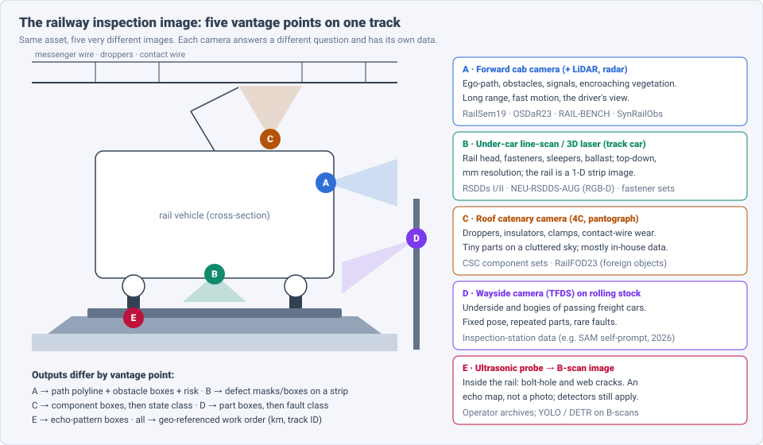
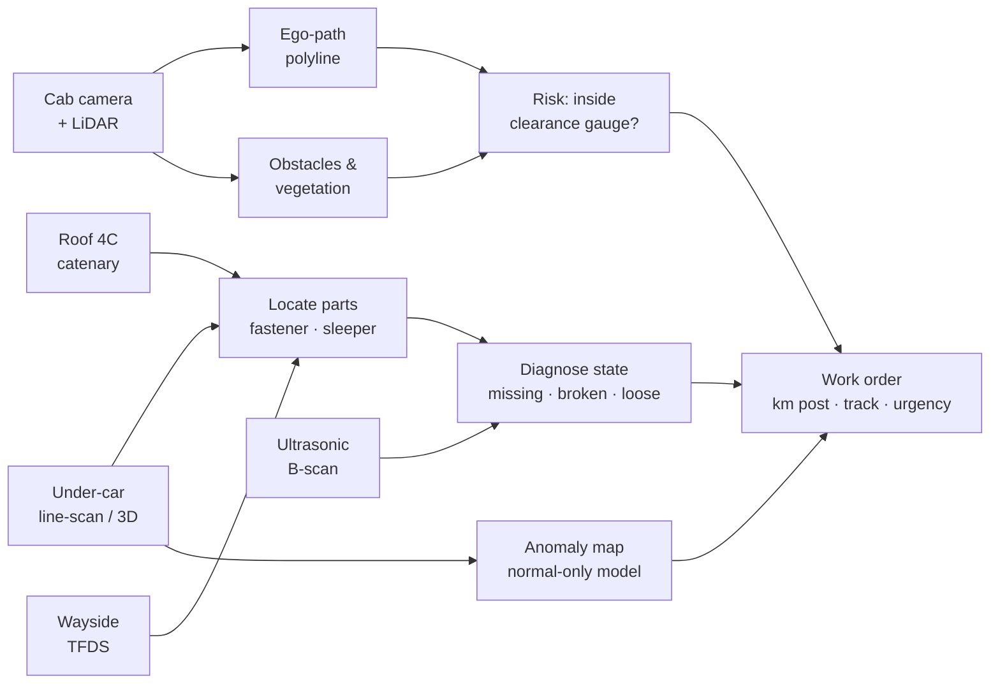
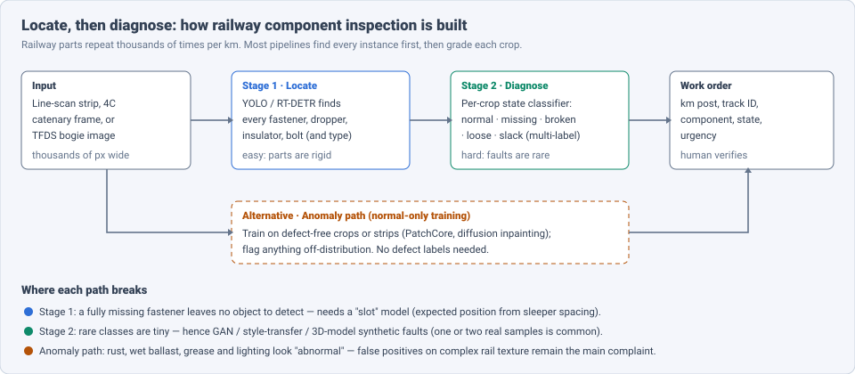

# Dense Object Detection & Classification — Recent Advances

*Compiled 2026-Oct-17 (America/Los_Angeles).*

Next installment in the running CV-updates log. Earlier entries on
`main`:
[Apr-30](../2026-Apr-30/2026-Apr-30_CV_updates.md),
[May-01](../2026-May-01/2026-May-01_CV_updates.md),
[May-02](../2026-May-02/2026-May-02_CV_updates.md),
[May-04](../2026-May-04/2026-May-04_CV_updates.md),
[May-05](../2026-May-05/2026-May-05_CV_updates.md),
[May-07](../2026-May-07/2026-May-07_CV_updates.md),
[May-08](../2026-May-08/2026-May-08_CV_updates.md),
[May-15](../2026-May-15/2026-May-15_CV_updates.md),
[May-16](../2026-May-16/2026-May-16_CV_updates.md),
[May-17](../2026-May-17/2026-May-17_CV_updates.md),
[Jun-09](../2026-Jun-09/2026-Jun-09_CV_updates.md),
[Jun-10](../2026-Jun-10/2026-Jun-10_CV_updates.md),
[Jun-12](../2026-Jun-12/2026-Jun-12_CV_updates.md),
[Jun-15](../2026-Jun-15/2026-Jun-15_CV_updates.md),
[Jun-16](../2026-Jun-16/2026-Jun-16_CV_updates.md),
[Jun-17](../2026-Jun-17/2026-Jun-17_CV_updates.md),
[Jun-19](../2026-Jun-19/2026-Jun-19_CV_updates.md),
[Jun-21](../2026-Jun-21/2026-Jun-21_CV_updates.md),
[Jun-22](../2026-Jun-22/2026-Jun-22_CV_updates.md),
[Jun-23](../2026-Jun-23/2026-Jun-23_CV_updates.md),
[Jun-24](../2026-Jun-24/2026-Jun-24_CV_updates.md),
[Jun-25](../2026-Jun-25/2026-Jun-25_CV_updates.md),
[Jun-27](../2026-Jun-27/2026-Jun-27_CV_updates.md),
[Jun-29](../2026-Jun-29/2026-Jun-29_CV_updates.md),
[Jun-30](../2026-Jun-30/2026-Jun-30_CV_updates.md),
[Jul-04](../2026-Jul-04/2026-Jul-04_CV_updates.md),
[Jul-07](../2026-Jul-07/2026-Jul-07_CV_updates.md),
[Jul-08](../2026-Jul-08/2026-Jul-08_CV_updates.md),
[Jul-10](../2026-Jul-10/2026-Jul-10_CV_updates.md),
[Jul-15](../2026-Jul-15/2026-Jul-15_CV_updates.md),
[Jul-17](../2026-Jul-17/2026-Jul-17_CV_updates.md),
[Jul-18](../2026-Jul-18/2026-Jul-18_CV_updates.md),
[Jul-21](../2026-Jul-21/2026-Jul-21_CV_updates.md),
[Jul-22](../2026-Jul-22/2026-Jul-22_CV_updates.md),
[Jul-24](../2026-Jul-24/2026-Jul-24_CV_updates.md),
[Jul-26](../2026-Jul-26/2026-Jul-26_CV_updates.md),
[Jul-27](../2026-Jul-27/2026-Jul-27_CV_updates.md),
[Jul-30](../2026-Jul-30/2026-Jul-30_CV_updates.md),
[Aug-01](../2026-Aug-01/2026-Aug-01_CV_updates.md),
[Aug-02](../2026-Aug-02/2026-Aug-02_CV_updates.md),
[Aug-04](../2026-Aug-04/2026-Aug-04_CV_updates.md),
[Aug-07](../2026-Aug-07/2026-Aug-07_CV_updates.md),
[Aug-10](../2026-Aug-10/2026-Aug-10_CV_updates.md),
[Aug-11](../2026-Aug-11/2026-Aug-11_CV_updates.md),
[Aug-13](../2026-Aug-13/2026-Aug-13_CV_updates.md),
[Aug-15](../2026-Aug-15/2026-Aug-15_CV_updates.md),
[Aug-16](../2026-Aug-16/2026-Aug-16_CV_updates.md),
[Aug-18](../2026-Aug-18/2026-Aug-18_CV_updates.md),
[Aug-19](../2026-Aug-19/2026-Aug-19_CV_updates.md),
[Aug-21](../2026-Aug-21/2026-Aug-21_CV_updates.md),
[Aug-22](../2026-Aug-22/2026-Aug-22_CV_updates.md),
[Aug-24](../2026-Aug-24/2026-Aug-24_CV_updates.md),
[Aug-26](../2026-Aug-26/2026-Aug-26_CV_updates.md),
[Aug-29](../2026-Aug-29/2026-Aug-29_CV_updates.md),
[Sep-01](../2026-Sep-01/2026-Sep-01_CV_updates.md),
[Sep-20](../2026-Sep-20/2026-Sep-20_CV_updates.md),
[Sep-23](../2026-Sep-23/2026-Sep-23_CV_updates.md),
[Sep-24](../2026-Sep-24/2026-Sep-24_CV_updates.md),
[Sep-25](../2026-Sep-25/2026-Sep-25_CV_updates.md),
[Sep-26](../2026-Sep-26/2026-Sep-26_CV_updates.md),
[Sep-29](../2026-Sep-29/2026-Sep-29_CV_updates.md),
[Sep-30](../2026-Sep-30/2026-Sep-30_CV_updates.md),
[Oct-01](../2026-Oct-01/2026-Oct-01_CV_updates.md),
[Oct-02](../2026-Oct-02/2026-Oct-02_CV_updates.md),
[Oct-03](../2026-Oct-03/2026-Oct-03_CV_updates.md),
[Oct-04](../2026-Oct-04/2026-Oct-04_CV_updates.md),
[Oct-05](../2026-Oct-05/2026-Oct-05_CV_updates.md),
[Oct-06](../2026-Oct-06/2026-Oct-06_CV_updates.md),
[Oct-07](../2026-Oct-07/2026-Oct-07_CV_updates.md),
[Oct-08](../2026-Oct-08/2026-Oct-08_CV_updates.md),
[Oct-09](../2026-Oct-09/2026-Oct-09_CV_updates.md),
[Oct-10](../2026-Oct-10/2026-Oct-10_CV_updates.md),
[Oct-11](../2026-Oct-11/2026-Oct-11_CV_updates.md),
[Oct-12](../2026-Oct-12/2026-Oct-12_CV_updates.md),
[Oct-13](../2026-Oct-13/2026-Oct-13_CV_updates.md),
[Oct-14](../2026-Oct-14/2026-Oct-14_CV_updates.md),
[Oct-15](../2026-Oct-15/2026-Oct-15_CV_updates.md),
[Oct-16](../2026-Oct-16/2026-Oct-16_CV_updates.md).

The last entry covered the [sewer pipe inspection image](../2026-Oct-16/2026-Oct-16_CV_updates.md).
Today's primitive stays with linear infrastructure but comes back above
ground: the **railway inspection image**. This is any image taken to
keep a railway safe and running: the forward view from a train cab, a
top-down line-scan strip of the rail from a track-recording car, a
roof-camera frame of the overhead catenary, a wayside photo of a
passing freight car's underside, and even the ultrasonic B-scan of the
rail's interior. The question is "on which track, at which kilometre
post, which component is missing, broken, worn or obstructed, and how
soon must a crew go out?"

Earlier entries touched rail only in passing.
[May-05](../2026-May-05/2026-May-05_CV_updates.md) cited conformal
risk control for *railway signalling*, and
[Aug-24](../2026-Aug-24/2026-Aug-24_CV_updates.md) mentioned fibre-optic
(DAS) train tracking. The closest neighbours are
[Oct-12](../2026-Oct-12/2026-Oct-12_CV_updates.md) (road surface),
[Oct-13](../2026-Oct-13/2026-Oct-13_CV_updates.md) (power lines — the
catenary shares insulators and fittings with them) and
[Oct-16](../2026-Oct-16/2026-Oct-16_CV_updates.md) (sewer). No earlier
entry treated the railway image as a modality of its own; this one does.

Six properties make the railway image a distinct problem:

- **One asset, five cameras.** Cab, under-car, roof, wayside and
  ultrasonic images look nothing alike and have separate datasets.
  "Railway CV" is really five sub-fields that share a work order (§2).
- **The track is a curve, not a box.** The most important object for a
  train — its own path — is a thin polyline that splits at switches.
  Rail-specific metrics (LineAP) and ego-path formulations exist for
  this reason (§3).
- **Parts repeat thousands of times per km.** Fasteners, sleepers,
  droppers and bogie bolts are rigid and identical. Finding them is easy;
  telling a loose one from a good one is not. This drives a
  locate-then-diagnose design (§4, §5).
- **Faults are rare and data is closed.** Rail operators hold the
  images; public rail-defect sets are tiny (RSDDs Type-I has 67 images).
  Few-shot generation and anomaly detection carry much of the field
  (§4, §6).
- **The front view is safety-critical and open-set.** Anything can be
  on the track. A closed-class obstacle detector is not enough, which
  pulls in synthetic data and vision-language models (§3, §7).
- **Benchmarks only arrived in 2026.** RAIL-BENCH (Apr 2026) is
  presented as the first perception benchmark suite for the railway
  domain with hidden test labels and public scoreboards (§3).

> **Numbers below come from search-engine abstracts, arXiv/journal
> landing-page snippets and third-party summary pages. I did not read
> the full papers** (arxiv.org, alphaxiv.org and
> isprs-archives.copernicus.org failed DNS resolution through WebFetch on
> this run). Treat every number as an author-reported, abstract-level
> claim. Datasets, splits and metrics differ between papers; do not
> compare numbers across rows unless the text says they share a
> protocol.

---

## Table of contents

1. [Why this pass](#1--why-this-pass)
2. [The primitive: five vantage points, one work order](#2--the-primitive-five-vantage-points-one-work-order)
3. [The forward view: ego-path, obstacles and the first benchmark suite](#3--the-forward-view-ego-path-obstacles-and-the-first-benchmark-suite)
4. [Track components: rail surface and fasteners](#4--track-components-rail-surface-and-fasteners)
5. [Catenary and rolling stock: tiny parts, fixed poses](#5--catenary-and-rolling-stock-tiny-parts-fixed-poses)
6. [Learning without defect labels: anomaly and generation](#6--learning-without-defect-labels-anomaly-and-generation)
7. [Foundation models and vision-language reasoning](#7--foundation-models-and-vision-language-reasoning)
8. [Beyond RGB: LiDAR and ultrasonic B-scans](#8--beyond-rgb-lidar-and-ultrasonic-b-scans)
9. [Open problems / what to watch](#9--open-problems--what-to-watch)
10. [Sources](#10--sources)

---

## 1 · Why this pass

Railways are a good stress test for "dense detection in the wild"
because they combine every hard case from the last week of entries:
thin structures like road cracks, small fittings on a cluttered
background like power lines, and long linear assets inspected by a
moving vehicle like sewers. On top of that, the forward view is a
**safety function**: a missed obstacle is a collision, not a
maintenance delay.

Three things changed in 2025–26 and make this a good moment:

1. **Shared evaluation.** RAIL-BENCH (arXiv 2604.22507) bundles five
   tasks — rail track detection, object detection, vegetation
   segmentation, multi-object tracking and monocular visual odometry —
   with withheld test labels and public scoreboards. Before this, papers
   mostly reported on RailSem19 (2019) or private data.
2. **Foundation models reached the track.** SAM adapters for railway
   scenes (RailSAM, ITSC 2025), a self-prompting lightweight SAM for
   freight-train faults (arXiv 2603.12624, Mar 2026) and a LISA-based
   reasoning ego-path model (ISPRS 2026) all appeared within a year.
3. **Synthetic data matured.** SynRailObs (diffusion-generated rare
   obstacles) and the SynDRA line (segmentation, then 2D/3D boxes and
   LiDAR) target the "anything can be on the track" problem — while a
   2026 ITSC paper argues the sim-to-real gap is still open.

---

## 2 · The primitive: five vantage points, one work order

The figure shows the five places a railway image comes from. They differ
in geometry, resolution, labels and risk:

| Vantage | Typical sensor | Main targets | Output | Public data |
|---|---|---|---|---|
| A · Forward cab | RGB / IR camera, LiDAR, radar | ego-path, obstacles, signals, vegetation | polylines, boxes, masks, risk | RailSem19, OSDaR23, RAIL-BENCH, SynRailObs, SynDRA |
| B · Under-car / track car | line-scan camera, 3D laser, RGB-D | rail-head defects, fasteners, sleepers | masks / boxes on a strip | RSDDs I/II, NEU-RSDDS-AUG, Roboflow fastener sets |
| C · Roof / catenary (4C) | high-res strobe cameras | droppers, insulators, clamps, contact wire | component box → state class | mostly in-house; RailFOD23 for foreign objects |
| D · Wayside (TFDS) | fixed trackside cameras | freight-car underside, bogies, bolts | part box → fault class | inspection-station data, rarely public |
| E · Ultrasonic | rail-borne probes | bolt-hole and web cracks inside the rail | echo-pattern boxes / classes | operator archives |

All five end in the same place: a geo-referenced work order (line,
track, kilometre post, component, state, urgency) that a human checks.

---

## 3 · The forward view: ego-path, obstacles and the first benchmark suite

**Datasets.** The forward view has the best public data in railways,
though still far less than driving:

- **RailSem19** (CVPRW 2019): 8,500 annotated ego-perspective frames
  from trains and trams (≈1,000 with level crossings, 1,200 tram
  scenes). Its dense labels mix manual geometry with weak labels from
  road-domain segmentation networks; later work reports noisy and
  missing annotations. It is still the default benchmark.
- **OSDaR23** (Hamburg, Sept 2021 recording; released 2023): 45
  multi-sensor sequences (RGB and IR cameras, LiDAR, radar, GNSS/IMU)
  with 204,091 polyline, polygon, box and cuboid annotations over 20
  classes. Billed as the first public multi-sensor rail dataset with
  rich object classes.
- **RAIL-BENCH** (arXiv 2604.22507, KIT, Apr 2026): five challenges —
  rail track detection, object detection, vegetation segmentation (low
  vs high growth, framed as clearance-gauge violation), multi-object
  tracking and monocular visual odometry. Test ground truth is
  withheld; predictions are scored on a server with public
  scoreboards. For track detection it models rails as polylines and
  introduces a segment-based metric, **LineAP**, compared against
  ChamferAP. *(I could not retrieve the baseline numbers.)*

**Rail and ego-path detection.** Two families compete:

- **Row-/anchor-based** detectors borrowed from lane detection.
  Rail-Net with the Rail-DB benchmark (7,432 image pairs) reports
  92.77% accuracy at 312 FPS for its light model; DALNet-style dynamic
  anchor lines adapt to track shape. Anchor methods are described as
  faster than segmentation at similar accuracy.
- **Ego-path** formulations predict only the track the train will
  actually take. TEP-Net (arXiv 2403.13094) is regression-based and
  decoder-free and reports 97.5% IoU on extended RailSem19 labels.
  Single-frame only; temporal models are listed as future work.

**Scene understanding and risk.** RailSafeNet (arXiv 2509.12125, Univ.
of West Bohemia) is a typical 2025 pipeline: a class-filtered SegFormer
B3 (65% IoU on RailSem19) for track, a fine-tuned YOLOv8 (75.6%
mAP@0.5) for objects, and a rule-based distance assessor that uses the
1,435 mm standard gauge as a ruler to classify risk from a single
camera.

**Foreign objects.** RailFOD23 (*Scientific Data*, 2024) targets
foreign objects on railway power lines (balloons, kite wires, plastic).
AARFOD merges it with the airport FOD-A set (48,409 images, 35
categories, 74,334 objects) for an improved YOLOv5. YOLO-UAT (*IEEE
Access*, Jan 2025) does intrusion detection from UAV imagery with an
EfficientNet backbone. BDANet (2025) treats intrusion as pixel-level
segmentation on a COCO-Stuff-Rail subset and notes the shortage of
mature railway datasets compared to road.

**What's still missing:** open-set obstacle segmentation for the
forward view. Search turned up older "obstacle as anomaly on the main
track" work (HAL 03379922) and GAN-generated anomalies (Railset, 2022),
but no 2025–26 rail equivalent of the road-domain
anomaly-segmentation benchmarks.

---

## 4 · Track components: rail surface and fasteners

**Rail surface defects** (squats, spalling, shelling, corrugation,
cracks) are imaged top-down by line-scan or RGB-D cameras under a track
car. The public sets are small: **RSDDs** Type-I (67 images, 160×1000
px, express lines) and Type-II (128 images, 55×1250 px, heavy-haul),
plus the RGB-D **NEU-RSDDS-AUG** from Northeastern University's Song
group. Results in 2025–26:

- **LPCAN** (arXiv 2601.09118, Jan 2026) — RGB-D, MobileNetv2 for RGB,
  a light pyramid module for depth, cross-attention fusion. Evaluated
  on NEU-RSDDS-AUG, RSDD-Type1 and RSDD-Type2 against 18 methods; reports
  9.90 M params, 2.50 GFLOPs, 162.6 fps, and +1.48% S_α, +0.86% IoU,
  +1.77% MAE over the best baseline. The trend is clear: RGB-D saliency
  with an edge-sized budget.
- **YOLOv12 instance segmentation** for track defects (EasyChair, 2026)
  — crack, flaking, shelling, spalling and joint classes, mAP@0.5 of
  0.976, with joints the weak class. Unknown peer-review status.
- **Squats** — a modified YOLOv8 with multi-scale convolutions and
  attention reports 0.92 accuracy (*IJEECS*, Nov 2025); a cascade model
  for urban railways identifies railhead corrugation with 95.5% F1 on a
  550 m test section (*J. Civil Struct. Health Monit.*, 2025). Head
  checks still lack a dedicated image-based paper in what I found.

**Fasteners** are the textbook case for locate-then-diagnose (next
figure).

- **TGEM-FDD** (*Applied Sciences*, 2025) — two stages: an enhanced
  YOLOv8s finds each fastener *and its type*, then a type-specific
  multi-label classifier diagnoses co-occurring defects. Built for mixed
  fastener types on one line.
- **DP-YOLO** (*Sensors*, 2025) — light YOLOv5s variant; on the Roboflow
  fastener-defect set reports 87.1% accuracy, +1.3 mAP@0.5 and +2.1
  mAP@0.5:0.95 over YOLOv5s, with 15.19% fewer FLOPs.
- **3D line-laser + detection** (*PLOS ONE*, 2026) — measures bolt
  height to catch loosening, reporting ≥90% precision and 91% recall for
  severe loosening. Loosening is a geometric fact that RGB alone barely
  shows — the same lesson as sewer deformation on Oct-16.
- **Synthetic faults** — YOLOv8-FAM (*Autom. Constr.* 162, 2024) uses
  style-transferred synthetic defects (+8% accuracy, −40% acquisition
  cost); a 2026 *Engineering Structures* paper combines 3D modelling and
  style transfer to synthesise defective fasteners; a GAN-fed YOLOv3
  appears in *Sensors and Materials* (2025).

**Classification baselines.** RailTrack-DaViT (2024) reports 96.9%
(rail), 98.9% (fastener/fishplate) and 98.8% (multi-fault) accuracy on
image-level sets. Saturated image classification on small sets is a
recurring pattern — compare Sewer-ML on Oct-16 and OCT2017 on Jul-24.

---

## 5 · Catenary and rolling stock: tiny parts, fixed poses

**Catenary (overhead contact system).** In China the **4C** inspection
system photographs catenary support components from a vehicle roof at
high resolution. Targets are droppers (slack, broken), insulators
(cracked, dirty), clamps, bolts and contact-wire wear.

- **MSIM-YOLOv11m** (PMC, 2025–26) — catenary components broadly:
  mAP50-95 78.3%, small-target AP 64.7%, and 50.5% less compute than
  YOLOv9m.
- **MDR-YOLOv8n** (*J. Shandong Univ.* 56(2), 2026) — multi-scale
  dynamic-rotation YOLOv8n with a local attention module in C2f, for
  dropper slack and fracture on 4C images. Dropper faults remain
  under-studied compared to insulators.
- **RCID-YOLOv5s** (*PeerJ CS*) — insulator defects, AP 98.0%.
- A **survey** in *Intelligent Transportation Infrastructure* (OUP)
  groups catenary defect methods into four model categories and
  compares them; a Springer monograph covers CNN, RL and GAN methods
  for catenary support components. A 2026 NAISS project plans
  contact-wire *crack* segmentation from lab bending tests — evidence of
  how thin that sub-area is.

The catenary image is close kin to the
[Oct-13 power-line image](../2026-Oct-13/2026-Oct-13_CV_updates.md):
small fittings, sky clutter, rotated boxes. The difference is that the
camera rides on the train at speed with strobes, so pose is fixed and
images repeat span after span.

**Rolling stock (TFDS).** Wayside cameras under the track photograph
every freight car as it passes. Parts are in fixed positions, which
favours two-stage locate-then-classify (the 2017 *Neurocomputing* side-
frame-key and shaft-bolt system is the classic). In 2026 the
foundation-model route arrived:

- **Prompt-driven lightweight SAM for freight-train faults** (arXiv
  2603.12624, Mar 2026, HBUT/HUST) — a self-prompt module generates
  task-specific prompts so SAM needs no clicks; a TinyViT backbone fits
  edge hardware. On real inspection-station data: 74.6 AP^box and 74.2
  AP^mask, above prior methods. Code under MVME-HBUT.
- Vendors claim large screening gains (e.g. filtering >95% of fault-free
  images). These are marketing figures without a public protocol.

---

## 6 · Learning without defect labels: anomaly and generation

Rare faults push the field toward two strategies.

**Generate the faults.** The strongest 2026 example is *Rail surface
defect detection via sample generation and style transfer under
extremely limited sample conditions* (*Autom. Constr.* 188, 106999, Aug
2026): from **one or two** real defect samples it generates augmented
and style-transferred variants (feature-learning network with a
sub-discriminator + generation network) and reports **>8 pp mAP@0.5**
on YOLOv9 — better, the authors say, than training on twice as much
real data. Fastener work (§4) follows the same recipe.

**Model only "normal".**

- **Cold-diffusion inpainting** (Han et al., *Autom. Constr.*, Sept
  2025) — unsupervised rail-damage segmentation; MIoU/F1 0.864/0.844 on
  RSDDs-I.
- **Line-scan generative anomaly detection** (Xing, Univ. of York PhD,
  2025) — treats the line-scan strip's vertical axis as time and builds
  generative models for that spatiotemporal structure.
- **Forward-camera comparison** (Miltiadous, LIACS MSc, 2025) — compared
  supervised and unsupervised models including PatchCore on train-mounted
  footage; a supervised DeiT-Small won.
- **FS-RSDD** (2023) — prototype memory bank from normal samples, ROC
  95.2% / 99.1% on two rail sets.

The recurring complaint is **false positives on complex rail texture**:
rust, grease, wet ballast and lighting all look "abnormal". That, plus
the LIACS result, suggests anomaly models work best as a pre-filter in
front of a supervised stage, not as the final decision.

---

## 7 · Foundation models and vision-language reasoning

- **RailSAM** (ITSC 2025) — frozen SAM encoder; railway knowledge is
  injected as visual prompts into the mask decoder through adapters.
  Evaluated on RailSem19.
- **Freight-train self-prompt SAM** (§5) — the same idea for faults.
- **DINOv2-assisted LiDAR labelling** (IDEAL 2024) — a transformer
  pipeline labels railway point clouds 6× faster than manual labelling.
- **VLM review** — *The Emerging Role of Vision-Language Models in the
  Automation of Railway Asset Management* (Varghese, Ghorbanalivakili,
  Sohn; ISPRS Archives XLIX-B2-2026, 745–753, 23 Jul 2026). The argument:
  rail CV is stuck in a closed-world assumption; open-vocabulary
  detection and reasoning segmentation map onto the open problems.
- **Reasoning-guided ego-path segmentation** (same group, ISPRS
  XLIX-B3-2026, 89ff., 30 Jul 2026) — adapts **LISA** so that a text query
  plus a cab image yields an ego-path mask *and* a textual reason,
  focusing on switches where route validity depends on blade–stock-rail
  contact and gaps. Beats the original LISA checkpoint on a
  RailSem19-based set and is more robust to prompt wording, but the
  reasoning set has only **54 samples** and explanations are "plausible
  but not always consistent". The authors call for stronger supervision
  before safety use. Code: `mvakili96/Railway_Perception_FoundationModel`.

The honest summary: VLMs in rail are at the review-and-pilot stage.
The most practical 2026 wins are SAM-style models made cheap
(self-prompting, TinyViT) for fixed-pose inspection, not open-ended
reasoning in the cab.

---

## 8 · Beyond RGB: LiDAR and ultrasonic B-scans

**LiDAR.** Rail LiDAR has become a dataset race:

- **OSDaR23** LiDAR + **Point Transformer V3** (arXiv 2504.18213, 2025)
  — a data-centric study; a *track sparsification* augmentation
  redistributes point density and improves far-range track segmentation
  with little cost up close.
- **RailCloud-HdF** (2024) — railborne LiDAR covering >267 km with dense
  point-wise labels.
- **RailPC** (*CAAI TIT*, 2024) — large railway point-cloud segmentation
  set.
- **Fraunhofer** (2024) — camera + LiDAR on a German line, 2DPASS with
  semi-automatic labelling and active learning; 71.48% mIoU on 9 classes
  from 602 coarsely labelled scans.
- **SynDRA-BBox** (2025) — synthetic 2D/3D boxes and LiDAR; a
  semi-supervised domain-adaptation method from automotive transferred
  to rail for 3D detection.

**Ultrasonic B-scans.** The rail interior is inspected with ultrasonic
probes; the B-scan is an echo image, but detectors apply unchanged.
Wang et al. (*Applied Sciences*, 2024) trained YOLOv8, YOLOv5, DETR and
Faster R-CNN on four defect types including bolt-hole and web cracks; a
2025 *Int. J. Steel Struct.* paper uses hierarchical classification
(testing ResNet, Swin, Conformer, EfficientNet-B7); a BINDT 2024 case
study uses a model both for live operator assistance and for labelling
archives; a physics-ML hybrid reconstructs 3D rail defects from 2D
B-scans (9.56–21.14% average size error).

---

## 9 · Open problems / what to watch

1. **RAIL-BENCH scoreboards.** The first common leaderboard for rail
   perception. Watch whether LineAP becomes the standard track metric
   and whether foundation models top the obstacle and vegetation
   tracks.
2. **Open-set obstacles.** No public 2025–26 benchmark for "unknown
   object on the ego-path" segmentation that I could find. Synthetic
   sets (SynRailObs, SynDRA) are the stopgap; the 2026 ITSC paper says
   they cannot fully replace real data.
3. **Missing-part detection.** A detector cannot box a fastener that is
   not there. Slot models that predict *expected* positions from sleeper
   spacing and flag empty slots deserve more work.
4. **Geometry over appearance.** Loosening, wear and corrugation are 3D.
   3D line-laser and RGB-D results (§4) beat RGB at these; expect more
   RGB-D fusion at edge budgets like LPCAN's.
5. **Closed data.** Operators hold most images; catenary and TFDS work is
   mostly in-house. Cross-railway generalisation is almost never
   reported.
6. **VLM reliability.** 54 reasoning samples is a pilot. Safety cases
   for ego-path decisions will need far larger, auditable sets — and
   probably conformal-style guarantees like those discussed on
   [May-05](../2026-May-05/2026-May-05_CV_updates.md).

---

## 10 · Sources

### Benchmarks and datasets

- RAIL-BENCH: A Benchmark Suite for Perception in the Railway Domain — arXiv 2604.22507 — https://arxiv.org/abs/2604.22507 — https://arxiv.org/html/2604.22507v1 — scoreboards: https://www.mrt.kit.edu/railbench
- RailSem19: A Dataset for Semantic Rail Scene Understanding (CVPRW 2019) — https://openaccess.thecvf.com/content_CVPRW_2019/html/WAD/Zendel_RailSem19_A_Dataset_for_Semantic_Rail_Scene_Understanding_CVPRW_2019_paper.html
- OSDaR23: Open Sensor Data for Rail 2023 — arXiv 2305.03001 — https://arxiv.org/abs/2305.03001v1 — https://www.asam.net/news-media/detail/news/first-open-multi-sensor-dataset-to-develop-automatic-train-operation-uses-asam-openlabel-to-annotate-data
- RailFOD23: foreign object detection on railroad transmission lines — *Scientific Data* — https://www.ncbi.nlm.nih.gov/pmc/articles/PMC10791632/
- SynRailObs: A Synthetic Dataset for Obstacle Detection in Railway Scenarios — arXiv 2505.10784 — https://arxiv.org/abs/2505.10784
- SynDRA — https://syndra.retis.santannapisa.it/ — Nesti et al., ITSC 2026 — https://retis.santannapisa.it/~giorgio/paps/2026/Nesti-ITSC26.pdf
- RailCloud-HdF (2024) — https://scitepress.org/PublishedPapers/2024/123948
- RailPC (CAAI TIT, 2024) — https://ietresearch.onlinelibrary.wiley.com/doi/10.1049/cit2.12349

### Forward view (§3)

- Train Ego-Path Detection on Railway Tracks Using End-to-End Deep Learning (TEP-Net) — arXiv 2403.13094 — https://arxiv.org/abs/2403.13094v1
- Rail Detection: An Efficient Row-based Network and a New Benchmark (Rail-Net / Rail-DB) — arXiv 2304.05667 — https://www.arxiv.org/abs/2304.05667
- Ultra-Fast Adaptive Track Detection Network — arXiv 2405.13538 — https://arxiv.org/html/2405.13538v1
- RailSafeNet: Visual Scene Understanding for Tram Safety — arXiv 2509.12125 — https://arxiv.org/abs/2509.12125v2
- Improved YOLOv5 with FasterNet for foreign objects on railway and airway tracks (AARFOD) — arXiv 2403.08499 — https://arxiv.org/pdf/2403.08499
- YOLO-UAT (IEEE Access, Jan 2025) — https://doaj.org/article/23f6709ff63947a9898ccd713fbf2003
- Deep-learning-based railway foreign object intrusion (BDANet) — https://research.buaa.edu.cn/en/publications/deep-learning-based-railway-foreign-object-intrusion-intelligent-/
- Obstacles as anomalies on the main track — https://hal-uphf.archives-ouvertes.fr/hal-03379922
- Railset: a dataset for railway anomaly detection — https://repository.adu.ac.ae/items/409ad68b-59cf-4c4f-abee-8962c9471d20

### Track components (§4)

- LPCAN: Lightweight Pyramid Cross-Attention Network for Rail Surface Defect Detection Using RGB-D Data — arXiv 2601.09118 — https://arxiv.org/abs/2601.09118
- YOLOv12 instance segmentation for railway track defects (EasyChair, 2026) — https://easychair.org/smart-slide/slide/v3nx
- Two-Stage Multi-Label Detection Method for Railway Fasteners Based on Type-Guided Expert Model (TGEM-FDD) — https://ouci.dntb.gov.ua/works/400VjgOv
- DP-YOLO fastener defects (*Sensors* 25(7):2139, 2025) — https://www.mdpi.com/1424-8220/25/7/2139/xml
- Integrated 3D line-laser fastener inspection (*PLOS ONE*, 2026) — https://ideas.repec.org/a/plo/pone00/0341210.html
- YOLOv8-FAM with style-transfer synthetic data — https://trid.trb.org/View/2351074
- Hybrid 3D modelling and style transfer for defective rail fasteners — https://trid.trb.org/View/2703134
- Improved FasterNet + YOLOv8s fastener detection (J. Beijing Jiaotong Univ., 2025) — https://jdxb.bjtu.edu.cn/EN/10.11860/j.issn.1673-0291.20250014
- YOLOv3 with GAN data (*Sensors and Materials*, 2025) — https://sensors.myu-group.co.jp/sm_pdf/SM4150.pdf
- RailTrack-DaViT — https://www.ncbi.nlm.nih.gov/pmc/articles/PMC11355430/
- Squat detection with modified YOLOv8 (*IJEECS*, 2025) — https://ijeecs.iaescore.com/index.php/IJEECS/article/download/41746/19712
- Real-time urban railway damage detection, cascade deep learning — https://pure.uos.ac.kr/en/publications/real-time-urban-railway-damage-detection-based-cascade-deep-learn/
- NEU-RSDDS-AUG / Song group — https://faculty.neu.edu.cn/songkc/en/zdylm/395562/list/index.htm

### Catenary and rolling stock (§5)

- Optimized YOLOv11m for real-time high-speed railway catenary defect detection — https://www.ncbi.nlm.nih.gov/pmc/articles/PMC12764556/
- MDR-YOLOv8n dropper states (*J. Shandong Univ.* 56(2), 2026) — https://gxbwk.njournal.sdu.edu.cn/EN/Y2026/V56/I2/1
- Detection of railway catenary insulator defects based on improved YOLOv5s — https://peerj.com/articles/cs-1474
- YOLOv5s-D dropper state identification (*Applied Sciences* 13(13):7881) — https://www.mdpi.com/2076-3417/13/13/7881
- Survey of intelligent defect detection for railway catenary (*Intell. Transp. Infrastruct.*) — https://academic.oup.com/iti/article/8322266
- Deep Learning-Based Detection of Catenary Support Component Defect and Fault in High-Speed Railways (Springer) — https://www.springer.com/book/9789819909520
- Contact-wire crack segmentation project (NAISS) — https://supr.naiss.se/public/project/38025/
- Prompt-Driven Lightweight Foundation Model for Instance Segmentation-Based Fault Detection in Freight Trains — arXiv 2603.12624 — https://arxiv.org/abs/2603.12624
- Automatic multi-fault recognition in TFDS based on CNNs — https://research.buaa.edu.cn/en/publications/automatic-multi-fault-recognition-in-tfds-based-on-convolutional-/
- Huawei TFDS solution (vendor claims) — https://www.globalrailwayreview.com/huawei-s-tfds-solution-transforming-train-operations-with-ai-driven-fault-identification-technology/295789.article

### Anomaly and generation (§6)

- Rail surface defect detection via sample generation and style transfer under extremely limited sample conditions (*Autom. Constr.* 188, 2026) — https://pure.bit.edu.cn/en/publications/rail-surface-defect-detection-via-sample-generation-and-style-tra/
- Unsupervised anomaly segmentation for rail damage via image inpainting and cold diffusion — https://www.worldtransitresearch.info/research/11419
- Generative unsupervised anomaly detection for railway line-scan imagery (Xing, York PhD) — https://etheses.whiterose.ac.uk/id/eprint/38256/
- Forward-camera anomaly detection thesis (Miltiadous, LIACS 2025–26) — https://theses.liacs.nl/pdf/2025-2026-MiltiadousMMyriana.pdf
- FS-RSDD: Few-Shot Rail Surface Defect Detection with Prototype Learning — https://www.ncbi.nlm.nih.gov/pmc/articles/PMC10536558/

### Foundation models and VLMs (§7)

- RailSAM: Taming SAM with Adapter for Railway Segmentation (ITSC 2025) — https://research.buaa.edu.cn/en/publications/railsam-taming-sam-with-adapter-for-railway-segmentation/
- The Emerging Role of Vision-Language Models in the Automation of Railway Asset Management (ISPRS Archives XLIX-B2-2026) — https://isprs-archives.copernicus.org/articles/XLIX-B2-2026/745/2026/
- Reasoning-guided Ego-path Segmentation for Autonomous Trains using Vision-language Models (ISPRS Archives XLIX-B3-2026) — https://isprs-archives.copernicus.org/articles/XLIX-B3-2026/89/2026/

### LiDAR and ultrasonic (§8)

- A Data-Centric Approach to 3D Semantic Segmentation of Railway Scenes — arXiv 2504.18213 — https://arxiv.org/abs/2504.18213
- Railway LiDAR semantic segmentation based on intelligent semi-automated data annotation — arXiv 2410.13383 — https://arxiv.org/html/2410.13383v1
- Rail flaw B-scan image analysis using a hierarchical classification model (*Int. J. Steel Struct.* 25, 2025) — https://magazine.sciencepod.net/?p=1131793
- AI-assisted ultrasonic testing of rails: a case study (BINDT NDT 2024) — https://www.bindt.org/events-and-awards/ndt-2024/abstract-4b1/
- Hybrid physics–ML for ultrasonic-field-guided 3D reconstruction of rail defects — https://researchportal.northumbria.ac.uk/en/publications/hybrid-physics-machine-learning-for-ultrasonic-field-guided-3d-ge/
