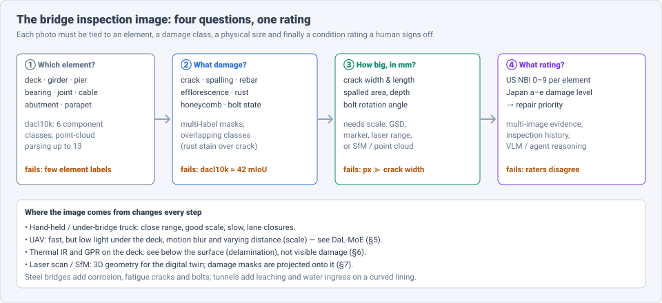
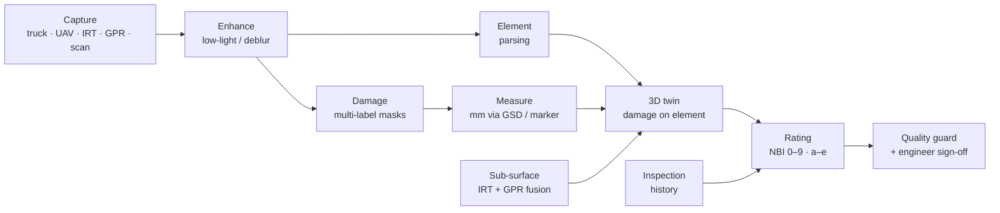
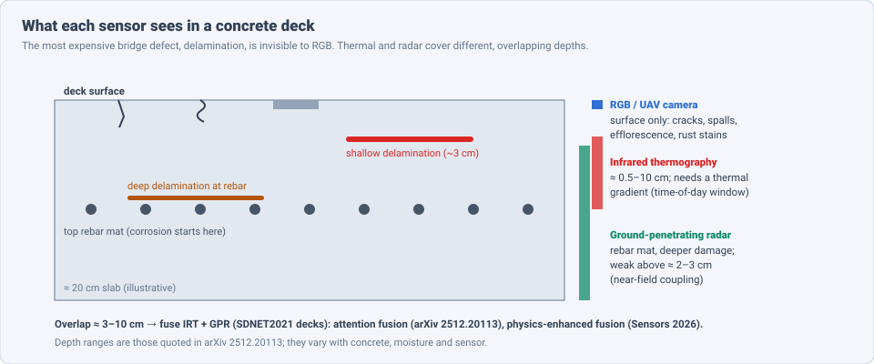

# Dense Object Detection & Classification — Recent Advances

*Compiled 2026-Oct-18 (America/Los_Angeles).*

Next installment in the running CV-updates log. Earlier entries:
[Apr-30](../2026-Apr-30/2026-Apr-30_CV_updates.md),
[May-01](../2026-May-01/2026-May-01_CV_updates.md),
[May-02](../2026-May-02/2026-May-02_CV_updates.md),
[May-04](../2026-May-04/2026-May-04_CV_updates.md),
[May-05](../2026-May-05/2026-May-05_CV_updates.md),
[May-07](../2026-May-07/2026-May-07_CV_updates.md),
[May-08](../2026-May-08/2026-May-08_CV_updates.md),
[May-15](../2026-May-15/2026-May-15_CV_updates.md),
[May-16](../2026-May-16/2026-May-16_CV_updates.md),
[May-17](../2026-May-17/2026-May-17_CV_updates.md),
[Jun-09](../2026-Jun-09/2026-Jun-09_CV_updates.md),
[Jun-10](../2026-Jun-10/2026-Jun-10_CV_updates.md),
[Jun-12](../2026-Jun-12/2026-Jun-12_CV_updates.md),
[Jun-15](../2026-Jun-15/2026-Jun-15_CV_updates.md),
[Jun-16](../2026-Jun-16/2026-Jun-16_CV_updates.md),
[Jun-17](../2026-Jun-17/2026-Jun-17_CV_updates.md),
[Jun-19](../2026-Jun-19/2026-Jun-19_CV_updates.md),
[Jun-21](../2026-Jun-21/2026-Jun-21_CV_updates.md),
[Jun-22](../2026-Jun-22/2026-Jun-22_CV_updates.md),
[Jun-23](../2026-Jun-23/2026-Jun-23_CV_updates.md),
[Jun-24](../2026-Jun-24/2026-Jun-24_CV_updates.md),
[Jun-25](../2026-Jun-25/2026-Jun-25_CV_updates.md),
[Jun-27](../2026-Jun-27/2026-Jun-27_CV_updates.md),
[Jun-29](../2026-Jun-29/2026-Jun-29_CV_updates.md),
[Jun-30](../2026-Jun-30/2026-Jun-30_CV_updates.md),
[Jul-04](../2026-Jul-04/2026-Jul-04_CV_updates.md),
[Jul-07](../2026-Jul-07/2026-Jul-07_CV_updates.md),
[Jul-08](../2026-Jul-08/2026-Jul-08_CV_updates.md),
[Jul-10](../2026-Jul-10/2026-Jul-10_CV_updates.md),
[Jul-15](../2026-Jul-15/2026-Jul-15_CV_updates.md),
[Jul-17](../2026-Jul-17/2026-Jul-17_CV_updates.md),
[Jul-18](../2026-Jul-18/2026-Jul-18_CV_updates.md),
[Jul-21](../2026-Jul-21/2026-Jul-21_CV_updates.md),
[Jul-22](../2026-Jul-22/2026-Jul-22_CV_updates.md),
[Jul-24](../2026-Jul-24/2026-Jul-24_CV_updates.md),
[Jul-26](../2026-Jul-26/2026-Jul-26_CV_updates.md),
[Jul-27](../2026-Jul-27/2026-Jul-27_CV_updates.md),
[Jul-30](../2026-Jul-30/2026-Jul-30_CV_updates.md),
[Aug-01](../2026-Aug-01/2026-Aug-01_CV_updates.md),
[Aug-02](../2026-Aug-02/2026-Aug-02_CV_updates.md),
[Aug-04](../2026-Aug-04/2026-Aug-04_CV_updates.md),
[Aug-07](../2026-Aug-07/2026-Aug-07_CV_updates.md),
[Aug-10](../2026-Aug-10/2026-Aug-10_CV_updates.md),
[Aug-11](../2026-Aug-11/2026-Aug-11_CV_updates.md),
[Aug-13](../2026-Aug-13/2026-Aug-13_CV_updates.md),
[Aug-15](../2026-Aug-15/2026-Aug-15_CV_updates.md),
[Aug-16](../2026-Aug-16/2026-Aug-16_CV_updates.md),
[Aug-18](../2026-Aug-18/2026-Aug-18_CV_updates.md),
[Aug-19](../2026-Aug-19/2026-Aug-19_CV_updates.md),
[Aug-21](../2026-Aug-21/2026-Aug-21_CV_updates.md),
[Aug-22](../2026-Aug-22/2026-Aug-22_CV_updates.md),
[Aug-24](../2026-Aug-24/2026-Aug-24_CV_updates.md),
[Aug-26](../2026-Aug-26/2026-Aug-26_CV_updates.md),
[Aug-29](../2026-Aug-29/2026-Aug-29_CV_updates.md),
[Sep-01](../2026-Sep-01/2026-Sep-01_CV_updates.md),
[Sep-20](../2026-Sep-20/2026-Sep-20_CV_updates.md),
[Sep-23](../2026-Sep-23/2026-Sep-23_CV_updates.md),
[Sep-24](../2026-Sep-24/2026-Sep-24_CV_updates.md),
[Sep-25](../2026-Sep-25/2026-Sep-25_CV_updates.md),
[Sep-26](../2026-Sep-26/2026-Sep-26_CV_updates.md),
[Sep-29](../2026-Sep-29/2026-Sep-29_CV_updates.md),
[Sep-30](../2026-Sep-30/2026-Sep-30_CV_updates.md),
[Oct-01](../2026-Oct-01/2026-Oct-01_CV_updates.md),
[Oct-02](../2026-Oct-02/2026-Oct-02_CV_updates.md),
[Oct-03](../2026-Oct-03/2026-Oct-03_CV_updates.md),
[Oct-04](../2026-Oct-04/2026-Oct-04_CV_updates.md),
[Oct-05](../2026-Oct-05/2026-Oct-05_CV_updates.md),
[Oct-06](../2026-Oct-06/2026-Oct-06_CV_updates.md),
[Oct-07](../2026-Oct-07/2026-Oct-07_CV_updates.md),
[Oct-08](../2026-Oct-08/2026-Oct-08_CV_updates.md),
[Oct-09](../2026-Oct-09/2026-Oct-09_CV_updates.md),
[Oct-10](../2026-Oct-10/2026-Oct-10_CV_updates.md),
[Oct-11](../2026-Oct-11/2026-Oct-11_CV_updates.md),
[Oct-12](../2026-Oct-12/2026-Oct-12_CV_updates.md),
[Oct-13](../2026-Oct-13/2026-Oct-13_CV_updates.md),
[Oct-14](../2026-Oct-14/2026-Oct-14_CV_updates.md),
[Oct-15](../2026-Oct-15/2026-Oct-15_CV_updates.md),
[Oct-16](../2026-Oct-16/2026-Oct-16_CV_updates.md),
[Oct-17](../2026-Oct-17/2026-Oct-17_CV_updates.md).

The last entry covered the [railway inspection image](../2026-Oct-17/2026-Oct-17_CV_updates.md).
Today's primitive is the structure that carries both roads and railways
over gaps: the **bridge (and civil concrete structure) inspection
image**. This is any image taken to rate a bridge, tunnel lining or
other concrete/steel structure: a close-range photo from an
under-bridge truck, a UAV frame under a dark deck, a thermal image of a
deck at noon, a GPR scan, or a laser point cloud. The question is
"which element is this, what damage does it carry, how large is it in
millimetres, and what condition rating does the element get?"

Earlier entries touched this only in passing.
[Oct-12](../2026-Oct-12/2026-Oct-12_CV_updates.md) (road surface)
covered the generic crack-segmentation line (SAM3 crack adapters,
SCSegamba, CrackSegFlow, CRACK500) and crack measurement on pavement;
this entry does **not** repeat that and points to it instead.
[Oct-16](../2026-Oct-16/2026-Oct-16_CV_updates.md) (sewer) and
[Oct-17](../2026-Oct-17/2026-Oct-17_CV_updates.md) (railway) are the
other linear-infrastructure neighbours, and
[Oct-13](../2026-Oct-13/2026-Oct-13_CV_updates.md) (power lines) shares the "UAV over a large structure" setting. No earlier entry
treated the bridge image as a modality of its own; this one does.

Six properties make the bridge image a distinct problem:

- **The label is a rating, not a box.** The deliverable is an element
  condition rating (US NBI 0–9, Japan's a–e damage levels) that a
  licensed engineer signs. Boxes and masks are evidence for it (§2, §8).
- **Damage classes overlap.** Rust stains run over cracks;
  efflorescence leaks out of cracks; exposed rebar sits inside spalls.
  dacl10k is *multi-label* segmentation for this reason, and its best
  baseline is only ≈ 42 mIoU (§3).
- **Size matters in millimetres.** A 0.2 mm and a 2 mm crack get
  different ratings. Every measurement needs a physical scale (§4).
- **The worst defect is invisible.** Deck delamination sits under the
  surface. RGB cannot see it; thermal IR and GPR can, at different
  depths (§6).
- **Capture is hard.** Under-deck UAV frames are dark, blurred and at
  varying distance. Restoration in front of the detector is now a
  research line of its own (§5).
- **Structures are inspected for decades.** Results must be stored,
  compared across visits and attached to a 3D model. Compact, vector
  outputs and digital twins follow from that (§7).

> **Numbers below come from search-engine abstracts, arXiv/journal
> landing-page snippets and third-party summary pages. I did not read
> the full papers** (arxiv.org failed DNS resolution through WebFetch on
> this run, so arXiv abstracts were read via search snippets and
> aggregators). Treat every number as an author-reported, abstract-level
> claim. Datasets, splits and metrics differ between papers; do not
> compare numbers across rows unless the text says they share a
> protocol.

---

## Table of contents

1. [Why this pass](#1--why-this-pass)
2. [The primitive: four questions, one rating](#2--the-primitive-four-questions-one-rating)
3. [Damage segmentation: dacl10k, CODEBRIM and the new datasets](#3--damage-segmentation-dacl10k-codebrim-and-the-new-datasets)
4. [From pixels to millimetres and to compact records](#4--from-pixels-to-millimetres-and-to-compact-records)
5. [UAV capture: saliency, low light and foundation-model labels](#5--uav-capture-saliency-low-light-and-foundation-model-labels)
6. [Below the surface: thermography and GPR](#6--below-the-surface-thermography-and-gpr)
7. [Steel, bolts, tunnels and the 3D twin](#7--steel-bolts-tunnels-and-the-3d-twin)
8. [Vision-language models and condition ratings](#8--vision-language-models-and-condition-ratings)
9. [Open problems / what to watch](#9--open-problems--what-to-watch)
10. [Sources](#10--sources)

---

## 1 · Why this pass

Bridges are the clearest case where dense detection is only an input to
a *decision with legal weight*. Three things moved in late 2025–2026:

1. **Ratings became a CV benchmark.** BridgeEQA (CVPR 2026) turns real
   inspection reports into 2,200 question–answer pairs over 200 bridge
   scenes, anchored to NBI condition ratings. A Japanese line fine-tunes
   LLaVA on 4,000 image–record pairs to predict a–e damage levels and a
   repair priority (arXiv 2605.27452, May 2026).
2. **Outputs got more structured.** FS-FSD (arXiv 2605.08781) predicts
   defects as Fourier-series contours instead of boxes or raster masks,
   for compact archiving across inspection cycles.
3. **Data stopped being only RGB crops.** synth-dacl (2025) adds
   synthetic damage to dacl10k; TTD (Dec 2025) opens tunnel-lining data;
   multi-sensor IRT+GPR fusion on SDNET2021 decks (Dec 2025 / 2026)
   targets the hidden defects.

---

## 2 · The primitive: four questions, one rating

| Question | Output | Typical method (2025–26) | Main public data |
|---|---|---|---|
| ① Which element? | component mask / point-cloud label | multi-task segmenters; PointNet++ on synthetic clouds | dacl10k (6 components), synthetic 3D bridges (13 components) |
| ② What damage? | multi-label masks, boxes, contours | FPN/UPerNet/Mask2Former; YOLOv8–v11-seg; SAM adapters | dacl10k, CODEBRIM, Kansas UAV set, FS-FSD set, TTD (tunnels) |
| ③ How big? | width/length/area in mm | skeleton + GSD scaling; markers; laser range; SfM | mostly in-house |
| ④ What rating? | NBI 0–9 / a–e / priority | VLMs, rule engines, agentic multi-image reasoning | BridgeEQA; Japanese records (closed) |

---

## 3 · Damage segmentation: dacl10k, CODEBRIM and the new datasets

**dacl10k** (WACV 2024, Univ. of the Bundeswehr Munich) remains the
reference: 9,920 images from real bridge inspections, 12 damage classes
plus 6 component classes (a later card lists 13 + 6), annotated as
*multi-label* semantic segmentation because classes overlap. The best
paper baseline reaches **mIoU 0.42**; a leaderboard lists FPN
EfficientNet-B4 at 42.4. The accompanying **dacl-challenge** (WACVW
2024) opened the first CVF workshop on vision-based structural
inspection. *(I could not retrieve the challenge winners' scores.)*

**synth-dacl** (arXiv 2506.14255, Jun 2025) asks whether synthetic
damage helps. It adds three 5,000-sample extensions: real defect
polygons pasted on synthetic concrete backgrounds (to rebalance
classes), and synthetic single-crack and single-cavity surfaces. Trained
on dacl10k + all extensions, models gain **≈ 2 points mIoU** (and ≈ 2%
F1/recall/precision) on a *perturbed* test set — a robustness result,
not a clean-test leap. The same group's steel-bridge defect extension
(Proc. Civil Eng., 2025) reports a baseline of **17.37% mIoU**, showing
steel is even harder.

**CODEBRIM** (CVPR 2019) is still the multi-*target* classification
reference (five concrete defects, partly UAV, changing weather). A 2026
*AI in Civil Engineering* paper fine-tunes three ImageNet CNNs and
reports **84.0% subset accuracy / 85.2% micro-F1** — no foundation-model
CODEBRIM result turned up in search.

**New 2025–26 datasets:**

- **Kansas UAV bridge set** (KDOT/FHWA, Nov 2025) — drone imagery and
  video from four counties with YOLOv11 instance-segmentation outputs
  for eight concrete defects (incl. efflorescence, spalling, exposed
  rebar).
- **FS-FSD set** (arXiv 2605.08781) — 3,767 UAV bridge images, 42,346
  instances, eight classes (spalling, crack, hole, honeycombing,
  seepage, rebar corrosion, rust, efflorescence), each with box *and*
  polygon.
- **Bridge2025** — a bridge-crack set released with CoGenSAM (AAAI 2026).
- **Exposed-reinforcement review** (ISPRS Annals XI-2-2026, KU Leuven) —
  surveys public sets for exposed rebar and notes that UAS images are
  harder (smaller damage, varied light).

**Takeaway.** The field's headline benchmark sits at ~42 mIoU after two
years — far below road-crack numbers on Oct-12. The gap is the
multi-label overlap and rare classes, not crack thinness alone.

---

## 4 · From pixels to millimetres and to compact records

**Measurement.** The pipeline is stable: segment → skeletonise →
width along the skeleton (or maximum inscribed circle) → scale by
ground sampling distance (GSD) or a reference. What varies is the scale
source:

- **Planar marker + total station** — YOLOv4 + edge processing on UAV
  images, widths down to ≈ 0.22 mm (Kao et al., *Sensors* 2023).
- **Laser rangefinder on the UAV** — Peng et al. (Xiangjiang River
  bridge) report > 90% width-class accuracy.
- **GSD only** — a UNL thesis finds Mask R-CNN widths reliable above
  ≈ 2 mm (0.080 in) but not at ≈ 0.5 mm (0.020 in): *GSD must be fine
  relative to the crack*. This is the binding constraint for UAVs that
  keep a safe stand-off.
- **SfM 3D models** — a WSU/TRB project measures widths on photogrammetric
  reconstructions, validated against LiDAR.

**Compact records — FS-FSD** (arXiv 2605.08781, *Autom. Constr.*,
2026). Boxes are too coarse; raster masks are expensive to store and
compare across inspection cycles. FS-FSD (Frequency-Supervised Fourier
Series Detection) predicts each defect's **Fourier contour
coefficients** directly and scores boxes, masks and contours under one
polygon-space protocol. A co-author reports **86.93% polygon mAP@50,
55.08% mAP@50:95 and ≈ 132 bytes per contour** (social-media figures;
verify against the paper). Fragmented, multi-region defects are listed
as future work. This is the bridge analogue of the "store geometry, not
pixels" trend.

---

## 5 · UAV capture: saliency, low light and foundation-model labels

**Low light under the deck.** DaL-MoE (arXiv 2608.23136, Aug 2026)
puts a *detector-agnostic* restoration front end before the detector:
a degradation-aware mixture of experts for noise, colour and structural
detail. On paired synthetic data it reports 23.12 dB PSNR / 0.8482 SSIM
and lifts **YOLOv11m box mAP50 from 0.310 → 0.492** and **mask mAP50
0.228 → 0.353**; on real low-light UAV footage (no reference) it shows
more complete detections. *(Abstract via aggregator.)* An earlier
CityU/UCL paper tackled the same under-deck darkness.

**Saliency first.** Hebbache et al. (arXiv 2511.14040, UQO, Nov 2025):
stage 1 proposes defect regions by visual saliency; stage 2 runs YOLOX
on images with those regions enhanced. Pitched for an on-board,
self-powered drone system; reports good accuracy and speed on standard
sets.

**Labels without annotators.** CoGenSAM (AAAI 2026, Shenzhen Univ.)
adapts SAM to cracks with *no manual masks*: a VQ-VAE codebook learns
crack priors from synthetic crack-like shapes, then repairs noisy
edge-detector labels that supervise SAM fine-tuning; performance is
reported close to fully supervised, and it releases Bridge2025.
Related: Segment Any Crack (arXiv 2504.14138) tunes only SAM's
normalisation layers (61.22% F1 / 44.13% IoU on OmniCrack30k), and a
LoRA-SAM structural-damage model (arXiv 2401.15266) reports ≈ +6% on
cracks for masonry. (Generic crack-SAM work is on Oct-12.)

---

## 6 · Below the surface: thermography and GPR

Delamination — a horizontal crack plane over corroding rebar — is the
main deck defect and invisible to RGB.

- **UAV thermography + simulation** (Aljagoub, Na & Cheng, *Autom.
  Constr.*, Feb 2025): Mask R-CNN and YOLOv5 on IRT images, trained on a
  mock-up slab, two in-service bridges and **39 simulated scenarios**;
  aims to remove the manual temperature threshold. The companion
  Delaware dissertation reports simulation helps most for *deep*
  delaminations and names midday–early evening as the best inspection
  window across US climate zones.
- **IRT + GPR attention fusion** (Moayedikia et al., arXiv 2512.20113,
  Dec 2025, v3 2026): temporal self-attention on GPR traces, spatial
  attention on thermal images, cross-modal attention between them, plus
  MC-dropout uncertainty. Tested on five **SDNET2021** decks; beats
  single-sensor and concatenation baselines on balanced data — but the
  authors warn attention models **collapse toward the majority class
  under extreme imbalance**, where simpler models can win. An honest
  negative result worth noting.
- **Physics-enhanced IRT+GPR fusion** (Rashidi et al., *Sensors* 2026,
  10.3390/s26123926), also on SDNET2021: average F1 gains of up to
  **55% over IRT-only and 25% over GPR-only**.

The sensor physics (IRT ≈ 0.5–10 cm, GPR weak above ≈ 2–3 cm) is why
fusion, not a better single-modality network, is the direction.

---

## 7 · Steel, bolts, tunnels and the 3D twin

**Steel.** Open data is small: an AASHTO-aligned steel-bridge corrosion
set (Ameli & Landis, 514 images, Mask R-CNN / YOLOv8 with condition
states), the TU/e **Cracks in Steel Bridges (CSB)** fatigue-crack set
with high-resolution pixel labels (arXiv 2403.17725), and the dacl
steel extension (17.37% mIoU baseline, §3). 2025 corrosion work
(*Mater. Today Commun.*) compares U-Net, Detectron2 and YOLOv8 on 812
generic steel images — not bridge-specific.

**Bolts.** The pattern is locate-then-measure (cf. railway fasteners on
Oct-17): an improved YOLOv8 finds bolts, perspective-corrected
registration estimates the rotation angle, error < 2° in a lab with M6
bolts (*IEEE Access* 13, 2025). Field validation on a historical truss
bridge in Vietnam continues the Huynh et al. line (RCNN + Hough, ≤ 40°
view angle). Loosening remains mostly a lab result.

**Tunnels.** **TTD — TACK Tunnel Data** (arXiv 2512.14477, KTH, Dec
2025) releases annotated images from three lining types (cracks,
leaching, water infiltration) for supervised, semi- and unsupervised
work. An EC3 2025 dataset (PoliTo / Birmingham) benchmarks Mask R-CNN,
Cascade Mask R-CNN and Mask2Former for multi-damage instance
segmentation. **T-GPRMask** (*Underground Space*, Dec 2025) does
instance segmentation of lining defects in GPR images (83.18–92.84%
per-class accuracy), and an MLS intensity+depth fusion preprint improves
spalling segmentation over intensity alone.

**3D twin.** Damage must land on an element in a model:

- Synthetic bridge point clouds (arXiv 2507.05814): PointNet++ trained on
  synthetic data reaches **84.2% mIoU** on real bridges for up to 13
  components; normals matter, colour hurts. *(v3 is marked withdrawn;
  cite with care.)*
- Cardiff pipeline: DeepLabV3+ on depth-derived pseudo-grayscale images,
  then voxelisation for near-real-time twin updates.
- UAV + TLS twin of large cable-stayed bridges (*Engineering*, 2026,
  10.1016/j.eng.2026.02.002) and a railway-bridge scan-to-BIM pipeline
  with damage enrichment (EC3 2026).

---

## 8 · Vision-language models and condition ratings

This is the newest and most bridge-specific layer.

- **BridgeEQA** (Varghese et al., CVPR 2026, Univ. of Houston): 2,200
  open-vocabulary QA pairs over 200 real bridge scenes (~48 images
  each), built from professional inspection reports and anchored to NBI
  0–9 ratings. Current VLMs show large gaps in the episodic-memory
  setting. The proposed **EMVR** agent treats inspection as navigation
  over an image scene graph (images = nodes) and reasons as an MDP. An
  aggregator lists ≈ 64.8 answer correctness, 88.9 image-citation
  relevance, and **40.9% exact / 81.8% ±1 rating accuracy** on scenes
  with < 30 images *(unverified against the paper)*. Exact rating is
  still hard; "within one grade" is where models reach human-like
  spread.
- **Visual Inspection ScoreBot** (Yasuno, arXiv 2605.27452, May 2026):
  LLaVA-1.5-7B + QLoRA on up to 4,000 Japanese image–record pairs,
  tested on 800; a **rule engine** maps free text to a five-level repair
  priority; a two-stage **Quality Guard** (rules + fine-tuned Swallow-8B
  judge) flags **12.5%** of outputs as low quality. Runs on one consumer
  GPU without cloud APIs. A summary suggests diminishing returns beyond
  ≈ 2,000 training pairs. Builds on the author's INT4/INT8/BF16
  quantisation study (arXiv 2603.26770).
- **Metaheuristic-optimised VLM framework** (TRB 2711732): YOLO11-seg
  masks feed a retrieval-augmented, LoRA-tuned LLM that writes
  component-level descriptions and repair advice, scored by BERTScore.

The design pattern is consistent: **detector for evidence → language
model for description → deterministic rules or a judge for the
rating**. Nobody lets the VLM output the legal rating unguarded.

---

## 9 · Open problems / what to watch

1. **dacl10k at ~42 mIoU.** Two years without a public jump. Watch for
   foundation-model backbones (a frozen DINOv2-L worked for cracks in
   CrackGeoFM on Oct-12) applied to the full multi-label set.
2. **Millimetre accuracy from a safe stand-off.** GSD limits UAV crack
   widths to ~2 mm reliability in some studies; sub-mm needs zoom
   optics, rangefinders or contact. Expect more "width class" rather than
   exact width.
3. **Hidden defects need fusion with honest imbalance handling.** The
   majority-class collapse reported in 2512.20113 is the key caveat.
4. **Ratings across visits.** Contour archives (FS-FSD), digital twins
   and inspection-history models point to *change* detection over
   decades; no public multi-visit bridge benchmark turned up.
5. **Rater disagreement as label noise.** BridgeEQA's ±1 metric and
   ScoreBot's motivation both admit that the ground truth itself varies;
   calibrated, set-valued ratings (cf. conformal methods on
   [May-05](../2026-May-05/2026-May-05_CV_updates.md)) fit naturally.
6. **Steel and bolts lag concrete.** 17% mIoU on steel defects and
   lab-only loosening results say where the gap is.

---

## 10 · Sources

### Benchmarks and datasets

- dacl10k: Benchmark for Semantic Bridge Damage Segmentation (WACV 2024) — https://openaccess.thecvf.com/content/WACV2024/html/Flotzinger_dacl10k_Benchmark_for_Semantic_Bridge_Damage_Segmentation_WACV_2024_paper.html — arXiv 2309.00460 — https://arxiv.org/abs/2309.00460v1
- dacl10k leaderboard (FPN EfficientNet-B4) — https://vercel.hyper.ai/en/sota/tasks/semantic-segmentation/benchmark/semantic-segmentation-on-dacl10k-v1-testfinal
- Dacl-Challenge: Semantic Segmentation During Visual Bridge Inspections (WACVW 2024) — https://openaccess.thecvf.com/content/WACV2024W/DACL/html/Flotzinger_Dacl-Challenge_Semantic_Segmentation_During_Visual_Bridge_Inspections_WACVW_2024_paper.html
- synth-dacl: Does Synthetic Defect Data Enhance Segmentation Accuracy and Robustness for Real-World Bridge Inspections? — arXiv 2506.14255 — https://arxiv.org/abs/2506.14255v1 — https://alphaxiv.org/overview/2506.14255v1
- Steel bridge defect dataset extension (Flotzinger et al., 2025) — https://athene-forschung.unibw.de/doc/153038/153038.pdf
- CODEBRIM (CVPR 2019) — https://openaccess.thecvf.com/content_CVPR_2019/html/Mundt_Meta-Learning_Convolutional_Neural_Architectures_for_Multi-Target_Concrete_Defect_Classification_With_CVPR_2019_paper.html
- Multi-label classification of concrete bridge defects on CODEBRIM (*AI in Civil Engineering*, 2026) — https://journal.hep.com.cn/aice/EN/1255952941526392943
- Annotated Bridge Inspection Imagery and Videos From AI-Powered Defect Detection in Kansas Bridges — https://rosap.ntl.bts.gov/view/dot/88076
- Exposed reinforcement datasets review (ISPRS Annals XI-2-2026) — https://isprs-annals.copernicus.org/articles/XI-2-2026/767/2026/isprs-annals-XI-2-2026-767-2026.pdf
- TACK Tunnel Data (TTD) — arXiv 2512.14477 — https://arxiv.org/abs/2512.14477v1
- Image-based Multi-Damage Detection in Tunnels (EC3 2025) — https://ec-3.org/publication/ec32025_266/
- Cracks in Steel Bridges (CSB) dataset — https://research.tue.nl/en/datasets/cracks-in-steel-bridges-csb-dataset-data-underlying-the-publicati-2/ — arXiv 2403.17725 — https://arxiv.org/html/2403.17725v1
- Steel bridge corrosion segmentation and condition rating (Ameli & Landis) — https://composites.umaine.edu/?p=38085

### Measurement and compact records (§4)

- Contour-Native Bridge Defect Detection and Compact Digital Archiving with Frequency-Supervised Fourier Contours (FS-FSD) — arXiv 2605.08781 — https://arxiv.org/pdf/2605.08781 — https://chatpaper.com/paper/279194
- YOLOv4 + UAV crack extraction and quantization (*Sensors*, 2023) — https://www.ncbi.nlm.nih.gov/pmc/articles/PMC10007411/
- Bridge crack width recognition with a special inspection UAV — https://structurae.de/de/fachliteratur/fachartikel/feasibility-assessment-study-of-bridge-crack-width-recognition-in-images-based-on-special-inspection-uav
- UNL thesis: Mask R-CNN crack width with GSD — https://digitalcommons.unl.edu/civilengdiss/173
- UAV SfM photogrammetry for bridge crack characterization (TRB) — https://trid.trb.org/View/1868767
- Abutment crack width with streamlined CNN — https://hrcak.srce.hr/en/325855

### UAV capture and labels (§5)

- Bridge Damage Detection from Low-Light UAV Imagery via Degradation-Aware Mixture-of-Experts Enhancement (DaL-MoE) — arXiv 2608.23136 — https://arxiv.org/pdf/2608.23136 — https://tldr.takara.ai/p/2608.23136
- An Innovative Approach for Detecting Bridge Defects Based on UAV Imagery in Low-Light Environments — https://scholars.cityu.edu.hk/en/publications/an-innovative-approach-for-detecting-bridge-defects-based-on-uav-/
- Saliency-Guided Deep Learning for Bridge Defect Detection in Drone Imagery — arXiv 2511.14040 — https://arxiv.org/html/2511.14040v1
- CoGenSAM: Codebook-Interactive Generative Labeling for Adapting SAM to Crack Segmentation (AAAI 2026) — https://ojs.aaai.org/index.php/AAAI/article/view/39182
- Segment Any Crack — arXiv 2504.14138 — https://arxiv.org/html/2504.14138v1
- SAM-based instance segmentation models for structural damage detection — arXiv 2401.15266 — https://arxiv.org/pdf/2401.15266
- Iowa DOT: Automated Assessment of Defects in Bridge Structures (2025) — https://publications.iowa.gov/53343

### Sub-surface (§6)

- Multi-Sensor Attention Networks for Automated Subsurface Delamination Detection in Concrete Bridge Decks — arXiv 2512.20113 — https://arxiv.org/html/2512.20113v3
- A New Multi-Modal Data Fusion Framework for Delamination Detection in Concrete Bridge Decks (*Sensors*, 2026) — https://www.citedrive.com/en/discovery/a-new-multi-modal-data-fusion-framework-for-delamination-detection-in-concrete-bridge-decks/
- Aljagoub — UAV IRT + deep learning for deck delamination (Univ. of Delaware) — https://udspace.udel.edu/items/0e3c10cf-75b6-40d5-8399-e08f72a6253d

### Steel, bolts, tunnels, 3D (§7)

- Bolt loosening detection with improved YOLOv8 + registration (*IEEE Access*, Jan 2025) — https://doaj.org/article/deafefaf99794d4bb81e5594a6dd1b9c
- Vision-based inspection of bolted joints: field evaluation on a historical truss bridge in Vietnam — https://vjs.ac.vn/vjmech/article/view/15073
- Bolt-loosening monitoring with image-based deep learning and graphical model — https://www.ncbi.nlm.nih.gov/pmc/articles/PMC7349298/
- Real-time detection of steel corrosion defects (semantic + instance segmentation) — https://avesis.ktu.edu.tr/yayin/35c35f5d-387d-4aa1-a62e-f1a14bb440e5/real-time-detection-of-steel-corrosion-defects-using-semantic-and-instance-segmentation-models-based-on-deep-learning
- T-GPRMask (*Underground Space*, Dec 2025) — https://doaj.org/article/16e45143496844c38c45d186d05ab317
- MLS intensity + depth fusion for tunnel spalling (preprint) — https://www.preprints.org/manuscript/202511.1054/v1
- Empowering Bridge Digital Twins by Bridging the Data Gap with a Unified Synthesis Framework — arXiv 2507.05814 — https://arxiv.org/html/2507.05814v2
- Point-cloud damage mapping for digital twins (Cardiff ORCA) — https://orca.cardiff.ac.uk/id/eprint/166007/
- UAV + TLS geometric digital twin of cable-stayed bridges (*Engineering*, 2026) — https://www.engineering.org.cn/engi/EN/10.1016/j.eng.2026.02.002
- Railway bridge inspection with scan-to-BIM enrichment (EC3 2026) — https://ec-3.org/wp-content/uploads/2026/08/EC32026_334.pdf
- Towards Damage Prediction: Mapping Inspection History of Concrete Bridges (EC3 2025) — https://ec-3.org/publication/ec32025_259/

### Vision-language and ratings (§8)

- BridgeEQA: Virtual Embodied Agents for Real Bridge Inspections (CVPR 2026) — https://openaccess.thecvf.com/content/CVPR2026/html/Varghese_BridgeEQA_Virtual_Embodied_Agents_for_Real_Bridge_Inspections_CVPR_2026_paper.html — arXiv 2511.12676 — https://arxiv.org/html/2511.12676v1 — aggregator numbers: https://www.wizwand.com/dataset/bridgeeqa
- Fine-Tuning Vision-Language Models for Understanding Current Damage and Scoring Priority with Quality Guard Agent — arXiv 2605.27452 — https://arxiv.org/pdf/2605.27452 — https://papers.cool/arxiv/2605.27452
- Quantized Vision-Language Models for Damage Assessment (LLaVA-1.5-7B quantization) — arXiv 2603.26770 — https://arxiv.org/pdf/2603.26770
- Metaheuristic-optimized vision–language framework for quantitative assessment of concrete bridge deterioration (TRB) — https://trid.trb.org/View/2711732
