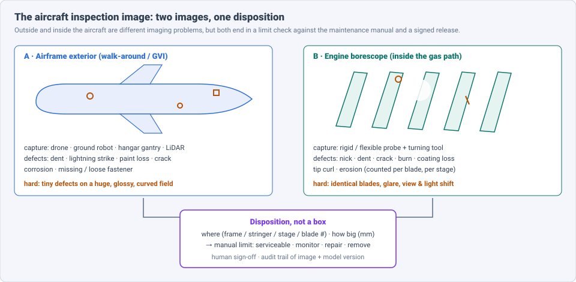
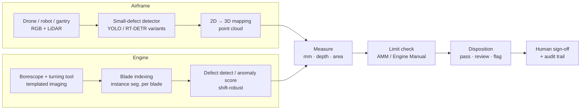
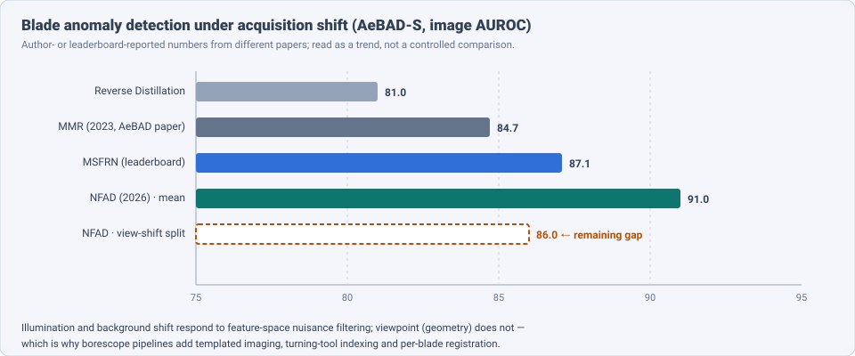

# Dense Object Detection & Classification — Recent Advances

*Compiled 2026-Oct-19 (America/Los_Angeles).*

Next installment in the running CV-updates log. Earlier entries:
[Apr-30](../2026-Apr-30/2026-Apr-30_CV_updates.md),
[May-01](../2026-May-01/2026-May-01_CV_updates.md),
[May-02](../2026-May-02/2026-May-02_CV_updates.md),
[May-04](../2026-May-04/2026-May-04_CV_updates.md),
[May-05](../2026-May-05/2026-May-05_CV_updates.md),
[May-07](../2026-May-07/2026-May-07_CV_updates.md),
[May-08](../2026-May-08/2026-May-08_CV_updates.md),
[May-15](../2026-May-15/2026-May-15_CV_updates.md),
[May-16](../2026-May-16/2026-May-16_CV_updates.md),
[May-17](../2026-May-17/2026-May-17_CV_updates.md),
[Jun-09](../2026-Jun-09/2026-Jun-09_CV_updates.md),
[Jun-10](../2026-Jun-10/2026-Jun-10_CV_updates.md),
[Jun-12](../2026-Jun-12/2026-Jun-12_CV_updates.md),
[Jun-15](../2026-Jun-15/2026-Jun-15_CV_updates.md),
[Jun-16](../2026-Jun-16/2026-Jun-16_CV_updates.md),
[Jun-17](../2026-Jun-17/2026-Jun-17_CV_updates.md),
[Jun-19](../2026-Jun-19/2026-Jun-19_CV_updates.md),
[Jun-21](../2026-Jun-21/2026-Jun-21_CV_updates.md),
[Jun-22](../2026-Jun-22/2026-Jun-22_CV_updates.md),
[Jun-23](../2026-Jun-23/2026-Jun-23_CV_updates.md),
[Jun-24](../2026-Jun-24/2026-Jun-24_CV_updates.md),
[Jun-25](../2026-Jun-25/2026-Jun-25_CV_updates.md),
[Jun-27](../2026-Jun-27/2026-Jun-27_CV_updates.md),
[Jun-29](../2026-Jun-29/2026-Jun-29_CV_updates.md),
[Jun-30](../2026-Jun-30/2026-Jun-30_CV_updates.md),
[Jul-04](../2026-Jul-04/2026-Jul-04_CV_updates.md),
[Jul-07](../2026-Jul-07/2026-Jul-07_CV_updates.md),
[Jul-08](../2026-Jul-08/2026-Jul-08_CV_updates.md),
[Jul-10](../2026-Jul-10/2026-Jul-10_CV_updates.md),
[Jul-15](../2026-Jul-15/2026-Jul-15_CV_updates.md),
[Jul-17](../2026-Jul-17/2026-Jul-17_CV_updates.md),
[Jul-18](../2026-Jul-18/2026-Jul-18_CV_updates.md),
[Jul-21](../2026-Jul-21/2026-Jul-21_CV_updates.md),
[Jul-22](../2026-Jul-22/2026-Jul-22_CV_updates.md),
[Jul-24](../2026-Jul-24/2026-Jul-24_CV_updates.md),
[Jul-26](../2026-Jul-26/2026-Jul-26_CV_updates.md),
[Jul-27](../2026-Jul-27/2026-Jul-27_CV_updates.md),
[Jul-30](../2026-Jul-30/2026-Jul-30_CV_updates.md),
[Aug-01](../2026-Aug-01/2026-Aug-01_CV_updates.md),
[Aug-02](../2026-Aug-02/2026-Aug-02_CV_updates.md),
[Aug-04](../2026-Aug-04/2026-Aug-04_CV_updates.md),
[Aug-07](../2026-Aug-07/2026-Aug-07_CV_updates.md),
[Aug-10](../2026-Aug-10/2026-Aug-10_CV_updates.md),
[Aug-11](../2026-Aug-11/2026-Aug-11_CV_updates.md),
[Aug-13](../2026-Aug-13/2026-Aug-13_CV_updates.md),
[Aug-15](../2026-Aug-15/2026-Aug-15_CV_updates.md),
[Aug-16](../2026-Aug-16/2026-Aug-16_CV_updates.md),
[Aug-18](../2026-Aug-18/2026-Aug-18_CV_updates.md),
[Aug-19](../2026-Aug-19/2026-Aug-19_CV_updates.md),
[Aug-21](../2026-Aug-21/2026-Aug-21_CV_updates.md),
[Aug-22](../2026-Aug-22/2026-Aug-22_CV_updates.md),
[Aug-24](../2026-Aug-24/2026-Aug-24_CV_updates.md),
[Aug-26](../2026-Aug-26/2026-Aug-26_CV_updates.md),
[Aug-29](../2026-Aug-29/2026-Aug-29_CV_updates.md),
[Sep-01](../2026-Sep-01/2026-Sep-01_CV_updates.md),
[Sep-20](../2026-Sep-20/2026-Sep-20_CV_updates.md),
[Sep-23](../2026-Sep-23/2026-Sep-23_CV_updates.md),
[Sep-24](../2026-Sep-24/2026-Sep-24_CV_updates.md),
[Sep-25](../2026-Sep-25/2026-Sep-25_CV_updates.md),
[Sep-26](../2026-Sep-26/2026-Sep-26_CV_updates.md),
[Sep-29](../2026-Sep-29/2026-Sep-29_CV_updates.md),
[Sep-30](../2026-Sep-30/2026-Sep-30_CV_updates.md),
[Oct-01](../2026-Oct-01/2026-Oct-01_CV_updates.md),
[Oct-02](../2026-Oct-02/2026-Oct-02_CV_updates.md),
[Oct-03](../2026-Oct-03/2026-Oct-03_CV_updates.md),
[Oct-04](../2026-Oct-04/2026-Oct-04_CV_updates.md),
[Oct-05](../2026-Oct-05/2026-Oct-05_CV_updates.md),
[Oct-06](../2026-Oct-06/2026-Oct-06_CV_updates.md),
[Oct-07](../2026-Oct-07/2026-Oct-07_CV_updates.md),
[Oct-08](../2026-Oct-08/2026-Oct-08_CV_updates.md),
[Oct-09](../2026-Oct-09/2026-Oct-09_CV_updates.md),
[Oct-10](../2026-Oct-10/2026-Oct-10_CV_updates.md),
[Oct-11](../2026-Oct-11/2026-Oct-11_CV_updates.md),
[Oct-12](../2026-Oct-12/2026-Oct-12_CV_updates.md),
[Oct-13](../2026-Oct-13/2026-Oct-13_CV_updates.md),
[Oct-14](../2026-Oct-14/2026-Oct-14_CV_updates.md),
[Oct-15](../2026-Oct-15/2026-Oct-15_CV_updates.md),
[Oct-16](../2026-Oct-16/2026-Oct-16_CV_updates.md),
[Oct-17](../2026-Oct-17/2026-Oct-17_CV_updates.md),
[Oct-18](../2026-Oct-18/2026-Oct-18_CV_updates.md).

The last entry covered the [bridge & civil concrete structure inspection image](../2026-Oct-18/2026-Oct-18_CV_updates.md).
Today's primitive moves from structures that stand still to the
inspected structure that flies: the **aircraft inspection image**. It
comes in two quite different forms:

- the **airframe exterior image**: a drone, ground robot or hangar
  gantry photographs the fuselage, wings and empennage during a
  walk-around or General Visual Inspection (GVI);
- the **engine borescope image**: a probe inserted through an access
  port photographs rotating compressor and turbine blades inside the
  gas path.

The question is the same for both: "where on the aircraft is this, what
damage is it, how large is it in millimetres, and is it inside the
manual's allowable limits?"

Earlier entries touched this only in passing.
[Oct-13](../2026-Oct-13/2026-Oct-13_CV_updates.md) (power lines) mentioned
detectors running on the airframe of an inspection drone, not inspection
*of* aircraft. [May-08](../2026-May-08/2026-May-08_CV_updates.md) covered
generic industrial anomaly detection (MVTec AD / AD 2), and
[Oct-15](../2026-Oct-15/2026-Oct-15_CV_updates.md) (wind turbine blades)
is the closest "blade" neighbour, but those are composite blades the
size of a building, not millimetre-scale metal aerofoils seen through a
6 mm probe. [Oct-18](../2026-Oct-18/2026-Oct-18_CV_updates.md) set out the
"evidence → measurement → rating" pattern that recurs here. No earlier
entry treated the aircraft inspection image as a modality of its own;
this one does.

Six properties make it a distinct problem:

- **The label is a disposition, not a box.** The output is serviceable /
  monitor / repair / remove, set by limits in the Aircraft Maintenance
  Manual (AMM) or Engine Manual and signed by a certified engineer.
  Detection is only evidence for it (§2, §7).
- **Two images with opposite statistics.** The airframe is a huge,
  glossy, curved field where a defect is a few pixels (§3). The borescope
  view is a tight close-up of near-identical blades under a point light
  with metallic glare (§4).
- **Defect data is scarce and proprietary.** Damaged engines and
  airframes are rare, and OEM/airline data is commercially restricted.
  Synthetic data, rendering and anomaly detection carry the field (§5).
- **Acquisition shift is the main failure.** Light, viewpoint and probe
  position change between inspections. The AeBAD benchmark exists to
  measure exactly this (§4).
- **Location must be in aircraft coordinates.** A dent is reported at a
  frame/stringer position; a blade nick at a stage and blade number.
  That forces 2D→3D mapping and blade indexing (§3, §6).
- **Traceability is regulatory.** Which image, which model version, which
  human decision — all must be auditable. Ledger and evidence-frame work
  is appearing for this (§7).

> **Numbers below come from search-engine abstracts, journal landing
> pages, repository records and vendor press releases. I did not read
> the full papers** (arxiv.org and several publisher sites failed DNS
> resolution through WebFetch on this run, so everything was read via
> search snippets). Treat every number as an author- or vendor-reported,
> abstract-level claim. Vendor figures are marked as such. Datasets and
> metrics differ between papers; do not compare rows unless the text
> says they share a protocol.

---

## Table of contents

1. [Why this pass](#1--why-this-pass)
2. [The primitive: two images, one disposition](#2--the-primitive-two-images-one-disposition)
3. [Airframe exterior: small defects on a large surface](#3--airframe-exterior-small-defects-on-a-large-surface)
4. [Engine borescope: detection, micro-cracks and acquisition shift](#4--engine-borescope-detection-micro-cracks-and-acquisition-shift)
5. [The data problem: synthetic, rendered and generated defects](#5--the-data-problem-synthetic-rendered-and-generated-defects)
6. [From pixels to millimetres and aircraft coordinates](#6--from-pixels-to-millimetres-and-aircraft-coordinates)
7. [Decisions, traceability and deployment](#7--decisions-traceability-and-deployment)
8. [Open problems / what to watch](#8--open-problems--what-to-watch)
9. [Sources](#9--sources)

---

## 1 · Why this pass

Aviation is the clearest case of dense detection under a *certification*
regime: a missed crack is a safety event, a false call grounds an
aircraft. Four things moved in 2025–2026:

1. **Acquisition shift got a number to beat.** NFAD (arXiv 2608.29112,
   Aug 2026) reports **91.0% image AUROC on AeBAD-S**, a new best on the
   aero-engine blade benchmark built for light/view shift, but only
   **86.0** on the view-shift split (§4).
2. **Borescope detectors specialised for micro-cracks and the edge.** An
   improved YOLO11 with high-resolution P1/P2 heads and miss-sensitive
   losses (*J. Imaging* 12(7):294, Jul 2026) and a wavelet YOLOv9t
   (*Aerosp. Sci. Technol.* 176, Sep 2026) both target small, glare-hit
   defects on light models (§4).
3. **Airframe work moved to 3D.** J-DDL (arXiv 2506.10505) fuses 2D
   detection with whole-aircraft point clouds and releases AIRSD; a 2026
   preprint (arXiv 2608.08955) scores damage directly on LiDAR scans
   learned from *healthy* aircraft (§3, §6).
4. **Generated data was compared head-to-head.** DLR's CINNABAR 2 work
   finds diffusion models beat GANs for aircraft-damage augmentation
   (≈ **+12%** detection, *CEAS Aeronaut. J.* 2026), and NeRF/3DGS
   novel-view rendering is used as a training "database" (§5).

---

## 2 · The primitive: two images, one disposition

| Question | Airframe exterior | Engine borescope | Main public data |
|---|---|---|---|
| ① Where? | frame / stringer / panel on a 3D model | engine module, stage, blade number | AIRSD (J-DDL); in-house LiDAR scans |
| ② What damage? | dent, lightning strike, paint loss, crack, corrosion, missing fastener | nick, dent, crack, burn, coating loss, tip curl, erosion | Aircraft_Fuselage_DET2023 (5,601 imgs, 4 classes); AeBAD; BladeSynth (synthetic) |
| ③ How big? | dent depth/diameter from point cloud | length / area from stereo or 3D probe | mostly in-house |
| ④ Within limits? | AMM / Structural Repair Manual limits | Engine Manual limits per stage | none public |

---

## 3 · Airframe exterior: small defects on a large surface

**J-DDL** (arXiv 2506.10505, Jun 2025) is the most complete public
system. A combined laser-scanner + camera rig captures 2D images *and*
3D point clouds of a whole fighter aircraft. The 2D detector, **AIR-YOLO**,
is derived from YOLOv8 with FasterNet-style C2f_Faster blocks in the
backbone, EMA attention in the neck and an Inner-IoU box loss. Detections
are projected onto the point cloud for 3D localisation. The paper
reports **65.2% mAP on AIRSD**, which it releases as the first public
aircraft-damage dataset, and claims higher FPS than Faster R-CNN, SSD,
RetinaNet and Swin baselines at similar or better accuracy. *(Class list
and image counts were not in the snippets I could read.)*

**Small-defect YOLO variants (2026).** The common theme is "do not lose
high-frequency detail when you downsample":

- **DEDW-YOLO** (*IEEE Signal Process. Lett.*, Sep 2026): Haar-wavelet +
  space-to-depth downsampling, a C3K2_DE block (distribution-shifting
  conv + ECA), a lightweight shared head and WIoUv3. On a self-built
  skin-defect set: **87.5% mAP@0.5 (+2.6)** with **83.8% fewer
  parameters** and **37.5% less compute**.
- **DEE-Net** (*Aerospace* 13(7):568, 2026): an improved YOLO11 with
  multi-scale discriminative edge enhancement for aircraft surface
  defects.
- **Dent detection, YOLOv11 vs RT-DETR** (Mhatre, Merola, Koschlik et
  al., AIDAA-CEAS 2025 proceedings): on real + synthetic fuselage images,
  **YOLOv11 0.66 vs RT-DETR 0.57 mAP50** — dents are shallow, low-contrast
  and lighting-dependent, so even the better number is modest.
- **UAV paint damage** (Erciyes Univ.): YOLO11 vs YOLO26 on a
  high-resolution drone dataset; and an ICRAEEE 2025 paper (*E3S Web
  Conf.* 2026) adds a human-in-the-loop review step to a YOLO
  exterior-defect detector.

**Older public baselines.** Aircraft_Fuselage_DET2023 (IEEE DataPort,
5,601 images, four defect types, COCO/VOC/YOLO labels) and a 2017
drone fuselage study (arXiv 1712.09213, 3888×5184 frames) are still
the open reference points. Rivet work remains small and controlled
(YOLOv5 + MobileNetV3 on a modelled set; a YOLOv5s rivet-crack variant
reporting +7.7 mAP over baseline, SPIE 2024).

**Takeaway.** The 2D detector is a commodity; the hard parts are
dents (geometry, not texture) and placing every finding on the
aircraft. That is why the strongest systems pair RGB with 3D (§6).

---

## 4 · Engine borescope: detection, micro-cracks and acquisition shift

**Supervised detection on light models.**

- **YOLO11 for micro-cracks** (Li, Cui et al., *J. Imaging* 12(7):294,
  1 Jul 2026). Micro-cracks are small, low-contrast and elongated, and
  metallic reflections plus uneven lighting cause misses. The fix:
  shallow high-resolution **P1/P2 detection branches**, plus Focal +
  object-level **Tversky** loss and hard-sample mining — losses chosen
  to penalise misses over false alarms. Reported on an independent test
  set: **P 0.998, R 0.961, F1 0.979, mAP50 0.978, mAP50-95 0.694.**
  The gap between mAP50 and mAP50-95 says localisation of thin cracks
  is still loose.
- **YOLOv9t-WELAN** (Yang, Sun, Zhao, Li, Chen — XJTU, *Aerosp. Sci.
  Technol.* 176:112595, Sep 2026). A wavelet convolution (WConv) keeps
  low-frequency structure and high-frequency detail; a Wavelet Efficient
  Layer Aggregation Network replaces ELAN. **0.98 mAP@0.5, 25% smaller**
  than baseline, also transferred to a public real-damage set.
- **Faster R-CNN by damage class** (Uzun et al., *Neural Comput. Appl.*,
  2025): **92.6% crack, 92.1% nick/dent, 81.1% burn**, 88.6% average.
  Burns (colour, not shape) are the weak class.
- **Edge-guided segmentation** (*Eng. Appl. AI*, 2025): segments defects
  on *in-service* blades from borescope video, using large-model priors
  to help training; a Research Square preprint (MESFR-DETR) adds
  high-frequency edge enhancement to RT-DETR for small blade defects.

**Anomaly detection under acquisition shift.** Supervised detectors
assume the defect classes are known and labelled; most borescope work
cannot. **AeBAD** (Zhang et al., XJTU, arXiv 2304.02216) is the benchmark:
AeBAD-S (single blades) and AeBAD-V (video), four defect types
(breakdown, ablation, groove, fracture), and — the point — a *domain
shift* in illumination, view and background between training and test
normals. Its MMR (masked multi-scale reconstruction) reported
≈ 84.7 AUROC; a leaderboard lists MSFRN at 87.1.

**NFAD** (Cao, Nghiem, Nguyen, Rekimoto, Wu — arXiv 2608.29112, 29 Aug
2026) estimates a *nuisance subspace* from feature displacements caused
by content-preserving perturbations and suppresses it at inference — no
anomaly labels and no target-domain data. One subspace drives full
projection for image-level detection and selective suppression for
pixel-level localisation. Reported: **91.0% mean image AUROC on AeBAD-S**,
**+15.3** over FiCo (the strongest prior detector *in its comparison*),
strongest under background and illumination shift, weakest under view
shift (**86.0**), which the authors attribute to geometry outside the
modelled nuisance families. Competitive on VisA, Real-IAD and MVTec AD.

**Few-shot with vision-language models.** A CLIP-based few-shot blade
anomaly method under domain shift (*Adv. Eng. Informatics*, 2025/26) and
CDADCLIP (XJTU, ICEIOM 2025: domain-invariant learnable prompts + hybrid
semantic fusion, evaluated on AeBAD-S) bring the prompt-learning line
from MVTec to blades.

**Takeaway.** Light and background shift are being filtered out in
feature space; **viewpoint shift is the residual gap**. Industry answers
it with hardware — templated imaging and motorised turning tools (§7) —
rather than with a better model.

---

## 5 · The data problem: synthetic, rendered and generated defects

Open aero-engine blade datasets are rare because of commercial and
copyright limits, and existing ones often carry segmentation labels
only (noted in the superpixel-GNN blade paper, arXiv 2210.07539). Three
responses:

- **Rendering.** **BladeSynth** (TU Delft + Aiir Innovations) is a
  large synthetic dataset of engine-blade images with pixel-level defect
  masks for detection and assessment; it is now used as a training set by
  downstream work (e.g. BladeChain, §7, with YOLOv8).
- **Generative augmentation.** Merola et al. (DLR MRO Institute,
  CINNABAR 2; CEAS–AIDAA 2025 proceedings and *CEAS Aeronaut. J.* 2026,
  10.1007/s42496-026-00318-3) compare GANs and diffusion models for
  synthetic aircraft-damage images: **diffusion wins on LPIPS and lifts
  detection by ≈ 12%** (the percentage appears in the DLR record, not in
  the proceedings abstract). The same group trains dent detectors on
  real + synthetic fuselage images (§3).
- **Novel-view synthesis.** Hu et al. (*Artif. Intell. Rev.*, Feb 2025,
  10.1007/s10462-024-11073-x) train NeRF and **3D Gaussian Splatting**
  on multi-view images of damaged aviation surfaces and render new views
  as a training "database" for a modified YOLOv8 (StarNet backbone,
  context fusion, attention head), then measure damage area on planar
  and curved surfaces.
- **Learn "healthy" instead.** arXiv 2608.08955 (3PDA, Aug 2026) starts
  from the observation that healthy aircraft LiDAR scans are abundant
  and damaged ones scarce: it combines point-cloud networks, topological
  data analysis and unsupervised ensemble forests trained on healthy
  scans, with 2D projections through a vision foundation model, and
  scores body, wings and tail on a −1…1 damage scale.

Compare [Oct-18](../2026-Oct-18/2026-Oct-18_CV_updates.md) (synth-dacl:
≈ +2 mIoU on bridges): aviation leans on synthetic data even harder,
because real damaged samples are rarer still.

---

## 6 · From pixels to millimetres and aircraft coordinates

**Dents from point clouds.** Dent limits are depth/diameter, so 3D is
needed. Lafiosca et al. (SAE 2022-01-0022, arXiv 2205.01614) train a
fully convolutional net on synthetic dents generated to Boeing 737
repair-manual criteria with scanner noise, converting point clouds to
2.5D to save memory (IoU > 80% on simulated data). Koschlik (HUMS 2025)
publishes an open-source workflow that builds a digital twin of a wing
from laser scans and highlights impact dents automatically.

**Blade damage from stereo.** KBMeasure (*Opt. Express*, 2024) detects
damage *keypoints* and measures them by binocular 3D reconstruction in
situ — size is a primary basis for the blade-damage grade. BladeNeRF (TU
Delft) addresses reconstruction when the probe is fixed and the blades
rotate past it: repetitive, texture-less blades on a circular trajectory
break normal pose estimation, so poses are learned with the scene.

**Blade indexing.** The Cambridge workflow (Wong et al., arXiv
2103.05430) uses instance segmentation to isolate and track each rotor
blade across borescope video, so damage is tallied *per blade* — the
borescope analogue of mapping a dent to a frame/stringer.

**Takeaway.** Location and size are where aviation differs most from
generic defect detection: a correct box without a blade number or a
depth is not a usable finding.

---

## 7 · Decisions, traceability and deployment

**Stage-level decisions.** Tse (HKUST; 1st Int. Online Conf. on
Aerospace, MDPI, Apr 2026) frames HPC borescope AI as decision support
that emits a **stage/segment verdict — AUTO_PASS / NEEDS_REVIEW /
AUTO_FLAG — with evidence frames and timestamps**, and calls out two
failure modes: shortcut learning from on-screen UI overlays, and
viewpoint generalisation. *(The abstract describes a planned evaluation;
no results were available.)*

**Traceability.** **BladeChain** (Khalifa Univ., arXiv 2603.08288, Mar
2026) records every AI blade inspection on a Hyperledger Fabric ledger
shared by OEM, airline, MRO and regulator; images live in IPFS linked
by SHA-256, and each record names the **model and version** used. The
detector is swappable without changing the ledger. Prototype: up to 100
blades, ≈ 26 ops/min, tamper detection in ≈ 17 ms.

**Industry (vendor-reported, not independently verified).**

- **GE Aerospace + Waygate Technologies** (Oct 2024): AI-assisted defect
  recognition for HPC inspections on the Mentor Visual iQ+ borescope;
  claimed **~34% higher detection and >13% fewer false alerts** than the
  previous model version.
- **Rolls-Royce Intelligent Borescope Method** (2025, with Waygate and
  Rhinestahl): templated high-resolution HPT blade imaging, linked to a
  motorised turning tool; AI maps each blade "like a face"; claimed
  **90 → 5 minutes** per inspection.
- **Drone GVI**: Donecle reports its drone is listed in Boeing and Airbus
  AMMs for automated checks (Oct 2024), though a trade-press profile
  describes that status as more limited; Mainblades operates inside
  hangars, pursuing outdoor approval with the Dutch authority.
- **VLM walk-around assistants** (Avi-Go report): an aviation-tuned VLM
  over video + LiDAR flags rivets, tyre tread and gear issues for a
  mechanic — explicitly *not* a go/no-go decision, which the vendor
  calls the regulatory hurdle.

The design pattern matches bridges (Oct-18): **detector → measurement →
deterministic limit check → human release**. Hardware standardisation
(templated imaging, turning tools) does as much for robustness as model
design does.

---

## 8 · Open problems / what to watch

1. **View shift.** NFAD's 86.0 on AeBAD-S view shift is the clearest open
   number. Expect geometry-aware methods (blade registration, 3D priors)
   rather than more nuisance filtering.
2. **A public, realistic benchmark.** AIRSD (65.2 mAP) and AeBAD are the
   only open anchors; most 2026 results (0.98 mAP@0.5 and up) are on
   self-built sets and are not comparable. A multi-site, multi-probe
   borescope benchmark would reset expectations.
3. **mAP50 vs mAP50-95 on cracks.** 0.978 vs 0.694 for micro-cracks says
   boxes are found but their extent is not; length-based limits need
   better localisation or contour outputs (cf. FS-FSD on Oct-18).
4. **Dents need geometry.** 2D dent detectors sit near 0.66 mAP50;
   point-cloud and twin-based methods are the way forward.
5. **Measuring the human baseline.** Vendor detection gains are reported
   against earlier model versions, not against inspectors under the same
   protocol. Probability-of-detection (POD) curves, standard in NDT, are
   largely missing from CV papers.
6. **Certification of the model itself.** Ledgers that record model
   versions (BladeChain) are a start; how a regulator accepts an updated
   detector is unresolved.

---

## 9 · Sources

### Benchmarks and datasets

- Industrial Anomaly Detection with Domain Shift: A Real-world Dataset and Masked Multi-scale Reconstruction (AeBAD, MMR) — arXiv 2304.02216 — https://arxiv.org/pdf/2304.02216 — https://huggingface.co/papers/2304.02216
- AeBAD-S leaderboard — https://hyper.ai/kr/sota/tasks/anomaly-detection/benchmark/anomaly-detection-on-aebad-s
- AeBAD dataset card — https://cs.paperswithcode.com/dataset/aebad
- Aircraft_Fuselage_DET2023 (IEEE DataPort) — https://ieee-dataport.org/documents/aircraftfuselagedet2023-aircraft-fuselage-defect-detection-dataset
- Aircraft Fuselage Defect Detection using Deep Neural Networks (2017) — arXiv 1712.09213 — https://arxiv.org/pdf/1712.09213
- BladeSynth (TU Delft repository) — https://repository.tudelft.nl/file/File_47b95000-0e87-4104-87b9-98620a0ccd3b
- Superpixel perception GNN for aero-engine blade defect detection (data scarcity note) — arXiv 2210.07539 — https://arxiv.org/pdf/2210.07539

### Airframe exterior (§3)

- J-DDL: Surface Damage Detection and Localization System for Fighter Aircraft (AIR-YOLO, AIRSD) — arXiv 2506.10505 — https://arxiv.org/html/2506.10505v1
- Aircraft Skin Defect Detection Based on Dual-Domain Wavelet Feature Enhancement (DEDW-YOLO, *IEEE SPL* 2026) — https://signalprocessingsociety.org/publications-resources/ieee-signal-processing-letters/2026/09/aircraft-skin-defect-detection-based-dual-domain-wavelet-feature-enhancement
- DEE-Net: multi-scale discriminative edge enhancement for aircraft surface defects (*Aerospace* 13(7):568) — https://www.citedrive.com/en/discovery/dee-net-a-multi-scale-discriminative-edge-enhancement-network-for-aircraft-surface-defect-detection/
- Deep-Learning-based Dent Detection of Aircraft Surfaces using Synthetic Data (YOLOv11 vs RT-DETR) — https://mrforum.com/product/9781644904251-7/
- A new UAV-based approach for detection of paint damage on aircraft surfaces — https://avesis.erciyes.edu.tr/yayin/be1aca1c-36a4-4aa3-9a55-96ccded2bf34/a-new-uav-based-approach-for-detection-of-paint-damage-on-aircraft-surfaces
- ICRAEEE 2025 aircraft exterior YOLO + human-in-the-loop (*E3S Web Conf.* 2026) — https://www.e3s-conferences.org/articles/e3sconf/pdf/2026/16/e3sconf_icraeee2026_01002.pdf
- Deep Neural Network Recognition of Rivet Joint Defects in Aircraft Products — https://www.ncbi.nlm.nih.gov/pmc/articles/PMC9105654/
- Aircraft rivet crack defect detection based on YOLOv5 (SPIE 13256) — https://nanolithography.spiedigitallibrary.org/conference-proceedings-of-spie/13256/1325626/Aircraft-rivet-crack-defect-detection-method-based-on-YOLOv5/10.1117/12.3037884.full

### Engine borescope (§4)

- Collaborative Optimization of High-Resolution Representation and Miss-Sensitive Supervision for Aero-Engine Micro-Crack Detection (*J. Imaging* 12(7):294) — https://www.mdpi.com/2313-433X/12/7/294
- A frequency-aware lightweight network with wavelet efficient layer aggregation for defect detection of aero-engine blade (*Aerosp. Sci. Technol.* 176:112595) — https://scholar.xjtu.edu.cn/en/publications/a-frequency-aware-lightweight-network-with-wavelet-efficient-laye/
- Damage detection in aircraft engine borescope inspection using deep learning (*Neural Comput. Appl.*) — https://avesis.metu.edu.tr/yayin/69699ec6-aa98-4401-b9a4-df4de9e2ddcf/damage-detection-in-aircraft-engine-borescope-inspection-using-deep-learning
- Cranfield: YOLOv8n borescope defect detection — https://dspace.lib.cranfield.ac.uk/handle/1826/23493
- An edge-guided defect segmentation network for in-service aerospace engine blades (*Eng. Appl. AI*, 2025) — https://www.sciencedirect.com/science/article/abs/pii/S0952197625009741
- MESFR-DETR (Research Square preprint) — https://www.researchsquare.com/article/rs-10874008/v1
- NFAD: Nuisance-Filtered Anomaly Detection Under Distribution Shift — arXiv 2608.29112 — https://arxiv.org/pdf/2608.29112 — https://www.roboticscenter.ai/research/papers/nfad-nuisance-filtered-anomaly-detection-under-distribution-shift-2608
- Enhancing aero-engine blade few-shot anomaly detection with visual-language multi-modal models under domain shift conditions (*Adv. Eng. Informatics*) — https://www.sciencedirect.com/science/article/abs/pii/S1474034625008468
- CDADCLIP: learning prompts with hybrid semantic fusion for few-shot anomaly detection — https://scholar.xjtu.edu.cn/en/publications/cdadclip-learning-prompts-with-hybrid-semantic-fusion-for-few-sho/
- Aero-Engine Blade Defect Detection: A Systematic Review of Deep Learning Models — https://www.semanticscholar.org/paper/Aero-Engine-Blade-Defect-Detection:-A-Systematic-of-Abdulrahman-Eltoum/941a77cb0a99f51928c3029a041854f0f1c829e3

### Data generation (§5)

- Comparative Analysis of Generative Data Augmentation Techniques for Aircraft Damage Detection Algorithms (CEAS–AIDAA 2025) — https://mrforum.com/product/9781644904251-4/
- DLR record of the journal version (≈ 12% detection gain) — https://elib.dlr.de/226049/
- NeRF / 3DGS novel-view augmentation for aviation surface damage (*Artif. Intell. Rev.*, 2025) — https://link.springer.com/article/10.1007/s10462-024-11073-x
- Damage Classification for 3D Point Cloud Data via 3D Data Analysis and Vision Foundation Model-based 2D Projections — arXiv 2608.08955 — https://arxiv.org/pdf/2608.08955

### Measurement and coordinates (§6)

- Automatic Segmentation of Aircraft Dents in Point Clouds — arXiv 2205.01614 — https://arxiv.org/abs/2205.01614v3 — SAE 2022-01-0022 — https://saemobilus.sae.org/content/2022-01-0022
- Koschlik, open-source dent detection on laser-scanned point clouds (HUMS 2025) — https://humsconference.com.au/Papers2025/HUMS2025_5_3_Koschlik.pdf
- KBMeasure: keypoint detection + binocular 3D reconstruction for in-situ blade damage (*Opt. Express*, 2024) — direct link not retrieved on this run
- BladeNeRF (TU Delft) — https://repository.tudelft.nl/file/File_b650c237-e298-49e1-a214-8d41a7522aa6
- Automatic Borescope Damage Assessments for Gas Turbine Blades via Deep Learning — arXiv 2103.05430 — https://ar5iv.labs.arxiv.org/html/2103.05430

### Decisions, traceability, deployment (§7)

- Robust AI-Assisted HPC Borescope Inspection: Evaluating Stage-Level Decisions and Viewpoint Generalisation (MDPI IOCAE 2026) — https://sciforum.net/paper/30342
- A Blockchain-based Traceability System for AI-Driven Engine Blade Inspection (BladeChain) — arXiv 2603.08288 — https://arxiv.org/html/2603.08288v1
- Waygate Technologies + GE Aerospace AI-assisted borescope (press release) — https://cdn.uc.assets.prezly.com/68a9503a-1944-40ac-816f-6c66a910e0e7/-/inline/no/Press%20Release_%20Waygate%20Technologies,%20GE%20Aerospace%20to%20Deliver%20new%20AI-assisted%20Commercial%20Jet%20Engine%20Borescope%20Inspection%20Solution.pdf
- Rolls-Royce: Intelligent borescope method (2025) — https://www.rolls-royce.com/media/our-stories/discover/2025/intelligent-borescope-method.aspx
- Donecle — Iris GVI authorization (company and trade press) — https://www.donecle.com/learn/ — https://www.robotics.press/news/iris-gvi-boeing-airbus-authorization/
- Mainblades FAQ — https://mainblades.com/faq
- Avi-Go: VLM-assisted aircraft walk-around inspection — https://avi-go.com/news/articles/89c627982a941d58434e7b642fe35454
