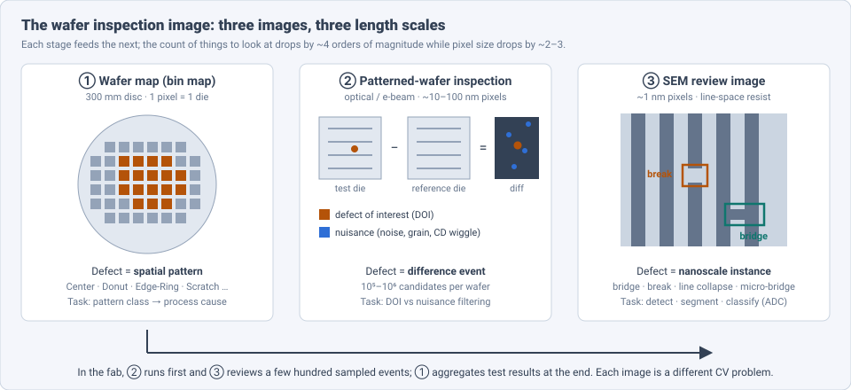
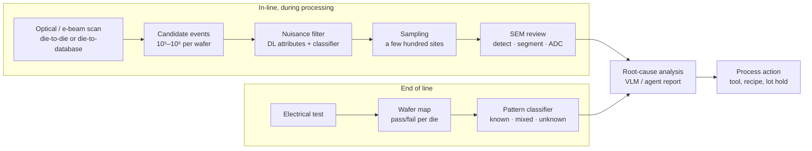
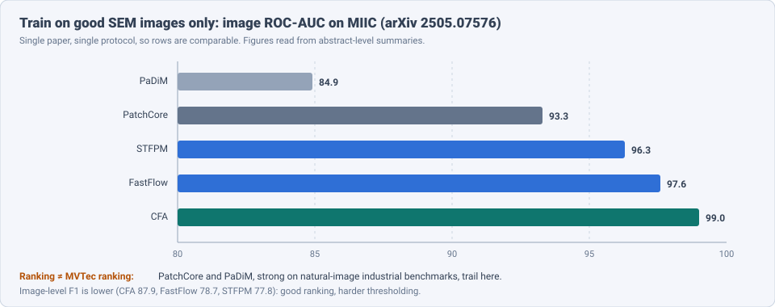
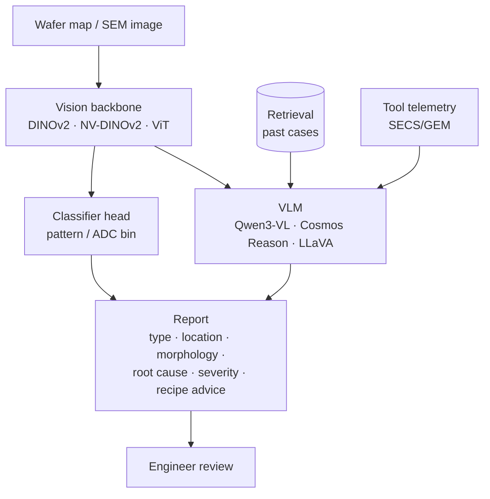

# Dense Object Detection & Classification — Recent Advances

*Compiled 2026-Oct-20 (America/Los_Angeles).*

Next installment in the running CV-updates log. Earlier entries:
[Apr-30](../2026-Apr-30/2026-Apr-30_CV_updates.md),
[May-01](../2026-May-01/2026-May-01_CV_updates.md),
[May-02](../2026-May-02/2026-May-02_CV_updates.md),
[May-04](../2026-May-04/2026-May-04_CV_updates.md),
[May-05](../2026-May-05/2026-May-05_CV_updates.md),
[May-07](../2026-May-07/2026-May-07_CV_updates.md),
[May-08](../2026-May-08/2026-May-08_CV_updates.md),
[May-15](../2026-May-15/2026-May-15_CV_updates.md),
[May-16](../2026-May-16/2026-May-16_CV_updates.md),
[May-17](../2026-May-17/2026-May-17_CV_updates.md),
[Jun-09](../2026-Jun-09/2026-Jun-09_CV_updates.md),
[Jun-10](../2026-Jun-10/2026-Jun-10_CV_updates.md),
[Jun-12](../2026-Jun-12/2026-Jun-12_CV_updates.md),
[Jun-15](../2026-Jun-15/2026-Jun-15_CV_updates.md),
[Jun-16](../2026-Jun-16/2026-Jun-16_CV_updates.md),
[Jun-17](../2026-Jun-17/2026-Jun-17_CV_updates.md),
[Jun-19](../2026-Jun-19/2026-Jun-19_CV_updates.md),
[Jun-21](../2026-Jun-21/2026-Jun-21_CV_updates.md),
[Jun-22](../2026-Jun-22/2026-Jun-22_CV_updates.md),
[Jun-23](../2026-Jun-23/2026-Jun-23_CV_updates.md),
[Jun-24](../2026-Jun-24/2026-Jun-24_CV_updates.md),
[Jun-25](../2026-Jun-25/2026-Jun-25_CV_updates.md),
[Jun-27](../2026-Jun-27/2026-Jun-27_CV_updates.md),
[Jun-29](../2026-Jun-29/2026-Jun-29_CV_updates.md),
[Jun-30](../2026-Jun-30/2026-Jun-30_CV_updates.md),
[Jul-04](../2026-Jul-04/2026-Jul-04_CV_updates.md),
[Jul-07](../2026-Jul-07/2026-Jul-07_CV_updates.md),
[Jul-08](../2026-Jul-08/2026-Jul-08_CV_updates.md),
[Jul-10](../2026-Jul-10/2026-Jul-10_CV_updates.md),
[Jul-15](../2026-Jul-15/2026-Jul-15_CV_updates.md),
[Jul-17](../2026-Jul-17/2026-Jul-17_CV_updates.md),
[Jul-18](../2026-Jul-18/2026-Jul-18_CV_updates.md),
[Jul-21](../2026-Jul-21/2026-Jul-21_CV_updates.md),
[Jul-22](../2026-Jul-22/2026-Jul-22_CV_updates.md),
[Jul-24](../2026-Jul-24/2026-Jul-24_CV_updates.md),
[Jul-26](../2026-Jul-26/2026-Jul-26_CV_updates.md),
[Jul-27](../2026-Jul-27/2026-Jul-27_CV_updates.md),
[Jul-30](../2026-Jul-30/2026-Jul-30_CV_updates.md),
[Aug-01](../2026-Aug-01/2026-Aug-01_CV_updates.md),
[Aug-02](../2026-Aug-02/2026-Aug-02_CV_updates.md),
[Aug-04](../2026-Aug-04/2026-Aug-04_CV_updates.md),
[Aug-07](../2026-Aug-07/2026-Aug-07_CV_updates.md),
[Aug-10](../2026-Aug-10/2026-Aug-10_CV_updates.md),
[Aug-11](../2026-Aug-11/2026-Aug-11_CV_updates.md),
[Aug-13](../2026-Aug-13/2026-Aug-13_CV_updates.md),
[Aug-15](../2026-Aug-15/2026-Aug-15_CV_updates.md),
[Aug-16](../2026-Aug-16/2026-Aug-16_CV_updates.md),
[Aug-18](../2026-Aug-18/2026-Aug-18_CV_updates.md),
[Aug-19](../2026-Aug-19/2026-Aug-19_CV_updates.md),
[Aug-21](../2026-Aug-21/2026-Aug-21_CV_updates.md),
[Aug-22](../2026-Aug-22/2026-Aug-22_CV_updates.md),
[Aug-24](../2026-Aug-24/2026-Aug-24_CV_updates.md),
[Aug-26](../2026-Aug-26/2026-Aug-26_CV_updates.md),
[Aug-29](../2026-Aug-29/2026-Aug-29_CV_updates.md),
[Sep-01](../2026-Sep-01/2026-Sep-01_CV_updates.md),
[Sep-20](../2026-Sep-20/2026-Sep-20_CV_updates.md),
[Sep-23](../2026-Sep-23/2026-Sep-23_CV_updates.md),
[Sep-24](../2026-Sep-24/2026-Sep-24_CV_updates.md),
[Sep-25](../2026-Sep-25/2026-Sep-25_CV_updates.md),
[Sep-26](../2026-Sep-26/2026-Sep-26_CV_updates.md),
[Sep-29](../2026-Sep-29/2026-Sep-29_CV_updates.md),
[Sep-30](../2026-Sep-30/2026-Sep-30_CV_updates.md),
[Oct-01](../2026-Oct-01/2026-Oct-01_CV_updates.md),
[Oct-02](../2026-Oct-02/2026-Oct-02_CV_updates.md),
[Oct-03](../2026-Oct-03/2026-Oct-03_CV_updates.md),
[Oct-04](../2026-Oct-04/2026-Oct-04_CV_updates.md),
[Oct-05](../2026-Oct-05/2026-Oct-05_CV_updates.md),
[Oct-06](../2026-Oct-06/2026-Oct-06_CV_updates.md),
[Oct-07](../2026-Oct-07/2026-Oct-07_CV_updates.md),
[Oct-08](../2026-Oct-08/2026-Oct-08_CV_updates.md),
[Oct-09](../2026-Oct-09/2026-Oct-09_CV_updates.md),
[Oct-10](../2026-Oct-10/2026-Oct-10_CV_updates.md),
[Oct-11](../2026-Oct-11/2026-Oct-11_CV_updates.md),
[Oct-12](../2026-Oct-12/2026-Oct-12_CV_updates.md),
[Oct-13](../2026-Oct-13/2026-Oct-13_CV_updates.md),
[Oct-14](../2026-Oct-14/2026-Oct-14_CV_updates.md),
[Oct-15](../2026-Oct-15/2026-Oct-15_CV_updates.md),
[Oct-16](../2026-Oct-16/2026-Oct-16_CV_updates.md),
[Oct-17](../2026-Oct-17/2026-Oct-17_CV_updates.md),
[Oct-18](../2026-Oct-18/2026-Oct-18_CV_updates.md),
[Oct-19](../2026-Oct-19/2026-Oct-19_CV_updates.md).

The last entry covered the [aircraft inspection image](../2026-Oct-19/2026-Oct-19_CV_updates.md).
This run moves from inspection at the scale of metres and millimetres to
inspection at the scale of nanometres: the **semiconductor wafer
inspection image**. Like the aircraft image, it comes in more than one
form, here three, each a different computer-vision problem:

- the **wafer map** (wafer bin map, WBM): one pixel per die, coloured
  pass/fail from electrical test. The "object" is a *spatial pattern* of
  failing dies (ring, centre cluster, scratch) that points to a process
  step;
- the **patterned-wafer inspection image** (optical brightfield/darkfield
  or e-beam): a test die compared against reference dies. Each difference
  is a candidate event, and almost all candidates are *nuisance*;
- the **SEM review image**: a ~1 nm-pixel close-up of a sampled event
  (bridge, break, line collapse in resist line-space patterns) that has
  to be detected, segmented and classified (automatic defect
  classification, ADC).

Earlier entries touched this only in passing.
[Sep-23](../2026-Sep-23/2026-Sep-23_CV_updates.md) (atomic-resolution
materials EM) mentioned semiconductor imaging, but for atom-column
detection in materials science, not fab defects.
[Jul-15](../2026-Jul-15/2026-Jul-15_CV_updates.md) covered X-ray
inspection including PCB/weld NDT, and
[May-08](../2026-May-08/2026-May-08_CV_updates.md) covered generic
industrial anomaly detection (MVTec). The recent inspection run
([Oct-12](../2026-Oct-12/2026-Oct-12_CV_updates.md) →
[Oct-19](../2026-Oct-19/2026-Oct-19_CV_updates.md)) set the "evidence →
measurement → disposition" pattern; here the disposition is a *yield*
decision rather than a safety one. No earlier entry treated the wafer
inspection image as a modality of its own; this one does.

Six properties make it a distinct problem:

- **Three images at three scales, in one funnel.** Optical/e-beam
  inspection produces 10⁵–10⁶ candidates per wafer; a few hundred are
  sent to SEM review; the wafer map summarises the electrical outcome.
  Detection at one stage is sampling for the next (§2).
- **The wafer map's object is a pattern, not a thing.** The class is
  defined by *where* failing dies sit on the disc, and it is valuable
  only because each pattern maps to a likely root cause (§3).
- **Nuisance dominates.** In patterned inspection, the hard part is not
  finding differences but rejecting the ones that do not matter (§4).
- **Defects shrink faster than pixels.** At high-NA EUV, thin resists
  lower SEM signal-to-noise and stochastic defects are a few nm. Fabs
  trade resolution for throughput, so detectors must work on
  under-sampled, noisy images (§5).
- **Data is proprietary and imbalanced.** Public data is mostly wafer
  maps (WM-811K, MixedWM38) and a few SEM sets (MIIC, imec ADI/AEI
  shared with collaborators). Synthetic data and anomaly detection carry
  the field (§6).
- **The output is a report to an engineer.** The newest work produces
  root-cause text and VQA answers, not just labels (§7).

> **Numbers below come from search-engine abstracts, repository records,
> conference listings and vendor blogs. I did not read the full papers**
> (arxiv.org failed DNS resolution through WebFetch on this run, so
> everything was read via search snippets). Treat every number as an
> author- or vendor-reported, abstract-level claim. Vendor figures are
> marked as such. WM-811K and MixedWM38 papers use different splits; do
> not compare accuracies across papers unless the text says they share a
> protocol.

---

## Table of contents

1. [Why this pass](#1--why-this-pass)
2. [The primitive: three images, one yield question](#2--the-primitive-three-images-one-yield-question)
3. [Wafer maps: pattern classification, mixed types and open sets](#3--wafer-maps-pattern-classification-mixed-types-and-open-sets)
4. [Patterned-wafer inspection: nuisance filtering and e-beam](#4--patterned-wafer-inspection-nuisance-filtering-and-e-beam)
5. [SEM review: nanoscale detection, segmentation and ADC](#5--sem-review-nanoscale-detection-segmentation-and-adc)
6. [The data problem: synthetic SEM, generated maps, anomaly detection](#6--the-data-problem-synthetic-sem-generated-maps-anomaly-detection)
7. [Foundation models, VLMs and failure-analysis agents](#7--foundation-models-vlms-and-failure-analysis-agents)
8. [Open problems / what to watch](#8--open-problems--what-to-watch)
9. [Sources](#9--sources)

---

## 1 · Why this pass

Wafer inspection is the densest detection problem in manufacturing by
count, and one where a 1% yield change is worth more than most CV
benchmarks. Five things moved in 2025–2026:

1. **Wafer maps became a VLM task.** WaferSAGE (arXiv 2604.27629, Apr
   2026) trains a 4B Qwen3-VL with rubric-guided RL to answer questions
   about defect type, location, morphology and root cause, scoring
   **6.49** on an LLM-judge scale vs **7.15** for Gemini-3-Flash, small
   enough to run on-premise. NVIDIA reports fine-tuned Cosmos Reason
   above **96%** on WM-811K (vendor claim) (§7).
2. **Failure analysis became agentic.** SemiFA (arXiv 2604.13236, Apr
   2026) chains four LangGraph agents (describe → root cause → severity
   → recipe advice) over DINOv2 features, case retrieval and equipment
   telemetry; **92.1%** classification accuracy on its 930-image
   SEMIFA-930 set, full report in **48 s** on one A100 (§7).
3. **Small transformers took wafer maps.** A ViT-Tiny reports **98.4%**
   on MixedWM38 (arXiv 2504.02494), above Swin (97.5) and MSF-Trans
   (97.2) in the same paper's table (§3).
4. **SEM anomaly detection got a public benchmark.** A Padova study
   (arXiv 2505.07576) benchmarks modern visual anomaly detection on the
   MIIC SEM dataset: CFA **99.0** image AUROC, while MVTec favourites
   PatchCore (93.3) and PaDiM (84.9) trail (§6).
5. **Synthetic data was tested on real SEM.** Samsung's line-pattern
   generator (arXiv 2505.10192) trains YOLOv8 to **96%** mAP on synthetic
   data; on real SEM it finds **84.6%** of bridges and **78.3%** of
   breaks, a measured sim-to-real gap (§6).

---

## 2 · The primitive: three images, one yield question

| Property | ① Wafer map | ② Patterned inspection | ③ SEM review |
|---|---|---|---|
| Pixel | 1 die (mm) | ~10–100 nm | ~1 nm |
| Object | spatial pattern of failing dies | difference event | defect instance |
| Task | pattern classification (single / mixed / unknown) | defect-of-interest (DOI) vs nuisance | detect · segment · classify (ADC) |
| Volume | 1 per wafer | 10⁵–10⁶ events per wafer | 10²–10³ sampled sites |
| Data | WM-811K (811,457 maps, 172,950 labelled, 9 classes); MixedWM38 (~38k maps, 38 classes) | none public (tool-vendor data) | MIIC; imec ADI/AEI line-space sets (collaborator access) |
| Answer goes to | process / yield engineer | recipe & sampling | ADC bins, failure analysis |

The structural point is that **each stage's detector is the next
stage's sampler**. A nuisance filter that is too strict hides real
defects from SEM review; one that is too loose wastes review time. That
makes recall at stage ② and precision at stage ③ the numbers that matter,
not mAP on either alone.

---

## 3 · Wafer maps: pattern classification, mixed types and open sets

**The benchmarks.** WM-811K (Wu et al., 2015) is still the base: 811,457
real wafer maps, 172,950 labelled into nine classes (Center, Donut,
Edge-Loc, Edge-Ring, Loc, Near-full, Random, Scratch, None). It is badly
imbalanced; one 2026 analysis puts about **85%** of labelled maps in
"None" and recommends balanced accuracy and macro-F1. MixedWM38 (~38,015
maps, 38 classes: normal, 8 single, 29 mixed) is the standard for
*multi-label* patterns, where two or more causes overlap on one wafer.

**Architectures.** Reported MixedWM38 accuracies have clustered around
97–99% for two years, so the movement is in efficiency and
interpretability rather than headline accuracy:

| Model (paper) | Dataset | Reported | Note |
|---|---|---|---|
| ViT-Tiny (arXiv 2504.02494, 2025) | MixedWM38 | **98.4%** val. acc. | beats Swin 97.5, MSF-Trans 97.2 in same table |
| Swin Transformer (IJEM v12n5) | MixedWM38 | 97.47% | ViT 96.77% in same study |
| Attention-augmented CNN + focal loss (IEEE Access 2023) | MixedWM38 | 98.66% acc. (10-fold CV) | baseline for the "CNN is enough" view |
| Custom AlexNet (IJRIAS, Jun 2025) | MixedWM38 | 98.75% | single-author journal paper |
| WCGN, conditional mask generation (Research Square) | MixedWM38 | 97.85% exact match, 0.8725 mIoU | classification *and* pattern masks |
| Hybrid CNN-ViT (FAMU-FSU dissertation, 2026) | WM-811K | hybrids > standalone | abstract only |

WCGN's mIoU is worth noting: it treats mixed-type recognition as
*segmenting* each pattern on the map, which is closer to what an
engineer needs ("which dies belong to the scratch?") than a 38-way label.

**Labels are scarce; unlabelled maps are not.** 630k+ of WM-811K's maps
carry no label. Contrastive pre-training on them has been the steady
thread: Kahng & Kim's noise-contrastive pre-training (IEEE TSM 2021),
SWaCo's OOD-tolerant contrastive learning, and a 2025 *Sensors* paper
pairing a global (image-level) and a local (region) contrastive module
for mixed-type classification **and** segmentation in low-label regimes.
Topological data analysis has also been combined with self-supervised
features for clustering MixedWM38 without labels (arXiv 2505.03848).

**Unknown patterns.** A new tool or process step produces a pattern no
one has labelled. Open-set methods flag it instead of forcing it into a
known class: WaferCap (IEEE VTS 2024) reports **99%** accuracy on seen
WM-811K patterns plus rejection of unseen ones; Frittoli et al. (arXiv
2208.14071) pair a sparse CNN with a GMM outlier detector; an
entropy-based one-class SVM reports >98% novel-pattern detection on
production data. There is still no public open-set *split*; papers hold
out classes ad hoc (§8).

**Explanations.** "Architecture-Aware Explanation Auditing" (arXiv
2605.14255, May 2026) measures heatmap faithfulness on WM-811K: ViT-Tiny
with Attention Rollout gets the best deletion AUC (**0.211**, lower is
better) vs **0.43–0.53** for Grad-CAM on CNNs, despite lower accuracy.
The ranking flips under a different perturbation baseline, which is the
real finding: a saliency map attached to a wafer-map classifier needs
its own faithfulness number. YOLO-LA (*Micromachines*, Dec 2025) adds
text-prototype alignment to a frozen YOLO backbone to give each detected
pattern a semantic description.

---

## 4 · Patterned-wafer inspection: nuisance filtering and e-beam

This is the least public part of the field: tools and data belong to
KLA, Applied Materials, Hitachi and ASML, and most method descriptions
are in patents. What the public record shows:

- **Deep features + classical classifier.** A US patent family describes
  a deep model that is iteratively trained, pruned and retrained to
  produce *automatically generated attributes* of candidate-defect
  patches; a statistical classifier on those attributes does nuisance
  filtering. This keeps the classifier retrainable per layer/recipe
  while the feature extractor stays fixed.
- **Single-image detection.** Another patent describes detecting
  candidates from one die image without a reference die, plus
  morphological filtering of small-pixel-count nuisances. That removes
  the die-to-die requirement at the cost of needing a model of "normal"
  pattern, which is the anomaly-detection framing of §6.
- **Learned die-to-die comparison.** A Bayesian twin (Siamese)
  encoder-decoder takes golden and test die images and outputs a
  difference map with uncertainty (Ewha, 2021); the uncertainty is what
  makes it usable as a nuisance filter.
- **Vendor framing.** Applied Materials describes DL detection and
  filtering as *necessary* to separate DOI from false defects at
  advanced nodes. No public number accompanies that.

**E-beam and voltage contrast.** E-beam sees buried electrical defects
(opens, shorts) through voltage contrast, but is too slow to scan a 300 mm
wafer. PDF Solutions' **YOLO-VC** (2025) modifies YOLOv7 to *predict*
voltage-contrast response across a full chip from layout, then focuses
e-beam care areas where defects are most likely. The detector here does
not find defects; it decides where the slow sensor should look. ASML's
multi-beam HMI eScan 1100 claims open/short/leakage and patterning
defects down to **7 nm** (vendor claim).

---

## 5 · SEM review: nanoscale detection, segmentation and ADC

The 2024 review arXiv 2409.06833 (103 papers) dates the switch:
reference-based SEM defect detection was the most common approach until
**2020**, after which deep learning took over, especially for
classification. It names throughput, setup effort and processing speed
as the open problems; a 2023 systematic review (arXiv 2308.08376, 38
papers) said the same with less data.

The imec / Ghent / KU Leuven line is the most continuous public thread,
built on in-house ADI (after-develop) and AEI (after-etch) line-space SEM
sets with bridge, break, line-collapse and micro-bridge classes:

| Method | Year | Task | Reported |
|---|---|---|---|
| Comparative study of DL detectors (ICECS) | 2022 | detection | YOLOv7 default > multiple RetinaNets |
| Mask R-CNN on stochastic defects (arXiv 2211.02185) | 2022 | instance seg. | bridges/breaks/collapse at pitches < 32 nm |
| SEMI-DiffusionInst (arXiv 2307.08693) | 2023 | detect + segment | +3.83 box mAP, +2.10 mask mAP over prior work |
| SEMI-CenterNet (arXiv 2308.07180) | 2023 | detect | faster inference; ADI↔AEI transfer cuts training time |
| SEMI-SuperYOLO-NAS (arXiv 2404.05862) | 2024 | detect at low resolution | super-resolution-assisted; works across pixel sizes without retraining |
| AEI segmentation (arXiv 2409.04310) | 2024 | segment | SEMI-PointRend / SEMI-DiffusionInst as baselines |

**SEMI-SuperYOLO-NAS** is the most forward-looking. High-NA EUV's
shallow depth of focus pushes thinner resists, which lowers SEM
signal-to-noise. Rather than image longer, the detector carries a
super-resolution branch so the tool can **scan at lower resolution for
higher throughput**. It was tested on two fab datasets from two processes
and two imaging tools (KU Leuven, imec, Ghent, SCREEN SPE). Abstract-level
summaries do not give the accuracy/throughput numbers.

**Industrial ADC.** A Siemens ASMC 2024 manuscript uses YOLOv8 with
ensemble voting for SEM automatic defect classification. NVIDIA's 2025
blog describes NV-DINOv2, adapted with self-supervised learning on
unlabelled fab images, as the die-level backbone replacing per-layer
CNNs that need frequent retraining (vendor).

**Few-shot with language priors.** SEM-CLIP (ICCAD 2024, arXiv
2502.14884, Zhejiang U.) adapts CLIP to SEM images by steering attention
to defect regions and away from repetitive background, and uses
domain-knowledge text prompts as priors. It reports strong few-shot
classification *and* segmentation; the abstract does not give
per-shot numbers. It is the clearest example of CLIP-style models
working on a modality almost absent from their pre-training data.

---

## 6 · The data problem: synthetic SEM, generated maps, anomaly detection

**Synthetic SEM with known defects.** Samsung (arXiv 2505.10192, May
2025) renders line patterns with inserted bridges and breaks, labels
them automatically, and compares detectors:

| Detector | mAP on synthetic | Real SEM: bridges found | Real SEM: breaks found |
|---|---|---|---|
| YOLOv8 | **96%** | **84.6%** | **78.3%** |
| EfficientNet-based | 83% | — | — |
| SSD | 77% | — | — |

The 11–18 point drop from synthetic to real is the most useful number
here: synthetic-only training works but leaves a gap. The paper also
reports the smallest reliably detected defect size, a POD-style
measurement that is rare in this literature. imec's DDPM generator
(arXiv 2407.10348) targets class imbalance: detectors trained on
generated SEM defects alone or with limited real data match or beat
real-only training on real wafer SEM.

**Generated wafer maps.** A preliminary ICML 2026 study compares a
hinge-loss GAN with LoRA-fine-tuned Stable Diffusion for WM-811K
minority classes. Diffusion wins on fidelity (Clean-FID **51.0 vs
106.4**), but the downstream gain depends on the backbone: lightweight
CNNs gain **2.5–3.6** macro-F1 points, the strongest backbones only
**0.6–0.8**. Generated data mostly helps weak models, as on Oct-19
(aircraft) where diffusion beat GANs for augmentation.

**Learning only from good images.** Defects are rare and varied, so
anomaly detection trained on defect-free SEM is attractive. Applied
Materials' reference-free U-Net (arXiv 2202.02998) learned clean
backgrounds with defect-implant augmentation. The new public anchor is
the Padova benchmark on **MIIC** (arXiv 2505.07576):

Two lessons. Image-level AUROC is near ceiling (CFA 99.0), but image-level
F1 is not (CFA 87.9, FastFlow 78.7): ranking is solved, thresholding is
not. And the MVTec ordering does not transfer: PaDiM drops to 84.9, so
natural-image industrial benchmarks are a poor proxy for SEM.

---

## 7 · Foundation models, VLMs and failure-analysis agents

The output of wafer inspection has always been a person's root-cause
judgement. 2025–2026 work tries to produce that judgement in text.

| System | Date | Input | Model | Reported |
|---|---|---|---|
| WaferSAGE (arXiv 2604.27629) | Apr–May 2026 | wafer maps | Qwen3-VL-4B, SFT + rubric-guided RL on synthetic VQA | LLM-judge 6.49 vs Gemini-3-Flash 7.15 |
| SemiFA (arXiv 2604.13236) | Apr 2026 | defect images + telemetry | DINOv2 + Qdrant + LLaVA-1.6, 4 LangGraph agents | 92.1% acc., macro-F1 0.917; 48 s/report; +0.86 reasoning score from fusion (GPT-4o judge) |
| NVIDIA Cosmos Reason (blog) | Dec 2025 | WM-811K maps | reasoning VLM, SFT | > 96% acc. (vendor); up to 2× faster model build via VLM labelling |
| WM-EVA-ViT (conf. 2025) | 2025 | MixedWM38 | pretrained large ViT + supervised contrastive fine-tune | — |
| YOLO-LA (*Micromachines*) | Dec 2025 | wafer maps | frozen YOLO + frozen text encoder + projection | semantic descriptions per pattern |

WaferSAGE's pipeline is the reusable idea: cluster to clean label noise,
have a VLM write defect descriptions, turn the descriptions into scoring
rubrics, then use the rubrics both to build VQA pairs and as RL reward.
That gets a 4B model within about 0.66 judge points of a frontier API
model without sending fab data off-site. SemiFA's limitations are
candid: SEMIFA-930 is partly procedural synthesis plus public maps, and
the authors estimate **≥ 5,000 real image–report pairs** are needed for
stable VLM fine-tuning. Both evaluate text with an LLM judge, not with
engineers.

---

## 8 · Open problems / what to watch

1. **Benchmark saturation on wafer maps.** MixedWM38 results sit at
   97–99% with different splits. A fixed split with macro-F1, plus an
   open-set split holding out pattern classes, would make the next
   claims comparable.
2. **A public SEM detection benchmark.** imec's ADI/AEI sets anchor
   most SEM detection work but are not openly downloadable; MIIC covers
   anomaly detection only. Without a shared detection set, SEMI-* results
   cannot be reproduced outside collaborations.
3. **Sim-to-real on SEM.** Samsung's 96% → 78–85% drop is the gap to
   close. Expect physics-based SEM simulators plus diffusion refinement,
   as rendered-then-refined pipelines did in aviation (Oct-19).
4. **Throughput-aware detection.** SEMI-SuperYOLO-NAS and YOLO-VC both
   use the detector to make a slow sensor faster (lower resolution, fewer
   care areas). Papers should report recall *at a given tool throughput*,
   not only mAP.
5. **Stage-to-stage metrics.** Nuisance filtering at ② decides what ③
   sees. No public work measures end-to-end capture rate through the
   funnel.
6. **Grading text outputs.** VLM reports are scored by LLM judges.
   Engineer-graded root-cause accuracy, ideally tied to confirmed
   failure-analysis outcomes, is the missing evaluation.
7. **Packaging and 3D integration.** Hybrid bonding moves defects inside
   the stack: Samsung/ZEISS show 3D X-ray microscopy finding ~100 nm
   bonding voids and ~200 nm bridges (MRS Spring 2026). Dense detection
   in 3D X-ray volumes of bonded stacks is the next inspection image.

---

## 9 · Sources

### Benchmarks and datasets

- WM-811K background and MATLAB example — https://kr.mathworks.com/help/vision/ug/classify-defects-on-wafer-maps-using-deep-learning.html
- MixedWM38 dataset card — https://astro.paperswithcode.com/dataset/mixedwm38 — repository https://github.com/Junliangwangdhu/WaferMap
- Evaluating Modern Visual Anomaly Detection Approaches in Semiconductor Manufacturing (MIIC benchmark) — arXiv 2505.07576 — https://arxiv.org/html/2505.07576v1 — summary https://alphaxiv.org/overview/2505.07576v1
- Review of automatic SEM image analysis for semiconductor defect inspection (103 papers) — arXiv 2409.06833 — https://www.arxiv.org/abs/2409.06833
- Automated Semiconductor Defect Inspection in SEM Images: a systematic review — arXiv 2308.08376 — https://ar5iv.labs.arxiv.org/html/2308.08376

### Wafer maps (§3)

- Semiconductor Wafer Map Defect Classification with Tiny Vision Transformers — arXiv 2504.02494 — https://arxiv.org/pdf/2504.02494
- High Accuracy Swin Transformers for Image-based Wafer Map Defect Detection (IJEM) — https://www.mecs-press.org/ijem/ijem-v12-n5/v12n5-2.html
- Attention-augmented CNN with focal loss for mixed-type wafer defects — https://umpir.ump.edu.my/id/eprint/40649/
- Custom AlexNet on MixedWM38 (IJRIAS 2025) — https://ideas.repec.org/a/bjf/journl/v10y2025i6p735-748.html
- WCGN conditional mask generation (Research Square) — https://www.researchsquare.com/article/rs-10356216
- Hybrid CNN-ViT on WM-811K (dissertation abstract, 2026) — https://eng.famu.fsu.edu/sites/default/files/2026-03/SamanthaLafrance-DissertationAbstract.pdf
- Contrastive Learning with Global and Local Representation for Mixed-Type Wafer Defect Recognition (*Sensors* 2025) — https://www.ncbi.nlm.nih.gov/pmc/articles/PMC11860719/
- Self-Supervised Representation Learning for Wafer Bin Map Defect Pattern Classification (IEEE TSM 2021) — https://pure.korea.ac.kr/en/publications/self-supervised-representation-learning-for-wafer-bin-map-defect-/
- SWaCo: Safe Wafer Bin Map Classification With Self-Supervised Contrastive Learning — https://scholar.korea.ac.kr/item/491e8058-f12f-447a-b2eb-ab4cd06e9897
- Deep TDA + self-supervised clustering for semiconductor image analytics — arXiv 2505.03848 — https://arxiv.org/pdf/2505.03848
- WaferCap: Open Classification of Wafer Map Patterns (IEEE VTS 2024) — https://par.nsf.gov/biblio/10570103
- Deep Open-Set Recognition for Silicon Wafer Production Monitoring — arXiv 2208.14071 — https://arxiv.org/abs/2208.14071v1
- Enhanced detection of unknown defect patterns on wafer bin maps (open-set) — https://scholarx.skku.edu/item/feb6ddd6-67a7-4ce8-ada5-9f17dc4c073f
- Architecture-Aware Explanation Auditing for Industrial Visual Inspection — arXiv 2605.14255 — https://arxiv.org/pdf/2605.14255
- YOLO-LA: Prototype-Based Vision–Language Alignment for Silicon Wafer Defect Pattern Detection — https://www.ncbi.nlm.nih.gov/pmc/articles/PMC12844300/

### Patterned-wafer inspection and e-beam (§4)

- US patent: inspection with automatically generated defect features (DL attributes + nuisance filter) — https://image-ppubs.uspto.gov/dirsearch-public/print/downloadPdf/11379967
- US patent: inspection of noisy patterned features (single-image detection) — https://image-ppubs.uspto.gov/dirsearch-public/print/downloadPdf/11631169
- Die-to-die Inspection of Semiconductor Wafer using Bayesian Twin Network — https://pure.ewha.ac.kr/en/publications/die-to-die-inspection-of-semiconductor-wafer-using-bayesian-twin-/
- Applied Materials on DL detection and filtering (Semiconductor Digest) — https://semiconductor-digest.com/?p=30333
- Full-Chip Voltage Contrast Inference Using Deep Learning (YOLO-VC, PDF Solutions 2025) — https://www.pdf.com/wp-content/uploads/2025/02/You-Only-Look-Once-Voltage-Contrast-2025.pdf — https://semiengineering.com/full-chip-voltage-contrast-inference-using-deep-learning-you-only-look-once-voltage-contrast-yolo-vc/
- ASML HMI eScan 1100 multi-beam (vendor) — https://asml.com/products/metrology-and-inspection-systems/hmi-escan-1100

### SEM review (§5)

- Optimizing YOLOv7 for Semiconductor Defect Detection / comparative study of DL detectors — https://imec-publications.be/handle/20.500.12860/41138
- Deep Learning based Defect classification and detection in SEM images: a Mask R-CNN approach — arXiv 2211.02185 — https://arxiv.org/abs/2211.02185v1
- SEMI-DiffusionInst — arXiv 2307.08693 — https://arxiv.org/pdf/2307.08693
- SEMI-CenterNet — arXiv 2308.07180 — https://arxiv.org/pdf/2308.07180
- Towards Improved Semiconductor Defect Inspection for high-NA EUVL based on SEMI-SuperYOLO-NAS — arXiv 2404.05862 — https://arxiv.org/pdf/2404.05862 — https://semiengineering.com/high-na-euvl-automated-defect-inspection-based-on-semi-superyolo-nas/
- imec AEI SEM segmentation — arXiv 2409.04310 — https://arxiv.org/html/2409.04310v1
- Siemens: ML-based SEM image analysis for automatic detection and classification of wafer defects (ASMC 2024) — https://support.sw.siemens.com/en-US/okba/KB000133350_EN_US/Machine-Learning-Based-SEM-Image-Analysis-for-Automatic-Detection-and-Classification-of-Wafer-Detects/media/ASMC-2024_ML-SEM-ADC_manuscript_final.pdf
- SEM-CLIP: Precise Few-Shot Learning for Nanoscale Defect Detection in SEM Images (ICCAD 2024) — arXiv 2502.14884 — https://arxiv.org/abs/2502.14884v1

### Data generation and anomaly detection (§6)

- Defect Detection in Photolithographic Patterns Using Deep Learning Models Trained on Synthetic Data (Samsung) — arXiv 2505.10192 — https://arxiv.org/html/2505.10192v1
- Generative augmentation of SEM defects for class imbalance (imec) — arXiv 2407.10348 — https://arxiv.org/abs/2407.10348v1
- Diffusion versus GAN Synthesis for Wafer Map Defect Classification (ICML 2026) — https://icml.cc/virtual/2026/80195
- Automatic defect segmentation by unsupervised anomaly learning (Applied Materials) — arXiv 2202.02998 — https://ar5iv.labs.arxiv.org/html/2202.02998

### Foundation models, VLMs, agents (§7)

- WaferSAGE: LLM-Powered Wafer Defect Analysis via Synthetic Data Generation and Rubric-Guided RL — arXiv 2604.27629 — https://arxiv.org/abs/2604.27629
- SemiFA: An Agentic Multi-Modal Framework for Autonomous Semiconductor Failure Analysis Report Generation — arXiv 2604.13236 — https://arxiv.org/pdf/2604.13236 — https://www.emergentmind.com/papers/2604.13236
- NVIDIA: Optimizing Semiconductor Defect Classification with Generative AI and Vision Foundation Models (vendor blog) — https://developer.nvidia.com/blog/optimizing-semiconductor-defect-classification-with-generative-ai-and-vision-foundation-models/
- WM-EVA-ViT (conference abstract, 2025) — https://www.aconf.org/conf_211395/abstract/136.html

### Packaging (§8)

- Samsung / ZEISS 3D X-ray microscopy of hybrid Cu bonding (MRS Spring 2026) — https://www.mrs.org/meetings-events/annual-meetings/archive/meeting/presentations/view/2026-mrs-spring-meeting/2026-mrs-spring-meeting-4409760
- X-ray Imaging Breakthroughs for Hybrid Bonding Inspection (IEEE TV) — https://ieeetv.ieee.org/node/240566
