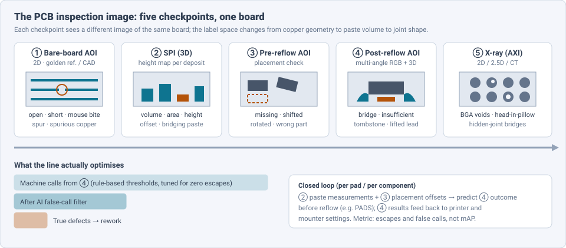
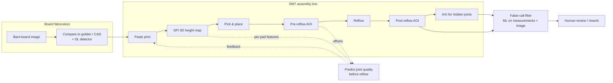
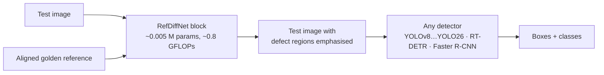
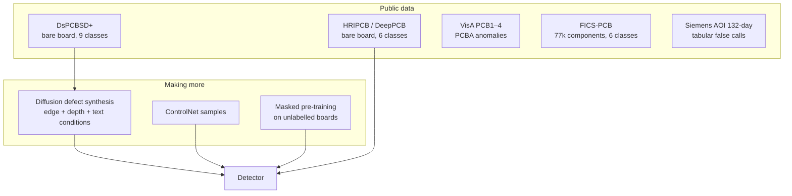

# Dense Object Detection & Classification — Recent Advances

*Compiled 2026-Oct-21 (America/Los_Angeles).*

Next installment in the running CV-updates log. Earlier entries:
[Apr-30](../2026-Apr-30/2026-Apr-30_CV_updates.md),
[May-01](../2026-May-01/2026-May-01_CV_updates.md),
[May-02](../2026-May-02/2026-May-02_CV_updates.md),
[May-04](../2026-May-04/2026-May-04_CV_updates.md),
[May-05](../2026-May-05/2026-May-05_CV_updates.md),
[May-07](../2026-May-07/2026-May-07_CV_updates.md),
[May-08](../2026-May-08/2026-May-08_CV_updates.md),
[May-15](../2026-May-15/2026-May-15_CV_updates.md),
[May-16](../2026-May-16/2026-May-16_CV_updates.md),
[May-17](../2026-May-17/2026-May-17_CV_updates.md),
[Jun-09](../2026-Jun-09/2026-Jun-09_CV_updates.md),
[Jun-10](../2026-Jun-10/2026-Jun-10_CV_updates.md),
[Jun-12](../2026-Jun-12/2026-Jun-12_CV_updates.md),
[Jun-15](../2026-Jun-15/2026-Jun-15_CV_updates.md),
[Jun-16](../2026-Jun-16/2026-Jun-16_CV_updates.md),
[Jun-17](../2026-Jun-17/2026-Jun-17_CV_updates.md),
[Jun-19](../2026-Jun-19/2026-Jun-19_CV_updates.md),
[Jun-21](../2026-Jun-21/2026-Jun-21_CV_updates.md),
[Jun-22](../2026-Jun-22/2026-Jun-22_CV_updates.md),
[Jun-23](../2026-Jun-23/2026-Jun-23_CV_updates.md),
[Jun-24](../2026-Jun-24/2026-Jun-24_CV_updates.md),
[Jun-25](../2026-Jun-25/2026-Jun-25_CV_updates.md),
[Jun-27](../2026-Jun-27/2026-Jun-27_CV_updates.md),
[Jun-29](../2026-Jun-29/2026-Jun-29_CV_updates.md),
[Jun-30](../2026-Jun-30/2026-Jun-30_CV_updates.md),
[Jul-04](../2026-Jul-04/2026-Jul-04_CV_updates.md),
[Jul-07](../2026-Jul-07/2026-Jul-07_CV_updates.md),
[Jul-08](../2026-Jul-08/2026-Jul-08_CV_updates.md),
[Jul-10](../2026-Jul-10/2026-Jul-10_CV_updates.md),
[Jul-15](../2026-Jul-15/2026-Jul-15_CV_updates.md),
[Jul-17](../2026-Jul-17/2026-Jul-17_CV_updates.md),
[Jul-18](../2026-Jul-18/2026-Jul-18_CV_updates.md),
[Jul-21](../2026-Jul-21/2026-Jul-21_CV_updates.md),
[Jul-22](../2026-Jul-22/2026-Jul-22_CV_updates.md),
[Jul-24](../2026-Jul-24/2026-Jul-24_CV_updates.md),
[Jul-26](../2026-Jul-26/2026-Jul-26_CV_updates.md),
[Jul-27](../2026-Jul-27/2026-Jul-27_CV_updates.md),
[Jul-30](../2026-Jul-30/2026-Jul-30_CV_updates.md),
[Aug-01](../2026-Aug-01/2026-Aug-01_CV_updates.md),
[Aug-02](../2026-Aug-02/2026-Aug-02_CV_updates.md),
[Aug-04](../2026-Aug-04/2026-Aug-04_CV_updates.md),
[Aug-07](../2026-Aug-07/2026-Aug-07_CV_updates.md),
[Aug-10](../2026-Aug-10/2026-Aug-10_CV_updates.md),
[Aug-11](../2026-Aug-11/2026-Aug-11_CV_updates.md),
[Aug-13](../2026-Aug-13/2026-Aug-13_CV_updates.md),
[Aug-15](../2026-Aug-15/2026-Aug-15_CV_updates.md),
[Aug-16](../2026-Aug-16/2026-Aug-16_CV_updates.md),
[Aug-18](../2026-Aug-18/2026-Aug-18_CV_updates.md),
[Aug-19](../2026-Aug-19/2026-Aug-19_CV_updates.md),
[Aug-21](../2026-Aug-21/2026-Aug-21_CV_updates.md),
[Aug-22](../2026-Aug-22/2026-Aug-22_CV_updates.md),
[Aug-24](../2026-Aug-24/2026-Aug-24_CV_updates.md),
[Aug-26](../2026-Aug-26/2026-Aug-26_CV_updates.md),
[Aug-29](../2026-Aug-29/2026-Aug-29_CV_updates.md),
[Sep-01](../2026-Sep-01/2026-Sep-01_CV_updates.md),
[Sep-20](../2026-Sep-20/2026-Sep-20_CV_updates.md),
[Sep-23](../2026-Sep-23/2026-Sep-23_CV_updates.md),
[Sep-24](../2026-Sep-24/2026-Sep-24_CV_updates.md),
[Sep-25](../2026-Sep-25/2026-Sep-25_CV_updates.md),
[Sep-26](../2026-Sep-26/2026-Sep-26_CV_updates.md),
[Sep-29](../2026-Sep-29/2026-Sep-29_CV_updates.md),
[Sep-30](../2026-Sep-30/2026-Sep-30_CV_updates.md),
[Oct-01](../2026-Oct-01/2026-Oct-01_CV_updates.md),
[Oct-02](../2026-Oct-02/2026-Oct-02_CV_updates.md),
[Oct-03](../2026-Oct-03/2026-Oct-03_CV_updates.md),
[Oct-04](../2026-Oct-04/2026-Oct-04_CV_updates.md),
[Oct-05](../2026-Oct-05/2026-Oct-05_CV_updates.md),
[Oct-06](../2026-Oct-06/2026-Oct-06_CV_updates.md),
[Oct-07](../2026-Oct-07/2026-Oct-07_CV_updates.md),
[Oct-08](../2026-Oct-08/2026-Oct-08_CV_updates.md),
[Oct-09](../2026-Oct-09/2026-Oct-09_CV_updates.md),
[Oct-10](../2026-Oct-10/2026-Oct-10_CV_updates.md),
[Oct-11](../2026-Oct-11/2026-Oct-11_CV_updates.md),
[Oct-12](../2026-Oct-12/2026-Oct-12_CV_updates.md),
[Oct-13](../2026-Oct-13/2026-Oct-13_CV_updates.md),
[Oct-14](../2026-Oct-14/2026-Oct-14_CV_updates.md),
[Oct-15](../2026-Oct-15/2026-Oct-15_CV_updates.md),
[Oct-16](../2026-Oct-16/2026-Oct-16_CV_updates.md),
[Oct-17](../2026-Oct-17/2026-Oct-17_CV_updates.md),
[Oct-18](../2026-Oct-18/2026-Oct-18_CV_updates.md),
[Oct-19](../2026-Oct-19/2026-Oct-19_CV_updates.md),
[Oct-20](../2026-Oct-20/2026-Oct-20_CV_updates.md).

The last entry covered the [semiconductor wafer inspection image](../2026-Oct-20/2026-Oct-20_CV_updates.md),
and ended by pointing at packaging. This run takes the next step down the
supply chain, from the die to the board it is soldered onto: the
**printed-circuit-board (PCB) inspection image**. One board is imaged
several times on an assembly line, and each image is a different
computer-vision problem:

- the **bare-board image** (before assembly): copper traces and pads,
  inspected against a golden board or the CAD/Gerber data. The objects are
  small, thin geometric faults: open, short, mouse bite, spur, spurious
  copper;
- the **solder paste inspection (SPI) image**: a 3D height map of every
  paste deposit after printing. The "detection" is a measurement per pad
  (volume, area, height, offset);
- the **automated optical inspection (AOI) image** before and after
  reflow: multi-angle colour plus 3D images of placed components and
  solder joints. Here the hard problem is not finding candidates but
  rejecting **false calls**;
- the **automated X-ray (AXI) image** for joints that optics cannot see
  (BGA voids, head-in-pillow).

Earlier entries touched this only at the edges.
[May-08](../2026-May-08/2026-May-08_CV_updates.md) covered generic
industrial anomaly detection (MVTec, VisA, which contains four PCB
categories), [Jul-15](../2026-Jul-15/2026-Jul-15_CV_updates.md) covered
X-ray transmission imaging in general, and
[Oct-20](../2026-Oct-20/2026-Oct-20_CV_updates.md) stopped at the wafer
and 3D packaging. No earlier entry treated the PCB inspection image as a
modality of its own; this one does, and it keeps the "evidence →
measurement → disposition" framing of the Oct-12 → Oct-20 inspection run.

Six properties make it a distinct problem:

- **One board, several images, several label spaces.** Copper geometry,
  paste volume, part placement and joint shape are different tasks with
  different sensors (§2).
- **Bare-board detection is a tiny-object benchmark that is nearly
  solved on the old data.** HRIPCB/PKU-Market-PCB and DeepPCB results
  sit at 97–99% mAP@0.5; the newer DsPCBSD+ is much harder (§3).
- **A reference image is free, and most deep detectors ignore it.**
  Golden boards and CAD exist for every product, which makes PCB
  inspection unusual among detection tasks (§3, §4).
- **On assembled boards the metric is the false call.** Rule-based AOI
  is tuned for zero escapes, so it flags many good joints; the industrial
  ML problem is classifying those calls, on tabular measurements as much
  as on pixels (§5).
- **Defects are rare and boards change weekly.** Anomaly detection,
  synthetic defects and few-shot methods carry the field; high-resolution
  (4K) boards break off-the-shelf anomaly detectors (§4, §6).
- **The output is moving to language.** A 2026 benchmark asks VLMs
  open-ended inspection questions, and they do poorly without domain
  training (§7).

> **Numbers below come from search-engine abstracts, repository records,
> dataset cards and vendor pages. I did not read the full papers**
> (everything on this run was read via search snippets). Treat every
> number as an author- or vendor-reported, abstract-level claim. Vendor
> figures are marked as such. PCB detection papers use different
> datasets, class subsets and splits; do not compare mAPs across rows
> unless the text says they share a protocol.

---

## Table of contents

1. [Why this pass](#1--why-this-pass)
2. [The primitive: five checkpoints, one board](#2--the-primitive-five-checkpoints-one-board)
3. [Bare-board defect detection: tiny objects and the reference image](#3--bare-board-defect-detection-tiny-objects-and-the-reference-image)
4. [Assembled boards (PCBA): anomaly detection at 4K](#4--assembled-boards-pcba-anomaly-detection-at-4k)
5. [Solder joints, SPI and the false-call problem](#5--solder-joints-spi-and-the-false-call-problem)
6. [The data problem: datasets, synthesis, pre-training](#6--the-data-problem-datasets-synthesis-pre-training)
7. [Vision-language inspection](#7--vision-language-inspection)
8. [Open problems / what to watch](#8--open-problems--what-to-watch)
9. [Sources](#9--sources)

---

## 1 · Why this pass

PCB inspection is one of the most published detection applications (a
2025 systematic review counts 56 studies from 2015 to Q1 2025, 26 of them
YOLO-based), but also one of the narrowest: most papers detect the same
six bare-board defect types. Five things moved in late 2025 and 2026 that
widen it:

1. **The reference image came back.** RefDiffNet (arXiv 2606.00852, Jun
   2026) puts a tiny reference-comparison block in front of any detector
   and reports up to **18%** relative mAP50:95 gain on HRIPCB and DeepPCB
   for YOLOv8–YOLO26, RT-DETR and Faster R-CNN, at ≤ **0.25%** extra
   parameters (§3).
2. **A harder benchmark replaced the saturated ones.** On DsPCBSD+ (10,259
   images, 20,276 boxes, 9 classes), structure-guided masked pre-training
   (arXiv 2606.03508) reports **85.5%** mAP@0.5 and **52.3%** mAP@0.5:0.95,
   far below the ~98% typical on HRIPCB (§3, §6).
3. **Anomaly detection reached 4K assembled boards.** HiSIR-Net (arXiv
   2512.17296, HUST/Siemens) targets pixel-wise localisation on
   high-resolution PCBA, where PatchCore and EfficientAD give many false
   positives on few-pixel defects (§4).
4. **The false-call literature got a methodology check.** Siemens (arXiv
   2506.14521, COMPSAC 2025) finds seven common weaknesses in published
   false-call-reduction studies and shows the usual best practice would
   fail on its own production data (§5).
5. **PCB inspection became a VLM benchmark.** UniPCB (arXiv 2601.19222,
   Jan 2026): ~6k images, ~23k QA pairs, 14 question types across three
   scenarios. Its PCB-GPT more than **doubles** the strongest general
   MLLMs on fine-grained defect localisation (§7).

---

## 2 · The primitive: five checkpoints, one board

| Property | ① Bare board | ② SPI | ③ Pre-reflow AOI | ④ Post-reflow AOI | ⑤ AXI |
|---|---|---|---|---|---|
| Sensor | 2D line-scan / area camera | 3D phase/laser profilometry | 2D/3D camera | multi-angle RGB + 3D | 2D / 2.5D / CT X-ray |
| Object | copper fault | paste deposit | component | solder joint | hidden joint |
| Task | detect tiny thin defects | measure + flag | presence, offset, polarity | true defect vs false call | void / bridge segmentation |
| Reference | golden board, Gerber | stencil apertures | pick-and-place file | component library | — |
| Public data | HRIPCB, DeepPCB, DsPCBSD+ | almost none | FICS-PCB (components) | Siemens AOI tabular set; Ülger et al. joints | few |

The structural point is that **the first checkpoint is a detection
problem and the later ones are mostly classification of machine calls**.
Academic work concentrates on ①, where public data exists. Factories
spend their effort on ④, where the AOI machine already detects and the
question is whether a human must look.

---

## 3 · Bare-board defect detection: tiny objects and the reference image

**Benchmarks.** Three datasets carry most results:

| Dataset | Images | Classes | Note |
|---|---|---|---|
| HRIPCB / PKU-Market-PCB (2019–2020) | 1,386 | 6 (missing hole, mouse bite, open, short, spur, spurious copper) | synthesised defects; most-used; near saturation |
| DeepPCB (2019) | 1,500 image pairs | 6 | each test image paired with a defect-free template |
| DsPCBSD+ (2024) | 10,259 | 9 (adds hole breakout, conductor scratch, conductor / base-material foreign object) | 20,276 boxes; harder, real defects; one later paper reports correcting annotation errors |

A Scopus review of 56 PCB papers (2015–Q1 2025) found **78.6%** detect at
most six defect types and **62.5%** use custom datasets, so most claims
are on HRIPCB-like data or are not reproducible.

**Detectors.** Two families dominate, both tuned for small objects:

| Model | Base | Dataset | Reported |
|---|---|---|---|
| SME-YOLO (arXiv 2601.11402, Jan 2026) | YOLOv11n + NWD loss, EUCB upsampling, MSFA attention | PKU-PCB | +2.2 mAP, +4.0 precision over YOLOv11n |
| PD-YOLOv8 (*Sci. Rep.* Jan 2025) | YOLOv8n + ECANet | PCB small defects | — |
| LPFF-DETR (*Meas. Sci. Technol.* Jun 2026) | lightweight DETR | HRIPCB | **98.5%** mAP, 7.7 M params, 11.2 GFLOPs |
| SCP-DETR (2025) | RT-DETR + small-object pyramid | PCB | 97% mAP@0.5, +3 over RT-DETR-r18 |
| CFSC-DETR (2026) | RT-DETR | PKU-Market-PCB; DeepPCB transfer | gains with fewer params (abstract) |
| Structure-guided masked pre-training (arXiv 2606.03508, Jun 2026) | YOLOv8s + sparse-conv reconstruction pre-training | **DsPCBSD+** | **85.5** mAP@0.5, **52.3** mAP@0.5:0.95 |

Two recurring ideas: a **Normalized Wasserstein Distance** (NWD) loss,
which treats boxes as Gaussians so a few-pixel offset does not drop IoU to
zero, and
**elongation-aware** training. The 2606.03508 paper adds a spatial
continuity term that pulls scattered positive predictions on one long
defect (a scratch, an open along a trace) together. Its masking is
"structure-guided": it uses the trace/pad layout to decide what to mask
during self-supervised pre-training on unlabelled boards.

**The reference image.** Every board design has a golden image and CAD.
Classical AOI was built on reference comparison; deep detectors mostly
dropped it. RefDiffNet (IIT Kanpur, arXiv 2606.00852) re-adds it as a
plug-in:

The reported gain is up to **18%** relative mAP50:95 on HRIPCB and
DeepPCB, and the block adds at most **0.25%** of any tested detector's
parameters. The design keeps the detector unchanged, which matters in
factories where the detector is already validated. The open question is
alignment: the block needs a registered reference, and the abstract does
not say how robust it is to misregistration.

---

## 4 · Assembled boards (PCBA): anomaly detection at 4K

Once components are on the board, the defect list is open-ended (wrong
part, damaged body, debris, missing label), so one-class anomaly
detection is the natural framing.

- **VisA's PCB1–PCB4** are the standard public PCBA anomaly categories.
  Zero-shot CLIP-based methods (WinCLIP, AnomalyCLIP, AdaCLIP, Bayesian
  Prompt Flow, arXiv 2503.10080) report per-category results; in the
  Bayesian Prompt Flow table PCB4 is the easiest and PCB1 among the
  hardest. GLAD (arXiv 2406.07487) assembles a **PCB-Bank** from VisA's
  four PCB sets plus others, and few-shot DriftAD (arXiv 2608.23723)
  reports per-PCB VisA results.
- **High resolution is the real gap.** HiSIR-Net (arXiv 2512.17296, HUST,
  Siemens, UESTC, PKU) argues that at 4K, standard methods either run out
  of GPU memory or lose few-pixel defects; PatchCore and EfficientAD show
  high false-positive rates. It reconstructs overlapping patches and adds
  two light modules: a **Selective Input-Reconstruction Gate** (where to
  trust the reconstruction vs the input) and **Region-level Optimised
  Patch Selection** (how to stitch). On its own 500-image **SIPCBA-500**
  set it reports state-of-the-art localisation with low false positives;
  the abstract does not give numbers.
- **Production-style benchmarks.** A Brazilian study (SBC) compares
  CFA, DFM, FRE and PatchCore one-class on assembled PCBs, a useful
  counterweight to VisA because its boards come from a real line.

This matches the wafer SEM finding (Oct-20): rankings from MVTec-style
benchmarks do not carry over, and thresholding (false positives at a
fixed recall) is the harder part.

---

## 5 · Solder joints, SPI and the false-call problem

**Why the false call is the metric.** A post-reflow AOI is tuned so that
almost no real defect escapes. The cost is many *false calls*: good
joints flagged for a human. Every vendor now sells an AI layer that
reclassifies those calls:

| Vendor / system | Claim (vendor, not independent) |
|---|---|
| Mycronic DeepReview (3D AOI) | eliminates **50–100%** of false calls for eligible components |
| Koh Young (AI AOI) | AI classification reduces false calls; auto-programming cuts setup up to **70%** |
| Siemens Opcenter AOI-FCR | ML false-call reduction on AOI measurements |

**What the public research shows.**

- **Tabular beats pixels, often.** Much of the false-call work uses the
  AOI's *measurements* rather than images. Comparisons of decision trees,
  random forests, k-NN and neural networks on logged AOI fails keep
  finding k-NN best on small data; Thielen et al. (FAU, 2020) note k-NN
  gets slow on large data, where random forests and neural networks win.
  Siemens released a **132-day** AOI dataset (Data in Brief, 2024): each
  board sent to manual review labelled true defect or false call, with
  the AOI's physical measurements, and with acknowledged drift and label
  noise.
- **Methodology check.** Pfab & Rothering (arXiv 2506.14521, COMPSAC 2025)
  list seven weaknesses common in false-call papers (random splits that
  ignore time, metrics not tied to escape cost, no success criteria) and
  show experimentally that the usual best practice would fail on this use
  case. Their recommendation: report escapes and false calls at a
  business threshold, and split by time.
- **Image-based joint classifiers.** ConvNeXt + YOLOX on 759 AOI defect
  images from one manufacturer, MobileXT (CNN + transformer), and Solder
  PointNet on 3D point clouds are reviewed in *Int. J. Adv. Manuf.
  Technol.* (2025). Ülger et al. (IEEE TIM 2023) survey optical solder
  inspection (reference-based, ML, DL, 3D reconstruction) and release a
  public joint dataset with SMT error types, one of the few.
- **Predict before reflow.** PADS (IEEE T-CPMT 2024) learns from SPI and
  pre-reflow AOI features and flags joints whose reconstruction error is
  high, *before* reflow makes them permanent. An iScience paper (2024)
  combines phase-measuring-profilometry SPI with an improved YOLOX to
  detect and locate printing defects in 3D.
- **X-ray joints.** PCB-DeepLabV3 (*Sci. Rep.* 2024, MobileNetV2
  backbone) segments voids in chip solder-joint X-rays; on 3D X-ray
  microscopy of BGAs, U-Net/U-Net++ reach about **88%** IoU / **92%** F1
  (EDFA 2024), with slice-to-slice consistency named as the weak point.

---

## 6 · The data problem: datasets, synthesis, pre-training

- **Components.** FICS-PCB (U. Florida, 2020): 9,912 images of 31 boards
  from a microscope and a DSLR, **77,347** labelled components in six
  classes (IC, capacitor, diode, inductor, resistor, transistor), heavily
  skewed to capacitors and resistors. It serves component detection and
  hardware-assurance work (reverse engineering, Trojan screening); a 2025
  ISQED paper rebuilds KiCad design files from X-ray CT segmentation of
  vias, pads and traces.
- **Diffusion synthesis.** A second "UniPCB" (arXiv 2605.04635, May 2026;
  different paper, same name as §7) conditions a diffusion generator on
  edge, depth and text, feeds generated defects back into detector
  training, and reports **98.0%** mAP@0.5 on DsPCBSD+ (FID 129.61).
  Treat it next to 2606.03508's 85.5% with care: the abstracts suggest
  different class subsets and splits (one DsPCBSD+ user reports keeping
  only six of nine classes after cleaning labels). DEFectDiffuser and
  ControlNet + Swin pipelines follow the same pattern.
- **Self-supervision.** Structure-guided masked pre-training (§3) is the
  first PCB-specific pre-training result on DsPCBSD+ in this log; it uses
  the board's own layout as the masking prior.

The lesson matches Oct-19 and Oct-20: generated data helps, but the gain
depends on the benchmark, and a saturated benchmark hides it.

---

## 7 · Vision-language inspection

**UniPCB benchmark** (arXiv 2601.19222, Jan 2026; Sun, Jiang et al.)
curates and standardises PCB data from scattered sources into ~6k images
and ~23k QA pairs across three annotated scenarios (its appendix
separates bare boards from assembled boards) and 14 question types. It
reports that general MLLMs struggle, and trains **PCB-GPT** on a
generated instruction set with a progressive curriculum; PCB-GPT more
than **doubles** the strongest competitors on fine-grained defect
localisation. Data, benchmark and model are announced for release.

Related industrial work: MMAD (arXiv 2410.09453) for MLLMs on general
industrial anomalies, IMDD-1M (arXiv 2512.24160) with >1M industrial
defect image–text pairs, and a DS-MoE cross-modal detector (arXiv
2603.26735) that uses distilled LLM text prompts and includes PCB
defects. PCB *design* also has LLM benchmarks now (PCB-QA, PCBWorld,
PCBInnoBench at NeurIPS 2026), which could later connect a detected
defect to the design rule it violates.

The pattern is the same as wafer maps (Oct-20, WaferSAGE): a small
domain-tuned VLM beats large general ones, and localisation, not
description, is where general models fail.

---

## 8 · Open problems / what to watch

1. **Retire HRIPCB as the headline.** With 97–99% mAP@0.5 common, new
   bare-board claims should report DsPCBSD+ (all nine classes, the
   published split) and mAP@0.5:0.95.
2. **Reference-aware detection with registration error.** RefDiffNet
   shows the reference image is cheap accuracy; the next papers should
   test it under realistic misalignment and against CAD-rendered (rather
   than golden-board) references.
3. **False-call metrics.** Report escape rate and false-call reduction at
   a fixed escape budget, on time-ordered splits (Siemens 2506.14521).
   The 132-day Siemens set makes this possible publicly.
4. **4K anomaly localisation.** HiSIR-Net names the problem; a public
   high-resolution PCBA benchmark with pixel masks does not yet exist.
5. **Closing the SPI → AOI loop.** Predicting joint defects from paste and
   placement data before reflow (PADS) is the highest-value direction for
   a line, and almost no public data supports it.
6. **Grounded VLM answers.** UniPCB measures localisation; the next step
   is linking an answer to a design rule or a process cause (paste
   volume, placement offset), as WaferSAGE did for wafer maps.

---

## 9 · Sources

### Surveys and datasets

- PCB defect detection systematic literature review, 56 articles 2015–Q1 2025 (CEUR-WS Vol-4222) — https://ceur-ws.org/Vol-4222/short10.pdf
- Research on PCB Defect Detection Using AI: a Systematic Mapping Study (Atılım) — https://ada.atilim.edu.tr/entities/publication/791f5e5c-0bc8-45f8-9f90-68c0edce5c5c
- A PCB Dataset for Defects Detection and Classification (HRIPCB / PKU-Market-PCB) — arXiv 1901.08204 — https://arxiv.org/pdf/1901.08204
- A dataset for deep learning based detection of PCB surface defect (DsPCBSD+) — https://www.ncbi.nlm.nih.gov/pmc/articles/PMC11263390/
- PCB-Defect: an annotated dataset for surface defect detection — https://www.ncbi.nlm.nih.gov/pmc/articles/PMC12756537/ — https://data.mendeley.com/datasets/vdj74sngvn
- FICS-PCB: a multi-modal image dataset for automated PCB visual inspection — https://eprint.iacr.org/2020/366.pdf
- Data of automated optical inspection of SMT electronic production (Siemens, 132 days) — https://www.ncbi.nlm.nih.gov/pmc/articles/PMC10847760/

### Bare-board detection (§3)

- SME-YOLO: A Real-Time Detector for Tiny Defect Detection on PCB Surfaces — arXiv 2601.11402 — https://arxiv.org/abs/2601.11402v1
- PD-YOLOv8 (Scientific Reports, Jan 2025) — https://doaj.org/article/779eff324b9e484d987af3be89dafaf5
- LPFF-DETR: a lightweight transformer model for PCB defect detection — https://scholar.hit.edu.cn/en/publications/lpff-detr-a-lightweight-transformer-model-for-printed-circuit-boa/
- SCP-DETR: small-object-enhanced feature pyramid for PCB defect detection — https://www.ncbi.nlm.nih.gov/pmc/articles/PMC12396718/
- CFSC-DETR (Research Square) — https://www.researchsquare.com/article/rs-10024488
- Structure-Guided Mixed Masked Pretraining and Spatial Continuity Regularization for PCB Defect Detection — arXiv 2606.03508 — https://arxiv.org/pdf/2606.03508
- RefDiffNet: Learning to Expose Subtle PCB Defects Before Detection — arXiv 2606.00852 — https://arxiv.org/pdf/2606.00852 — https://papers.cool/arxiv/2606.00852

### Assembled boards, anomaly detection (§4)

- Towards Pixel-Wise Anomaly Location for High-Resolution PCBA via Self-Supervised Image Reconstruction (HiSIR-Net) — arXiv 2512.17296 — https://arxiv.org/abs/2512.17296v1
- Bayesian Prompt Flow Learning for Zero-Shot Anomaly Detection — arXiv 2503.10080 — https://arxiv.org/pdf/2503.10080
- GLAD (PCB-Bank) — arXiv 2406.07487 — https://arxiv.org/pdf/2406.07487
- DriftAD: Visually-Guided Text Drift for Few-Shot Industrial Anomaly Detection — arXiv 2608.23723 — https://arxiv.org/pdf/2608.23723
- One-class anomaly detection benchmark on assembled PCBs (SBC) — https://sol.sbc.org.br/index.php/semish/article/download/43544/43307/

### Solder joints, SPI, false calls (§5)

- Towards Improved Research Methodologies for Industrial AI: a case study of false call reduction — arXiv 2506.14521 — https://arxiv.org/abs/2506.14521
- A Machine Learning Based Approach to Detect False Calls in SMT Manufacturing (FAU) — https://cris.fau.de/publications/247683995
- Comparison of classifiers on AOI fail data (IEEE 2021) — https://ieeexplore.ieee.org/document/9648445
- Deep learning for solder joint inspection, review (Int. J. Adv. Manuf. Technol. 2025) — https://link.springer.com/article/10.1007/s00170-025-15460-8
- Solder Joint Inspection on Printed Circuit Boards: A Survey and a Dataset (IEEE TIM 2023) — https://avesis.hacettepe.edu.tr/yayin/a94edfea-393d-4a5a-a972-1b4602d32072/solder-joint-inspection-on-printed-circuit-boards-a-survey-and-a-dataset
- PADS: Predictive Anomaly Detection for SMT Solder Joints — https://researchconnect.suny.edu/en/publications/pads-predictive-anomaly-detection-for-smt-solder-joints-using-nov/
- Intelligent inspection of solder paste printing defects with improved YOLOX (iScience 2024) — https://pmc.ncbi.nlm.nih.gov/articles/PMC10904988
- PCB-DeepLabV3: void segmentation in chip solder-joint X-rays — https://www.ncbi.nlm.nih.gov/pmc/articles/PMC11126598/
- 3D X-ray microscopy BGA void segmentation (EDFA Aug 2024) — https://static.asminternational.org/edfa/202408/9
- Mycronic DeepReview for 3D AOI (vendor) — https://www.mycronic.com/product-areas/pcb-assembly/solutions/pcb-assembly-solutions/deep-review-for-3d-aoi/
- Koh Young: AI-powered AOI (vendor) — https://kohyoungamerica.com/?p=993227
- Siemens Opcenter AOI false-call reduction (vendor) — https://plm.sw.siemens.com/en-US/opcenter/manufacturing-intelligence/aoi-fcr

### Data generation and components (§6)

- UniPCB: A Generation-Assisted Vision-Based Measurement Framework for PCB Defect Inspection — arXiv 2605.04635 — https://arxiv.org/pdf/2605.04635
- Surveying GenAI-based Automation in PCB Design and Test — arXiv 2606.17074 — https://arxiv.org/pdf/2606.17074
- A Framework for PCB Design File Reconstruction from X-ray CT Annotations (ISQED 2025) — https://isqed.org/English/Archives/2025/Technical_Sessions/51.html

### Vision-language (§7)

- UniPCB: A Unified Vision-Language Benchmark for Open-Ended PCB Quality Inspection — arXiv 2601.19222 — https://arxiv.org/abs/2601.19222v1
- MMAD: industrial anomaly detection benchmark for MLLMs — arXiv 2410.09453 — https://www.arxiv.org/pdf/2410.09453v1
- IMDD-1M industrial defect image–text dataset — arXiv 2512.24160 — https://arxiv.org/pdf/2512.24160v2
- DS-MoE cross-modal industrial defect detection — arXiv 2603.26735 — https://arxiv.org/html/2603.26735v1
- PCBInnoBench (NeurIPS 2026) — https://neurips.cc/virtual/2026/poster/139034
- PCBWorld — arXiv 2607.05915 — https://arxiv.org/pdf/2607.05915
