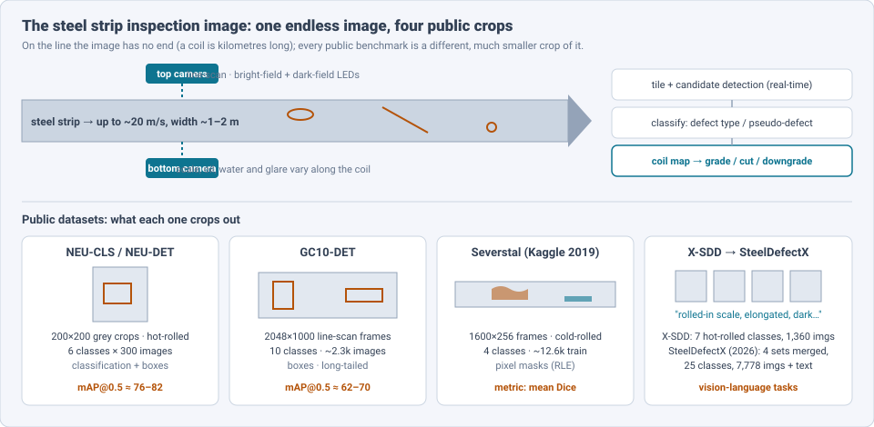
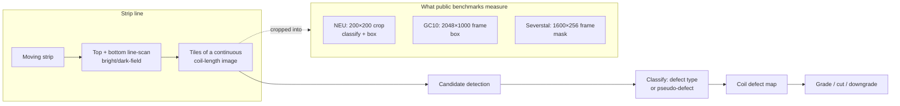
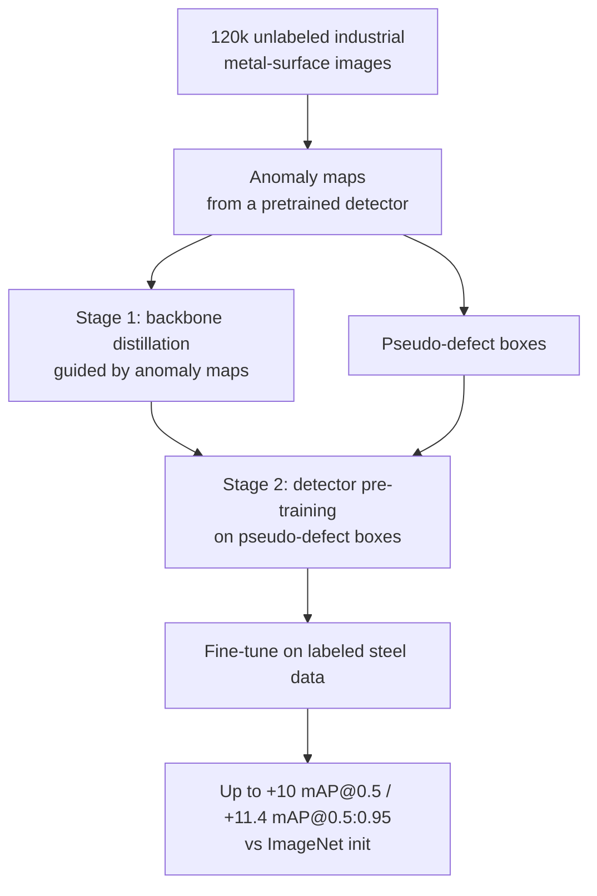
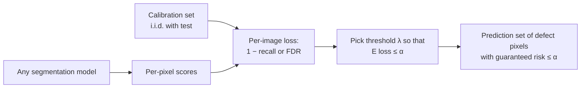

# Dense Object Detection & Classification — Recent Advances

*Compiled 2026-Oct-22 (America/Los_Angeles).*

Next installment in the running CV-updates log. Earlier entries:
[Apr-30](../2026-Apr-30/2026-Apr-30_CV_updates.md),
[May-01](../2026-May-01/2026-May-01_CV_updates.md),
[May-02](../2026-May-02/2026-May-02_CV_updates.md),
[May-04](../2026-May-04/2026-May-04_CV_updates.md),
[May-05](../2026-May-05/2026-May-05_CV_updates.md),
[May-07](../2026-May-07/2026-May-07_CV_updates.md),
[May-08](../2026-May-08/2026-May-08_CV_updates.md),
[May-15](../2026-May-15/2026-May-15_CV_updates.md),
[May-16](../2026-May-16/2026-May-16_CV_updates.md),
[May-17](../2026-May-17/2026-May-17_CV_updates.md),
[Jun-09](../2026-Jun-09/2026-Jun-09_CV_updates.md),
[Jun-10](../2026-Jun-10/2026-Jun-10_CV_updates.md),
[Jun-12](../2026-Jun-12/2026-Jun-12_CV_updates.md),
[Jun-15](../2026-Jun-15/2026-Jun-15_CV_updates.md),
[Jun-16](../2026-Jun-16/2026-Jun-16_CV_updates.md),
[Jun-17](../2026-Jun-17/2026-Jun-17_CV_updates.md),
[Jun-19](../2026-Jun-19/2026-Jun-19_CV_updates.md),
[Jun-21](../2026-Jun-21/2026-Jun-21_CV_updates.md),
[Jun-22](../2026-Jun-22/2026-Jun-22_CV_updates.md),
[Jun-23](../2026-Jun-23/2026-Jun-23_CV_updates.md),
[Jun-24](../2026-Jun-24/2026-Jun-24_CV_updates.md),
[Jun-25](../2026-Jun-25/2026-Jun-25_CV_updates.md),
[Jun-27](../2026-Jun-27/2026-Jun-27_CV_updates.md),
[Jun-29](../2026-Jun-29/2026-Jun-29_CV_updates.md),
[Jun-30](../2026-Jun-30/2026-Jun-30_CV_updates.md),
[Jul-04](../2026-Jul-04/2026-Jul-04_CV_updates.md),
[Jul-07](../2026-Jul-07/2026-Jul-07_CV_updates.md),
[Jul-08](../2026-Jul-08/2026-Jul-08_CV_updates.md),
[Jul-10](../2026-Jul-10/2026-Jul-10_CV_updates.md),
[Jul-15](../2026-Jul-15/2026-Jul-15_CV_updates.md),
[Jul-17](../2026-Jul-17/2026-Jul-17_CV_updates.md),
[Jul-18](../2026-Jul-18/2026-Jul-18_CV_updates.md),
[Jul-21](../2026-Jul-21/2026-Jul-21_CV_updates.md),
[Jul-22](../2026-Jul-22/2026-Jul-22_CV_updates.md),
[Jul-24](../2026-Jul-24/2026-Jul-24_CV_updates.md),
[Jul-26](../2026-Jul-26/2026-Jul-26_CV_updates.md),
[Jul-27](../2026-Jul-27/2026-Jul-27_CV_updates.md),
[Jul-30](../2026-Jul-30/2026-Jul-30_CV_updates.md),
[Aug-01](../2026-Aug-01/2026-Aug-01_CV_updates.md),
[Aug-02](../2026-Aug-02/2026-Aug-02_CV_updates.md),
[Aug-04](../2026-Aug-04/2026-Aug-04_CV_updates.md),
[Aug-07](../2026-Aug-07/2026-Aug-07_CV_updates.md),
[Aug-10](../2026-Aug-10/2026-Aug-10_CV_updates.md),
[Aug-11](../2026-Aug-11/2026-Aug-11_CV_updates.md),
[Aug-13](../2026-Aug-13/2026-Aug-13_CV_updates.md),
[Aug-15](../2026-Aug-15/2026-Aug-15_CV_updates.md),
[Aug-16](../2026-Aug-16/2026-Aug-16_CV_updates.md),
[Aug-18](../2026-Aug-18/2026-Aug-18_CV_updates.md),
[Aug-19](../2026-Aug-19/2026-Aug-19_CV_updates.md),
[Aug-21](../2026-Aug-21/2026-Aug-21_CV_updates.md),
[Aug-22](../2026-Aug-22/2026-Aug-22_CV_updates.md),
[Aug-24](../2026-Aug-24/2026-Aug-24_CV_updates.md),
[Aug-26](../2026-Aug-26/2026-Aug-26_CV_updates.md),
[Aug-29](../2026-Aug-29/2026-Aug-29_CV_updates.md),
[Sep-01](../2026-Sep-01/2026-Sep-01_CV_updates.md),
[Sep-20](../2026-Sep-20/2026-Sep-20_CV_updates.md),
[Sep-23](../2026-Sep-23/2026-Sep-23_CV_updates.md),
[Sep-24](../2026-Sep-24/2026-Sep-24_CV_updates.md),
[Sep-25](../2026-Sep-25/2026-Sep-25_CV_updates.md),
[Sep-26](../2026-Sep-26/2026-Sep-26_CV_updates.md),
[Sep-29](../2026-Sep-29/2026-Sep-29_CV_updates.md),
[Sep-30](../2026-Sep-30/2026-Sep-30_CV_updates.md),
[Oct-01](../2026-Oct-01/2026-Oct-01_CV_updates.md),
[Oct-02](../2026-Oct-02/2026-Oct-02_CV_updates.md),
[Oct-03](../2026-Oct-03/2026-Oct-03_CV_updates.md),
[Oct-04](../2026-Oct-04/2026-Oct-04_CV_updates.md),
[Oct-05](../2026-Oct-05/2026-Oct-05_CV_updates.md),
[Oct-06](../2026-Oct-06/2026-Oct-06_CV_updates.md),
[Oct-07](../2026-Oct-07/2026-Oct-07_CV_updates.md),
[Oct-08](../2026-Oct-08/2026-Oct-08_CV_updates.md),
[Oct-09](../2026-Oct-09/2026-Oct-09_CV_updates.md),
[Oct-10](../2026-Oct-10/2026-Oct-10_CV_updates.md),
[Oct-11](../2026-Oct-11/2026-Oct-11_CV_updates.md),
[Oct-12](../2026-Oct-12/2026-Oct-12_CV_updates.md),
[Oct-13](../2026-Oct-13/2026-Oct-13_CV_updates.md),
[Oct-14](../2026-Oct-14/2026-Oct-14_CV_updates.md),
[Oct-15](../2026-Oct-15/2026-Oct-15_CV_updates.md),
[Oct-16](../2026-Oct-16/2026-Oct-16_CV_updates.md),
[Oct-17](../2026-Oct-17/2026-Oct-17_CV_updates.md),
[Oct-18](../2026-Oct-18/2026-Oct-18_CV_updates.md),
[Oct-19](../2026-Oct-19/2026-Oct-19_CV_updates.md),
[Oct-20](../2026-Oct-20/2026-Oct-20_CV_updates.md),
[Oct-21](../2026-Oct-21/2026-Oct-21_CV_updates.md).

The last entry covered the [PCB inspection image](../2026-Oct-21/2026-Oct-21_CV_updates.md).
This run moves from electronics to primary metals: the **steel strip
surface inspection image**. Hot- and cold-rolled strip passes under
top- and bottom-side line-scan cameras at line speed, and the inspection
system writes one continuous image of each surface for the whole coil,
which can be kilometres long. It is the oldest high-volume industrial
deployment of surface inspection, and it has its own small family of
benchmarks:

- **NEU-CLS / NEU-DET** (Northeastern University): 1,800 grayscale crops
  of 200×200 pixels, six hot-rolled defect classes with 300 images each
  (crazing, inclusion, patches, pitted surface, rolled-in scale,
  scratches);
- **GC10-DET**: line-scan frames of about 2048×1000 pixels, ten classes
  (punching hole, weld line, crescent gap, water spot, oil spot, silk
  spot, inclusion, rolled pit, crease, waist folding), long-tailed;
- **Severstal** (Kaggle, 2019): cold-rolled frames of 1600×256 pixels
  with four classes and pixel masks;
- **X-SDD**: seven hot-rolled classes, 1,360 images, for classification.

Earlier entries touched this only from the side.
[May-08](../2026-May-08/2026-May-08_CV_updates.md) covered generic
industrial anomaly detection (MVTec AD, VisA),
[Oct-17](../2026-Oct-17/2026-Oct-17_CV_updates.md) covered rail-head
surface defects, and [Oct-21](../2026-Oct-21/2026-Oct-21_CV_updates.md)
introduced the IMDD-1M image–text set. No earlier entry treated the
steel strip image as a modality of its own; this one does, and it keeps
the "evidence → measurement → disposition" framing of the Oct-12 →
Oct-21 inspection run.

Six properties make it a distinct problem:

- **The image never ends.** Inspection is a stream over the whole coil,
  and the decision is about the coil (grade, cut, downgrade). Every
  public dataset is a small crop, and each crops differently (§2).
- **The benchmarks are small and stuck.** NEU-DET mAP@0.5 has sat in the
  high 70s to low 80s for years, and GC10-DET in the 60s to low 70s. The
  limit looks like ambiguous boxes on diffuse, texture-like defects
  ("crazing", "rolled-in scale") rather than detector capacity (§3).
- **Pre-training is moving in-domain.** A 120k-image industrial
  pre-training set with anomaly-guided objectives beats ImageNet
  initialisation by up to 10 mAP@0.5 points (§4).
- **Labels are expensive, defects are rare.** Unsupervised representation
  learning, anomaly detection and diffusion-generated defects carry most
  new work (§4, §5).
- **Reliability needs guarantees, not just mAP.** Conformal risk control
  now bounds the pixel miss rate on Severstal and NEU at a chosen level
  (§6).
- **Steel defects are becoming a language task.** SteelDefectX merges
  four datasets into 25 classes with text, and million-scale industrial
  image–text sets give the open-vocabulary setting (§7).

> **Numbers below come from search-engine abstracts, publisher pages and
> dataset cards. I did not read the full papers** (arxiv.org could not be
> fetched on this run, so everything was read via search snippets). Treat
> every number as an author-reported, abstract-level claim. Steel papers
> use different splits, input sizes and versions of NEU-DET and GC10-DET
> (sources disagree even on GC10-DET's image count), so do not compare
> mAPs across rows unless the text says they share a protocol. Vendor
> figures are excluded except where marked.

---

## Table of contents

1. [Why this pass](#1--why-this-pass)
2. [The primitive: an endless image, cropped four ways](#2--the-primitive-an-endless-image-cropped-four-ways)
3. [Supervised detection on NEU-DET and GC10-DET: a plateau](#3--supervised-detection-on-neu-det-and-gc10-det-a-plateau)
4. [In-domain pre-training and unsupervised learning](#4--in-domain-pre-training-and-unsupervised-learning)
5. [Synthetic defects with diffusion](#5--synthetic-defects-with-diffusion)
6. [Reliability: conformal guarantees and honest benchmarking](#6--reliability-conformal-guarantees-and-honest-benchmarking)
7. [Vision-language and open-vocabulary steel inspection](#7--vision-language-and-open-vocabulary-steel-inspection)
8. [Open problems / what to watch](#8--open-problems--what-to-watch)
9. [Sources](#9--sources)

---

## 1 · Why this pass

Steel surface defect detection is among the most published detection
applications. Most papers are a YOLO variant with an added attention or
fusion module, evaluated on NEU-DET and sometimes GC10-DET. Five things
from late 2025 and 2026 change the picture:

1. **In-domain pre-training at scale.** AGSSP (arXiv 2509.18919, USTB)
   pre-trains on **120k** industrial metal-surface images. Anomaly maps
   guide both backbone distillation and detector pre-training on
   pseudo-defect boxes. It reports up to **+10% mAP@0.5** and **+11.4%
   mAP@0.5:0.95** over ImageNet initialisation, and releases two
   pixel-labelled steel datasets (§4).
2. **VLM knowledge distilled into a real-time detector.** FusionKD
   (Information Fusion, 2026) distils a frozen vision-language model into
   a vision-only student. It reports **77.8–80.0 mAP** on NEU-DET with a
   **3.8×** speed-up and **5.3×** fewer parameters than the teacher, at
   ≤ **2.6%** accuracy loss (§3, §7).
3. **A vision-language steel benchmark.** SteelDefectX (arXiv 2603.21824,
   Mar/May 2026) merges NEU, GC10, X-SDD and S3D into **7,778** images in
   **25** classes. It adds class-level text (attributes, industrial
   cause), sample-level text (shape, size, position, contrast) and masks
   (§7).
4. **Distribution-free error control.** Conformal segmentation (arXiv
   2504.17721; *Mathematics* 2025) calibrates a threshold so that the
   expected pixel-level miss rate or false-discovery rate on Severstal
   and NEU stays below a user-chosen level (§6).
5. **Label-free structure.** A masked autoencoder on steel surfaces
   (arXiv 2607.13178, Jul 2026) clusters NEU's six classes with
   **91.3%** Hungarian-matched accuracy and no labels (§4).

---

## 2 · The primitive: an endless image, cropped four ways

A surface inspection system on a strip line has three parts:

- **Acquisition.** Line-scan cameras above and below the strip with
  bright-field and dark-field lighting. Each surface becomes one
  continuous image, at roughly 0.1–0.5 mm per pixel (vendor figure). Scale, oil, water
  and glare change along the coil, and many detections are
  **pseudo-defects** (water drops, oil, lighting artefacts) rather than
  real ones.
- **Detection and classification.** Real-time candidate detection on
  tiles, then classification into the plant's defect catalogue, which
  can have dozens of classes.
- **Disposition.** Each defect is mapped to a coil position, and the
  plant decides whether to grade, cut or downgrade. The metric that
  matters is the escape rate per coil, not mAP per tile.

The public datasets each test a different piece of this pipeline.
NEU-DET is a tile-level classification-and-box task on small, centred
crops. GC10-DET is closer to real frames, with few, sparse,
long-tailed defects. Severstal is semantic segmentation measured with
Dice. None measures the coil-level decision or the pseudo-defect
problem directly.

---

## 3 · Supervised detection on NEU-DET and GC10-DET: a plateau

The steady flow of 2025–2026 detector papers reports, on their own
protocols:

| Model (venue, year) | Base | NEU-DET mAP@0.5 | GC10-DET mAP@0.5 | Note |
|---|---|---|---|---|
| Multi-scale fusion detector (Sensors 26(6), 2026) | YOLO | 82.4 | 67.6 | snippet-level |
| Unnamed improved detector (2026 snippet) | YOLOv8s | 76.55 | 69.94 | +3.7 / +3.1 over YOLOv8s |
| Steel-CGA (2026) | YOLO26s | — | 62.0 | +3.6 over YOLO26s, 134 FPS |
| YOLOv13-based module (*Materials* 19(10), 2026) | YOLOv13 | — | 70.4 | |
| MESC-DETR (2026) | RT-DETR | — | +3.4% rel. | absolute not in abstract |
| FusionKD student (Information Fusion, 2026) | VLM-distilled | 77.8–80.0 | validated, n/a in snippet | 3.8× faster than teacher |
| RT-DETR / YOLOv11n baselines (OEE, 2025 table) | — | 76.7 / 77.9 | — | same-table comparison |

Three observations:

- **The ceiling is low and flat.** Gains are usually 2–4 points over the
  matched baseline. NEU-DET has stayed at roughly 76–82 for several
  detector generations. Its diffuse classes (crazing, rolled-in scale)
  have no clear object boundary, so the IoU threshold penalises box
  placement more than recognition. This is our reading of the pattern;
  we found no published re-annotation of NEU-DET that tests it.
- **Outliers need checking.** One YOLOv8-EfficientNet paper reports
  99.4% mAP@0.5 on GC10-DET, and a foundry study reports up to 0.982
  across five datasets including GC10. Those figures sit 25–30 points
  above the cluster and probably reflect a different split, a class
  subset or classification-style scoring.
- **Head-to-head comparisons are rare.** A short arXiv comparison
  (2510.21811) of YOLOv11, YOLOv8, RT-DETR, DETR, RetinaNet and Fast
  R-CNN on NEU-DET favours YOLOv11. Its headline "70% higher accuracy" is
  not well defined. In one 2025 table, RT-DETR and YOLOv11n are only 1.2
  points apart.

---

## 4 · In-domain pre-training and unsupervised learning

- **AGSSP** (arXiv 2509.18919): the argument is that ImageNet features do
  not transfer well to metal texture, and that plain self-supervised
  pre-training on industrial images fails to separate subtle defects
  from background. Anomaly guidance makes pre-training "look at" the
  defect-like regions. Code, models and datasets are listed as public
  (project page clovermini.github.io/AGSSP-Dev; we did not check it).
- **MAE clustering** (arXiv 2607.13178, Jul 2026): a ViT masked
  autoencoder (about 75% masking) with an auxiliary localisation loss.
  Reconstruction SSIM is **0.92**. UMAP plus agglomerative clustering
  of its features reaches **91.3%** matched accuracy on six classes. This
  suggests the six NEU classes are largely separable as textures, which
  supports reading the detection plateau as a box-definition problem.
- **One-class anomaly detection on steel.** VQGNet (Sensors 2024) reports
  I-AUROC 99.6 / P-AUROC 97.0 on an industrial steel set and KolektorSDD2.
  SD-INPFormer (NDT&E, 2025) builds normal prototypes from each test
  image. SSAD-FSL (Coatings) is a 3,000-image few-shot strip-steel
  anomaly set. These remain fragmented: no shared steel anomaly
  benchmark exists, and the dataset names vary between papers.
- **SteelBlastQC** (arXiv 2504.20510, Maastricht): 1,654 RGB images of
  shot-blasted steel, labelled "ready for paint" or "needs
  re-blasting". Supervised CCT and SVM-on-ResNet reach ~95% accuracy,
  and the paper includes interpretability maps. Data is on DataverseNL.

---

## 5 · Synthetic defects with diffusion

Generation targets the rarity problem directly:

- **Context-aware conditional diffusion** (*Measurement* vol. 276,
  2026): binary masks plus a conditional reverse-diffusion process embed
  defects into real backgrounds. It is evaluated on GC10-DET, NEU-DET,
  MT, TILDA and MVTec-fabric, and the authors report it beats prior
  augmentation methods.
- **Latent diffusion for NEU-seg** (Vicomtech, Sensors 2024): Stable
  Diffusion fine-tuned with LoRA. Mixing synthetic with real images
  raises mIoU by **5.95** (DeepLabV3+) and **6.85** (FPN) points.
- **stableIDG** (Sensors 2025): few-shot Stable Diffusion with LoRA,
  defect identifiers and mask guidance, validated on a new
  medium/heavy-plate dataset.
- **DefFiller** (arXiv 2412.15570): mask-conditioned generation based on
  GLIGEN, producing image–mask pairs for saliency detectors.

The common limitation is that synthetic defects are judged by
downstream mAP on the same small benchmarks. None is yet tested on the
pseudo-defect distinction (oil, water) that dominates false alarms on a
real line.

---

## 6 · Reliability: conformal guarantees and honest benchmarking

- **Conformal segmentation** (Shen & Liu, arXiv 2504.17721 → MDPI
  *Mathematics* 13(15), 2025): wraps any model (Mask R-CNN in the paper).
  The expected test error stays below the chosen level α on Severstal
  and NEU across calibration/test ratios. The guarantee depends on the
  calibration set being i.i.d. with production data. On a strip line,
  coil-to-coil drift (grade, thickness, lighting) breaks that
  assumption, so recalibration per product family is the practical
  form.
- **Statistically rigorous benchmarking** (Lema, Sánchez-González,
  Usamentiaga, de la Calle, J. Intell. Manuf. 2025): calls for
  reproducible, statistically tested comparisons of defect detectors. We
  only saw the bibliographic record. Given the 2–4 point gains in §3, it
  is the right corrective: most single-run improvements on 1,800-image
  NEU-DET are within seed variance.

---

## 7 · Vision-language and open-vocabulary steel inspection

- **SteelDefectX** (Zhao, Gui, Yu, Tao; arXiv 2603.21824): 7,778 images,
  25 classes, merged from NEU, GC10, X-SDD and S3D. Coarse text gives
  category, visual attributes and industrial cause. Fine text gives
  per-sample shape, size, depth, position and contrast. Its tasks are
  vision-only and vision-language classification, few/zero-shot
  recognition, and zero-shot transfer, with CLIP-Adapter-style
  baselines. The authors report that text annotations improve
  generalisation and transfer; the abstract gives no numbers. Data is
  promised at github.com/Zhaosxian/SteelDefectX.
- **FusionKD** (Information Fusion, 2026): the deployment path for a VLM
  in a mill. The VLM is the teacher only. A word-region alignment and
  Pearson-correlation loss transfers its knowledge to a real-time
  vision-only student. Results are validated on NEU-DET, PCB and GC10-DET.
- **MMIO → MMIOC-1M** (Zhang et al.; AAAI 2025 → arXiv 2606.07965 /
  2606.07953, Jun 2026, TPAMI per the journal reference): MMIO has
  80k+ samples in 18 sub-categories. On it, the Mobile-SAM-based RTVP
  reports **42.2% AP** zero-shot and **24.7% AP** closed-set. The
  extension MMIOC-1M has more than 1M samples, 14 super-categories, 29
  scenes and 351 defect sub-categories. Its RTVPNet is reported as
  state of the art on MMIOC-1M, LVIS and COCO. Code and data are at
  github.com/hellozzk/mmio.
- **IMDD-1M** (CVPR 2026; see
  [Oct-21](../2026-Oct-21/2026-Oct-21_CV_updates.md)): ~1M image–text
  pairs, 60+ materials, 400+ defect types. Its diffusion-based
  foundation model matches expert models with under 5% of their task
  data. Metal surfaces are one of its domains.

Steel is moving from "six classes on 200×200 crops" towards an
open-vocabulary catalogue described in text. That matches how mills
work: plant catalogues list dozens of classes defined by appearance and
cause, and they differ between plants.

---

## 8 · Open problems / what to watch

1. **A coil-level benchmark.** No public dataset has full-length,
   two-sided coil images with pseudo-defects and a coil-grade label.
   Until one exists, academic mAP does not predict line performance.
2. **Re-annotate NEU-DET or retire it.** Either relabel the diffuse
   classes with masks (SteelDefectX partly does this) or report
   mAP@0.5:0.95 plus multi-seed variance. Single-run +2 points on
   NEU-DET should no longer count as evidence.
3. **Release the 120k pre-training set's weights widely.** AGSSP-style
   in-domain backbones should become the default starting point, the
   way RETFound did for retina (see the
   [Jul-24](../2026-Jul-24/2026-Jul-24_CV_updates.md) OCT and
   [Oct-04](../2026-Oct-04/2026-Oct-04_CV_updates.md) fundus entries).
4. **Pseudo-defect rejection.** Oil, water and lighting artefacts are the
   real false-alarm source; generative augmentation and anomaly detection
   should be scored on them.
5. **Conformal guarantees under drift.** Per-grade or per-coil
   recalibration, and online conformal methods, for the
   non-stationary line.
6. **VLMs as teachers, not runtime models.** FusionKD's pattern (frozen
   VLM → fast student) is the likely deployment form at 20 m/s line
   speed. SteelDefectX gives the text to make it repeatable.

---

## 9 · Sources

### Datasets and benchmarks

- Deep Metallic Surface Defect Detection: The New Benchmark and Detection Network (GC10-DET, Sensors 2020) — https://www.ncbi.nlm.nih.gov/pmc/articles/PMC7146379/
- Severstal steel defects (FiftyOne dataset zoo) — https://docs.voxel51.com/dataset_zoo/datasets_hf/severstal_steel_defects.html
- Severstal dataset card (Dataset Ninja) — https://datasetninja.com/severstal
- X-SDD hot-rolled strip defect dataset (IEEE DataPort) — https://ieee-dataport.org/documents/x-sdd
- A Review of Benchmarks for Visual Defect Detection in the Manufacturing Industry — arXiv 2305.13261 — https://arxiv.org/pdf/2305.13261
- Surface defect inspection of industrial products with object detection deep networks: a systematic review (AI Review 2024) — https://link.springer.com/article/10.1007/s10462-024-10956-3
- SteelBlastQC: Shot-blasted Steel Surface Dataset with Interpretable Detection of Surface Defects — arXiv 2504.20510 — https://arxiv.org/abs/2504.20510 — dataset record https://b2find.eudat.eu/dataset/5a71c7a7-4d29-540e-b069-999a1c48f810

### Supervised detection (§3)

- Comparative Analysis of Object Detection Algorithms for Surface Defect Detection — arXiv 2510.21811 — https://arxiv.org/abs/2510.21811v1
- Enhanced Multi-Scale Defect Detection in Steel Surfaces via Innovative Deep Learning Architecture (Sensors 26(6), 2026) — https://doi.org/10.3390/s26062001
- Enhanced multi-scale feature fusion for accurate steel surface defect detection (The Visual Computer, 2026) — https://link.springer.com/article/10.1007/s00371-026-04575-y
- Confidence–gradient reweighting and lightweight feature enhancement for steel surface defect detection (Sci. Rep. 2026) — https://www.nature.com/articles/s41598-026-36543-w
- YOLO-FDA: hierarchical attention and detail enhancement for surface defect detection — arXiv 2506.21135 — https://arxiv.org/pdf/2506.21135
- Steel surface defect detection algorithm based on improved YOLOv10 (Sci. Rep. 2025) — https://www.nature.com/articles/s41598-025-16725-8
- A direction-adaptive and geometry-constrained network for strip steel surface defect detection (Applied Soft Computing, 2026) — https://www.sciencedirect.com/science/article/abs/pii/S1568494626020818
- A lightweight steel surface defect detection model for automotive production lines (EAAI, 2026) — https://www.sciencedirect.com/science/article/abs/pii/S0952197626008821
- A Lightweight Model for Hot-Rolled Steel Strip Surface Defect Recognition (2026) — https://pmc.ncbi.nlm.nih.gov/articles/PMC12986633/
- GC10-DET YOLOv13-based module (*Materials* 19(10), 2026) — https://www.mdpi.com/1996-1944/19/10/2060
- CCP-YOLO: an improved YOLOv11n for steel surface defect detection (Sensors 2026) — https://www.citedrive.com/en/discovery/ccp-yolo-an-improved-yolov11n-algorithm-for-steel-surface-defect-detection/
- Archives of Foundry Engineering (Mar 2026), YOLO comparison on five datasets — https://doaj.org/article/98ffa7403ed74e018bddc49bb9c0e14b
- Opto-Electronic Engineering 52(3) 240296 (2025), NEU-DET comparison table — https://m.researching.cn/articles/OJ32c8776b4ec28956/figureandtable

### Pre-training, unsupervised and anomaly detection (§4)

- Advancing Metallic Surface Defect Detection via Anomaly-Guided Pretraining on a Large Industrial Dataset (AGSSP) — arXiv 2509.18919 — https://arxiv.org/html/2509.18919v1
- A Masked Autoencoder Approach to Unsupervised Steel Surface Defect Recognition — arXiv 2607.13178 — https://arxiv.org/abs/2607.13178
- VQGNet: An Unsupervised Defect Detection Approach for Complex Textured Steel Surfaces — https://www.ncbi.nlm.nih.gov/pmc/articles/PMC11478711/
- SD-INPFormer: unsupervised anomaly detection for steel surface defects (NDT&E) — https://www.tandfonline.com/doi/full/10.1080/10589759.2025.2577840
- Strip steel few-shot anomaly detection, SSAD-FSL (Coatings 13(7)) — https://www.mdpi.com/2079-6412/13/7/1171
- HSS-IAD: A Heterogeneous Same-Sort Industrial Anomaly Detection Dataset — arXiv 2504.12689 — https://arxiv.org/html/2504.12689v1

### Synthetic defects (§5)

- Latent Diffusion Models to Enhance Visual Defect Segmentation in Steel Surface Inspection (Sensors 2024) — https://www.ncbi.nlm.nih.gov/pmc/articles/PMC11436218/
- A Few-Shot Steel Surface Defect Generation Method Based on Diffusion Models (Sensors 2025) — https://www.ncbi.nlm.nih.gov/pmc/articles/PMC12115093/
- DefFiller: Mask-Conditioned Diffusion for Salient Steel Surface Defect Generation — arXiv 2412.15570 — https://arxiv.org/pdf/2412.15570
- Context-aware defect sample generation using conditional diffusion (Measurement, 2026) — https://pure.jbnu.ac.kr/en/publications/context-aware-defect-sample-generation-using-conditional-diffusio/

### Reliability (§6)

- Conformal Segmentation in Industrial Surface Defect Detection with Statistical Guarantees — arXiv 2504.17721 — https://arxiv.org/abs/2504.17721 — https://www.mdpi.com/2227-7390/13/15/2430
- Benchmarking deep learning models for surface defect detection: a reproducible and statistically-rigorous approach (J. Intell. Manuf. 2025) — https://link.springer.com/article/10.1007/s10845-025-02672-8

### Vision-language (§7)

- SteelDefectX: A Multi-Form Vision-Language Dataset and Benchmark for Steel Surface Defect Analysis — arXiv 2603.21824 — https://arxiv.org/abs/2603.21824
- FusionKD: Fusion knowledge distillation of vision-language foundation model for strip steel surface defect detection (Information Fusion) — https://www.sciencedirect.com/science/article/abs/pii/S1566253525010024
- Zero-Shot Learning in Industrial Scenarios: New Large-Scale Benchmark, Challenges and Baseline (MMIO, AAAI 2025) — https://ojs.aaai.org/index.php/AAAI/article/view/33124 — arXiv 2606.07965 https://arxiv.org/pdf/2606.07965
- Unification of Closed-Open Industrial Detection Scenarios (MMIOC-1M) — arXiv 2606.07953 — https://arxiv.org/pdf/2606.07953 — https://github.com/hellozzk/mmio
- Towards Open-Vocabulary Industrial Defect Understanding with a Large-Scale Multimodal Dataset (IMDD-1M, CVPR 2026) — arXiv 2512.24160 — https://arxiv.org/html/2512.24160v1
- Anomaly Object Segmentation with Vision-Language Models for Steel Scrap Recycling — arXiv 2506.13282 — https://arxiv.org/pdf/2506.13282

### Context

- Photometric Stereo-Based Defect Detection System for Steel Components (Sensors 2022) — https://www.ncbi.nlm.nih.gov/pmc/articles/PMC8838491/
- Vendor overview of hot-strip-mill AI inspection (vendor, marketing claims not used for numbers) — https://oxmaint.com/industries/steel-plant/ai-surface-defect-detection-hot-strip-mill
