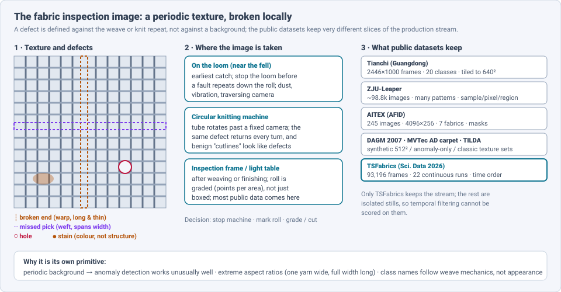
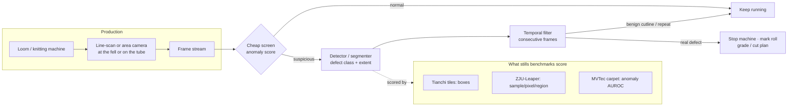
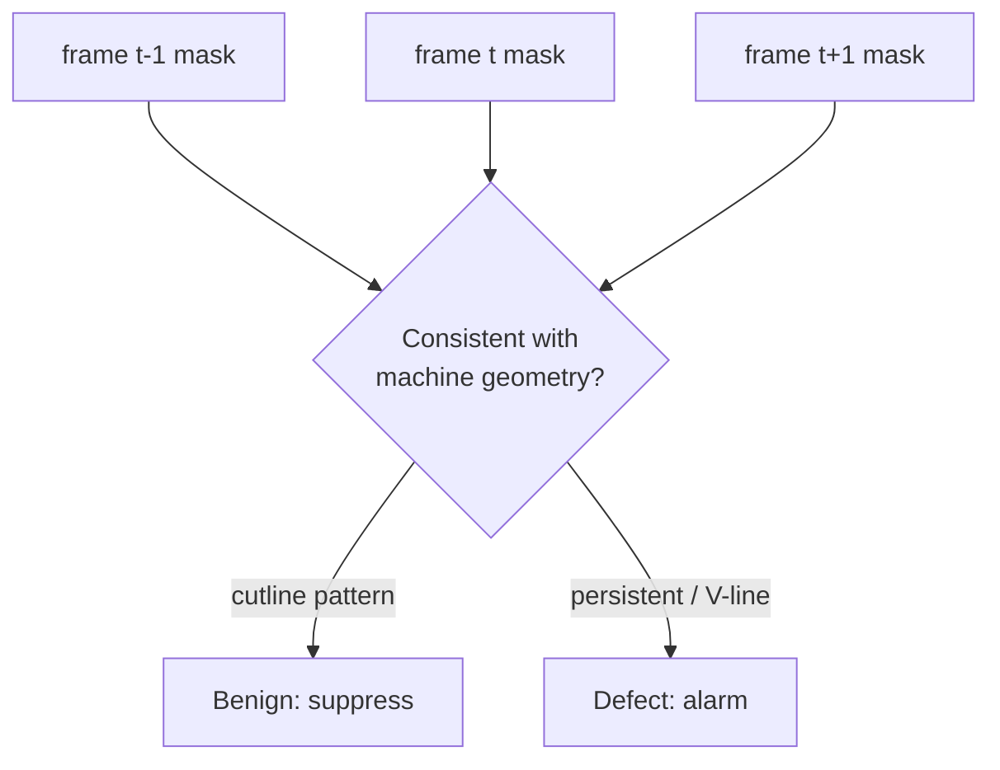

# Dense Object Detection & Classification — Recent Advances

*Compiled 2026-Oct-23 (America/Los_Angeles).*

Next installment in the running CV-updates log. Earlier entries:
[Apr-30](../2026-Apr-30/2026-Apr-30_CV_updates.md),
[May-01](../2026-May-01/2026-May-01_CV_updates.md),
[May-02](../2026-May-02/2026-May-02_CV_updates.md),
[May-04](../2026-May-04/2026-May-04_CV_updates.md),
[May-05](../2026-May-05/2026-May-05_CV_updates.md),
[May-07](../2026-May-07/2026-May-07_CV_updates.md),
[May-08](../2026-May-08/2026-May-08_CV_updates.md),
[May-15](../2026-May-15/2026-May-15_CV_updates.md),
[May-16](../2026-May-16/2026-May-16_CV_updates.md),
[May-17](../2026-May-17/2026-May-17_CV_updates.md),
[Jun-09](../2026-Jun-09/2026-Jun-09_CV_updates.md),
[Jun-10](../2026-Jun-10/2026-Jun-10_CV_updates.md),
[Jun-12](../2026-Jun-12/2026-Jun-12_CV_updates.md),
[Jun-15](../2026-Jun-15/2026-Jun-15_CV_updates.md),
[Jun-16](../2026-Jun-16/2026-Jun-16_CV_updates.md),
[Jun-17](../2026-Jun-17/2026-Jun-17_CV_updates.md),
[Jun-19](../2026-Jun-19/2026-Jun-19_CV_updates.md),
[Jun-21](../2026-Jun-21/2026-Jun-21_CV_updates.md),
[Jun-22](../2026-Jun-22/2026-Jun-22_CV_updates.md),
[Jun-23](../2026-Jun-23/2026-Jun-23_CV_updates.md),
[Jun-24](../2026-Jun-24/2026-Jun-24_CV_updates.md),
[Jun-25](../2026-Jun-25/2026-Jun-25_CV_updates.md),
[Jun-27](../2026-Jun-27/2026-Jun-27_CV_updates.md),
[Jun-29](../2026-Jun-29/2026-Jun-29_CV_updates.md),
[Jun-30](../2026-Jun-30/2026-Jun-30_CV_updates.md),
[Jul-04](../2026-Jul-04/2026-Jul-04_CV_updates.md),
[Jul-07](../2026-Jul-07/2026-Jul-07_CV_updates.md),
[Jul-08](../2026-Jul-08/2026-Jul-08_CV_updates.md),
[Jul-10](../2026-Jul-10/2026-Jul-10_CV_updates.md),
[Jul-15](../2026-Jul-15/2026-Jul-15_CV_updates.md),
[Jul-17](../2026-Jul-17/2026-Jul-17_CV_updates.md),
[Jul-18](../2026-Jul-18/2026-Jul-18_CV_updates.md),
[Jul-21](../2026-Jul-21/2026-Jul-21_CV_updates.md),
[Jul-22](../2026-Jul-22/2026-Jul-22_CV_updates.md),
[Jul-24](../2026-Jul-24/2026-Jul-24_CV_updates.md),
[Jul-26](../2026-Jul-26/2026-Jul-26_CV_updates.md),
[Jul-27](../2026-Jul-27/2026-Jul-27_CV_updates.md),
[Jul-30](../2026-Jul-30/2026-Jul-30_CV_updates.md),
[Aug-01](../2026-Aug-01/2026-Aug-01_CV_updates.md),
[Aug-02](../2026-Aug-02/2026-Aug-02_CV_updates.md),
[Aug-04](../2026-Aug-04/2026-Aug-04_CV_updates.md),
[Aug-07](../2026-Aug-07/2026-Aug-07_CV_updates.md),
[Aug-10](../2026-Aug-10/2026-Aug-10_CV_updates.md),
[Aug-11](../2026-Aug-11/2026-Aug-11_CV_updates.md),
[Aug-13](../2026-Aug-13/2026-Aug-13_CV_updates.md),
[Aug-15](../2026-Aug-15/2026-Aug-15_CV_updates.md),
[Aug-16](../2026-Aug-16/2026-Aug-16_CV_updates.md),
[Aug-18](../2026-Aug-18/2026-Aug-18_CV_updates.md),
[Aug-19](../2026-Aug-19/2026-Aug-19_CV_updates.md),
[Aug-21](../2026-Aug-21/2026-Aug-21_CV_updates.md),
[Aug-22](../2026-Aug-22/2026-Aug-22_CV_updates.md),
[Aug-24](../2026-Aug-24/2026-Aug-24_CV_updates.md),
[Aug-26](../2026-Aug-26/2026-Aug-26_CV_updates.md),
[Aug-29](../2026-Aug-29/2026-Aug-29_CV_updates.md),
[Sep-01](../2026-Sep-01/2026-Sep-01_CV_updates.md),
[Sep-20](../2026-Sep-20/2026-Sep-20_CV_updates.md),
[Sep-23](../2026-Sep-23/2026-Sep-23_CV_updates.md),
[Sep-24](../2026-Sep-24/2026-Sep-24_CV_updates.md),
[Sep-25](../2026-Sep-25/2026-Sep-25_CV_updates.md),
[Sep-26](../2026-Sep-26/2026-Sep-26_CV_updates.md),
[Sep-29](../2026-Sep-29/2026-Sep-29_CV_updates.md),
[Sep-30](../2026-Sep-30/2026-Sep-30_CV_updates.md),
[Oct-01](../2026-Oct-01/2026-Oct-01_CV_updates.md),
[Oct-02](../2026-Oct-02/2026-Oct-02_CV_updates.md),
[Oct-03](../2026-Oct-03/2026-Oct-03_CV_updates.md),
[Oct-04](../2026-Oct-04/2026-Oct-04_CV_updates.md),
[Oct-05](../2026-Oct-05/2026-Oct-05_CV_updates.md),
[Oct-06](../2026-Oct-06/2026-Oct-06_CV_updates.md),
[Oct-07](../2026-Oct-07/2026-Oct-07_CV_updates.md),
[Oct-08](../2026-Oct-08/2026-Oct-08_CV_updates.md),
[Oct-09](../2026-Oct-09/2026-Oct-09_CV_updates.md),
[Oct-10](../2026-Oct-10/2026-Oct-10_CV_updates.md),
[Oct-11](../2026-Oct-11/2026-Oct-11_CV_updates.md),
[Oct-12](../2026-Oct-12/2026-Oct-12_CV_updates.md),
[Oct-13](../2026-Oct-13/2026-Oct-13_CV_updates.md),
[Oct-14](../2026-Oct-14/2026-Oct-14_CV_updates.md),
[Oct-15](../2026-Oct-15/2026-Oct-15_CV_updates.md),
[Oct-16](../2026-Oct-16/2026-Oct-16_CV_updates.md),
[Oct-17](../2026-Oct-17/2026-Oct-17_CV_updates.md),
[Oct-18](../2026-Oct-18/2026-Oct-18_CV_updates.md),
[Oct-19](../2026-Oct-19/2026-Oct-19_CV_updates.md),
[Oct-20](../2026-Oct-20/2026-Oct-20_CV_updates.md),
[Oct-21](../2026-Oct-21/2026-Oct-21_CV_updates.md),
[Oct-22](../2026-Oct-22/2026-Oct-22_CV_updates.md).

The last entry covered the [steel strip surface inspection image](../2026-Oct-22/2026-Oct-22_CV_updates.md).
This run stays in surface inspection but moves from metal to textiles:
the **fabric inspection image**. Woven and knitted fabric is imaged on
the loom, on the knitting machine, or on an inspection frame after
production. The background is a **periodic texture** of yarns, and a
defect is a local break in that repeat: a broken end (a missing warp
yarn, one yarn wide and the length of the roll), a missed pick (a
missing weft that crosses the full width), a hole, a knot, a stain.
The public benchmarks are:

- **Tianchi** (Alibaba Tianchi / Guangdong competition): 2446×1000
  frames, 20 defect classes. One 2025 paper reports 5,913 defective and
  3,663 defect-free images with 9,523 boxes. Papers usually tile it to
  640×640 and drop defect-free tiles;
- **ZJU-Leaper**: about 98.8k images over many fabric patterns, with an
  official sample-, pixel- and region-level protocol;
- **AITEX (AFID)**: 245 images of 4096×256 pixels over seven fabrics,
  with masks;
- **TILDA, DAGM 2007, MVTec AD "carpet"**: classic texture sets.
  DAGM 2007 is synthetic, and MVTec carpet has only defect-free training
  images;
- **TSFabrics** (*Scientific Data*, 2026): **93,196** grayscale frames
  from **22 continuous** circular-knitting runs, with pixel labels. It is
  the first of these to keep time order.

Earlier entries touched textiles only from the side.
[May-08](../2026-May-08/2026-May-08_CV_updates.md) covered generic
industrial anomaly detection (MVTec AD, VisA), and
[Oct-22](../2026-Oct-22/2026-Oct-22_CV_updates.md) cited a conditional
diffusion augmenter that was also tested on MVTec-fabric and TILDA. No
earlier entry treated the fabric image as a modality of its own; this
one does. It keeps the "evidence → measurement → disposition" framing of
the Oct-12 → Oct-22 inspection run.

Six properties make it a distinct problem:

- **The background is a lattice.** Defects are defined against the weave
  or knit repeat. That makes unsupervised and even training-free anomaly
  detection work unusually well, at image level (§4).
- **Shapes are extreme.** Broken ends and missed picks are a few pixels
  wide and the full frame long. Most new detector modules are
  strip-shaped convolutions or large kernels aimed at this (§3).
- **The leaderboard is not a leaderboard.** On Tianchi, reported mAP@0.5
  for the *same* YOLOv8s baseline ranges from about 48 to about 85 across
  papers, depending on tiling, splits and class merging (§3).
- **Production is a stream, and the stream has benign look-alikes.** On a
  circular knitting machine, harmless "cutlines" appear in good fabric.
  TSFabrics and its companion model filter them over consecutive frames,
  which isolated stills cannot test (§5).
- **Edge cost decides adoption.** The best 2026 edge paper is mostly a
  careful account of where the speed-up actually came from (§5).
- **Language helps less here than elsewhere.** Zero-shot CLIP does
  poorly on fabric, while few-shot adaptation does well (§7).

> **Numbers below come from search-engine abstracts, publisher pages and
> dataset cards. I did not read the full papers.** arxiv.org and
> ncbi.nlm.nih.gov could not be fetched on this run (DNS failure), so
> everything was read via search snippets. Treat every number as an
> author-reported, abstract-level claim. Fabric papers use different
> tilings, splits and class sets for Tianchi, so do not compare mAPs
> across rows unless the text says they share a protocol. Vendor figures
> are excluded except where marked.

---

## Table of contents

1. [Why this pass](#1--why-this-pass)
2. [The primitive: a periodic texture, broken locally](#2--the-primitive-a-periodic-texture-broken-locally)
3. [Supervised detection on Tianchi: strip shapes and an incomparable baseline](#3--supervised-detection-on-tianchi-strip-shapes-and-an-incomparable-baseline)
4. [Anomaly detection: where the lattice pays off](#4--anomaly-detection-where-the-lattice-pays-off)
5. [The stream: time-series data and honest edge accounting](#5--the-stream-time-series-data-and-honest-edge-accounting)
6. [Synthetic defects](#6--synthetic-defects)
7. [Few-shot, zero-shot and language](#7--few-shot-zero-shot-and-language)
8. [Open problems / what to watch](#8--open-problems--what-to-watch)
9. [Sources](#9--sources)

---

## 1 · Why this pass

Fabric defect detection, like steel, publishes many papers that add a
module to a YOLO detector. Five things from late 2025 and 2026 are worth
a separate look:

1. **A sequential dataset.** TSFabrics (*Sci. Data* 13:379, 2026,
   doi 10.1038/s41597-026-06748-9) releases **93,196** frames from **22**
   continuous knitting runs under varied lighting, speed and fabric. Its
   pixel labels separate real defects from production "cutlines" on
   defect-free fabric (§5).
2. **Temporal false-alarm filtering.** The same group's LBUnet (IEEE
   Access, 2025) reports **86.24% mIoU at 4 ms/image**. A filter over
   consecutive segmentation maps then reaches **100%** cutline
   identification (§5).
3. **An edge cascade that audits itself.** arXiv 2608.14727 (Aug 2026)
   screens every frame with an autoencoder and sends suspicious ones to
   YOLO. It finds that **91%** of its 1.36× speed-up came from
   overlapping JPEG decoding with inference, not from the cascade (§5).
4. **End-to-end detection via differentiable NMS.** arXiv 2505.07040
   recasts NMS as Sinkhorn-solved bipartite matching, so gradients reach
   the box selection step, and evaluates on Tianchi (§3).
5. **YOLOv12 across four fabric datasets.** UniDefectNet-Omni (*PLOS ONE*
   21(7), 2026) fine-tunes YOLOv12 on a mill dataset (**85.1% mAP**,
   seven classes) and reports **86.7% mAP** on TILDAv2. It also
   validates on DPFD-DET and ZJU-Leaper (§3).

---

## 2 · The primitive: a periodic texture, broken locally

Fabric inspection has three capture points, and each changes the task:

- **On the loom.** A camera near the fell (where new weft is beaten in)
  can stop the loom before a fault repeats down the roll. Uster holds a
  granted patent for an on-loom system that images the shed, the woven
  fabric and the fell, and gives each batch an "objective quality
  index". An RWTH Aachen prototype uses a traversing high-resolution
  camera that it says can track single yarns in real time.
- **On a circular knitting machine.** The fabric tube rotates past a
  fixed camera, so a defect comes back every turn. Benign "cutlines"
  appear in good fabric. This is where TSFabrics was collected.
- **On an inspection frame or light table.** After weaving or finishing,
  a roll is graded (in industry, often by a points-per-area system) and
  defects are marked for cutting. Most public stills come from here or
  from bench rigs.

The stills benchmarks measure only the "detector" box. The screen, the
temporal filter and the machine-stop decision, which set false-stop
and escape rates on the floor, have had no public test until TSFabrics.

---

## 3 · Supervised detection on Tianchi: strip shapes and an incomparable baseline

**What the modules target.** Recent Tianchi papers mostly add
shape-aware blocks to YOLO:

- **SPFFNet** (arXiv 2502.01445) adds a Strip Perception Module and an
  SE-SPPF block. It reports **65.8% mAP** on Tianchi and a 0.8–8.1-point
  gain over YOLOv5/6/8/9/10 baselines. Note that v1 of the paper builds on
  YOLOv4 and v3 on YOLOv11, so check which version you cite.
- **Fab-ASLKS** (arXiv 2501.14190) uses adaptive shape convolutions and
  large-kernel spatial modelling on YOLOv8s, and reports **+5% mAP@50**
  over baseline.
- **Fab-ME** (arXiv 2412.03200) adds a visual state-space (Mamba-style)
  module and attention to YOLOv8s on 20 Tianchi classes. Its abstract says
  **+3.5% mAP@0.5**, while its table shows 57.4 → 59.4 against a baseline
  labelled 2023. The two may not be the same run.
- **Differentiable NMS via Sinkhorn matching** (arXiv 2505.07040) treats
  NMS as a differentiable assignment problem solved by Sinkhorn–Knopp,
  with entropy-constrained mask refinement. The authors report
  improvement on Tianchi at industrial speed and say it transfers to
  general detection. The snippets did not include the numbers. This is
  the one Tianchi paper here that changes the training objective rather
  than the backbone.
- **UniDefectNet-Omni** (*PLOS ONE*, 2026) fine-tunes YOLOv12 with
  adaptive augmentation. It reports **85.1% mAP / 84.5% P / 81.7% R** on a
  seven-class mill dataset (Chenab Textiles) and **86.7% mAP** on TILDAv2.

**The baseline problem.** The same detector gets very different
Tianchi scores in different papers:

| Report | YOLOv8s on Tianchi, mAP@0.5 |
|---|---|
| Comparison table in a 2025 journal paper | **47.9** |
| Fab-ME's table | **57.4** |
| CP-YOLOv8s paper (implied baseline: 89.5 − 5.1, if the gain is absolute) | **≈84.4** |

A spread of about 37 points on one baseline is far larger than any
module's claimed gain (2–8 points). It comes from tiling (640 tiles with
defect-free tiles dropped, versus full frames), train/val splits, and
whether rare classes are merged. Until papers state these choices and
release splits, a Tianchi delta is only meaningful within one paper's
own table.

---

## 4 · Anomaly detection: where the lattice pays off

Because good fabric is close to periodic, a model of "normal" is easy to
learn, and image-level anomaly detection is close to solved on the
fabric-like MVTec categories:

- **Reverse distillation for fabric** (Thomine & Snoussi, *Textile
  Research Journal*; arXiv 2401.02287) reports **100 image AUROC on MVTec
  carpet** and a **99.9** mean over fabric-like textures. It also tests on
  AITEX, TILDA and factory data. Its pixel-level localisation is
  *lower* than the baselines' (mean ~95.9 vs ~97.2–97.4; carpet 98.8 vs
  98.9–99.1). Saying "this roll has a defect" is easier than saying
  exactly where.
- **FABLE** (arXiv 2306.10089) is domain-generalised texture anomaly
  detection with a check for "have we seen this fabric before?" to avoid
  retraining. It reports **97.5 AUROC** on MVTec AD textures.
- **Training-free.** GRNR (arXiv 2406.07333) does zero-shot texture
  anomaly detection by global-regularised neighbourhood regression. It
  uses no training data and relies on the texture's self-similarity.
  Aota et al. (WACV 2023) is the earlier zero-shot-vs-many-shot
  comparison built on the same homogeneity assumption.
- **Supervised vs unsupervised on ZJU-Leaper.** A 2025 study (IUT Dhaka)
  compares six CNN segmenters, UperNet/SegFormer and EfficientAD under
  the ZJU-Leaper multi-level protocol. In the abstract, transformers
  generalise better on complex textures, CNNs localise fine defects
  better, and label-free EfficientAD is "competitive". Per-model numbers
  were not in the snippet.
- **Generalising to unseen fabrics.** Rippel et al. (*Sensors*, 2022)
  frame new fabrics as distribution shift. Only AugMix consistently
  helped, and ImageNet pre-training helped. This is still the main open
  issue for mills that change articles every week.

The lattice argument has limits. It breaks for jacquard and printed
fabric, where the pattern repeat is large or absent. There, reference-
or template-based comparison is the older approach, and the search found
no new 2025–2026 work.

---

## 5 · The stream: time-series data and honest edge accounting

**TSFabrics** is this run's most useful new resource. Earlier fabric
datasets are isolated stills. TSFabrics keeps 22 continuous production
runs (93,196 frames) across illuminations, line speeds and fabric types.
Its pixel labels mark true defects separately from cutlines, which appear
in defect-free fabric during production. This makes "benign look-alike"
a labelled class rather than a false positive found only in deployment.

Its companion model shows what time buys. LBUnet, a lightweight
segmenter, reaches **86.24% mIoU at about 4 ms** per image. A false-alarm
filter that checks *consecutive* segmentation maps (for example, to
confirm V-line defects) then identifies cutlines with **100%** accuracy
in the authors' tests. The decision uses the time axis, so no stills
benchmark can measure it.

**Low-cost two-stage edge detection** (arXiv 2608.14727, Aug 2026)
targets small and medium mills in low-income economies, where commercial
systems cost too much. Stage 1 is a compact convolutional autoencoder,
and Stage 2 is YOLO, run only on flagged frames. The reported results are
useful because they are candid:

- At a recall-first threshold, Stage 1 catches **all 20** defective
  images in a 249-image test (95% CI for recall 0.83–1.00). It also flags
  **113 of 229** good images (49.3% false-positive rate), which is 19.3%
  fewer than a plain autoencoder (p = 0.011).
- Throughput rises from **9.86 to 13.45 FPS (1.36×)**. However, **91%** of
  that gain comes from overlapping JPEG decoding with inference. The
  cascade itself saves only about **5.1%** of inference at its forward
  rate of 0.534.
- About **85%** of forwarded frames are false alarms. The authors project
  a 29–45% saving with tighter calibration, but have not measured it.

Lesson for any cascade paper: control the data path before crediting the
architecture. On a periodic texture the screen is also the part most
likely to be fooled by lighting change, and TSFabrics now provides the
data to test that.

---

## 6 · Synthetic defects

Defect images are scarce and long-tailed in fabric too. Recent
generators that report fabric results:

- **In&Out** (arXiv 2406.00501) argues that pasting defects onto normal
  images makes out-of-distribution samples, and uses diffusion to make
  in-distribution ones. It covers zero-, few- and full-shot setups. Its
  headline result is on Kolektor SDD2 (AP 0.782, weak supervision), not
  fabric.
- **Context-aware conditional reverse diffusion** (*Measurement*, 2026,
  JBNU) adds defects while keeping the background structure consistent.
  It is tested on five benchmarks including MVTec AD fabric and TILDA, and
  was already noted in [Oct-22](../2026-Oct-22/2026-Oct-22_CV_updates.md).
- **SynSur** (arXiv 2604.26633) fine-tunes Flux.1-dev with LoRA,
  inpaints defects, blends and auto-annotates them, then filters with
  CLIPScore and DreamSim. Its premise is that general-purpose diffusion
  does not capture industrial surface structure without fine-tuning.
- A **mask-guided diffusion** framework, summarised by Nature Index,
  learns how damage shape correlates with background texture. A
  conditional GAN approach from a Turkish group takes a mask plus a clean
  fabric image.

Lattice-preserving generation is easier to judge for fabric than for
most surfaces: a generated defect that also warps the surrounding weave
is visibly wrong. No paper found here reports that kind of structural
check as a metric.

---

## 7 · Few-shot, zero-shot and language

- **Zero-shot CLIP fails, few-shot works.** A 2024 Darmstadt (h-da)
  master's thesis tested CLIP-based zero- and few-shot defect detection
  and localisation on two fabric datasets, including a cross-dataset
  setting. Zero-shot "was unable to detect defects effectively", while
  few-shot variants were accurate on both. Fabric words ("broken end",
  "slub", "float") are trade jargon that web-trained text encoders
  barely know.
- **Few-shot SAM.** A *Journal of Natural Fibers* (2024) paper injects
  fabric-defect knowledge into Segment Anything with a few trainable
  parameters, and reports cross-dataset and few-shot results.
- **Few-shot classification and continual learning.** A 2025 PolyU
  thesis proposes MVREC for few-shot defect classification and a
  continual-learning inspection model. It targets the "pattern/criteria
  shift" that occurs when a mill changes articles.
- **Text prompts in patents.** A Chinese Academy of Sciences patent
  describes zero-shot fabric defect detection driven by defect text
  prompts. Other patents fuse visible, infrared and ultrasonic data.
- **Shared multimodal data.** IMDD-1M (CVPR 2026; arXiv 2512.24160)
  includes textiles among its 63 domains. It was covered in
  [Oct-21](../2026-Oct-21/2026-Oct-21_CV_updates.md) and
  [Oct-22](../2026-Oct-22/2026-Oct-22_CV_updates.md). No fabric-specific
  image–text benchmark like SteelDefectX was found.

---

## 8 · Open problems / what to watch

1. **Fix Tianchi's protocol.** Publish canonical tiles, splits and class
   merges, and report mAP@0.5:0.95 with seeds. A 37-point spread on one
   baseline makes single-digit gains uninterpretable (§3).
2. **Stream-level metrics.** Use TSFabrics to score false *stops* per
   hour and time-to-detect, not per-frame mIoU. Temporal filters like
   LBUnet's should become standard baselines (§5).
3. **Localisation, not detection.** Image-level AUROC on fabric-like
   textures is saturated (~100). Pixel- and region-level scores (the
   ZJU-Leaper protocol) are where methods still differ (§4).
4. **Article changeover.** Measure few-shot adaptation to a new fabric
   in minutes of good-fabric footage: the setting a mill actually faces
   (§4, §7).
5. **Patterned and printed fabric.** Jacquard and prints break the
   lattice assumption. They need reference-aware methods and a public
   benchmark, and neither appeared in 2025–2026 searches (§4).
6. **Cascade accounting.** Report the data-path baseline (decode, I/O,
   batching) alongside any cascade speed-up, as 2608.14727 did (§5).
7. **A textile vocabulary for VLMs.** A SteelDefectX-style
   fabric image–text set with weave-mechanics descriptions would test
   whether language can help on this modality at all (§7).

---

## 9 · Sources

### Datasets and benchmarks

- TSFabrics: A Time-Series Fabric Dataset for Real-Time Defect Detection on Circular Knitting Machines (Sci. Data 13:379, 2026; doi 10.1038/s41597-026-06748-9) — https://isslab.csie.ncu.edu.tw/download/publications/TSFabrics%20A%20Time-Series%20Fabric%20Dataset%20for%20Real-Time%20Defect%20Detection%20on%20Circular%20Knitting%20Machines.pdf
- A Review of Benchmarks for Visual Defect Detection in the Manufacturing Industry (DAGM 2007 description) — arXiv 2305.13261 — https://arxiv.org/pdf/2305.13261
- AITEX Fabric Image Database (AFID) dataset card — https://datasetninja.com/afid
- AITEX on Roboflow Universe — https://universe.roboflow.com/aitex-data-set-waiandt/dataset-aitex
- Fabric defect dataset for anomaly detection (Applied Sciences, Jun 2024) — https://doaj.org/article/2017a90955fd42b89c0e88015f94a69f — https://www.mdpi.com/2076-3417/14/12/5298
- DME Fabric Defect Detection Dataset (Mendeley Data, Jan 2026) — https://data.mendeley.com/datasets/4fcvnr77sb/1
- Fabric Defects Dataset (Mendeley Data) — https://data.mendeley.com/datasets/663j22s43c/3
- Tianchi-derived 20-class model card (Hugging Face) — https://huggingface.co/hazemaaa/fabric-defect-detection
- IEEE DataPort fabric defect detection keyword page — https://ieee-dataport.org/keywords/fabric-defect-detection

### Supervised detection (§3)

- YOLO Object Detection for Real-Time Fabric Defect Inspection in the Textile Industry: A Review of YOLOv1 to YOLOv11 (Sensors 2025) — https://www.ncbi.nlm.nih.gov/pmc/articles/PMC11990965/
- SPFFNet: Strip Perception and Feature Fusion Spatial Pyramid Pooling for Fabric Defect Detection — arXiv 2502.01445 — https://arxiv.org/html/2502.01445v3
- High-Precision Fabric Defect Detection via Adaptive Shape Convolutions and Large Kernel Spatial Modeling (Fab-ASLKS) — arXiv 2501.14190 — https://arxiv.org/html/2501.14190v1
- Fab-ME: A Vision State-Space and Attention-Enhanced Framework for Fabric Defect Detection — arXiv 2412.03200 — https://arxiv.org/html/2412.03200v2
- Differentiable NMS via Sinkhorn Matching for End-to-End Fabric Defect Detection — arXiv 2505.07040 — https://arxiv.org/html/2505.07040v1
- Fabric defect detection using fine-tuned Yolo-12 (UniDefectNet-Omni, PLOS ONE 21(7), 2026) — https://econpapers.repec.org/RePEc:plo:pone00:0353550
- CP-YOLOv8s and Tianchi YOLO comparison tables (Textile Research Journal, 2025) — https://journals.sagepub.com/doi/full/10.1177/00405175251362869 — https://journals.sagepub.com/doi/abs/10.1177/00405175241285596
- Fabric defect detection of industrial knitting machines using YOLOv7 (BRAC University) — https://dspace.bracu.ac.bd/items/3092090c-ecf3-4ae5-a3ae-effadd3adbbd
- Real-Time Fabric Defect Detection Using a Lightweight YOLOv8 Model on Edge Devices — https://archives.christuniversity.in/items/show/26996

### Anomaly detection (§4)

- Distillation-based fabric anomaly detection (Textile Research Journal; doi 10.1177/00405175231206820) — arXiv 2401.02287 — https://arxiv.org/abs/2401.02287v1
- FABLE: Fabric Anomaly Detection Automation Process — arXiv 2306.10089 — https://arxiv.org/pdf/2306.10089
- Global-Regularized Neighborhood Regression for Efficient Zero-Shot Texture Anomaly Detection (GRNR) — arXiv 2406.07333 — https://www.arxiv.org/pdf/2406.07333
- Zero-Shot Versus Many-Shot: Unsupervised Texture Anomaly Detection (WACV 2023) — https://openaccess.thecvf.com/content/WACV2023/html/Aota_Zero-Shot_Versus_Many-Shot_Unsupervised_Texture_Anomaly_Detection_WACV_2023_paper.html
- A Comparative Study of Supervised and Unsupervised Deep Learning Models for Fabric Defect Localization (ZJU-Leaper; IUT Dhaka, 2025) — https://repository.iutoic-dhaka.edu/items/f4233478-3889-48aa-9279-77ddeffe74d8
- HKAN: A Hybrid Kolmogorov–Arnold Network for Robust Fabric Defect Segmentation — https://www.ncbi.nlm.nih.gov/pmc/articles/PMC11679074/
- Increasing the Generalization of Supervised Fabric Anomaly Detection Methods to Unseen Fabrics (Sensors 2022) — https://www.ncbi.nlm.nih.gov/pmc/articles/PMC9269532/
- Jacquard fabric defect detection with RGB + NIR (IEEE Access 2022) — https://doaj.org/article/2825e0efe1ab4dac843977a692f1ffee

### Stream and edge (§5)

- Real-Time Defect Detection for Fast-Moving Fabrics on Circular Knitting Machine Under Various Illumination Conditions (LBUnet, IEEE Access 2025) — https://isslab.csie.ncu.edu.tw/download/publications/Real-Time%20Defect%20Detection%20for%20Fast-Moving%20Fabrics%20on%20Circular%20Knitting%20Machine%20Under%20Various%20Illumination%20Conditions.pdf — https://doaj.org/article/bd297aea126f4b72b65dd7ec4965f74c
- Low Cost Two-Stage Fabric Defect Detection at the Edge — arXiv 2608.14727 — https://arxiv.org/abs/2608.14727
- Uster Technologies on-loom inspection patent holder record — https://www.ipqwery.com/ipowner/en/owner/ip/4832197-uster-technologies-ltd.html
- RWTH Aachen traversing-camera on-loom inspection — https://publications.rwth-aachen.de/record/483740/files/483740.pdf
- Better weaving looms with optical controls (CORDIS, archived EU project) — https://cordis.europa.eu/article/id/81009-better-weaving-looms-with-optical-controls

### Synthetic defects (§6)

- Diffusion-based Image Generation for In-distribution Data Augmentation in Surface Defect Detection (In&Out) — arXiv 2406.00501 — https://arxiv.org/pdf/2406.00501
- Context-aware defect sample generation using conditional diffusion (Measurement, 2026) — https://pure.jbnu.ac.kr/en/publications/context-aware-defect-sample-generation-using-conditional-diffusio/
- SynSur: An end-to-end generative pipeline for synthetic industrial surface defect generation and detection — arXiv 2604.26633 — https://arxiv.org/pdf/2604.26633
- Automated Fabric Defect Detection Techniques (Nature Index topic summary) — https://www.nature.com/nature-index/topics/l4/automated-fabric-defect-detection-techniques

### Few-shot, zero-shot and language (§7)

- CLIP-based zero/few-shot fabric defect detection (h-da MDS thesis, WS24) — https://fbmn.h-da.de/fileadmin/Dokumente/Studium/DS/WS24_MDS_Thesis_Patrick_Wessely_ABS.pdf
- Few-shot SAM adaptation for fabric defects (Journal of Natural Fibers, Dec 2024) — https://doaj.org/article/1c8c2aff5c434cde92ce3f9242fac73a
- PolyU thesis: MVREC few-shot defect classification and continual fabric inspection — https://theses.lib.polyu.edu.hk/handle/200/13828
- Towards Open-Vocabulary Industrial Defect Understanding with a Large-Scale Multimodal Dataset (IMDD-1M, CVPR 2026) — arXiv 2512.24160 — https://arxiv.org/html/2512.24160v1
- Fabric defect detection method based on multi-modal deep learning (US12223633B2) — https://patents.google.com/patent/US12223633
- Textile fabric defect real-time detection based on multi-modal feature fusion (CN121527094B) — https://eureka.patsnap.com/patent/CN121527094B

### Context

- A Comprehensive Survey on Machine Learning Driven Material Defect Detection — arXiv 2406.07880 — https://arxiv.org/pdf/2406.07880
- Vendor denim-mill case study (vendor claim: 96.4% over 11 classes at 45 ms/frame; not used for comparisons) — https://litslink.com/case-studies/defect-detection-solution-for-manufacturing
- Intel/Count AI KNIT-i knitting inspection brief (vendor) — https://builders.intel.com/docs/networkbuilders/eliminate-textile-defects-in-real-time-with-ai-powered-vision-systems-1760461723.pdf
