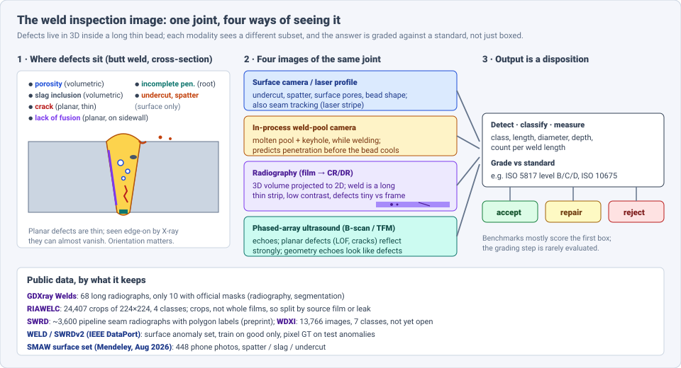
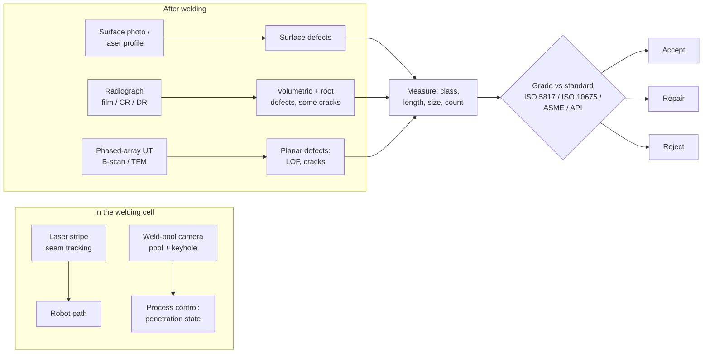
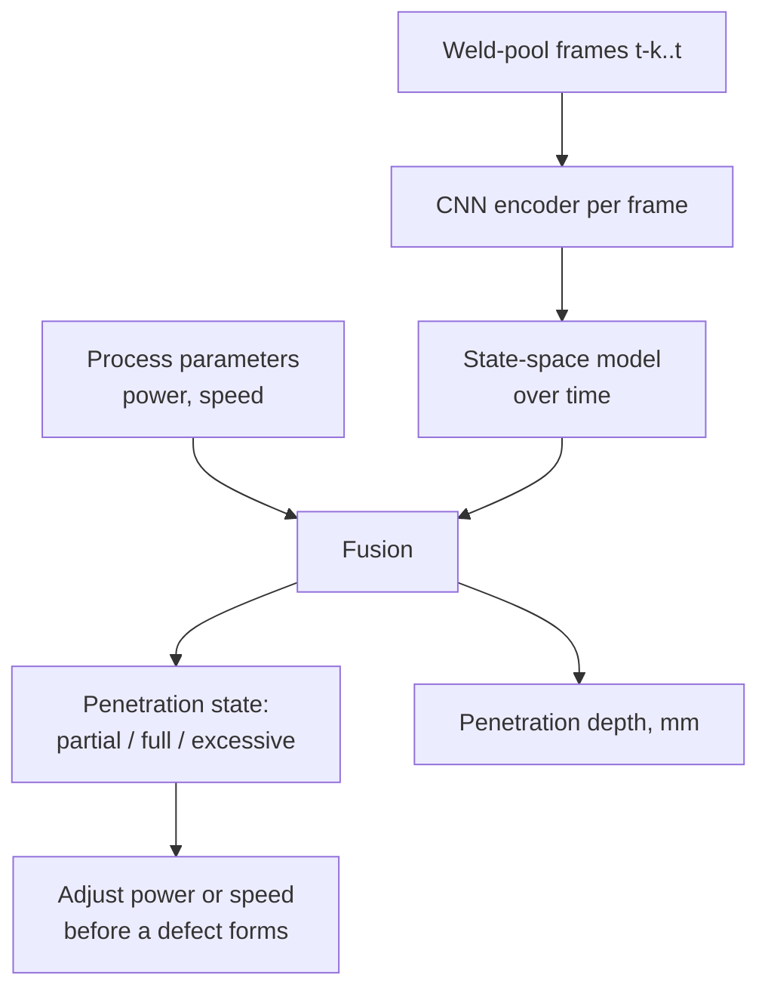

# Dense Object Detection & Classification — Recent Advances

*Compiled 2026-Oct-24 (America/Los_Angeles).*

Next installment in the running CV-updates log. Earlier entries:
[Apr-30](../2026-Apr-30/2026-Apr-30_CV_updates.md),
[May-01](../2026-May-01/2026-May-01_CV_updates.md),
[May-02](../2026-May-02/2026-May-02_CV_updates.md),
[May-04](../2026-May-04/2026-May-04_CV_updates.md),
[May-05](../2026-May-05/2026-May-05_CV_updates.md),
[May-07](../2026-May-07/2026-May-07_CV_updates.md),
[May-08](../2026-May-08/2026-May-08_CV_updates.md),
[May-15](../2026-May-15/2026-May-15_CV_updates.md),
[May-16](../2026-May-16/2026-May-16_CV_updates.md),
[May-17](../2026-May-17/2026-May-17_CV_updates.md),
[Jun-09](../2026-Jun-09/2026-Jun-09_CV_updates.md),
[Jun-10](../2026-Jun-10/2026-Jun-10_CV_updates.md),
[Jun-12](../2026-Jun-12/2026-Jun-12_CV_updates.md),
[Jun-15](../2026-Jun-15/2026-Jun-15_CV_updates.md),
[Jun-16](../2026-Jun-16/2026-Jun-16_CV_updates.md),
[Jun-17](../2026-Jun-17/2026-Jun-17_CV_updates.md),
[Jun-19](../2026-Jun-19/2026-Jun-19_CV_updates.md),
[Jun-21](../2026-Jun-21/2026-Jun-21_CV_updates.md),
[Jun-22](../2026-Jun-22/2026-Jun-22_CV_updates.md),
[Jun-23](../2026-Jun-23/2026-Jun-23_CV_updates.md),
[Jun-24](../2026-Jun-24/2026-Jun-24_CV_updates.md),
[Jun-25](../2026-Jun-25/2026-Jun-25_CV_updates.md),
[Jun-27](../2026-Jun-27/2026-Jun-27_CV_updates.md),
[Jun-29](../2026-Jun-29/2026-Jun-29_CV_updates.md),
[Jun-30](../2026-Jun-30/2026-Jun-30_CV_updates.md),
[Jul-04](../2026-Jul-04/2026-Jul-04_CV_updates.md),
[Jul-07](../2026-Jul-07/2026-Jul-07_CV_updates.md),
[Jul-08](../2026-Jul-08/2026-Jul-08_CV_updates.md),
[Jul-10](../2026-Jul-10/2026-Jul-10_CV_updates.md),
[Jul-15](../2026-Jul-15/2026-Jul-15_CV_updates.md),
[Jul-17](../2026-Jul-17/2026-Jul-17_CV_updates.md),
[Jul-18](../2026-Jul-18/2026-Jul-18_CV_updates.md),
[Jul-21](../2026-Jul-21/2026-Jul-21_CV_updates.md),
[Jul-22](../2026-Jul-22/2026-Jul-22_CV_updates.md),
[Jul-24](../2026-Jul-24/2026-Jul-24_CV_updates.md),
[Jul-26](../2026-Jul-26/2026-Jul-26_CV_updates.md),
[Jul-27](../2026-Jul-27/2026-Jul-27_CV_updates.md),
[Jul-30](../2026-Jul-30/2026-Jul-30_CV_updates.md),
[Aug-01](../2026-Aug-01/2026-Aug-01_CV_updates.md),
[Aug-02](../2026-Aug-02/2026-Aug-02_CV_updates.md),
[Aug-04](../2026-Aug-04/2026-Aug-04_CV_updates.md),
[Aug-07](../2026-Aug-07/2026-Aug-07_CV_updates.md),
[Aug-10](../2026-Aug-10/2026-Aug-10_CV_updates.md),
[Aug-11](../2026-Aug-11/2026-Aug-11_CV_updates.md),
[Aug-13](../2026-Aug-13/2026-Aug-13_CV_updates.md),
[Aug-15](../2026-Aug-15/2026-Aug-15_CV_updates.md),
[Aug-16](../2026-Aug-16/2026-Aug-16_CV_updates.md),
[Aug-18](../2026-Aug-18/2026-Aug-18_CV_updates.md),
[Aug-19](../2026-Aug-19/2026-Aug-19_CV_updates.md),
[Aug-21](../2026-Aug-21/2026-Aug-21_CV_updates.md),
[Aug-22](../2026-Aug-22/2026-Aug-22_CV_updates.md),
[Aug-24](../2026-Aug-24/2026-Aug-24_CV_updates.md),
[Aug-26](../2026-Aug-26/2026-Aug-26_CV_updates.md),
[Aug-29](../2026-Aug-29/2026-Aug-29_CV_updates.md),
[Sep-01](../2026-Sep-01/2026-Sep-01_CV_updates.md),
[Sep-20](../2026-Sep-20/2026-Sep-20_CV_updates.md),
[Sep-23](../2026-Sep-23/2026-Sep-23_CV_updates.md),
[Sep-24](../2026-Sep-24/2026-Sep-24_CV_updates.md),
[Sep-25](../2026-Sep-25/2026-Sep-25_CV_updates.md),
[Sep-26](../2026-Sep-26/2026-Sep-26_CV_updates.md),
[Sep-29](../2026-Sep-29/2026-Sep-29_CV_updates.md),
[Sep-30](../2026-Sep-30/2026-Sep-30_CV_updates.md),
[Oct-01](../2026-Oct-01/2026-Oct-01_CV_updates.md),
[Oct-02](../2026-Oct-02/2026-Oct-02_CV_updates.md),
[Oct-03](../2026-Oct-03/2026-Oct-03_CV_updates.md),
[Oct-04](../2026-Oct-04/2026-Oct-04_CV_updates.md),
[Oct-05](../2026-Oct-05/2026-Oct-05_CV_updates.md),
[Oct-06](../2026-Oct-06/2026-Oct-06_CV_updates.md),
[Oct-07](../2026-Oct-07/2026-Oct-07_CV_updates.md),
[Oct-08](../2026-Oct-08/2026-Oct-08_CV_updates.md),
[Oct-09](../2026-Oct-09/2026-Oct-09_CV_updates.md),
[Oct-10](../2026-Oct-10/2026-Oct-10_CV_updates.md),
[Oct-11](../2026-Oct-11/2026-Oct-11_CV_updates.md),
[Oct-12](../2026-Oct-12/2026-Oct-12_CV_updates.md),
[Oct-13](../2026-Oct-13/2026-Oct-13_CV_updates.md),
[Oct-14](../2026-Oct-14/2026-Oct-14_CV_updates.md),
[Oct-15](../2026-Oct-15/2026-Oct-15_CV_updates.md),
[Oct-16](../2026-Oct-16/2026-Oct-16_CV_updates.md),
[Oct-17](../2026-Oct-17/2026-Oct-17_CV_updates.md),
[Oct-18](../2026-Oct-18/2026-Oct-18_CV_updates.md),
[Oct-19](../2026-Oct-19/2026-Oct-19_CV_updates.md),
[Oct-20](../2026-Oct-20/2026-Oct-20_CV_updates.md),
[Oct-21](../2026-Oct-21/2026-Oct-21_CV_updates.md),
[Oct-22](../2026-Oct-22/2026-Oct-22_CV_updates.md),
[Oct-23](../2026-Oct-23/2026-Oct-23_CV_updates.md).

The last two entries covered [steel strip](../2026-Oct-22/2026-Oct-22_CV_updates.md)
and [textile fabric](../2026-Oct-23/2026-Oct-23_CV_updates.md) surface
inspection. This run stays in manufacturing quality but changes the
object: the **weld inspection image**. A weld is a long, thin bead, and
its defects (porosity, slag, cracks, lack of fusion, incomplete
penetration, undercut, spatter) live in three dimensions. Four kinds of
image are used to find them:

- **Radiographs** (film, now mostly computed or digital radiography):
  the main volumetric record for pipelines, pressure vessels and
  structural work;
- **Phased-array ultrasound** (B-scan, total focusing method / TFM):
  the main alternative to radiography, and better at planar defects;
- **Surface photos and laser profiles** of the finished bead, plus the
  laser-stripe images robots use for **seam tracking**;
- **In-process weld-pool cameras** that watch the molten pool and keyhole
  while the weld is made.

Earlier entries mentioned welds only in passing. The
[Jul-15](../2026-Jul-15/2026-Jul-15_CV_updates.md) X-ray entry cited
one GDXray segmentation paper (~84.75%), and
[Oct-20](../2026-Oct-20/2026-Oct-20_CV_updates.md) listed weld NDT as a
neighbour of wafer inspection. No earlier entry treated the weld image
as a modality of its own; this one does. It keeps the "evidence →
measurement → disposition" framing of the Oct-12 → Oct-23 inspection
run.

Six properties make it a distinct problem:

- **The object is a strip.** A radiograph of a seam weld is a long,
  narrow band on a mostly irrelevant frame. Cracks and lack of fusion
  are thin lines inside it. Recent detectors add stride-4 heads,
  orientation-aware box losses and slender-object branches (§3).
- **The image is a projection of a 3D flaw.** A crack seen edge-on by
  X-ray can nearly vanish, while ultrasound sees the same flaw strongly.
  Which defects a model can find depends on the modality, not only on
  the model (§2, §5).
- **The public data is tiny or chopped up.** GDXray's weld group has 68
  radiographs and only 10 official masks. The large open set, RIAWELC,
  is 224×224 crops. Big real datasets (WDXI, SWRD, a 10,079-image
  pipeline set) are private or preprint-only (§2, §3).
- **The answer is a grade, not a box.** Inspectors size each indication
  and grade it against an acceptance standard (ISO 5817 quality levels,
  ISO 10675 radiographic acceptance levels, ASME/API codes). Almost no
  paper scores that step (§6).
- **Foundation models arrive as segmenters.** SAM adaptations exist for
  both radiographs (WRT-SAM) and ultrasonic B-scans. Vision-language
  models are still at the review and "do MLLMs understand welding?"
  stage (§4, §6).
- **The weld can be judged before it cools.** Weld-pool and laser-stripe
  imaging run in the welding cell, which turns some inspection into
  process control (§5).

> **Numbers below come from search-engine abstracts, publisher pages,
> dataset cards and secondary summaries. I did not read the full papers.**
> arxiv.org and ncbi.nlm.nih.gov could not be fetched on this run (DNS
> failure), so everything was read via search snippets. Treat every number
> as an author-reported, abstract-level claim. Weld papers almost all use
> private data or private splits, so **do not compare mAPs across rows**
> unless the text says they share a protocol. Vendor figures are excluded
> except where marked. Standards names (ISO 5817, ISO 10675, ISO 17636)
> are given as background; their clauses were not checked on this run.

---

## Table of contents

1. [Why this pass](#1--why-this-pass)
2. [The primitive: a 3D flaw in a thin bead, seen four ways](#2--the-primitive-a-3d-flaw-in-a-thin-bead-seen-four-ways)
3. [Radiographic detection: strip-shaped objects and private data](#3--radiographic-detection-strip-shaped-objects-and-private-data)
4. [Segmentation and foundation models](#4--segmentation-and-foundation-models)
5. [Beyond X-ray: ultrasound, surface, seam and weld pool](#5--beyond-x-ray-ultrasound-surface-seam-and-weld-pool)
6. [From indication to disposition: standards and language models](#6--from-indication-to-disposition-standards-and-language-models)
7. [Open problems / what to watch](#7--open-problems--what-to-watch)
8. [Sources](#8--sources)

---

## 1 · Why this pass

Weld radiograph detection, like steel and fabric, publishes many "YOLO
plus a module" papers. Six items from late 2025 and 2026 are worth a
separate look:

1. **Boundary-guided segmentation at scale.** A boundary-guided feature
   modulation network (*Applied Sciences* 2026, doi
   10.3390/app16136579) reports **Dice 0.810 ± 0.003** on a **10,079-image**
   pipeline weld radiograph set. It also reports **Surface Dice@3 px of
   only 0.394**, an unusually honest measure of how poor boundary
   placement still is (§4).
2. **A slender-defect branch.** MGDR-YOLO (*Sensors* 2026, doi
   10.3390/s26113354), a multi-backbone YOLOv11n, raises overall mAP from
   **92.9 to 95.2**. Its largest gain is on a slender, low-contrast class,
   where it reports P/R/mAP rising from **88.2 to 98.3** (§3).
3. **Orientation-aware boxes for small-pipe welds.** A YOLO11 paper
   (*Sensors* 2026, doi 10.3390/s26134144) swaps CIoU for SIoU so boxes
   align with elongated defects (**99.5% mAP@50**) and adds a stride-4 P2
   head (**94.8% mAP@50, 72.0% mAP@50–95** at 960 px). These are two
   different variants (§3).
4. **SAM for weld radiographs.** WRT-SAM (arXiv 2502.11338) adapts
   Segment Anything with adapters and a prompt generator. It reports
   **recall 78.87%, precision 84.04%, AUC 0.9746**, motivated by poor
   cross-scenario transfer of small task-specific models (§4).
5. **Do MLLMs understand welding?** A Notre Dame study (arXiv 2503.16537;
   *Information Fusion* 2025) finds two MLLMs judge weld acceptability
   better on online images than on unseen real ones, which suggests
   memorisation. Its WeldPrompt method helps recall only in some
   contexts (§6).
6. **Weld-pool state from a camera.** arXiv 2606.26260 (Jun 2026) predicts
   laser-weld penetration state at **99.35%** accuracy and depth to
   **1.79 mm** error from top-view weld-pool images plus process
   parameters, with a CNN + state-space model (§5).

---

## 2 · The primitive: a 3D flaw in a thin bead, seen four ways

Defects in a weld differ in shape and in where they sit:

- **Volumetric** (porosity, slag inclusions): rounded or irregular
  voids that show up as dark spots on a radiograph;
- **Planar** (cracks, lack of fusion along a sidewall): very thin. They
  show on X-ray only when the beam runs roughly along their plane, and
  they reflect ultrasound strongly. This is the main reason ultrasound
  complements radiography;
- **Root** (incomplete penetration): a line along the bottom of the
  joint;
- **Surface** (undercut, spatter, surface pores, bead shape): visible to
  a camera or laser profiler, with no volume imaging needed.

Each modality covers a different subset, so a "weld defect detector" is
really one of four different tasks:

**Public data, by what it keeps:**

| Dataset | Modality | What it is | Caveat |
|---|---|---|---|
| **GDXray "Welds"** | radiograph | 68 long weld radiographs (some sources say 88); 10 with official masks ("GDXray-10") | far too small for training from scratch |
| **RIAWELC** | radiograph | 24,407 crops of 224×224, 4 classes (crack, porosity, lack of penetration, no defect) | crops of the same films; per-crop random splits can leak |
| **SWRD** | radiograph | ~3,600 pipeline seam weld radiographs with polygon labels | Research Square preprint; publication not confirmed |
| **WDXI** | radiograph | 13,766 images, 7 defect types | announced as "public in the future"; not open |
| **WELD / SWRDv2 / WELDv2** (IEEE DataPort) | surface photo | high-resolution weld surfaces; train on good only; pixel masks on test anomalies | anomaly-detection protocol (image AUROC, pixel IoU/AUROC) |
| **SMAW surface set** (Mendeley, Aug 2026) | phone photo | 448 images; spatter, slag inclusion, undercut; 358/90 split | companion to a DETR paper in *Welding International* |

Background for the radiograph rows: a 2026 field study of API 5L X65
pipe (30-inch OD, 20 mm wall) compared film with computed and digital
detector-array radiography. It reports image sensitivity improving from
**2.5%** of wall thickness (film) to **2.0%** (CR) and **1.8%** (DDA),
probability of detection for 1–3 mm defects rising from **78% to 88%**,
and false calls falling from **12 to 7 per 100 welds**. Digital
radiography is the input most new models assume, but GDXray and many
crop datasets come from digitised film.

---

## 3 · Radiographic detection: strip-shaped objects and private data

**What the modules target.** The 2025–2026 radiograph detectors mostly
address three issues: low contrast, slender defects, and very small
defects on a large film.

- **MGDR-YOLO** (*Sensors* 2026) uses several backbones on YOLOv11n.
  Overall mAP rises **92.9 → 95.2**. The slender, low-contrast class is
  where it reports the largest gain (**88.2 → 98.3** on P/R/mAP).
- **YOLO11 + SIoU / P2** (*Sensors* 2026, small-diameter pipe welds). SIoU
  adds an angle cost so predicted boxes align with elongated targets
  (**99.5% mAP@50, 99.9% precision** for YOLOv11s + SIoU). Small-pipe
  radiographs have narrow weld regions with sharp edges, which motivates
  this. A separate P2 variant (stride-4) reports **94.8% mAP@50 and
  72.0% mAP@50–95** at 960 px, aimed at larger defects (lack of fusion,
  incomplete penetration, cracks).
- **Improved YOLOv8n** (*J. X-ray Sci. Technol.*, May 2026) targets
  preservation of fine defect features. The snippet gave no numbers.
- **MADet** (*Materials* 2025, doi 10.3390/ma18153646), a YOLO-based
  multi-branch fusion network with attention residual modules and an
  anchor-based feature-selective head for five defect classes. It
  reports **+7.41 mAP@0.5 over the next-best model** on public and
  proprietary data. Only the relative gain was in the snippet.
- **WT-YOLO** (*Applied Sciences* 2025) adds wavelet convolutions to
  YOLOv11n, trained on **7,000** radiographs, with **+0.0212 mAP75**.
  **YOLO-LWD** (2025) reports **92.7% mAP** on seven classes (+2.9).
- **Older reference points**, still cited: LF-YOLO (arXiv 2110.15045,
  **92.9 mAP50 at 61.5 FPS**) and WD-YOLO (2023, **92.6% mAP@0.5 at
  98 FPS**), both on self-built sets.

**Classification on crops.** RIAWELC has become the default open
classification set. WeldVGG (*Sensors* 2025) trains a VGG-style network
on it with Grad-CAM++ maps and tests on GDXray. A ResNet50 classifier
(*Heliyon* 2024) reports **98.75%** on RIAWELC, **90.26%** on GDXray and
**75.83%** on a private low-quality set. That decline is the clearest
statement of the problem: crop-level accuracy on a clean set does not
carry over to other films. RIAWELC is cut from a smaller number of
radiographs, so **any per-crop random split risks putting neighbouring
crops of one film in both train and test**. The snippets did not show
whether published splits are grouped by source film. Until they are,
treat accuracy near 99% as an upper bound.

**Why the numbers do not compare.** Every 2026 detector above reports on
its own data: different pipe diameters, film versus DR, five to seven
classes, mAP@50 versus mAP@50–95 versus mAP75. The "92.9" baseline in
MGDR-YOLO and LF-YOLO's "92.9" are coincidence, not a shared benchmark.
No open weld radiograph detection set of the size of NEU-DET or Tianchi
was found.

---

## 4 · Segmentation and foundation models

- **Boundary-guided feature modulation** (*Applied Sciences* 2026) names
  the three problems precisely: severe foreground–background imbalance,
  ambiguous boundaries, and defect-like background structures. It
  builds boundary bands from the training masks and uses them **only as
  a training-time regulariser**. No mask, band or predicted boundary is
  given at test time. It adds dual attention and a false-positive
  suppression loss. On **10,079** pipeline radiographs it reports
  **Dice 0.810, precision 0.809, Surface Dice@3 px 0.394** (± over runs),
  above CNN and transformer baselines. The gap between region Dice (0.81)
  and boundary agreement (0.39) matters, because defect *length* drives
  most acceptance decisions (§6).
- **WRT-SAM** (arXiv 2502.11338, China Special Equipment Inspection and
  Research Institute) adapts SAM with adapters and an automatic prompt
  generator for general weld radiographs. It evaluates on **GDXray-10**
  and a private **WRTD** set of **115** images, and reports **recall
  78.87%, precision 84.04%, AUC 0.9746**. Its premise is that small
  models trained per scenario do not transfer, and that a frozen
  foundation backbone is a better start for a field with tiny datasets.
- **Earlier segmentation reference points.** MAU-Net with GAN
  augmentation on GDXray (*Sci. Rep.* 2024) reports **~84.75%**, the
  number cited in Jul-15. A multiple-scale-spaces method (*NDT&E Int.*
  2023, aerospace data) reports **mIoU 74.65%**. An interactive
  segmentation method (*NDT&E Int.* 2024) fuses hand-crafted features
  with user clicks.

The pattern matches dental and chest X-ray from earlier entries:
foundation segmenters help when labels are scarce, but the evaluation
sets (10 and 115 images for WRT-SAM) are too small to separate methods
reliably.

---

## 5 · Beyond X-ray: ultrasound, surface, seam and weld pool

**Phased-array ultrasound.** UT finds the planar defects radiography can
miss.

- **SAM on B-scans** (*Sensors* 2025, doi 10.3390/s25010277) adapts SAM 1
  and SAM 2 with full fine-tuning and LoRA (image encoder and mask
  decoder; prompt encoder frozen) to find **lack of fusion** in
  automated girth-weld B-scans of oil and gas pipelines. The authors
  report beating a prior study on the same proprietary data. A December
  2025 follow-up from the group (*Applied Sciences* 15(23):12811) cites a
  foundation-model F1 of **~0.94** on that data; the snippets did not
  confirm which paper that figure comes from.
- **Simulation-trained TFM** (ICU 2025, German–French team) trains on
  synthetic multimodal TFM images generated with CIVA and applies the
  models to experimental data collected under matching conditions. This
  is the UT counterpart of the synthetic-defect pipelines in Oct-22/23.
- **Nuclear welds** (AFPAC 2026, *Acta Acustica*, Aug 2026) apply
  phased-array imaging to defects near weld bevels and in heat-affected
  zones. Only the introduction was visible.
- **Deployment.** Kanadevia (vendor) describes deep-learning phased-array
  inspection of tube-to-tubesheet welds that cuts judgement time and
  cost (no numbers).

**Surface and seam.**

- The **SMAW surface set** (Mendeley, 19 Aug 2026) is small (448 phone
  images, three classes) but documented, with a fixed camera distance
  and a stated split. It accompanies a DETR-based detector in *Welding
  International* (2026). Most Roboflow "weld" sets lack class lists or
  protocols, and were not used.
- **Laser-stripe seam tracking.** A 2026 *J. Donghua Univ. (Engl. Ed.)*
  paper (43(2):120–127) segments the laser line with attention-augmented
  DeepLabv3+ under strong arc, spatter and fume interference. This
  continues a 2023–2024 line of lightweight DeepLabv3+ and CNN–transformer
  stripe segmenters, and multi-task models that also locate weld feature
  points. Arc light, spatter and fume are the "weather" of this
  modality.

**Weld pool, in process.**

- **arXiv 2606.26260** (Jun 2026) combines top-view CMOS weld-pool images
  with welding parameters in a multi-task spatiotemporal network
  (convolution + state-space). It reports **99.35%** penetration-state
  accuracy and **1.79 mm** depth error.
- A Politecnico di Torino thesis (Mar 2026) studies thermographic video
  post-processing for inline monitoring of laser and TIG welding.

In-process models answer a different question ("is this weld forming
correctly?") from post-weld ones ("is this finished weld acceptable?"),
and can prevent defects instead of only finding them. None of the
in-process papers found here link their predictions to post-weld
radiographs or sections at scale.

---

## 6 · From indication to disposition: standards and language models

An inspector's output is not a box. Each indication gets a type and a
size (length, diameter, depth). Indications are counted per weld length
and graded against a code: in ISO practice, ISO 5817 quality levels
(B, C, D) for the weld and ISO 10675 acceptance levels for radiographic
indications; in pipelines and pressure equipment, API and ASME codes.
The result is accept, repair or reject. Two consequences:

- **Measurement error matters more than detection mAP.** A crack, or
  lack of fusion longer than a code limit, may be rejectable where a
  shorter one is not. A box that is 20% too short can flip the decision.
  The 0.39 Surface Dice in §4 is the most relevant number in this report
  for that reason. No 2026 paper found here scored **grading
  agreement** with certified inspectors.
- **Film evaluation is beginning to be automated end to end.** A 2025
  *Coatings* paper on pressure-pipeline radiographs pairs detection with
  an automated film-evaluation algorithm. The snippet did not show how
  it maps to a standard.

**Language models.**

- **"Do MLLMs understand welding?"** (arXiv 2503.16537; *Information
  Fusion* 2025) tests two MLLMs on weld acceptability in RV & marine,
  aeronautical and farming contexts, with expert labels on real and
  online images. Both models do better on online images, likely through
  prior exposure, but still do reasonably on unseen real welds.
  **WeldPrompt** (chain-of-thought + in-context examples) raises recall
  in some contexts and is inconsistent in others. These are photos, not
  radiographs.
- **Review** (*Trans. China Welding Inst.*, 2026, in Chinese): VLMs help
  most with semantic interpretation, and their bottlenecks are
  fine-grained localisation and real-time use. It proposes a hybrid: a
  conventional detector localises, and a VLM interprets.
- **Structured reports.** An Intel Open Edge guide (2026.2) fine-tunes a
  VLM with LoRA on a weld dataset whose system prompt cites AWS D1.1 /
  ISO 5817 and whose target is a fixed-schema report. It is a product
  how-to, not an evaluation.

This matches the conclusion in the steel and fabric entries: language
models help with explanation and reporting, while localisation and
measurement still need a dedicated vision model.

---

## 7 · Open problems / what to watch

1. **An open, film-level radiograph benchmark.** Something the size of
   SWRD or the 10,079-image pipeline set, released with whole films,
   polygon masks, defect sizes and fixed splits. GDXray-10 cannot
   separate methods (§2–§4).
2. **Film-grouped splits for RIAWELC.** Re-report crop classifiers with
   all crops of one radiograph on the same side of the split (§3).
3. **Grade agreement as a metric.** Score accept/repair/reject agreement
   with certified inspectors under a named code (ISO 5817 / ISO 10675 /
   API 1104), not just mAP. Report length error for linear indications
   (§6).
4. **Boundary and length accuracy.** Surface Dice and length error should
   accompany Dice and mAP, following the 2026 boundary-guided paper (§4).
5. **Cross-modality ground truth.** Paired RT + UT (and sectioning) on the
   same welds would show which defects each modality and model really
   misses, especially planar ones (§2, §5).
6. **Film → DR domain shift.** Test models trained on digitised film
   (GDXray, RIAWELC) on DR/DDA images, and the reverse (§2).
7. **In-process to post-weld linkage.** Check weld-pool predictions
   against post-weld RT/UT on the same welds, to see whether process
   monitoring can reduce downstream inspection (§5).
8. **A weld vocabulary for VLMs.** An image–text set built from inspection
   reports (indication type, size, location, code clause), on the model
   of SteelDefectX, would test whether language can help with grading
   (§6).

---

## 8 · Sources

### Datasets and benchmarks

- GDXray: The Database of X-ray Images for Nondestructive Testing (J. Nondestruct. Eval. 2015) — https://www.ing.uc.cl/?p=48672 — https://www.doi.org/10.1007/S10921-015-0315-7
- GDXray welds benchmark page (secondary) — https://www.codesota.com/browse/industrial-inspection/weld-inspection/gdxray-welds
- RIAWELC: A Novel Dataset of Radiographic Images for Automatic Weld Defects Classification — https://www.researchgate.net/publication/369294451_RIAWELC_A_Novel_Dataset_of_Radiographic_Images_for_Automatic_Weld_Defects_Classification
- SWRD: A dataset of radiographic image of seam weld for defect detection (Research Square preprint) — https://www.researchsquare.com/article/rs-5369992/v1
- WDXI: The Dataset of X-Ray Image for Weld Defects — https://ieeexplore.ieee.org/document/8686975 — https://www.semanticscholar.org/paper/WDXI:-The-Dataset-of-X-Ray-Image-for-Weld-Defects-Guo-Qu/cee1589f3cbe4b787c4acdc003556e06143a71ed
- WELD (SWRDv2 / WELDv2) weld surface anomaly dataset, IEEE DataPort, doi 10.21227/k7rj-fk73 — https://ieee-dataport.org/documents/weld
- Annotated Image Dataset for Shielded Metal Arc Welding (SMAW) Surface Defect Detection (Mendeley Data, Aug 2026) — https://data.mendeley.com/datasets/f7j76vz53p
- Weld defect detection datasets index (GitHub) — https://github.com/admin1523/Weld-defect-detection-datasets
- Evaluation of Manual Radiography Versus Digital Radiography for High-Pressure Pipeline Weld Inspection (J. Univ. Babylon, 2026) — https://journalofbabylon.com/index.php/JUBES/article/view/6578

### Radiographic detection and classification (§3)

- MGDR-YOLO: An Efficient Multi-Backbone YOLOv11 Framework for X-Ray Weld Defect Inspection (Sensors 2026) — https://doi.org/10.3390/s26113354 — https://pmc.ncbi.nlm.nih.gov/articles/PMC13259311/
- YOLO11-Based Weld Defect Detection Method for X-Ray Images Integrating SIoU Bounding Box Regression and P2 Shallow Feature Enhancement (Sensors 2026) — https://doi.org/10.3390/s26134144 — https://www.citedrive.com/en/discovery/yolo11-based-weld-defect-detection-method-for-x-ray-images-integrating-siou-bounding-box-regression-and-p2-shallow-feature-enhancement/
- Weld defect detection based on improved YOLOv8n (J. X-ray Sci. Technol., 2026) — https://pubmed.ncbi.nlm.nih.gov/41873587/
- MADet: A Multi-Dimensional Feature Fusion Model for Detecting Typical Defects in Weld Radiographs (Materials 2025) — https://www.mdpi.com/1996-1944/18/15/3646 — https://www.ncbi.nlm.nih.gov/pmc/articles/PMC12348205/
- Wavelet-Enhanced YOLO for Intelligent Detection of Welding Defects in X-Ray Films (Applied Sciences 2025) — https://doi.org/10.3390/app15084586
- A lightweight pipeline weld radiographs defect detection detector based on Inverted Bottleneck (YOLO-LWD) — https://www.sciencedirect.com/science/article/pii/S2667143325000691
- LF-YOLO: A Lighter and Faster YOLO for Weld Defect Detection of X-ray Image — arXiv 2110.15045 — https://arxiv.org/pdf/2110.15045
- WD-YOLO: A More Accurate YOLO for Defect Detection in Weld X-ray Images — https://www.ncbi.nlm.nih.gov/pmc/articles/PMC10649023/
- WeldVGG: A VGG-Inspired Deep Learning Model for Weld Defect Classification from Radiographic Images with Visual Interpretability (Sensors 2025) — https://www.ncbi.nlm.nih.gov/pmc/articles/PMC12526791/ — https://www.mdpi.com/1424-8220/25/19/6183/htm
- Deep convolutional neural network for weld defect classification in radiographic images (Heliyon 2024) — https://www.ncbi.nlm.nih.gov/pmc/articles/PMC11079250/ — https://doaj.org/article/8bc05d890a6a4103a8716e2c13344377
- Deep Learning-Based Automated Detection of Welding Defects in Pressure Pipeline Radiograph (Coatings 2025) — https://pure.bit.edu.cn/en/publications/deep-learning-based-automated-detection-of-welding-defects-in-pre/

### Segmentation and foundation models (§4)

- A Boundary-Guided Feature Modulation Network for Weld Radiographic Defect Segmentation (Applied Sciences 2026, doi 10.3390/app16136579) — https://www.citedrive.com/en/discovery/a-boundary-guided-feature-modulation-network-for-weld-radiographic-defect-segmentation/
- WRT-SAM: Foundation Model-Driven Segmentation for Generalized Weld Radiographic Testing — arXiv 2502.11338 — https://arxiv.org/pdf/2502.11338 — https://papers.cool/arxiv/2502.11338
- A new method for deep learning detection of defects in X-ray images of pressure vessel welds (Sci. Rep. 2024) — https://www.nature.com/articles/s41598-024-56794-9
- A multiple scale spaces empowered approach for welding radiograph defect segmentation (NDT&E Int. 2023) — https://research.polyu.edu.hk/en/publications/a-multiple-scale-spaces-empowered-approach-for-welding-radiograph/
- Interactive defect segmentation in welding radiographic images based on artificial features fusion (NDT&E Int. 2024) — https://www.sciencedirect.com/science/article/abs/pii/S0963869524002706
- A state-of-the-art survey of welding radiographic image analysis — https://research.polyu.edu.hk/en/publications/a-state-of-the-art-survey-of-welding-radiographic-image-analysis-/

### Ultrasound, surface, seam and weld pool (§5)

- Leveraging Segment Anything Model (SAM) for Weld Defect Detection in Industrial Ultrasonic B-Scan Images (Sensors 2025) — https://www.ncbi.nlm.nih.gov/pmc/articles/PMC11723471/
- Follow-up foundation-model UT study (Applied Sciences 15(23):12811, Dec 2025) — https://www.mdpi.com/2076-3417/15/23/12811
- Phased-array imaging for welded nuclear components (AFPAC 2026, Acta Acustica) — https://acta-acustica.edpsciences.org/10.1051/aacus/2026069
- Automated flaw detection in multi-channel phased array ultrasonic data (J. Nondestruct. Eval. 2021) — https://cris.vtt.fi/en/publications/automated-flaw-detection-in-multi-channel-phased-array-ultrasonic/
- Kanadevia phased-array UT inspection system for tube-to-tubesheet welds (vendor) — https://kanadevia.com/english/company/dx/case/case02.html
- Segmentation of Line Laser Stripe on Weld Image under Strong Interferences (J. Donghua Univ. Engl. Ed. 43(2), 2026) — https://journal.hep.com.cn/jdue/EN/1264139150375510478
- Lightweight CNN–Transformer weld stripe segmentation (Chinese J. Lasers 51(24), 2024) — https://m.researching.cn/articles/OJ7545ddc44bf768b0
- Multi-task spatiotemporal network for laser penetration welding (weld-pool images) — arXiv 2606.26260 — https://papers.cool/arxiv/2606.26260
- Thermographic video post-processing for inline monitoring of laser and TIG welding (PoliTo thesis, 2026) — https://webthesis.biblio.polito.it/39672/1/tesi.pdf
- Automated defect classification of SS304 TIG welding using a visible-spectrum camera — https://research.birmingham.ac.uk/en/publications/automated-defect-classification-of-ss304-tig-welding-process-usin/

### Disposition, standards and language (§6)

- Do Multimodal Large Language Models Understand Welding? (Information Fusion 2025) — arXiv 2503.16537 — https://arxiv.org/html/2503.16537v1 — https://par.nsf.gov/biblio/10640736
- Review of vision-language models for welding defect detection (Trans. China Welding Inst., 2026) — https://pure.bit.edu.cn/en/publications/%E8%A7%86%E8%A7%89%E8%AF%AD%E8%A8%80%E6%A8%A1%E5%9E%8B%E5%9C%A8%E7%84%8A%E6%8E%A5%E7%BC%BA%E9%99%B7%E6%A3%80%E6%B5%8B%E4%B8%AD%E7%9A%84%E5%BA%94%E7%94%A8%E7%8E%B0%E7%8A%B6%E4%B8%8E%E5%B1%95%E6%9C%9B/
- VLM Fine-Tuning LoRA Adapter — Welding Dataset (Intel Open Edge Platform 2026.2, product guide) — https://docs.openedgeplatform.intel.com/2026.2/edge-ai-suites/ai-suite-manufacturing/industrial-edge-insights-multimodal/how-to-guides/how-to-fine-tune-vlm-weld-usecase.html
- Fraunhofer IZFP accreditation scope (UT procedures incl. phased-array weld testing) — https://www.izfp.fraunhofer.de/content/dam/izfp/en/documents/2024/Description_of_the_flexible_scope_of_accreditation_at_Fraunhofer_IZFP_en_2024-04-26.pdf

### Context

- Weld inspection task overview (secondary; claims uncited) — https://codesota.com/browse/industrial-inspection/weld-inspection
- Industrial AI weld-radiograph project summary (AIoD, Aug 2025) — https://research.aiodp.eu/?p=2976
