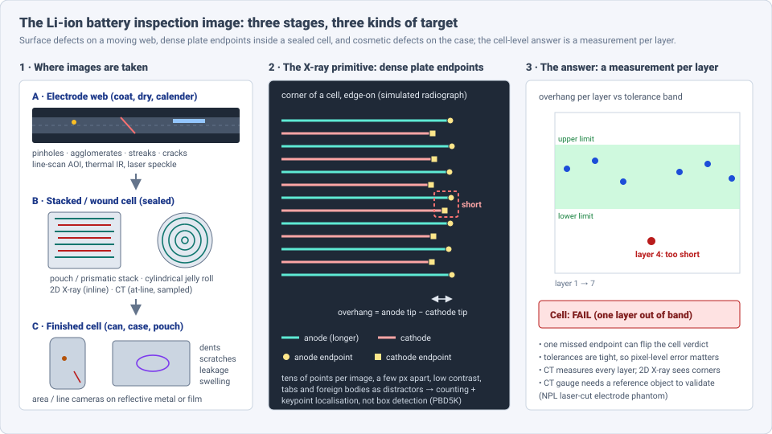
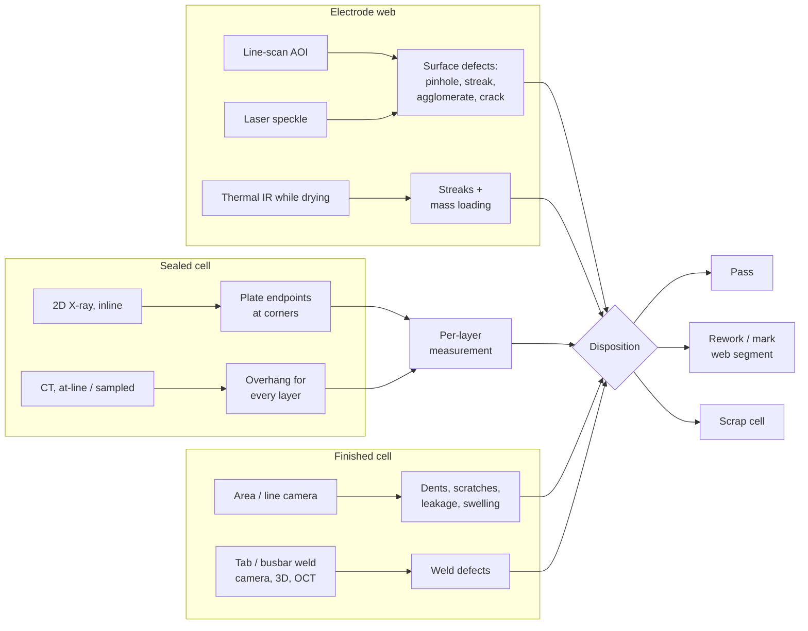
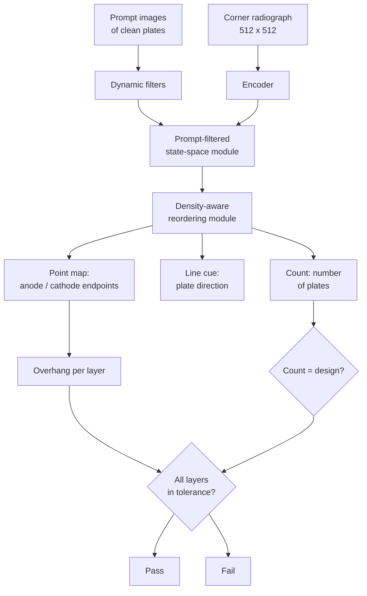

# Dense Object Detection & Classification — Recent Advances

*Compiled 2026-Oct-25 (America/Los_Angeles).*

Next installment in the running CV-updates log. Earlier entries:
[Apr-30](../2026-Apr-30/2026-Apr-30_CV_updates.md),
[May-01](../2026-May-01/2026-May-01_CV_updates.md),
[May-02](../2026-May-02/2026-May-02_CV_updates.md),
[May-04](../2026-May-04/2026-May-04_CV_updates.md),
[May-05](../2026-May-05/2026-May-05_CV_updates.md),
[May-07](../2026-May-07/2026-May-07_CV_updates.md),
[May-08](../2026-May-08/2026-May-08_CV_updates.md),
[May-15](../2026-May-15/2026-May-15_CV_updates.md),
[May-16](../2026-May-16/2026-May-16_CV_updates.md),
[May-17](../2026-May-17/2026-May-17_CV_updates.md),
[Jun-09](../2026-Jun-09/2026-Jun-09_CV_updates.md),
[Jun-10](../2026-Jun-10/2026-Jun-10_CV_updates.md),
[Jun-12](../2026-Jun-12/2026-Jun-12_CV_updates.md),
[Jun-15](../2026-Jun-15/2026-Jun-15_CV_updates.md),
[Jun-16](../2026-Jun-16/2026-Jun-16_CV_updates.md),
[Jun-17](../2026-Jun-17/2026-Jun-17_CV_updates.md),
[Jun-19](../2026-Jun-19/2026-Jun-19_CV_updates.md),
[Jun-21](../2026-Jun-21/2026-Jun-21_CV_updates.md),
[Jun-22](../2026-Jun-22/2026-Jun-22_CV_updates.md),
[Jun-23](../2026-Jun-23/2026-Jun-23_CV_updates.md),
[Jun-24](../2026-Jun-24/2026-Jun-24_CV_updates.md),
[Jun-25](../2026-Jun-25/2026-Jun-25_CV_updates.md),
[Jun-27](../2026-Jun-27/2026-Jun-27_CV_updates.md),
[Jun-29](../2026-Jun-29/2026-Jun-29_CV_updates.md),
[Jun-30](../2026-Jun-30/2026-Jun-30_CV_updates.md),
[Jul-04](../2026-Jul-04/2026-Jul-04_CV_updates.md),
[Jul-07](../2026-Jul-07/2026-Jul-07_CV_updates.md),
[Jul-08](../2026-Jul-08/2026-Jul-08_CV_updates.md),
[Jul-10](../2026-Jul-10/2026-Jul-10_CV_updates.md),
[Jul-15](../2026-Jul-15/2026-Jul-15_CV_updates.md),
[Jul-17](../2026-Jul-17/2026-Jul-17_CV_updates.md),
[Jul-18](../2026-Jul-18/2026-Jul-18_CV_updates.md),
[Jul-21](../2026-Jul-21/2026-Jul-21_CV_updates.md),
[Jul-22](../2026-Jul-22/2026-Jul-22_CV_updates.md),
[Jul-24](../2026-Jul-24/2026-Jul-24_CV_updates.md),
[Jul-26](../2026-Jul-26/2026-Jul-26_CV_updates.md),
[Jul-27](../2026-Jul-27/2026-Jul-27_CV_updates.md),
[Jul-30](../2026-Jul-30/2026-Jul-30_CV_updates.md),
[Aug-01](../2026-Aug-01/2026-Aug-01_CV_updates.md),
[Aug-02](../2026-Aug-02/2026-Aug-02_CV_updates.md),
[Aug-04](../2026-Aug-04/2026-Aug-04_CV_updates.md),
[Aug-07](../2026-Aug-07/2026-Aug-07_CV_updates.md),
[Aug-10](../2026-Aug-10/2026-Aug-10_CV_updates.md),
[Aug-11](../2026-Aug-11/2026-Aug-11_CV_updates.md),
[Aug-13](../2026-Aug-13/2026-Aug-13_CV_updates.md),
[Aug-15](../2026-Aug-15/2026-Aug-15_CV_updates.md),
[Aug-16](../2026-Aug-16/2026-Aug-16_CV_updates.md),
[Aug-18](../2026-Aug-18/2026-Aug-18_CV_updates.md),
[Aug-19](../2026-Aug-19/2026-Aug-19_CV_updates.md),
[Aug-21](../2026-Aug-21/2026-Aug-21_CV_updates.md),
[Aug-22](../2026-Aug-22/2026-Aug-22_CV_updates.md),
[Aug-24](../2026-Aug-24/2026-Aug-24_CV_updates.md),
[Aug-26](../2026-Aug-26/2026-Aug-26_CV_updates.md),
[Aug-29](../2026-Aug-29/2026-Aug-29_CV_updates.md),
[Sep-01](../2026-Sep-01/2026-Sep-01_CV_updates.md),
[Sep-20](../2026-Sep-20/2026-Sep-20_CV_updates.md),
[Sep-23](../2026-Sep-23/2026-Sep-23_CV_updates.md),
[Sep-24](../2026-Sep-24/2026-Sep-24_CV_updates.md),
[Sep-25](../2026-Sep-25/2026-Sep-25_CV_updates.md),
[Sep-26](../2026-Sep-26/2026-Sep-26_CV_updates.md),
[Sep-29](../2026-Sep-29/2026-Sep-29_CV_updates.md),
[Sep-30](../2026-Sep-30/2026-Sep-30_CV_updates.md),
[Oct-01](../2026-Oct-01/2026-Oct-01_CV_updates.md),
[Oct-02](../2026-Oct-02/2026-Oct-02_CV_updates.md),
[Oct-03](../2026-Oct-03/2026-Oct-03_CV_updates.md),
[Oct-04](../2026-Oct-04/2026-Oct-04_CV_updates.md),
[Oct-05](../2026-Oct-05/2026-Oct-05_CV_updates.md),
[Oct-06](../2026-Oct-06/2026-Oct-06_CV_updates.md),
[Oct-07](../2026-Oct-07/2026-Oct-07_CV_updates.md),
[Oct-08](../2026-Oct-08/2026-Oct-08_CV_updates.md),
[Oct-09](../2026-Oct-09/2026-Oct-09_CV_updates.md),
[Oct-10](../2026-Oct-10/2026-Oct-10_CV_updates.md),
[Oct-11](../2026-Oct-11/2026-Oct-11_CV_updates.md),
[Oct-12](../2026-Oct-12/2026-Oct-12_CV_updates.md),
[Oct-13](../2026-Oct-13/2026-Oct-13_CV_updates.md),
[Oct-14](../2026-Oct-14/2026-Oct-14_CV_updates.md),
[Oct-15](../2026-Oct-15/2026-Oct-15_CV_updates.md),
[Oct-16](../2026-Oct-16/2026-Oct-16_CV_updates.md),
[Oct-17](../2026-Oct-17/2026-Oct-17_CV_updates.md),
[Oct-18](../2026-Oct-18/2026-Oct-18_CV_updates.md),
[Oct-19](../2026-Oct-19/2026-Oct-19_CV_updates.md),
[Oct-20](../2026-Oct-20/2026-Oct-20_CV_updates.md),
[Oct-21](../2026-Oct-21/2026-Oct-21_CV_updates.md),
[Oct-22](../2026-Oct-22/2026-Oct-22_CV_updates.md),
[Oct-23](../2026-Oct-23/2026-Oct-23_CV_updates.md),
[Oct-24](../2026-Oct-24/2026-Oct-24_CV_updates.md).

The last three entries covered [steel strip](../2026-Oct-22/2026-Oct-22_CV_updates.md),
[textile fabric](../2026-Oct-23/2026-Oct-23_CV_updates.md) and
[weld](../2026-Oct-24/2026-Oct-24_CV_updates.md) inspection. This run
stays in manufacturing quality and moves to the
**lithium-ion battery inspection
image**. A cell goes through three stages, and each stage has its own
kind of image and target:

- **Electrode web** (coating, drying, calendering): a fast-moving coated
  foil imaged by line-scan cameras, and in research lines by thermal
  infrared and laser speckle. Targets are pinholes, agglomerates, streaks
  and cracks, much like the steel and fabric entries.
- **Assembled cell** (stacked pouch or prismatic, wound cylindrical
  "jelly roll"): sealed, so it is imaged by **2D X-ray inline** and **CT
  at-line or on samples**. The target is the edge of every electrode
  plate: each anode must extend past its neighbouring cathode by a small
  **overhang**.
- **Finished cell** (can, prismatic case, pouch film): area and line
  cameras looking for dents, scratches, leakage, pinholes and swelling on
  reflective metal or film.

Earlier entries mentioned batteries only briefly. The
[Jul-15](../2026-Jul-15/2026-Jul-15_CV_updates.md) X-ray entry had a
short "Batteries" bullet (one CT study of 1,054 cylindrical cells), and
listed HiXray, where a battery is an *object in baggage*, a different
task. No earlier entry treated the battery inspection image as a modality
of its own; this one does. It keeps the "evidence → measurement →
disposition" framing of the Oct-12 → Oct-24 inspection run.

Six properties make it a distinct problem:

- **The X-ray target is a dense set of points, not boxes.** Seen edge-on,
  a cell corner is a comb of tens of plates a few pixels apart. The task
  is to find and count every plate endpoint, which looks more like crowd
  counting ([Oct-11](../2026-Oct-11/2026-Oct-11_CV_updates.md)) than
  defect detection (§4).
- **The answer is a measurement per layer.** A cell fails if *one* layer's
  overhang is out of tolerance. One missed or misplaced endpoint can flip
  the verdict, so recall and localisation error both matter (§4, §6).
- **2D X-ray and CT see different things.** Vendor and industry sources
  say a single radiograph cannot reliably separate individual layers, so
  CT measures every layer while inline 2D X-ray sees corners. CT is too
  slow for every cell (§4).
- **The gauge itself needs validating.** CT overhang values are hard to
  check without a calibration object. NPL built one from laser-cut
  electrode sheets (§4).
- **Surface inspection is a known problem with no shared benchmark.**
  Electrode and case papers report on private data with incompatible
  class lists. Even the defect taxonomy is not agreed (§3, §5).
- **Benchmarks are appearing on the X-ray side first.** PBD5K (5,000
  X-ray images, nine battery types) is the only public benchmark found
  for the inside of the cell (§2, §4).

> **Numbers below come from search-engine abstracts, publisher pages,
> repository records and secondary summaries. I did not read the full
> papers.** On this run the network policy blocked direct page fetches
> (arxiv.org, mdpi.com, frontiersin.org and others returned DNS or
> proxy errors), so everything was read via search snippets. Treat every
> number as an author-reported, abstract-level claim. Almost all battery
> papers use private data, so **do not compare mAPs across rows** unless
> the text says they share a protocol. Vendor figures (Nikon, Lumafield,
> iFactory, Robovision and others) are excluded except where marked.

---

## Table of contents

1. [Why this pass](#1--why-this-pass)
2. [The primitive: three stages, three kinds of target](#2--the-primitive-three-stages-three-kinds-of-target)
3. [Electrode web: surface defects on a moving foil](#3--electrode-web-surface-defects-on-a-moving-foil)
4. [Inside the sealed cell: X-ray endpoints and CT overhang](#4--inside-the-sealed-cell-x-ray-endpoints-and-ct-overhang)
5. [Finished cell: case, can, pouch and tab welds](#5--finished-cell-case-can-pouch-and-tab-welds)
6. [From measurement to disposition, and where language models are](#6--from-measurement-to-disposition-and-where-language-models-are)
7. [Open problems / what to watch](#7--open-problems--what-to-watch)
8. [Sources](#8--sources)

---

## 1 · Why this pass

Like steel, fabric and weld, battery inspection publishes many "YOLO plus
a module" papers. Six items from late 2025 and 2026 are worth a separate
look:

1. **A public benchmark for the inside of the cell.** *Power Battery
   Detection* (arXiv 2508.07797; v2 under submission to IJCV) releases
   **PBD5K: 5,000 X-ray images from nine battery types**, with
   fine-grained annotations and **eight types of real-world visual
   interference**. It treats the task as **point-level segmentation** of
   cathode and anode endpoints. Its model, **MDCNeXt**, reports average
   gains of **more than 18%, 17% and 20%** on AN-ACC, CN-ACC and PN-ACC
   (anode, cathode and plate-number accuracy) over its own CVPR 2024
   predecessor MDCNet (§4).
2. **A large production pouch-cell set.** Kang, Son and Choi (*J.
   Electrochem. Sci. Technol.*, epub) build **15,312** 1024×1024 images
   from a commercial line, with five classes (pass, leakage, pinhole,
   swelling, scratch) and **leakage at only 8.8%**. Their YOLOv11n is
   slimmed (0.75 width, magnitude pruning, mixed precision) for the edge.
   The snippets did not include mAP (§5).
3. **Visible + X-ray fusion across the lifecycle.** A *Sensors* 2026 paper
   (26(2):635, Hebei Univ. of Technology) fuses visible-light and X-ray
   images in a YOLOv8 with SE attention and a multi-scale fusion module,
   to cover surface and internal defects in one model. The public review
   report asked for major revisions on how the fusion is defined and on
   reproducibility (§5).
4. **Micro-CT for cell health, not just defects.** *Batteries* 2026
   (12(7):238, UDC and NSWC Carderock) classifies the structural condition
   of **18650** cells from micro-CT: crop around the centroid, stack
   **three adjacent slices as an RGB input**, and fine-tune
   InceptionResNet-V2. Accuracy and dataset size were not in the
   snippets (§4).
5. **Electrode detectors: transformer vs CNN, and the role of labels.**
   Fraunhofer IPT (*J. Energy Storage* 105, 2025, 114378) finds a
   transformer detector more accurate but slower than a CNN on electrode
   surface defects, with a YOLO baseline at **mAP 54.1 / AP50 90.3**. The
   paper's main warning is how sensitive results are to annotation
   quality. A 2026 *Procedia CIRP* paper from the same group turns this
   into a project pipeline for the coating line (§3).
6. **Validating the CT gauge.** NPL built a **reference object from
   laser-cut graphite and LFP electrode sheets**, measured by confocal
   microscopy, to check XCT overhang values. A patent notes that until
   now there has been no accurate way to validate CT overhang (§4).

---

## 2 · The primitive: three stages, three kinds of target

Each stage produces a different image and a different kind of answer:

**Public data, by what it keeps:**

| Dataset | Stage / modality | What it is | Caveat |
|---|---|---|---|
| **PBD5K** | cell, 2D X-ray | 5,000 images, 9 battery types, cathode/anode endpoint labels, 8 interference types | paper says code and data are public; the link was not visible in snippets |
| **MDCNet set** (CVPR 2024) | cell, 2D X-ray | 1,500 images from 5 manufacturers; regular / difficult / tough splits | predecessor of PBD5K |
| **M-BSD** (DS2A-Former) | finished cell, AOI | 2,491 images, 6,639 instances, 3 defect types; segmentation | code and data linked from the paper's GitHub |
| **BSD** (FHS-Net) | finished cell, AOI | 2,183 production-line images; siamese test-vs-reference setup | venue (IEEE TETCI) inferred from a file name, not confirmed |
| **Pouch-cell set** (JECST) | finished pouch | 15,312 images, 5 classes, leakage 8.8% | private |
| **"Battery-Defects"** (MSA-YOLO) | cylindrical cell surface | named in an abstract | size and access unknown |
| Electrode sets (Fraunhofer IPT/IKTS, BLB Braunschweig) | electrode web | private line data | no public electrode-web benchmark found |

The one thing the X-ray side has that the surface side lacks is a
**fixed, public benchmark with difficulty splits**. Surface papers, like
the weld radiograph papers in Oct-24, all report on their own data.

---

## 3 · Electrode web: surface defects on a moving foil

The electrode web is closest to the steel and fabric entries: a long,
fast, mostly uniform strip with rare small defects. What differs is the
range of sensors used in research lines.

- **Transformer vs CNN, and labels.** Mattern, Gerdes, Grunert and
  Schmitt (Fraunhofer IPT / RWTH, *J. Energy Storage* 2025) compare
  transformer and CNN detectors on electrode surface defects. The
  transformer is more accurate and slower. The YOLO baseline reports
  **mAP 54.1, AP50 90.3**: the gap between the two shows that the boxes
  are found but placed loosely, as with slender defects in Oct-24. The
  authors stress that COCO-style benchmarks do not reflect industrial
  use, and that **annotation quality moves the results**. Their 2026
  *Procedia CIRP* paper (doi 10.1016/j.procir.2026.01.143) packages this
  into a step-by-step deep-learning project pipeline, validated on
  coating-line defects. A Fraunhofer thesis posting names **reducing
  expert annotation effort** as the main blocker.
- **Laser speckle photometry.** Klarák et al. (Fraunhofer IKTS, 2025)
  image the coating with laser speckle, whose interference pattern
  responds to surface roughness and porosity. YOLOv4 reaches **93.82%
  detection and 91.10% labelling accuracy at 50 fps**. Their
  unsupervised + supervised **U2S-CNNv2** is reported to localise defect
  areas better and to flag defect types **absent from training**.
- **Thermal imaging during drying.** Amin et al. (*Small Methods* 2025)
  watch silicon-based coatings dry with an IR camera. Streaks show as
  surface temperature drops of **up to 15 °C**. A random forest predicts
  **mass loading to ±0.3 mg cm⁻²** from surface temperature. This was
  validated in batch, not yet roll-to-roll. It is a rare example of an
  image used to *measure* a process quantity, not only to find defects.
- **Lighter detectors.** YOLOv8s_AD (IEEE) reports **−43.5% parameters,
  −41.4% GFLOPs, +0.4 mAP50, +4.5 mAP50–95** on electrode sheets (year
  not confirmed). An earlier YOLOv8 variant (*Electronics* 2024) and a
  YOLO system validated at Battery LabFactory Braunschweig (*Adv. Intell.
  Syst.* 2022) remain reference points.
- **No agreed taxonomy.** Search summaries of the literature, and a
  Chinese review in *Chinese J. Sci. Instrum.*, note that defect classes
  differ from study to study. That alone makes cross-paper comparison
  unreliable.

---

## 4 · Inside the sealed cell: X-ray endpoints and CT overhang

**Why overhang matters.** The anode is made larger than the cathode so
that lithium does not plate at the cathode edge. Overhang must stay
inside close limits at every layer. Misalignment, folded tabs and missing
layers are all found by locating plate edges.

**2D X-ray: dense endpoint detection (PBD).**

- **MDCNet** (CVPR 2024, arXiv 2312.02528) defined the task: from a
  radiograph of a cell corner, find every cathode and anode endpoint
  and count the plates. Its dataset had 1,500 images from five
  manufacturers. The authors framed it as segmentation and showed it
  beat corner detection, **crowd counting** and object-detection
  baselines. It reported **over 95%** on regular samples, and admitted
  that **difficult and tough splits were poor**.
- **MDCNeXt / PBD5K** (arXiv 2508.07797) scales the benchmark to 5,000
  images and nine battery types, and adds eight kinds of simulated
  interference. The model extracts **point, line and count** cues and
  adds two state-space modules:
  - a **prompt-filtered module**: dynamic filters built from images of
    clean plates suppress distractors at each encoder scale;
  - a **density-aware reordering module** that refines regions where
    plates are densest.
  It reports average gains of **>18% AN-ACC, >17% CN-ACC and >20%
  PN-ACC** over MDCNet across regular, difficult and tough splits. A
  secondary summary claims **sub-pixel endpoint localisation on the
  "Tough" subset**; that was not checked against the paper. Training
  uses 512×512 inputs.

This is the battery counterpart of the crowd-counting entry: points too
dense to box, a known expected count, and a structure prior (plates
alternate and run roughly parallel). It differs in one way that matters:
**a single error is a defect**, while crowd counting tolerates small
relative error.

- **Industry practice.** A US patent (12450714) describes the usual
  approach: locate anode and cathode plates in X-ray images and compute
  misalignment. It calls the existing approach prone to interference,
  missed detections and poor positioning, and adds attention. A Chinese
  patent application (CN122003597A) locates the tab region in CT data and
  judges tab defects from vertical cross-sections.

**CT: every layer, slowly.**

- **Why CT.** Nikon states that 2D radiography is not precise or
  repeatable enough to separate individual layers, and sells an
  AI-assisted **LiB.Overhang Analysis** that reports a value per layer
  rather than pass/fail (vendor; no accuracy figures). Zeiss describes
  at-line CT that measures overhang in one scan. An industry blog notes
  that 18650 and 21700 cells need **180–225 kV** sources to penetrate the
  can and jelly roll. A Patsnap industry report says LG Energy Solution
  runs inline CT for cylindrical cells and pairs pre-assembly vision data
  with post-assembly X-ray (secondary source).
- **Validating the gauge.** NPL's reference object uses laser-cut graphite
  anode and LFP cathode sheets with distances set by confocal laser
  microscopy, then compares XCT. A patent (12292394) makes the same point:
  CT overhang values have had no accurate validation. This is the
  battery version of the measurement concerns in Oct-24 (boundary
  Surface Dice 0.39): **if the gauge is not validated, model accuracy
  against it means little**.
- **Deep models on CT slices.** Mezina, Burget and Kotrly (Brno Univ.
  of Technology) build CT-slice defect datasets and benchmark U-Net
  variants. **U-Net + Xception** reports **binary accuracy 0.9982 and
  IoU 0.8066** (venue and year not confirmed). The accuracy figure mostly
  reflects background pixels; IoU is the number to watch.
- **Micro-CT health classification.** *Batteries* 2026 (above) classifies
  18650 structural condition with a 2.5D input (three slices as RGB).
  It shows a cheap way to reuse ImageNet backbones on CT. It is
  classification, not localisation.
- **Research-scale segmentation (older reference points).** A 3D U-Net
  trained on **synthetic electrode microstructures** (*Nat. Commun.*
  2021), **batteryNET** for lithium structures in operando CT (*npj
  Comput. Mater.* 2023), and **TransforCNN** for dendrites in Li-metal
  cells (*J. Imaging* 2023). No SAM-style foundation segmenter for battery
  CT was found, unlike the weld (WRT-SAM) and dental cases.
- **A vendor data point** (Lumafield, marked as vendor): across 10 iPhone
  16 batteries, overhang standard deviation was **0.008 mm** for genuine
  cells and **0.173 mm** for third-party cells. This echoes the Jul-15
  CT study (0% vs 8–15% overhang failure, OEM vs low-cost), but both are
  vendor studies.

---

## 5 · Finished cell: case, can, pouch and tab welds

**Cosmetic and seal defects.** This is the most crowded part of the
literature and the least comparable.

- **Pouch cells** (JECST, above): 15,312 images, 5 classes, leakage rare
  (8.8%), handled with mosaic, MixUp and random erasing. It compares
  against YOLOv11n and YOLOv12n on an A100.
- **Cylindrical cells, 2026.** **MSA-YOLO** (*Nondestructive Testing and
  Evaluation*, 2026, on YOLOv9s) reports **+3.0 mAP50** on a
  "Battery-Defects" set. **LSMI-YOLO** (*Meas. Sci. Technol.*, Feb 2026,
  on YOLOv11n) reports **+9.04 mAP@0.5 and +9.20 mAP@0.5:0.95**. Only
  relative gains were in the snippets.
- **Other recent variants.** A cooperative-attention YOLOv7-tiny
  (*Energies* 19(4):1044) reports **93.14% mAP@0.5 (+3.08)**. A
  line-focused laser + YOLOv5 system for reflective cases (*Informatica*
  2025) reports **96.35% mAP** on 5,086 defect samples; the laser line
  is the hardware fix for specular metal. YOLO-MDD (*Sustainability* 2024)
  reports **80% mAP**, with the hardest class (small rust spots) at
  **74.1%**.
- **Reference-based and segmentation models.** **FHS-Net** is a siamese
  network that compares each image to a reference (weight-shared encoder,
  fine-grained enhancement, hierarchical perception decoder). It is tested
  on BSD, NEU-SEG and Magnetic-Tile. **DS2A-Former** is a transformer
  segmenter with dual-scale cross attention and dual-query gated
  attention. It is tested on M-BSD and transferred to Crack-500. These two
  are the closest to the "golden template" approach of the PCB entry
  (Oct-21).
- **Review.** Ge and Jin (*World Electr. Veh. J.* 17(7):381, July 2026)
  survey shell defect detection: how stamping and deep drawing form
  scratches, pits and cracks, single- vs two-stage detectors, and open
  problems in data, deployment and "detection dimensions".

**Tab and busbar welds** link to the Oct-24 weld entry, at a smaller
scale:

- A UNIST thesis (2024) detects irregular laser-weld defects on tabs from
  production-line images and notes that **atypical defects are rare in
  mass production**, so data is scarce.
- An *IEEE Access* paper (Oct 2025) fuses a CCD camera, a spectrometer and
  OCT to predict the **interfacial gap** in Al–Cu overlap joints. Like the
  weld-pool work in Oct-24, it judges the weld while it is made.
- A Chinese patent application (Jun 2026, CN122170775A) combines 3D point
  clouds and 2D images to find penetration defects in cell connector
  welds.

---

## 6 · From measurement to disposition, and where language models are

The battery line's decision is not a box:

- **Electrode web:** mark or cut out a segment of web, and feed back to
  coating or drying (the RWTH ML4CPS 2025 paper links defect classes to
  process tuning; the thermal-IR work links images to mass loading).
- **Cell:** pass or scrap from **every layer's overhang** and the plate
  count. The PBD metrics (AN-ACC, CN-ACC, PN-ACC) score this per image,
  which is closer to the real decision than mAP. No paper found here
  reports **cell-level false-accept rate**, the number that matters for
  safety.
- **Finished cell:** cosmetic grade, plus hard rejects for leakage and
  swelling.

**Language and foundation models.** No peer-reviewed vision-language
work on battery inspection images was found. A 2026 *J. Electrochem.
Soc.* review (*From Task-Specific AI to Battery Foundation Models*,
Chalmers) argues that battery AI is still task-specific and trained on
fragmented data. It covers the whole battery lifecycle, not vision.
Vendor pages (Robovision, Roboflow, Cognex, iFactory) describe deployed
vision systems with unverified figures and were not used for numbers.
Compared with steel (SteelDefectX) and weld (MLLM studies), batteries are
a step behind on language models, and ahead on a public dense-point
benchmark.

---

## 7 · Open problems / what to watch

1. **Independent PBD5K results.** Results from groups other than the
   authors, and per-split numbers (regular / difficult / tough), would
   show whether the benchmark separates methods (§4).
2. **Cell-level error rates.** Report the share of cells wrongly passed
   or failed, not only per-endpoint accuracy, since one bad layer fails a
   cell (§4, §6).
3. **Gauge-validated CT benchmarks.** CT overhang datasets whose labels
   are checked against a physical reference such as the NPL object (§4).
4. **2D X-ray ↔ CT pairing.** The same cells imaged both ways would show
   what inline 2D X-ray misses and whether models can predict CT
   results from radiographs (§4).
5. **An open electrode-web benchmark** with an agreed defect taxonomy
   and line-scan resolution, on the model of NEU-DET or Tianchi fabric
   (§3).
6. **Unknown defect types.** Electrode and case lines change with new
   chemistries and formats; U2S-CNNv2's "unseen type" claim and
   reference-based models (FHS-Net) are worth testing more widely (§3,
   §5).
7. **Foundation segmenters for battery CT.** SAM-style adapters exist
   for weld radiographs and medical CT but were not found for battery CT
   (§4).
8. **Process linkage.** Link electrode-web images (thermal, speckle) to
   downstream cell results, as weld-pool imaging does for welds (§3).

---

## 8 · Sources

### Benchmarks and datasets

- Power Battery Detection (PBD5K, MDCNeXt) — arXiv 2508.07797 — https://arxiv.org/abs/2508.07797 — https://papers.cool/arxiv/2508.07797 — https://www.emergentmind.com/topics/pbd5k
- Towards Automatic Power Battery Detection: New Challenge, Benchmark Dataset and Baseline (MDCNet, CVPR 2024) — arXiv 2312.02528 — https://arxiv.org/abs/2312.02528 — https://astro.paperswithcode.com/paper/towards-automatic-power-battery-detection-new
- Fine-Grained Hierarchical Perception Siamese Network for Battery Surface Defect Detection (FHS-Net, BSD dataset) — https://piurilabs.di.unimi.it/Papers/tetci26.pdf
- DS2A-Former (M-BSD dataset) — https://piurilabs.di.unimi.it/Papers/tim25b.pdf
- Battery Pouch Cell Defect Detection System Using YOLOv11 Lightweight Model (J. Electrochem. Sci. Technol.) — https://jecst.org/journal/view.php?number=596

### Electrode web (§3)

- A comparison of transformer and CNN-based object detection models for surface defects on Li-Ion Battery Electrodes (J. Energy Storage 105, 2025, 114378) — https://www.sciencedirect.com/science/article/pii/S2352152X24039641 — https://publica.fraunhofer.de/handle/publica/481041
- Deep learning project pipeline for defect detection, validated on Li-ion coating (Procedia CIRP 2026, doi 10.1016/j.procir.2026.01.143) — https://publica.fraunhofer.de/entities/publication/809aa15c-9bdb-403e-a5ed-2f2149db490b
- Fraunhofer IPT thesis posting, deep learning for defect detection in battery cells — https://jobs.fraunhofer.de/job/Aachen-Master-Thesis-%C2%BBDeep-learning-for-defect-detection-in-battery-cells%C2%AB-52074/1078156101
- Klarák et al., laser speckle photometry for electrode defects, YOLOv4 vs U2S-CNNv2 (2025) — https://publica.fraunhofer.de/entities/publication/d3c6df6c-da16-435d-98a2-e716fcfaeffe
- Fraunhofer ZESS, laser speckle photometry for drying and calendering — https://www.zess.fraunhofer.de/en/competencies/zess-testing-technology/laser-speckle-photometry.html
- Thermal Imaging for Quality Control in Thin Silicon-Based Coatings for Lithium-Ion Batteries (Small Methods 2025) — https://www.ncbi.nlm.nih.gov/pmc/articles/PMC12285618/ — https://engrxiv.org/preprint/view/4221
- Surface Defect Detection Network for Lithium-ion Battery Electrode Sheets (YOLOv8s_AD, IEEE) — https://ieeexplore.ieee.org/document/11150264/
- A YOLOv8-Based Approach for Real-Time Lithium-Ion Battery Electrode Defect Detection (Electronics 2024) — https://citedrive.com/en/discovery/a-yolov8-based-approach-for-real-time-lithium-ion-battery-electrode-defect-detection-with-high-accuracy
- Research progress on defect detection methods for electrode surface of lithium-ion battery (Chinese J. Sci. Instrum.) — https://www.sciengine.com/CJSI/doi/10.19650/j.cnki.cjsi.J2413335
- KIT electrode coating defect detection publications — https://publikationen.bibliothek.kit.edu/1000152261
- Deep-learning coating defect classification linked to coating/drying process optimisation (RWTH Aachen, ML4CPS 2025) — https://openhsu.ub.hsu-hh.de/entities/publication/20022

### Sealed cell: X-ray and CT (§4)

- Battery cell electrode plate detection method (US patent 12450714) — https://image-ppubs.uspto.gov/dirsearch-public/print/downloadPdf/12450714
- CT-based battery tab defect detection (CN122003597A) — https://www.goveda.com/patent/CN-122003597-A
- Apparatus and method for computed tomography system calibration (overhang validation, US patent 12292394) — https://image-ppubs.uspto.gov/dirsearch-public/print/downloadPdf/12292394
- NPL reference object for XCT electrode distance measurement — https://eprintspublications.npl.co.uk/10473/
- Nikon, AI speeds up automated battery anode overhang analysis using X-ray CT (vendor) — https://industry.nikon.com/en-gb/news/overhang-analysis-using-x-ray-ct/ — https://industry.nikon.com/en-gb/blog/a-breakthrough-in-lithium-ion-cell-inspection-rapid-x-ray-ct-analysis-of-anode-overhang/
- Zeiss technical paper, NEV battery CT (vendor) — https://pages.zeiss.com/rs/896-XMS-794/images/EN_60_025_0084III_Technical-Paper-NEV_Battery_CT_RGB%20%281%29.pdf
- Volume Graphics battery analysis (vendor) — https://volumegraphics.hexagon.com/en/products/software-features/battery-analysis.html
- Battery Inspection with X-ray CT Techniques (Hammer blog, Apr 2026) — https://feeds.hammer-ims.com/blog/battery-films-c-ray
- X-Ray Battery Inspection: Overhang Defects, Weld Quality, and Throughput Limits (Patsnap report, secondary) — https://eureka.patsnap.com/blog/research-report/x-ray-battery-inspection-overhang-defects-weld-quality-throughput-limits/
- Lumafield Apple battery quality brief (vendor) — https://www.lumafield.com/resource/apple-battery-quality-brief
- Mezina, Burget, Kotrly, Defect Detection in Battery Cells Using U-Net-Based Neural Networks — https://www.vut.cz/vav/vysledky/detail/199898
- Deep Learning-Based Image Classification of 18650 Lithium-Ion Battery Structural Health Using X-Ray Micro-Computed Tomography (Batteries 12(7):238, 2026) — https://www.mdpi.com/2313-0105/12/7/238 — https://www.citedrive.com/en/discovery/deep-learning-based-image-classification-of-18650-lithium-ion-battery-structural-health-using-x-ray-micro-computed-tomography/
- Deep learning-based segmentation of lithium-ion battery microstructures enhanced by artificially generated electrodes (Nat. Commun. 2021) — https://www.ncbi.nlm.nih.gov/pmc/articles/PMC8551326/
- batteryNET, operando CT of lithium structures (npj Comput. Mater. 2023) — https://doaj.org/article/7a98e626611141af8c8ecee11f97f937
- Lithium Metal Battery Quality Control via Transformer–CNN Segmentation (J. Imaging 2023) — https://www.ncbi.nlm.nih.gov/pmc/articles/PMC10300758/
- Design, Properties, and Manufacturing of Cylindrical Li-Ion Battery Cells — A Generic Overview (Batteries 2023, 4680 CT) — https://www.mdpi.com/2313-0105/9/6/309

### Finished cell and tab welds (§5)

- Research on a Unified Multi-Type Defect Detection Method for Lithium Batteries Throughout Their Entire Lifecycle Based on Multimodal Fusion and Attention-Enhanced YOLOv8 (Sensors 26(2):635, 2026) — https://www.ncbi.nlm.nih.gov/pmc/articles/PMC12845972/ — https://www.mdpi.com/1424-8220/26/2/635/review_report
- MSA-YOLO: Multi-scale Adaptive Network for surface defect detection of cylindrical lithium battery (NDT&E 2026) — https://www.tandfonline.com/doi/abs/10.1080/10589759.2026.2671365
- LSMI-YOLO: detection of surface defects in cylindrical lithium-ion batteries (Meas. Sci. Technol. 2026) — https://iopscience.iop.org/article/10.1088/1361-6501/ae3a01/meta
- Lightweight Cooperative Attention for Empowering YOLOv7-Tiny in Lithium Battery Surface Defect Recognition (Energies 19(4):1044) — https://doi.org/10.3390/en19041044
- Line-Focused Laser and YOLOv5-Based High-Precision Defect Detection for Reflective Surfaces (Informatica 2025) — https://www.informatica.si/index.php/informatica/article/view/7556/6314
- YOLO-MDD, lithium battery shell end-face defects (Sustainability 16(23):10502, 2024) — https://www.mdpi.com/2071-1050/16/23/10502
- A lithium batteries bottom surface defect detection model based on dual-path downsampling (Meas. Sci. Technol.) — https://iopscience.iop.org/article/10.1088/1361-6501/adf875
- A Review of Research Progress on Surface Defect Detection Methods for Battery Shells of New Energy Vehicles (World Electr. Veh. J. 17(7):381, 2026) — https://mdpi-res.com/d_attachment/wevj/wevj-17-00381/article_deploy/wevj-17-00381.pdf
- Laser-welded battery tab defect detection (UNIST thesis, 2024) — https://scholarworks.unist.ac.kr/handle/201301/82000
- Battery cell connector laser weld detection with 3D point cloud + 2D images (CN122170775A) — https://eureka.patsnap.com/patent-CN122170775A
- Battery lid-hole defect detection with YOLOv11 / ResNet18 / EfficientNet-B0 (Comillas thesis) — https://repositorio.comillas.edu/items/4edd6897-bd0f-4f00-af96-bb316af47748

### Disposition and context (§6)

- From Task-Specific AI to Battery Foundation Models (J. Electrochem. Soc. 2026) — https://research.chalmers.se/en/publication/553648
- Battery detection of X-ray images using transfer learning (baggage screening; ESANN 2022, reposted as arXiv 2606.11779) — https://arxiv.org/pdf/2606.11779 — https://www.esann.org/sites/default/files/proceedings/2022/ES2022-60.pdf
- Roboflow, battery cell inspection overview (vendor) — https://roboflow.com/ai/battery-cell-inspection
- Robovision, battery surface defect detection blueprint (vendor) — https://robovision.ai/resources/papers/battery-surface-defect-detection-blueprint
