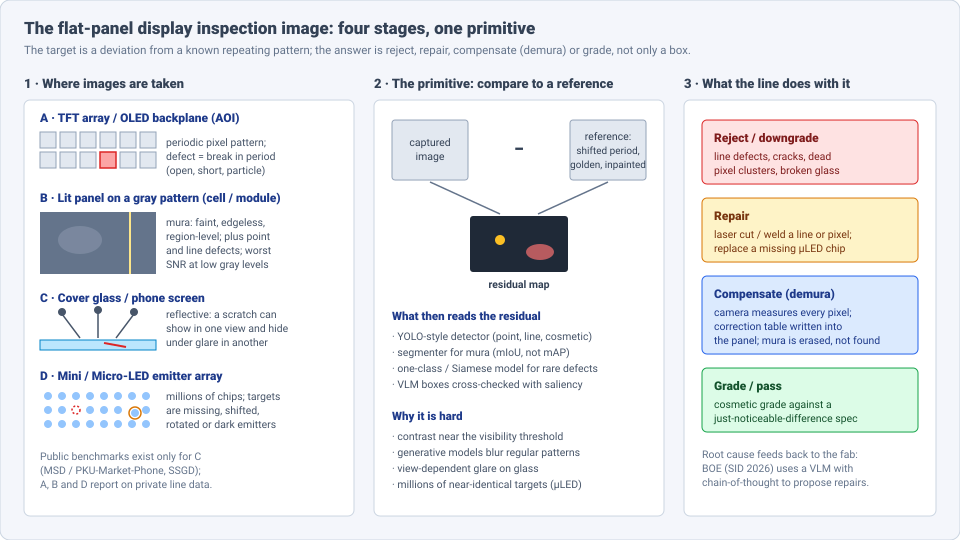
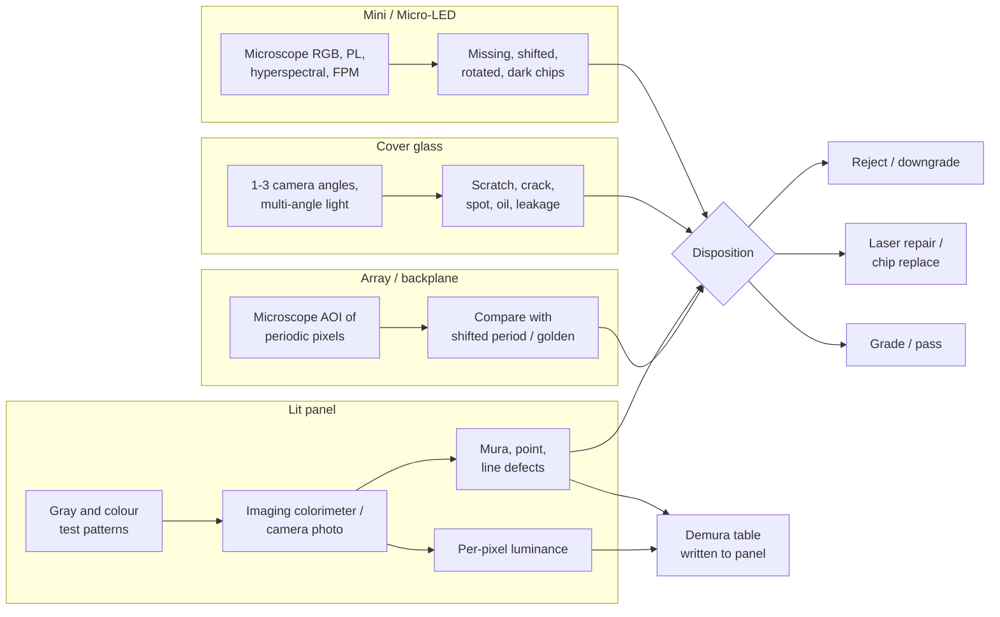
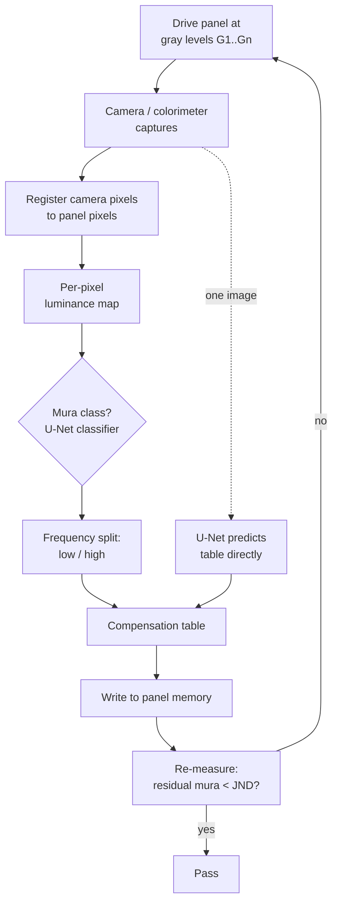

# Dense Object Detection & Classification — Recent Advances

*Compiled 2026-Oct-26 (America/Los_Angeles).*

Next installment in the running CV-updates log. Earlier entries:
[Apr-30](../2026-Apr-30/2026-Apr-30_CV_updates.md),
[May-01](../2026-May-01/2026-May-01_CV_updates.md),
[May-02](../2026-May-02/2026-May-02_CV_updates.md),
[May-04](../2026-May-04/2026-May-04_CV_updates.md),
[May-05](../2026-May-05/2026-May-05_CV_updates.md),
[May-07](../2026-May-07/2026-May-07_CV_updates.md),
[May-08](../2026-May-08/2026-May-08_CV_updates.md),
[May-15](../2026-May-15/2026-May-15_CV_updates.md),
[May-16](../2026-May-16/2026-May-16_CV_updates.md),
[May-17](../2026-May-17/2026-May-17_CV_updates.md),
[Jun-09](../2026-Jun-09/2026-Jun-09_CV_updates.md),
[Jun-10](../2026-Jun-10/2026-Jun-10_CV_updates.md),
[Jun-12](../2026-Jun-12/2026-Jun-12_CV_updates.md),
[Jun-15](../2026-Jun-15/2026-Jun-15_CV_updates.md),
[Jun-16](../2026-Jun-16/2026-Jun-16_CV_updates.md),
[Jun-17](../2026-Jun-17/2026-Jun-17_CV_updates.md),
[Jun-19](../2026-Jun-19/2026-Jun-19_CV_updates.md),
[Jun-21](../2026-Jun-21/2026-Jun-21_CV_updates.md),
[Jun-22](../2026-Jun-22/2026-Jun-22_CV_updates.md),
[Jun-23](../2026-Jun-23/2026-Jun-23_CV_updates.md),
[Jun-24](../2026-Jun-24/2026-Jun-24_CV_updates.md),
[Jun-25](../2026-Jun-25/2026-Jun-25_CV_updates.md),
[Jun-27](../2026-Jun-27/2026-Jun-27_CV_updates.md),
[Jun-29](../2026-Jun-29/2026-Jun-29_CV_updates.md),
[Jun-30](../2026-Jun-30/2026-Jun-30_CV_updates.md),
[Jul-04](../2026-Jul-04/2026-Jul-04_CV_updates.md),
[Jul-07](../2026-Jul-07/2026-Jul-07_CV_updates.md),
[Jul-08](../2026-Jul-08/2026-Jul-08_CV_updates.md),
[Jul-10](../2026-Jul-10/2026-Jul-10_CV_updates.md),
[Jul-15](../2026-Jul-15/2026-Jul-15_CV_updates.md),
[Jul-17](../2026-Jul-17/2026-Jul-17_CV_updates.md),
[Jul-18](../2026-Jul-18/2026-Jul-18_CV_updates.md),
[Jul-21](../2026-Jul-21/2026-Jul-21_CV_updates.md),
[Jul-22](../2026-Jul-22/2026-Jul-22_CV_updates.md),
[Jul-24](../2026-Jul-24/2026-Jul-24_CV_updates.md),
[Jul-26](../2026-Jul-26/2026-Jul-26_CV_updates.md),
[Jul-27](../2026-Jul-27/2026-Jul-27_CV_updates.md),
[Jul-30](../2026-Jul-30/2026-Jul-30_CV_updates.md),
[Aug-01](../2026-Aug-01/2026-Aug-01_CV_updates.md),
[Aug-02](../2026-Aug-02/2026-Aug-02_CV_updates.md),
[Aug-04](../2026-Aug-04/2026-Aug-04_CV_updates.md),
[Aug-07](../2026-Aug-07/2026-Aug-07_CV_updates.md),
[Aug-10](../2026-Aug-10/2026-Aug-10_CV_updates.md),
[Aug-11](../2026-Aug-11/2026-Aug-11_CV_updates.md),
[Aug-13](../2026-Aug-13/2026-Aug-13_CV_updates.md),
[Aug-15](../2026-Aug-15/2026-Aug-15_CV_updates.md),
[Aug-16](../2026-Aug-16/2026-Aug-16_CV_updates.md),
[Aug-18](../2026-Aug-18/2026-Aug-18_CV_updates.md),
[Aug-19](../2026-Aug-19/2026-Aug-19_CV_updates.md),
[Aug-21](../2026-Aug-21/2026-Aug-21_CV_updates.md),
[Aug-22](../2026-Aug-22/2026-Aug-22_CV_updates.md),
[Aug-24](../2026-Aug-24/2026-Aug-24_CV_updates.md),
[Aug-26](../2026-Aug-26/2026-Aug-26_CV_updates.md),
[Aug-29](../2026-Aug-29/2026-Aug-29_CV_updates.md),
[Sep-01](../2026-Sep-01/2026-Sep-01_CV_updates.md),
[Sep-20](../2026-Sep-20/2026-Sep-20_CV_updates.md),
[Sep-23](../2026-Sep-23/2026-Sep-23_CV_updates.md),
[Sep-24](../2026-Sep-24/2026-Sep-24_CV_updates.md),
[Sep-25](../2026-Sep-25/2026-Sep-25_CV_updates.md),
[Sep-26](../2026-Sep-26/2026-Sep-26_CV_updates.md),
[Sep-29](../2026-Sep-29/2026-Sep-29_CV_updates.md),
[Sep-30](../2026-Sep-30/2026-Sep-30_CV_updates.md),
[Oct-01](../2026-Oct-01/2026-Oct-01_CV_updates.md),
[Oct-02](../2026-Oct-02/2026-Oct-02_CV_updates.md),
[Oct-03](../2026-Oct-03/2026-Oct-03_CV_updates.md),
[Oct-04](../2026-Oct-04/2026-Oct-04_CV_updates.md),
[Oct-05](../2026-Oct-05/2026-Oct-05_CV_updates.md),
[Oct-06](../2026-Oct-06/2026-Oct-06_CV_updates.md),
[Oct-07](../2026-Oct-07/2026-Oct-07_CV_updates.md),
[Oct-08](../2026-Oct-08/2026-Oct-08_CV_updates.md),
[Oct-09](../2026-Oct-09/2026-Oct-09_CV_updates.md),
[Oct-10](../2026-Oct-10/2026-Oct-10_CV_updates.md),
[Oct-11](../2026-Oct-11/2026-Oct-11_CV_updates.md),
[Oct-12](../2026-Oct-12/2026-Oct-12_CV_updates.md),
[Oct-13](../2026-Oct-13/2026-Oct-13_CV_updates.md),
[Oct-14](../2026-Oct-14/2026-Oct-14_CV_updates.md),
[Oct-15](../2026-Oct-15/2026-Oct-15_CV_updates.md),
[Oct-16](../2026-Oct-16/2026-Oct-16_CV_updates.md),
[Oct-17](../2026-Oct-17/2026-Oct-17_CV_updates.md),
[Oct-18](../2026-Oct-18/2026-Oct-18_CV_updates.md),
[Oct-19](../2026-Oct-19/2026-Oct-19_CV_updates.md),
[Oct-20](../2026-Oct-20/2026-Oct-20_CV_updates.md),
[Oct-21](../2026-Oct-21/2026-Oct-21_CV_updates.md),
[Oct-22](../2026-Oct-22/2026-Oct-22_CV_updates.md),
[Oct-23](../2026-Oct-23/2026-Oct-23_CV_updates.md),
[Oct-24](../2026-Oct-24/2026-Oct-24_CV_updates.md),
[Oct-25](../2026-Oct-25/2026-Oct-25_CV_updates.md).

The last three entries covered [textile fabric](../2026-Oct-23/2026-Oct-23_CV_updates.md),
[weld](../2026-Oct-24/2026-Oct-24_CV_updates.md) and
[lithium-ion battery](../2026-Oct-25/2026-Oct-25_CV_updates.md) inspection.
This run stays in manufacturing quality and moves to the **flat-panel
display (FPD) inspection image**: LCD, OLED, Mini-LED and Micro-LED panels
and the cover glass on top of them. A display is imaged at four points,
and each produces a different image and target:

- **Array / backplane** (TFT-LCD array, OLED backplane): automated optical
  inspection (AOI) of a highly periodic pixel pattern. Targets are opens,
  shorts, particles and other breaks in the period. This is closest to the
  wafer ([Oct-20](../2026-Oct-20/2026-Oct-20_CV_updates.md)) and PCB
  ([Oct-21](../2026-Oct-21/2026-Oct-21_CV_updates.md)) entries.
- **Lit panel** (cell and module test): the panel is driven with flat gray
  and colour patterns and photographed. Targets are point defects (dead or
  bright sub-pixels), line defects and **mura**: faint, edgeless brightness
  non-uniformities.
- **Cover glass / phone screen**: a reflective surface imaged from one or
  several angles for scratches, cracks, spots, oil and light leakage.
- **Mini- / Micro-LED emitter array**: microscope images of dense grids of
  tiny LED chips, each of which can be missing, shifted, rotated or dark.

No earlier entry treated the display inspection image as a modality of its
own; searching the archive found no mention of mura, TFT-LCD, SSGD or
Micro-LED inspection. This entry keeps the "evidence → measurement →
disposition" framing of the Oct-12 → Oct-25 inspection run.

Six properties make it a distinct problem:

- **The target is a deviation from a known, repeating pattern.** Array and
  emitter images are periodic by design, so most pipelines compare against
  a reference (a neighbouring period, a golden image, or a defect-free
  inpainting) and detect the residual (§3, §6).
- **Mura has no edges.** It is a low-contrast, region-level change near the
  threshold of human visibility, so a box is a poor description; the better
  papers treat it as segmentation or classification (§4).
- **The panel is the light source.** Lit-panel images are photographs of
  test patterns. At low gray levels the camera's signal-to-noise ratio is
  poor, which a 2026 SID paper names as the main source of measurement
  error (§4).
- **The answer is often a correction, not a reject.** Demura measures every
  pixel's luminance and writes a correction table into the panel, so the
  camera image is a measurement instrument, as in the battery CT entry
  (§4, §7).
- **Cover glass is view-dependent.** A scratch can be visible in one
  camera angle and lost in glare in another. A 2026 preprint shows
  product-level recall rising from **75.5% to 88.3%** when three views are
  fused (§5).
- **Public benchmarks exist only for the cover glass, and they disagree.**
  The same model scores **99.3 mAP50 on MSD and 46.0 on SSGD** (§5). Array,
  mura and Micro-LED papers report on private line data.

> **Numbers below come from search-engine abstracts, publisher pages,
> repository records and secondary summaries. I did not read the full
> papers.** On this run the network policy blocked direct page fetches
> (arxiv.org, ncbi.nlm.nih.gov, sid.onlinelibrary.wiley.com and others
> returned DNS errors), so everything was read via search snippets. Treat
> every number as an author-reported, abstract-level claim. Almost all
> display papers use private data, so **do not compare mAPs across rows**
> unless the text says they share a protocol. Vendor and patent material
> is marked where used and was not used for accuracy figures.

---

## Table of contents

1. [Why this pass](#1--why-this-pass)
2. [The primitive: four stages, one comparison](#2--the-primitive-four-stages-one-comparison)
3. [Array and backplane: breaks in a periodic pattern](#3--array-and-backplane-breaks-in-a-periodic-pattern)
4. [The lit panel: mura, point and line defects, and demura](#4--the-lit-panel-mura-point-and-line-defects-and-demura)
5. [Cover glass and phone screens: the only public benchmarks](#5--cover-glass-and-phone-screens-the-only-public-benchmarks)
6. [Mini- and Micro-LED: dense emitter arrays](#6--mini--and-micro-led-dense-emitter-arrays)
7. [From detection to disposition, and where language models are](#7--from-detection-to-disposition-and-where-language-models-are)
8. [Open problems / what to watch](#8--open-problems--what-to-watch)
9. [Sources](#9--sources)

---

## 1 · Why this pass

Display inspection publishes many "YOLO plus a module" papers on private
data. Six items from late 2025 and 2026 are worth a separate look:

1. **Multi-view cover-glass inspection with a VLM.** Nguyen, Tran, Phan and
   HoangVan (arXiv 2608.30997, Aug 2026, submitted to RIVF 2026) run one
   per-view model on each of three camera angles. A **vision-language
   model** proposes class-aware boxes, a **normal-reference reconstruction**
   branch gives class-agnostic saliency, and the two are cross-checked.
   Evidence is merged per product, without registering the views. On 282
   production-line images, cross-checking lifts **AP50 from 52.6% to
   62.6%**; over 94 products, **recall@IoU0.5 rises from 75.5% (best single
   view) to 88.3% (three views)** (§5).
2. **The cover-glass benchmarks pull apart.** DY-YOLO (*Sci. Rep.* 2025, a
   YOLOv8 with dynamic large separable kernel attention) reports **99.3 /
   70.9** (mAP50 / mAP50-95) on MSD but **46.0 / 20.2** on SSGD. On MSD
   the strongest baselines (YOLOv11 99.2, YOLOv5 99.0) are within a point;
   on SSGD it beats YOLOv9 by **10.1** and YOLOv10 by **8.7** mAP50 (§5).
3. **A VLM that proposes repairs.** BOE (Haiyang Guo et al., SID Display
   Week 2026) presents a vision-language model with **chain-of-thought
   reasoning** for closed-loop defect remediation: it classifies the
   defect, runs root-cause analysis and proposes a repair strategy. Display
   Week 2026 added an AI topic area this year (§7).
4. **Low-gray demura as a measurement problem.** A TCL CSOT paper (SID
   2026, P-6.7) states that at low gray levels, camera imaging for mura
   detection has low SNR and large measurement errors, and proposes an
   adaptive one-time compensation. A TCL paper at Display Week 2025
   predicts compensation values from **one** gray-level photo instead of
   seven with a U-shaped network (**+51% demura efficiency, 0.3% prediction
   error**, LCD) (§4).
5. **Synthetic defects for patterned panels.** Kim and Seo (*J. Inf.
   Disp.* 26(1), Jan 2025) build an OLED defect acquisition system and
   augment it with a diffusion model, noting that **generative models still
   struggle with regular-patterned images**. A SID Digest paper (P-235)
   uses diffusion inpainting on backplane images to synthesise dark-spot
   and repair-NG defects, and a patent application describes
   "difference-maximisation" sampling of synthetic NG images for
   OLED/QD-OLED inspection (§3, §7).
6. **Micro-LED inspection moves to new optics.** 2025–2026 papers use
   microscopic RGB vision with a lightweight YOLO (*Opt. Laser Technol.*
   2026), AOTF hyperspectral imaging with a segmentation network (*Opt.
   Laser Technol.* 2025), **reflection-mode Fourier ptychographic
   microscopy** with learned inspection (*Appl. Opt.* 65(17), 2026), and
   Bayesian-optimised one-class classification for imbalanced chip defects
   (*Int. J. Adv. Manuf. Technol.* 2026) (§6).

---

## 2 · The primitive: four stages, one comparison

Each stage produces a different image, but most methods share one step:
compare the image with what a defect-free panel should look like, then
read the difference.

**Public data, by what it keeps:**

| Dataset | Stage | What it is | Caveat |
|---|---|---|---|
| **MSD / PKU-Market-Phone** (Peking Univ.) | cover glass | ~1,200 images at 1920×1080; 3 classes (oil, scratch, spot), 400 each; 6:2:2 split | saturated: several YOLOs score ≥99 mAP50 |
| **SSGD** (ICASSP 2023) | cover glass | 2,504 images, 7 classes incl. crack, light leakage, broken membrane | academic-use licence; a TIB listing says ~10,000 images, which conflicts with the paper |
| Roboflow "LCD display defect detection" | lit LCD | scratch, image retention, mura classes, CC BY 4.0 | no published description |
| Line datasets (BOE, TCL CSOT, Samsung, LG, research labs) | array, lit panel, µLED | private | no public array, mura or Micro-LED benchmark found |

Like the battery entry's surface side, the display literature has **no
public array or mura benchmark**. The two public sets are both cover glass,
and they behave very differently (§5).

---

## 3 · Array and backplane: breaks in a periodic pattern

The array image is a microscope view of thousands of identical pixel
circuits. A defect is anything that breaks the period: an open or shorted
line, a particle, a residue, a missing via.

- **Reference by inpainting, not by template.** A multi-stage few-shot
  method for patterned OLED panels (*J. Intell. Manuf.* 35(6), 2024) uses a
  redesigned **VQ-VAE to inpaint each defect with normal texture**, takes
  the difference to segment the defect by region growing, and classifies it
  with a multi-scale Siamese network. It reports **90.0–96.0% detection
  rate** across array processes and **98.6% classification accuracy** on a
  long-tailed defect set. This is the learned version of the golden
  template in the PCB entry: the reference is generated from the image
  itself, so no alignment to a stored master is needed.
- **Classical background suppression is still the baseline.** A patent on
  display-panel AOI (US 10621701) decomposes the image by wavelets across
  scales and directions, suppresses high-frequency sub-bands that carry the
  pixel pattern, and boosts low-frequency ones. An older stacking-ensemble
  CNN for TFT-LCD defect classification (*J. Intell. Manuf.* 2019/20) notes
  that background brightness and saturation vary even within one image,
  which makes removing the pattern hard.
- **Synthetic NG data.** Kim and Seo (JID 2025) and the SID P-235 paper
  (above) generate defects with diffusion models. Kim and Seo's warning that
  generators **struggle with regular patterns** matters here more than on
  steel or fabric: a synthetic defect that also blurs the surrounding
  period teaches the model the wrong residual.
- **Related layers.** A YOLOv10-N variant for **polarizer coating
  defects** adds scale-aware pyramid pooling, rotation-equivariant
  convolution and WIoU loss, reporting **+1.8 mAP50 and +2.8 mAP50-95**
  over the baseline (venue and year not confirmed). A 2025 *Acta Optica
  Sinica* paper on cosmetic polarizer defects reports a **99.3% detection
  rate** with MobileNetV3-small. A YOLOv4 study on TFT-LCD glass
  substrates appeared in *Sensors and Materials* 2025.
- **Industry signals (patent, not accuracy).** A PatSnap patent snapshot
  notes LG Display patents that sense sub-pixel electrical characteristics
  to pre-locate regions likely to be defective, so the camera looks where
  the electrical test points.

---

## 4 · The lit panel: mura, point and line defects, and demura

**Mura detection.** Mura is the display-specific target: a smooth patch,
band or spot of slightly wrong brightness, often only visible at certain
gray levels.

| Work | Year / venue | Task | Reported result |
|---|---|---|---|
| YOLO-ADPAM (Chen et al.) | *J. Intell. Manuf.* 35(3), 2024 (online 2023) | TFT-LCD mura detection, attention-based lightweight YOLO | **98.20% mAP, 83.23 FPS** |
| YOLO-DSM (Kong et al.) | *Acta Sci. Nat. Univ. Sunyatseni* 64(2), Mar 2025 | multi-background TFT-LCD micro-defects; DSM, SSMA, ODConv | **97.40% mAP, 77.42 FPS** |
| Piecewise gamma + CNN | *Sensors* 2024 | low-contrast TFT-LCD mura | **93.75% detection, 96.67% classification** |
| Lightweight bilateral net (STDC-based) | *Measurement* 2025 | micro-OLED mura segmentation | **77.56% mIoU**, real-time |
| Improved YOLOv8n | *Chin. J. Liq. Cryst. Disp.* 40(3), 2025 | mura | metadata only |
| In-line mura CNN (Tomita et al.) | SID 2022 | in-line classification | **0.868**, close to human visual test |
| ResUNet-GAN with memory | IAICT 2023 | unsupervised mura | **AUC ≈ 0.8** |

The table shows the pattern seen in steel and fabric: **detection papers on
private sets report 97–98% mAP**, while the one segmentation paper reports
78% mIoU and the unsupervised one about 0.8 AUC. These numbers measure
different things, but the gap is a reminder that mura's soft boundary makes
box mAP an easy metric. A 2024 review in *J. Image Graph.* lists complex
backgrounds, limited datasets, real-time limits and **curved screens** as
the open problems, and a 2019 Samsung study found that a standard SSD was
not enough without wavelength-specific augmentation.

**Demura: the camera as gauge.** On OLED lines, most mura is not rejected
but corrected. A camera or imaging colorimeter measures each pixel's
luminance at several gray levels, and the panel stores a per-pixel
correction table. Deep learning enters in three places:

- **Fewer captures.** TCL (Display Week 2025, LCD) predicts compensation
  data from a single gray-level image with a U-shaped network: **7 photos
  → 1, demura efficiency +51%, prediction error 0.3%**.
- **Choosing the compensation.** A SID 2025 OLED paper classifies mura
  with a U-shaped network and uses the class to pick compensation values,
  raising first-pass demura yield. Another SID 2025 paper splits mura into
  high- and low-frequency components and compensates them differently.
- **Low-gray measurement error.** TCL CSOT (SID 2026, P-6.7) states that
  at low gray levels the camera image has low SNR and large measurement
  error, and proposes an adaptive one-time compensation. An IDW 2025 talk
  proposes a quantitative mura evaluation scheme for OLED-on-silicon
  microdisplays.

This is the display version of the battery CT overhang question: **the
measurement is the product**. A detector that finds mura is less valuable
than a camera pipeline that measures each pixel accurately enough to erase
it, and the hardest part is the low-gray end where the signal is weakest.

---

## 5 · Cover glass and phone screens: the only public benchmarks

**Two benchmarks, two regimes.**

- **MSD / PKU-Market-Phone is saturated.** DY-YOLO reports **99.3 mAP50**,
  with YOLOv11 at 99.2 and YOLOv5 at 99.0 in its own table. LNB-YOLO
  (*PLOS ONE*, Dec 2025), a lightweight YOLOv8 deployed on **RK3568** edge
  boards, reports **97.5 mAP50 / 68.8 mAP50-95** on the same images. With
  three classes and 400 images each, differences of a point are within
  noise, and mAP50-95 (≈70) is the only number with room left.
- **SSGD is hard.** The same DY-YOLO gets **46.0 mAP50 / 20.2 mAP50-95**.
  Its ablation shows Dynamic-LSKA beating SE, CBAM and deformable LKA by
  **1.8, 3.9 and 2.5 mAP50** on SSGD with fewer parameters. A third-party
  summary claims +4.8 over YOLOv8 on SSGD, not checked against the paper.
  SSGDD-YOLO (YOLOv7-based) reports a best **62.46% mAP** on an industrial
  screen-glass set.
- **Why the gap.** SSGD has seven classes, including thin cracks, light
  leakage and broken membrane, captured in varied conditions; MSD has three
  visually distinct classes in fixed conditions. A new method should be
  reported on SSGD, or on both; **MSD alone no longer separates methods**.

**Seeing past the glare.**

- **Multi-view fusion** (arXiv 2608.30997, above): three fixed views, a
  shared per-view model, VLM boxes cross-checked against reconstruction
  saliency, product-level merge. Besides the 282-image and 94-product
  results, a secondary summary reports that on a **1,310-image, five-class
  SSGD subset** a saliency-based ranking raised AP50 from **57.1% to
  64.6%** over a direct VLM baseline. The authors list the limits plainly:
  three views, one product family, defective products only, and a
  200-image screening subset they call diagnostic.
- **Multi-angle lighting** is the hardware answer. A 2021 cover-glass
  system lit the glass sequentially from several directions with a ring
  light and segmented scratches from the dark-field stack with a U-Net. A
  2026 *Measurement*-family paper (venue not confirmed) combines
  three-angle illumination with a modified YOLOv10 for smears, creases,
  scratches and dots on phone screens.
- **Other 2025–2026 detectors.** MSAdaNet (*Sensors*, Mar 2026) for
  smartphone component surfaces; PGS-YOLO (YOLOv8n, **+2.5 mAP50**) for
  small screen defects. A 2025 *Sensors* paper on glossy curved products
  found a ResNet-50 variant best among eight CNNs.

This is the same lesson as the weld radiograph and battery surface
entries: hardware that changes what is visible (angles, lighting) moves
recall more than a new attention block.

---

## 6 · Mini- and Micro-LED: dense emitter arrays

A Micro-LED display is a grid of millions of microscopic LED chips placed
by mass transfer. Inspection looks for **missing, shifted, rotated, cracked
or dark** chips. Like the battery X-ray endpoints, the targets are tiny,
near-identical and too many to box by hand.

- **Oriented boxes for rotated chips.** SD-YOLOv8 (Zhou et al., IEEE 2025)
  adds a small-object head, deformable convolution in the neck and an
  **oriented-box (OBB) head** to predict chip position and rotation angle,
  reporting **96.7 mAP50, +2.3 over YOLOv8-OBB** on a self-built Mini-LED
  set. Rotation is itself the defect here, so OBB is not optional.
- **Lightweight detectors.** LED-YOLO (*Opt. Precis. Eng.* 33(9), 2025,
  IME-CAS) reports **99.2% mAP** (lowest class, foreign matter, 98.0%) with
  **1.6 M fewer parameters** than YOLOv11s. CM-YOLOv5 (*Digit. Signal
  Process.* 2024) reports **+3.8 mAP** over YOLOv5. A 2026 *Opt. Laser
  Technol.* paper builds a microscopic RGB vision system and a lightweight
  YOLO for RGB Micro-LED pixels, where sub-pixel structure complicates
  detection (the model's name in snippets, "LCB-YOLO", was not confirmed).
- **New optics.**
  - **AOTF hyperspectral imaging** (*Opt. Laser Technol.*, Jun 2025):
    segmentation network SA-DDR compared with PSPNet, U-Net, DeepLabv3+ and
    DDRNet on Micro-LED arrays.
  - **Reflection-mode Fourier ptychographic microscopy** (*Appl. Opt.*
    65(17):5836, 2026): learned defect inspection of µLED patterns, trading
    many low-resolution captures for a wide field at high resolution. imec
    advertises a student project on the same approach.
  - **RGB + photoluminescence registration** (*Chinese Optics* 2025): PL
    images show which chips emit; registering them to RGB links an
    optical-looking defect to an electrical one.
- **One-class methods for imbalance.** An AOI system with **Bayesian
  optimisation and support vector data description** (*Int. J. Adv. Manuf.
  Technol.* 2026) classifies four defect types (holes, fractures, missing
  chips, dislocations) under heavy imbalance.
- **Mini-LED backlights.** An HRNet with residual global context (*Front.
  Optoelectron.* 2024) segments dead pixels and LED placement in vehicle
  Mini-LED backlights at **86.91% mIoU**, and simulates dead-pixel cases
  with a baffle plate to get training data.

What is missing, compared with the battery PBD5K benchmark, is a **public
dense-emitter benchmark** with counts and per-chip labels; every result
above is on a private set.

---

## 7 · From detection to disposition, and where language models are

A display line has more outcomes than pass / fail:

- **Reject or downgrade**: line defects, cracks, clusters of dead pixels.
- **Repair**: laser cut or weld of a line or pixel on the array; chip
  replacement on Micro-LED. A repair decision needs the defect's exact
  location and type, not just its presence.
- **Compensate**: demura (§4) removes visible mura by writing a correction
  table, so the right metric is residual mura after compensation, not
  detection mAP.
- **Grade**: cosmetic defects on glass and panel are graded against a
  just-noticeable-difference spec.

**Language and foundation models.**

- **BOE, SID 2026**: a VLM with chain-of-thought for closed-loop defect
  remediation, including root-cause analysis and repair strategy. Only
  the symposium preview was found; no metrics.
- **Information Display commentary on Display Week 2026**: AI submissions
  grew substantially year over year; it says industry-specific large
  models are pushing defect classification to production-relevant
  accuracy, and attention-guided models detect defects with little data.
  No figures were given in snippets.
- **Cover glass**: the multi-view preprint (§5) is the only peer-review-track
  work found that uses a VLM for display defect boxes, and it does not
  trust the VLM alone: it cross-checks against a reconstruction branch.

Compared with the battery entry (no VLM work found) and steel
(SteelDefectX), displays sit in between: large panel makers are deploying
VLMs for **root cause and repair**, while academic work uses them for
**proposals that must be verified**.

---

## 8 · Open problems / what to watch

1. **A public array or mura benchmark** with lit-panel images at several
   gray levels and segmentation masks, so mura methods can be compared on
   mIoU or a perceptual metric rather than private-set mAP (§4).
2. **Retire MSD as a headline benchmark.** Report SSGD (and mAP50-95) for
   cover-glass methods; MSD is saturated (§5).
3. **Low-gray measurement.** Demura accuracy at low gray levels is limited
   by camera SNR; watch for learned denoising or multi-exposure fusion
   validated against a reference photometer (§4).
4. **Post-compensation metrics.** Score models by residual visible mura
   after demura, not only by detection (§4, §7).
5. **Generators that respect the period.** Synthetic NG images that keep
   the surrounding pixel pattern exact; current diffusion models blur it
   (§3).
6. **Dense-emitter benchmark for Micro-LED** with per-chip labels,
   rotation and emission state, on the model of PBD5K (§6).
7. **Multi-view as standard for glass**, with normal products included and
   more product families, as the RIVF preprint itself asks for (§5).
8. **Curved and foldable panels**, named as an open direction by the 2024
   review; the only 2026 curved-OLED item found was a BOE stress
   simulation, not inspection (§4).
9. **VLM repair suggestions with measured outcomes**: how often does the
   proposed repair work? None of the 2026 material reports this (§7).

---

## 9 · Sources

### Benchmarks and datasets

- SSGD: A smartphone screen glass dataset for defect detection (ICASSP 2023) — https://arxiv.org/abs/2303.06673 — https://github.com/VincentHancoder/SSGD — https://pure.qub.ac.uk/en/publications/ssgd-a-smartphone-screen-glass-dataset-for-defect-detection/
- SSGD dataset listing (TIB; conflicting size) — https://service.tib.eu/ldmservice/dataset/ssgd
- PKU-Market-Phone / MSD dataset — https://hyper.ai/en/datasets/34037
- Roboflow Universe, LCD display defect detection — https://universe.roboflow.com/cp-uwsgu/lcd-display-defect-detection

### Array, backplane and synthetic data (§3)

- Multi-stage few-shot micro-defect detection of patterned OLED panel using defect inpainting and multi-scale Siamese neural network (J. Intell. Manuf. 2024) — https://ideas.repec.org/a/spr/joinma/v35y2024i6d10.1007_s10845-023-02168-3.html — https://dl.acm.org/doi/abs/10.1007/s10845-023-02168-3
- Data acquisition system for OLED defect detection and augmentation of system data through diffusion model (J. Inf. Disp. 26(1), 2025) — https://scholarworks.sogang.ac.kr/item/0a497b2d-9611-468d-8847-8f14f676b79b — https://www.tandfonline.com/doi/pdf/10.1080/15980316.2024.2381464
- SID Digest P-235, diffusion inpainting of backplane defects — https://sid.org/Portals/sid/Files/SID-Digest/docs/P-235.pdf
- Methods for sampling synthetic defect image generation (patent) — https://image-ppubs.uspto.gov/dirsearch-public/print/downloadPdf/12657668
- Background suppression method in AOI of display panel (patent US 10621701) — https://image-ppubs.uspto.gov/dirsearch-public/print/downloadPdf/10621701
- Effective automatic defect classification process based on CNN with stacking ensemble model for TFT-LCD panel (J. Intell. Manuf.) — https://link.springer.com/article/10.1007/s10845-019-01502-y
- Cognitive Visual Inspection Service for LCD Manufacturing Industry — https://arxiv.org/pdf/2101.03747
- Synthetic Defect Generation for Display Front-of-Screen Quality Inspection: A Survey — https://arxiv.org/pdf/2203.03429
- Improved YOLOv10-N for LCD polarizer coating defects — https://www.synapsesocial.com/papers/69d895ea6c1944d70ce0710c
- Polarizer cosmetic defect detection (Acta Optica Sinica 45(4), 2025) — https://m.researching.cn/articles/OJ8c7bd35ae53e782f
- YOLOv4 for TFT-LCD glass defects (Sensors and Materials 2025) — https://sensors.myu-group.co.jp/sm_pdf/SM4061.pdf
- OLED Mura & Defect Inspection Patent Snapshot (PatSnap, secondary) — https://www.patsnap.com/resources/blog/rd-blog/oled-mura-defect-inspection-patent-snapshot/

### Lit panel, mura and demura (§4)

- Real-time defect detection of TFT-LCD displays using a lightweight network architecture (YOLO-ADPAM, J. Intell. Manuf. 2024) — https://www.springerprofessional.de/en/real-time-defect-detection-of-tft-lcd-displays-using-a-lightweig/25213612 — https://ideas.repec.org/a/spr/joinma/v35y2024i3d10.1007_s10845-023-02110-7.html
- YOLO-DSM method for detecting multi-background visual micro-defects in TFT-LCD panels (2025) — https://xuebaozr.sysu.edu.cn/en/article/doi/10.13471/j.cnki.acta.snus.ZR20240261/
- A Machine-Learning Strategy to Detect Mura Defects in a Low-Contrast Image by Piecewise Gamma Correction (Sensors 2024) — https://www.ncbi.nlm.nih.gov/pmc/articles/PMC10934610/
- Lightweight bilateral network of Mura detection on micro-OLED displays (Measurement) — https://www.sciencedirect.com/science/article/abs/pii/S0263224125012965
- Mura detection with improved YOLOv8n (Chin. J. Liq. Cryst. Disp. 40(3), 2025) — https://m.researching.cn/articles/OJc726419e9784ae9f/referenceandcitations
- 72-1: In-Line Mura Detection using CNN in Display Manufacturing (SID 2022) — https://sid.onlinelibrary.wiley.com/doi/10.1002/sdtp.15656
- ResUNet GAN with dynamic memory for mura defect detection — https://scholars.ncu.edu.tw/en/publications/resunet-gan-with-dynamic-memory-for-mura-defect-detection/
- Deep Learning based MURA Defect Detection — https://publications.eai.eu/index.php/cs/article/view/2486
- Vision-based LCD/OLED defect detection methods: a critical summary (J. Image Graph.) — https://www.cjig.cn/en/article/doi/10.11834/jig.230518
- P-6.7: An Adaptive Demura Algorithm for Precise One-Time Compensation of Low-Gray-Scale Mura in OLED Displays (SID 2026) — https://sid.onlinelibrary.wiley.com/doi/10.1002/sdtp.70003_372
- Display Week 2025 demura presentations (TCL single-image compensation; OLED mura classification) — https://displayweek.inmapz.com/presentation-detail/3016934 — https://displayweek.inmapz.com/presentation-detail/3016885
- IDW 2025, quantitative mura evaluation for OLEDoS — https://pub.confit.atlas.jp/en/event/idw2025/presentation/OLEDp1-03
- Radiant Vision Systems, pixel-level measurement for demura (vendor) — https://www.radiantvisionsystems.com/blog/inspecting-and-correcting-displays-resolution-goes-method-improved-pixel-level-measurement
- Optical compensation method and device (camera demura patent) — https://image-ppubs.uspto.gov/dirsearch-public/print/downloadPdf/11380255

### Cover glass and phone screens (§5)

- Multi-View Reflective Surface Inspection via Semantic-Saliency Cross-Verification (arXiv 2608.30997) — https://arxiv.org/abs/2608.30997 — https://awesomepapers.io/computer-vision/papers/2608.30997
- Smartphone screen surface defect detection using dynamic large separable kernel attention and multi-scale feature bi-directional path aggregation network (DY-YOLO, Sci. Rep. 2025) — https://www.nature.com/articles/s41598-025-24225-y — https://pmc.ncbi.nlm.nih.gov/articles/PMC12627599/
- A lightweight network for phone surface defect detection with industrial deployment on RK3568 edge devices (LNB-YOLO, PLOS ONE 2025) — https://journals.plos.org/plosone/article?id=10.1371%2Fjournal.pone.0336971
- SSGDD-YOLO — https://www.researchgate.net/publication/387888185_SSGDD-YOLO_Multiscale_Feature_Fusion_and_Multi-Attention_based_YOLO_for_Smartphone_Screen_Glass_Defect_Detection
- Mobile Phone Screen Defect Detection Algorithm Based on Improved YOLOv8n: PGS-YOLO — https://www.ecice06.com/EN/abstract/abstract32800.shtml
- Combining AI and deep learning to develop a mobile phone screen defect detection system (multi-angle illumination + YOLOv10) — https://www.sciencedirect.com/science/article/abs/pii/S0263224126011772
- Smartphone Glass Inspection System (multi-direction dark-field, 2021) — https://www.scitepress.org/Papers/2021/102233/
- Optimizing Defect Detection on Glossy and Curved Surfaces Using Deep Learning (Sensors 2025) — https://www.ncbi.nlm.nih.gov/pmc/articles/PMC12031545/

### Mini- and Micro-LED (§6)

- A Novel Rotated YOLOv8 for Mini LED Multi-Class Defect Detection (SD-YOLOv8, IEEE 2025) — https://scholar.xjtu.edu.cn/zh/publications/a-novel-rotated-yolov8-for-mini-led-multi-class-defect-detection/
- LED-YOLO (Optics and Precision Engineering 33(9), 2025) — https://m.researching.cn/articles/OJ9921e6ac870f3a54
- A deep learning-based approach for RGB Micro-LED defect detection using microscopic vision (Opt. Laser Technol. 2026) — https://www.sciencedirect.com/science/article/abs/pii/S003039922600530X
- Efficient Micro-LED defect detection based on microscopic vision and deep learning — https://www.sciencedirect.com/science/article/abs/pii/S0143816624000952
- Detection of defects in Micro-LED arrays by AOTF hyperspectral imaging and machine learning (Opt. Laser Technol. 2025) — https://www.sciencedirect.com/science/article/abs/pii/S0030399225001434
- Learning-based defect inspection of µLED patterns using reflection-mode Fourier ptychographic microscopy (Appl. Opt. 65(17), 2026) — https://opg.optica.org/ao/abstract.cfm?uri=ao-65-17-5836
- imec, FPM for micro-LED defect detection (project page) — https://imec-int.com/en/work-at-imec/job-opportunities/3d-tomographic-metrology-display-samples
- An AOI system embedded with Bayesian optimization and SVDD for imbalanced micro-LED defects (Int. J. Adv. Manuf. Technol. 2026) — https://link.springer.com/article/10.1007/s00170-026-17658-w
- Local–global lightweight ViT model for mini/micro-LED-chip defect recognition — https://www.sciencedirect.com/science/article/abs/pii/S0952197623004311
- Vehicular Mini-LED backlight display inspection based on residual global context mechanism (Front. Optoelectron. 2024) — https://link.springer.com/article/10.1007/s12200-024-00140-4
- RGB–PL image registration for Micro LED inspection (Chinese Optics 2025) — https://chineseoptics.net.cn/en/article/doi/10.37188/CO.2025-0142
- CM-YOLOv5 for Micro LED (Digit. Signal Process. 2024) — https://ma.x-mol.com/paper/1771081101500182528

### Disposition and language models (§7)

- Display Week 2026 Technical Symposium Highlights (Information Display; BOE VLM chain-of-thought paper) — https://sid.onlinelibrary.wiley.com/doi/full/10.1002/msid.70045
- The Intelligent Display Era Has Arrived (Information Display 2026) — https://sid.onlinelibrary.wiley.com/doi/full/10.1002/msid.70050
- Display Week special topics (AI track) — https://www.displayweek.org/special-topics/
- BOE at SID Display Week 2026 (LEDinside, news) — https://www.ledinside.com/news/2026/5/2026_05_07_03
