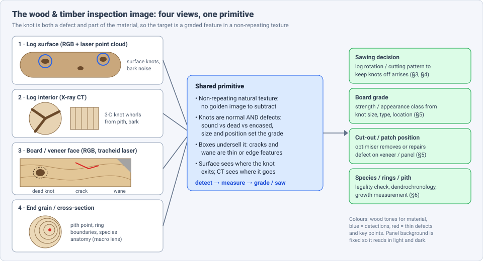
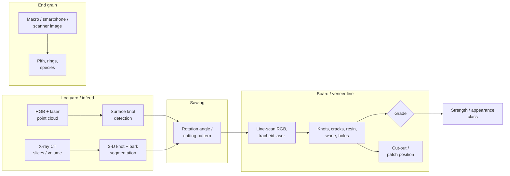
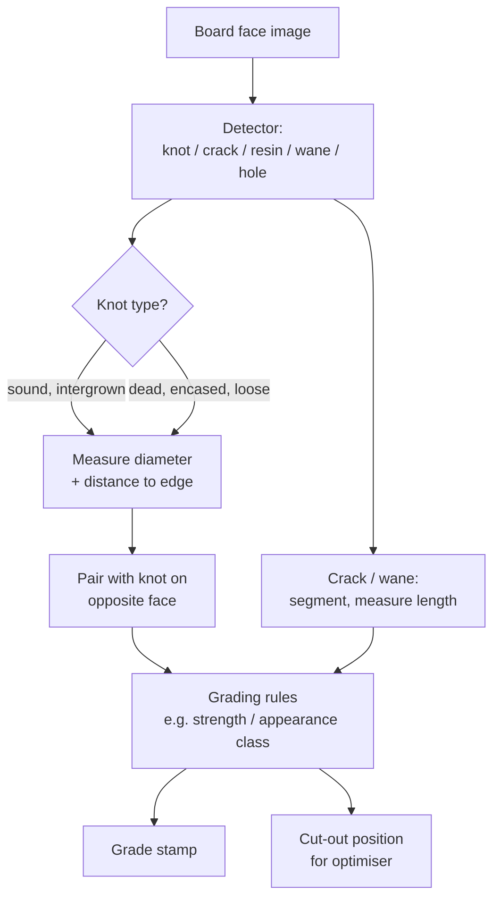

# Dense Object Detection & Classification — Recent Advances

*Compiled 2026-Oct-27 (America/Los_Angeles).*

Next installment in the running CV-updates log. Earlier entries:
[Apr-30](../2026-Apr-30/2026-Apr-30_CV_updates.md),
[May-01](../2026-May-01/2026-May-01_CV_updates.md),
[May-02](../2026-May-02/2026-May-02_CV_updates.md),
[May-04](../2026-May-04/2026-May-04_CV_updates.md),
[May-05](../2026-May-05/2026-May-05_CV_updates.md),
[May-07](../2026-May-07/2026-May-07_CV_updates.md),
[May-08](../2026-May-08/2026-May-08_CV_updates.md),
[May-15](../2026-May-15/2026-May-15_CV_updates.md),
[May-16](../2026-May-16/2026-May-16_CV_updates.md),
[May-17](../2026-May-17/2026-May-17_CV_updates.md),
[Jun-09](../2026-Jun-09/2026-Jun-09_CV_updates.md),
[Jun-10](../2026-Jun-10/2026-Jun-10_CV_updates.md),
[Jun-12](../2026-Jun-12/2026-Jun-12_CV_updates.md),
[Jun-15](../2026-Jun-15/2026-Jun-15_CV_updates.md),
[Jun-16](../2026-Jun-16/2026-Jun-16_CV_updates.md),
[Jun-17](../2026-Jun-17/2026-Jun-17_CV_updates.md),
[Jun-19](../2026-Jun-19/2026-Jun-19_CV_updates.md),
[Jun-21](../2026-Jun-21/2026-Jun-21_CV_updates.md),
[Jun-22](../2026-Jun-22/2026-Jun-22_CV_updates.md),
[Jun-23](../2026-Jun-23/2026-Jun-23_CV_updates.md),
[Jun-24](../2026-Jun-24/2026-Jun-24_CV_updates.md),
[Jun-25](../2026-Jun-25/2026-Jun-25_CV_updates.md),
[Jun-27](../2026-Jun-27/2026-Jun-27_CV_updates.md),
[Jun-29](../2026-Jun-29/2026-Jun-29_CV_updates.md),
[Jun-30](../2026-Jun-30/2026-Jun-30_CV_updates.md),
[Jul-04](../2026-Jul-04/2026-Jul-04_CV_updates.md),
[Jul-07](../2026-Jul-07/2026-Jul-07_CV_updates.md),
[Jul-08](../2026-Jul-08/2026-Jul-08_CV_updates.md),
[Jul-10](../2026-Jul-10/2026-Jul-10_CV_updates.md),
[Jul-15](../2026-Jul-15/2026-Jul-15_CV_updates.md),
[Jul-17](../2026-Jul-17/2026-Jul-17_CV_updates.md),
[Jul-18](../2026-Jul-18/2026-Jul-18_CV_updates.md),
[Jul-21](../2026-Jul-21/2026-Jul-21_CV_updates.md),
[Jul-22](../2026-Jul-22/2026-Jul-22_CV_updates.md),
[Jul-24](../2026-Jul-24/2026-Jul-24_CV_updates.md),
[Jul-26](../2026-Jul-26/2026-Jul-26_CV_updates.md),
[Jul-27](../2026-Jul-27/2026-Jul-27_CV_updates.md),
[Jul-30](../2026-Jul-30/2026-Jul-30_CV_updates.md),
[Aug-01](../2026-Aug-01/2026-Aug-01_CV_updates.md),
[Aug-02](../2026-Aug-02/2026-Aug-02_CV_updates.md),
[Aug-04](../2026-Aug-04/2026-Aug-04_CV_updates.md),
[Aug-07](../2026-Aug-07/2026-Aug-07_CV_updates.md),
[Aug-10](../2026-Aug-10/2026-Aug-10_CV_updates.md),
[Aug-11](../2026-Aug-11/2026-Aug-11_CV_updates.md),
[Aug-13](../2026-Aug-13/2026-Aug-13_CV_updates.md),
[Aug-15](../2026-Aug-15/2026-Aug-15_CV_updates.md),
[Aug-16](../2026-Aug-16/2026-Aug-16_CV_updates.md),
[Aug-18](../2026-Aug-18/2026-Aug-18_CV_updates.md),
[Aug-19](../2026-Aug-19/2026-Aug-19_CV_updates.md),
[Aug-21](../2026-Aug-21/2026-Aug-21_CV_updates.md),
[Aug-22](../2026-Aug-22/2026-Aug-22_CV_updates.md),
[Aug-24](../2026-Aug-24/2026-Aug-24_CV_updates.md),
[Aug-26](../2026-Aug-26/2026-Aug-26_CV_updates.md),
[Aug-29](../2026-Aug-29/2026-Aug-29_CV_updates.md),
[Sep-01](../2026-Sep-01/2026-Sep-01_CV_updates.md),
[Sep-20](../2026-Sep-20/2026-Sep-20_CV_updates.md),
[Sep-23](../2026-Sep-23/2026-Sep-23_CV_updates.md),
[Sep-24](../2026-Sep-24/2026-Sep-24_CV_updates.md),
[Sep-25](../2026-Sep-25/2026-Sep-25_CV_updates.md),
[Sep-26](../2026-Sep-26/2026-Sep-26_CV_updates.md),
[Sep-29](../2026-Sep-29/2026-Sep-29_CV_updates.md),
[Sep-30](../2026-Sep-30/2026-Sep-30_CV_updates.md),
[Oct-01](../2026-Oct-01/2026-Oct-01_CV_updates.md),
[Oct-02](../2026-Oct-02/2026-Oct-02_CV_updates.md),
[Oct-03](../2026-Oct-03/2026-Oct-03_CV_updates.md),
[Oct-04](../2026-Oct-04/2026-Oct-04_CV_updates.md),
[Oct-05](../2026-Oct-05/2026-Oct-05_CV_updates.md),
[Oct-06](../2026-Oct-06/2026-Oct-06_CV_updates.md),
[Oct-07](../2026-Oct-07/2026-Oct-07_CV_updates.md),
[Oct-08](../2026-Oct-08/2026-Oct-08_CV_updates.md),
[Oct-09](../2026-Oct-09/2026-Oct-09_CV_updates.md),
[Oct-10](../2026-Oct-10/2026-Oct-10_CV_updates.md),
[Oct-11](../2026-Oct-11/2026-Oct-11_CV_updates.md),
[Oct-12](../2026-Oct-12/2026-Oct-12_CV_updates.md),
[Oct-13](../2026-Oct-13/2026-Oct-13_CV_updates.md),
[Oct-14](../2026-Oct-14/2026-Oct-14_CV_updates.md),
[Oct-15](../2026-Oct-15/2026-Oct-15_CV_updates.md),
[Oct-16](../2026-Oct-16/2026-Oct-16_CV_updates.md),
[Oct-17](../2026-Oct-17/2026-Oct-17_CV_updates.md),
[Oct-18](../2026-Oct-18/2026-Oct-18_CV_updates.md),
[Oct-19](../2026-Oct-19/2026-Oct-19_CV_updates.md),
[Oct-20](../2026-Oct-20/2026-Oct-20_CV_updates.md),
[Oct-21](../2026-Oct-21/2026-Oct-21_CV_updates.md),
[Oct-22](../2026-Oct-22/2026-Oct-22_CV_updates.md),
[Oct-23](../2026-Oct-23/2026-Oct-23_CV_updates.md),
[Oct-24](../2026-Oct-24/2026-Oct-24_CV_updates.md),
[Oct-25](../2026-Oct-25/2026-Oct-25_CV_updates.md),
[Oct-26](../2026-Oct-26/2026-Oct-26_CV_updates.md).

The last three entries covered [weld](../2026-Oct-24/2026-Oct-24_CV_updates.md),
[lithium-ion battery](../2026-Oct-25/2026-Oct-25_CV_updates.md) and
[flat-panel display](../2026-Oct-26/2026-Oct-26_CV_updates.md) inspection.
This run stays in manufacturing quality and moves to the **wood and timber
inspection image**: the log surface, the log interior seen by X-ray CT, the
sawn board or veneer face, and the end-grain cross-section.

---

## Table of contents

1. [Why this pass](#1--why-this-pass)
2. [The primitive: four views, one graded feature](#2--the-primitive-four-views-one-graded-feature)
3. [The log surface: RGB plus point cloud](#3--the-log-surface-rgb-plus-point-cloud)
4. [The log interior: knots in CT volumes](#4--the-log-interior-knots-in-ct-volumes)
5. [Boards and veneer: the YOLO-heavy middle](#5--boards-and-veneer-the-yolo-heavy-middle)
6. [End grain: pith, rings and species](#6--end-grain-pith-rings-and-species)
7. [Anomaly detection on wood: MVTec is saturated, WoodAD is not](#7--anomaly-detection-on-wood-mvtec-is-saturated-woodad-is-not)
8. [Open problems / what to watch](#8--open-problems--what-to-watch)
9. [Sources](#9--sources)

---

## 1 · Why this pass

No earlier entry treated wood as an image modality of its own. Searching
the archive for *timber*, *lumber*, *veneer*, *sawmill* and *log CT* found
nothing; *knot* appears only once, in the textile entry, where it means a
yarn knot. The MVTec AD "wood" category has come up in passing in
anomaly-detection discussions, but never the industrial pipeline around it.

Five properties make it a distinct problem:

- **No golden reference.** Wafers, PCBs and display arrays are periodic, so
  a residual against a reference does most of the work. Wood grain never
  repeats, so the model has to learn what normal variation looks like.
- **The main feature is not a defect by default.** A sound, intergrown knot
  in a structural board may be fine; a dead or loose knot of the same size
  on an edge may drop the grade. The label is a *type + size + position*,
  not "anomaly".
- **Surface and interior disagree.** A camera sees where a knot exits; CT
  sees where it runs through the log. Sawing decisions need the interior,
  but CT scanners are expensive and slow for many mills, which drives the
  surface-only work in §3.
- **Thin and edge-shaped defects.** Cracks, checks and wane (missing wood
  at the board edge) are poorly described by a box; the better pipelines
  segment them.
- **The output is a decision.** Log rotation, a cutting pattern, a grade
  stamp or a cut-out position; the detector is a means, as in the battery
  and display entries.

---

## 2 · The primitive: four views, one graded feature

**Public data, by what it keeps:**

| Dataset | View | What it is | Caveat |
|---|---|---|---|
| VŠB-TUO wood surface defects ([F1000Research 2021/22](https://f1000research.com/articles/10-581)) | board face | 20,276 images (1,992 defect-free, 18,284 with defects), 10 defect types, boxes + semantic labels | papers cite 20,275 or 20,276; subsets and relabelings make numbers non-comparable (§5) |
| WoodAD ([Expert Systems 2025](https://scienceportal.tecnalia.com/en/publications/woodad-a-new-dataset-and-a-comparison-of-deep-learning-approaches/)) | board face | anomaly-detection benchmark with pixel masks, public on Kaggle | one-class methods far from solved (§7) |
| MVTec AD *wood* ([category stats via 2026 paper](https://arxiv.org/pdf/2605.27748)) | texture patch | 247 train-normal, 79 test images, 60 anomalous | saturated: ~99–100 image AUROC (§7) |
| Veneer21 ([IEEE DataPort](https://ieee-dataport.org/open-access/veneer21)) | veneer | 2,579 before/after-drying pairs from a plywood mill | built for product tracking, not labelled defects |
| WPS-Dataset ([arXiv 2404.11051](https://arxiv.org/pdf/2404.11051)) | debarked plate | wood-plate segmentation for bark removal | segmentation of the piece, not defects |
| Pith dataset ([arXiv 2512.00625](https://arxiv.org/abs/2512.00625)) | end grain | 582 cross-section images + small Oregon oak set | small |
| UruDendro / Deep CS-TRD sets ([arXiv 2504.16242](https://arxiv.org/abs/2504.16242), [2511.20935](https://arxiv.org/html/2511.20935v1)) | end grain | annotated ring boundaries across species and imaging devices | ring delineation, not defects |
| CITES-28 ([Front. Plant Sci. 2024](https://www.frontiersin.org/journals/plant-science/articles/10.3389/fpls.2024.1368885/epub)) | end grain | 9,437 images, 14 CITES species + 14 look-alikes | specimen bias between xylarium and market images |

Log CT data remains mostly private; the Swedish
[WAI-KnotCT](https://www.vinnova.se/en/p/wood-artificial-intelligence---knot-modelling-by-computed-tomography-wai-knotct)
project (May 2023 – Apr 2026) says its models will be shared after the
project ends; no release was found in this pass.

---

## 3 · The log surface: RGB plus point cloud

**Multimodal surface knot detection for sawing optimisation**
(Reich et al., LUT University / Brno University of Technology,
[arXiv 2503.21367](https://arxiv.org/abs/2503.21367), Mar 2025) is the
clearest statement of the surface-only case:

- Two streams, one on RGB images and one on laser point clouds of the log
  surface, joined by a **late-fusion** module. The authors report that
  fusion beats either modality alone; small knots and bark texture defeat
  single-modality models.
- Knot detections feed a **sawing-angle** optimiser that uses
  cross-correlation to keep knots off the board arrises (edges), with
  reported gains over random rotation angles.
- The motivation is cost: CT scanners are expensive and slow for many
  sawmills, while laser profile scanners and cameras are already on the
  infeed. (Exact detection numbers were not retrievable in this pass; see
  the paper's tables.)

The same group's line of work includes unsupervised segmentation of log
point clouds (Zolotarev, Eerola, Kauppi, 2025) and a 2018 LUT thesis that
found laser-detected knots agreed with X-ray data
([lutpub](https://lutpub.lut.fi/bitstream/10024/157381/1/Anisimov2018.pdf)).

On the instrument side, the **tracheid effect** (laser light spreads along
the fibre direction, and dead fibre in a knot does not scatter it) is still
the main non-RGB cue on board and log scanners
([LMI](https://lmi3d.com/blog/optimization-wood-industry-3d-laser-scanning-part-2/)).
A 2025 *Wood Science and Technology* study across **60 Malaysian
hardwoods** found the effect, well established in softwoods, does not work
for every hardwood at 650 nm
([s00226-025-01653-7](https://link.springer.com/article/10.1007/s00226-025-01653-7)),
which limits transfer of softwood-trained pipelines.

---

## 4 · The log interior: knots in CT volumes

- **Gergel et al., *Forests* 17(4):425 (27 Mar 2026)**, "Performance of
  Neural Networks in Automated Detection of Wood Features in CT Images"
  ([PDF](https://mdpi-res.com/d_attachment/forests/forests-17-00425/article_deploy/forests-17-00425.pdf)).
  CNNs separate healthy from damaged regions in log CT and segment bark,
  including discontinuous bark. The abstract names **insufficient spatial
  context in 2-D slice analysis** as the limitation, which is the reason
  for stacking neighbouring slices as channels; evaluation uses Dice and
  confusion matrices under industrial conditions.
- **KnotSegNet3D** (*Wood Science and Technology*, 2026,
  [s00226-026-01771-w](https://link.springer.com/article/10.1007/s00226-026-01771-w)):
  3-D knot segmentation in **Norway spruce** CT logs, trained via
  "mixed training and fine-tuned transfer learning" (per its title). Details
  beyond the title and abstract could not be retrieved in this pass.
- **Synthetic logs for training** ([arXiv 2503.14277](https://arxiv.org/abs/2503.14277), Mar 2025):
  a mathematical log model fitted to real CT scans to generate knot
  training data, addressing the same data scarcity.
- Programmes: Luleå's CT WOOD project (2,100 Scots pine knots scanned green
  and dry, [LTU](https://www.ltu.se/en/research/research-subjects/wood-science-and-engineering/ct-wood/project/2023-12-08-improved-knot-detection-for-ct-using-ai))
  and an NMBU PhD call on ML for low-contrast log CT
  ([forskning.no](https://stilling.forskning.no/job-ads-nmbu-phd/phd-scholarship-within-the-use-of-machine-learning-for-ct-scanning-of-wood/2247044))
  show the problem is still open where green (wet) wood flattens CT
  contrast between knot and stem.

The CT-to-surface link mirrors the weld and battery entries: a cheap
surface sensor is trained or checked against an expensive volumetric one.

---

## 5 · Boards and veneer: the YOLO-heavy middle

Most 2025–2026 papers are YOLO variants on board faces. The useful ones
report deployment conditions as well as mAP:

| Work | Data | Headline | Note |
|---|---|---|---|
| **CFIS-YOLO** ([arXiv 2504.11305](https://arxiv.org/abs/2504.11305), Apr 2025) | VŠB subset: 3 rare classes dropped, 3,465 images | **77.5% mAP@0.5**, +4.0 pp over YOLOv10s; **135 FPS** on a SOPHON BM1684X edge chip, −0.5 pp after fp16, 17.3% of A10 GPU power | one of the few with an edge-chip benchmark |
| **TUM knot detection + pairing** ([arXiv 2505.05845](https://arxiv.org/abs/2505.05845), May 2025) | industrial line-camera images of boards | YOLOv8l **mAP@0.5 0.887** after transfer; YOLOv8n close behind | pairs the same knot on opposite faces of a board, a step towards 3-D knot geometry from 2-D images |
| **LumberSeg** ([J. Cleaner Production 2025](https://www.sciencedirect.com/science/article/abs/pii/S0959652625023431)) | reclaimed lumber, lab-collected | knots, holes, cracks, wane segmented; 99–100% precision with 3-D defect mapping | lab data; reclaimed-wood grading for reuse |
| **OptiWood-YOLO** ([Preprints 202609.0951](https://www.preprints.org/manuscript/202609.0951), Sep 2026; reported in *Forests* Oct 2026 per [ebiotrade](https://www.ebiotrade.com/newsf/2026-10/20261017085850555.htm)) | 10,507 images from a running sawmill, 6 defect classes + "Objects" | YOLOv8n **mAP@0.5 0.46**, mAP@0.5:0.95 0.23; 51.3 FPS; YOLOv11 at 0.45 | authors call results exploratory: single runs, image-level split may leak the same board |
| **MFWSD-YOLO** ([BioResources 2026](https://bioresources.cnr.ncsu.edu/resources/mfwsd-yolo-lightweight-multi-scale-feature-fusion-wood-surface-defect-detection-algorithm/)) | wood surface defects | +8.90 mAP@0.5 / +5.17 mAP@0.5:0.95 over YOLOv12n; −52.7% params | lightweight multi-scale fusion |
| **Dual-path attention YOLO** ([Forests 17:329, Mar 2026](https://mdpi-res.com/d_attachment/forests/forests-17-00329/article_deploy/forests-17-00329.pdf)) | wood surface defects | small-defect focus, lower complexity for embedded devices | — |
| **YOLOv10 + CenterNet + GAT + MLP** ([SAGE 2026](https://sage.cnpereading.com/doi/10.1177/00202940261440368)) | VŠB, 20,275 images | 92.7% "accuracy" at 40 FPS | accuracy, not mAP; protocol unverified |
| **Beech knot framework** ([UPB Sci. Bull. 2026](https://www.scientificbulletin.upb.ro/static/pdfs/a2026nr2c_20_C-223_MButolo_AHadar_pag.pdf)) | curated beech set | modular YOLO with ERP / digital-twin hooks | integration over accuracy |
| **Historic timber knot pipeline** ([ISPRS Annals X-M-2-2025](https://isprs-annals.copernicus.org/articles/X-M-2-2025/267/2025/isprs-annals-X-M-2-2025-267-2025.pdf)) | aged beams in situ | surface seg. mIoU > 0.85; knot F1 up to 0.9 | perspective correction + knot detection for heritage structures |

**The comparability problem.** The gap between the sawmill number
(OptiWood, ~0.46 mAP@0.5) and the curated-set numbers (0.77–0.89) is the
main finding of this section. The VŠB set is used whole, with rare classes
dropped, or relabelled (one area-attention detector reports 60.6 AP / 81.2
AP50 against a YOLOv12 reference of 55.3 / 74.3 on a relabelled variant,
[CMC 2026](https://www.techscience.com/cmc/v88n3/68134/html), not
comparable with the original taxonomy). No shared split or leaderboard
exists, and almost no paper splits by physical board.

**Veneer.** No new 2025–2026 veneer defect benchmark turned up. The
reference points remain the multiscale DETR with a redesigned position
encoder on >16,380 veneer defect images
([Sensors 2023](https://www.mdpi.com/1424-8220/23/10/4837)) and PGGAN-
augmented Mask R-CNN on poplar veneer (live knot 99.05%, dead knot 97.05%,
insect hole 99.10% identification,
[BioResources](https://bioresources.cnr.ncsu.edu/resources/defect-identification-method-for-poplar-veneer-based-on-progressive-growing-generated-adversarial-network-and-mask-r-cnn-model)).

---

## 6 · End grain: pith, rings and species

- **Pith detection** (Liao, Fakhry, Varghese,
  [arXiv 2512.00625](https://arxiv.org/abs/2512.00625), Nov 2025):
  YOLOv9, U-Net, Swin Transformer, DeepLabV3 and Mask R-CNN compared on
  582 cross-sections; **Swin best at 0.94 accuracy**. Adding NMS raised
  Mask R-CNN IoU from **0.45 to 0.80**, a reminder that duplicate
  detections of a single-instance target are a post-processing issue.
- **Deep CS-TRD** (Marichal et al.,
  [arXiv 2504.16242](https://arxiv.org/abs/2504.16242), Apr 2025):
  replaces the edge-detection step of the classical CS-TRD ring
  detector with a U-Net; works across microscopy, scanner and smartphone
  images and three species; releases two annotated datasets; better on
  macro images, slightly worse on *Salix glauca* microscopy.
- **Pinus taeda ring delineation**
  ([arXiv 2511.20935](https://arxiv.org/html/2511.20935v1), Nov 2025):
  adding the new dataset to training improves cross-dataset generalisation.
- **Species ID** for timber-legality checks: CITES-28's SE-ResNet reaches
  99.65% on its test split but **82.3% on timber-market images**
  ([Front. Plant Sci.](https://www.frontiersin.org/journals/plant-science/articles/10.3389/fpls.2024.1368885/epub)),
  the same lab-to-field drop seen in §5. Patch-based inference voting on
  high-resolution images (TDLI-PIV,
  [arXiv 2406.11772](https://www.arxiv.org/abs/2406.11772)) keeps the
  fine anatomy that downsampling destroys.

---

## 7 · Anomaly detection on wood: MVTec is saturated, WoodAD is not

On **MVTec AD wood**, image-level AUROC is at the ceiling: CFA 99.7,
PatchCore 99.2, FastFlow 99.2, RD++ 99.3, MixedTeacher 99.6 and 100 for
CSE ([arXiv 2403.01859](https://arxiv.org/pdf/2403.01859)); dual-student
distillation reports 99.6
([arXiv 2402.00448](https://arxiv.org/pdf/2402.00448)). The category has
only 79 test images.

**WoodAD** (del-Tejo-Catala et al., *Expert Systems* 42(3):e13834, 2025,
[record](https://scienceportal.tecnalia.com/en/publications/woodad-a-new-dataset-and-a-comparison-of-deep-learning-approaches/))
re-opens the problem:

- **EfficientAD**, the best one-class method, reaches only **0.535 pixel
  AP** on the full test set.
- A **few-shot supervised U-Net** reaches **0.862 pixel AP**.

That gap argues for the industrial default: a handful of labelled defects
beats a purely normal-only model on natural texture, because "normal" wood
already contains knots, colour shifts and grain swirls that look anomalous.
Mahalanobis PatchCore
([arXiv 2605.27748](https://arxiv.org/pdf/2605.27748), 2026) adds
streaming covariance updates, relevant to mills where species and
seasonal moisture shift the normal distribution. No SAM- or VLM-based
wood defect work was found in this pass.

---

## 8 · Open problems / what to watch

1. **A board-level split on a shared benchmark.** The VŠB set needs a
   fixed, board-disjoint split; OptiWood's caveat applies to most of §5.
2. **Lab-to-mill drop.** 0.77–0.89 mAP@0.5 on curated sets vs 0.46 at a
   running sawmill; species ID drops 99.65% → 82.3% from xylarium to
   market (§5, §6).
3. **Public log CT data.** Watch for the WAI-KnotCT model/data release
   after its April 2026 end date, and for KnotSegNet3D code (§4).
4. **Surface-to-interior prediction.** Fusing RGB, point cloud and
   tracheid scatter to infer internal knot paths without CT (§3).
5. **Grading-rule-aware outputs.** Detectors that output knot type,
   diameter and edge distance and are scored on grade agreement, not mAP.
6. **Hardwood transfer.** Tracheid cues fail for some hardwoods at 650 nm;
   pipelines are mostly softwood-tuned (§3).
7. **Few-shot over one-class** on natural textures, per WoodAD (§7).

---

## 9 · Sources

### Benchmarks and datasets
- Kodytek et al., A large-scale image dataset of wood surface defects (F1000Research) — https://f1000research.com/articles/10-581
- Wood defect detection on Dataset Ninja — https://datasetninja.com/wood-defect-detection
- WoodAD (Expert Systems 2025) — https://scienceportal.tecnalia.com/en/publications/woodad-a-new-dataset-and-a-comparison-of-deep-learning-approaches/ — https://core.ac.uk/outputs/650204661
- Veneer21 — https://ieee-dataport.org/open-access/veneer21
- WPS-Dataset, arXiv 2404.11051 — https://arxiv.org/pdf/2404.11051
- CITES-28 (Front. Plant Sci. 2024) — https://www.frontiersin.org/journals/plant-science/articles/10.3389/fpls.2024.1368885/epub
- CRTreeCuts (Front. Plant Sci. 2022) — https://www.frontiersin.org/journals/plant-science/articles/10.3389/fpls.2022.789227/epub

### Log surface and tracheid effect (§3)
- Multimodal surface defect detection from wooden logs for sawing optimization, arXiv 2503.21367 — https://arxiv.org/abs/2503.21367
- Anisimov 2018 LUT thesis — https://lutpub.lut.fi/bitstream/10024/157381/1/Anisimov2018.pdf
- LMI Technologies, wood industry 3D laser scanning — https://lmi3d.com/blog/optimization-wood-industry-3d-laser-scanning-part-2/
- Tracheid effect in Malaysian hardwoods (Wood Sci. Technol. 2025) — https://link.springer.com/article/10.1007/s00226-025-01653-7
- Tracheid effect scanning in Norway spruce (Wood and Fiber Science) — https://wfs.swst.org/index.php/wfs/article/view/2728

### Log CT (§4)
- Gergel et al., Forests 17:425 (2026) — https://mdpi-res.com/d_attachment/forests/forests-17-00425/article_deploy/forests-17-00425.pdf
- KnotSegNet3D (Wood Sci. Technol. 2026) — https://link.springer.com/article/10.1007/s00226-026-01771-w
- Synthetic log generation, arXiv 2503.14277 — https://arxiv.org/abs/2503.14277
- WAI-KnotCT (Vinnova) — https://www.vinnova.se/en/p/wood-artificial-intelligence---knot-modelling-by-computed-tomography-wai-knotct
- LTU CT WOOD project — https://www.ltu.se/en/research/research-subjects/wood-science-and-engineering/ct-wood/project/2023-12-08-improved-knot-detection-for-ct-using-ai
- NMBU PhD call, ML for CT scanning of wood — https://stilling.forskning.no/job-ads-nmbu-phd/phd-scholarship-within-the-use-of-machine-learning-for-ct-scanning-of-wood/2247044

### Boards and veneer (§5)
- CFIS-YOLO, arXiv 2504.11305 — https://arxiv.org/abs/2504.11305
- Automated Knot Detection and Pairing, arXiv 2505.05845 — https://arxiv.org/abs/2505.05845
- Scalable AI-driven automation for visual lumber grading (LumberSeg) — https://www.sciencedirect.com/science/article/abs/pii/S0959652625023431
- OptiWood-YOLO preprint — https://www.preprints.org/manuscript/202609.0951 — journal report: https://www.ebiotrade.com/newsf/2026-10/20261017085850555.htm
- MFWSD-YOLO (BioResources 2026) — https://bioresources.cnr.ncsu.edu/resources/mfwsd-yolo-lightweight-multi-scale-feature-fusion-wood-surface-defect-detection-algorithm/
- Dual-path attention YOLO (Forests 17:329) — https://mdpi-res.com/d_attachment/forests/forests-17-00329/article_deploy/forests-17-00329.pdf
- YOLOv11-GATFormer — https://metatoc.com/papers/182402-yolov11-gatformer-a-unified-framework-for-wood-surface-defect-detection-and-classification
- Hybrid YOLOv10/CenterNet/GAT (SAGE 2026) — https://sage.cnpereading.com/doi/10.1177/00202940261440368
- Area-attention detector on relabelled VŠB (CMC 2026) — https://www.techscience.com/cmc/v88n3/68134/html
- Modular YOLO knot framework, beech (UPB Sci. Bull. 2026) — https://www.scientificbulletin.upb.ro/static/pdfs/a2026nr2c_20_C-223_MButolo_AHadar_pag.pdf
- Historic timber knot pipeline (ISPRS Annals 2025) — https://isprs-annals.copernicus.org/articles/X-M-2-2025/267/2025/isprs-annals-X-M-2-2025-267-2025.pdf
- Wood defect detection review (AIMS 2026) — https://www.aimspress.com/aimspress-data/aci/2026/1/PDF/aci-06-01-001.pdf
- Multiscale DETR veneer (Sensors 2023) — https://www.mdpi.com/1424-8220/23/10/4837
- PGGAN + Mask R-CNN poplar veneer (BioResources) — https://bioresources.cnr.ncsu.edu/resources/defect-identification-method-for-poplar-veneer-based-on-progressive-growing-generated-adversarial-network-and-mask-r-cnn-model

### End grain (§6)
- Automatic Pith Detection, arXiv 2512.00625 — https://arxiv.org/abs/2512.00625
- Deep CS-TRD, arXiv 2504.16242 — https://arxiv.org/abs/2504.16242
- Pinus taeda ring delineation, arXiv 2511.20935 — https://arxiv.org/html/2511.20935v1
- TDLI-PIV high-resolution timber patches, arXiv 2406.11772 — https://www.arxiv.org/abs/2406.11772

### Anomaly detection (§7)
- CSE, arXiv 2403.01859 — https://arxiv.org/pdf/2403.01859
- Dual-Student KD, arXiv 2402.00448 — https://arxiv.org/pdf/2402.00448
- Mahalanobis PatchCore, arXiv 2605.27748 — https://arxiv.org/pdf/2605.27748

*Research note: direct page fetches were blocked by the network policy in
this run, so figures come from search-indexed abstracts and snippets.
Numbers marked as not retrievable should be checked against the papers.*
