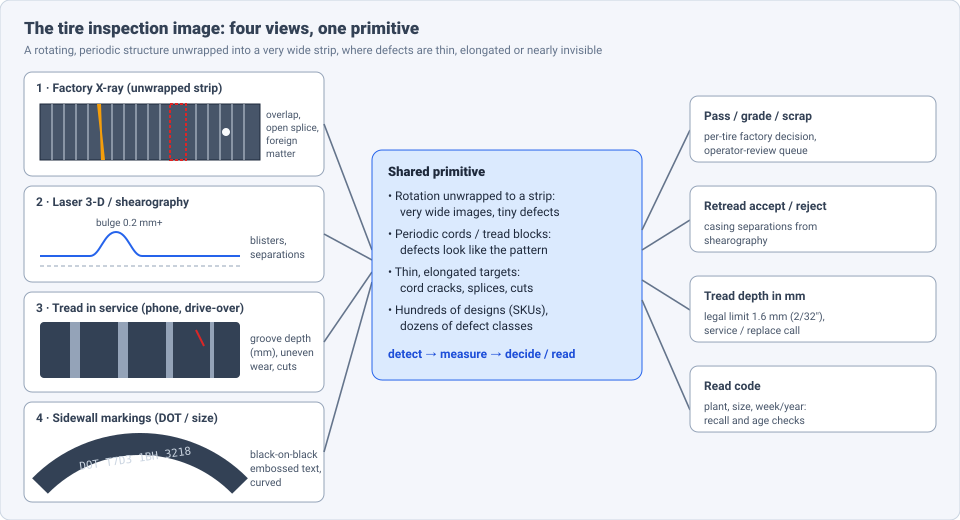
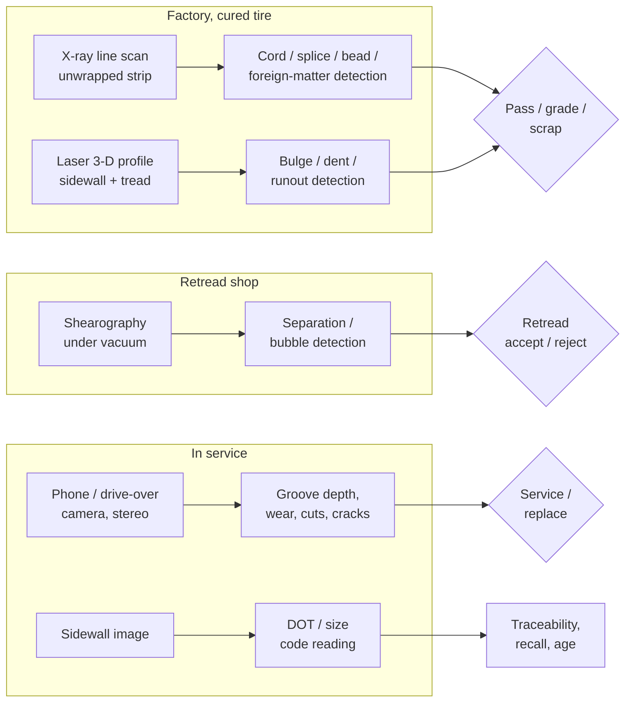
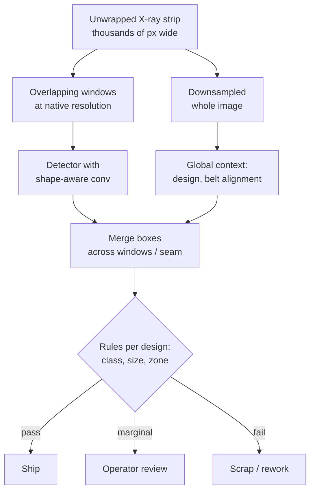

# Dense Object Detection & Classification — Recent Advances

*Compiled 2026-Oct-28 (America/Los_Angeles).*

Next installment in the running CV-updates log. Earlier entries:
[Apr-30](../2026-Apr-30/2026-Apr-30_CV_updates.md),
[May-01](../2026-May-01/2026-May-01_CV_updates.md),
[May-02](../2026-May-02/2026-May-02_CV_updates.md),
[May-04](../2026-May-04/2026-May-04_CV_updates.md),
[May-05](../2026-May-05/2026-May-05_CV_updates.md),
[May-07](../2026-May-07/2026-May-07_CV_updates.md),
[May-08](../2026-May-08/2026-May-08_CV_updates.md),
[May-15](../2026-May-15/2026-May-15_CV_updates.md),
[May-16](../2026-May-16/2026-May-16_CV_updates.md),
[May-17](../2026-May-17/2026-May-17_CV_updates.md),
[Jun-09](../2026-Jun-09/2026-Jun-09_CV_updates.md),
[Jun-10](../2026-Jun-10/2026-Jun-10_CV_updates.md),
[Jun-12](../2026-Jun-12/2026-Jun-12_CV_updates.md),
[Jun-15](../2026-Jun-15/2026-Jun-15_CV_updates.md),
[Jun-16](../2026-Jun-16/2026-Jun-16_CV_updates.md),
[Jun-17](../2026-Jun-17/2026-Jun-17_CV_updates.md),
[Jun-19](../2026-Jun-19/2026-Jun-19_CV_updates.md),
[Jun-21](../2026-Jun-21/2026-Jun-21_CV_updates.md),
[Jun-22](../2026-Jun-22/2026-Jun-22_CV_updates.md),
[Jun-23](../2026-Jun-23/2026-Jun-23_CV_updates.md),
[Jun-24](../2026-Jun-24/2026-Jun-24_CV_updates.md),
[Jun-25](../2026-Jun-25/2026-Jun-25_CV_updates.md),
[Jun-27](../2026-Jun-27/2026-Jun-27_CV_updates.md),
[Jun-29](../2026-Jun-29/2026-Jun-29_CV_updates.md),
[Jun-30](../2026-Jun-30/2026-Jun-30_CV_updates.md),
[Jul-04](../2026-Jul-04/2026-Jul-04_CV_updates.md),
[Jul-07](../2026-Jul-07/2026-Jul-07_CV_updates.md),
[Jul-08](../2026-Jul-08/2026-Jul-08_CV_updates.md),
[Jul-10](../2026-Jul-10/2026-Jul-10_CV_updates.md),
[Jul-15](../2026-Jul-15/2026-Jul-15_CV_updates.md),
[Jul-17](../2026-Jul-17/2026-Jul-17_CV_updates.md),
[Jul-18](../2026-Jul-18/2026-Jul-18_CV_updates.md),
[Jul-21](../2026-Jul-21/2026-Jul-21_CV_updates.md),
[Jul-22](../2026-Jul-22/2026-Jul-22_CV_updates.md),
[Jul-24](../2026-Jul-24/2026-Jul-24_CV_updates.md),
[Jul-26](../2026-Jul-26/2026-Jul-26_CV_updates.md),
[Jul-27](../2026-Jul-27/2026-Jul-27_CV_updates.md),
[Jul-30](../2026-Jul-30/2026-Jul-30_CV_updates.md),
[Aug-01](../2026-Aug-01/2026-Aug-01_CV_updates.md),
[Aug-02](../2026-Aug-02/2026-Aug-02_CV_updates.md),
[Aug-04](../2026-Aug-04/2026-Aug-04_CV_updates.md),
[Aug-07](../2026-Aug-07/2026-Aug-07_CV_updates.md),
[Aug-10](../2026-Aug-10/2026-Aug-10_CV_updates.md),
[Aug-11](../2026-Aug-11/2026-Aug-11_CV_updates.md),
[Aug-13](../2026-Aug-13/2026-Aug-13_CV_updates.md),
[Aug-15](../2026-Aug-15/2026-Aug-15_CV_updates.md),
[Aug-16](../2026-Aug-16/2026-Aug-16_CV_updates.md),
[Aug-18](../2026-Aug-18/2026-Aug-18_CV_updates.md),
[Aug-19](../2026-Aug-19/2026-Aug-19_CV_updates.md),
[Aug-21](../2026-Aug-21/2026-Aug-21_CV_updates.md),
[Aug-22](../2026-Aug-22/2026-Aug-22_CV_updates.md),
[Aug-24](../2026-Aug-24/2026-Aug-24_CV_updates.md),
[Aug-26](../2026-Aug-26/2026-Aug-26_CV_updates.md),
[Aug-29](../2026-Aug-29/2026-Aug-29_CV_updates.md),
[Sep-01](../2026-Sep-01/2026-Sep-01_CV_updates.md),
[Sep-20](../2026-Sep-20/2026-Sep-20_CV_updates.md),
[Sep-23](../2026-Sep-23/2026-Sep-23_CV_updates.md),
[Sep-24](../2026-Sep-24/2026-Sep-24_CV_updates.md),
[Sep-25](../2026-Sep-25/2026-Sep-25_CV_updates.md),
[Sep-26](../2026-Sep-26/2026-Sep-26_CV_updates.md),
[Sep-29](../2026-Sep-29/2026-Sep-29_CV_updates.md),
[Sep-30](../2026-Sep-30/2026-Sep-30_CV_updates.md),
[Oct-01](../2026-Oct-01/2026-Oct-01_CV_updates.md),
[Oct-02](../2026-Oct-02/2026-Oct-02_CV_updates.md),
[Oct-03](../2026-Oct-03/2026-Oct-03_CV_updates.md),
[Oct-04](../2026-Oct-04/2026-Oct-04_CV_updates.md),
[Oct-05](../2026-Oct-05/2026-Oct-05_CV_updates.md),
[Oct-06](../2026-Oct-06/2026-Oct-06_CV_updates.md),
[Oct-07](../2026-Oct-07/2026-Oct-07_CV_updates.md),
[Oct-08](../2026-Oct-08/2026-Oct-08_CV_updates.md),
[Oct-09](../2026-Oct-09/2026-Oct-09_CV_updates.md),
[Oct-10](../2026-Oct-10/2026-Oct-10_CV_updates.md),
[Oct-11](../2026-Oct-11/2026-Oct-11_CV_updates.md),
[Oct-12](../2026-Oct-12/2026-Oct-12_CV_updates.md),
[Oct-13](../2026-Oct-13/2026-Oct-13_CV_updates.md),
[Oct-14](../2026-Oct-14/2026-Oct-14_CV_updates.md),
[Oct-15](../2026-Oct-15/2026-Oct-15_CV_updates.md),
[Oct-16](../2026-Oct-16/2026-Oct-16_CV_updates.md),
[Oct-17](../2026-Oct-17/2026-Oct-17_CV_updates.md),
[Oct-18](../2026-Oct-18/2026-Oct-18_CV_updates.md),
[Oct-19](../2026-Oct-19/2026-Oct-19_CV_updates.md),
[Oct-20](../2026-Oct-20/2026-Oct-20_CV_updates.md),
[Oct-21](../2026-Oct-21/2026-Oct-21_CV_updates.md),
[Oct-22](../2026-Oct-22/2026-Oct-22_CV_updates.md),
[Oct-23](../2026-Oct-23/2026-Oct-23_CV_updates.md),
[Oct-24](../2026-Oct-24/2026-Oct-24_CV_updates.md),
[Oct-25](../2026-Oct-25/2026-Oct-25_CV_updates.md),
[Oct-26](../2026-Oct-26/2026-Oct-26_CV_updates.md),
[Oct-27](../2026-Oct-27/2026-Oct-27_CV_updates.md).

The last four entries covered [weld](../2026-Oct-24/2026-Oct-24_CV_updates.md),
[lithium-ion battery](../2026-Oct-25/2026-Oct-25_CV_updates.md),
[flat-panel display](../2026-Oct-26/2026-Oct-26_CV_updates.md) and
[wood & timber](../2026-Oct-27/2026-Oct-27_CV_updates.md) inspection.
This run stays in manufacturing and moves to the **tire inspection image**:
the factory X-ray of a cured tire, the laser 3-D profile and shearography
of sidewall and casing, the tread in service, and the sidewall markings.

---

## Table of contents

1. [Why this pass](#1--why-this-pass)
2. [The primitive: four views, one rotating structure](#2--the-primitive-four-views-one-rotating-structure)
3. [Factory X-ray: many classes, private data, YOLO everywhere](#3--factory-x-ray-many-classes-private-data-yolo-everywhere)
4. [Laser 3-D and shearography: defects you cannot see](#4--laser-3-d-and-shearography-defects-you-cannot-see)
5. [Tread in service: wear, depth and damage](#5--tread-in-service-wear-depth-and-damage)
6. [Sidewall markings and tread pattern identity](#6--sidewall-markings-and-tread-pattern-identity)
7. [Open problems / what to watch](#7--open-problems--what-to-watch)
8. [Sources](#8--sources)

---

## 1 · Why this pass

Tires have not had an entry of their own. Searching the archive for
*tire* and *tyre* turns up only incidental hits (wordplay and paper
titles); *shearography*, *tread depth* and *DOT code* do not appear.
The [X-ray transmission entry](../2026-Jul-15/2026-Jul-15_CV_updates.md)
covered industrial radiography in general, and the
[weld entry](../2026-Oct-24/2026-Oct-24_CV_updates.md) covered radiographs
of welds, but neither the tire-specific pipeline.

What makes it a distinct primitive:

- **Unwrapped rotation.** Factory X-ray and laser scanners spin the tire
  and record a line per step, so one image is a long strip, often several
  thousand pixels wide, in which a defect can be about 40 × 40 px
  ([Cozma et al.](https://arxiv.org/abs/2402.18527)). Downsampling to
  detector input size erases it.
- **A periodic background that looks like the defect.** Steel cords are
  parallel bright lines in the X-ray; a cord overlap or open splice is a
  small break in that period. Tread blocks repeat around the
  circumference, and a cut or chunk sits among grooves of similar shape.
- **Many designs, many classes.** A plant runs hundreds of tire designs
  (SKUs). The datasets in §3 carry 15 to 58 defect classes and dozens of
  design patterns, so per-design "golden" references are expensive to
  maintain.
- **Some defects are invisible to a camera.** Blisters, ply separations
  and bead problems sit inside rubber. They need X-ray, a laser profile
  or shearography, which is why §4 exists.
- **The output is a number or a decision.** Pass/scrap, retread
  accept/reject, tread depth in millimetres, or a decoded DOT code; as in
  the battery and wood entries, the detector is only one step.

---

## 2 · The primitive: four views, one rotating structure

**Public data, by what it keeps:**

| Dataset | View | What it is | Caveat |
|---|---|---|---|
| Sailun tire X-ray set ([Cozma et al., arXiv 2402.18527](https://arxiv.org/abs/2402.18527)) | factory X-ray | 1,054 grayscale scans, boxes for **two** defect types (blisters, wire defects); stated aim is public access | two classes only; scan sizes vary widely; hosting not confirmed in this pass |
| MTire299 ([arXiv 2607.23979](https://arxiv.org/pdf/2607.23979), Jul 2026) | tread surface + tread indentation | 14,795 paired image samples, 299 tire pattern categories | pattern identity, not defects (§6) |
| TyreNet ([Mendeley Data, Jan 2024](https://data.mendeley.com/datasets/32b5vfj6tc)) | phone photo of tire | 1,698 images: 866 defective (cracks and other damage), 832 good; 48 MP Android phone | image-level labels; no published baseline found |
| Defective vs good tyres ([Mendeley Data 2023](https://data.mendeley.com/datasets/bn7ch8tvyp)) | phone photo | 1,854 images, defective / good | often confused with TyreNet |
| Tyre Condition Classification ([Kaggle](https://www.kaggle.com/datasets/sameersambhare1/tyre-condition-classification-dataset)) | phone photo | Indian repair-workshop images, three classes: new, serviceable, unusable; card updated Jan 2026 | community dataset |

Every large factory X-ray set in §3 (8,326 images / 58 classes; ~122,700
images / 15 classes; 23,366 images) is private. There is still no shared
tire X-ray benchmark, a gap one of the dataset owners states directly
([Saleh et al., NCA 2024](https://link.springer.com/10.1007/s00521-024-09664-4)).

---

## 3 · Factory X-ray: many classes, private data, YOLO everywhere

A cured tire is X-rayed in a rotating cabinet; steel belt and carcass
cords absorb strongly and rubber does not, so cords appear as bright
parallel lines. Defect families include cord overlap, cord cracking or
open ends, belt misalignment, open or tapered ply splices, bead wire
problems, and foreign matter
([cord patent](https://patents.google.com/patent/US4706267),
[belt-position patent](https://patents.google.com/patent/US10739279)).

| Work | Data | Headline | Note |
|---|---|---|---|
| **DyReCS-YOLO** ([*Electronics* 14(23):4570, late 2025](https://www.mdpi.com/2079-9292/14/23/4570)) | industrial X-ray set, **8,326 images, 58 defect classes** | **mAP@0.5 0.741, mAP@0.5:0.95 0.505**; +4.5 / +2.8 pp over YOLOv8-s, +9.2 / +7.7 pp over YOLOv11-s; **189.5 FPS** | dynamic convolution + channel shuffle; also 0.975 mAP@0.5 on the MT tile set |
| **TDS-YOLO** ([*J. Network Intelligence* 11(1), Feb 2026](https://bit.kuas.edu.tw/~jni/2026/vol11/s1/47.JNI-S-2025-05-004.pdf)) | radial-tire X-ray (details not retrievable) | **97.3% mAP@0.5, 65.8% mAP@0.5:0.95** | improved YOLOv11n; targets blurred boundaries and weak features |
| **Hybrid ViT-CNN** (Saleh & Ertunç, [*ESWA* 269, 2025](https://avesis.kocaeli.edu.tr/yayin/6c2cb8ba-52d1-4e4b-a78e-9b37343c9f58/attention-based-deep-learning-for-tire-defect-detection-fusing-local-and-global-features-in-an-industrial-case-study)) | **83,985 good + 38,710 defective** X-rays, 15 defect types, 50 design patterns | 97.33% acc., 96.1% P, 95.5% R, 95.8% F1 | image-level; attention CNN for local, ViT for global |
| **XAFCNN** (same group, [*Eng. Res. Express* 2024](https://avesis.kocaeli.edu.tr/yayin/2024f10c-356a-475b-89af-75b072bbaae4/explainable-attention-based-fused-convolutional-neural-network-xafcnn-for-tire-defect-detection-an-industrial-case-study)) | similar data | ~95.4% acc., 86.9% recall | explainable attention fusion |
| **Transfer-learning end-to-end** (Saleh et al., [*NCA* 2024](https://link.springer.com/10.1007/s00521-024-09664-4)) | 3,366 faulty + 20,000 good X-rays | mainly binary defect / no defect | notes no standard tire X-ray dataset exists |
| **YOLO-GUAC** ([*J. Nondestructive Evaluation* 2026](https://link.springer.com/article/10.1007/s10921-026-01345-7)) | tire X-ray | global attention + self-calibration for small defects on complex background | numbers not retrievable in this pass |
| **Cozma et al.** ([arXiv 2402.18527](https://arxiv.org/abs/2402.18527), ICIP 2024) | Sailun, 1,054 scans | LBP / GLCM / Fourier / wavelet features + Random Forest vs YOLOv8-m; engineered features stacked as extra input channels helped | windowed high-res inference |
| **DSC-YOLO** ([2024](https://www.researchgate.net/publication/382293195_DSC-YOLO_Non-Destructive_Defect_Detection_of_Tire_X-Ray_Images_Based_on_Dynamic_Snake_Convolution)) | tire X-ray | +5.9 pp mAP@0.5 over YOLOv5 | dynamic snake convolution for elongated cord-overlap / cord-crack defects |

**Reading the table.** The spread from 0.741 (58 classes) to 97.3%
(unspecified classes) mAP@0.5 is mostly a class-taxonomy and dataset
effect, not a model ranking: no two rows share data. Two technical
threads are consistent across them:

- **Shape-aware convolution for thin targets.** Snake convolution
  (DSC-YOLO) and dynamic kernels (DyReCS) both target defects that run
  along or across cords, the same reason the
  [wood entry](../2026-Oct-27/2026-Oct-27_CV_updates.md) segmented
  cracks instead of boxing them.
- **Keep resolution, crop instead.** Cozma et al. train on a mix of
  windows and whole images; the 40 × 40 px defects otherwise vanish.

The seam matters: the strip's two ends are the same place on the tire,
so a defect crossing the seam must be merged, as with the
[pipe](../2026-Oct-16/2026-Oct-16_CV_updates.md) and log unwrapping
problems.

**Unsupervised X-ray.** A GAN reconstruction approach trained only on
good tires reported AUC 0.873
([Sensors 2021](https://pmc.ncbi.nlm.nih.gov/articles/PMC8540295)); no
2025–2026 tire-specific PatchCore- or foundation-model-based X-ray work
turned up in this pass, despite general-purpose candidates such as
DefectFill for synthetic defects
([arXiv 2503.13985](https://arxiv.org/pdf/2503.13985)) and open-vocabulary
industrial defect datasets
([arXiv 2512.24160](https://arxiv.org/pdf/2512.24160)).

---

## 4 · Laser 3-D and shearography: defects you cannot see

**Laser 3-D profile.** Bubbles (bulges) are hard to see in RGB and in
X-ray. Line-laser sidewall sensors resolve bulge heights around 0.2 mm
regardless of sidewall colour or embossing
([Laser Focus World](https://www.laserfocusworld.com/software-accessories/software/article/16554624/laser-maps-tiresidewall-flaws)).
Learned pipelines on this data:

- **Point cloud → depth render → transformer detector**
  (Zhejiang Univ. / Zhongce Rubber,
  [*Appl. Sci.* 13:11350, 2023](https://www.mdpi.com/2076-3417/13/20/11350)):
  a laser-scanned 3-D tire surface dataset, converted to 2-D depth
  renders so a standard detector can run on it.
- **Rotational-symmetry curvature features** for sidewall defects
  ([*Symmetry* 16:1581](https://api.crossref.org/works/10.3390%2FSYM16121581)),
  using normals and surface variation rather than learned features.
- **Point-cloud network** PointVotes for bubbles
  ([*Computing and Informatics* 41(6), 2022](https://bura.brunel.ac.uk/handle/2438/32394?mode=full))
  and a line-laser method at 93% accuracy
  ([*Processes* 10:255](https://psecommunity.org/LAPSE:2023.3273)).
- **Depth-scan tread + PatchCore** (VUT Brno thesis,
  [dspace.vut.cz](https://dspace.vut.cz/items/8c14e737-2994-4ab8-b55e-348e0bc110c7/full)):
  modified PatchCore on tread depth scans with **no defect-free reference
  tire of the same design**; AP 0.584, weakest on very shallow defects.
  This is the most direct attempt at the "hundreds of SKUs" problem.

**Shearography.** Under a small vacuum, a separation inside the casing
bulges more than sound material; laser speckle interferometry shows the
strain gradient as a butterfly-shaped fringe pattern. It is the standard
check for casings before retreading.

- **Supervised baselines** are mature on small sets: DenseNet201
  >95% on 1,392 tire shearography images (811 good / 581 bad)
  ([*Eng. Res. Express* 2024](https://avesis.kocaeli.edu.tr/yayin/f3bb1243-a473-437a-a4c4-87d98fe6af75/bubble-defect-detection-for-tire-shearography-images-with-transfer-learning-based-deep-cnn-models));
  a sliding-window CNN + Faster R-CNN hybrid aimed at fewer false alarms
  ([*Electronics* 9(1):45](https://www.mdpi.com/2079-9292/9/1/45/html)).
- **Label efficiency is the 2025 thread.** Trier UAS (Plassmann, Schuler,
  von Freymann, Schuth) published two preprints: an unsupervised study
  ([arXiv 2511.02541](https://arxiv.org/abs/2511.02541), Nov 2025)
  comparing a fully connected AE, a convolutional AE and a
  student-teacher feature-matching model trained only on defect-free
  shearograms, with student-teacher giving the most robust
  classification and localisation against a supervised YOLOv8 reference;
  and an **automated annotation** workflow
  ([arXiv 2512.06171](https://arxiv.org/abs/2512.06171), Dec 2025) that
  generates masks and boxes from shearography measurements accurately
  enough, against expert labels, for weakly supervised training. The
  specimens in these preprints could not be confirmed as tires; the
  methods transfer directly to retread casing inspection.

---

## 5 · Tread in service: wear, depth and damage

The legal threshold is the anchor: 1.6 mm (2/32″) for most passenger
tires; US commercial steer axles use 4/32″
([heavyvehicleinspection.com](https://heavyvehicleinspection.com/article/dot-tire-tread-depth-2026)).
A model has to output millimetres, not "worn".

- **Phone, monocular.** A multi-stage CNN (tire boundary → groove
  segmentation → relative-depth regression) trained on >50,000 images
  reports **±1.5 mm on 90%** of test images
  ([QBurst case study](https://www.qburst.com/en-us/resources/case-studies/tire-inspection-system));
  vendor-reported, and ±1.5 mm is large against a 1.6 mm limit.
- **Cheap active sensing.** An ESP32-CAM plus laser line with U-Net groove
  segmentation reports **0.112 mm** depth error and 69.46% less
  inspection time than a gauge
  ([SBESC 2024](https://sol.sbc.org.br/index.php/sbesc/article/view/32268)).
  The laser line does the geometry; the network only finds it.
- **High-resolution reference.** Laser section + photometric stereo
  (one camera, 16 LEDs) reaches 31 µm resolution around the tread
  ([SAE Int. J. Commer. Veh. 2020](https://saemobilus.sae.org/content/02-13-01-0001)),
  useful as ground truth for learned methods.
- **Drive-over / onboard.** Patents describe drive-through stations
  that de-skew tread and sidewall images and estimate depth plus sidewall
  damage ([US8542881](https://patents.google.com/patent/US8542881)) and
  onboard stereo that reports wear as a percentage between 8 mm (new)
  and 1.6 mm (worn) ([US12112464](https://image-ppubs.uspto.gov/dirsearch-public/print/downloadPdf/12112464)).
- **Damage classification.** Sidewall cracking from ageing: a densely
  connected CNN reached 81.2% on cropped phone images against 55% for
  inexperienced humans ([MIT, Siegel et al.](https://dspace.mit.edu/handle/1721.1/124000));
  Mask R-CNN with a ResNet-50 backbone segments sidewall cracks
  ([*Sensors and Materials* 2023](https://sensors.myu-group.co.jp/sm_pdf/SM3212.pdf)).
  A 2025 ResNet-50 + YOLOv7 pipeline on 1,856 Kaggle images peaks at
  0.955 precision ([AABFJ 2025](https://www.uowoajournals.org/aabfj/article/1592/galley/1515/download)).
  Tread-area instance segmentation as a first stage for wear, cracking
  and bulge checks is in a recent ScienceDirect paper
  ([S2950425225000325](https://www.sciencedirect.com/science/article/abs/pii/S2950425225000325)).

The pattern from the [road surface entry](../2026-Oct-12/2026-Oct-12_CV_updates.md)
repeats: image-level "good / bad" datasets are easy to build and easy to
score highly on, but they do not deliver the measured quantity
(depth, crack length) that the decision needs.

---

## 6 · Sidewall markings and tread pattern identity

**DOT / TIN reading.** The DOT code is embossed black-on-black on a
curved, often dirty surface: plant code, size code, optional
manufacturer code and a four-digit week-year (e.g. `3218` = week 32,
2018) ([Michelin](https://developer.michelin.com/en/products/tires/dot-image-recognition)).
The reference academic pipeline remains Kazmi et al.
([IEEE T-ITS 2021](https://research.aston.ac.uk/en/publications/an-efficient-industrial-system-for-vehicle-tyre-tire-detection-an/)):
circular Hough to find the tire, unwarp the arch into a rectangle, a
CNN proposal generator and filter to localise the code, then separate
character detection and recognition CNNs, at vehicle speeds under
10 mph. Patents describe polygon-labelled straightened sidewall segments
for text detection ([US11935222](https://image-ppubs.uspto.gov/dirsearch-public/print/downloadPdf/11935222))
and lighting set-ups that make the embossing legible
([US11922683](https://image-ppubs.uspto.gov/dirsearch-public/print/downloadPdf/11922683)).
Commercial APIs exist (Michelin, Anyline); **no public DOT-code dataset
and no TrOCR / VLM-based tire OCR paper** turned up in this pass, which
makes this the one sub-problem where scene-text advances
([document entry](../2026-Aug-18/2026-Aug-18_CV_updates.md)) have not
visibly been applied.

**Tread pattern identity.** Two 2026 papers treat the tread as a
fine-grained class:

- **M²T + LR²** (Yang, Fang et al.,
  [arXiv 2607.23979](https://arxiv.org/pdf/2607.23979), Jul 2026): one
  branch on the tire surface image and one on the tread **indentation**
  (the print), each predicting; a *Mutual Modality Trust* module fuses
  them, a band-pass frequency module adds periodic cues, and a
  lightweight reconstruction regulariser stabilises embeddings under
  scarce labels. Introduces **MTire299** (299 classes, 14,795 pairs).
- **Wheel-track identification** (Manh et al.,
  [*Int. J. Intelligent Systems* 2026](https://onlinelibrary.wiley.com/doi/10.1155/int/7723883)):
  YOLOv11 localises tire impressions in wheel tracks, then a triplet
  embedding matches them to tread templates in real time; dataset
  collected under several environmental conditions in Vietnam.
  Forensic retrieval, continuing earlier normalised cross-correlation
  work ([UT Austin](https://cs.utexas.edu/~liyanc/projects/tread)).

Pattern identity matters for inspection too: a factory model that knows
the design can apply design-specific rules (§3) without a separate
golden image per SKU.

---

## 7 · Open problems / what to watch

1. **A public multi-class tire X-ray benchmark.** Industrial sets have
   15–58 classes and up to ~120k images, all private; the only public
   one has two classes (§2, §3).
2. **Design-agnostic anomaly detection.** The VUT PatchCore result
   (AP 0.584 without a same-design reference) is the honest baseline for
   the many-SKU problem (§4).
3. **Seam- and resolution-aware detection** on unwrapped strips, scored
   per tire, not per window (§3).
4. **Label-efficient shearography**: auto-annotation + student-teacher
   (§4) applied and reported on tire casings.
5. **Millimetre-accurate phone depth.** ±1.5 mm is not enough near a
   1.6 mm limit; laser-assisted or photometric-stereo ground truth
   should anchor evaluation (§5).
6. **Modern OCR on sidewalls.** A public DOT dataset and a
   transformer/VLM reader would test whether scene-text gains carry over
   to black-on-black embossing (§6).
7. **Watch:** YOLO-GUAC numbers in *J. Nondestructive Evaluation*;
   whether the Sailun set is released; MTire299 availability.

---

## 8 · Sources

### Datasets
- Cozma et al., Defect Detection in Tire X-Ray Images, arXiv 2402.18527 — https://arxiv.org/abs/2402.18527
- TyreNet (Mendeley Data) — https://data.mendeley.com/datasets/32b5vfj6tc
- Digital images of defective and good condition tyres (Mendeley Data) — https://data.mendeley.com/datasets/bn7ch8tvyp
- Tyre Condition Classification Dataset (Kaggle) — https://www.kaggle.com/datasets/sameersambhare1/tyre-condition-classification-dataset
- MTire299 / Mutual Modality Trust, arXiv 2607.23979 — https://arxiv.org/pdf/2607.23979 — https://www.alphaxiv.org/abs/2607.23979

### Factory X-ray (§3)
- DyReCS-YOLO, Electronics 14(23):4570 — https://www.mdpi.com/2079-9292/14/23/4570
- TDS-YOLO, J. Network Intelligence 11(1), 2026 — https://bit.kuas.edu.tw/~jni/2026/vol11/s1/47.JNI-S-2025-05-004.pdf
- Saleh & Ertunç, Attention-based deep learning for tire defect detection (ESWA 2025) — https://avesis.kocaeli.edu.tr/yayin/6c2cb8ba-52d1-4e4b-a78e-9b37343c9f58/attention-based-deep-learning-for-tire-defect-detection-fusing-local-and-global-features-in-an-industrial-case-study
- XAFCNN (Eng. Res. Express 2024) — https://avesis.kocaeli.edu.tr/yayin/2024f10c-356a-475b-89af-75b072bbaae4/explainable-attention-based-fused-convolutional-neural-network-xafcnn-for-tire-defect-detection-an-industrial-case-study
- End-to-end tire defect detection via transfer learning (NCA 2024) — https://link.springer.com/10.1007/s00521-024-09664-4
- YOLO-GUAC (J. Nondestructive Evaluation 2026) — https://link.springer.com/article/10.1007/s10921-026-01345-7
- DSC-YOLO — https://www.researchgate.net/publication/382293195_DSC-YOLO_Non-Destructive_Defect_Detection_of_Tire_X-Ray_Images_Based_on_Dynamic_Snake_Convolution
- YOLOv8n-SOI (IEEE Access 2024) — https://doaj.org/article/b97b17f1e03c45708c566288aba8764e
- GAN-based unsupervised tire X-ray inspection (Sensors 2021) — https://pmc.ncbi.nlm.nih.gov/articles/PMC8540295
- Cord-reinforced fabric defect detector patent — https://patents.google.com/patent/US4706267
- Belt/cord position X-ray inspection patent — https://patents.google.com/patent/US10739279
- DefectFill, arXiv 2503.13985 — https://arxiv.org/pdf/2503.13985
- Open-vocabulary industrial defect dataset, arXiv 2512.24160 — https://arxiv.org/pdf/2512.24160

### Laser 3-D and shearography (§4)
- Tire defect detection via 3D laser scanning (Appl. Sci. 13:11350) — https://www.mdpi.com/2076-3417/13/20/11350
- Sidewall curvature-based 3-D defect detection (Symmetry 16:1581) — https://api.crossref.org/works/10.3390%2FSYM16121581
- PointVotes (Computing and Informatics 2022) — https://bura.brunel.ac.uk/handle/2438/32394?mode=full
- Bubble detection via line laser (Processes 10:255) — https://psecommunity.org/LAPSE:2023.3273
- Camera + laser sidewall inspection, unsupervised + VGG-16 (Sensors 2021) — https://www.ncbi.nlm.nih.gov/pmc/articles/PMC8587048/
- VUT Brno thesis, tread depth scans + PatchCore — https://dspace.vut.cz/items/8c14e737-2994-4ab8-b55e-348e0bc110c7/full
- Laser maps tire-sidewall flaws (Laser Focus World) — https://www.laserfocusworld.com/software-accessories/software/article/16554624/laser-maps-tiresidewall-flaws
- Bubble detection in tire shearography with transfer learning — https://avesis.kocaeli.edu.tr/yayin/f3bb1243-a473-437a-a4c4-87d98fe6af75/bubble-defect-detection-for-tire-shearography-images-with-transfer-learning-based-deep-cnn-models
- Hybrid CNN + Faster R-CNN on tire shearography (Electronics 9(1):45) — https://www.mdpi.com/2079-9292/9/1/45/html
- Unsupervised learning on shearographic data, arXiv 2511.02541 — https://arxiv.org/abs/2511.02541
- Automated annotation of shearographic measurements, arXiv 2512.06171 — https://arxiv.org/abs/2512.06171

### Tread in service (§5)
- QBurst tire inspection case study — https://www.qburst.com/en-us/resources/case-studies/tire-inspection-system
- ESP32-CAM + U-Net tread depth (SBESC 2024) — https://sol.sbc.org.br/index.php/sbesc/article/view/32268
- Laser section + photometric stereo tread profiling (SAE 2020) — https://saemobilus.sae.org/content/02-13-01-0001
- Drive-through tread/sidewall station patent — https://patents.google.com/patent/US8542881
- Onboard stereoscopic tire inspection patent — https://image-ppubs.uspto.gov/dirsearch-public/print/downloadPdf/12112464
- Siegel et al., smartphone tire crack classification (MIT) — https://dspace.mit.edu/handle/1721.1/124000
- Mask R-CNN sidewall cracks (Sensors and Materials 2023) — https://sensors.myu-group.co.jp/sm_pdf/SM3212.pdf
- ResNet-50 + YOLOv7 tyre quality (AABFJ 2025) — https://www.uowoajournals.org/aabfj/article/1592/galley/1515/download
- Instance segmentation of tire tread area (ScienceDirect) — https://www.sciencedirect.com/science/article/abs/pii/S2950425225000325
- DOT tread depth requirements 2026 — https://heavyvehicleinspection.com/article/dot-tire-tread-depth-2026

### Sidewall markings and tread identity (§6)
- Kazmi et al., industrial tyre detection and text recognition (IEEE T-ITS) — https://research.aston.ac.uk/en/publications/an-efficient-industrial-system-for-vehicle-tyre-tire-detection-an/
- Automatic tire inspection patent (US11935222) — https://image-ppubs.uspto.gov/dirsearch-public/print/downloadPdf/11935222
- Tyre sidewall imaging patent (US11922683) — https://image-ppubs.uspto.gov/dirsearch-public/print/downloadPdf/11922683
- Michelin DOT Image Recognition — https://developer.michelin.com/en/products/tires/dot-image-recognition
- Anyline, tire sidewall computer vision — https://anyline.com/news/tire-sidewall-computer-vision
- Real-time tire tread identification from wheel tracks (Int. J. Intelligent Systems 2026) — https://onlinelibrary.wiley.com/doi/10.1155/int/7723883
- Large-scale tread pattern matching (UT Austin) — https://cs.utexas.edu/~liyanc/projects/tread

*Research note: direct page fetches (arxiv.org, link.springer.com, doi.org
and others) were blocked by the network policy in this run, so figures
come from search-indexed abstracts and snippets. Numbers marked as not
retrievable should be checked against the papers.*
