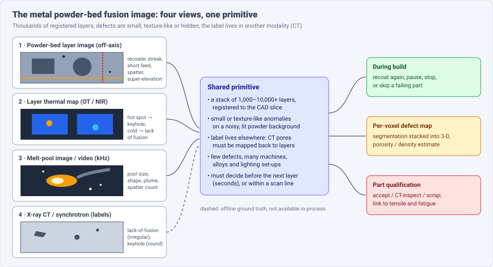
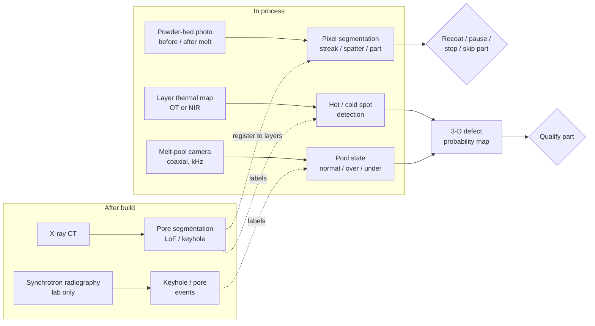

# Dense Object Detection & Classification — Recent Advances

*Compiled 2026-Oct-29 (America/Los_Angeles).*

Next installment in the running CV-updates log. Earlier entries:
[Apr-30](../2026-Apr-30/2026-Apr-30_CV_updates.md),
[May-01](../2026-May-01/2026-May-01_CV_updates.md),
[May-02](../2026-May-02/2026-May-02_CV_updates.md),
[May-04](../2026-May-04/2026-May-04_CV_updates.md),
[May-05](../2026-May-05/2026-May-05_CV_updates.md),
[May-07](../2026-May-07/2026-May-07_CV_updates.md),
[May-08](../2026-May-08/2026-May-08_CV_updates.md),
[May-15](../2026-May-15/2026-May-15_CV_updates.md),
[May-16](../2026-May-16/2026-May-16_CV_updates.md),
[May-17](../2026-May-17/2026-May-17_CV_updates.md),
[Jun-09](../2026-Jun-09/2026-Jun-09_CV_updates.md),
[Jun-10](../2026-Jun-10/2026-Jun-10_CV_updates.md),
[Jun-12](../2026-Jun-12/2026-Jun-12_CV_updates.md),
[Jun-15](../2026-Jun-15/2026-Jun-15_CV_updates.md),
[Jun-16](../2026-Jun-16/2026-Jun-16_CV_updates.md),
[Jun-17](../2026-Jun-17/2026-Jun-17_CV_updates.md),
[Jun-19](../2026-Jun-19/2026-Jun-19_CV_updates.md),
[Jun-21](../2026-Jun-21/2026-Jun-21_CV_updates.md),
[Jun-22](../2026-Jun-22/2026-Jun-22_CV_updates.md),
[Jun-23](../2026-Jun-23/2026-Jun-23_CV_updates.md),
[Jun-24](../2026-Jun-24/2026-Jun-24_CV_updates.md),
[Jun-25](../2026-Jun-25/2026-Jun-25_CV_updates.md),
[Jun-27](../2026-Jun-27/2026-Jun-27_CV_updates.md),
[Jun-29](../2026-Jun-29/2026-Jun-29_CV_updates.md),
[Jun-30](../2026-Jun-30/2026-Jun-30_CV_updates.md),
[Jul-04](../2026-Jul-04/2026-Jul-04_CV_updates.md),
[Jul-07](../2026-Jul-07/2026-Jul-07_CV_updates.md),
[Jul-08](../2026-Jul-08/2026-Jul-08_CV_updates.md),
[Jul-10](../2026-Jul-10/2026-Jul-10_CV_updates.md),
[Jul-15](../2026-Jul-15/2026-Jul-15_CV_updates.md),
[Jul-17](../2026-Jul-17/2026-Jul-17_CV_updates.md),
[Jul-18](../2026-Jul-18/2026-Jul-18_CV_updates.md),
[Jul-21](../2026-Jul-21/2026-Jul-21_CV_updates.md),
[Jul-22](../2026-Jul-22/2026-Jul-22_CV_updates.md),
[Jul-24](../2026-Jul-24/2026-Jul-24_CV_updates.md),
[Jul-26](../2026-Jul-26/2026-Jul-26_CV_updates.md),
[Jul-27](../2026-Jul-27/2026-Jul-27_CV_updates.md),
[Jul-30](../2026-Jul-30/2026-Jul-30_CV_updates.md),
[Aug-01](../2026-Aug-01/2026-Aug-01_CV_updates.md),
[Aug-02](../2026-Aug-02/2026-Aug-02_CV_updates.md),
[Aug-04](../2026-Aug-04/2026-Aug-04_CV_updates.md),
[Aug-07](../2026-Aug-07/2026-Aug-07_CV_updates.md),
[Aug-10](../2026-Aug-10/2026-Aug-10_CV_updates.md),
[Aug-11](../2026-Aug-11/2026-Aug-11_CV_updates.md),
[Aug-13](../2026-Aug-13/2026-Aug-13_CV_updates.md),
[Aug-15](../2026-Aug-15/2026-Aug-15_CV_updates.md),
[Aug-16](../2026-Aug-16/2026-Aug-16_CV_updates.md),
[Aug-18](../2026-Aug-18/2026-Aug-18_CV_updates.md),
[Aug-19](../2026-Aug-19/2026-Aug-19_CV_updates.md),
[Aug-21](../2026-Aug-21/2026-Aug-21_CV_updates.md),
[Aug-22](../2026-Aug-22/2026-Aug-22_CV_updates.md),
[Aug-24](../2026-Aug-24/2026-Aug-24_CV_updates.md),
[Aug-26](../2026-Aug-26/2026-Aug-26_CV_updates.md),
[Aug-29](../2026-Aug-29/2026-Aug-29_CV_updates.md),
[Sep-01](../2026-Sep-01/2026-Sep-01_CV_updates.md),
[Sep-20](../2026-Sep-20/2026-Sep-20_CV_updates.md),
[Sep-23](../2026-Sep-23/2026-Sep-23_CV_updates.md),
[Sep-24](../2026-Sep-24/2026-Sep-24_CV_updates.md),
[Sep-25](../2026-Sep-25/2026-Sep-25_CV_updates.md),
[Sep-26](../2026-Sep-26/2026-Sep-26_CV_updates.md),
[Sep-29](../2026-Sep-29/2026-Sep-29_CV_updates.md),
[Sep-30](../2026-Sep-30/2026-Sep-30_CV_updates.md),
[Oct-01](../2026-Oct-01/2026-Oct-01_CV_updates.md),
[Oct-02](../2026-Oct-02/2026-Oct-02_CV_updates.md),
[Oct-03](../2026-Oct-03/2026-Oct-03_CV_updates.md),
[Oct-04](../2026-Oct-04/2026-Oct-04_CV_updates.md),
[Oct-05](../2026-Oct-05/2026-Oct-05_CV_updates.md),
[Oct-06](../2026-Oct-06/2026-Oct-06_CV_updates.md),
[Oct-07](../2026-Oct-07/2026-Oct-07_CV_updates.md),
[Oct-08](../2026-Oct-08/2026-Oct-08_CV_updates.md),
[Oct-09](../2026-Oct-09/2026-Oct-09_CV_updates.md),
[Oct-10](../2026-Oct-10/2026-Oct-10_CV_updates.md),
[Oct-11](../2026-Oct-11/2026-Oct-11_CV_updates.md),
[Oct-12](../2026-Oct-12/2026-Oct-12_CV_updates.md),
[Oct-13](../2026-Oct-13/2026-Oct-13_CV_updates.md),
[Oct-14](../2026-Oct-14/2026-Oct-14_CV_updates.md),
[Oct-15](../2026-Oct-15/2026-Oct-15_CV_updates.md),
[Oct-16](../2026-Oct-16/2026-Oct-16_CV_updates.md),
[Oct-17](../2026-Oct-17/2026-Oct-17_CV_updates.md),
[Oct-18](../2026-Oct-18/2026-Oct-18_CV_updates.md),
[Oct-19](../2026-Oct-19/2026-Oct-19_CV_updates.md),
[Oct-20](../2026-Oct-20/2026-Oct-20_CV_updates.md),
[Oct-21](../2026-Oct-21/2026-Oct-21_CV_updates.md),
[Oct-22](../2026-Oct-22/2026-Oct-22_CV_updates.md),
[Oct-23](../2026-Oct-23/2026-Oct-23_CV_updates.md),
[Oct-24](../2026-Oct-24/2026-Oct-24_CV_updates.md),
[Oct-25](../2026-Oct-25/2026-Oct-25_CV_updates.md),
[Oct-26](../2026-Oct-26/2026-Oct-26_CV_updates.md),
[Oct-27](../2026-Oct-27/2026-Oct-27_CV_updates.md),
[Oct-28](../2026-Oct-28/2026-Oct-28_CV_updates.md).

The last four entries covered
[lithium-ion battery](../2026-Oct-25/2026-Oct-25_CV_updates.md),
[flat-panel display](../2026-Oct-26/2026-Oct-26_CV_updates.md),
[wood & timber](../2026-Oct-27/2026-Oct-27_CV_updates.md) and
[tire](../2026-Oct-28/2026-Oct-28_CV_updates.md) inspection.
This run stays in manufacturing and moves to the **metal powder-bed fusion
(PBF) monitoring image**: the layer photo of the powder bed, the
layer-integrated thermal map, the melt-pool image or video, and the X-ray
CT / synchrotron data used to label them.

---

## Table of contents

1. [Why this pass](#1--why-this-pass)
2. [The primitive: four views, one layer stack](#2--the-primitive-four-views-one-layer-stack)
3. [Powder-bed layer images: spreading anomalies and part outlines](#3--powder-bed-layer-images-spreading-anomalies-and-part-outlines)
4. [Layer thermal maps: optical tomography and NIR](#4--layer-thermal-maps-optical-tomography-and-nir)
5. [Melt-pool images and video](#5--melt-pool-images-and-video)
6. [Ground truth: X-ray CT and synchrotron imaging](#6--ground-truth-x-ray-ct-and-synchrotron-imaging)
7. [Open problems / what to watch](#7--open-problems--what-to-watch)
8. [Sources](#8--sources)

---

## 1 · Why this pass

Additive manufacturing has not had an entry of its own. Searching the
archive for *powder bed*, *L-PBF*, *recoater* and *melt pool* returns
nothing. The [X-ray transmission entry](../2026-Jul-15/2026-Jul-15_CV_updates.md)
and the [weld entry](../2026-Oct-24/2026-Oct-24_CV_updates.md) touched on
radiography and on pores, but not on in-process images of a build.

What makes it a distinct primitive:

- **The image is a stack, not a frame.** A build has thousands of layers,
  each registered to a CAD slice. One defect may span a few layers, and a
  part's quality depends on the whole stack (a Chalmers EB-PBF thesis
  notes builds of over 7,000 layer images,
  [Habibi 2026](https://odr.chalmers.se/bitstreams/be91708e-2df2-4a91-b735-129ebeae2ed5/download)).
- **The label lives in another modality.** Pores that matter are below
  the surface. Training labels usually come from post-build X-ray CT, so
  every supervised method in §3–§5 depends on CT-to-layer registration
  (§6).
- **Small, texture-like anomalies on a lit, granular background.**
  Recoater streaks, spatter and short feed are a few pixels wide on a
  powder texture that changes with illumination and layer height
  ([Li et al., IEEE Access 2025](https://doi.org/10.1109/access.2025.3620374);
  [Raimondo et al. 2026](https://www.alphaxiv.org/abs/2604.24234)).
- **Two clocks.** Layer images give a decision between layers (seconds);
  melt-pool cameras run at kHz to tens of kHz and resolve a single scan
  line ([RAISE-LPBF, 20,000 fps](https://arxiv.org/abs/2409.12475)).
- **Machine and alloy shift.** Every printer, camera mount and alloy
  looks different. ORNL's patent filing frames its segmenter explicitly as
  "machine and imaging system agnostic"
  ([Scime et al., patent](https://patents.justia.com/inventor/derek-c-rose)).

---

## 2 · The primitive: four views, one layer stack

**Public data, by what it keeps:**

| Dataset | View | What it is | Caveat |
|---|---|---|---|
| Peregrine 2025 ([ORNL, DOI 10.13139/ORNLNCCS/2588140](https://doi.ccs.ornl.gov/ui/doi/452)) | powder-bed layer images | released Sep 2025; four builds (Concept Laser M2 L-PBF and ExOne binder jet) as HDF5, anomalies annotated across 37 image stacks | binder jet included; check class list before mixing |
| Peregrine co-registered 316L L-PBF (v2023-10) ([ORNL](https://impact.ornl.gov/en/datasets/a-co-registered-in-situ-and-ex-situ-dataset-from-a-laser-powder-b/)) | layer images + scan paths + X-CT + tensile | in-situ and ex-situ co-registered; DSCNN detections included | 2023; the one public set pairing layers with CT |
| Peregrine EB-PBF IN738 (v2023-09) ([ORNL](https://doi.ccs.ornl.gov/dataset/c0247625-951c-5616-a2e3-03803e848896)) | NIR layer images + X-CT | single Arcam Q10 build, DSCNN detections | electron beam, one build |
| Aalto ADDLAB annotated set ([research.fi](https://research.fi/en/results/dataset/c8e93778-314b-42d7-9859-d1af724fa872)) | powder bed + optical tomography | 2,638 PB images (1280×1024) and 2,674 OT images (2000×2000), EOS M290, 316L; LabelImg XML boxes, Mar 2025 | crops are binary good/defect |
| RAISE-LPBF ([Blanc et al., arXiv 2409.12475](https://arxiv.org/abs/2409.12475); [PwC](https://astro.paperswithcode.com/dataset/raise-lpbf)) | on-axis melt-pool video | 316L bulk prints at 20,000 fps; laser power and speed randomised per scan line; public benchmark | predicts process parameters, not defects |
| NIST AMMT melt-pool images ([used in Emmanuel et al., arXiv 2606.23851](https://arxiv.org/abs/2606.23851)) | coaxial melt-pool | IN625 images from NIST's AM Metrology Testbed; the paper uses a balanced 1,200-image subset | labelling differs per paper |

Several industrial powder-bed sets in §3 (7,116 images / five anomaly
types; 12,385 augmented images / four types) are not listed as public.
NIST's [AM Bench 2025](https://www.nist.gov/ambench/am-bench-2025-measurements-and-challenge-problems)
challenges (19 problems, 86 submissions) are simulation tasks such as
melt-pool width and depth, not image-detection benchmarks; evaluation was
delayed by the 2025 shutdown
([results note](https://www.nist.gov/document/amb2025-06and-07challengeresults)).

---

## 3 · Powder-bed layer images: spreading anomalies and part outlines

An off-axis camera above the build plate photographs each layer after
recoating and again after melting. The "after recoat" image shows
spreading problems (streaks from a damaged blade, short feed, pits,
debris); the "after melt" image shows spatter, super-elevated edges and the
part outline, which can be compared with the CAD slice.

**Small-target detection is now the main focus.**

- **Mask-fusion YOLOv8** ([Li, Xing & Liu, IEEE Access 13:177405, 2025](https://doi.org/10.1109/access.2025.3620374)):
  7,116 industrial layer images, five anomaly types. A background-modelling
  module with hierarchical updates and noise-aware regularisation
  suppresses random powder texture while keeping temporal information
  across layers. Reported mAP50 0.88 on the spreading set, and gains of up
  to 60.7% and 34.5% on small targets over baselines (the abstract does not
  say which metrics those percentages refer to). Using the previous layer
  as a background model is the idea most worth copying.
- **16-detector benchmark** ([IEEE Access, doc. 10934994](https://ieeexplore.ieee.org/document/10934994/keywords)):
  ditch (420), insufficient spreading (800), crater (657) and stacking
  (600) images, augmented to 12,385. YOLOv9-e had the highest mAP@0.50
  (precision 0.965, recall 0.975); YOLOv8-n inferred in 12.4 ms. Layer
  times are seconds, so speed is not the constraint here; few defect
  examples are.
- **Transfer and few-shot.** TransMatch
  ([Asghari Ilani & Banad, arXiv 2509.01754](https://arxiv.org/abs/2509.01754))
  combines transfer learning with semi-supervised few-shot learning and
  reports 98.91% accuracy on an 8,284-image surface-defect set (cracks,
  pinholes, holes, spatter); no baseline table was retrievable. A 2024
  *Scientific Reports* paper reuses a porosity model to detect surface
  deformation, where examples are scarce
  ([DOAJ](https://doaj.org/article/67340a2354864cfe887c8d21fe6e7b4d)).
- **Height, not intensity.** One line of work uses 3-D point clouds of the
  bed ([Virtual and Physical Prototyping, 2025](https://www.tandfonline.com/doi/full/10.1080/17452759.2024.2449171)).
  Phase3D's fringe-projection system measures a height map of each layer
  before and after melting. Its large-format versions (Nov 2025) quote
  ±10 µm vertical accuracy and 60 µm lateral resolution
  ([Metal AM](https://www.metal-am.com/phase3d-launches-two-large-format-in-situ-inspection-systems-for-metal-am/)).
  The company positions this as measurement, not ML. For detection, a
  height map removes the illumination problem that RGB methods spend most
  of their effort on.

**Pixel-wise segmentation and the reference system.** ORNL's Peregrine
software uses a multi-scale Dynamic Segmentation CNN (DSCNN; recent ORNL
releases call it DMSCNN, "multilabel") for pixel-wise semantic
segmentation of layer images and other sensor channels. It flags edge
discontinuities, recoater interactions, spatter and texture shifts in near
real time, and it has been run on laser PBF, binder jet and electron-beam
machines ([ORNL news](https://www.ornl.gov/news/peregrine-releases-new-dataset-smarter-3d-printing/);
[ORNL publication](https://www.ornl.gov/publication/layer-wise-anomaly-detection-and-classification-powder-bed-additive-manufacturing)).
It is still the main public reference: the datasets in §2 ship its
detections as a baseline.

**Part segmentation for geometry reconstruction.** If the solidified
region of each layer can be segmented, stacking the masks gives an in-situ
3-D reconstruction to compare with CAD.

- **Graph-augmented U-Net** ([Raimondo, Bugatti & Grasso, arXiv 2604.24234, Apr 2026](https://www.alphaxiv.org/abs/2604.24234)):
  a GNN bottleneck inside a U-Net models relations between regions, aimed
  at lattice structures under industrial lighting and layer-to-layer
  intensity changes. It is benchmarked against existing in-situ lattice
  reconstruction methods; the numbers were not retrievable in this pass.
  A companion Politecnico di Milano paper argues that calibrating classical
  active-contour segmentation is enough to make it robust
  ([Additive Manufacturing 2026, PDF](https://re.public.polimi.it/retrieve/c4afccd0-f8c7-455e-97c3-10935ffb217f/1-s2.0-S2214860426001545-main.pdf)).
  Together they mark this as an open question, not a solved one.
- **Foundation segmenter plus generative super-resolution.** CMU and Sandia
  map low-resolution webcam images of the plate to high-resolution
  optical images with a conditional latent diffusion model. They then
  prompt Segment Anything with foreground points to split part from
  powder and stack the masks into 3-D
  ([arXiv 2409.13171](https://arxiv.org/abs/2409.13171)).

---

## 4 · Layer thermal maps: optical tomography and NIR

A long-exposure camera (sCMOS or NIR) integrates the light emitted while
a whole layer is melted. EOS calls this optical tomography (OT). The
result is one thermal-intensity image per layer. Persistent hot spots
point to overheating and keyhole pores; cold spots point to lack of
fusion. Unlike the powder-bed photo, this view sees the melt, but it
averages over a whole layer.

- **Supervised against CT.** On Aalto data (EOS M 290, custom specimens),
  OT layers are labelled in five classes: standard, two lack-of-fusion
  severities and two keyhole severities; four CNNs were compared
  ([Aalto](https://research.aalto.fi/fi/publications/artificial-intelligence-driven-defect-detection-and-localization-/);
  [thesis](https://aaltodoc.aalto.fi/items/51ceec4f-b9d4-45f9-807f-d632fad11c89)).
  YOLOv5 beat Faster R-CNN on the boxed version of the task.
- **Generalising across builds is the real test.** The Penn State result
  is still the reference: CNNs on layer images with CT labels reached
  93.5% accuracy on large flaws within one build and 87.3% on an unseen
  build ([J. Manuf. Systems 2021](https://pure.psu.edu/en/publications/toward-in-situ-flaw-detection-in-laser-powder-bed-fusion-additive/)).
  A Dec 2025 UTK thesis proposes a geometry-agnostic porosity CNN on NIR
  and optical images of 316L, aligned to post-build CT
  ([UTK](https://trace.tennessee.edu/utk_gradthes/15470)).
- **Unsupervised for electron beam.** EB-PBF layers are imaged in NIR or
  with backscattered electrons. A 2026 Chalmers thesis trains anomaly
  detection on nominal layers only, to avoid labelling builds with more
  than 7,000 images
  ([Habibi](https://odr.chalmers.se/bitstreams/be91708e-2df2-4a91-b735-129ebeae2ed5/download)).
  Simpler gradient segmentation also works, because pores emit more and
  look brighter in IR
  ([SFF 2024 abstract](https://programmaster.org/PM/PM.nsf/ApprovedAbstracts/8F755D6D2E578B6585258B0700472FAF)).
- **Two-wavelength pyrometry** turns intensity into temperature. A July
  2026 *Additive Manufacturing* article (vol. 127, 105282) uses a
  single-camera two-wavelength set-up with ML for porosity; earlier work
  showed that ratiometric temperature beats monochrome intensity for
  predicting melt-pool depth with a CNN-Transformer
  ([arXiv 2404.17699](https://arxiv.org/abs/2404.17699)).

---

## 5 · Melt-pool images and video

A coaxial camera looks down the laser path, or an off-axis high-speed
camera watches the pool, plume and spatter. Frames are small (the pool
fills a few hundred pixels), rates are kHz, and the task is usually
classification: normal, overheated (keyholing risk) or underheated
(lack-of-fusion risk), sometimes with multiple labels.

- **Plain CNNs still score high on small, single-machine sets.**
  [Özel, *Advances in Manufacturing* 2026](https://link.springer.com/article/10.1007/s40436-026-00620-0):
  high-speed IR and off-axis images of IN625 are turned into contour maps
  (pool, plume, spatter). An ImageNet-pretrained ResNet-18 with an SVM
  head reaches 97.87% over normal / overheated / underheated
  ([press summary](https://www.fabbaloo.com/?p=239331)).
- **Pretrained features + a classical head, for speed.**
  [Emmanuel, Yang, Yeung & Zhang, arXiv 2606.23851 (Jun 2026)](https://arxiv.org/abs/2606.23851),
  Florida State and NIST: 1,200 balanced AMMT IN625 images. ResNet50,
  EfficientNetB0 and MobileNetV2 fine-tuning is compared with a random
  forest on EfficientNetB0 embeddings and one on raw pixels. The authors
  conclude that the embedding + forest hybrid is the efficient route for
  real-time, low-data monitoring (numbers not retrievable here).
- **Self-supervised beats supervised on imbalanced labels.** NIST's SiT
  (self-supervised ViT) multi-label classifier (abnormal size, irregular
  shape, spatter, plume) reports mean F1 0.979 against 0.836 for a
  supervised model, with the gap largest on imbalanced data
  ([Yang, Lu, Hong & Kim, IDETC 2024](https://www.nist.gov/node/1852931)).
  For directed-energy deposition (DED), a ViT masked autoencoder
  pretrained on unlabelled melt-pool thermal images and then fine-tuned
  does the same job for porosity
  ([Era et al., arXiv 2411.12028](https://arxiv.org/abs/2411.12028)).
- **Foundation models vs task-specific models** is the open comparison.
  A listing for an Oct 2026 article, "Comparative Evaluation of
  Task-specific Machine Learning and Foundation Models for Melt Pool
  Anomaly Detection in Laser Powder Bed Fusion" (Hong et al.), appears on
  [ResearchGate](https://www.researchgate.net/publication/327469644_Machine-Learning-Based_Monitoring_of_Laser_Powder_Bed_Fusion).
  Its contents could not be confirmed in this pass.
- **Video, not frames.** Spatio-temporal deep learning on melt-pool video
  ([Williams & Sing, J. Intell. Manuf. 2025](https://ideas.repec.org/a/spr/joinma/v36y2025i4d10.1007_s10845-024-02355-w.html))
  and RAISE-LPBF's per-scan-line parameter reconstruction (§2) treat the
  sequence as the unit. That matches the physics better: a keyhole
  instability is an event in time, not a shape in one frame.
- **Cheaper sensors as proxies for images.** Acoustic and photodiode
  signals turned into wavelet scalograms can predict melt-pool visual
  features within 1 ms (R² ≥ 0.8) and flag lack of fusion between scan
  lines ([Liu et al., arXiv 2310.05289](https://arxiv.org/abs/2310.05289)).

---

## 6 · Ground truth: X-ray CT and synchrotron imaging

Every supervised result above depends on how the labels were made.

- **CT pore segmentation** compares deep 3-D nets (UNet++, UNet 3+,
  UNet-MSS) with thresholding
  ([SPIE 2022](https://proceedings.spiedigitallibrary.org/conference-proceedings-of-spie/12242/122421K/Evaluation-of-deeply-supervised-neural-networks-for-3D-pore-segmentation/10.1117/12.2633318.full);
  [ASU / ASME 2023](https://asu.elsevierpure.com/en/publications/defect-segmentation-from-x-ray-computed-tomography-of-laser-powde)).
  YOLO detection of multi-layer keyhole pores in XCT slices reports mAP
  92.6% ([Huddersfield, IEEE Access 2024](https://pure.hud.ac.uk/en/publications/keyhole-porosity-identification-and-localization-via-x-ray-imagin/)).
- **Calibrating the labels.** Padova built a reference object with
  deliberate lack-of-fusion, keyhole and spatter pores to calibrate CT
  porosity measurement. The stated aim is reliable labels for models that
  predict defects from in-process data
  ([Bonato, Zanini & Carmignato, euspen/ASPE Oct 2025](https://www.euspen.eu/knowledge-base/AM2525104.pdf)).
  Without this, a detector's "miss" may be a CT segmentation error.
- **Registration.** Mapping CT voxels back to layer pixels has to
  correct for shrinkage and distortion
  ([BAM, Metals 12:947](https://opus4.kobv.de/opus4-bam/files/54941/metals-12-00947.pdf)).
- **Synchrotron as the teacher.** Operando X-ray imaging at the Advanced
  Photon Source shows keyholes and pores directly. Ren et al. trained a
  model on synchrotron-labelled events to detect keyhole pore formation
  from thermal (NIR) signals with sub-millisecond resolution and a
  reported 100% prediction rate on their test set
  ([Science 2023, 10.1126/science.add4667](https://aps.anl.gov/APS-Science-Highlight/2023-01-09/detecting-3-d-printing-defects-in-real-time)).
  AM-SegNet segments synchrotron frames (keyhole, pores, melt pool) at
  about 96% accuracy and under 4 ms per frame
  ([UCL](https://discovery.ucl.ac.uk/id/eprint/10189088/1/AM-SegNet%20for%20additive%20manufacturing%20in%20situ%20X-ray%20image%20segmentation%20and%20feature%20quantification.pdf)).
  A BASNet pipeline segments keyhole area at about 91%
  ([Materials 2024](https://www.ncbi.nlm.nih.gov/pmc/articles/PMC10817330/)).
  Washington State fuses synchrotron X-ray with cheap photodiode
  absorptivity in a CNN+RNN and finds both modalities together beat
  either alone ([arXiv 2509.03029](https://arxiv.org/abs/2509.03029)).

The pattern is **cross-modal distillation**: an expensive, lab-only view
(synchrotron, CT) labels a cheap production view (photodiode, NIR, layer
photo). That is the same structure as the CT-teacher pattern in the
[battery entry](../2026-Oct-25/2026-Oct-25_CV_updates.md).

---

## 7 · Open problems / what to watch

1. **A public, CT-labelled, multi-machine layer benchmark.** Peregrine
   v2023-10 is the only public set pairing layers with CT, and it covers one
   machine. The large industrial sets (7,116 and 12,385 images) are not
   public (§2, §3).
2. **Cross-build and cross-machine scores as the headline.** Penn State's
   drop from 93.5% to 87.3% on an unseen build is the kind of number every
   paper should report; most still report a single-build split (§4).
3. **Temporal background modelling.** Using the previous layer as
   background (mask-fusion YOLOv8) and video-level melt-pool models both
   beat single-frame methods; a model combining layer-to-layer and
   within-layer time is missing (§3, §5).
4. **Label quality.** Calibrated CT references (Padova) and synchrotron
   teachers (APS) should become standard for supervised training (§6).
5. **Foundation vs task-specific.** Watch for the Hong et al. comparison
   and for self-supervised pretraining across alloys and machines (§5).
6. **Height maps vs photos.** Fringe-projection height data may make
   much of the illumination-robustness work in RGB segmentation
   unnecessary; a head-to-head comparison is needed (§3).
7. **Watch:** the next Peregrine release; whether the Li et al. and
   16-detector datasets are released; the full results of arXiv
   2604.24234 and 2606.23851; AM Bench 2025 data publications.

---

## 8 · Sources

### Datasets and benchmarks
- ORNL Peregrine 2025 dataset (DOI 10.13139/ORNLNCCS/2588140) — https://doi.ccs.ornl.gov/ui/doi/452
- ORNL co-registered in-situ / ex-situ 316L L-PBF dataset — https://impact.ornl.gov/en/datasets/a-co-registered-in-situ-and-ex-situ-dataset-from-a-laser-powder-b/
- ORNL EB-PBF IN738 dataset — https://doi.ccs.ornl.gov/dataset/c0247625-951c-5616-a2e3-03803e848896
- Peregrine releases new dataset (ORNL news) — https://www.ornl.gov/news/peregrine-releases-new-dataset-smarter-3d-printing/
- Aalto annotated L-PBF image dataset — https://research.fi/en/results/dataset/c8e93778-314b-42d7-9859-d1af724fa872 — https://research.aalto.fi/fi/datasets/annotated-image-dataset-for-defects-detection-in-laser-powder-bed/
- RAISE-LPBF, arXiv 2409.12475 — https://arxiv.org/abs/2409.12475 — https://astro.paperswithcode.com/dataset/raise-lpbf
- NIST AM Bench 2025 challenges — https://www.nist.gov/ambench/am-bench-2025-measurements-and-challenge-problems — https://www.nist.gov/document/amb2025-06and-07challengeresults

### Powder-bed layer images (§3)
- Li, Xing & Liu, Anomaly Detection of Small Targets in PBF Powder Spreading Process Based on Mask Fusion, IEEE Access 13 (2025) — https://doi.org/10.1109/access.2025.3620374 — https://doaj.org/article/f5a5132d2c3445ae99da678301422bcd
- Industrial Camera-Based Powder Bed Defect Detection in L-PBF (IEEE Access) — https://ieeexplore.ieee.org/document/10934994/keywords
- TransMatch, arXiv 2509.01754 — https://arxiv.org/abs/2509.01754
- Transfer learning for surface deformation (Scientific Reports 2024) — https://doaj.org/article/67340a2354864cfe887c8d21fe6e7b4d
- Real-time powder bed defect detection on 3-D point clouds (Virtual and Physical Prototyping) — https://www.tandfonline.com/doi/full/10.1080/17452759.2024.2449171
- Phase3D large-format in-situ inspection (Metal AM, Nov 2025) — https://www.metal-am.com/phase3d-launches-two-large-format-in-situ-inspection-systems-for-metal-am/
- ORNL layer-wise anomaly detection and classification — https://www.ornl.gov/publication/layer-wise-anomaly-detection-and-classification-powder-bed-additive-manufacturing
- DSCNN patent filings (Scime, Rose et al.) — https://patents.justia.com/inventor/derek-c-rose
- Raimondo, Bugatti & Grasso, Graph-augmented Segmentation of Complex Shapes in L-PBF, arXiv 2604.24234 — https://www.alphaxiv.org/abs/2604.24234
- Politecnico di Milano calibrated segmentation (Additive Manufacturing 2026) — https://re.public.polimi.it/retrieve/c4afccd0-f8c7-455e-97c3-10935ffb217f/1-s2.0-S2214860426001545-main.pdf
- Diffusion super-resolution + SAM for layerwise monitoring, arXiv 2409.13171 — https://arxiv.org/abs/2409.13171

### Layer thermal maps (§4)
- Aalto, AI-driven defect detection and localization — https://research.aalto.fi/fi/publications/artificial-intelligence-driven-defect-detection-and-localization-/
- Aalto thesis, ML classification for L-PBF defects — https://aaltodoc.aalto.fi/items/51ceec4f-b9d4-45f9-807f-d632fad11c89
- Penn State, Toward in situ flaw detection in L-PBF (J. Manuf. Systems 2021) — https://pure.psu.edu/en/publications/toward-in-situ-flaw-detection-in-laser-powder-bed-fusion-additive/
- UTK thesis, NIR/optical porosity detection with XCT labels (Dec 2025) — https://trace.tennessee.edu/utk_gradthes/15470
- Habibi, unsupervised EB-PBF anomaly detection (Chalmers 2026) — https://odr.chalmers.se/bitstreams/be91708e-2df2-4a91-b735-129ebeae2ed5/download
- Johnstone & Saldana, IR gradient segmentation for EB-PBF porosity (SFF 2024) — https://programmaster.org/PM/PM.nsf/ApprovedAbstracts/8F755D6D2E578B6585258B0700472FAF
- Melt pool depth from thermal images via ViT, arXiv 2404.17699 — https://arxiv.org/abs/2404.17699

### Melt-pool images and video (§5)
- Özel, Detection of anomalous meltpool conditions using deep learning in L-PBF (Adv. Manuf. 2026) — https://link.springer.com/article/10.1007/s40436-026-00620-0 — https://journal.hep.com.cn/aim/EN/10.1007/s40436-026-00620-0
- Fabbaloo coverage — https://www.fabbaloo.com/?p=239331
- Emmanuel et al., hybrid real-time melt pool monitoring, arXiv 2606.23851 — https://arxiv.org/abs/2606.23851
- Yang, Lu, Hong & Kim, self-supervised multi-label melt pool classification (NIST / IDETC 2024) — https://www.nist.gov/node/1852931
- Era et al., ViT masked autoencoder for DED porosity, arXiv 2411.12028 — https://arxiv.org/abs/2411.12028
- ML-based monitoring of L-PBF (ResearchGate, related-item listing) — https://www.researchgate.net/publication/327469644_Machine-Learning-Based_Monitoring_of_Laser_Powder_Bed_Fusion
- Williams & Sing, spatiotemporal melt pool video analysis (J. Intell. Manuf. 2025) — https://ideas.repec.org/a/spr/joinma/v36y2025i4d10.1007_s10845-024-02355-w.html
- Liu et al., acoustic + thermal emission to melt pool features, arXiv 2310.05289 — https://arxiv.org/abs/2310.05289
- Review: intelligent defect detection in metal PBF (Mater. Sci. Eng. R, 2025) — https://www.sciencedirect.com/science/article/pii/S0927796X25001901

### Ground truth: CT and synchrotron (§6)
- Deeply supervised 3-D pore segmentation (SPIE 2022) — https://proceedings.spiedigitallibrary.org/conference-proceedings-of-spie/12242/122421K/Evaluation-of-deeply-supervised-neural-networks-for-3D-pore-segmentation/10.1117/12.2633318.full
- Defect segmentation from XCT of L-PBF (ASU) — https://asu.elsevierpure.com/en/publications/defect-segmentation-from-x-ray-computed-tomography-of-laser-powde
- Keyhole porosity identification via X-ray imaging + YOLO (Huddersfield) — https://pure.hud.ac.uk/en/publications/keyhole-porosity-identification-and-localization-via-x-ray-imagin/
- Bonato, Zanini & Carmignato, CT porosity reference object (euspen 2025) — https://www.euspen.eu/knowledge-base/AM2525104.pdf
- Registration of thermographic in-situ data and CT (BAM, Metals 12:947) — https://opus4.kobv.de/opus4-bam/files/54941/metals-12-00947.pdf
- Ren et al., real-time keyhole pore detection (Science 2023; APS highlight) — https://aps.anl.gov/APS-Science-Highlight/2023-01-09/detecting-3-d-printing-defects-in-real-time
- AM-SegNet (UCL) — https://discovery.ucl.ac.uk/id/eprint/10189088/1/AM-SegNet%20for%20additive%20manufacturing%20in%20situ%20X-ray%20image%20segmentation%20and%20feature%20quantification.pdf
- Keyhole segmentation in in-situ X-ray imaging (Materials 2024) — https://www.ncbi.nlm.nih.gov/pmc/articles/PMC10817330/
- X-ray + photodiode multimodal fusion, arXiv 2509.03029 — https://arxiv.org/abs/2509.03029

*Research note: direct page fetches (arxiv.org, alphaxiv.org, doaj.org)
were blocked by the network policy in this run, so figures come from
search-indexed abstracts and snippets. Numbers marked as not retrievable,
and the Hong et al. listing, should be checked against the papers.*
