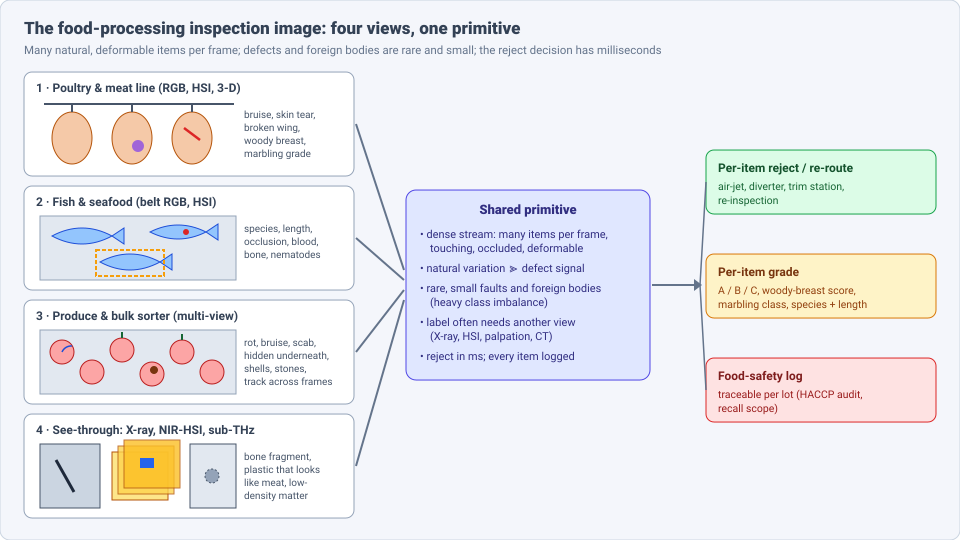
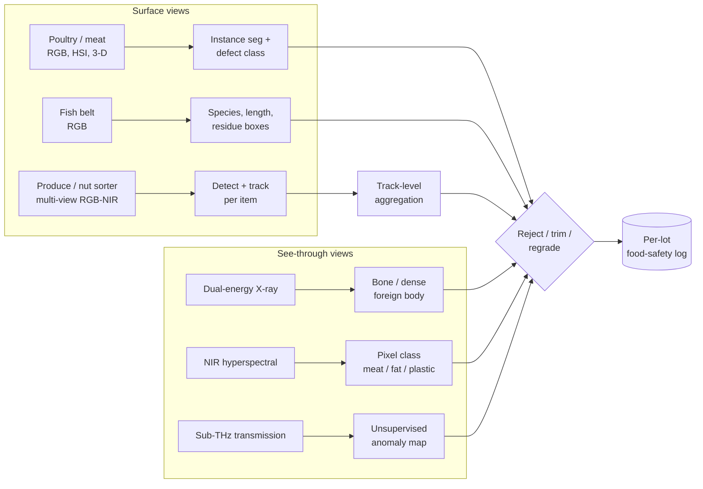
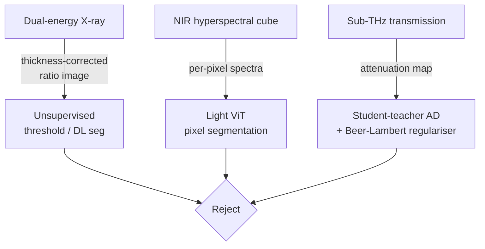

# Dense Object Detection & Classification — Recent Advances

*Compiled 2026-Oct-30 (America/Los_Angeles).*

Next installment in the running CV-updates log. Earlier entries:
[Apr-30](../2026-Apr-30/2026-Apr-30_CV_updates.md),
[May-01](../2026-May-01/2026-May-01_CV_updates.md),
[May-02](../2026-May-02/2026-May-02_CV_updates.md),
[May-04](../2026-May-04/2026-May-04_CV_updates.md),
[May-05](../2026-May-05/2026-May-05_CV_updates.md),
[May-07](../2026-May-07/2026-May-07_CV_updates.md),
[May-08](../2026-May-08/2026-May-08_CV_updates.md),
[May-15](../2026-May-15/2026-May-15_CV_updates.md),
[May-16](../2026-May-16/2026-May-16_CV_updates.md),
[May-17](../2026-May-17/2026-May-17_CV_updates.md),
[Jun-09](../2026-Jun-09/2026-Jun-09_CV_updates.md),
[Jun-10](../2026-Jun-10/2026-Jun-10_CV_updates.md),
[Jun-12](../2026-Jun-12/2026-Jun-12_CV_updates.md),
[Jun-15](../2026-Jun-15/2026-Jun-15_CV_updates.md),
[Jun-16](../2026-Jun-16/2026-Jun-16_CV_updates.md),
[Jun-17](../2026-Jun-17/2026-Jun-17_CV_updates.md),
[Jun-19](../2026-Jun-19/2026-Jun-19_CV_updates.md),
[Jun-21](../2026-Jun-21/2026-Jun-21_CV_updates.md),
[Jun-22](../2026-Jun-22/2026-Jun-22_CV_updates.md),
[Jun-23](../2026-Jun-23/2026-Jun-23_CV_updates.md),
[Jun-24](../2026-Jun-24/2026-Jun-24_CV_updates.md),
[Jun-25](../2026-Jun-25/2026-Jun-25_CV_updates.md),
[Jun-27](../2026-Jun-27/2026-Jun-27_CV_updates.md),
[Jun-29](../2026-Jun-29/2026-Jun-29_CV_updates.md),
[Jun-30](../2026-Jun-30/2026-Jun-30_CV_updates.md),
[Jul-04](../2026-Jul-04/2026-Jul-04_CV_updates.md),
[Jul-07](../2026-Jul-07/2026-Jul-07_CV_updates.md),
[Jul-08](../2026-Jul-08/2026-Jul-08_CV_updates.md),
[Jul-10](../2026-Jul-10/2026-Jul-10_CV_updates.md),
[Jul-15](../2026-Jul-15/2026-Jul-15_CV_updates.md),
[Jul-17](../2026-Jul-17/2026-Jul-17_CV_updates.md),
[Jul-18](../2026-Jul-18/2026-Jul-18_CV_updates.md),
[Jul-21](../2026-Jul-21/2026-Jul-21_CV_updates.md),
[Jul-22](../2026-Jul-22/2026-Jul-22_CV_updates.md),
[Jul-24](../2026-Jul-24/2026-Jul-24_CV_updates.md),
[Jul-26](../2026-Jul-26/2026-Jul-26_CV_updates.md),
[Jul-27](../2026-Jul-27/2026-Jul-27_CV_updates.md),
[Jul-30](../2026-Jul-30/2026-Jul-30_CV_updates.md),
[Aug-01](../2026-Aug-01/2026-Aug-01_CV_updates.md),
[Aug-02](../2026-Aug-02/2026-Aug-02_CV_updates.md),
[Aug-04](../2026-Aug-04/2026-Aug-04_CV_updates.md),
[Aug-07](../2026-Aug-07/2026-Aug-07_CV_updates.md),
[Aug-10](../2026-Aug-10/2026-Aug-10_CV_updates.md),
[Aug-11](../2026-Aug-11/2026-Aug-11_CV_updates.md),
[Aug-13](../2026-Aug-13/2026-Aug-13_CV_updates.md),
[Aug-15](../2026-Aug-15/2026-Aug-15_CV_updates.md),
[Aug-16](../2026-Aug-16/2026-Aug-16_CV_updates.md),
[Aug-18](../2026-Aug-18/2026-Aug-18_CV_updates.md),
[Aug-19](../2026-Aug-19/2026-Aug-19_CV_updates.md),
[Aug-21](../2026-Aug-21/2026-Aug-21_CV_updates.md),
[Aug-22](../2026-Aug-22/2026-Aug-22_CV_updates.md),
[Aug-24](../2026-Aug-24/2026-Aug-24_CV_updates.md),
[Aug-26](../2026-Aug-26/2026-Aug-26_CV_updates.md),
[Aug-29](../2026-Aug-29/2026-Aug-29_CV_updates.md),
[Sep-01](../2026-Sep-01/2026-Sep-01_CV_updates.md),
[Sep-20](../2026-Sep-20/2026-Sep-20_CV_updates.md),
[Sep-23](../2026-Sep-23/2026-Sep-23_CV_updates.md),
[Sep-24](../2026-Sep-24/2026-Sep-24_CV_updates.md),
[Sep-25](../2026-Sep-25/2026-Sep-25_CV_updates.md),
[Sep-26](../2026-Sep-26/2026-Sep-26_CV_updates.md),
[Sep-29](../2026-Sep-29/2026-Sep-29_CV_updates.md),
[Sep-30](../2026-Sep-30/2026-Sep-30_CV_updates.md),
[Oct-01](../2026-Oct-01/2026-Oct-01_CV_updates.md),
[Oct-02](../2026-Oct-02/2026-Oct-02_CV_updates.md),
[Oct-03](../2026-Oct-03/2026-Oct-03_CV_updates.md),
[Oct-04](../2026-Oct-04/2026-Oct-04_CV_updates.md),
[Oct-05](../2026-Oct-05/2026-Oct-05_CV_updates.md),
[Oct-06](../2026-Oct-06/2026-Oct-06_CV_updates.md),
[Oct-07](../2026-Oct-07/2026-Oct-07_CV_updates.md),
[Oct-08](../2026-Oct-08/2026-Oct-08_CV_updates.md),
[Oct-09](../2026-Oct-09/2026-Oct-09_CV_updates.md),
[Oct-10](../2026-Oct-10/2026-Oct-10_CV_updates.md),
[Oct-11](../2026-Oct-11/2026-Oct-11_CV_updates.md),
[Oct-12](../2026-Oct-12/2026-Oct-12_CV_updates.md),
[Oct-13](../2026-Oct-13/2026-Oct-13_CV_updates.md),
[Oct-14](../2026-Oct-14/2026-Oct-14_CV_updates.md),
[Oct-15](../2026-Oct-15/2026-Oct-15_CV_updates.md),
[Oct-16](../2026-Oct-16/2026-Oct-16_CV_updates.md),
[Oct-17](../2026-Oct-17/2026-Oct-17_CV_updates.md),
[Oct-18](../2026-Oct-18/2026-Oct-18_CV_updates.md),
[Oct-19](../2026-Oct-19/2026-Oct-19_CV_updates.md),
[Oct-20](../2026-Oct-20/2026-Oct-20_CV_updates.md),
[Oct-21](../2026-Oct-21/2026-Oct-21_CV_updates.md),
[Oct-22](../2026-Oct-22/2026-Oct-22_CV_updates.md),
[Oct-23](../2026-Oct-23/2026-Oct-23_CV_updates.md),
[Oct-24](../2026-Oct-24/2026-Oct-24_CV_updates.md),
[Oct-25](../2026-Oct-25/2026-Oct-25_CV_updates.md),
[Oct-26](../2026-Oct-26/2026-Oct-26_CV_updates.md),
[Oct-27](../2026-Oct-27/2026-Oct-27_CV_updates.md),
[Oct-28](../2026-Oct-28/2026-Oct-28_CV_updates.md),
[Oct-29](../2026-Oct-29/2026-Oct-29_CV_updates.md).

The last four entries covered
[flat-panel display](../2026-Oct-26/2026-Oct-26_CV_updates.md),
[wood & timber](../2026-Oct-27/2026-Oct-27_CV_updates.md),
[tire](../2026-Oct-28/2026-Oct-28_CV_updates.md) and
[metal powder-bed fusion](../2026-Oct-29/2026-Oct-29_CV_updates.md)
inspection. This run stays on the factory floor but moves from metal and
rubber to biology: the **food-processing inspection image**, meaning the
poultry or meat line camera, the fish belt, the fruit and nut sorter, and
the X-ray, hyperspectral and sub-THz views used to find what an RGB camera
cannot see.

---

## Table of contents

1. [Why this pass](#1--why-this-pass)
2. [The primitive: four views, one conveyor](#2--the-primitive-four-views-one-conveyor)
3. [Poultry and meat lines](#3--poultry-and-meat-lines)
4. [Fish and seafood](#4--fish-and-seafood)
5. [Produce and bulk sorters](#5--produce-and-bulk-sorters)
6. [Seeing inside: X-ray, hyperspectral and sub-THz](#6--seeing-inside-x-ray-hyperspectral-and-sub-thz)
7. [Open-vocabulary and VLM inspection](#7--open-vocabulary-and-vlm-inspection)
8. [Open problems / what to watch](#8--open-problems--what-to-watch)
9. [Sources](#9--sources)

---

## 1 · Why this pass

Food processing has not had an entry of its own. Searching the archive for
*carcass*, *fillet*, *woody breast*, *marbling* and *poultry* returns
nothing. The [in-field crop entry](../2026-Oct-09/2026-Oct-09_CV_updates.md)
stops at harvest, the [retail-shelf entry](../2026-Oct-07/2026-Oct-07_CV_updates.md)
starts at the store, and the
[terahertz entry](../2026-Aug-11/2026-Aug-11_CV_updates.md) and the
[X-ray transmission entry](../2026-Jul-15/2026-Jul-15_CV_updates.md) cover
the sensors but not the processing line between them.

What makes it a distinct primitive:

- **The objects are alive (or were).** Unlike a steel strip or a PCB,
  there is no CAD reference. Every carcass, fillet and apple differs in
  size, shape and colour, so natural variation is larger than most defect
  signals.
- **Dense and touching.** Fish on a discard belt overlap; carcasses swing
  on shackles; nuts and apples tumble. Occlusion is a first-class problem
  ([AutoFish](https://openaccess.thecvf.com/content/WACV2025W/MaCVi/html/Bengtson_AutoFish_Dataset_and_Benchmark_for_Fine-grained_Analysis_of_Fish_WACVW_2025_paper.html);
  [4TU discard set](https://data.4tu.nl/datasets/a6d5a40e-0358-47cf-9ec1-335df0e4a3c3)).
- **The worst defects are invisible in RGB.** Bone fragments, plastics
  that look like blood stains, nematodes inside a cod fillet and woody
  breast are found by X-ray, NIR hyperspectral imaging (HSI) or
  mechanical behaviour, not by colour
  ([Ghimpeteanu et al., Sensors 2025](https://www.mdpi.com/1424-8220/25/22/7015);
  [Syed et al., Sci. Rep. 2024](https://pmc.ncbi.nlm.nih.gov/articles/PMC11550473)).
- **Safety asymmetry.** A missed bone fragment is a recall; a false
  reject is lost yield. Vendors now quote false-reject rates as the
  headline, not accuracy
  ([Tomra 4C, FreshPlaza](https://www.freshplaza.com/north-america/article/9829063/ai-powered-4c-optical-sorter-introduced-for-nuts-and-iqf-processing/)).
- **Public data is thin.** Most plant data stays private; AutoFish's
  authors list this as the main constraint on the field.

---

## 2 · The primitive: four views, one conveyor

**Public data, by what it keeps:**

| Dataset | View | What it is | Caveat |
|---|---|---|---|
| AutoFish ([Bengtson et al., WACV-W 2025](https://openaccess.thecvf.com/content/WACV2025W/MaCVi/html/Bengtson_AutoFish_Dataset_and_Benchmark_for_Fine-grained_Analysis_of_Fish_WACVW_2025_paper.html); [project](https://vap.aau.dk/autofish/)) | RGB, white conveyor | 1,500 images, 454 specimens of similar-looking species, 18,160 instance masks, per-fish ID and length; 25 disjoint groups | controlled lab belt, not a vessel |
| Discarded fish with weight ([4TU, v2 2024](https://data.4tu.nl/datasets/a6d5a40e-0358-47cf-9ec1-335df0e4a3c3)) | RGB, vessel belt | species, box, weight and occlusion level; CC BY 4.0 | demersal North Sea species only |
| Chicken fillet bone fragments ([CWI, Zenodo 10579608](https://zenodo.org/records/10579608)) | dual-energy X-ray | fillet masks (auto) and bone-fragment masks (manual), bone size in mm, DE contrast | Jan 2024; one product |
| Pork belly HSI foreign objects ([Zenodo 17242553](https://zenodo.org/records/17242553)) | NIR hyperspectral | 78 contaminated and 183 clean cubes, with code | small; one plant |
| CarcassFormer ([Poultry Sci. 103:103765](https://pmc.ncbi.nlm.nih.gov/articles/PMC11255899); [code](https://github.com/UARK-AICV/CarcassFormer)) | RGB, shackle line | 7,321 images from a pilot plant, three expert annotators; code and weights released | check data licence before use |
| Pigs RGB-D cutting ([NMBU, PMC8866887](https://www.ncbi.nlm.nih.gov/pmc/articles/PMC8866887/)) | RGB-D | six D415 cameras plus arm-mounted view, stepwise cutting; skin / muscle / fat | 2022; segmentation masks limited |

---

## 3 · Poultry and meat lines

**Carcass defects: one model for localise, segment and classify.**
CarcassFormer (University of Arkansas, 2024) is still the reference: a
Transformer U-Net that finds each carcass on the shackle line, segments it
and flags defects in one pass, compared against SOTA baselines on
classification, detection and segmentation
([PMC11255899](https://pmc.ncbi.nlm.nih.gov/articles/PMC11255899);
[arXiv 2404.11429](https://arxiv.org/abs/2404.11429v1)).
What changed in 2025–26:

- **Synthetic data is the main lever.** Feng et al. trained YOLOv11-seg,
  Mask R-CNN (R50/R101) and Mask2Former on 60 real carcass images plus
  varying amounts of rendered ones. Synthetic data helped every model;
  YOLOv11-seg was most accurate, while R101 and Mask2Former gained most
  from large synthetic volumes, and each model had its own best
  synthetic-to-real ratio. The paper also introduces a 300-image real
  benchmark ([arXiv 2507.18558](https://arxiv.org/html/2507.18558v1)).
- **Hyperspectral for surface defects.** A *Foods* paper (vol. 15, 2775,
  7 Aug 2026) pairs HSI with a detector for broken bones, skin scratches
  and skin tearing, with band reduction to cut redundant spectra
  ([DOI 10.3390/foods15162775](https://doi.org/10.3390/foods15162775)).
  Its band-selection method and numbers were not retrievable in this pass.
  The same group's 2024 work used an improved firefly band-selection
  algorithm with a 1-D CNN as the objective for blood-related breast
  defects ([Foods 13:3745](https://www.mdpi.com/2304-8158/13/23/3745)).
- **Anomaly detection for the long tail.** KAIST's adversarial
  autoencoder trains on a heavily unbalanced set (broken legs, injured
  skin, bent wings) and beats standard anomaly detectors
  ([KAIST](https://koasas.kaist.ac.kr/handle/10203/299228)).

**Woody breast: a defect you see by how the fillet moves.** Woody breast
is a stiff-muscle myopathy that looks almost normal in a still image.

- **Bending as the signal.** The USDA method watches single fillets bend
  as they fall off the end of a conveyor (side view). Sen Mukherjee, Yoon
  and Beksi (UT Arlington / USDA-ARS, IEEE CASE 2026) propose a top-down
  camera that scores several fillets at once: a digital twin of the
  conveyor with viscoelastic fillet meshes produces a continuous 2-D
  shape-deformation score at the roller edge
  ([arXiv 2606.16951](https://arxiv.org/pdf/2606.16951)). Simulation only;
  plant validation is the next step.
- **Spectra as the signal.** Arkansas' NAS-WD (neural architecture search
  on HSI) classifies three woody-breast levels at 95% overall accuracy,
  up from about 84% for their earlier HSI pipeline, and beats SVM and MLP
  baselines; online integration is the stated next step
  ([UADA, Feb 2025](https://uaex.uada.edu/media-resources/news/2025/february/02-10-2025-ark-woody-breast-chicken-imaging.aspx)).

**Red meat.**

- **Marbling grade.** An improved YOLOv8x with attention, a modified loss
  and ROI preprocessing reports 99.93% validation and 97.82% practical
  grading accuracy on 1,300 rib-eye images at <0.5 s per image; SegFormer
  was the best of the segmentation baselines at 90.85%
  ([Foods, May 2025, PMC12111137](https://www.ncbi.nlm.nih.gov/pmc/articles/PMC12111137/)).
  One plant, one standard atlas: treat as an upper bound.
- **Cutting, not grading.** NMBU's robotic pig-cutting framework registers
  a CT-derived carcass model to a RealSense point cloud (Bayesian Coherent
  Point Drift) and plans knife paths from it
  ([Smart Agric. Tech. 2024](https://doaj.org/article/55450b94fdb54c8590e1773f7fd1dd16);
  [NMBU](https://www.nmbu.no/en/node/56093)). Laser-depth plus deep
  instance segmentation does the same job for poultry
  ([AgriEngineering 7:77, 2025](https://www.mdpi.com/2624-7402/7/3/77)).
  Here detection is the first stage of a manipulation pipeline, and 3-D
  pose matters as much as the mask.

---

## 4 · Fish and seafood

- **Fine-grained species, length and occlusion.** AutoFish's Mask2Former
  baseline reaches 89.15% mAP on instance segmentation of similar-looking
  species; the best length estimator (MobileNetV2 regression) reports MAE
  0.62 cm unoccluded and 1.38 cm occluded
  ([arXiv 2501.03767](https://arxiv.org/abs/2501.03767v1)). The gap
  between those two numbers is the whole problem on a real belt.
- **Catch monitoring on vessels.** The 4TU datasets pair YOLO detection
  with tracking across consecutive frames to count per species, and v2
  adds weight regression; a DTU thesis names occlusion, vessel-layout
  variation and scarce labels as the barriers to electronic monitoring
  ([4TU](https://data.4tu.nl/datasets/a6d5a40e-0358-47cf-9ec1-335df0e4a3c3);
  [DTU](https://orbit.dtu.dk/en/publications/advancing-fisheries-science-enhancing-data-collection-and-analysi/)).
- **Parasites in white fish.** Nofima's HSI system on an industrial cod
  line outputs a per-pixel nematode probability using joint
  spatial-spectral deep networks. It detects 73% of nematodes against
  about 50% for manual candling, and can be dropped into existing lines
  ([Syed et al., Sci. Rep. 14, 2024](https://pmc.ncbi.nlm.nih.gov/articles/PMC11550473)).
  73% is a large gain and still means one in four parasites passes.
- **Fillet residues.** GC-YOLOv10n (double-head, lightened) detects four
  residue types on tilapia fillets (blood, bone, viscera, scale) at
  mAP 0.942, 3.3 MB and 77 FPS; the training set is only 421 images with
  60 for validation
  ([Su, Tang & Zhong, Foods 14:1772, 2025](https://www.ncbi.nlm.nih.gov/pmc/articles/PMC12111716/)).
- **Shrimp** remains mostly classification of peeled-shrimp
  abnormalities with transfer learning
  ([ISJET](https://ph02.tci-thaijo.org/index.php/isjet/article/view/255604)),
  plus a 2025 lightweight multi-scale detector for shrimp-meat quality
  control ([Processes 13:1556](https://www.mdpi.com/2227-9717/13/5/1556)).
  No public shell-residue benchmark turned up.

---

## 5 · Produce and bulk sorters

The produce sorter is the densest version of the primitive: hundreds of
items per second, rolling, each seen several times.

- **Detect, track, then decide.** Park, Pal & Mok (Feb 2026) split apple
  inspection into YOLOv8 detection, ByteTrack multi-object tracking and a
  ResNet18 defect classifier on crops, and aggregate predictions per
  track. They also propose video-level metrics (track-level defect ratio,
  temporal stability) instead of per-frame accuracy
  ([arXiv 2602.19278](https://arxiv.org/html/2602.19278v1)). This mirrors
  the track-then-classify pattern in the
  [sports entry](../2026-Oct-10/2026-Oct-10_CV_updates.md), and it is the
  right unit: a sorter rejects an apple, not a frame. The authors call it
  preliminary.
- **Multi-view coverage.** On a four-lane sorter, YOLOv5s with a Swin
  Transformer reached 96.56% on stem and surface defects; side views
  carried the most information, because the top view is dominated by
  stem and calyx, which are easily confused with defects
  ([PMC10253039](https://www.ncbi.nlm.nih.gov/pmc/articles/PMC10253039/)).
  YOLOv12 has since been applied to a 1,600-image apple set under several
  filters and illuminations
  ([Electronics 14:4259, 2025](https://www.mdpi.com/2079-9292/14/21/4259/htm)).
- **Industrial nut sorters are now deep-learning products.** Tomra's 4C
  (late 2025, shown at Interpack 2026) combines its LUCAi deep learning
  with classical ML and claims <1% false rejects and >97% detection of
  defects and foreign material on nuts
  ([FreshPlaza](https://www.freshplaza.com/north-america/article/9829063/ai-powered-4c-optical-sorter-introduced-for-nuts-and-iqf-processing/)).
  Satake's Beltuza Spectra fuses IR, visible and X-ray to find internal
  insect damage ([World Grain](https://www.world-grain.com/articles/15501-satake-releases-beltuza-spectra-optical-sorter));
  Techik's quad-view sorter targets shells, stones, sticks, mould and
  insect damage ([Techik](https://www.techikgroup.com/quad-view-belt-optical-sorter-product/)).
  All are vendor numbers with no public benchmark.

---

## 6 · Seeing inside: X-ray, hyperspectral and sub-THz

The highest-risk faults (bone, glass, plastic, metal) are foreign bodies
that RGB cannot separate from the food. Three sensing routes, each with a
different ML pattern:

- **Dual-energy X-ray.** CWI's unsupervised method uses thickness
  correction on dual-energy absorptiometry and reports 95% foreign-object
  detection on 488 meat samples; it notes that a thin fillet with a bone
  can look like a thicker clean one
  ([arXiv 2104.05326](https://arxiv.org/abs/2104.05326v1)). The same group
  released the chicken-fillet bone dataset in §2 and used X-ray image
  *generation* to predict inspection performance before deployment
  ([Springer](https://www.springerprofessional.de/en/x-ray-image-generation-as-a-method-of-performance-prediction-for/27188420)).
  For fish bones, classical X-ray features with an SVM already reported
  99% on salmon and trout fillets in 2011
  ([Mery et al., J. Food Eng.](https://repositorio.uc.cl/dspace/items/b7ac6534-d156-49e9-9c05-f011ef24f637/full));
  no 2025–26 deep-learning benchmark that beats it turned up.
- **NIR hyperspectral.** Ghimpeteanu et al. (Girona) treat pork-belly
  contamination as pixel segmentation with a lightweight ViT that
  separates contaminant, meat, fat and belt. RGB fails because, for
  example, a polyethylene fragment resembles a blood stain; the model is
  built to cope with sensor noise and temperature drift on the line
  ([arXiv 2503.16086](https://arxiv.org/html/2503.16086v1);
  [Sensors 25:7015](https://www.mdpi.com/1424-8220/25/22/7015);
  [data](https://zenodo.org/records/17242553)).
- **Sub-THz transmission.** Hwang & Lee (June 2026) argue that
  RGB-pretrained features in student-teacher anomaly detectors miss
  transmission physics. They add an attenuation-decomposition module that
  forces the student to reconstruct attenuation (Beer-Lambert), and
  propose a Leave-One-Food-Out protocol for unseen products on the
  Inline-Food-Inspection-THz set
  ([arXiv 2606.16421](https://www.emergentmind.com/papers/2606.16421)).
  Numbers were not retrievable here. Physics-informed pretraining for
  non-RGB sensors is the idea worth tracking; it echoes the
  [THz entry](../2026-Aug-11/2026-Aug-11_CV_updates.md).

---

## 7 · Open-vocabulary and VLM inspection

- **Zero-shot hazard detection.** A knowledge graph of food categories
  and visual safety attributes drives a zero-shot detector: 63.7% mAP,
  6.9 points above general zero-shot detectors
  ([Applied Sciences 2025, PDF](https://smartfoodsafe.com/wp-content/uploads/2025/11/Zero-Shot-Detection-of-Visual-Food-Safety-Hazards.pdf)).
- **Multi-agent VLM dialogue.** MultiFoodChat uses VLM + LLM rounds for
  zero-shot food recognition and pitches itself for quality inspection
  ([arXiv 2510.13889](https://arxiv.org/pdf/2510.13889)); it is not yet a
  conveyor system.
- **Tooling.** Roboflow's Feb 2026 workflow chains an RF-DETR detector
  with a VLM to check allergen labels and flag foreign objects
  ([Roboflow](https://blog.roboflow.com/prevent-food-recalls/)); Superb
  AI's ZERO 2.2 (Aug 2026) is a text-prompted inspection model with no
  per-item retraining, evaluated on general industrial data
  ([Superb AI](https://superb-ai.com/en/resources/blog/zero-2-2-update)).

Reading: open-vocabulary models help with packaging and labelling and
with listing *what* a hazard is. For bones, plastics and parasites the
sensor, not the model, still sets the ceiling (§6).

---

## 8 · Open problems / what to watch

1. **Public plant-scale benchmarks.** The largest public sets (CarcassFormer
   7,321 images, AutoFish 1,500) are small and single-site. No public
   nut / grain foreign-material set was found (§2, §5).
2. **Report false-reject rate and per-item metrics.** Vendors already lead
   with false rejects; papers mostly report per-image mAP. Track-level
   metrics (2602.19278) are a start (§5).
3. **Occlusion-aware measurement.** AutoFish's length error more than
   doubles under occlusion (0.62 → 1.38 cm) (§4).
4. **Physics-informed pretraining for X-ray / HSI / THz.** Beer-Lambert
   regularisation (2606.16421) and dual-energy thickness correction
   (2104.05326) both beat "RGB backbone on a non-RGB image" (§6).
5. **Simulation to plant.** Woody-breast digital twins (2606.16951) and
   synthetic carcasses (2507.18558) need real-line validation (§3).
6. **Cross-product generalisation.** Leave-One-Food-Out evaluation should
   become standard; most papers train and test on one product (§6).
7. **Watch:** full numbers of Foods 15:2775 and 2606.16421; plant trials
   of NAS-WD and top-down woody-breast scoring; any independent test of
   AI nut sorters; a deep-learning pin-bone X-ray benchmark.

---

## 9 · Sources

### Datasets and benchmarks
- AutoFish (WACV-W 2025) — https://openaccess.thecvf.com/content/WACV2025W/MaCVi/html/Bengtson_AutoFish_Dataset_and_Benchmark_for_Fine-grained_Analysis_of_Fish_WACVW_2025_paper.html — https://arxiv.org/abs/2501.03767v1 — https://vap.aau.dk/autofish/
- Discarded fish with weight estimation (4TU) — https://data.4tu.nl/datasets/a6d5a40e-0358-47cf-9ec1-335df0e4a3c3
- Chicken fillet bone fragment X-ray dataset (CWI, Zenodo) — https://zenodo.org/records/10579608
- Pork belly hyperspectral foreign-object dataset (Zenodo) — https://zenodo.org/records/17242553
- Pigs: stepwise RGB-D pig carcass cutting dataset — https://www.ncbi.nlm.nih.gov/pmc/articles/PMC8866887/

### Poultry and meat (§3)
- CarcassFormer (Poultry Science 2024) — https://pmc.ncbi.nlm.nih.gov/articles/PMC11255899 — https://arxiv.org/abs/2404.11429v1
- Synthetic data augmentation for chicken carcass instance segmentation, arXiv 2507.18558 — https://arxiv.org/html/2507.18558v1
- HSI + deep learning chicken carcass defect detection (Foods 15:2775, Aug 2026) — https://doi.org/10.3390/foods15162775
- Blood-related breast defects, HSI + CNN (Foods 13:3745) — https://www.mdpi.com/2304-8158/13/23/3745
- KAIST adversarial autoencoder for carcass anomalies — https://koasas.kaist.ac.kr/handle/10203/299228
- AI-powered carcass grading (AVI News 2026) — https://avinews.com/en/ai-powered-carcass-grading/
- Simulation-based multi-fillet woody breast evaluation, arXiv 2606.16951 — https://arxiv.org/pdf/2606.16951
- Woody breast NAS-WD (University of Arkansas, Feb 2025) — https://uaex.uada.edu/media-resources/news/2025/february/02-10-2025-ark-woody-breast-chicken-imaging.aspx
- Beef marbling grading with improved YOLOv8x (Foods 2025) — https://www.ncbi.nlm.nih.gov/pmc/articles/PMC12111137/
- CT + RGB-D robotic pig cutting (Smart Agric. Tech. 2024) — https://doaj.org/article/55450b94fdb54c8590e1773f7fd1dd16 — https://www.nmbu.no/en/node/56093
- Depth-integrated instance segmentation for poultry (AgriEngineering 2025) — https://www.mdpi.com/2624-7402/7/3/77

### Fish and seafood (§4)
- Syed et al., HSI + deep learning for parasites in white fish (Sci. Rep. 2024) — https://pmc.ncbi.nlm.nih.gov/articles/PMC11550473 — https://nofima.com/publication/2320986/
- DTU thesis on electronic catch monitoring — https://orbit.dtu.dk/en/publications/advancing-fisheries-science-enhancing-data-collection-and-analysi/
- GC-YOLOv10n tilapia fillet residues (Foods 14:1772) — https://www.ncbi.nlm.nih.gov/pmc/articles/PMC12111716/
- White shrimp abnormality classification (ISJET) — https://ph02.tci-thaijo.org/index.php/isjet/article/view/255604
- Lightweight multi-scale detector for shrimp meat quality (Processes 13:1556) — https://www.mdpi.com/2227-9717/13/5/1556

### Produce and bulk sorters (§5)
- Park, Pal & Mok, two-stage detection-tracking apple inspection, arXiv 2602.19278 — https://arxiv.org/html/2602.19278v1
- Apple grading with multi-dimensional views (PMC10253039) — https://www.ncbi.nlm.nih.gov/pmc/articles/PMC10253039/
- YOLOv12 apple defects (Electronics 14:4259) — https://www.mdpi.com/2079-9292/14/21/4259/htm
- Tomra 4C AI optical sorter (FreshPlaza) — https://www.freshplaza.com/north-america/article/9829063/ai-powered-4c-optical-sorter-introduced-for-nuts-and-iqf-processing/
- Satake Beltuza Spectra (World Grain) — https://www.world-grain.com/articles/15501-satake-releases-beltuza-spectra-optical-sorter
- Techik quad-view belt sorter — https://www.techikgroup.com/quad-view-belt-optical-sorter-product/

### See-through sensing (§6)
- Andriiashen et al., unsupervised dual-energy foreign object detection, arXiv 2104.05326 — https://arxiv.org/abs/2104.05326v1
- X-ray image generation for performance prediction (Springer) — https://www.springerprofessional.de/en/x-ray-image-generation-as-a-method-of-performance-prediction-for/27188420
- Mery et al., automated fish bone detection using X-ray imaging — https://repositorio.uc.cl/dspace/items/b7ac6534-d156-49e9-9c05-f011ef24f637/full
- Ghimpeteanu et al., HSI for foreign objects on pork belly, arXiv 2503.16086 / Sensors 25:7015 — https://arxiv.org/html/2503.16086v1 — https://www.mdpi.com/1424-8220/25/22/7015
- Hwang & Lee, Beer-Lambert guided representation learning for sub-THz food AD, arXiv 2606.16421 — https://www.emergentmind.com/papers/2606.16421

### Open-vocabulary and VLM (§7)
- Zero-shot detection of visual food safety hazards (2025) — https://smartfoodsafe.com/wp-content/uploads/2025/11/Zero-Shot-Detection-of-Visual-Food-Safety-Hazards.pdf
- MultiFoodChat, arXiv 2510.13889 — https://arxiv.org/pdf/2510.13889
- Roboflow, prevent food recalls with computer vision — https://blog.roboflow.com/prevent-food-recalls/
- Superb AI ZERO 2.2 — https://superb-ai.com/en/resources/blog/zero-2-2-update

*Research note: direct page fetches (arxiv.org, alphaxiv.org, mdpi-res.com,
papers.cool) were blocked by the network policy in this run, so figures
come from search-indexed abstracts and snippets. Results for Foods 15:2775
and arXiv 2606.16421 were not retrievable; vendor sorter figures are
unaudited claims. Two links (AgriEngineering 7:77 and Processes 13:1556)
were reconstructed from search-result PDF names and should be checked.*
