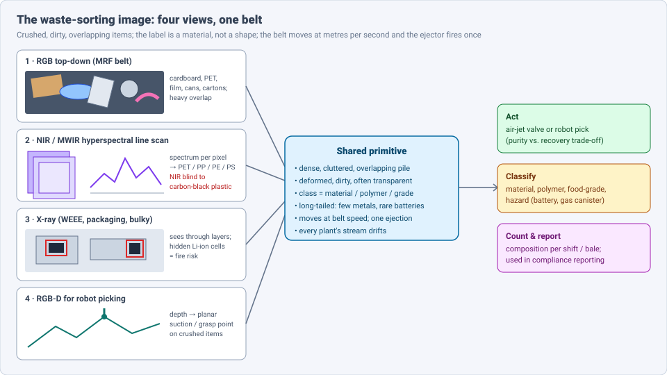
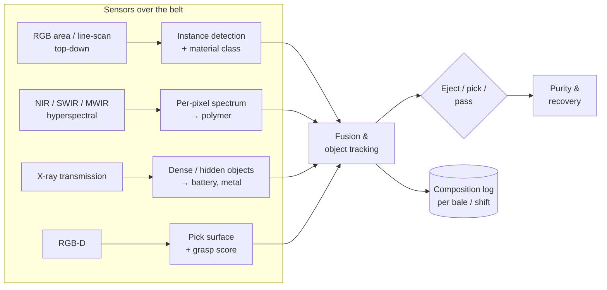
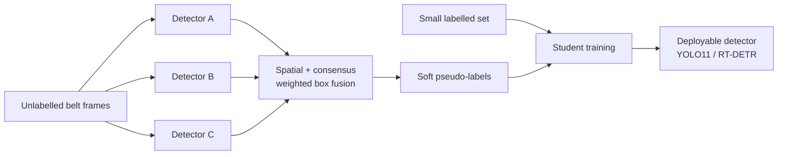
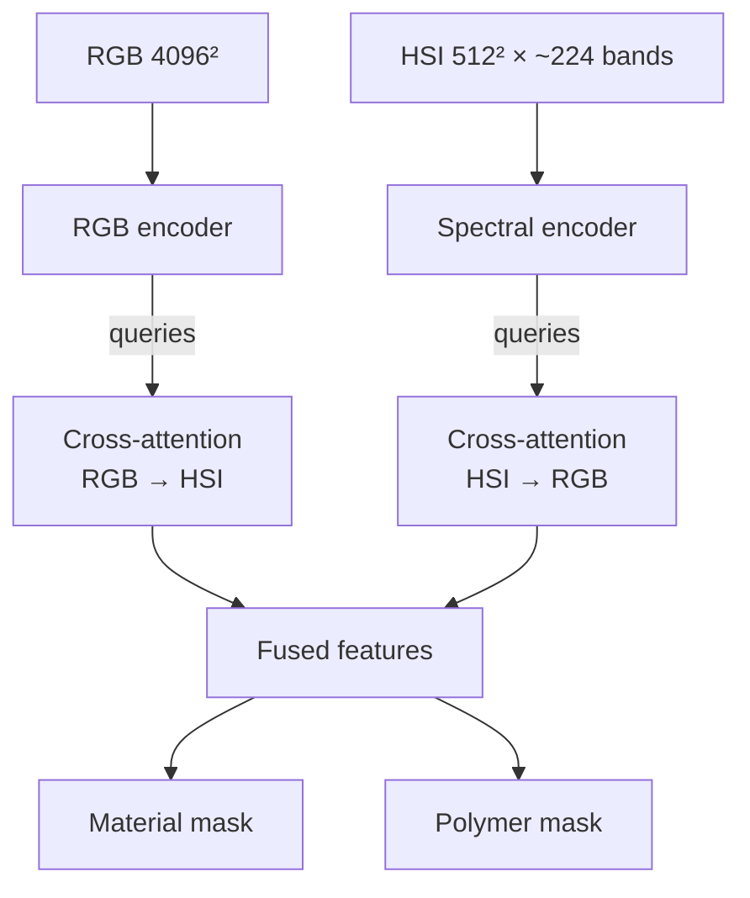
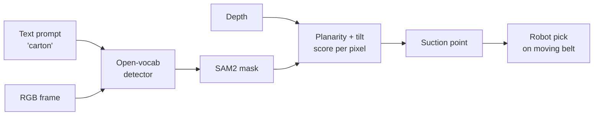

# Dense Object Detection & Classification — Recent Advances

*Compiled 2026-Oct-31 (America/Los_Angeles).*

Next installment in the running CV-updates log. Earlier entries:
[Apr-30](../2026-Apr-30/2026-Apr-30_CV_updates.md),
[May-01](../2026-May-01/2026-May-01_CV_updates.md),
[May-02](../2026-May-02/2026-May-02_CV_updates.md),
[May-04](../2026-May-04/2026-May-04_CV_updates.md),
[May-05](../2026-May-05/2026-May-05_CV_updates.md),
[May-07](../2026-May-07/2026-May-07_CV_updates.md),
[May-08](../2026-May-08/2026-May-08_CV_updates.md),
[May-15](../2026-May-15/2026-May-15_CV_updates.md),
[May-16](../2026-May-16/2026-May-16_CV_updates.md),
[May-17](../2026-May-17/2026-May-17_CV_updates.md),
[Jun-09](../2026-Jun-09/2026-Jun-09_CV_updates.md),
[Jun-10](../2026-Jun-10/2026-Jun-10_CV_updates.md),
[Jun-12](../2026-Jun-12/2026-Jun-12_CV_updates.md),
[Jun-15](../2026-Jun-15/2026-Jun-15_CV_updates.md),
[Jun-16](../2026-Jun-16/2026-Jun-16_CV_updates.md),
[Jun-17](../2026-Jun-17/2026-Jun-17_CV_updates.md),
[Jun-19](../2026-Jun-19/2026-Jun-19_CV_updates.md),
[Jun-21](../2026-Jun-21/2026-Jun-21_CV_updates.md),
[Jun-22](../2026-Jun-22/2026-Jun-22_CV_updates.md),
[Jun-23](../2026-Jun-23/2026-Jun-23_CV_updates.md),
[Jun-24](../2026-Jun-24/2026-Jun-24_CV_updates.md),
[Jun-25](../2026-Jun-25/2026-Jun-25_CV_updates.md),
[Jun-27](../2026-Jun-27/2026-Jun-27_CV_updates.md),
[Jun-29](../2026-Jun-29/2026-Jun-29_CV_updates.md),
[Jun-30](../2026-Jun-30/2026-Jun-30_CV_updates.md),
[Jul-04](../2026-Jul-04/2026-Jul-04_CV_updates.md),
[Jul-07](../2026-Jul-07/2026-Jul-07_CV_updates.md),
[Jul-08](../2026-Jul-08/2026-Jul-08_CV_updates.md),
[Jul-10](../2026-Jul-10/2026-Jul-10_CV_updates.md),
[Jul-15](../2026-Jul-15/2026-Jul-15_CV_updates.md),
[Jul-17](../2026-Jul-17/2026-Jul-17_CV_updates.md),
[Jul-18](../2026-Jul-18/2026-Jul-18_CV_updates.md),
[Jul-21](../2026-Jul-21/2026-Jul-21_CV_updates.md),
[Jul-22](../2026-Jul-22/2026-Jul-22_CV_updates.md),
[Jul-24](../2026-Jul-24/2026-Jul-24_CV_updates.md),
[Jul-26](../2026-Jul-26/2026-Jul-26_CV_updates.md),
[Jul-27](../2026-Jul-27/2026-Jul-27_CV_updates.md),
[Jul-30](../2026-Jul-30/2026-Jul-30_CV_updates.md),
[Aug-01](../2026-Aug-01/2026-Aug-01_CV_updates.md),
[Aug-02](../2026-Aug-02/2026-Aug-02_CV_updates.md),
[Aug-04](../2026-Aug-04/2026-Aug-04_CV_updates.md),
[Aug-07](../2026-Aug-07/2026-Aug-07_CV_updates.md),
[Aug-10](../2026-Aug-10/2026-Aug-10_CV_updates.md),
[Aug-11](../2026-Aug-11/2026-Aug-11_CV_updates.md),
[Aug-13](../2026-Aug-13/2026-Aug-13_CV_updates.md),
[Aug-15](../2026-Aug-15/2026-Aug-15_CV_updates.md),
[Aug-16](../2026-Aug-16/2026-Aug-16_CV_updates.md),
[Aug-18](../2026-Aug-18/2026-Aug-18_CV_updates.md),
[Aug-19](../2026-Aug-19/2026-Aug-19_CV_updates.md),
[Aug-21](../2026-Aug-21/2026-Aug-21_CV_updates.md),
[Aug-22](../2026-Aug-22/2026-Aug-22_CV_updates.md),
[Aug-24](../2026-Aug-24/2026-Aug-24_CV_updates.md),
[Aug-26](../2026-Aug-26/2026-Aug-26_CV_updates.md),
[Aug-29](../2026-Aug-29/2026-Aug-29_CV_updates.md),
[Sep-01](../2026-Sep-01/2026-Sep-01_CV_updates.md),
[Sep-20](../2026-Sep-20/2026-Sep-20_CV_updates.md),
[Sep-23](../2026-Sep-23/2026-Sep-23_CV_updates.md),
[Sep-24](../2026-Sep-24/2026-Sep-24_CV_updates.md),
[Sep-25](../2026-Sep-25/2026-Sep-25_CV_updates.md),
[Sep-26](../2026-Sep-26/2026-Sep-26_CV_updates.md),
[Sep-29](../2026-Sep-29/2026-Sep-29_CV_updates.md),
[Sep-30](../2026-Sep-30/2026-Sep-30_CV_updates.md),
[Oct-01](../2026-Oct-01/2026-Oct-01_CV_updates.md),
[Oct-02](../2026-Oct-02/2026-Oct-02_CV_updates.md),
[Oct-03](../2026-Oct-03/2026-Oct-03_CV_updates.md),
[Oct-04](../2026-Oct-04/2026-Oct-04_CV_updates.md),
[Oct-05](../2026-Oct-05/2026-Oct-05_CV_updates.md),
[Oct-06](../2026-Oct-06/2026-Oct-06_CV_updates.md),
[Oct-07](../2026-Oct-07/2026-Oct-07_CV_updates.md),
[Oct-08](../2026-Oct-08/2026-Oct-08_CV_updates.md),
[Oct-09](../2026-Oct-09/2026-Oct-09_CV_updates.md),
[Oct-10](../2026-Oct-10/2026-Oct-10_CV_updates.md),
[Oct-11](../2026-Oct-11/2026-Oct-11_CV_updates.md),
[Oct-12](../2026-Oct-12/2026-Oct-12_CV_updates.md),
[Oct-13](../2026-Oct-13/2026-Oct-13_CV_updates.md),
[Oct-14](../2026-Oct-14/2026-Oct-14_CV_updates.md),
[Oct-15](../2026-Oct-15/2026-Oct-15_CV_updates.md),
[Oct-16](../2026-Oct-16/2026-Oct-16_CV_updates.md),
[Oct-17](../2026-Oct-17/2026-Oct-17_CV_updates.md),
[Oct-18](../2026-Oct-18/2026-Oct-18_CV_updates.md),
[Oct-19](../2026-Oct-19/2026-Oct-19_CV_updates.md),
[Oct-20](../2026-Oct-20/2026-Oct-20_CV_updates.md),
[Oct-21](../2026-Oct-21/2026-Oct-21_CV_updates.md),
[Oct-22](../2026-Oct-22/2026-Oct-22_CV_updates.md),
[Oct-23](../2026-Oct-23/2026-Oct-23_CV_updates.md),
[Oct-24](../2026-Oct-24/2026-Oct-24_CV_updates.md),
[Oct-25](../2026-Oct-25/2026-Oct-25_CV_updates.md),
[Oct-26](../2026-Oct-26/2026-Oct-26_CV_updates.md),
[Oct-27](../2026-Oct-27/2026-Oct-27_CV_updates.md),
[Oct-28](../2026-Oct-28/2026-Oct-28_CV_updates.md),
[Oct-29](../2026-Oct-29/2026-Oct-29_CV_updates.md),
[Oct-30](../2026-Oct-30/2026-Oct-30_CV_updates.md).

The last four entries covered
[wood & timber](../2026-Oct-27/2026-Oct-27_CV_updates.md),
[tire](../2026-Oct-28/2026-Oct-28_CV_updates.md),
[metal powder-bed fusion](../2026-Oct-29/2026-Oct-29_CV_updates.md) and
[food-processing](../2026-Oct-30/2026-Oct-30_CV_updates.md)
inspection. Those all inspect a product on its way *in*. This run follows
products on the way *out*: the **waste-sorting image**, meaning the camera
over a material recovery facility (MRF) conveyor, the NIR/MWIR
hyperspectral line scanner that reads polymers, the X-ray scanner that
hunts hidden batteries, and the RGB-D view a picking robot uses.

---

## Table of contents

1. [Why this pass](#1--why-this-pass)
2. [The primitive: four views, one belt](#2--the-primitive-four-views-one-belt)
3. [RGB detection on the MRF belt](#3--rgb-detection-on-the-mrf-belt)
4. [Reading the material: RGB + hyperspectral fusion](#4--reading-the-material-rgb--hyperspectral-fusion)
5. [Black plastics, metals and the MWIR / LIBS route](#5--black-plastics-metals-and-the-mwir--libs-route)
6. [X-ray for hidden batteries](#6--x-ray-for-hidden-batteries)
7. [From detection to picking](#7--from-detection-to-picking)
8. [Deployed systems](#8--deployed-systems)
9. [Open problems / what to watch](#9--open-problems--what-to-watch)
10. [Sources](#10--sources)

---

## 1 · Why this pass

Waste sorting has not had its own entry. The archive mentions it once,
as one bullet in the
[hyperspectral entry](../2026-Jul-21/2026-Jul-21_CV_updates.md) (NIR
polymer discrimination), and once as a steel-scrap reference in the
[steel strip entry](../2026-Oct-22/2026-Oct-22_CV_updates.md). Searching
for *ZeroWaste*, *SpectralWaste*, *MRF*, *black plastic* and *WEEE*
returns nothing else. Meanwhile the field gained a WACV 2026 workshop, a
new dense benchmark (SortWaste), two multimodal datasets (K3I-Cycling,
WoodVIT) and plant-scale X-ray battery detectors.

What makes it a distinct primitive:

- **Class is material, not shape.** A crushed PET bottle and a crushed PP
  tub look alike; a black PP part and a black ABS part look identical in
  RGB *and* in NIR. The label lives in the spectrum, so detectors that
  are excellent on COCO under-perform
  ([ZeroWaste, arXiv 2106.02740](https://arxiv.org/abs/2106.02740)).
- **Maximum clutter.** Objects are piled, crushed, wet and translucent.
  SortWaste introduces a *ClutterScore* precisely because mAP falls as
  piles get denser
  ([Inácio et al., WACV-W 2026](https://arxiv.org/abs/2601.02299)).
- **Long tail with a lethal tail.** Most items are paper and cardboard;
  a few are lithium batteries, which cause plant fires
  ([GRINNER, Recovery](https://www.recovery-worldwide.com/en/news/new-eu-funded-project-aims-to-prevent-fires-caused-by-batteries-at-e-waste-recycling-facilities-3880783.html)).
- **Detection triggers a physical action.** The output fires an air
  valve or moves a robot, so a box must be localised for ejection or a
  grasp point, not just classified.
- **The stream drifts.** Packaging, seasons and municipalities change the
  mix. The VisDA 2022 challenge showed that this is a domain-adaptation
  problem, and that synthetic data did not close the gap
  ([VisDA 2022, arXiv 2303.14828](https://arxiv.org/abs/2303.14828)).

---

## 2 · The primitive: four views, one belt

**Public data, by what it keeps:**

| Dataset | View | What it is | Caveat |
|---|---|---|---|
| ZeroWaste ([Bashkirova et al., CVPR 2022](https://arxiv.org/abs/2106.02740)) | RGB, single-stream paper line (MA, USA) | ~4,600 labelled frames, ~27k instances, 4 removable classes (soft plastic, rigid plastic, cardboard, metal) + unlabelled and before/after splits | one plant, one line; paper is background |
| SortWaste ([Inácio et al., WACV-W 2026](https://arxiv.org/abs/2601.02299); [project](https://sortwaste.di.ubi.pt/)) | RGB, top-down, mechanical-biological treatment plant | 8 categories, densely boxed (author-reported ~87k boxes), COCO + YOLO formats, plastics-only subset, ClutterScore | image count not verified here |
| SpectralWaste ([Casao et al., IROS 2024](https://arxiv.org/abs/2403.18033); [Zenodo](https://doi.org/10.5281/zenodo.10880543)) | line-scan RGB + Specim FX17 HSI (224 bands, 900–1700 nm) | operational plastics/cartons/cans plant; HSI labels transferred from RGB | NIR range only |
| K3I-Cycling ([Funk et al., arXiv 2603.13941](https://arxiv.org/abs/2603.13941); [IOSB project](https://www.iosb.fraunhofer.de/en/projects-and-products/ki-optimierung-kunststoff-recycling-kreislauf.html)) | 4096² RGB + 512² FX17e HSI | 354 co-registered pairs, 4,855 instances; material (plastic, paper/cardboard, metal, other) and plastic-type labels | only the RGB subset is released so far |
| WoodVIT ([Bihler et al., Sci. Data 2026](https://doi.org/10.1038/s41597-026-07053-1); [RADAR](https://radar.kit.edu/radar/en/dataset/aj4ve1c03pkan0dr)) | RGB, NIR-HSI, thermal IR, THz + depth, registered | 56 bulky-waste scenes, 22,659 patches, wood vs. non-wood + 16 subclasses, concealed metals; CC BY 4.0 | ~325 GB processed |
| SDOOD / UDD ([Messai et al., arXiv 2509.01332](https://arxiv.org/abs/2509.01332); [code](https://github.com/o-messai/SDOOD)) | RGB, industrial recycling line | >10k images, ~120k small, dense instances | domain details not verified |
| CODD ([Mendeley](https://data.mendeley.com/datasets/wds85kt64j)) / CDW-Seg ([Sci. Data 12:885, 2025](https://hub.hku.hk/handle/10722/371361)) | RGB, construction & demolition waste | CODD: 3,129 images, 16,545 objects, 10 classes; CDW-Seg: skip bins on site | CDW, not packaging |
| TACO ([Proença & Simões, 2020](https://arxiv.org/abs/2003.06975)) | phone photos of litter | 1,500 images, 60 classes; used to augment ZeroWaste | not a conveyor |

---

## 3 · RGB detection on the MRF belt

**Where the baselines stand.** On ZeroWaste, Abid, Muhammad & Khan
(BMVC 2025) report:

| Setting | Model | mAP |
|---|---|---|
| Zero-shot, class-name prompts | OWLv2 / Grounding DINO | ≤ 7.3 |
| Zero-shot, LLM-optimised prompts | OWLv2 → 13.5, Grounding DINO → 12.4 | 12–14 |
| Fully supervised (fine-tuned transformer) | — | 51.6 |
| Semi-supervised, ensemble soft pseudo-labels | Grounding DINO Swin-B | 54.3 |

Pseudo-labels from the ensemble also lift YOLO11 by +6.3 and RT-DETR by
+4.3 mAP ([BMVC 2025](https://bmvc2025.bmva.org/proceedings/507/);
[arXiv 2508.18799](https://arxiv.org/abs/2508.18799);
[code](https://github.com/h-abid97/robust-waste-detection); figures from
indexed summaries).

**Reading.** Open-vocabulary detectors start almost blind here
(single-digit mAP), because "soft plastic" is a material concept that web
captions rarely ground. The useful role for foundation detectors in 2025–26
is as *teachers* for pseudo-labelling, not as the deployed model.

Other RGB results:

- **SortWaste (WACV-W 2026)** benchmarks detectors on a plastics-only task
  at 59.7% mAP and shows the drop as ClutterScore rises. The metric
  (object count, overlap) lets you report accuracy *per difficulty bin*,
  which is what an MRF manager actually needs
  ([arXiv 2601.02299](https://arxiv.org/abs/2601.02299);
  [supplement](https://openaccess.thecvf.com/content/WACV2026W/WasteVision/supplemental/Inacio_SortWaste_A_Densely_WACVW_2026_supplemental.pdf)).
- **Small, dense objects.** Messai et al. (Mines Saint-Étienne, Siléane,
  Orano) built a >10k-image, ~120k-instance set; YOLOv11-x reaches 62.8%
  mAP@0.5:0.95, and they pair it with an image-enhancement network
  ([arXiv 2509.01332](https://arxiv.org/abs/2509.01332); a 2026 journal
  version is titled "Small Object Detection in Industrial Recycling",
  [arXiv 2605.26884](https://arxiv.org/abs/2605.26884)).
- **SAM for waste masks.** Abou Baker & Handmann fine-tune only SAM's mask
  decoder and report ~30 IoU points over prior ZeroWaste and TACO
  baselines ([arXiv 2606.10696](https://arxiv.org/abs/2606.10696);
  an earlier version appeared at
  [ESANN 2023](https://www.esann.org/sites/default/files/proceedings/2023/ES2023-116.pdf)).
- **NAS for the edge.** TrashDet (Tran & Hu) uses neural architecture
  search for efficient waste detection at the WACV 2026 WasteVision
  workshop ([proceedings](https://openaccess.thecvf.com/WACV2026_workshops/WasteVision)).
- **The workshop itself.** WasteVision (WACV 2026, Tucson) mostly
  targets illegal dumping in surveillance video; its 2027 edition is
  announced ([WACV](https://wacv.thecvf.com/virtual/2026/workshop/42);
  [2027 site](https://mivia.unisa.it/wastevision2027/)). Street-level
  litter sets are growing next to it (StreetView-Waste,
  [arXiv 2511.16440](https://arxiv.org/abs/2511.16440); RoLID-11K,
  [arXiv 2601.00398](https://arxiv.org/abs/2601.00398); MDWD,
  [arXiv 2608.00257](https://arxiv.org/abs/2608.00257)). These are a
  different primitive (outdoor scenes) and are only noted here.

---

## 4 · Reading the material: RGB + hyperspectral fusion

RGB gives sharp shapes; HSI gives the polymer but at lower resolution
and from a line scanner. The 2025–26 work is about fusing them without
forcing both to the same grid.

- **BCAF (Funk et al., KIT / Fraunhofer IOSB, Mar 2026).** Bidirectional
  cross-attention between high-res RGB and low-res HSI; 62.3% mIoU for
  material and 66.2% mIoU for plastic type on K3I-Cycling
  ([arXiv 2603.13941](https://arxiv.org/abs/2603.13941)).
- **FusionSort (Ali & AlSuwaidi, Aug 2025).** Compares RGB, multispectral,
  HSI and RGB+HSI inputs on SpectralWaste-style data. It reports 67.26%
  mIoU on RGB vs. 44.5% (MiniNet-v2) and 48.4% (SegFormer-B0), but
  61.30% for fused RGB+HSI while calling fusion "best overall" — check
  the tables before quoting
  ([arXiv 2508.19798](https://arxiv.org/abs/2508.19798)).
- **Hybrid split pipelines.** A Yolact RGB branch for instance masks plus
  an SVM on NIR spectra per mask is a pragmatic pattern for household
  plastics ([EEP 2026](https://eep1987.com/en/wangluoshoufa/5943.html));
  the older SOLO-based RGB+HSI fusion explains why RGB alone fails on
  clear and light-blue PET on dark belts
  ([Sensors 22:7974](https://www.mdpi.com/1424-8220/22/20/7974)).
- **How many bands do you need?** For C&D waste, Vítek, Zbíral & Nežerka
  find that RGB plus two narrow bands (centres near 650–750 nm and
  850–1000 nm) suffices for high accuracy — a route to cheap filter
  cameras instead of full HSI
  ([Resour. Conserv. Recycl. 2025](https://doi.org/10.1016/j.resconrec.2025.108123);
  [arXiv 2501.02239](https://arxiv.org/abs/2501.02239)).
- **Beyond HSI.** WoodVIT registers RGB, NIR-HSI, thermal IR and THz;
  earlier work on the same rig reported 0.77 accuracy for THz alone and
  0.921 for multimodal fusion on wood vs. non-wood
  ([KIT](https://publikationen.bibliothek.kit.edu/1000191765)).

---

## 5 · Black plastics, metals and the MWIR / LIBS route

- **The black-plastic gap.** Carbon black absorbs across the visible and
  NIR (≈750–2500 nm), so NIR sorters cannot read black parts. Fraunhofer
  IOSB compare MWIR and NIR HSI with a CNN: MWIR wins on black plastics,
  NIR by ~7 points on coloured ones — so the answer is a hybrid line
  ([Fraunhofer publica](https://publica.fraunhofer.de/handle/publica/497261);
  [Plastics Recycling, Fall 2025](https://digitaledition.plasticsmachinerymagazine.com/article/HYPERSPECTRAL+EYES+ON+THE+PRIZE/5048143/853485/article.html)).
- **MWIR-4-Plastic** is described as the first public HSI dataset of
  shredded black plastics from end-of-life vehicles, four polymers, with
  nine methods benchmarked from chemometrics to deep learning; numbers
  were not retrievable in this run
  ([AI Understanding summary](https://aiunderstanding.org/news/paper-introduces-public-ai-benchmark-for-sorting-shredded-black-industrial-plastic)).
- **Industry.** Picvisa combines MWIR HSI with AI and sensor fusion for
  black plastics ([Recycling International](https://recyclinginternational.com/technology/technology-news/breaking-the-black-plastics-barrier-picvisas-advances-in-ai-driven-detection-and-sorting/63934/));
  Metaspectral runs spatial-spectral deep learning in real time at Merlin
  Plastics ([Plastics Recycling](https://digitaledition.plasticsmachinerymagazine.com/article/HYPERSPECTRAL+EYES+ON+THE+PRIZE/5048143/853485/article.html)).
- **Aluminium alloys.** Cameras separate aluminium from other materials but
  not alloy from alloy. LIBS spectra + RGB-D images fused by deep learning
  split cast vs. wrought scrap
  ([UPC](https://upcommons.upc.edu/entities/publication/90839f9b-8e1e-4297-8a29-efdae6bd9c7e));
  vendors now sell LIBS sorters for 5xxx vs. 6xxx
  ([Recycling Inside](https://recyclinginside.com/news/why-do-aluminum-recyclers-need-libs/)).
  The detector's job here shrinks to *where to fire the laser*.

---

## 6 · X-ray for hidden batteries

Lithium cells buried in e-waste or packaging start fires. RGB cannot see
them; X-ray transmission can.

| System | Approach | Status |
|---|---|---|
| WEEE battery sorter ([arXiv 2512.05599](https://arxiv.org/abs/2512.05599), Dec 2025) | X-ray images → YOLO detection + U-Net segmentation of battery-containing items → Delta robot | validated in Isaac Sim and on a real rig; authors say robust sorting across diverse WEEE types is still unsolved |
| GRINNER ([Recovery](https://www.recovery-worldwide.com/en/news/new-eu-funded-project-aims-to-prevent-fires-caused-by-batteries-at-e-waste-recycling-facilities-3880783.html)) | energy-resolved X-ray + AI → pick-and-place | EU Horizon; demo planned in Romania |
| DangerSort ([Fraunhofer IIS & Lobbe](https://www.recovery-worldwide.com/en/news/fraunhofer-iis-and-lobbe-develop-innovative-ai-x-ray-sorting-system-4330848.html)) | real-time AI on X-ray of packaging waste | operating at Lobbe, Iserlohn |
| WeSort.AI X.Sort ([letsrecycle](https://www.letsrecycle.com/news/kaizen-and-wesort-ai-partner-on-battery-fire-prevention-technology/)) | X-ray + AI through waste layers up to ~50 cm | commercial rollout with Kaizen Recycling |

**Reading.** This is the same anti-overlap problem covered in the
[X-ray transmission entry](../2026-Jul-15/2026-Jul-15_CV_updates.md),
with one twist: recall on a single rare class matters more than mAP.
No public benchmark with battery-recall at a fixed false-eject rate was
found.

---

## 7 · From detection to picking

Detection is half the job; the robot must pick a crushed, wet item from a
moving pile.

- **Training-free suction on deformed cartons (Aug 2026).** A zero-shot
  VLM finds targets from a text prompt, SAM2 refines masks, and a
  geometric score ranks suction points by local planarity and tilt. The
  authors note that ZeroWaste and TACO lack depth and grasp labels
  ([arXiv 2608.28246](https://arxiv.org/abs/2608.28246)).
- **GRAB benchmark (Feb 2026).** About 1,750 grasp attempts on
  contaminated food waste across four scenes and several industrial
  grasping modes; object properties dominate success, vision quality and
  clutter matter moderately, and multimodal grippers are recommended
  ([arXiv 2602.18835](https://arxiv.org/abs/2602.18835)).
- **E-waste disassembly.** SAM2 vs. YOLOv8 on irregular laptop
  components ([arXiv 2603.27441](https://arxiv.org/abs/2603.27441)) and
  robot-assisted phone disassembly
  ([RAISE, arXiv 2509.23048](https://arxiv.org/abs/2509.23048)).
- **C&D waste.** ReCoDeWaste provides RGB-D with >100k instances for
  instance segmentation and grasp detection (per
  [CDW-Seg listing](https://hub.hku.hk/handle/10722/371361)); a 2024
  survey maps the CDW vision field
  ([arXiv 2409.13112](https://arxiv.org/abs/2409.13112)).

---

## 8 · Deployed systems

Vendor figures, unaudited:

- **Greyparrot** (analytics, not sorting). Reported 250+ analyser units in
  65+ facilities; $27M Series B (Jul 2026); UK Environment Agency accepted
  its AI composition data for statutory reporting from Biffa and FCC in
  Q1 2026 ([Kurrant](https://kurrant.com/kurrantly-news/greyparrot-raises-27m-series-b-to-scale-ai-waste-sorting-platform/);
  [TAM Radar](https://www.tamradar.com/funding-rounds/greyparrot-series-b-27m)).
  If confirmed, this makes a detector's *count* a regulatory record —
  calibration, not just mAP, becomes the metric.
- **TOMRA GAINnext.** Deep learning on top of NIR/VIS to split
  food-grade from non-food PET, PP and HDPE; >95% purity claimed; >100
  units at launch ([TOMRA](https://www.tomra.com/waste-metal-recycling/media-center/news/2024/tomra-latest-deep-learning-innovation-food-grade-plastic-sorting-solution)).
- **AMP.** AI sortation in owned/operated plants (AMP ONE); acquired
  RDS Portsmouth operations (Sep 2025); operating a Waste Connections MRF
  in Colorado slated for early 2026
  ([Built In Colorado](https://www.builtincolorado.com/articles/amp-acquires-rds-portsmouth-20250924);
  [BusinessWire](https://www.businesswire.com/news/home/20241118648654/en/AMP-to-Operate-Waste-Connections-Recycling-Facility-with-AI-Powered-Sortation-Technology)).
- **Glacier, EverestLabs.** Robot pickers with 30+ material classes at
  ~45 picks/min (Glacier) and ≥80% can-pick accuracy at 60/min
  (EverestLabs, Fresno)
  ([CBS](https://www.cbsnews.com/sanfrancisco/news/glacier-recycling-robotics-ai-artificlal-intelligence-trash-waste/);
  [NBC](https://www.nbcboston.com/news/business/money-report/everestlabs-is-using-robotic-arms-and-ai-to-make-recycling-more-efficient/3108465/?amp=1)).

---

## 9 · Open problems / what to watch

1. **Public data is single-plant.** ZeroWaste, SortWaste and SpectralWaste
   each come from one facility. A multi-plant, multi-season split (like
   the Leave-One-Food-Out idea in the
   [food entry](../2026-Oct-30/2026-Oct-30_CV_updates.md)) does not exist.
2. **Clutter-aware metrics.** ClutterScore (§3) is a start; per-object
   purity/recovery at a fixed eject budget is what plants use.
3. **Open-vocabulary is weak on materials.** ≤ 14 mAP zero-shot on
   ZeroWaste (§3). Spectral or physics priors may help more than bigger
   text encoders.
4. **Fusion across resolutions and ranges.** RGB+NIR+MWIR (+X-ray) on one
   belt, with different scan geometries; BCAF-style cross-attention (§4)
   is the current template.
5. **Battery recall as a headline metric**, with a public X-ray benchmark (§6).
6. **Depth and grasp labels** for deformed items (§7).
7. **Counts as compliance data.** If regulators accept AI composition
   counts (§8), uncertainty and calibration of counts need reporting.
8. **Watch:** MWIR-4-Plastic numbers; K3I-Cycling HSI release; WasteVision
   2027 benchmark; Colorado MRF start-up; independent tests of AI sorter
   purity claims.

---

## 10 · Sources

### Datasets and benchmarks
- ZeroWaste, arXiv 2106.02740 — https://arxiv.org/abs/2106.02740
- VisDA 2022 industrial waste sorting challenge, arXiv 2303.14828 — https://arxiv.org/abs/2303.14828
- SortWaste (WACV-W 2026), arXiv 2601.02299 — https://arxiv.org/abs/2601.02299 — https://sortwaste.di.ubi.pt/ — https://openaccess.thecvf.com/content/WACV2026W/WasteVision/supplemental/Inacio_SortWaste_A_Densely_WACVW_2026_supplemental.pdf
- SpectralWaste (IROS 2024), arXiv 2403.18033 — https://arxiv.org/abs/2403.18033 — https://doi.org/10.5281/zenodo.10880543
- K3I-Cycling project (Fraunhofer IOSB) — https://www.iosb.fraunhofer.de/en/projects-and-products/ki-optimierung-kunststoff-recycling-kreislauf.html
- WoodVIT (Sci. Data 2026) — https://doi.org/10.1038/s41597-026-07053-1 — https://radar.kit.edu/radar/en/dataset/aj4ve1c03pkan0dr — https://publikationen.bibliothek.kit.edu/1000191765
- SDOOD / small dense objects in industrial recycling, arXiv 2509.01332 / 2605.26884 — https://arxiv.org/abs/2509.01332 — https://arxiv.org/abs/2605.26884 — https://github.com/o-messai/SDOOD
- CODD (Mendeley) — https://data.mendeley.com/datasets/wds85kt64j
- CDW-Seg (Sci. Data 12:885, 2025) — https://hub.hku.hk/handle/10722/371361
- TACO, arXiv 2003.06975 — https://arxiv.org/abs/2003.06975

### RGB detection (§3)
- Abid, Muhammad & Khan, Robust and Label-Efficient Deep Waste Detection (BMVC 2025) — https://bmvc2025.bmva.org/proceedings/507/ — https://arxiv.org/abs/2508.18799 — https://github.com/h-abid97/robust-waste-detection
- Abou Baker & Handmann, Don't waste SAM — https://arxiv.org/abs/2606.10696 — https://www.esann.org/sites/default/files/proceedings/2023/ES2023-116.pdf
- WACV 2026 WasteVision workshop — https://wacv.thecvf.com/virtual/2026/workshop/42 — https://openaccess.thecvf.com/WACV2026_workshops/WasteVision — https://mivia.unisa.it/wastevision2027/
- StreetView-Waste, arXiv 2511.16440 — https://arxiv.org/abs/2511.16440
- RoLID-11K, arXiv 2601.00398 — https://arxiv.org/abs/2601.00398
- MDWD, arXiv 2608.00257 — https://arxiv.org/abs/2608.00257

### Spectral fusion and materials (§4–5)
- BCAF, Funk et al., arXiv 2603.13941 — https://arxiv.org/abs/2603.13941
- FusionSort, arXiv 2508.19798 — https://arxiv.org/abs/2508.19798
- RGB+HSI SOLO fusion for plastic bottles (Sensors 22:7974) — https://www.mdpi.com/1424-8220/22/20/7974
- Yolact + NIR dual-branch (EEP 2026) — https://eep1987.com/en/wangluoshoufa/5943.html
- Vítek, Zbíral & Nežerka, narrowband filters for CDW (RCR 2025), arXiv 2501.02239 — https://doi.org/10.1016/j.resconrec.2025.108123 — https://arxiv.org/abs/2501.02239
- Fraunhofer IOSB, MWIR vs. NIR for black plastics — https://publica.fraunhofer.de/handle/publica/497261
- Plastics Recycling, "Hyperspectral eyes on the prize" (Fall 2025) — https://digitaledition.plasticsmachinerymagazine.com/article/HYPERSPECTRAL+EYES+ON+THE+PRIZE/5048143/853485/article.html
- MWIR-4-Plastic summary — https://aiunderstanding.org/news/paper-introduces-public-ai-benchmark-for-sorting-shredded-black-industrial-plastic
- Picvisa black plastics (Recycling International) — https://recyclinginternational.com/technology/technology-news/breaking-the-black-plastics-barrier-picvisas-advances-in-ai-driven-detection-and-sorting/63934/
- LIBS + RGB-D aluminium scrap sorting (UPC) — https://upcommons.upc.edu/entities/publication/90839f9b-8e1e-4297-8a29-efdae6bd9c7e
- Why aluminium recyclers need LIBS — https://recyclinginside.com/news/why-do-aluminum-recyclers-need-libs/

### X-ray and batteries (§6)
- WEEE battery sorting with X-ray + YOLO/U-Net, arXiv 2512.05599 — https://arxiv.org/abs/2512.05599
- GRINNER EU project — https://www.recovery-worldwide.com/en/news/new-eu-funded-project-aims-to-prevent-fires-caused-by-batteries-at-e-waste-recycling-facilities-3880783.html
- DangerSort, Fraunhofer IIS & Lobbe — https://www.recovery-worldwide.com/en/news/fraunhofer-iis-and-lobbe-develop-innovative-ai-x-ray-sorting-system-4330848.html
- Kaizen & WeSort.AI — https://www.letsrecycle.com/news/kaizen-and-wesort-ai-partner-on-battery-fire-prevention-technology/

### Picking (§7)
- Training-free suction grasp for deformed aseptic cartons, arXiv 2608.28246 — https://arxiv.org/abs/2608.28246
- GRAB grasping benchmark for food waste sorting, arXiv 2602.18835 — https://arxiv.org/abs/2602.18835
- SAM2 vs. YOLOv8 for e-waste disassembly, arXiv 2603.27441 — https://arxiv.org/abs/2603.27441
- RAISE phone disassembly, arXiv 2509.23048 — https://arxiv.org/abs/2509.23048
- CDW vision survey, arXiv 2409.13112 — https://arxiv.org/abs/2409.13112

### Deployed systems (§8)
- Greyparrot Series B (Kurrant; TAM Radar) — https://kurrant.com/kurrantly-news/greyparrot-raises-27m-series-b-to-scale-ai-waste-sorting-platform/ — https://www.tamradar.com/funding-rounds/greyparrot-series-b-27m
- TOMRA GAINnext food-grade sorting — https://www.tomra.com/waste-metal-recycling/media-center/news/2024/tomra-latest-deep-learning-innovation-food-grade-plastic-sorting-solution
- AMP acquires RDS Portsmouth — https://www.builtincolorado.com/articles/amp-acquires-rds-portsmouth-20250924
- AMP to operate Waste Connections facility — https://www.businesswire.com/news/home/20241118648654/en/AMP-to-Operate-Waste-Connections-Recycling-Facility-with-AI-Powered-Sortation-Technology
- Glacier (CBS) — https://www.cbsnews.com/sanfrancisco/news/glacier-recycling-robotics-ai-artificlal-intelligence-trash-waste/
- EverestLabs (NBC) — https://www.nbcboston.com/news/business/money-report/everestlabs-is-using-robotic-arms-and-ai-to-make-recycling-more-efficient/3108465/?amp=1

*Research note: arxiv.org could not be fetched from this run (DNS blocked
by the network policy), so paper figures come from search-indexed
abstracts, proceedings pages and third-party summaries. The SortWaste box
count is author-reported on social media; FusionSort's fusion claim is
internally inconsistent; MWIR-4-Plastic numbers and its arXiv ID were not
retrievable; Greyparrot and other vendor figures are unaudited.*
